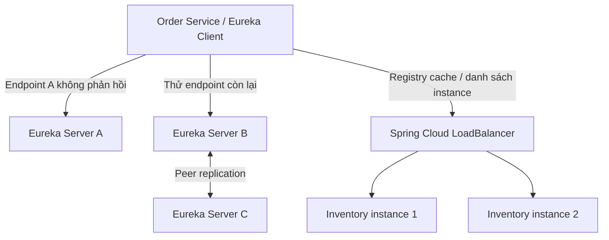
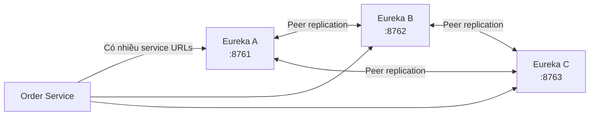
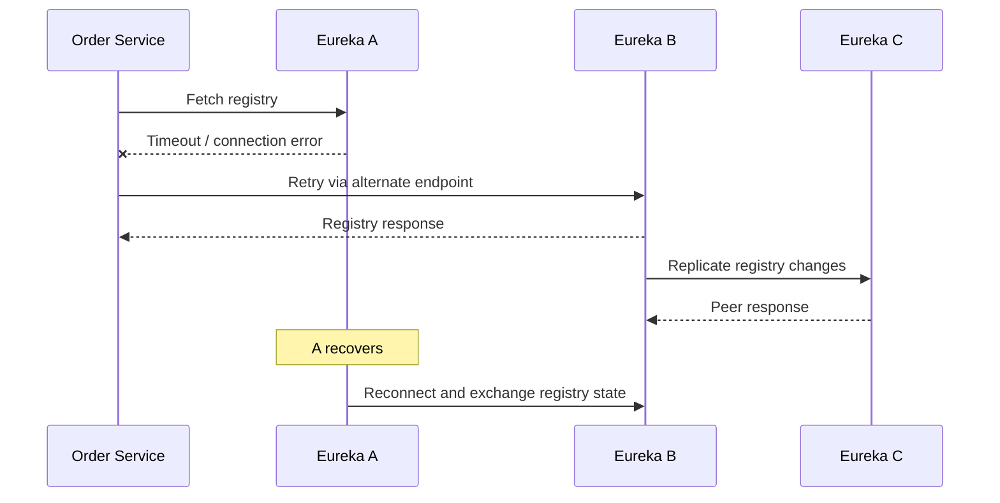

# Chuyển sang máy chủ khác khi một peer mất kết nối

Trong cụm Eureka, một server có thể tạm thời không truy cập được vì tiến trình dừng, mạng bị gián đoạn hoặc peer quá tải. Ứng dụng vẫn có thể tiếp tục đăng ký và tra cứu nếu nó biết các Eureka Server còn lại và Eureka Client có thể chuyển sang endpoint khác. Tuy nhiên, khả năng chuyển endpoint của client, việc các server peer sao chép registry và việc LoadBalancer chọn instance của service là ba cơ chế riêng biệt.

Để failover hoạt động, cần cấu hình nhiều địa chỉ Eureka Server ở cả phía ứng dụng client và phía các server peer. Các node còn sống phải tiếp tục phục vụ registry; peer replication cần được khôi phục khi kết nối trở lại; consumer cần xử lý dữ liệu registry cache có thể cũ trong thời gian gián đoạn.

## Ba lớp cần phân biệt

| Cơ chế | Thành phần thực hiện | Khi một peer lỗi thì điều gì xảy ra? |
|---|---|---|
| Eureka endpoint failover | Eureka Client trong ứng dụng | Client thử hoặc chọn một URL Eureka khác đã cấu hình khi endpoint hiện tại không truy cập được |
| Peer replication | Các Eureka Server | Các node còn kết nối tiếp tục trao đổi thay đổi registry; node bị cô lập có thể tạm thời có dữ liệu khác biệt |
| Service load balancing | Spring Cloud LoadBalancer | Chọn một instance của `inventory-service` hoặc service khác từ danh sách instance mà consumer đang có |

Ví dụ, `order-service` được cấu hình kết nối tới `eureka-a` và `eureka-b`. Nếu `eureka-a` dừng, Eureka Client có thể chuyển request registry sang `eureka-b`. Sau đó, LoadBalancer của `order-service` mới chọn một instance `inventory-service` từ registry mà client tải được.



LoadBalancer không tự chuyển Eureka Client từ server A sang server B. Nó chọn instance dịch vụ; Eureka Client chịu trách nhiệm giao tiếp với các endpoint registry.

## Cấu hình nhiều Eureka Server cho ứng dụng client

Ứng dụng client nên biết nhiều địa chỉ Eureka Server khả dụng thay vì chỉ biết một node. Với Spring Cloud Netflix, có thể khai báo danh sách URL trong `eureka.client.service-url.defaultZone`.

```yaml
spring:
  application:
    name: order-service

eureka:
  client:
    register-with-eureka: true
    fetch-registry: true
    service-url:
      defaultZone: "http://eureka-a:8761/eureka/,http://eureka-b:8762/eureka/,http://eureka-c:8763/eureka/"
```

Trong ví dụ này:

- `register-with-eureka: true` cho phép `order-service` đăng ký instance của chính nó.
- `fetch-registry: true` cho phép client tải danh sách application và instance.
- `defaultZone` chứa nhiều endpoint để client có lựa chọn khác khi một server không truy cập được.
- Các hostname phải phân giải được từ môi trường chạy `order-service`; port và context path phải khớp với từng Eureka Server.

`defaultZone` là tên khóa cấu hình đặc biệt trong map `service-url`; giữ đúng cách viết này trong YAML. Danh sách URL thường được phân tách bằng dấu phẩy. Thứ tự lựa chọn, retry và thời gian chuyển endpoint phụ thuộc phiên bản Eureka Client cùng cấu hình timeout/retry, vì vậy không nên giả định failover xảy ra tức thì hoặc luôn theo thứ tự cố định trong chuỗi.

Nếu ứng dụng chỉ là consumer, có thể đặt `register-with-eureka: false` và vẫn giữ `fetch-registry: true`. Điều đó không thay đổi nguyên tắc cấu hình nhiều endpoint.

## Cấu hình peer để các Eureka Server trao đổi registry

Khai báo nhiều URL cho ứng dụng client giúp client có thể tiếp cận server còn sống, nhưng chưa đủ để các registry độc lập tự đồng bộ với nhau. Nếu triển khai Eureka theo mô hình peer-aware, từng server cũng cần khai báo các peer còn lại trong `service-url.defaultZone`.

Ví dụ cụm ba node:

| Node đang chạy | Hostname / port | Peer URL được cấu hình |
|---|---|---|
| `eureka-a` | `eureka-a:8761` | `eureka-b:8762`, `eureka-c:8763` |
| `eureka-b` | `eureka-b:8762` | `eureka-a:8761`, `eureka-c:8763` |
| `eureka-c` | `eureka-c:8763` | `eureka-a:8761`, `eureka-b:8762` |

Ví dụ cấu hình node A:

```yaml
server:
  port: 8761

spring:
  application:
    name: eureka-server

eureka:
  instance:
    hostname: eureka-a
  client:
    register-with-eureka: true
    fetch-registry: true
    service-url:
      defaultZone: "http://eureka-b:8762/eureka/,http://eureka-c:8763/eureka/"
```

Node B và C dùng cùng cấu trúc, thay `hostname`, `port` và danh sách peer để mỗi node trỏ tới các node còn lại. Không đưa URL của chính node vào danh sách peer. Trong môi trường Docker hoặc Kubernetes, dùng DNS/service name có thể phân giải giữa các container hoặc pod; `localhost` chỉ trỏ về chính network namespace của tiến trình hiện tại.



Các node peer-aware thường bật cả `register-with-eureka` và `fetch-registry` để tham gia trao đổi registry. Hai thuộc tính này điều khiển Eureka Client bên trong từng server; chúng không thay thế cấu hình `defaultZone` chính xác và kết nối mạng giữa các peer.

## Điều gì xảy ra khi một peer mất kết nối?

Giả sử `eureka-a` dừng nhưng `eureka-b` và `eureka-c` vẫn hoạt động:

1. Client đang gửi request tới A có thể gặp timeout hoặc lỗi kết nối.
2. Eureka Client dùng các endpoint khác đã khai báo để retry hoặc chuyển request registry sang B/C theo cơ chế endpoint selection của phiên bản đang dùng.
3. Các client kết nối được B/C tiếp tục fetch registry từ node còn hoạt động và gửi heartbeat/registration qua endpoint khả dụng.
4. B/C tiếp tục phục vụ registry cục bộ và trao đổi thay đổi với nhau.
5. Khi A khởi động lại, nó cần kết nối lại peer và đồng bộ trạng thái theo cơ chế Eureka; hãy kiểm tra registry trên từng node thay vì giả định mọi dữ liệu đã hội tụ ngay lập tức.



Đây là luồng khái niệm. Thời gian retry, số lần thử và cách chọn endpoint cụ thể phụ thuộc Eureka Client version, HTTP transport, timeout và retry configuration.

## Failover không đồng nghĩa registry đồng bộ tức thời

Eureka peer replication là cơ chế trao đổi registry giữa các node, không phải một giao thức consensus có quorum như một số hệ thống lưu trữ phân tán khác. Khi peer bị cô lập mạng, các node còn lại có thể tiếp tục phục vụ client mà chúng kết nối được, nhưng trạng thái registry giữa các phía có thể tạm thời khác nhau.

Điều này tạo ra một số tình huống:

- Một provider đăng ký qua node B trong lúc A bị cô lập; A có thể chưa thấy bản ghi mới.
- Một instance bị dừng nhưng node đang giữ bản ghi chưa nhận được deregistration hoặc heartbeat timeout.
- Client chuyển sang C và nhận registry view khác với view trước đó ở A.
- Khi A hồi phục, quá trình trao đổi và đồng bộ cần thời gian; trong khoảng chuyển tiếp, các client khác nhau có thể nhìn thấy danh sách instance khác nhau.

Không nên xem cụm Eureka như một cụm có quorum bắt buộc phải còn đa số node mới hoạt động. Các node có thể tiếp tục phục vụ độc lập khi còn sống và truy cập được, nhưng mức độ mới và nhất quán của registry phụ thuộc kết nối peer, replication và cache.

## Client có thể dùng registry cache khi mọi peer tạm thời không truy cập được

Eureka Client giữ registry cục bộ sau những lần fetch thành công. Khi các endpoint registry tạm thời lỗi, client thường vẫn có thể giữ dữ liệu đã tải trước đó để phục vụ tra cứu trong bộ nhớ. Điều này giúp một số lời gọi nội bộ tiếp tục hoạt động trong thời gian gián đoạn.

Tuy nhiên, cache không thay thế registry đang hoạt động:

- Instance mới đăng ký sau lần fetch cuối có thể chưa xuất hiện trong cache.
- Instance đã chết có thể vẫn còn trong cache và tiếp tục được chọn cho request.
- Thay đổi metadata hoặc trạng thái health chưa chắc đã được consumer nhìn thấy.
- Nếu ứng dụng khởi động khi không có registry endpoint nào khả dụng, khả năng có cache hợp lệ để sử dụng phụ thuộc trạng thái khởi tạo và phiên bản client.

Vì vậy, cần coi cache là dữ liệu gần nhất đã biết, có thể cũ. Ứng dụng vẫn phải đặt timeout, xử lý lỗi kết nối, retry có giới hạn và circuit breaker khi phù hợp. Nếu Spring Cloud LoadBalancer có cache riêng, cần tính thêm TTL của cache đó vào thời gian dữ liệu cũ còn được sử dụng.

## Phân biệt server failover và service instance failover

| Tình huống | Cơ chế liên quan | Cách xử lý |
|---|---|---|
| Eureka A không truy cập được | Eureka Client endpoint failover | Client thử URL B/C đã cấu hình |
| Peer A mất kết nối với B | Peer replication | Khôi phục mạng và xác minh đồng bộ registry sau reconnect |
| `inventory-service` instance 1 chết | Service discovery + LoadBalancer | Registry cập nhật bản ghi; LoadBalancer chọn instance còn khả dụng sau khi danh sách được làm mới |
| Tất cả Eureka Server đều không truy cập được | Registry outage và local cache | Dùng dữ liệu gần nhất nếu có, đồng thời giới hạn lỗi và chờ registry phục hồi |
| Client chỉ cấu hình một URL Eureka và URL đó chết | Không có endpoint dự phòng phía client | Thêm các URL khả dụng hoặc dùng endpoint ổn định có health check |

Đừng nhầm việc chuyển sang một Eureka Server khác với việc chuyển request sang một provider instance khác. Đầu tiên là failover của control plane discovery; thứ hai là lựa chọn đích của request nghiệp vụ.

## Cấu hình timeout và retry có chủ đích

Failover không xảy ra ngay khi socket đầu tiên gặp lỗi nếu client còn phải đợi connect timeout hoặc read timeout. Tổng thời gian chuyển endpoint có thể bao gồm:

1. Thời gian chờ kết nối tới endpoint hiện tại.
2. Thời gian chờ response hoặc phát hiện lỗi đọc.
3. Backoff/retry theo cấu hình client.
4. Thời gian kết nối tới endpoint thay thế và nhận response.

Không nên đặt timeout quá dài vì request registry có thể bị chặn lâu khi peer đã chết. Cũng không nên đặt quá ngắn vì mạng chậm tạm thời có thể bị hiểu nhầm là peer hỏng. Hãy chọn timeout theo độ trễ mạng giữa các node, số lần retry và mục tiêu thời gian phục hồi.

Các nguyên tắc cấu hình:

- Khai báo đủ endpoint Eureka có thể truy cập từ từng ứng dụng.
- Bảo đảm các URL dùng đúng scheme, host, port, context path và thông tin xác thực.
- Đặt connect/read timeout và retry theo khả năng của phiên bản Eureka Client đang sử dụng.
- Tránh retry không giới hạn hoặc retry đồng thời dồn dập khi server vừa phục hồi.
- Theo dõi thời gian từ lần lỗi endpoint đầu tiên đến lần fetch/register thành công ở endpoint thay thế.

Không nên sao chép các tên property timeout từ một phiên bản Netflix Eureka khác mà chưa kiểm tra binding của Spring Cloud Netflix đang dùng. Tên và cách cấu hình transport có thể thay đổi giữa các release train.

## Dùng DNS hoặc load balancer trước Eureka Server

Một lựa chọn khác là cung cấp một DNS name hoặc virtual IP ổn định trỏ tới nhiều Eureka Server. Khi đó, lớp DNS/load balancer bên ngoài chịu trách nhiệm loại backend không khỏe và chuyển kết nối sang node còn sống.

| Cách kết nối | Ưu điểm | Điều cần quản lý |
|---|---|---|
| Client khai báo nhiều URL peer | Eureka Client biết trực tiếp các endpoint dự phòng | Danh sách URL, DNS từng peer, timeout và retry |
| Client gọi một DNS/VIP/load balancer | Endpoint ứng dụng ổn định, thay đổi backend tập trung | Health check, connection draining, TLS và cấu hình cân bằng tải |

Không nên chỉ tạo một DNS name trỏ ngẫu nhiên tới các server mà không có health check phù hợp. DNS cache hoặc load balancer có thể tiếp tục trả về backend đã chết nếu cấu hình kiểm tra sức khỏe và thời gian cập nhật không phù hợp. Nếu dùng TLS, certificate phải hợp lệ với hostname mà client gọi.

## Kiểm chứng failover trong môi trường thử nghiệm

Có thể kiểm thử với ba Eureka Server peer-aware và một service client:

1. Khởi động `eureka-a`, `eureka-b`, `eureka-c` với peer URL cấu hình hai chiều.
2. Khởi động `inventory-service` và `order-service`; cấu hình cả hai biết nhiều Eureka endpoint.
3. Xác nhận provider đăng ký và xuất hiện trên dashboard/API của các node.
4. Dừng `eureka-a` hoặc chặn kết nối từ client tới A.
5. Quan sát log của Eureka Client: lỗi kết nối, retry và request thành công tới B/C.
6. Gọi `DiscoveryClient.getInstances("inventory-service")` và kiểm tra danh sách trả về.
7. Gửi request qua HTTP client có `@LoadBalanced`; xác nhận LoadBalancer chọn instance provider hợp lệ.
8. Khởi động lại A, chờ peer kết nối lại và so sánh registry trên A/B/C.
9. Lặp lại với network partition giữa A và B trong khi cả hai tiến trình vẫn chạy.

Kết quả mong đợi:

- Khi một endpoint lỗi, client có URL thay thế có thể tiếp tục fetch hoặc đăng ký qua node còn truy cập được sau thời gian retry.
- Các peer còn kết nối vẫn phục vụ registry và trao đổi thay đổi với nhau.
- Khi peer phục hồi, registry dần hội tụ; cần quan sát và xác minh chứ không giả định cập nhật tức thì.
- Nếu mọi endpoint đều lỗi, ứng dụng có thể còn dữ liệu cache cũ nhưng không nhận được cập nhật mới.

## Quan sát và chẩn đoán

Khi kiểm tra failover, cần quan sát đồng thời client, server và provider:

- **Client log:** endpoint đang được gọi, lỗi DNS/connect/read timeout, retry và lần fetch/register thành công tiếp theo.
- **Peer log:** kết nối giữa các server, lỗi replication, thời điểm peer reconnect và cảnh báo registry không đồng nhất.
- **Registry view:** số application/instance trên dashboard hoặc REST API của từng node.
- **Consumer cache:** thời điểm registry fetch gần nhất, số instance hiện có và thời gian cache LoadBalancer được làm mới.
- **Request metrics:** tỷ lệ lỗi, latency, timeout và instance đích sau khi failover.

Có thể kiểm tra registry từng node bằng endpoint Eureka trong môi trường local:

```bash
curl -H "Accept: application/json" http://eureka-a:8761/eureka/apps
curl -H "Accept: application/json" http://eureka-b:8762/eureka/apps
curl -H "Accept: application/json" http://eureka-c:8763/eureka/apps
```

Các lệnh cần chạy từ môi trường có thể phân giải và truy cập các hostname đó. Nếu registry được bảo vệ bằng authentication hoặc TLS, bổ sung thông tin kết nối an toàn; không ghi credential vào shell history hoặc log.

## Lỗi thường gặp

| Triệu chứng | Nguyên nhân có thể | Cách xử lý |
|---|---|---|
| Client không chuyển sang peer khác | Chỉ cấu hình một URL hoặc các URL dự phòng không truy cập được | Khai báo nhiều endpoint và kiểm tra DNS/network từng endpoint |
| Client chuyển peer nhưng không thấy service mới | Registry view của peer chưa nhận replication | Kiểm tra peer URL, replication và thời gian hội tụ |
| Client vẫn gọi instance đã chết | Registry cache hoặc LoadBalancer cache còn cũ | Kiểm tra fetch interval, supplier cache và timeout/retry request |
| Hai server hiển thị registry khác nhau | Peer link bị gián đoạn hoặc replication chưa hoàn tất | Khôi phục kết nối và theo dõi quá trình đồng bộ sau reconnect |
| Failover mất quá nhiều thời gian | Connect/read timeout hoặc retry/backoff quá lớn | Đo từng khoảng chờ và điều chỉnh theo mạng thực tế |
| Client đăng ký không thành công sau failover | Endpoint thay thế sai URL, auth hoặc không nhận request | Kiểm tra context path, TLS, credential và log server |
| DNS vẫn trả node đã chết | DNS TTL hoặc health check của load balancer chưa cập nhật | Kiểm tra TTL, backend health và connection draining |
| Chỉ một phần client bị ảnh hưởng | Các client có danh sách endpoint hoặc cache khác nhau | So sánh cấu hình runtime, active profile và thời điểm fetch |

## Bảo mật khi cấu hình nhiều endpoint

Khi thêm nhiều Eureka URL, mỗi endpoint phải tuân theo cùng chính sách xác thực và mã hóa. Không để một URL dự phòng dùng HTTP không bảo vệ trong khi URL chính dùng HTTPS. Nếu peer yêu cầu Basic Auth hoặc cơ chế xác thực khác, bảo đảm credential được quản lý bằng secret store và không nhúng trực tiếp vào repository.

Giới hạn quyền truy cập dashboard và REST API Eureka vào mạng quản trị hoặc các workload được phép. Peer replication cần kết nối giữa các node, nhưng không có nghĩa mọi ứng dụng đều được phép truy cập endpoint quản trị. Theo dõi log và metrics mà không làm lộ credential hoặc thông tin nhạy cảm.

## Checklist triển khai

1. Triển khai ít nhất hai Eureka Server nếu cần chịu lỗi một node; xác định rõ các peer và hostname ổn định.
2. Cấu hình mỗi server trỏ tới các peer còn lại bằng `service-url.defaultZone`.
3. Với peer-aware server, bật `register-with-eureka` và `fetch-registry` theo topology đã chọn.
4. Cấu hình mỗi Eureka Client có nhiều endpoint server khả dụng hoặc một DNS/VIP có health check.
5. Xác nhận client có thể truy cập mọi endpoint từ đúng network namespace.
6. Đồng nhất context path, TLS, authentication và credential trên các endpoint.
7. Đặt timeout/retry phù hợp và tránh retry storm.
8. Theo dõi registry fetch, peer replication, registry size và LoadBalancer cache.
9. Kiểm thử node chết, peer partition, toàn bộ registry outage và phục hồi node.
10. Xác minh registry view hội tụ sau reconnect và request không còn chọn instance stale sau khi cache cập nhật.

## Kết luận

Muốn ứng dụng chuyển sang Eureka Server khác khi một peer mất kết nối, hãy cấu hình nhiều URL registry cho Eureka Client và cấu hình các server peer trao đổi registry với nhau. Client endpoint failover giúp ứng dụng tiếp cận node còn sống; peer replication giúp các registry cập nhật trạng thái; LoadBalancer chọn instance dịch vụ từ dữ liệu discovery mà consumer đang có. Ba lớp này có độ trễ và giới hạn riêng. Hãy kiểm thử cả node failure lẫn network partition, quan sát cache và replication, đồng thời cấu hình timeout, retry, DNS và bảo mật cho mọi endpoint.
