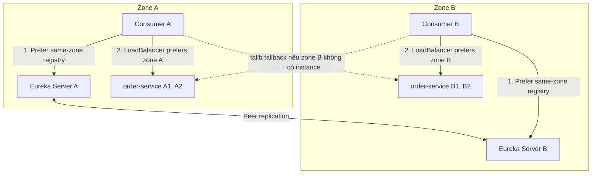

# Khám phá ưu tiên cùng vùng và phạm vi của cơ chế cân bằng tải

Trong hệ thống triển khai nhiều vùng khả dụng (availability zone), các instance của cùng một service có thể nằm ở nhiều vùng khác nhau. Một consumer ở `zone-a` thường nên gọi instance ở `zone-a` trước để giảm độ trễ và lưu lượng liên vùng. Khi vùng cục bộ không còn instance phù hợp, hệ thống có thể cần chuyển sang vùng khác để tiếp tục phục vụ.

Eureka và Spring Cloud hỗ trợ tính locality này ở hai lớp riêng biệt: Eureka Client có thể ưu tiên kết nối tới Eureka Server cùng zone để lấy registry; Spring Cloud LoadBalancer có thể ưu tiên chọn service instance cùng zone cho từng lời gọi. Hai cơ chế thường được dùng cùng nhau nhưng có phạm vi và cấu hình khác nhau. Bài học này làm rõ region, zone, cách khai báo metadata, cấu hình LoadBalancer và giới hạn của chiến lược ưu tiên cùng vùng.

## 1. Region và availability zone

Một **region** là khu vực triển khai lớn, bên trong có thể có nhiều **availability zone** độc lập về hạ tầng. Ví dụ:

```text
Region: ap-southeast-1
  zone-a
    Eureka Server A
    order-service instance A1, A2
    payment-service instance A1
  zone-b
    Eureka Server B
    order-service instance B1, B2
    payment-service instance B1
```

Trong ví dụ, các instance cùng cung cấp `order-service`, nhưng được đặt ở hai zone. Consumer trong `zone-a` có thể ưu tiên `order-service` ở `zone-a`; consumer trong `zone-b` có thể ưu tiên các instance ở `zone-b`.

Các tên `region`, `zone-a`, `zone-b` chỉ là ví dụ. Tên zone phải nhất quán giữa cấu hình client, metadata instance và hạ tầng triển khai. Eureka không tự suy ra mọi thông tin topology từ tên service; ứng dụng hoặc môi trường triển khai cần cung cấp thông tin vùng phù hợp.

## 2. Hai lớp ưu tiên cùng zone cần phân biệt

Có hai quyết định khác nhau trong luồng discovery:

1. **Eureka Client chọn Eureka Server nào để kết nối:** `eureka.client.prefer-same-zone-eureka` giúp client ưu tiên server registry trong cùng zone. Mục tiêu là giảm độ trễ khi đăng ký, gửi heartbeat và lấy registry.
2. **LoadBalancer chọn service instance nào để gọi:** `ZonePreferenceServiceInstanceListSupplier` lọc danh sách instance để ưu tiên những instance có metadata `zone` trùng với zone của consumer.

Sơ đồ tổng thể:



`prefer-same-zone-eureka` không phải thuật toán chọn `order-service` instance. Ngược lại, zone preference của LoadBalancer không quyết định Eureka Client sẽ lấy registry từ server peer nào. Cần cấu hình đúng cả hai lớp nếu muốn vừa truy cập registry gần, vừa gọi service gần.

## 3. Khai báo zone cho Eureka Client và Eureka Server

### 3.1. Gắn zone vào metadata của instance

Mỗi ứng dụng đăng ký vào Eureka nên khai báo zone của chính nó trong metadata:

```yaml
spring:
  application:
    name: order-service

eureka:
  instance:
    metadata-map:
      zone: ${APP_ZONE:zone-a}
```

Eureka lưu metadata này cùng registration và cung cấp cho client khi client lấy registry. Các instance trong `zone-a` khai báo `APP_ZONE=zone-a`; instance trong `zone-b` khai báo `APP_ZONE=zone-b`.

Metadata là dữ liệu mô tả. Chỉ thêm `metadata-map.zone` chưa tự bật lọc zone cho mọi lời gọi; LoadBalancer cần được cấu hình zone preference như phần sau. Nếu dùng registry khác Eureka, cần khai báo `spring.cloud.loadbalancer.zone` hoặc cơ chế tương ứng để xác định zone của consumer.

### 3.2. Khai báo region, availability zones và Eureka Server URL

Eureka Client có thể được cấu hình để biết region và các zone trong region đó. Ví dụ cho hai zone:

```yaml
eureka:
  client:
    region: ap-southeast-1
    availability-zones:
      ap-southeast-1:
        - zone-a
        - zone-b
    service-url:
      zone-a: http://eureka-zone-a:8761/eureka/
      zone-b: http://eureka-zone-b:8761/eureka/
    prefer-same-zone-eureka: true
  instance:
    metadata-map:
      zone: ${APP_ZONE:zone-a}
```

Ý nghĩa:

- `eureka.client.region` xác định region mà client thuộc về. Giá trị mặc định tương thích Netflix thường là `us-east-1`; nên khai báo rõ region thật trong hệ thống nhiều vùng.
- `availability-zones` ánh xạ region sang danh sách zone của region đó.
- `service-url` ánh xạ tên zone sang URL Eureka Server có thể truy cập tại zone tương ứng.
- `prefer-same-zone-eureka: true` yêu cầu client ưu tiên Eureka Server cùng zone khi chọn endpoint registry.
- `metadata-map.zone` mô tả zone của chính service instance.

Trong ví dụ, cùng một cấu hình có thể được dùng làm nền; profile hoặc biến môi trường của từng deployment đặt `APP_ZONE` thành `zone-a` hoặc `zone-b`. Hãy bảo đảm URL peer tương ứng thật sự tồn tại và có thể truy cập từ client.

### 3.3. Eureka Server phải đồng bộ giữa các zone

Nếu triển khai Eureka Server ở nhiều zone, các server cần được cấu hình peer-aware để trao đổi registration. Client ở zone A có thể lấy registry từ server A, trong khi consumer ở zone B lấy registry từ server B. Nếu hai server không đồng bộ, mỗi zone có thể nhìn thấy tập instance khác nhau.

Ví dụ cấu hình peer rút gọn cho hai server:

```yaml
# Eureka Server A
eureka:
  client:
    service-url:
      defaultZone: http://eureka-zone-b:8761/eureka/
```

```yaml
# Eureka Server B
eureka:
  client:
    service-url:
      defaultZone: http://eureka-zone-a:8761/eureka/
```

Trong production, cấu hình đủ peer theo topology và kiểm tra kết nối hai chiều. Mỗi Eureka Server có registry/cache riêng; peer replication giúp chúng trao đổi trạng thái đăng ký. Ưu tiên cùng zone không thay thế peer replication và cũng không tự tạo tính sẵn sàng cao nếu zone chỉ có một server.

## 4. Cấu hình ưu tiên Eureka Server cùng zone

Thuộc tính:

```yaml
eureka:
  client:
    prefer-same-zone-eureka: true
```

Thuộc tính này điều khiển cách Eureka Client ưu tiên các Eureka Server endpoint trong zone của nó. Mặc định hiện đại thường là `true`; vẫn nên kiểm tra cấu hình của release train đang dùng.

Đây là lựa chọn endpoint registry. Nó giúp client giảm lưu lượng liên vùng khi giao tiếp với Eureka, nhưng không bảo đảm mọi service request sẽ tới instance cùng zone. Muốn ưu tiên instance ứng dụng cùng zone, cần thêm zone-aware LoadBalancer.

Nếu không có Eureka Server khả dụng trong zone cục bộ, client có thể phải sử dụng endpoint khác theo danh sách zone và URL được cấu hình. Vì vậy, hãy khai báo URL fallback hợp lệ và kiểm tra behavior khi một server hoặc cả zone mất kết nối.

## 5. Ưu tiên service instance cùng zone bằng Spring Cloud LoadBalancer

Spring Cloud LoadBalancer cung cấp `ZonePreferenceServiceInstanceListSupplier`. Supplier này nhận danh sách `ServiceInstance` từ DiscoveryClient rồi lọc theo metadata `zone`:

- Nếu xác định được zone của consumer và có instance cùng zone, supplier trả danh sách instance cùng zone.
- Nếu zone của consumer không xác định được, supplier trả danh sách ban đầu.
- Nếu không có instance nào cùng zone, supplier fallback về toàn bộ danh sách instance đã tìm được.

Như vậy, zone preference là **ưu tiên có fallback**, không phải chính sách cô lập cứng. Khi zone cục bộ không có instance, request vẫn có thể được gửi sang zone khác.

### 5.1. Cấu hình zone của consumer

Với Eureka Discovery Client, Spring Cloud có thể lấy zone của consumer từ `eureka.instance.metadata-map.zone` và dùng giá trị đó cho LoadBalancer. Có thể ghi đè trực tiếp bằng:

```yaml
spring:
  cloud:
    loadbalancer:
      zone: zone-a
```

Nếu không có zone từ metadata hoặc property, Spring Cloud Netflix có thể suy đoán theo cấu hình `eureka.client.availability-zones` của region. Tùy chọn `spring.cloud.loadbalancer.eureka.approximate-zone-from-hostname` cho phép dùng domain trong hostname làm gợi ý zone; mặc định thường tắt. Không nên phụ thuộc vào suy đoán hostname nếu hạ tầng có thể cung cấp zone rõ ràng.

Với Consul hoặc discovery implementation khác, hãy đặt `spring.cloud.loadbalancer.zone` nếu implementation không tự cung cấp zone cho LoadBalancer.

### 5.2. Bật ZonePreferenceServiceInstanceListSupplier

Thêm starter LoadBalancer nếu dependency hiện tại chưa cung cấp:

```xml
<dependency>
    <groupId>org.springframework.cloud</groupId>
    <artifactId>spring-cloud-starter-loadbalancer</artifactId>
</dependency>
```

Tạo cấu hình riêng cho service cần zone preference:

```java
import org.springframework.cloud.loadbalancer.core.ServiceInstanceListSupplier;
import org.springframework.context.ConfigurableApplicationContext;
import org.springframework.context.annotation.Bean;

public class OrderServiceLoadBalancerConfiguration {

    @Bean
    ServiceInstanceListSupplier orderServiceInstanceListSupplier(
            ConfigurableApplicationContext context) {
        return ServiceInstanceListSupplier.builder()
                .withDiscoveryClient()
                .withZonePreference()
                .build(context);
    }
}
```

Gắn cấu hình này với service ID:

```java
import org.springframework.cloud.loadbalancer.annotation.LoadBalancerClient;
import org.springframework.boot.autoconfigure.SpringBootApplication;

@SpringBootApplication
@LoadBalancerClient(
        name = "order-service",
        configuration = OrderServiceLoadBalancerConfiguration.class
)
public class OrderConsumerApplication {
    // main method
}
```

Lớp `OrderServiceLoadBalancerConfiguration` nên nằm ngoài phạm vi component scan của ứng dụng hoặc không đánh dấu `@Configuration`, để bean tùy chỉnh chỉ áp dụng cho LoadBalancer context của service được chỉ định. Cách tổ chức supplier và caching cần phù hợp với phiên bản Spring Cloud đang dùng. Eureka Discovery Client đã cache registry; không bật thêm cache LoadBalancer nếu điều đó tạo hai lớp cache và làm dữ liệu cũ kéo dài. Nếu implementation discovery của bạn không cache và cần cache ở LoadBalancer, có thể thêm `.withCaching()` ngay sau `.withDiscoveryClient()` và trước `.withZonePreference()`.

### 5.3. Gọi service bằng logical name

Ví dụ với `RestTemplate` có `@LoadBalanced`:

```java
@Bean
@LoadBalanced
RestTemplate restTemplate() {
    return new RestTemplate();
}

public String getOrders() {
    return restTemplate.getForObject(
            "http://order-service/api/orders",
            String.class
    );
}
```

Luồng xử lý:

1. Ứng dụng gửi request tới logical service ID `order-service`.
2. DiscoveryClient lấy các instance mà Eureka client đang biết.
3. Zone preference lọc instance cùng zone nếu có.
4. LoadBalancer chọn một instance trong danh sách còn lại, ví dụ bằng round-robin.
5. HTTP client gửi request tới host/port của instance được chọn.

Thuật toán round-robin hoặc thuật toán LoadBalancer đang cấu hình chỉ chọn trong danh sách supplier trả về. Zone preference quyết định tập ứng viên; LoadBalancer quyết định instance cụ thể trong tập đó.

## 6. Ví dụ hoạt động và fallback

Giả sử consumer chạy ở `zone-a` và registry có:

| Service instance | Metadata zone | Trạng thái |
| --- | --- | --- |
| `order-a1` | `zone-a` | UP |
| `order-a2` | `zone-a` | UP |
| `order-b1` | `zone-b` | UP |
| `order-b2` | `zone-b` | UP |

Với zone preference được bật, danh sách ứng viên ban đầu của consumer ở `zone-a` chỉ còn `order-a1` và `order-a2`. Nếu cả hai instance ở `zone-a` đều không có trong danh sách khả dụng, supplier trả lại `order-b1` và `order-b2` để LoadBalancer tiếp tục chọn.

| Tình huống | Danh sách supplier trả về cho consumer `zone-a` |
| --- | --- |
| Có instance `zone-a` và `zone-b` | Chỉ các instance `zone-a` |
| Không còn instance `zone-a`, còn instance `zone-b` | Tất cả instance còn lại ở `zone-b` |
| Consumer không xác định được zone | Danh sách instance ban đầu ở mọi zone |
| Registry không trả instance nào | Danh sách rỗng; LoadBalancer không có instance để gọi |

Fallback giúp hệ thống tiếp tục phục vụ khi một zone gặp sự cố, nhưng có thể tăng độ trễ, lưu lượng liên vùng và chi phí truyền dữ liệu. Nếu yêu cầu nghiệp vụ bắt buộc không gọi chéo zone, cần thiết kế chính sách fail-closed riêng và chấp nhận request thất bại khi zone cục bộ không còn instance.

## 7. Phạm vi của cơ chế cân bằng tải

Spring Cloud LoadBalancer là cơ chế **client-side**. Mỗi ứng dụng gọi service có LoadBalancer context riêng theo service ID. Cấu hình zone preference trong một consumer không tự thay đổi cách các consumer khác chọn instance.

Zone preference chỉ áp dụng cho lời gọi đi qua LoadBalancer, chẳng hạn `@LoadBalanced RestTemplate`, `RestClient` hoặc WebClient tích hợp LoadBalancer. Những lời gọi dùng URL cố định, HTTP client không tích hợp LoadBalancer, hoặc request đi qua một load balancer bên ngoài không tự động chịu ảnh hưởng của cấu hình này.

| Thành phần | Phạm vi trách nhiệm |
| --- | --- |
| Eureka Server | Lưu registry và trao đổi registration giữa các peer. |
| Eureka Client / DiscoveryClient | Lấy registry và cung cấp danh sách `ServiceInstance` cho ứng dụng. |
| `prefer-same-zone-eureka` | Ưu tiên Eureka Server endpoint cùng zone để client giao tiếp với registry. |
| `ZonePreferenceServiceInstanceListSupplier` | Lọc danh sách service instance theo zone của consumer và fallback khi không có instance cùng zone. |
| Spring Cloud LoadBalancer | Chọn một instance trong danh sách ứng viên và điều phối request của consumer. |
| Network / ingress / external load balancer | Định tuyến lưu lượng theo cấu hình mạng hoặc hạ tầng bên ngoài; không tự động chịu tác động từ client-side zone preference. |

Do đó, không nên kết luận rằng bật `prefer-same-zone-eureka` sẽ tự động phân phối request ứng dụng cùng zone. Cũng không nên cho rằng zone preference của một service sẽ thay đổi cách cân bằng tải của toàn bộ hệ thống.

## 8. Kiểm tra cấu hình locality

Khi triển khai nhiều zone, hãy xác minh lần lượt:

1. Mỗi service instance đăng ký đúng `spring.application.name` và metadata `zone`.
2. Consumer có zone chính xác qua metadata hoặc `spring.cloud.loadbalancer.zone`.
3. Eureka Client biết đúng `region`, danh sách `availability-zones` và URL Eureka Server của từng zone.
4. Eureka Server trong các zone là peer và có thể trao đổi registry.
5. `prefer-same-zone-eureka` được bật nếu muốn ưu tiên endpoint registry cùng zone.
6. `ZonePreferenceServiceInstanceListSupplier` đã được cấu hình cho service ID cần áp dụng.
7. Lời gọi thực tế đi qua Spring Cloud LoadBalancer thay vì URL cố định.
8. Có kế hoạch fallback khi zone cục bộ không còn instance và theo dõi lưu lượng liên vùng.

Có thể kiểm tra metadata bằng cách gọi `DiscoveryClient`:

```java
discoveryClient.getInstances("order-service")
        .forEach(instance -> System.out.printf(
                "host=%s port=%d zone=%s%n",
                instance.getHost(),
                instance.getPort(),
                instance.getMetadata().get("zone")
        ));
```

Kết quả giúp xác nhận registry có trả metadata zone hay không. Để xác minh lựa chọn cuối cùng, bật log phù hợp cho Spring Cloud LoadBalancer và kiểm tra host/port nhận request ở từng instance. Thử nghiệm fallback bằng cách tạm thời loại các instance cùng zone khỏi danh sách khả dụng trong môi trường kiểm thử.

## 9. Lỗi thường gặp

| Hiện tượng | Nguyên nhân có thể | Hướng xử lý |
| --- | --- | --- |
| Consumer ở `zone-a` vẫn gọi instance `zone-b` dù `zone-a` có instance | Zone preference supplier chưa được cấu hình, consumer không nhận zone hoặc metadata sai key | Kiểm tra `ZonePreferenceServiceInstanceListSupplier`, `spring.cloud.loadbalancer.zone` và metadata key `zone`. |
| Không thấy instance cùng zone trong registry | Service đăng ký sai `metadata-map.zone` hoặc Eureka server peer chưa đồng bộ | Kiểm tra metadata registration và peer replication giữa Eureka Server. |
| Mọi instance đều được trả về | Zone consumer là `null`, không có supplier zone preference hoặc không có instance trùng zone | Xác minh zone của consumer và cấu hình supplier; nếu không có instance local, trả toàn bộ là fallback dự kiến. |
| Consumer không kết nối được Eureka Server cùng zone | Sai URL zone, DNS, firewall hoặc server cùng zone không hoạt động | Kiểm tra `service-url`, `availability-zones` và khả năng truy cập peer. |
| Đã bật `prefer-same-zone-eureka` nhưng request service vẫn liên vùng | Thuộc tính này chỉ chọn Eureka Server, không chọn service instance | Cấu hình thêm Spring Cloud LoadBalancer zone preference. |
| Sau khi tắt instance local, request không fallback | Supplier hoặc custom policy đang lọc cứng, hoặc registry chưa cập nhật danh sách | Kiểm tra supplier chain, cache, health status và chính sách fallback. |
| Kết quả zone thay đổi chậm sau deploy | Eureka registry và LoadBalancer có cache, cập nhật không tức thời | Kiểm tra fetch interval, cache TTL và peer replication; điều chỉnh có kiểm soát. |

## 10. Nguyên tắc thiết kế production

- Dùng cùng quy ước tên zone trên metadata, cấu hình client và hạ tầng.
- Đặt Eureka Server tại các zone cần phục vụ và cấu hình peer replication.
- Ưu tiên registry cùng zone để giảm latency giữa client và Eureka Server.
- Dùng zone preference của LoadBalancer nếu muốn ưu tiên service instance cùng zone.
- Giữ fallback liên vùng nếu yêu cầu availability cao; đo latency và chi phí khi fallback xảy ra.
- Không dùng zone metadata như cơ chế bảo mật hoặc ranh giới truy cập. Phân vùng bảo mật vẫn cần network policy, authentication và authorization.
- Theo dõi tỷ lệ request cùng zone và khác zone, lỗi gọi instance, số instance healthy theo từng zone và trạng thái peer.
- Kiểm thử mất một instance, mất cả zone và mất kết nối giữa các Eureka peer trước khi triển khai production.

## 11. Ghi nhớ

- Region chứa nhiều availability zone; zone metadata cần được khai báo nhất quán cho từng instance.
- `eureka.client.prefer-same-zone-eureka` ưu tiên Eureka Server cùng zone cho giao tiếp registry.
- `eureka.instance.metadata-map.zone` cung cấp zone của instance; Spring Cloud Netflix có thể dùng metadata này để xác định zone của consumer cho LoadBalancer.
- `ZonePreferenceServiceInstanceListSupplier` lọc service instance cùng zone; nếu zone không xác định hoặc không có instance cùng zone, supplier trả lại danh sách rộng hơn.
- Zone preference chỉ tác động tới request đi qua Spring Cloud LoadBalancer và chỉ trong phạm vi consumer/service được cấu hình.
- Muốn locality hoạt động đúng, cần cả metadata zone, registry peer replication, supplier zone-aware và fallback được kiểm thử.

## Tài liệu tham khảo

- [Spring Cloud Netflix: Zones và Eureka với Spring Cloud LoadBalancer](https://docs.spring.io/spring-cloud-netflix/reference/spring-cloud-netflix.html)
- [Spring Cloud Commons: Zone-Based Load-Balancing](https://docs.spring.io/spring-cloud-commons/reference/spring-cloud-commons/loadbalancer.html)
