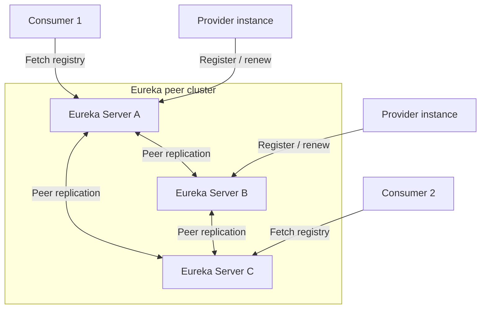
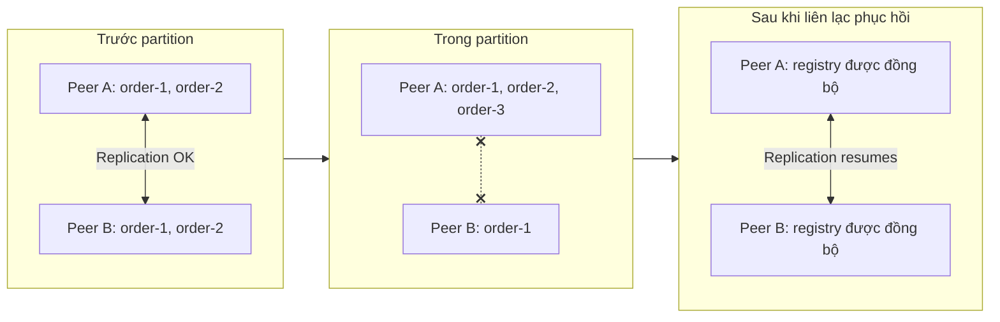

# Phân vùng mạng, dữ liệu lệch giữa peer và quá trình hội tụ

Một cụm Eureka thường có nhiều Eureka Server peer để tăng khả năng sẵn sàng. Các peer trao đổi thông tin đăng ký để provider và consumer có thể kết nối tới những server khác nhau mà vẫn khám phá được các service. Tuy nhiên, peer replication phụ thuộc vào mạng. Khi liên kết giữa các server bị gián đoạn, mỗi peer có thể tạm thời giữ một góc nhìn khác nhau về registry.

Hiện tượng này được gọi là dữ liệu lệch giữa peer (*registry divergence*). Một peer có thể đã nhận instance mới trong khi peer khác chưa biết; một peer có thể còn giữ registration cũ sau khi instance đã dừng; hoặc các consumer truy vấn hai peer khác nhau và nhận danh sách instance khác nhau. Khi mạng phục hồi, replication có thể truyền các thay đổi còn thiếu và trạng thái registry dần hội tụ, nhưng không nên coi việc kết nối mạng trở lại là bằng chứng duy nhất rằng mọi dữ liệu đã đồng nhất.

Bài học thuộc chương `Cụm Eureka` trong module `SPRING_CLOUD_SERVICE_DISCOVERY`. Module giúp người học hiểu cơ chế tìm instance theo tên dịch vụ qua `DiscoveryClient`, `ServiceRegistry`, Eureka hoặc Consul, vòng đời đăng ký, health check, load balancing, bảo mật và xử lý sai lệch registry. Bài này tập trung vào phân vùng mạng giữa các peer Eureka, nguyên nhân dữ liệu lệch, tác động của self-preservation và cách xác minh quá trình hội tụ sau sự cố.

## 1. Peer trong cụm Eureka làm gì?

Một Eureka Server có thể hoạt động độc lập hoặc tham gia cụm nhiều server. Trong cụm peer-aware, mỗi server biết các peer khác qua cấu hình service URL. Provider đăng ký instance vào một server; server phối hợp trao đổi các thay đổi registry với peer theo cơ chế replication của Eureka.

Consumer cũng có thể kết nối tới một trong các server trong cụm để lấy danh sách application và instance. Tùy cấu hình client, consumer có thể có nhiều URL Eureka để dự phòng hoặc cân bằng việc truy cập.



Các peer không phải một database duy nhất được nhiều server cùng đọc ghi đồng bộ theo một giao dịch. Mỗi server duy trì trạng thái registry của mình và trao đổi các thay đổi với peer. Vì vậy, cần phân biệt:

- **Peer replication:** truyền thông tin đăng ký và thay đổi giữa các Eureka Server.
- **Client registry fetch:** Eureka client tải snapshot hoặc delta từ một server để cập nhật cache cục bộ.
- **Client heartbeat:** provider renew lease để server biết client còn hoạt động.
- **Load balancing:** consumer hoặc Spring Cloud LoadBalancer chọn instance cho request sau khi có danh sách khám phá.

Đây là các luồng riêng. Peer replication khỏe không tự bảo đảm client đã refresh; client refresh thành công cũng không chứng minh mọi peer đã có cùng dữ liệu.

## 2. Network partition là gì?

Network partition xảy ra khi một phần node không thể trao đổi dữ liệu với phần còn lại, dù các node vẫn có thể đang chạy. Trong cụm Eureka, cần xác định chính xác liên kết nào bị đứt vì mỗi loại partition tạo ra triệu chứng khác nhau.

### 2.1. Partition giữa các Eureka Server peer

Ví dụ server A không thể kết nối tới B và C, trong khi B và C vẫn liên lạc được với nhau. Server A có thể tiếp tục phục vụ các client đang kết nối tới nó, nhưng các thay đổi tại A không được truyền tới nhóm B/C trong thời gian partition.

### 2.2. Partition giữa provider và Eureka Server

Provider vẫn chạy nhưng không gửi được registration hoặc heartbeat tới server. Registry có thể tiếp tục giữ bản ghi cũ trong một khoảng thời gian; sau đó lease expiration và eviction có thể xử lý tùy cấu hình và trạng thái self-preservation.

### 2.3. Partition giữa consumer và Eureka Server

Consumer không thể tải registry mới. Nếu client đã có cache, ứng dụng có thể tiếp tục khám phá từ snapshot gần nhất tùy implementation; dữ liệu đó có thể đã cũ. Nếu client mới khởi động và chưa có snapshot, khả năng khám phá có thể bị ảnh hưởng rõ hơn.

### 2.4. Partition giữa consumer và provider

Consumer vẫn nhìn thấy instance trong registry nhưng không thể kết nối tới host/port của instance do route, firewall, DNS hoặc network policy. Đây là lỗi data plane; registry có thể hoàn toàn bình thường.

| Liên kết bị lỗi | Triệu chứng thường gặp | Tầng cần điều tra đầu tiên |
|---|---|---|
| Peer ↔ peer | Dashboard hoặc REST API trên các peer hiển thị registry khác nhau. | Peer URL, DNS, port, TLS, log replication. |
| Provider ↔ server | Instance không đăng ký mới hoặc heartbeat bị thiếu. | Log provider, endpoint server, lease và network path. |
| Consumer ↔ server | Cache discovery không được cập nhật. | `defaultZone`, client refresh, timeout và cache. |
| Consumer ↔ provider | Discovery có instance nhưng request thất bại. | Host/port, route, firewall, TLS và health endpoint. |

## 3. Vì sao dữ liệu giữa các peer bị lệch?

Giả sử một cụm có hai peer A và B. Trước sự cố, cả hai đều biết `ORDER-SERVICE` có instance `order-1` và `order-2`. Khi mạng giữa A và B bị ngắt:

- Provider mới đăng ký `order-3` qua A. Peer A biết instance này, B chưa nhận được thay đổi.
- `order-2` dừng và provider gửi deregistration tới B. Peer B xử lý thay đổi cục bộ, A chưa biết.
- Consumer đọc từ A và B có thể nhận hai danh sách khác nhau.



Các nguyên nhân thường gặp gồm:

1. **Peer không liên lạc được:** DNS sai, port bị chặn, route mất, TLS hoặc authentication không khớp.
2. **Replication bị lỗi hoặc chậm:** request trao đổi thay đổi thất bại, retry chưa thành công hoặc server quá tải.
3. **Client gửi thao tác tới các peer khác nhau:** provider và consumer không nhất thiết dùng cùng một peer tại mọi thời điểm.
4. **Response cache chưa được cập nhật:** dữ liệu API trả về có thể chậm hơn registry nội bộ sau khi thay đổi.
5. **Heartbeat bị gián đoạn:** peer có thể giữ trạng thái cũ vì không nhận được renewal hoặc không đủ điều kiện eviction.
6. **Instance ID không duy nhất:** hai process có thể vô tình đăng ký cùng một định danh, khiến các cập nhật khó đối chiếu và có thể tác động lên cùng một registration.

## 4. Eureka không dùng peer replication như một giao dịch consensus

Khi thiết kế cụm, không nên hiểu peer replication của Eureka như một cơ chế đồng thuận quorum bảo đảm mọi server cùng commit một thay đổi trước khi trả lời provider. Eureka hướng tới khả năng phục vụ trong hệ thống discovery và trao đổi các thay đổi giữa peer; trong khoảng thời gian mạng bị phân vùng, các peer có thể tạm thời có góc nhìn khác nhau.

Điều này có nghĩa:

- Một peer có thể nhận và phục vụ registration cục bộ dù không liên lạc được với peer khác.
- Consumer kết nối tới các peer khác nhau có thể nhận snapshot khác nhau.
- Không nên giả định mọi thay đổi đồng thời trên hai phía partition sẽ được hợp nhất theo một quy tắc nghiệp vụ mà ứng dụng có thể dựa vào.
- Khi mạng phục hồi, cần xác minh replication đã chạy lại và các peer thực sự nhìn thấy cùng tập registration.

Eureka không phải nguồn dữ liệu giao dịch mạnh cho nghiệp vụ. Không dùng registry để lưu trạng thái đơn hàng, số dư hoặc dữ liệu cần consistency chặt. Registry phục vụ định vị instance; request nghiệp vụ vẫn cần timeout, retry có giới hạn và kiểm tra trạng thái ở endpoint đích.

## 5. Vai trò và giới hạn của self-preservation

Eureka Server theo dõi heartbeat/renewal từ client. Nếu số renewal giảm bất thường, nguyên nhân có thể là nhiều instance chết cùng lúc hoặc mạng giữa client và server bị gián đoạn. Cơ chế self-preservation giúp hạn chế việc xóa hàng loạt registration khi Eureka nghi ngờ có sự cố mạng diện rộng.

Self-preservation bảo vệ dữ liệu khỏi eviction quá sớm trong một số tình huống, nhưng có hệ quả là bản ghi cũ có thể tiếp tục tồn tại lâu hơn. Ví dụ, provider đã chết nhưng peer vẫn giữ registration vì số heartbeat giảm trên diện rộng khiến server kích hoạt chế độ bảo vệ.

| Cơ chế | Vai trò | Giới hạn |
|---|---|---|
| Heartbeat/renewal | Cho biết client tiếp tục duy trì lease. | Mất heartbeat có thể do process chết hoặc do mạng lỗi. |
| Lease expiration/eviction | Loại bỏ registration không còn được renew theo chính sách. | Thời gian phát hiện không tức thời; có thể bị ảnh hưởng bởi self-preservation. |
| Self-preservation | Hạn chế eviction hàng loạt khi renewal giảm bất thường. | Có thể giữ stale registration lâu hơn. |
| Peer replication | Lan truyền thay đổi registry giữa các server. | Không loại bỏ mọi độ trễ hoặc sai lệch trong partition. |

Self-preservation không sửa được mạng, không bảo đảm peer hội tụ và không xác minh endpoint nghiệp vụ. Không nên tắt cơ chế này chỉ để xóa nhanh instance cũ trên Dashboard. Trước tiên cần xác định heartbeat giảm do provider chết hay do đường mạng bị lỗi.

## 6. Ví dụ cấu hình peer và các điểm cần kiểm tra

Trong một cụm hai node, mỗi server thường công bố địa chỉ peer còn lại trong `eureka.client.service-url.defaultZone`. Ví dụ minh họa:

```yaml
# Eureka Server A
server:
  port: 8761

eureka:
  instance:
    hostname: eureka-a.internal
  client:
    register-with-eureka: true
    fetch-registry: true
    service-url:
      defaultZone: http://eureka-b.internal:8762/eureka/
```

```yaml
# Eureka Server B
server:
  port: 8762

eureka:
  instance:
    hostname: eureka-b.internal
  client:
    register-with-eureka: true
    fetch-registry: true
    service-url:
      defaultZone: http://eureka-a.internal:8761/eureka/
```

Đây là cấu hình minh họa cho hai peer, cần điều chỉnh hostname, port, TLS, authentication và profile theo môi trường thực tế. Với cụm nhiều peer, mỗi server cần biết các peer phù hợp theo topology. Cũng cần cấu hình địa chỉ công bố mà các peer khác thực sự truy cập được; hostname chỉ phân giải trong một container sẽ không hữu ích với node ở mạng khác.

Khi kiểm tra cấu hình peer, xác minh:

- `eureka.instance.hostname` phản ánh địa chỉ có thể phân giải từ các peer.
- `eureka.client.service-url.defaultZone` trỏ tới peer đúng, không trỏ nhầm `localhost` trong môi trường container hoặc nhiều máy.
- Các cổng Eureka Server và đường dẫn `/eureka/` được mở theo network policy.
- TLS certificate, truststore và authentication tương thích giữa các peer nếu được bật.
- Server không vô tình dùng cấu hình standalone `register-with-eureka: false` và `fetch-registry: false` trong khi cần tham gia peer cluster.
- Mỗi node có log và metric riêng để phân biệt lỗi cục bộ với lỗi toàn cụm.

## 7. Split-brain và hai phía cùng nhận thay đổi

Split-brain trong bối cảnh này mô tả tình huống các nhóm peer bị tách thành các phía không liên lạc được nhưng mỗi phía vẫn đang hoạt động. Các provider có thể tiếp tục đăng ký hoặc renew với peer gần chúng. Vì vậy, mỗi phía có thể có các thay đổi cục bộ mà phía kia chưa biết.

Ví dụ:

| Sự kiện | Phía A | Phía B |
|---|---|---|
| Trước partition | `catalog-1=UP`, `catalog-2=UP` | `catalog-1=UP`, `catalog-2=UP` |
| Trong partition | Thêm `catalog-3=UP` | Đánh dấu `catalog-2` không phục vụ hoặc mất renewal |
| Consumer truy vấn | Nhìn thấy `catalog-1`, `catalog-2`, `catalog-3` | Có thể chỉ nhìn thấy `catalog-1`, `catalog-2` hoặc trạng thái khác tùy dữ liệu local |
| Sau khi mạng phục hồi | Nhận các thay đổi replication còn thiếu | Nhận các thay đổi replication còn thiếu |

Nếu cùng một service instance bị đăng ký từ hai process với cùng instance ID nhưng địa chỉ hoặc trạng thái khác nhau, việc điều tra càng khó. Hãy tạo instance ID ổn định cho một process trong vòng đời của nó nhưng duy nhất giữa các process đang chạy. Không tái sử dụng cùng ID cho nhiều replica đồng thời.

Không nên giả định một phía partition luôn đúng. Hãy xác định nguồn sự kiện: process nào còn chạy, provider nào đã gửi heartbeat, server nào nhận registration và thời điểm thay đổi. Registry chỉ là bản ghi khám phá; trạng thái thực tế của process và endpoint cần được kiểm tra độc lập.

## 8. Quá trình hội tụ sau khi mạng phục hồi

Khi kết nối giữa peer được khôi phục, replication có thể tiếp tục truyền các thay đổi mà peer cần biết. Các server dần cập nhật registry local và consumer có thể nhận danh sách đồng nhất hơn sau những lần fetch tiếp theo.

Hội tụ không nhất thiết xảy ra ngay tại thời điểm TCP connection được mở lại. Có thể còn độ trễ do:

- Peer cần thiết lập lại kết nối và xử lý các request replication đang chờ hoặc retry.
- Registration và status phải được truyền lại hoặc cập nhật.
- Heartbeat tiếp tục renew lease sau khi provider kết nối lại.
- Lease cũ cần hết hạn hoặc eviction được thực hiện theo chính sách.
- Response cache trên server cần được cập nhật.
- Client cần tới chu kỳ refresh registry tiếp theo để nhận dữ liệu mới.
- LoadBalancer có thể có cache/supplier riêng cần được refresh.

```mermaid
sequenceDiagram
    participant A as Eureka peer A
    participant B as Eureka peer B
    participant C as Consumer client

    Note over A,B: Mạng bị partition; registry có thể khác nhau
    A->>A: Nhận registration X
    B->>B: Giữ snapshot cũ hoặc nhận thay đổi Y
    Note over A,B: Kết nối peer được khôi phục
    A->>B: Peer replication tiếp tục
    B->>A: Peer replication tiếp tục
    Note over A,B: Các peer cập nhật registry local
    C->>A: Registry fetch
    A-->>C: Snapshot/delta mới
    C->>C: Cập nhật local cache
```

Đây là mô hình khái niệm, không phải lịch trình đồng bộ có thời hạn cố định. Thời gian hội tụ phụ thuộc topology, tình trạng server, số lượng registration, cấu hình refresh, retry và mức độ kéo dài của sự cố.

### 8.1. Điều kiện để hội tụ ổn định

- Các peer có thể kết nối hai chiều theo topology đã cấu hình.
- DNS, hostname, port, TLS và authentication đã được sửa đúng.
- Không còn lỗi replication kéo dài hoặc server quá tải.
- Provider còn hoạt động gửi renewal hoặc đã deregister đúng cách.
- Các registration trùng instance ID được xử lý và không tiếp tục phát sinh.
- Client đã refresh lại dữ liệu sau khi peer đồng bộ.
- Response cache và LoadBalancer cache không tiếp tục cung cấp snapshot quá cũ.

### 8.2. Khi nào không thể tự hội tụ?

Nếu peer URL sai, firewall tiếp tục chặn, credential hết hạn, một server liên tục restart hoặc hai node không còn cùng topology, replication sẽ tiếp tục thất bại. Trong trường hợp đó, không nên chờ vô thời hạn hoặc giả định Eureka tự sửa mọi dữ liệu. Cần xử lý nguyên nhân nền, xác minh từng peer và áp dụng quy trình phục hồi có kiểm soát.

## 9. Quy trình điều tra khi hai peer hiển thị dữ liệu khác nhau

Thực hiện theo trình tự để xác định sai lệch nằm ở peer, client hay provider:

1. **Ghi nhận cùng một thời điểm:** chụp hoặc lưu kết quả Dashboard/REST API của từng peer, kèm timestamp, application name và instance ID.
2. **So sánh cùng application:** dùng cùng service ID và cùng instance ID; tránh so sánh hai snapshot lấy ở các thời điểm khác nhau.
3. **Kiểm tra peer connectivity:** xác minh DNS, TCP port, HTTP path, TLS, authentication và log request replication.
4. **Xác định phía nhận sự kiện:** xem provider đăng ký/deregister vào peer nào và client đang fetch từ peer nào.
5. **Kiểm tra heartbeat:** xem lần renew gần nhất và trạng thái lease của instance liên quan.
6. **Kiểm tra self-preservation:** xác minh server có đang hạn chế eviction vì renewal giảm bất thường không.
7. **Kiểm tra response cache:** so sánh dữ liệu registry nội bộ, REST response và Dashboard nếu có khác biệt.
8. **Kiểm tra client fetch:** nếu các peer đã đồng nhất nhưng consumer chưa thấy, xem `fetch-registry`, refresh interval và log full/delta fetch.
9. **Kiểm tra LoadBalancer:** nếu discovery client đã có danh sách mới nhưng request vẫn dùng instance cũ, kiểm tra supplier/cache và policy của LoadBalancer.
10. **Đánh giá hội tụ:** lặp lại phép so sánh sau khi replication và refresh hoàn tất; ghi nhận thời gian từ lúc khôi phục mạng đến lúc dữ liệu đồng nhất.

Không kết luận peer replication lỗi chỉ từ một lần tải Dashboard. Cần so sánh cùng dữ liệu, cùng thời điểm và cùng node; nếu có thể, dùng REST API đọc registry từ từng peer để đối chiếu có cấu trúc.

## 10. Phục hồi an toàn sau partition

Sau sự cố, mục tiêu là đưa cụm về topology và dữ liệu có thể kiểm chứng. Một quy trình phục hồi an toàn thường gồm:

**Bước 1 – Khôi phục kết nối.** Sửa DNS, route, firewall, port, TLS hoặc credential làm gián đoạn peer communication. Kiểm tra kết nối hai chiều từ từng node.

**Bước 2 – Xác nhận peer hoạt động.** Kiểm tra log server, peer list và các lỗi replication. Xác nhận mọi node đang dùng đúng peer URL và profile.

**Bước 3 – Kiểm tra provider thật.** Đối chiếu process/container đang chạy với registration. Xác minh instance ID, host, port và lần heartbeat gần nhất.

**Bước 4 – Để lifecycle xử lý bản ghi hợp lệ.** Provider đang chạy cần tiếp tục renew; instance đã dừng cần deregister hoặc được loại bỏ theo lease/eviction. Không xóa bản ghi hàng loạt khi chưa xác minh.

**Bước 5 – Đối chiếu các peer.** Dùng Dashboard và REST API trên từng server để so sánh application, instance ID, status, host và metadata.

**Bước 6 – Làm mới consumer.** Xác nhận Eureka client fetch registry thành công; chờ chu kỳ refresh hoặc dùng cơ chế refresh được hỗ trợ của phiên bản khi có lý do rõ ràng. Kiểm tra cache LoadBalancer sau đó.

**Bước 7 – Kiểm tra đường gọi thực tế.** Gửi request từ consumer tới các instance còn được chọn; xác minh DNS, port, health và lỗi kết nối.

**Bước 8 – Theo dõi ổn định.** Quan sát heartbeat, replication error, instance count, stale record, thời gian hội tụ và request failure trong một khoảng đủ dài.

Không sửa trực tiếp dữ liệu nội bộ của Eureka hoặc gọi API xóa registration hàng loạt chỉ để ép hai Dashboard giống nhau. Nếu cần thao tác quản trị, phải xác định đúng instance, kiểm soát quyền, lưu bằng chứng trước/sau và thực hiện theo runbook đã được kiểm chứng.

## 11. Tác động tới consumer và load balancing

Khi hai peer có danh sách khác nhau, hai consumer có thể chọn các instance khác nhau dù cùng gọi một service ID. Điều này có thể tạo ra:

- Consumer A thấy instance mới, consumer B chưa thấy.
- Một consumer vẫn chọn instance đã dừng vì cache chưa cập nhật.
- Các request phân phối không đồng đều trong thời gian registry lệch.
- Một số consumer trả lỗi kết nối trong khi consumer khác vẫn hoạt động.

Spring Cloud LoadBalancer lựa chọn từ danh sách instance mà discovery integration cung cấp tại thời điểm xử lý. Nó không thể chọn một instance mà registry client chưa biết, và cũng không bảo đảm instance vừa được chọn vẫn sống tới lúc request hoàn tất.

Để giảm tác động:

1. Đặt connect timeout và response timeout hợp lý.
2. Retry có giới hạn, có backoff và chỉ cho thao tác an toàn khi retry.
3. Dùng circuit breaker hoặc cơ chế cô lập lỗi khi dependency liên tục thất bại.
4. Thiết kế readiness và graceful shutdown để instance rút khỏi traffic có kiểm soát.
5. Theo dõi tuổi cache và độ trễ từ thay đổi registration tới consumer.
6. Tránh cache nhiều tầng không có chính sách invalidation rõ ràng.

## 12. Quan sát và chỉ số vận hành

Để phát hiện partition và xác minh hội tụ, cần thu thập tín hiệu từ cả peer, provider và consumer.

| Tín hiệu | Điều cần quan sát |
|---|---|
| Peer connectivity | Kết nối tới peer, lỗi timeout, DNS, TLS và authentication. |
| Replication errors | Số lỗi và thời gian kéo dài của request replication. |
| Registry size | Số application/instance theo từng peer. |
| Instance status | Phân bố `UP`, `DOWN`, `OUT_OF_SERVICE` và bản ghi cũ. |
| Heartbeat/renewal | Số renewal nhận được, tỷ lệ renewal thất bại và thời điểm cuối. |
| Self-preservation | Trạng thái bảo vệ, ngưỡng renewal và cảnh báo eviction. |
| Client fetch | Thời gian full/delta fetch, lỗi fetch và lần refresh thành công gần nhất. |
| Consumer discovery | Số instance được trả về và tỷ lệ kết quả rỗng theo service ID. |
| LoadBalancer | Instance được chọn, lỗi kết nối theo instance và cache age nếu có. |
| Convergence time | Thời gian từ lúc mạng phục hồi đến khi các peer và consumer có cùng góc nhìn. |

Log nên có timestamp, server/peer identity, service ID và instance ID. Không ghi token, credential hoặc metadata nhạy cảm. Khi so sánh nhiều peer, đồng bộ thời gian hệ thống để thứ tự sự kiện có thể được phân tích chính xác hơn.

## 13. Phòng ngừa dữ liệu lệch kéo dài

- Triển khai peer ở các failure domain phù hợp, tránh để toàn bộ node phụ thuộc cùng một đường mạng đơn lẻ.
- Dùng hostname ổn định, DNS đáng tin cậy và cấu hình port/network policy rõ ràng.
- Kiểm tra peer communication sau mỗi lần thay đổi DNS, certificate, firewall hoặc credential.
- Đặt instance ID duy nhất cho từng process đang chạy.
- Thiết kế health check và readiness phù hợp với khả năng phục vụ thực tế.
- Giữ cấu hình heartbeat, lease và self-preservation phù hợp; không tắt bảo vệ chỉ để làm sạch registry.
- Theo dõi replication error, registry size và sự khác biệt giữa các peer.
- Kiểm thử có kiểm soát tình huống mất một peer, mất liên kết giữa peer và phục hồi liên kết.
- Chuẩn bị runbook so sánh peer và xử lý stale registration trước khi sự cố production xảy ra.
- Bảo vệ peer endpoint bằng TLS, authentication và network segmentation phù hợp.

## 14. Các hiểu nhầm thường gặp

**“Peer cluster nghĩa là mọi server luôn có dữ liệu giống nhau ngay lập tức.”** Không đúng. Replication có độ trễ; partition có thể khiến các peer tạm thời giữ góc nhìn khác nhau.

**“Mạng phục hồi là registry tự động đã sạch.”** Không đủ căn cứ. Cần kiểm tra replication, heartbeat, stale record, response cache và client refresh.

**“Self-preservation giải quyết network partition.”** Không đúng. Nó hạn chế eviction hàng loạt khi renewal giảm bất thường; nó không khôi phục kết nối hoặc bảo đảm dữ liệu hội tụ.

**“Dashboard trên một peer là nguồn chân lý cho toàn cụm.”** Không đúng trong thời gian peer chưa đồng bộ. Cần so sánh dữ liệu từ các node liên quan.

**“Nếu DiscoveryClient trả về instance thì request sẽ thành công.”** Không đúng. Registry có thể chứa dữ liệu cũ và network path tới provider vẫn có thể lỗi.

**“Có thể xóa các bản ghi cũ bằng tay ngay khi thấy sai lệch.”** Rủi ro. Trước hết xác minh process, heartbeat, peer replication và lifecycle để tránh xóa nhầm instance đang hoạt động.

## 15. Checklist partition và convergence

| Nhóm | Câu hỏi cần trả lời |
|---|---|
| Phạm vi lỗi | Partition nằm giữa peer, provider-server, consumer-server hay consumer-provider? |
| Peer topology | Mỗi server có biết đúng peer và địa chỉ có thể truy cập không? |
| Network | DNS, route, firewall, port, TLS và authentication có hoạt động hai chiều không? |
| Registry | Cùng service ID và instance ID có dữ liệu khác nhau trên các peer không? |
| Provider | Process nào còn chạy, instance nào đang renew và instance nào đã dừng? |
| Self-preservation | Có đang giữ stale record vì renewal giảm bất thường không? |
| Replication | Log có cho thấy lỗi peer replication kéo dài không? |
| Cache server | Response cache có phản ánh thay đổi registry mới nhất không? |
| Client fetch | Consumer đã fetch snapshot/delta thành công sau khi peer đồng bộ chưa? |
| LoadBalancer | Consumer có còn chọn instance cũ từ cache hoặc supplier không? |
| Convergence | Các peer có cùng application, instance ID, status và metadata chưa? |
| Operations | Có bằng chứng trước/sau và runbook phục hồi được ghi nhận không? |

## Kết luận

Network partition có thể làm các Eureka Server peer giữ những registry khác nhau trong một khoảng thời gian. Provider có thể tiếp tục gửi thay đổi tới peer mà nó truy cập được; consumer kết nối tới các peer khác nhau vì thế có thể nhận danh sách instance khác nhau. Heartbeat, lease, eviction và self-preservation ảnh hưởng tới thời gian bản ghi cũ còn tồn tại, trong khi peer replication truyền các thay đổi giữa server khi kết nối hoạt động trở lại.

Quá trình hội tụ cần được xác minh qua peer connectivity, log replication, registry trên từng server, trạng thái provider, heartbeat, cache response và lần refresh của consumer. Không coi việc mạng đã thông là bằng chứng dữ liệu đã đồng nhất, cũng không dùng thao tác xóa thủ công để che triệu chứng. Khi hiểu rõ partition nằm ở tầng nào và đo được thời gian hội tụ, đội vận hành có thể khôi phục cụm Eureka an toàn và giảm tác động của dữ liệu discovery cũ tới consumer.
