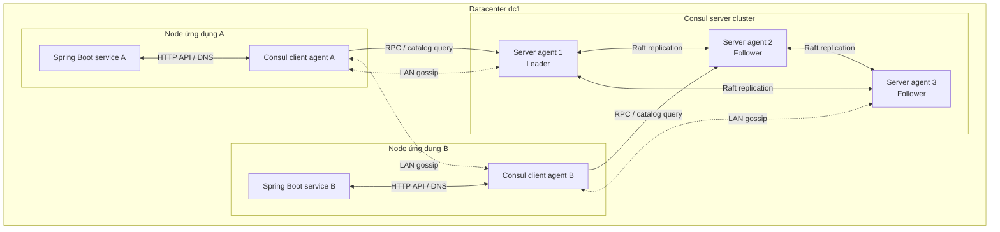

# Kiến trúc Consul agent, client agent và server agent

Consul cung cấp một registry tập trung để các dịch vụ tìm thấy nhau theo tên. Trong một hệ thống Spring Cloud, ứng dụng có thể đăng ký dịch vụ và tra cứu các instance thông qua Spring Cloud Consul. Phía sau API đó là các tiến trình Consul agent: mỗi agent quản lý trạng thái của node mà nó chạy trên đó, còn nhóm server agent duy trì catalog dùng chung và phối hợp để bảo đảm dữ liệu nhất quán.

Hiểu đúng vai trò của agent giúp phân biệt ba việc thường bị nhầm lẫn: **ứng dụng đăng ký dịch vụ**, **agent kiểm tra sức khỏe và chuyển trạng thái vào registry**, và **server cluster lưu trữ, đồng bộ catalog**. Consul hỗ trợ tìm địa chỉ instance; việc chọn instance để gửi request thường do Spring Cloud LoadBalancer hoặc một thành phần định tuyến khác đảm nhiệm.

## 1. Các khái niệm trong kiến trúc Consul

### Consul agent

Consul agent là một tiến trình chạy lâu dài trên máy hoặc môi trường triển khai của dịch vụ. Mỗi node tham gia Consul thường chạy một agent. Agent cung cấp các chức năng cục bộ như:

- Nhận yêu cầu đăng ký hoặc hủy đăng ký service và health check.
- Thực hiện các health check được khai báo cho node, service hoặc ứng dụng.
- Tham gia giao thức gossip để trao đổi thông tin thành viên và phát hiện node không còn phản hồi.
- Cung cấp HTTP API và DNS interface để công cụ hoặc ứng dụng truy vấn Consul.
- Chuyển các yêu cầu cần xử lý ở cấp cluster đến server agent và đồng bộ trạng thái cục bộ với catalog.

Agent có hai chế độ chính: **client mode** và **server mode**. Cả hai đều là Consul agent; khác biệt nằm ở việc agent có tham gia lưu trữ dữ liệu cluster và Raft consensus hay không.

### Client agent

Client agent là agent chạy ở chế độ client, thường đặt trên mỗi máy chạy một hoặc nhiều ứng dụng. Nó là điểm kết nối gần ứng dụng nhất đến Consul.

Client agent có các trách nhiệm chính:

- Nhận đăng ký service và health check từ ứng dụng hoặc công cụ triển khai trên node.
- Chạy các health check được giao cho agent đó và cập nhật kết quả.
- Tham gia LAN gossip để biết thành viên trong datacenter và phát hiện sự cố node.
- Chuyển tiếp các truy vấn hoặc thao tác cần thiết đến server agent.
- Giữ trạng thái cục bộ để tiếp tục quản lý service và check của node.

Client agent **không** tham gia biểu quyết Raft, không phải thành viên voting của server cluster và không giữ bản sao có thẩm quyền của catalog toàn datacenter. Vì vậy, thêm client agent trên các node ứng dụng không làm tăng số phiếu Raft.

Trong mô hình phổ biến, ứng dụng Spring Boot gọi HTTP API của client agent ở cùng node. Nếu dùng DNS, ứng dụng cũng có thể truy vấn DNS interface do agent cung cấp. Cách bố trí này giúp ứng dụng không cần biết server leader đang ở đâu hoặc tự quản lý danh sách server Consul.

### Server agent

Server agent là Consul agent chạy ở chế độ server. Ngoài các chức năng agent thông thường, server agent còn tham gia vào server cluster của một datacenter.

Server agent chịu trách nhiệm:

- Lưu trữ và nhân bản service catalog, node catalog, health state cùng dữ liệu Consul liên quan.
- Tham gia Raft consensus để thống nhất các thay đổi cần được commit vào cluster.
- Bầu chọn một leader; leader điều phối các thao tác ghi và các công việc quản trị cluster.
- Phục vụ các yêu cầu được client agent chuyển đến và cung cấp dữ liệu registry cho truy vấn.
- Trao đổi trạng thái với server của datacenter khác thông qua WAN gossip khi triển khai nhiều datacenter.

Các server agent trong cùng datacenter tạo thành một nhóm có quorum. Với cấu hình phổ biến, nên triển khai **3 hoặc 5 server agent** trên các máy độc lập, tốt nhất phân bố qua các failure domain hoặc availability zone. Ba server chịu được một server lỗi; năm server chịu được hai server lỗi, miễn là phần còn lại vẫn duy trì quorum. Một cluster hai server không có khả năng chịu lỗi server nào mà vẫn giữ quorum.

Server agent thường không được cài trên từng node ứng dụng. Chúng được triển khai thành một nhóm nhỏ, ổn định và có lưu trữ bền vững. Ứng dụng và client agent kết nối đến nhóm này qua mạng nội bộ.

### Datacenter và cluster

Trong Consul, một **datacenter** là phạm vi gồm một nhóm server agent cùng quản lý catalog và phối hợp bằng Raft. Tên datacenter phải nhất quán trong các agent thuộc cùng phạm vi.

Một datacenter thường có:

- Một nhóm server agent tạo thành server cluster.
- Nhiều client agent chạy trên các node ứng dụng hoặc node hạ tầng.
- Một service catalog phản ánh các node, service instance và trạng thái health check đã được đồng bộ.

Khi có nhiều datacenter, mỗi datacenter duy trì server cluster riêng. WAN gossip giúp các server agent trao đổi thông tin giữa các datacenter. Không nên xem nhiều datacenter là một Raft cluster duy nhất: Raft consensus được thực hiện trong từng datacenter.

## 2. Gossip và Raft giải quyết hai bài toán khác nhau

Consul sử dụng hai cơ chế phối hợp chính. Chúng bổ sung cho nhau nhưng không thay thế nhau.

| Cơ chế | Phạm vi và mục đích | Thành phần tham gia |
| --- | --- | --- |
| LAN gossip | Trao đổi membership, phát hiện node rời cụm hoặc không phản hồi trong cùng datacenter | Client agent và server agent |
| WAN gossip | Trao đổi thông tin membership giữa các datacenter | Server agent |
| Raft consensus | Thống nhất các thay đổi được commit vào dữ liệu server cluster | Chỉ các server agent |

Gossip ưu tiên phát hiện thành viên và truyền thông tin phân tán. Nó không phải cơ chế commit catalog. Raft cung cấp tính nhất quán cho dữ liệu được quản lý bởi server cluster; một thao tác ghi cần được quorum chấp nhận mới được xem là đã commit.

Ví dụ, khi một client agent phát hiện node không còn phản hồi, thông tin membership được lan truyền bằng gossip. Với health check của service, agent chạy check cục bộ rồi đồng bộ kết quả lên server cluster để cập nhật catalog; đây là luồng cập nhật registry, tách biệt với việc client agent tham gia gossip. Khi một server agent mất kết nối, các server còn lại chỉ tiếp tục commit thay đổi nếu vẫn còn quorum Raft.

## 3. Sơ đồ kiến trúc điển hình

Sơ đồ sau mô tả hai node ứng dụng kết nối đến client agent cục bộ, còn các client agent giao tiếp với nhóm server agent của cùng datacenter:



Trong sơ đồ:

- Ứng dụng làm việc với agent trên node của nó để đăng ký service, khai báo health check hoặc tra cứu instance.
- Client agent tham gia LAN gossip và gửi yêu cầu đến server cluster.
- Server agent nhân bản dữ liệu bằng Raft. Một server có thể là leader tại một thời điểm; các server còn lại là follower.
- Các đường gossip thể hiện trao đổi membership, còn đường Raft thể hiện đồng bộ dữ liệu cluster. Đây là hai luồng riêng biệt.

Sơ đồ là mô hình logic. Trong triển khai thực tế, kết nối RPC có thể đi đến bất kỳ server agent phù hợp nào; agent và Consul tự xử lý việc định tuyến nội bộ đến leader khi thao tác yêu cầu điều đó.

## 4. Vòng đời đăng ký và tra cứu service

### Bước 1: Agent gia nhập datacenter

Consul agent khởi động với cấu hình datacenter, địa chỉ bind, thư mục dữ liệu và danh sách địa chỉ dùng để gia nhập cluster. Client agent gia nhập LAN gossip và tìm server agent. Server agent khởi động, tìm các server còn lại và hình thành quorum Raft.

Client agent không cần biết server nào là leader cố định. Nó sử dụng địa chỉ server được cấu hình hoặc khám phá qua cơ chế join để liên lạc với cluster.

### Bước 2: Ứng dụng đăng ký service

Khi Spring Boot khởi động, Spring Cloud Consul có thể đăng ký ứng dụng với Consul bằng service name, instance ID, địa chỉ IP, port, metadata và health check. Trong mô hình có client agent cục bộ, ứng dụng gửi yêu cầu đến HTTP API của agent đó.

Ví dụ, một ứng dụng có thể đăng ký service tên `orders` với instance chạy tại `10.0.1.20:8080`. Tên `orders` đại diện cho dịch vụ logic; mỗi lần triển khai có thể tạo ra nhiều instance cùng tên nhưng khác địa chỉ hoặc instance ID.

Agent nhận yêu cầu và quản lý service cùng health check gắn với node. Trạng thái đăng ký được đồng bộ lên server cluster để các client khác có thể tra cứu trong catalog.

### Bước 3: Agent thực hiện health check

Health check có thể kiểm tra trạng thái node, tiến trình, TCP port, HTTP endpoint hoặc một lệnh phù hợp với môi trường. Với Spring Boot Actuator, một HTTP health check thường gọi endpoint `/actuator/health`.

Agent thực hiện check theo chu kỳ đã cấu hình và cập nhật trạng thái như `passing`, `warning` hoặc `critical`. Server cluster sử dụng trạng thái đã đồng bộ để trả kết quả tra cứu. Vì thế, một instance có thể đã đăng ký trong catalog nhưng không được trả về khi truy vấn chỉ yêu cầu instance đang `passing`.

Health check cần kiểm tra đúng endpoint mà agent có thể truy cập. Nếu ứng dụng chạy trong container, địa chỉ `localhost` bên trong container ứng dụng không nhất thiết là địa chỉ mà agent trên host hoặc container khác có thể gọi được.

### Bước 4: Ứng dụng khác tra cứu service

Một ứng dụng cần gọi `orders` có thể dùng Spring Cloud `DiscoveryClient` để lấy danh sách instance theo service name. Spring Cloud Consul chuyển yêu cầu tra cứu qua Consul API; ứng dụng cũng có thể dùng DNS của Consul nếu kiến trúc chọn cách đó.

Kết quả discovery chứa thông tin các instance phù hợp, chẳng hạn host và port. Spring Cloud LoadBalancer có thể chọn một instance từ danh sách này để thực hiện request. Consul registry không tự động trở thành proxy xử lý toàn bộ lưu lượng HTTP giữa các ứng dụng.

### Bước 5: Trạng thái thay đổi khi instance gặp sự cố

Nếu health check thất bại, agent cập nhật trạng thái check. Nếu node rời mạng hoặc agent không còn phản hồi, gossip hỗ trợ phát hiện sự cố thành viên. Trạng thái được đồng bộ vào catalog; những truy vấn lọc theo health sẽ loại instance không còn đạt yêu cầu.

Khi instance phục hồi, health check thành công trở lại và trạng thái được cập nhật. Ứng dụng gọi discovery sẽ nhận danh sách phản ánh trạng thái mới sau khi thông tin đã được đồng bộ. Do có chu kỳ health check và thời gian truyền trạng thái, discovery không phải lúc nào cũng phản ánh thay đổi ngay tức thì.

## 5. Cấu hình mẫu cho server agent và client agent

Ví dụ dưới đây minh họa một datacenter tên `dc1` có ba server agent. Các địa chỉ IP chỉ là ví dụ; cần thay bằng địa chỉ mạng có thể định tuyến trong môi trường triển khai.

### Cấu hình server agent

Trên mỗi server, tạo cấu hình tương tự sau trong thư mục cấu hình Consul:

```hcl
server           = true
datacenter       = "dc1"
data_dir         = "/opt/consul"
node_name        = "consul-server-1"
bind_addr        = "10.0.0.11"
client_addr      = "127.0.0.1"
bootstrap_expect = 3

retry_join = [
  "10.0.0.12",
  "10.0.0.13"
]
```

Trên server thứ hai và thứ ba, thay `node_name` và `bind_addr` tương ứng. `bootstrap_expect = 3` cho biết cluster dự kiến có ba server để hoàn tất quá trình bootstrap. Các server cần có `data_dir` bền vững và không dùng chung thư mục dữ liệu.

`bind_addr` là địa chỉ agent dùng cho giao tiếp mạng nội bộ. `client_addr` xác định các địa chỉ lắng nghe cho HTTP API, DNS và giao diện client; ví dụ trên chỉ mở giao diện client trên loopback. Nếu client agent hoặc ứng dụng cần gọi API qua mạng, phải cấu hình địa chỉ lắng nghe phù hợp và giới hạn truy cập bằng firewall cùng cơ chế bảo mật.

### Cấu hình client agent

Trên node chạy ứng dụng, cấu hình một client agent:

```hcl
server      = false
datacenter  = "dc1"
data_dir    = "/opt/consul"
node_name   = "app-node-1"
bind_addr   = "10.0.1.20"
client_addr = "127.0.0.1"

retry_join = [
  "10.0.0.11",
  "10.0.0.12",
  "10.0.0.13"
]
```

Client agent gia nhập cùng datacenter và kết nối đến nhóm server. `client_addr = "127.0.0.1"` phù hợp khi ứng dụng gọi API từ cùng network namespace với agent. Nếu ứng dụng nằm trong container hoặc máy khác, cần chọn địa chỉ có thể truy cập từ ứng dụng và áp dụng giới hạn mạng tương ứng.

Các cấu hình trên chỉ minh họa cấu trúc cơ bản. Môi trường thật cần bổ sung ACL token, TLS, gossip encryption, quyền truy cập file, giám sát và chính sách firewall phù hợp.

## 6. Kết nối Spring Cloud với Consul agent

Với Spring Cloud Consul, ứng dụng khai báo địa chỉ HTTP API của Consul agent mà nó sẽ sử dụng. Nếu client agent chạy cùng máy và API chỉ lắng nghe loopback, ứng dụng có thể dùng `localhost:8500`.

Ví dụ `application.yml`:

```yaml
spring:
  application:
    name: orders
  cloud:
    consul:
      host: localhost
      port: 8500
      discovery:
        register: true
        health-check-path: /actuator/health
        health-check-interval: 10s

management:
  endpoints:
    web:
      exposure:
        include: health
```

Trong ví dụ này:

- `spring.application.name` là tên service được đăng ký, cũng là tên service mà ứng dụng khác dùng khi discovery.
- `spring.cloud.consul.host` và `port` trỏ đến HTTP API của agent.
- `register` bật đăng ký service cho ứng dụng.
- `health-check-path` chỉ định endpoint để Consul kiểm tra sức khỏe ứng dụng; endpoint phải được mở và agent phải truy cập được.
- `health-check-interval` quy định chu kỳ kiểm tra trong ví dụ.

Tên và giá trị thuộc tính có thể thay đổi theo phiên bản Spring Cloud Consul đang sử dụng. Hãy đối chiếu với tài liệu của phiên bản dependency trong dự án trước khi áp dụng vào môi trường thật.

Khi ứng dụng và agent chạy trong hai container riêng, `localhost` thường trỏ về chính container ứng dụng. Khi đó cần cấu hình hostname hoặc địa chỉ của client agent trong cùng network, đồng thời bảo đảm agent có thể gọi ngược lại health endpoint của ứng dụng. Đây là nguyên nhân phổ biến khiến service đăng ký thành công nhưng health check luôn ở trạng thái `critical`.

## 7. Phân biệt discovery, registry và load balancing

Các thành phần thường xuất hiện cùng nhau nhưng đảm nhiệm những vai trò khác nhau:

| Thành phần | Vai trò |
| --- | --- |
| Spring Cloud Consul Registry | Đăng ký và hủy đăng ký instance của ứng dụng với Consul |
| Consul agent | Tiếp nhận đăng ký, chạy health check và làm đầu mối giao tiếp với Consul cluster |
| Consul server cluster | Lưu và đồng bộ catalog, trả dữ liệu discovery |
| Spring Cloud `DiscoveryClient` | Cung cấp API để ứng dụng lấy danh sách instance theo tên service |
| Spring Cloud LoadBalancer | Chọn một instance từ danh sách discovery để gửi request |
| API Gateway hoặc reverse proxy | Định tuyến request theo chính sách của gateway/proxy nếu kiến trúc sử dụng |

Ví dụ, khi `checkout` gọi `orders`, `DiscoveryClient` có thể trả về ba instance `orders`. LoadBalancer chọn một instance, chẳng hạn `10.0.1.20:8080`, rồi HTTP client gửi request đến địa chỉ đó. Consul cung cấp dữ liệu về instance và health; nó không thay thế HTTP client hoặc tự cân bằng mọi request giữa các service.

## 8. Bảo mật và vận hành

Consul agent mở nhiều giao diện mạng cho các mục đích khác nhau. Cần phân biệt cổng RPC, gossip, HTTP API, HTTPS và DNS; chỉ cho phép các nguồn cần thiết truy cập từng cổng. Một số cổng thường gặp trong cấu hình mặc định:

| Cổng | Giao thức | Mục đích |
| --- | --- | --- |
| `8300` | TCP | RPC giữa client agent và server agent, cũng như giao tiếp RPC trong server cluster |
| `8301` | TCP/UDP | LAN gossip trong datacenter |
| `8302` | TCP/UDP | WAN gossip giữa các datacenter |
| `8500` | TCP | HTTP API |
| `8501` | TCP | HTTPS API khi được cấu hình |
| `8600` | TCP/UDP | DNS interface |

Không nên mở HTTP API hoặc DNS ra Internet. Trong môi trường thật, cần:

- Bật ACL để xác thực và giới hạn quyền đọc/ghi registry, KV và các tài nguyên Consul.
- Dùng TLS cho các kết nối API/RPC phù hợp với cấu hình triển khai; quản lý và luân chuyển chứng chỉ.
- Bật gossip encryption để bảo vệ thông tin trao đổi qua gossip.
- Giới hạn `client_addr`, firewall và security group theo đúng các node cần truy cập.
- Bảo vệ `data_dir`, token và file cấu hình; không đưa secret vào repository hoặc log.
- Theo dõi trạng thái leader, quorum, health check, dung lượng đĩa, độ trễ RPC và số lượng instance.

Server cluster cần quorum để commit thay đổi. Nếu mất quá nửa số server, cluster có thể không tiếp tục xử lý các thao tác ghi cho đến khi quorum được khôi phục. Vì vậy, nên đặt server trên các máy hoặc vùng lỗi độc lập và sao lưu dữ liệu theo quy trình vận hành Consul.

## 9. Kiểm tra và xử lý sự cố cơ bản

Khi một service không xuất hiện trong kết quả discovery, nên kiểm tra từ agent cục bộ đến server cluster theo thứ tự:

1. Xác nhận Consul agent đang chạy và node đã gia nhập đúng datacenter.
2. Kiểm tra agent có thấy service đã đăng ký hay chưa.
3. Kiểm tra health check, địa chỉ IP, port và khả năng truy cập endpoint từ chính agent.
4. Kiểm tra client agent có kết nối được đến server agent và server cluster còn quorum hay không.
5. Kiểm tra ACL token, TLS, DNS hoặc HTTP API mà ứng dụng đang sử dụng.
6. Kiểm tra ứng dụng đang trỏ đến đúng agent, đúng datacenter và đúng service name.

Một số lệnh kiểm tra qua HTTP API cục bộ (giả sử agent lắng nghe trên `127.0.0.1:8500`):

```bash
# Liệt kê service agent đang quản lý trên node hiện tại
curl http://127.0.0.1:8500/v1/agent/services

# Xem các instance của service orders cùng trạng thái health check
curl "http://127.0.0.1:8500/v1/health/service/orders"

# Chỉ lấy các instance đang passing
curl "http://127.0.0.1:8500/v1/health/service/orders?passing=true"
```

Nếu bật ACL hoặc HTTPS, cần gửi token và cấu hình chứng chỉ theo chính sách của môi trường. Không nên tắt kiểm tra bảo mật để xử lý sự cố trên môi trường production.

| Triệu chứng | Nguyên nhân thường gặp | Hướng kiểm tra |
| --- | --- | --- |
| Service không xuất hiện | Ứng dụng chưa đăng ký, sai service name hoặc agent chưa đồng bộ | Xem service tại agent, log Spring Cloud Consul và trạng thái kết nối server |
| Service xuất hiện nhưng không `passing` | Health endpoint sai, agent không truy cập được ứng dụng, port hoặc firewall sai | Gọi health endpoint từ node chạy agent và xem output của check |
| Client agent không gia nhập cluster | Sai `retry_join`, sai `bind_addr`, firewall chặn gossip hoặc khác datacenter | Kiểm tra địa chỉ server, LAN gossip và cấu hình datacenter |
| Server cluster mất leader | Không đủ quorum, lỗi mạng giữa server hoặc lỗi dữ liệu/đĩa | Kiểm tra trạng thái Raft, log server và kết nối giữa các server |
| Ứng dụng không gọi được Consul API | Trỏ nhầm host/port, `client_addr` chỉ bind loopback hoặc ACL/TLS sai | Kiểm tra từ đúng network namespace của ứng dụng |
| Discovery trả về instance cũ trong một khoảng thời gian | Chu kỳ health check và đồng bộ trạng thái chưa hoàn tất | Kiểm tra interval, timeout và trạng thái catalog trên agent/server |

## 10. Những điểm cần ghi nhớ

- Consul agent là tiến trình chạy trên node; mỗi agent hoạt động ở client mode hoặc server mode.
- Client agent đứng gần ứng dụng, quản lý service và health check cục bộ, tham gia LAN gossip và chuyển yêu cầu đến server cluster. Nó không bỏ phiếu trong Raft.
- Server agent lưu trữ và nhân bản catalog, tham gia Raft consensus, duy trì leader và phục vụ dữ liệu cho các agent khác.
- Gossip phát hiện và trao đổi thông tin thành viên; Raft thống nhất các thay đổi dữ liệu trong server cluster.
- Mỗi datacenter có server cluster riêng. WAN gossip kết nối thông tin giữa các datacenter.
- Spring Cloud Consul tích hợp ứng dụng với registry; `DiscoveryClient` lấy instance và Spring Cloud LoadBalancer chọn instance để gọi.
- Health check chỉ hữu ích khi agent có thể truy cập đúng endpoint và trạng thái được đồng bộ về catalog.

Khi triển khai Spring Cloud Service Discovery với Consul, mô hình dễ vận hành là chạy một client agent trên mỗi node ứng dụng, duy trì một nhóm ba hoặc năm server agent ổn định trong mỗi datacenter, rồi để Spring Cloud Consul giao tiếp với agent gần ứng dụng. Cách bố trí này tách biệt trách nhiệm của ứng dụng, agent và server cluster, đồng thời giúp việc mở rộng instance không làm thay đổi cách các service tra cứu nhau.
