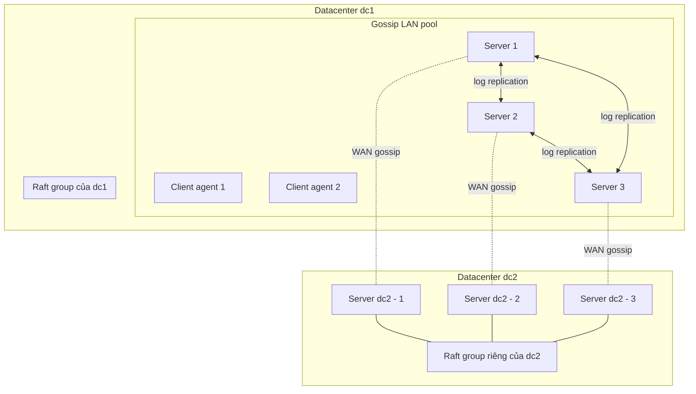

# Vai trò của gossip, Raft và quorum trong cụm Consul

Khi triển khai Consul để service discovery cho microservice, một server đơn lẻ có thể trở thành điểm lỗi duy nhất. Consul giải quyết vấn đề này bằng cách chạy nhiều Consul Server trong cùng một datacenter và phối hợp giữa chúng. Ba khái niệm cần hiểu là **gossip**, **Raft** và **quorum**: gossip giúp các agent biết thành viên nào đang tham gia và phát hiện node gặp sự cố; Raft giữ trạng thái nhất quán giữa các server; quorum xác định số server tối thiểu cần có để cụm tiếp tục bầu leader và ghi dữ liệu an toàn.

Bài học đặt các cơ chế này trong bối cảnh Spring Cloud Service Discovery. Ứng dụng có thể đăng ký service bằng Spring Cloud Consul, tìm instance qua `DiscoveryClient` và chọn instance bằng Spring Cloud LoadBalancer. Để luồng đó hoạt động ổn định, Consul cần duy trì membership và trạng thái registry khi node hoặc kết nối mạng bị gián đoạn.

## 1. Nhìn tổng thể kiến trúc Consul

Một datacenter Consul thường có nhiều server agent và có thể có nhiều client agent. Server lưu trạng thái của datacenter và tham gia Raft. Client agent chạy gần ứng dụng, tham gia gossip LAN và chuyển các yêu cầu cần thiết tới server.



Hình dung ba cơ chế theo ba câu hỏi:

| Cơ chế | Câu hỏi được trả lời | Phạm vi chính |
| --- | --- | --- |
| Gossip | Những node nào đang tham gia? Node nào đang bị nghi ngờ hoặc đã thất bại? | Membership và failure detection trong LAN pool; kết nối server giữa các datacenter qua WAN pool. |
| Raft | Các server đồng thuận thế nào về trạng thái đã được ghi nhận? Ai là leader? | Nhóm server của từng datacenter. |
| Quorum | Cần tối thiểu bao nhiêu server đồng ý để bầu leader hoặc commit log? | Các server có quyền bỏ phiếu trong một Raft group. |

Gossip và Raft hỗ trợ nhau nhưng không thay thế nhau. Membership được gossip lan truyền; trạng thái nhất quán của registry được Raft bảo vệ. Số client agent không làm tăng quorum của Raft.

## 2. Gossip: membership và phát hiện node gặp sự cố

Consul dùng giao thức gossip dựa trên Serf để các agent trao đổi thông tin thành viên và lan truyền sự kiện. Mỗi agent tham gia một nhóm gossip phù hợp với vai trò và datacenter của nó. Các cập nhật được truyền dần qua nhiều thành viên thay vì yêu cầu một node trung tâm gửi thông báo tới tất cả node.

### 2.1. LAN gossip

LAN gossip hoạt động trong một datacenter. Cả client agent và server agent đều tham gia LAN pool của datacenter đó. Nó giúp các agent:

- Khám phá và duy trì danh sách thành viên trong datacenter.
- Phát hiện node không còn phản hồi theo cơ chế kiểm tra và nghi ngờ của gossip.
- Lan truyền thông tin membership và sự kiện tới các thành viên khác.
- Hỗ trợ các server biết những server cùng datacenter đang tham gia cụm.

Gossip dùng cơ chế phát hiện lỗi theo thời gian. Khi một node không phản hồi, các thành viên có thể chuyển node qua trạng thái nghi ngờ rồi `failed` sau khi không thể xác minh lại. Một lần mất gói tin hoặc nghẽn mạng ngắn hạn có thể làm chậm hoặc gây nhầm lẫn trong quá trình phát hiện; vì vậy cần đối chiếu trạng thái membership với log và tình trạng mạng.

### 2.2. WAN gossip

WAN gossip kết nối các **server agent** giữa những datacenter khác nhau. Nó hỗ trợ Consul biết các datacenter và server từ xa, phục vụ mô hình federation. Client agent không tham gia WAN pool.

Ví dụ, `dc1` và `dc2` có thể mỗi nơi chạy một cụm server riêng. WAN gossip giúp server ở `dc1` biết các server ở `dc2` và ngược lại. Việc này không gộp hai datacenter thành một Raft group; mỗi datacenter vẫn duy trì Raft group riêng.

### 2.3. Gossip không phải là health check của ứng dụng

Gossip tập trung vào membership và khả năng liên lạc của agent/node. Nó không thay thế health check của service như HTTP check gọi tới Spring Boot Actuator. Một node có thể vẫn `alive` trong gossip nhưng ứng dụng trên node đó trả lỗi; ngược lại, một ứng dụng có thể khỏe trong khi agent gặp vấn đề kết nối với cụm.

Khi điều tra sự cố, hãy xem hai lớp riêng biệt:

- **Node membership:** agent có còn tham gia và liên lạc trong gossip pool không?
- **Service health:** instance của ứng dụng có vượt qua health check đã đăng ký với Consul không?

Lệnh kiểm tra membership LAN:

```bash
consul members
```

Kiểm tra các server trong WAN pool:

```bash
consul members -wan
```

Hai lệnh trên cho biết membership theo góc nhìn gossip. Chúng không liệt kê đầy đủ trạng thái leader và các voter của Raft.

## 3. Raft: đồng thuận và sao chép trạng thái

Raft là thuật toán consensus mà Consul dùng để duy trì trạng thái nhất quán giữa các Consul Server trong cùng một datacenter. Trong mỗi Raft group, các server có vai trò leader hoặc follower tại một thời điểm. Chỉ server agent tham gia nhóm Raft và có quyền bỏ phiếu; client agent không phải voter.

### 3.1. Leader và follower

- **Leader** tiếp nhận các thay đổi cần ghi vào trạng thái được Raft quản lý, tạo log entry và sao chép entry tới các follower.
- **Follower** nhận log từ leader, lưu log và tham gia bỏ phiếu khi cần bầu leader mới.
- Nếu leader ngừng hoạt động hoặc không còn duy trì được sự đồng thuận, các server còn lại có thể tổ chức bầu leader mới nếu vẫn đạt quorum.

Raft dùng term và cơ chế bầu cử để tránh nhiều leader hợp lệ cùng điều khiển một nhóm. Một thay đổi được xem là commit khi log entry đã được sao chép và xác nhận bởi đa số server voter. Sau khi commit, thay đổi mới được áp dụng vào state machine của cụm.

Các trạng thái quan trọng của Consul, chẳng hạn service catalog, key/value store, session và ACL state, được duy trì thông qua cơ chế nhất quán của server. Vì vậy, Raft bảo vệ trạng thái mà các client và server truy vấn, thay vì chỉ theo dõi node nào còn sống.

### 3.2. Raft hoạt động trong phạm vi một datacenter

Mỗi datacenter có Raft group riêng. Nếu hệ thống có ba datacenter thì thông thường có ba nhóm Raft độc lập, mỗi nhóm bầu leader và đạt quorum trong phạm vi server của datacenter đó.

Điều này rất quan trọng khi có sự cố WAN: mất kết nối giữa `dc1` và `dc2` có thể làm gián đoạn discovery hoặc truy vấn xuyên datacenter, nhưng không tự động làm mất quorum Raft cục bộ của `dc1` hay `dc2`. Mỗi cụm vẫn có thể tiếp tục các thao tác nội bộ nếu các server của chính nó còn đủ quorum.

Kiểm tra Raft peer và leader bằng lệnh:

```bash
consul operator raft list-peers
```

Kết quả hiển thị các peer trong Raft group, trạng thái và server đang giữ vai trò leader. Dùng lệnh này cùng `consul members` để phân biệt lỗi membership gossip với lỗi đồng thuận Raft.

## 4. Quorum: đa số server cần thiết

Quorum là số phiếu tối thiểu cần có để Raft thực hiện một quyết định an toàn, chẳng hạn bầu leader hoặc commit log entry. Với `N` server voter trong một Raft group:

\[
Q = \left\lfloor \frac{N}{2} \right\rfloor + 1
\]

Trong đó `Q` là quorum. Số server tối đa có thể mất mà nhóm vẫn còn quorum là:

\[
F = N - Q
\]

`N` ở đây là số **server voter của Raft group**, không phải tổng số máy, tổng số service instance hay tổng số client agent trong datacenter.

| Số server voter (`N`) | Quorum (`Q`) | Số server có thể mất (`F`) |
| ---: | ---: | ---: |
| 1 | 1 | 0 |
| 2 | 2 | 0 |
| 3 | 2 | 1 |
| 4 | 3 | 1 |
| 5 | 3 | 2 |
| 6 | 4 | 2 |
| 7 | 4 | 3 |

Ví dụ:

- Cụm có 3 server cần ít nhất 2 phiếu. Một server hỏng vẫn còn quorum; hai server hỏng thì server còn lại không thể tự commit thay đổi.
- Cụm có 5 server cần ít nhất 3 phiếu. Cụm chịu được tối đa 2 server mất liên lạc mà vẫn có thể đạt quorum.
- Cụm có 4 server cũng chỉ chịu được 1 server hỏng, giống cụm 3 server, nhưng cần nhiều tài nguyên hơn. Vì thế số server lẻ thường hiệu quả hơn khi chọn kích thước cụm.

Trong triển khai production, thường chọn 3 hoặc 5 Consul Server cho mỗi datacenter. Ba server phù hợp với phần lớn cụm cần chịu được một lỗi server; năm server tăng khả năng chịu lỗi lên hai. Tăng số server vượt quá mức cần thiết làm tăng chi phí phối hợp và độ trễ ghi mà không phải lúc nào cũng đem lại lợi ích tương xứng.

## 5. Điều gì xảy ra khi node hoặc mạng gặp sự cố?

### 5.1. Mất một server trong cụm ba server

Giả sử `dc1` có ba server và quorum bằng hai. Khi một server dừng:

1. Gossip phát hiện server không phản hồi và lan truyền trạng thái membership.
2. Hai server còn lại vẫn có thể tạo thành đa số.
3. Nếu leader còn hoạt động, nó có thể tiếp tục commit log; nếu leader bị mất, hai server còn lại có thể bầu leader mới.
4. Các thao tác ghi có thể tiếp tục sau khi cụm duy trì được Raft quorum.

Việc phát hiện lỗi qua gossip và bầu leader qua Raft là hai quá trình liên quan nhưng độc lập. Không nên hiểu rằng gossip tự bầu Raft leader.

### 5.2. Mất hai server trong cụm ba server

Chỉ còn một trong ba voter, trong khi quorum cần hai. Server còn lại không thể tự bầu leader hợp lệ hoặc commit log entry mới. Dữ liệu đã commit vẫn nằm trên đĩa của các server, nhưng các thay đổi cần consensus sẽ bị chặn cho tới khi khôi phục đủ quorum.

Khi gặp tình huống này, hãy ưu tiên khôi phục server hoặc kết nối mạng để các voter cũ gặp lại nhau. Không xóa data directory, không tự ý tạo cụm mới và không thay đổi cấu hình bootstrap để cố ép một server đơn lẻ thành cụm hiện tại; các thao tác đó có thể tạo trạng thái registry phân kỳ hoặc làm mất dữ liệu.

### 5.3. Network partition chia cụm thành hai phía

Giả sử cụm năm server bị chia thành hai phía: một phía có ba server và phía kia có hai server. Phía có ba voter vẫn có thể đạt quorum, bầu leader và commit log. Phía hai voter không có đa số nên không thể commit các thay đổi Raft.

Raft ưu tiên tính nhất quán: hai phía không thể cùng commit hai lịch sử log xung đột. Hành vi đọc trong thời gian mất quorum còn phụ thuộc consistency mode và loại truy vấn của Consul; không nên mặc định mọi truy vấn đọc đều hoạt động hoặc mọi follower đều trả dữ liệu mới nhất.

### 5.4. Mất kết nối WAN giữa các datacenter

Nếu WAN gossip giữa `dc1` và `dc2` bị gián đoạn nhưng các server trong từng datacenter vẫn liên lạc nội bộ, mỗi Raft group vẫn có thể duy trì quorum riêng. Những chức năng cần liên lạc hoặc khám phá xuyên datacenter có thể bị ảnh hưởng, nhưng không có một quorum Raft toàn cầu phải được duy trì giữa tất cả datacenter.

## 6. Cấu hình cụm server ban đầu

Ví dụ cấu hình rút gọn cho ba Consul Server trong `dc1`:

```hcl
server           = true
datacenter       = "dc1"
data_dir         = "/opt/consul"
bootstrap_expect = 3

retry_join = [
  "10.0.0.11",
  "10.0.0.12",
  "10.0.0.13"
]
```

Áp dụng cấu hình tương ứng trên cả ba server, với `node_name` và data directory riêng cho từng máy. `bootstrap_expect = 3` cho biết cụm khởi tạo mong đợi ba server trong datacenter trước khi hoàn tất bootstrap và bầu leader. `retry_join` cung cấp các địa chỉ để agent tìm và tham gia cụm.

Các điểm cần lưu ý:

- Ba server phải dùng cùng tên datacenter và có thể liên lạc qua các cổng Consul cần thiết.
- Mỗi server cần data directory bền vững và định danh node duy nhất.
- Không dùng `bootstrap = true` như một cách khắc phục sự cố quorum thông thường. Chế độ bootstrap thủ công có thể tạo cụm mới ngoài ý muốn.
- Bật gossip encryption với cùng shared key trên các agent khi triển khai; tạo key bằng `consul keygen` và quản lý như secret. Mã hóa gossip không thay thế TLS cho RPC/API hoặc ACL.
- Phân bố server qua các máy chủ và fault domain khác nhau để một lỗi máy hoặc một vùng hạ tầng không làm mất đa số voter cùng lúc.

Client agent có thể tham gia LAN gossip và đăng ký service cục bộ nhưng không được tính vào `bootstrap_expect` hoặc quorum Raft. Thêm nhiều client agent không giúp cụm server chịu thêm lỗi Raft.

## 7. Kiểm tra và chẩn đoán cụm

Khi Consul có biểu hiện không ổn định, hãy kiểm tra từ membership tới consensus:

```bash
# Thành viên gossip trong datacenter hiện tại
consul members

# Thành viên server trong WAN pool
consul members -wan

# Các peer Raft, voter và leader của datacenter
consul operator raft list-peers
```

Đọc kết quả theo đúng lớp:

| Quan sát | Khả năng cần kiểm tra tiếp |
| --- | --- |
| Node hiển thị `failed` trong `consul members` | Agent dừng, lỗi mạng LAN gossip, firewall hoặc cấu hình gossip encryption không đồng nhất. |
| Server có trong gossip membership nhưng Raft không đủ peer hoặc không có leader | Kết nối RPC giữa các server, tình trạng process, log Raft và số voter còn liên lạc được. |
| Raft vẫn có leader và quorum nhưng service không được consumer tìm thấy | Service registration, catalog, health check, ACL và bộ lọc discovery của consumer. |
| Truy vấn xuyên datacenter thất bại nhưng Raft cục bộ vẫn khỏe | WAN gossip, định tuyến giữa datacenter và cấu hình federation. |
| Cụm mất quorum sau khi nhiều server khởi động lại | Kiểm tra data directory, node identity, địa chỉ peer và kết nối trước khi thay đổi membership hoặc khởi tạo lại cụm. |

Một số cổng mặc định thường cần được kiểm tra trong firewall và network policy:

| Cổng | Giao thức | Mục đích |
| ---: | --- | --- |
| 8300 | TCP | Server RPC, bao gồm giao tiếp giữa các server. |
| 8301 | TCP và UDP | Gossip LAN. |
| 8302 | TCP và UDP | Gossip WAN giữa các server. |
| 8500 | TCP | HTTP API của Consul, nếu được bật. |

Hãy xác minh cổng thực tế theo cấu hình triển khai, vì Consul cho phép thay đổi port và bind address. Không mở các cổng này rộng hơn phạm vi mạng cần thiết.

## 8. Những nhầm lẫn thường gặp

| Nhầm lẫn | Cách hiểu đúng |
| --- | --- |
| Gossip và Raft đều chỉ là cơ chế đồng bộ node. | Gossip quản lý membership/failure detection; Raft đồng thuận về trạng thái được lưu trong cụm server. |
| Có nhiều client agent thì quorum mạnh hơn. | Quorum tính trên server voter của Raft group; client agent không bỏ phiếu. |
| Mỗi datacenter trong federation dùng chung một Raft group. | Mỗi datacenter có Raft group và leader riêng; WAN gossip kết nối các server giữa datacenter. |
| Node `alive` trong gossip nghĩa là ứng dụng khỏe. | Node membership và health check của từng service là hai tín hiệu khác nhau. |
| Mất quorum chỉ làm truy vấn chậm. | Cụm không thể commit thay đổi Raft mới hoặc bầu leader nếu không có đa số; khả năng đọc phụ thuộc consistency mode. |
| Có thể thêm một server đơn lẻ để tự khôi phục quorum. | Thay đổi membership phải theo quy trình an toàn; một server mới không tự khôi phục được đa số voter cũ nếu các peer cũ vẫn mất liên lạc. |

## 9. Checklist thiết kế production

Trước khi đưa Consul vào production, hãy xác minh:

1. Mỗi datacenter có số server voter phù hợp, thường là 3 hoặc 5.
2. Server được phân bố qua các fault domain để giảm khả năng mất đa số cùng lúc.
3. Các server có kết nối ổn định cho Raft RPC và gossip LAN; server giữa các datacenter có kết nối WAN gossip khi dùng federation.
4. Gossip encryption, TLS và ACL được cấu hình theo yêu cầu bảo mật của môi trường.
5. Data directory của server được lưu bền vững và có kế hoạch backup/restore phù hợp.
6. Có giám sát leader, số Raft peer, trạng thái membership, độ trễ và cảnh báo khi mất quorum.
7. Đội vận hành biết cách khôi phục quorum từ các server hiện có trước khi cân nhắc thay đổi membership hoặc bootstrap lại.

## 10. Ghi nhớ

- **Gossip** giúp các Consul agent khám phá thành viên, phát hiện node gặp sự cố và lan truyền thông tin membership. LAN pool nằm trong một datacenter; WAN pool kết nối server giữa các datacenter.
- **Raft** giúp các Consul Server trong cùng datacenter đồng thuận về trạng thái và sao chép log. Mỗi datacenter có Raft group riêng.
- **Quorum** là đa số server voter: `floor(N / 2) + 1`. Mất đa số đồng nghĩa cụm không thể commit thay đổi Raft mới hoặc bầu leader.
- Client agent không tham gia bỏ phiếu Raft. Gossip membership cũng không thay thế health check của ứng dụng.

Hiểu đúng ba cơ chế này giúp thiết kế cụm Consul có khả năng chịu lỗi phù hợp và giúp người vận hành xác định liệu sự cố service discovery xuất phát từ membership, consensus, health check hay kết nối giữa các datacenter.
