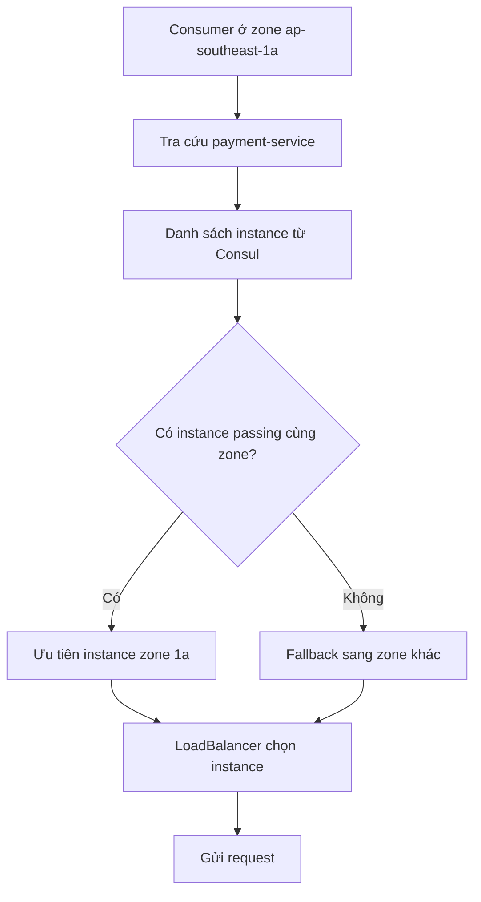

# Khai báo tags, metadata và vị trí vùng triển khai

Khi đăng ký một service instance vào Consul, ứng dụng có thể công bố thêm thông tin để consumer và công cụ vận hành hiểu instance đó thuộc môi trường nào, chạy phiên bản nào và đang nằm trong vùng triển khai nào. Spring Cloud Consul Discovery hỗ trợ hai nhóm dữ liệu thường dùng là **tags** và **metadata**. Vị trí vùng triển khai như zone, region hoặc rack thường được biểu diễn bằng metadata theo một quy ước thống nhất.

Các thông tin này bổ sung cho service name, instance ID, hostname/IP, port và health status. Chúng giúp tìm kiếm, quan sát, phân nhóm và lựa chọn instance. Tuy nhiên, Consul không tự hiểu ý nghĩa của mọi tag hoặc metadata. Ứng dụng, truy vấn Consul hoặc load balancer phải được cấu hình để sử dụng các giá trị đó.

Trong Spring Cloud, `DiscoveryClient` trả về `ServiceInstance` cùng metadata của instance; `ServiceRegistry` và Spring Cloud Consul chịu trách nhiệm đăng ký thông tin lên Consul. Bài học này tập trung vào cách khai báo tags, metadata và zone để hỗ trợ service discovery trong môi trường có nhiều nhóm triển khai.

## 1. Tags và metadata trong Consul

Một service registration của Consul có thể chứa danh sách tags và một map metadata dạng key-value.

| Thành phần | Cấu trúc | Mục đích thường dùng | Ví dụ |
|---|---|---|---|
| Tags | Danh sách chuỗi | Nhãn để phân loại, tìm kiếm hoặc lọc service. | `production`, `payments`, `canary` |
| Service metadata | Map key-value dạng chuỗi | Mô tả thuộc tính có cấu trúc của một service instance. | `version=2.8.1`, `zone=ap-southeast-1a` |
| Node metadata | Map key-value gắn với Consul agent node | Mô tả đặc điểm của node nơi agent chạy. | `rack=rack-03`, `hardware-class=compute` |

Tags và metadata đều được công bố cùng service registration nhưng có mục đích khác nhau. Tags phù hợp với nhãn ngắn và thao tác lọc theo tag. Metadata phù hợp với các thuộc tính có tên rõ ràng, ví dụ `version`, `api-level`, `zone` hoặc `region`.

Consul lưu tag dưới dạng chuỗi. Consul không tự diễn giải chuỗi `environment=production` thành một map key-value; với Consul, đó vẫn là một tag có nội dung nguyên vẹn. Nếu cần một trường có cấu trúc để consumer đọc, hãy khai báo trong metadata map.

## 2. Khai báo tags bằng Spring Cloud Consul

Tags được cấu hình bằng `spring.cloud.consul.discovery.tags`. Mỗi phần tử là một chuỗi. Ví dụ:

```yaml
spring:
  application:
    name: payment-service
  cloud:
    consul:
      host: consul.internal.example
      port: 8500
      discovery:
        service-name: payment-service
        instance-id: payment-service:payment-01
        tags:
          - production
          - payments
          - rest
          - canary
```

Sau khi đăng ký, service có thể được nhận diện bằng các nhãn `production`, `payments`, `rest` và `canary`. Các nhãn nên ngắn, nhất quán và có quy ước chung trong toàn hệ thống.

### 2.1. Chọn tags có ích

Một số nhóm tags thường gặp:

| Nhóm | Ví dụ | Công dụng |
|---|---|---|
| Môi trường | `dev`, `staging`, `production` | Phân biệt môi trường triển khai. |
| Nhóm sở hữu | `team-payments`, `team-commerce` | Hỗ trợ tìm service theo nhóm phụ trách. |
| Giao thức | `http`, `grpc`, `https` | Mô tả loại endpoint hoặc giao thức. |
| Vai trò | `worker`, `api`, `scheduler` | Phân loại vai trò triển khai nếu cùng một service name có các loại instance khác nhau. |
| Phát hành | `canary`, `blue`, `green` | Hỗ trợ nhận diện nhóm rollout. |

Không cần đưa mọi thông tin vào tags. Nếu consumer cần đọc giá trị như version hoặc zone, metadata key-value thường rõ ràng và dễ kiểm tra hơn.

### 2.2. Tags không tự động điều khiển load balancing

Đăng ký tag `canary` không có nghĩa Spring Cloud LoadBalancer tự động gửi một tỷ lệ request đến instance canary. Tag chỉ là dữ liệu được công bố. Cần có truy vấn Consul, gateway, custom `ServiceInstanceListSupplier` hoặc policy định tuyến hiểu tag đó.

Consul HTTP API hỗ trợ lọc service theo tag trong các truy vấn catalog/health phù hợp. Ví dụ, truy vấn các instance đang passing và có tag `canary`:

```http
GET /v1/health/service/payment-service?passing=true&tag=canary
```

API cụ thể có thể có thêm query parameter và giới hạn theo phiên bản Consul. `DiscoveryClient.getInstances("payment-service")` của Spring Cloud không mặc định có tham số tag tùy ý trong chữ ký phương thức; nếu cần lọc tag, phải chọn cơ chế truy vấn hoặc lớp discovery phù hợp.

## 3. Khai báo metadata dạng key-value

Metadata được cấu hình bằng `spring.cloud.consul.discovery.metadata`. Mỗi key và value được lưu dưới dạng chuỗi. Ví dụ:

```yaml
spring:
  application:
    name: payment-service
  cloud:
    consul:
      discovery:
        metadata:
          version: "2.8.1"
          api-level: "v2"
          region: "ap-southeast-1"
          zone: "ap-southeast-1a"
          release-ring: "canary"
```

Trong ví dụ này:

- `version` cho biết phiên bản phần mềm của instance.
- `api-level` mô tả hợp đồng API mà instance hỗ trợ.
- `region` và `zone` mô tả vị trí triển khai.
- `release-ring` phân biệt nhóm phát hành như canary hoặc stable.

Metadata giúp consumer đọc thuộc tính của từng instance sau khi discovery. Ví dụ, consumer có thể lấy `zone` để ưu tiên instance cùng vùng hoặc đọc `api-level` để chọn provider tương thích. Consul chỉ lưu và cung cấp dữ liệu; logic sử dụng metadata do ứng dụng hoặc thành phần định tuyến đảm nhiệm.

### 3.1. Quy ước key và value

Để metadata dễ dùng giữa nhiều service:

- Dùng key chữ thường, ổn định, ví dụ `version`, `zone`, `region`, `api-level`.
- Thống nhất cách viết và ý nghĩa của từng key trên cả provider lẫn consumer.
- Dùng value đơn giản, có thể so sánh chính xác; tránh nhiều cách viết cho cùng một vùng như `az-a`, `AZ-A` và `zone-a`.
- Giữ metadata có kích thước nhỏ và chỉ chứa thông tin cần cho discovery hoặc vận hành.
- Không lưu password, token, private key, connection string có thông tin xác thực hoặc dữ liệu cá nhân.
- Tránh đưa dữ liệu thay đổi liên tục vào metadata vì việc cập nhật registration sẽ tạo thêm tải và độ trễ hội tụ.

Metadata thường được trả về trong trường `ServiceMeta` của Consul service record và được Spring Cloud Consul ánh xạ vào metadata của `ServiceInstance`. Hãy kiểm tra đúng integration/version khi dựa vào cách ánh xạ cụ thể.

## 4. Khai báo zone, region và rack

Trong hệ thống phân tán, hai instance cùng chạy một service có thể nằm ở các vùng hạ tầng khác nhau. Nếu consumer luôn gọi instance ở xa, request có thể tăng latency và phụ thuộc nhiều hơn vào liên kết liên vùng. Việc công bố vị trí giúp hệ thống ưu tiên instance gần consumer và hỗ trợ thiết kế chịu lỗi theo failure domain.

Các khái niệm nên được phân biệt:

| Khái niệm | Ý nghĩa | Ví dụ |
|---|---|---|
| Region | Vùng địa lý hoặc khu vực hạ tầng lớn. | `ap-southeast-1` |
| Zone / Availability Zone | Failure domain nhỏ hơn trong region. | `ap-southeast-1a` |
| Rack | Nhóm phần cứng hoặc tủ máy trong một data center. | `rack-03` |
| Consul datacenter | Phạm vi datacenter logic trong topology Consul. | `dc-singapore-1` |

Consul datacenter không đồng nghĩa với availability zone. Một Consul datacenter có thể chứa nhiều zone; cách tổ chức region/zone phụ thuộc cloud hoặc nền tảng triển khai. Nếu cần định tuyến theo zone, hãy công bố zone bằng một metadata key nhất quán, ví dụ `zone`.

Ví dụ hai instance của cùng service nằm ở hai zone:

| Instance | Region | Zone | Rack |
|---|---|---|---|
| `payment-01` | `ap-southeast-1` | `ap-southeast-1a` | `rack-03` |
| `payment-02` | `ap-southeast-1` | `ap-southeast-1b` | `rack-07` |

Khi consumer chạy ở `ap-southeast-1a`, load balancer có thể ưu tiên `payment-01`. Nếu zone đó không còn instance khỏe mạnh, policy cần cho phép fallback sang `ap-southeast-1b` để duy trì khả năng phục vụ.

## 5. Kết hợp tags, metadata và zone trong một registration

Một cấu hình hoàn chỉnh có thể khai báo cả tags lẫn metadata:

```yaml
spring:
  application:
    name: payment-service

  cloud:
    consul:
      host: consul.internal.example
      port: 8500
      discovery:
        enabled: true
        register: true
        service-name: ${spring.application.name}
        instance-id: "${spring.application.name}:${INSTANCE_ID:payment-01}"
        tags:
          - production
          - payments
          - rest
          - canary
        metadata:
          version: "2.8.1"
          api-level: "v2"
          region: "ap-southeast-1"
          zone: "ap-southeast-1a"
          rack: "rack-03"
          release-ring: "canary"
        health-check-path: /actuator/health
        health-check-interval: 15s
        query-passing: true
```

Trong môi trường thực tế, `INSTANCE_ID`, version, region và zone nên được pipeline hoặc nền tảng triển khai cung cấp theo từng instance. Không dùng một file cấu hình chung với `instance-id` giống nhau cho mọi replica.

`query-passing: true` yêu cầu discovery chỉ trả các instance có health check passing theo cách Spring Cloud Consul integration hỗ trợ. Nó không thay thế readiness policy ở nền tảng triển khai và không bảo đảm mọi request đến instance đều thành công.

## 6. Zone metadata và Spring Cloud LoadBalancer

Chỉ đăng ký metadata `zone` chưa khiến consumer tự động chọn instance cùng zone. Muốn dùng zone để lựa chọn, cần cấu hình consumer và bật cơ chế zone preference tương ứng của Spring Cloud LoadBalancer.

Ví dụ consumer thuộc zone `ap-southeast-1a`:

```yaml
spring:
  cloud:
    loadbalancer:
      configurations: zone-preference
      zone: ap-southeast-1a
```

Provider cần đăng ký metadata với key `zone` và value khớp quy ước:

```yaml
spring:
  cloud:
    consul:
      discovery:
        metadata:
          zone: ap-southeast-1a
```

Khi zone preference supplier được kích hoạt và nhận được metadata tương thích, load balancer có thể ưu tiên các instance cùng zone. Hành vi chính xác phụ thuộc phiên bản Spring Cloud LoadBalancer, cấu hình supplier và dữ liệu metadata của provider. Hãy kiểm tra release train đang dùng và xác minh supplier thực tế được tạo trong application context.

### 6.1. Cần có fallback liên vùng

Zone preference nên được xem là ưu tiên, không phải giới hạn cứng trong mọi tình huống. Nếu zone của consumer không còn instance khỏe mạnh, ứng dụng cần có fallback đến zone khác hoặc trả lỗi có kiểm soát theo yêu cầu nghiệp vụ.



Nếu chính sách chỉ cho phép gọi cùng zone, hệ thống có thể mất khả năng phục vụ khi zone đó gặp sự cố. Vì vậy, cần quyết định rõ ưu tiên latency hay ưu tiên availability, đồng thời kiểm thử kịch bản zone outage.

### 6.2. Không dùng metadata zone như bằng chứng health

`zone=ap-southeast-1a` chỉ mô tả vị trí. Nó không chứng minh instance đang khỏe mạnh. Health check của Consul và điều kiện lọc instance phải được áp dụng riêng. Một instance cùng zone nhưng health check failing không nên được chọn chỉ vì vị trí gần.

## 7. Node metadata và service metadata

Consul có metadata gắn với node và metadata gắn với service registration. Hai loại này khác phạm vi:

- **Node metadata (`NodeMeta`):** mô tả Consul agent node, ví dụ rack, hardware class hoặc zone của máy chạy agent.
- **Service metadata (`ServiceMeta`):** mô tả một service instance đăng ký trên node, ví dụ software version, API level, release ring hoặc zone triển khai của workload.

Nếu tất cả service trên một node luôn thuộc cùng một zone, node metadata có thể phản ánh vị trí của node. Nếu cùng một node chạy workload thuộc các zone hoặc nhóm logic khác nhau, service metadata phù hợp hơn để mô tả từng registration.

Spring Cloud Consul Discovery property `metadata` chủ yếu phục vụ metadata của service registration. Không nên giả định rằng cấu hình này sẽ cập nhật `NodeMeta` của Consul agent. Node metadata thường được cấu hình ở Consul agent hoặc service definition theo cơ chế của Consul.

## 8. Đọc tags và metadata từ Consul

### 8.1. Kiểm tra qua Consul UI và HTTP API

Sau khi ứng dụng khởi động, mở Consul UI trong mạng quản trị và tìm service `payment-service`. Kiểm tra tags, metadata, địa chỉ, port và health status của từng instance.

Có thể đọc danh sách registration bằng Consul HTTP API:

```bash
curl http://consul.internal.example:8500/v1/catalog/service/payment-service
```

Kết quả có thể chứa các trường như `ServiceTags`, `ServiceMeta`, `ServiceAddress`, `ServicePort`, `Node` và thông tin datacenter. Để chỉ lấy instance passing và có tag cụ thể:

```bash
curl "http://consul.internal.example:8500/v1/health/service/payment-service?passing=true&tag=canary"
```

Các API này cần được bảo vệ bằng ACL token và network policy phù hợp. Không đưa token thật vào tài liệu, log hoặc ví dụ cấu hình được commit vào repository.

### 8.2. Đọc metadata qua DiscoveryClient

Consumer Spring Cloud có thể đọc metadata của từng instance thông qua `ServiceInstance`:

```java
import java.util.List;

import org.springframework.cloud.client.ServiceInstance;
import org.springframework.cloud.client.discovery.DiscoveryClient;
import org.springframework.stereotype.Service;

@Service
public class PaymentInstanceInspector {

    private final DiscoveryClient discoveryClient;

    public PaymentInstanceInspector(DiscoveryClient discoveryClient) {
        this.discoveryClient = discoveryClient;
    }

    public void printInstances() {
        List<ServiceInstance> instances =
                discoveryClient.getInstances("payment-service");

        for (ServiceInstance instance : instances) {
            String version = instance.getMetadata().get("version");
            String zone = instance.getMetadata().get("zone");
            String apiLevel = instance.getMetadata().get("api-level");

            System.out.printf(
                    "id=%s host=%s port=%d version=%s api=%s zone=%s%n",
                    instance.getInstanceId(),
                    instance.getHost(),
                    instance.getPort(),
                    version,
                    apiLevel,
                    zone
            );
        }
    }
}
```

Metadata map có thể thiếu key hoặc chứa giá trị cũ trong thời gian registry/cache hội tụ. Consumer cần xử lý `null`, giá trị không hợp lệ và trường hợp không có instance. Không nên giả định mọi provider đều công bố đủ `version`, `api-level` hoặc `zone`.

## 9. Lọc instance theo tag, metadata và version

Các chính sách lọc nên dựa trên mục tiêu rõ ràng:

- Dùng tag khi muốn chọn nhóm đã được gắn nhãn, ví dụ `canary` hoặc `production`.
- Dùng metadata `version` để quan sát hoặc kiểm tra phiên bản artifact.
- Dùng `api-level` để kiểm tra khả năng tương thích hợp đồng.
- Dùng metadata `zone` để ưu tiên vùng gần consumer.
- Dùng health status để loại instance không sẵn sàng.

Ví dụ consumer lọc các instance có API v2 và cùng zone:

```java
import java.util.List;
import java.util.stream.Collectors;

import org.springframework.cloud.client.ServiceInstance;
import org.springframework.cloud.client.discovery.DiscoveryClient;
import org.springframework.stereotype.Service;

@Service
public class CompatiblePaymentInstances {

    private final DiscoveryClient discoveryClient;

    public CompatiblePaymentInstances(DiscoveryClient discoveryClient) {
        this.discoveryClient = discoveryClient;
    }

    public List<ServiceInstance> findV2InZone(String zone) {
        return discoveryClient.getInstances("payment-service").stream()
                .filter(instance -> "v2".equals(
                        instance.getMetadata().get("api-level")))
                .filter(instance -> zone.equals(
                        instance.getMetadata().get("zone")))
                .collect(Collectors.toList());
    }
}
```

Đây là ví dụ lọc danh sách đã được discovery client trả về. Nó không tự tích hợp vào mọi request của Spring Cloud LoadBalancer. Nếu cần policy cho từng request, hãy triển khai `ServiceInstanceListSupplier` hoặc cơ chế định tuyến tương ứng và xác định fallback khi không có instance phù hợp.

Không nên suy ra API compatibility chỉ từ software version. Một bản phát hành mới có thể vẫn phục vụ API cũ hoặc một bản phát hành cũ có thể hỗ trợ nhiều API. Dùng metadata riêng như `api-level` hoặc `capabilities` để mô tả hợp đồng thực tế.

## 10. Tags và metadata trong quá trình triển khai

Tags và metadata thường được thiết lập khi service instance đăng ký. Khi phát hành bản mới hoặc chuyển workload sang zone khác, cần bảo đảm registration được cập nhật theo vòng đời instance.

Một quy trình triển khai có thể gồm:

1. Pipeline build xác định version và commit của artifact.
2. Nền tảng triển khai cấp instance ID, region và zone cho workload.
3. Spring Cloud Consul client đăng ký service name, tags và metadata.
4. Consul health check xác nhận trạng thái service.
5. Consumer discovery và load balancer đọc metadata để chọn instance.
6. Khi workload dừng, registration được deregister hoặc health check chuyển sang trạng thái không passing.

Nếu metadata version hoặc zone thay đổi mà instance không được đăng ký lại/cập nhật, consumer có thể tiếp tục nhìn thấy giá trị cũ trong registry cache. Hãy kiểm tra registration sau rollout thay vì chỉ kiểm tra biến môi trường của container.

## 11. Các lỗi thường gặp

| Hiện tượng | Nguyên nhân có thể | Hướng xử lý |
|---|---|---|
| Consul UI không hiển thị tags | `tags` chưa được cấu hình đúng hoặc client chưa đăng ký lại. | Kiểm tra `spring.cloud.consul.discovery.tags` và bản ghi service. |
| Metadata không xuất hiện trong `ServiceInstance` | Key được khai báo sai, integration không ánh xạ như mong đợi hoặc consumer đang dùng cache cũ. | Kiểm tra `ServiceMeta` trong Consul API và phiên bản Spring Cloud Consul. |
| Consumer không lọc được theo tag | Nhầm tag với metadata hoặc dùng `DiscoveryClient` API không hỗ trợ tham số tag. | Dùng Consul query/filter hoặc policy discovery riêng. |
| Load balancer không ưu tiên cùng zone | Chỉ khai báo metadata `zone` nhưng chưa bật zone preference hoặc key/value không khớp. | Kiểm tra `spring.cloud.loadbalancer.zone`, supplier và metadata của instance. |
| Instance cùng zone vẫn bị gọi dù health check lỗi | Zone chỉ là thông tin vị trí, chưa chắc danh sách đã lọc health passing. | Bật/kiểm tra health-aware discovery và xử lý trạng thái `passing`. |
| Không có instance sau khi lọc zone | Zone consumer không có instance khỏe mạnh hoặc giá trị zone không thống nhất. | Chuẩn hóa metadata và thiết kế fallback sang zone khác. |
| Nhiều instance cùng version nhưng khác API | Dùng software version thay cho API compatibility. | Công bố `api-level` hoặc capability riêng. |
| Metadata bị cũ sau rollout | Registration/cache chưa hội tụ hoặc workload cũ vẫn còn. | Kiểm tra instance ID, deregistration, health và refresh cache. |
| Lộ thông tin nhạy cảm qua Consul | Đưa token, password hoặc thông tin cá nhân vào tag/metadata. | Loại bỏ dữ liệu nhạy cảm và giới hạn ACL/network access. |

## 12. Nguyên tắc thiết kế và vận hành

- Dùng tags cho nhãn ngắn phục vụ phân loại hoặc truy vấn; dùng metadata cho thuộc tính key-value cần được consumer đọc.
- Thống nhất key `zone`, `region`, `version`, `api-level` giữa tất cả provider và consumer.
- Đặt zone theo failure domain thật của workload; không suy ra zone chỉ từ Consul datacenter.
- Chỉ dùng metadata zone cho load balancing khi đã bật supplier/policy tương ứng.
- Luôn có fallback khi zone ưu tiên không còn instance passing, trừ khi yêu cầu nghiệp vụ bắt buộc cô lập vùng.
- Kết hợp health status với zone; vị trí gần không có nghĩa instance khỏe mạnh.
- Không giả định tags tự động được Spring Cloud LoadBalancer áp dụng.
- Giữ metadata nhỏ, ổn định và không chứa bí mật.
- Cấp version, commit, region và zone từ pipeline hoặc nền tảng triển khai để giảm sai lệch do nhập tay.
- Kiểm tra tags, `ServiceMeta`, địa chỉ và health qua Consul UI/API sau khi rollout.
- Bảo vệ Consul API bằng ACL token, TLS và network policy; không công khai registry ra Internet.
- Kiểm tra hành vi theo phiên bản Consul và Spring Cloud Consul đang sử dụng trước khi phụ thuộc vào filter hoặc zone supplier cụ thể.

## Kết luận

Consul tags là danh sách nhãn chuỗi, phù hợp để phân loại và truy vấn service. Service metadata là map key-value, phù hợp để công bố version, API level, region, zone và các thuộc tính của từng instance. Node metadata mô tả Consul agent node và có phạm vi khác với metadata của service registration.

Trong Spring Cloud Consul, khai báo tags qua `spring.cloud.consul.discovery.tags` và metadata qua `spring.cloud.consul.discovery.metadata`. Muốn dùng zone để ưu tiên instance gần consumer, cần công bố metadata `zone`, cấu hình Spring Cloud LoadBalancer zone preference và thiết kế fallback khi vùng ưu tiên không còn instance khỏe mạnh. Việc kiểm tra registration, health và lựa chọn instance từ góc nhìn consumer giúp bảo đảm dữ liệu được công bố thực sự có ích cho service discovery.
