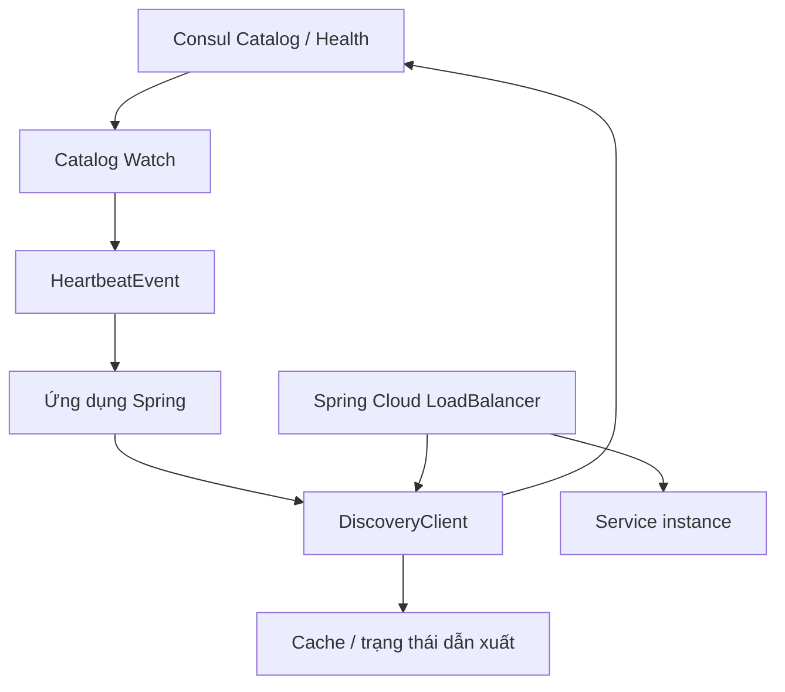

# Catalog Watch và cách ứng dụng nhận biết thay đổi

## 1. Vì sao ứng dụng cần theo dõi Catalog?

Trong hệ thống microservice, Consul lưu thông tin service và instance trong service catalog. Khi một instance được đăng ký, hủy đăng ký hoặc thay đổi trạng thái health, consumer cần cập nhật góc nhìn của mình để chọn đích gọi phù hợp. Nếu consumer chỉ đọc catalog một lần lúc khởi động rồi giữ danh sách đó mãi mãi, nó có thể tiếp tục gọi instance đã dừng hoặc bỏ lỡ instance mới.

Catalog Watch là cách theo dõi thay đổi của Consul Catalog và thông báo cho ứng dụng khi dữ liệu cần quan tâm thay đổi. Sau khi nhận tín hiệu, ứng dụng có thể truy vấn lại registry, cập nhật cache hoặc tính toán lại trạng thái phụ thuộc.

Trong Spring Cloud Service Discovery, `DiscoveryClient` cung cấp API chung để lấy danh sách service và instance. Với Consul, implementation dùng Consul Catalog/Health API làm nguồn dữ liệu. Catalog Watch giúp ứng dụng biết lúc nào nên làm mới thông tin; nó không thay thế việc truy vấn instance, health check hay load balancing.

## 2. Phân biệt Catalog, Health và Watch

Consul tách thông tin đăng ký service khỏi kết quả kiểm tra sức khỏe:

| Thành phần | Nội dung | Câu hỏi được trả lời |
|---|---|---|
| Catalog | Service, node, địa chỉ, port, tag và metadata đã đăng ký | Service/instance nào được đăng ký? |
| Health | Trạng thái các health check gắn với node hoặc service | Instance đang passing, warning hay critical? |
| Catalog Watch | Cơ chế phát hiện thay đổi từ các truy vấn catalog/health | Khi nào ứng dụng nên đọc lại dữ liệu? |
| DiscoveryClient | Abstraction của Spring Cloud để truy vấn instance | Ứng dụng lấy instance bằng API nào? |
| Load balancer | Thành phần chọn một instance cho request | Request tiếp theo nên đi tới instance nào? |

Một service có thể vẫn tồn tại trong catalog nhưng health check đang `critical`. Vì vậy, chỉ theo dõi danh sách service chưa đủ để kết luận instance có thể nhận traffic. Khi cần danh sách instance khỏe, hãy truy vấn health endpoint hoặc dùng DiscoveryClient với cơ chế lọc health tương ứng.

## 3. Consul phát hiện thay đổi bằng blocking query

### 3.1. Ý tưởng của `index` và `wait`

Consul HTTP API hỗ trợ blocking query. Thay vì gọi API liên tục theo chu kỳ ngắn và nhận lại cùng một dữ liệu, client gửi chỉ số `index` của lần đọc trước cùng thời gian chờ `wait`. Consul giữ request cho đến khi dữ liệu liên quan thay đổi hoặc thời gian chờ kết thúc.

Khi trả về, response thường có header `X-Consul-Index`. Client lưu chỉ số này và dùng nó trong request tiếp theo:

1. Gọi API lần đầu với `index=0` để lấy snapshot hiện tại.
2. Đọc `X-Consul-Index` trong response.
3. Gọi lại cùng API với `index` vừa nhận và `wait`, ví dụ `wait=5m`.
4. Khi dữ liệu thay đổi, Consul trả response mới sớm hơn thời hạn chờ; client đọc index mới và tiếp tục vòng theo dõi.
5. Nếu hết thời gian chờ mà dữ liệu không đổi, request trả về với index hiện tại; client tiếp tục chờ bằng index đó.

`index` là cursor để Consul biết client đã đọc tới phiên bản dữ liệu nào. `wait` là thời gian chờ tối đa của một blocking query; server có thể áp dụng giới hạn thời gian riêng. Không nên gửi request mới liên tục ngay khi một request timeout vì điều đó biến watch thành polling dày và tạo tải không cần thiết.

### 3.2. Ví dụ theo dõi danh sách service

Endpoint catalog services là:

```text
GET /v1/catalog/services
```

Lần đọc đầu tiên:

```bash
curl -i "http://localhost:8500/v1/catalog/services?index=0&wait=5m"
```

Giả sử response có header:

```text
X-Consul-Index: 1250
```

Request kế tiếp dùng index đã nhận:

```bash
curl -i "http://localhost:8500/v1/catalog/services?index=1250&wait=5m"
```

Khi catalog thay đổi, Consul trả dữ liệu mới cùng `X-Consul-Index` mới. Client lưu index đó rồi tiếp tục theo dõi. Nếu không có thay đổi, request có thể chỉ trả về sau khi hết `wait`.

Ví dụ này theo dõi danh sách tên service trong catalog. Nó không phải lúc nào cũng đủ để phát hiện mọi thay đổi instance hoặc health của một service đã tồn tại. Nếu cần theo dõi instance và trạng thái check, chọn endpoint phù hợp hơn.

### 3.3. Theo dõi instance và health của một service

Để đọc các instance cùng trạng thái health, có thể dùng Health API:

```text
GET /v1/health/service/{service-name}
```

Ví dụ chỉ lấy instance có trạng thái passing:

```bash
curl -i "http://localhost:8500/v1/health/service/payment-service?passing=true&index=0&wait=5m"
```

Sau response đầu tiên, lấy `X-Consul-Index` và dùng lại trong request tiếp theo:

```bash
curl -i "http://localhost:8500/v1/health/service/payment-service?passing=true&index=1250&wait=5m"
```

Query `passing=true` yêu cầu kết quả chỉ gồm service instance có các check liên quan ở trạng thái passing theo semantics của endpoint. Nếu cần quan sát cả `warning` hoặc `critical`, bỏ bộ lọc này và tự xử lý trạng thái trả về.

Hãy chọn query theo câu hỏi của ứng dụng:

- Chỉ cần biết một service mới được thêm hoặc xóa khỏi catalog: theo dõi `/v1/catalog/services`.
- Cần biết instance nào của `payment-service` xuất hiện hoặc biến mất: theo dõi catalog service cụ thể hoặc Health API của service đó.
- Cần biết instance có đủ điều kiện nhận traffic: theo dõi Health API và lọc trạng thái theo chính sách ứng dụng.

## 4. Chỉ số index và các tình huống cần xử lý

Client watch cần quản lý index cẩn thận:

- Lần đầu nên dùng `index=0` để lấy snapshot và cursor ban đầu.
- Lưu index từ header `X-Consul-Index`, không tự tăng index bằng cách cộng một.
- Khi request trả về do timeout mà không có thay đổi, tiếp tục theo dõi bằng index nhận được.
- Khi kết nối lỗi, giữ trạng thái cần thiết và retry với backoff; không tạo vòng lặp request nóng.
- Nếu index trả về thấp hơn index đã lưu sau sự cố, restore hoặc thay đổi trạng thái cluster, cần xử lý theo hướng dẫn blocking query của phiên bản Consul đang dùng. Có thể reset cursor và lấy snapshot mới để tránh chờ trên một index không còn phù hợp.
- Không giả định mọi lần thay đổi đều tạo ra một event riêng mà ứng dụng sẽ nhận đủ. Blocking query là cơ chế phát hiện dữ liệu đã thay đổi; ứng dụng nên đọc snapshot mới nhất và đối chiếu trạng thái hiện tại.

Consul có thể trả về kết quả giống nhau ở nhiều lần truy vấn nếu không có thay đổi liên quan. Ứng dụng nên so sánh dữ liệu cần thiết hoặc index, tránh phát lại công việc tốn kém khi snapshot không đổi.

## 5. Catalog Watch trong Spring Cloud Consul

Spring Cloud Consul cung cấp cơ chế Catalog Watch để ứng dụng Spring nhận biết thay đổi catalog mà không phải tự viết toàn bộ vòng lặp gọi Consul API. Trong nhiều phiên bản, watch tích hợp được triển khai như một tác vụ nền kiểm tra catalog theo lịch và phát `HeartbeatEvent` khi phát hiện thay đổi. Cách triển khai, tên thuộc tính và chi tiết theo dõi có thể khác theo release train; hãy đối chiếu tài liệu đúng phiên bản Spring Cloud Consul đang dùng.

Các cấu hình thường gặp có dạng:

```yaml
spring:
  cloud:
    consul:
      discovery:
        catalog-services-watch:
          enabled: true
          delay: 1000
```

`enabled` bật/tắt watch tích hợp; `delay` là khoảng thời gian giữa các lần kiểm tra theo đơn vị mili giây trong các phiên bản hỗ trợ thuộc tính này. Một số tài liệu hoặc release có thể hiển thị tên thuộc tính ở dạng camelCase, ví dụ `catalogServicesWatch.enabled` và `catalogServicesWatch.delay`. Kiểm tra metadata cấu hình/Javadoc của release train dự án trước khi áp dụng.

Điểm quan trọng là không nên mặc định rằng Catalog Watch tích hợp của Spring Cloud luôn dùng Consul blocking query với `index`/`wait` giống một client tự viết. Một số phiên bản thực hiện kiểm tra catalog theo lịch. Blocking query là khả năng của Consul HTTP API; cách Spring Cloud Consul sử dụng API đó là chi tiết implementation theo phiên bản.

### 5.1. Nhận `HeartbeatEvent`

Khi watch tích hợp phát hiện thay đổi catalog, ứng dụng có thể lắng nghe `HeartbeatEvent` của Spring Cloud Commons:

```java
import org.springframework.cloud.client.discovery.event.HeartbeatEvent;
import org.springframework.context.event.EventListener;
import org.springframework.stereotype.Component;

@Component
public class CatalogChangeListener {

    @EventListener
    public void onCatalogChanged(HeartbeatEvent event) {
        // Xem event như tín hiệu cần làm mới trạng thái discovery.
        // Truy vấn lại DiscoveryClient hoặc cập nhật cache nội bộ.
    }
}
```

`HeartbeatEvent` là tín hiệu cho biết nguồn discovery đã quan sát được một thay đổi/nhịp cập nhật. Không nên xem event là bản diff đầy đủ gồm instance nào được thêm, xóa hoặc đổi trạng thái. Khi nhận event, ứng dụng nên truy vấn lại `DiscoveryClient` hoặc Consul API để lấy snapshot mới nhất.

Ví dụ làm mới danh sách instance:

```java
import java.util.List;

import org.springframework.cloud.client.ServiceInstance;
import org.springframework.cloud.client.discovery.DiscoveryClient;
import org.springframework.cloud.client.discovery.event.HeartbeatEvent;
import org.springframework.context.event.EventListener;
import org.springframework.stereotype.Component;

@Component
public class PaymentCatalogRefresher {

    private final DiscoveryClient discoveryClient;

    public PaymentCatalogRefresher(DiscoveryClient discoveryClient) {
        this.discoveryClient = discoveryClient;
    }

    @EventListener
    public void onCatalogChanged(HeartbeatEvent event) {
        List<ServiceInstance> instances =
                discoveryClient.getInstances("payment-service");

        // Cập nhật cache nội bộ một cách idempotent.
        // Không giả định danh sách luôn khác rỗng hoặc mọi instance đều khỏe.
    }
}
```

Ví dụ chỉ minh họa luồng event -> query snapshot. Trong ứng dụng thực tế, nên giới hạn công việc trong event listener; nếu refresh tốn thời gian, hãy chuyển sang executor phù hợp, gom nhiều event liên tiếp và bảo đảm cập nhật cache an toàn khi có nhiều lần refresh chồng nhau.

### 5.2. Watch catalog không phải health check của mọi instance

Catalog Watch có thể theo dõi thay đổi danh sách service. Một service vẫn tồn tại trong catalog dù một instance của nó chuyển sang `critical`; tùy endpoint và implementation watch, thay đổi health hoặc instance-level có thể không làm thay đổi danh sách service.

Nếu ứng dụng cần phản ứng với trạng thái từng instance, cần theo dõi Health API hoặc query service cụ thể. Cũng cần xác định trạng thái nào được coi là có thể nhận traffic: `passing` thường được chọn cho request thông thường; `warning` cần quyết định theo chính sách; `critical` thường phải loại khỏi traffic.

## 6. Consul Watch CLI và handler

Ngoài việc gọi HTTP API, Consul cung cấp lệnh `consul watch` để theo dõi một loại dữ liệu và chạy handler khi có thay đổi. Ví dụ:

```bash
consul watch -type=services -datacenter=dc1 ./refresh-services.sh
```

Hoặc theo dõi một service cụ thể:

```bash
consul watch -type=service -service=payment-service ./refresh-payment.sh
```

Handler nhận dữ liệu watch qua standard input theo định dạng mà Consul CLI cung cấp. Script cần đọc dữ liệu đầu vào, kiểm tra lỗi, cập nhật trạng thái một cách idempotent và ghi log. Cú pháp watch type và tùy chọn phụ thuộc phiên bản Consul; hãy kiểm tra `consul watch -h` và tài liệu tương ứng trước khi dùng trong production.

CLI watch phù hợp cho automation hoặc tích hợp bên ngoài ứng dụng Spring. Trong ứng dụng Spring Boot, thường nên dùng Spring Cloud Consul Catalog Watch hoặc Consul HTTP API thông qua client phù hợp để quản lý lifecycle, retry và event ngay trong process.

## 7. Ứng dụng nên làm gì sau khi nhận thay đổi?

Watch chỉ thông báo rằng dữ liệu cần được đọc lại. Ứng dụng cần xác định hành động phù hợp:

1. **Đọc snapshot mới:** truy vấn `DiscoveryClient`, Catalog API hoặc Health API theo đúng phạm vi cần thiết.
2. **So sánh trạng thái:** xác định service/instance nào mới xuất hiện, biến mất hoặc đổi health.
3. **Cập nhật cache:** thay thế hoặc cập nhật cache nội bộ theo cách thread-safe và idempotent.
4. **Cập nhật lựa chọn traffic:** nếu tự quản lý routing, loại instance không đủ điều kiện và thêm instance mới; nếu dùng Spring Cloud LoadBalancer, để thành phần discovery/load balancing cung cấp danh sách mới theo cơ chế của nó.
5. **Ghi nhận quan sát:** log/metric số lần thay đổi, thời gian refresh, số instance passing/warning/critical và lỗi truy vấn.

Không nên thực hiện tác vụ nghiệp vụ không thể đảo ngược chỉ vì nhận một watch event. Event có thể được gộp, lặp lại hoặc đến sau khi trạng thái đã thay đổi lần nữa. Hãy dùng trạng thái snapshot mới nhất làm nguồn sự thật và làm cho thao tác cập nhật có thể chạy lặp an toàn.

## 8. Debounce, retry và xử lý lỗi

Khi triển khai watch trong môi trường có nhiều instance scale cùng lúc, một loạt thay đổi có thể đến liên tiếp. Nếu mỗi event đều kích hoạt tác vụ nặng, ứng dụng có thể tạo tải đột biến lên Consul hoặc chính nó.

Một số nguyên tắc:

- **Debounce/coalesce:** gom nhiều tín hiệu gần nhau thành một lần refresh snapshot.
- **Idempotency:** áp dụng cùng một snapshot nhiều lần vẫn cho kết quả đúng.
- **Bounded retry:** retry lỗi mạng với exponential backoff và jitter; tránh vòng lặp vô hạn không nghỉ.
- **Timeout:** đặt thời hạn cho HTTP request và thời gian chờ blocking query.
- **Cursor recovery:** lưu index hợp lệ; nếu index bị reset hoặc không còn phù hợp, lấy snapshot mới rồi thiết lập cursor lại.
- **Stale state:** khi Consul tạm thời không truy cập được, quyết định có tiếp tục dùng cache cũ hay chuyển sang degraded mode; không coi cache cũ là dữ liệu mới.
- **Concurrency:** bảo đảm hai lần refresh không ghi đè snapshot mới bằng kết quả cũ hơn.
- **Shutdown:** hủy tác vụ watch hoặc đóng HTTP client theo lifecycle của Spring để không giữ thread và connection sau khi context đóng.

Nếu dùng blocking query, thời gian `wait` nên đủ dài để giảm polling nhưng không quá dài so với timeout của proxy/load balancer trên đường mạng. Khi request bị proxy đóng trước thời hạn, client cần reconnect và tiếp tục từ cursor phù hợp.

## 9. Watch và DiscoveryClient/LoadBalancer phối hợp ra sao?

`DiscoveryClient` là API truy vấn danh sách instance; Catalog Watch là tín hiệu làm mới thông tin. Spring Cloud LoadBalancer sử dụng discovery để tìm instance khi chọn đích cho request. Ba vai trò này liên quan nhưng không thay thế nhau:



Khi nhận event, ứng dụng có thể làm mới dữ liệu dẫn xuất của riêng nó. Còn request thông thường nên đi qua cơ chế load balancing phù hợp, tránh tự duy trì một danh sách địa chỉ cũ không có cơ chế hết hạn.

## 10. Ví dụ luồng blocking query bằng HTTP

Một client tự viết có thể theo dõi health của `payment-service` theo vòng lặp khái niệm sau:

```text
index = 0

while application_is_running:
    response = GET /v1/health/service/payment-service
               ?passing=true&index={index}&wait=5m

    if response is successful:
        new_index = response.header["X-Consul-Index"]
        if response.data or new_index differs from current snapshot:
            replace_local_snapshot(response.data)
        index = new_index
    else:
        wait_with_exponential_backoff_and_jitter()
```

Đây là pseudocode mô tả giao thức; khi triển khai cần dùng HTTP client có timeout, xử lý mã trạng thái, parse response, hủy request khi shutdown và xử lý trường hợp index reset. Không dùng vòng lặp chặn trên request thread phục vụ HTTP của ứng dụng.

## 11. Các lỗi hiểu nhầm thường gặp

| Hiểu nhầm | Cách hiểu đúng |
|---|---|
| Catalog Watch là health check | Watch phát hiện dữ liệu thay đổi; health check đánh giá trạng thái instance |
| Chỉ theo dõi `/v1/catalog/services` là đủ | Endpoint này tập trung vào danh sách service; cần Health API nếu quan tâm instance/health |
| Mỗi watch event chứa đầy đủ diff | Event thường là tín hiệu; truy vấn lại snapshot để biết trạng thái hiện tại |
| `ApplicationReadyEvent` hoặc watch event bảo đảm catalog đã ổn định | Registry có thể tiếp tục thay đổi và có độ trễ; luôn xử lý snapshot rỗng/cũ |
| Blocking query là polling nhanh | Consul giữ request tới khi index thay đổi hoặc hết `wait` |
| Spring Cloud Catalog Watch ở mọi phiên bản đều dùng blocking query | Cơ chế tích hợp thay đổi theo release; nhiều phiên bản dùng tác vụ kiểm tra catalog theo lịch |
| Catalog Watch tự cân bằng tải request | Load balancer chọn instance; watch chỉ giúp phát hiện cần làm mới dữ liệu |
| Không có event nghĩa là service chắc chắn không đổi | Watch có thể tạm lỗi hoặc bị ngắt; cần reconnect và đối chiếu snapshot sau khi phục hồi |

## 12. Checklist triển khai

- [ ] Chọn đúng nguồn dữ liệu: Catalog API hay Health API theo loại thay đổi cần phát hiện.
- [ ] Nếu dùng blocking query, lưu `X-Consul-Index`, truyền lại bằng `index` và đặt `wait` hợp lý.
- [ ] Xử lý timeout, lỗi mạng, index reset và reconnect.
- [ ] Xác định rõ Catalog Watch tích hợp của Spring Cloud Consul trong release train đang dùng hoạt động theo lịch hay blocking query.
- [ ] Lắng nghe `HeartbeatEvent` như tín hiệu làm mới; không giả định event là bản diff chi tiết.
- [ ] Truy vấn lại snapshot bằng `DiscoveryClient` hoặc Consul API sau khi nhận tín hiệu.
- [ ] Phân biệt service tồn tại trong catalog với instance đang passing.
- [ ] Debounce/coalesce event, cập nhật cache idempotent và an toàn đa luồng.
- [ ] Đặt timeout, retry/backoff và chính sách dùng stale cache khi Consul gián đoạn.
- [ ] Theo dõi log/metric và đóng tác vụ watch đúng lifecycle khi ứng dụng shutdown.

## 13. Kết luận

Consul Catalog Watch giúp ứng dụng nhận biết registry có thay đổi để đọc lại trạng thái service và instance. Ở tầng Consul HTTP API, blocking query dùng `index` và `wait` để chờ dữ liệu thay đổi mà không phải polling liên tục. Ở tầng Spring Cloud Consul, Catalog Watch tích hợp có thể phát `HeartbeatEvent` khi phát hiện thay đổi; chi tiết triển khai và cấu hình phụ thuộc phiên bản.

Hãy xem watch event là tín hiệu làm mới, sau đó truy vấn snapshot mới nhất và cập nhật cache một cách idempotent. Khi cần biết instance có thể nhận traffic hay không, theo dõi Health API và trạng thái check; khi gửi request, để DiscoveryClient và load balancer đảm nhiệm việc cung cấp/chọn instance theo cơ chế phù hợp.
