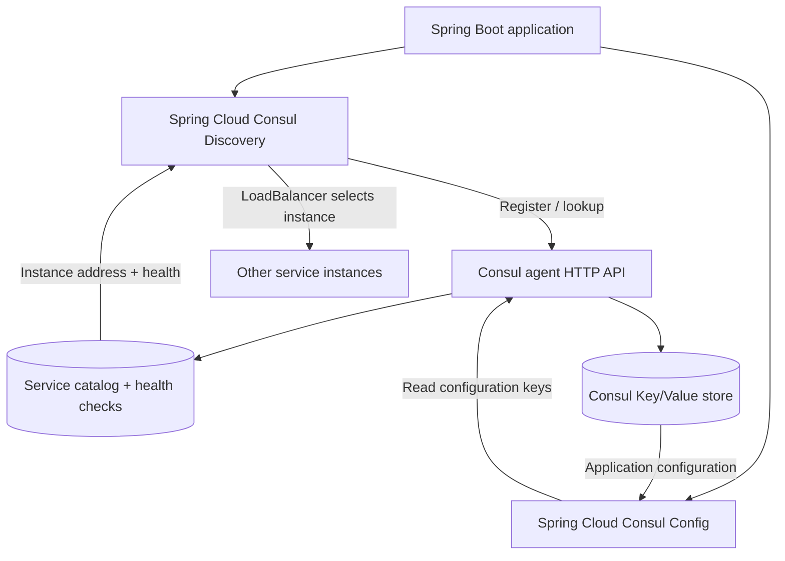

# Tách cấu hình Consul Discovery khỏi Consul Config

Spring Cloud Consul tích hợp ứng dụng Spring Boot với Consul qua hai nhóm chức năng độc lập: **Consul Discovery** dùng service catalog để đăng ký và tìm service instance; **Consul Config** dùng Key/Value store để nạp cấu hình ứng dụng từ bên ngoài. Cả hai có thể dùng cùng Consul cluster và cùng Consul agent endpoint, nhưng chúng giải quyết hai bài toán khác nhau, có dependency, namespace cấu hình và vòng đời riêng.

Một service có thể dùng Discovery mà không dùng Config, dùng Config mà không đăng ký service, hoặc bật cả hai. Tách rõ hai chức năng giúp tránh việc vô tình bật đăng ký service khi chỉ muốn đọc cấu hình, hoặc mong đợi Consul KV tự tạo ra service instance trong catalog.

## 1. Hai chức năng, hai loại dữ liệu

### Consul Discovery: tìm service instance

Discovery quản lý thông tin để các ứng dụng tìm được nhau. Service provider đăng ký service với Consul agent. Agent cập nhật service catalog và chạy health check đã khai báo. Consumer tra cứu service theo tên, nhận địa chỉ và port của các instance phù hợp, sau đó dùng Spring Cloud LoadBalancer hoặc cơ chế định tuyến khác để chọn instance.

Các dữ liệu thường thuộc Discovery:

- Service name và service ID.
- Instance ID của từng bản chạy.
- Node, hostname/IP và port có thể truy cập.
- Tags và metadata phục vụ nhận diện hoặc lọc instance.
- Health check và trạng thái `passing`, `warning`, `critical`.

Các API Consul thường liên quan gồm Agent Service API để đăng ký service và Health API/Catalog API để tra cứu. Ví dụ, agent nhận đăng ký qua endpoint `/v1/agent/service/register`; consumer có thể truy vấn trạng thái service qua `/v1/health/service/{service}`.

### Consul Config: nạp cấu hình ứng dụng

Config sử dụng Consul Key/Value store để lưu các giá trị cấu hình như URL của dependency, feature flag, giới hạn timeout, tên topic hoặc cấu hình theo môi trường. Spring Cloud Consul Config đọc các key theo context của ứng dụng và profile rồi đưa chúng vào Spring `Environment` trong quá trình khởi động.

Các dữ liệu thường thuộc Config:

- Cấu hình chung của ứng dụng.
- Cấu hình riêng theo `spring.application.name`.
- Cấu hình theo profile như `dev`, `staging`, `production`.
- File YAML/properties được lưu dưới một key KV.
- Thay đổi cấu hình được theo dõi bằng cơ chế watch nếu bật.

Config thường dùng Consul KV API, ví dụ endpoint `/v1/kv/{key}`. Một key KV không phải là một service instance và không được trả về bởi `DiscoveryClient.getInstances()`.

### So sánh nhanh

| Nội dung | Consul Discovery | Consul Config |
| --- | --- | --- |
| Mục tiêu | Đăng ký và tìm service instance | Lưu và phân phối cấu hình ứng dụng |
| Nguồn dữ liệu | Agent service registry, catalog và health checks | Consul Key/Value store |
| Dữ liệu tiêu biểu | Service name, instance ID, host, port, tags, health | YAML, properties, feature flags, URL và tham số ứng dụng |
| API chính | Agent Service, Catalog, Health | KV |
| Spring abstraction | `DiscoveryClient`, `ServiceRegistry`, `ServiceInstance` | Spring Config Data và `Environment` |
| Dependency thường dùng | `spring-cloud-starter-consul-discovery` | `spring-cloud-starter-consul-config` |
| Bật/tắt | `spring.cloud.consul.discovery.enabled` | `spring.cloud.consul.config.enabled` |
| Có tự đăng ký service không? | Có thể, nếu `discovery.register` bật | Không |
| Có tạo dữ liệu KV không? | Không | Không tự tạo; đọc dữ liệu đã được ghi vào KV |

## 2. Kiến trúc khi dùng riêng hoặc kết hợp

Hai tính năng có thể cùng kết nối đến một Consul agent, nhưng mỗi tính năng gọi API và đọc loại dữ liệu riêng.



Các kiểu triển khai thường gặp:

1. **Chỉ Discovery:** ứng dụng tự cấu hình bằng file hoặc environment variables, nhưng đăng ký và tìm service qua Consul.
2. **Chỉ Config:** ứng dụng lấy cấu hình từ Consul KV nhưng không đăng ký service và không dùng Consul để discovery.
3. **Discovery và Config:** ứng dụng vừa đăng ký/tìm instance, vừa nạp cấu hình tập trung.

Việc dùng chung Consul cluster không làm hai chức năng phụ thuộc bắt buộc vào nhau. Quyền truy cập KV và quyền truy cập service catalog cũng nên được cấp theo nhu cầu riêng.

## 3. Dependency cho từng chức năng

Spring Cloud Consul cung cấp starter riêng cho Discovery và Config. Cần dùng Spring Cloud BOM tương thích với phiên bản Spring Boot của dự án để quản lý version.

### Chỉ dùng Consul Discovery

Thêm dependency:

```xml
<dependency>
    <groupId>org.springframework.cloud</groupId>
    <artifactId>spring-cloud-starter-consul-discovery</artifactId>
</dependency>
```

Starter này tích hợp service registration và discovery với Consul. Nếu ứng dụng gọi service bằng Spring Cloud LoadBalancer, thêm starter LoadBalancer tương ứng:

```xml
<dependency>
    <groupId>org.springframework.cloud</groupId>
    <artifactId>spring-cloud-starter-loadbalancer</artifactId>
</dependency>
```

### Chỉ dùng Consul Config

Thêm dependency:

```xml
<dependency>
    <groupId>org.springframework.cloud</groupId>
    <artifactId>spring-cloud-starter-consul-config</artifactId>
</dependency>
```

Ứng dụng sẽ nạp cấu hình từ Consul KV. Chỉ thêm starter Discovery nếu ứng dụng còn cần đăng ký hoặc tra cứu service instance.

### Dùng cả hai

Khi ứng dụng cần cả service discovery và externalized configuration, khai báo cả hai starter:

```xml
<dependencies>
    <dependency>
        <groupId>org.springframework.cloud</groupId>
        <artifactId>spring-cloud-starter-consul-discovery</artifactId>
    </dependency>
    <dependency>
        <groupId>org.springframework.cloud</groupId>
        <artifactId>spring-cloud-starter-consul-config</artifactId>
    </dependency>
    <dependency>
        <groupId>org.springframework.cloud</groupId>
        <artifactId>spring-cloud-starter-loadbalancer</artifactId>
    </dependency>
</dependencies>
```

Không cần khai báo dependency Consul Server trong ứng dụng. Consul agent/server là hạ tầng chạy riêng; các starter chỉ là client integration trong ứng dụng Spring Boot.

## 4. Namespace cấu hình: `discovery` và `config`

Các thuộc tính của hai tính năng nằm dưới hai nhánh riêng của `spring.cloud.consul`:

```yaml
spring:
  cloud:
    consul:
      host: localhost
      port: 8500
      discovery:
        enabled: true
        register: true
      config:
        enabled: false
```

`host` và `port` xác định Consul agent endpoint mà Spring Cloud Consul sử dụng. Các thuộc tính bên dưới `discovery` điều khiển service registration và lookup; các thuộc tính bên dưới `config` điều khiển việc đọc KV và nạp cấu hình.

Hai cờ bật/tắt có phạm vi riêng:

- `spring.cloud.consul.discovery.enabled=false` tắt tích hợp discovery của ứng dụng. Nó không có nghĩa Config cũng bị tắt.
- `spring.cloud.consul.config.enabled=false` tắt tích hợp Config. Nó không ngăn ứng dụng đăng ký service nếu Discovery vẫn bật.

Khi cần cả hai, bật cả hai nhánh. Không đặt các thuộc tính Config như `prefix`, `format`, `data-key` bên dưới `discovery`; cũng không đặt `register`, `service-name` hoặc health-check properties bên dưới `config`.

## 5. Cấu hình Discovery độc lập

Ví dụ `payment-service` đăng ký service và health check với Consul nhưng lấy cấu hình từ `application.yml` hoặc environment variables:

```yaml
spring:
  application:
    name: payment-service
  cloud:
    consul:
      host: ${CONSUL_HOST:localhost}
      port: ${CONSUL_PORT:8500}
      discovery:
        enabled: true
        register: true
        service-name: payment-service
        instance-id: ${spring.application.name}:${spring.cloud.client.hostname}:${server.port}
        prefer-ip-address: true
        health-check-path: /actuator/health
        health-check-interval: 15s
      config:
        enabled: false

server:
  port: 8085

management:
  endpoints:
    web:
      exposure:
        include: health,info
```

Trong cấu hình này:

- `discovery.enabled` bật tích hợp Consul Discovery.
- `register` cho phép đăng ký service instance.
- `service-name` là tên logic mà consumer dùng để tra cứu.
- `instance-id` phân biệt từng bản chạy của service.
- `prefer-ip-address` yêu cầu quảng bá IP thay vì hostname nếu địa chỉ được chọn phù hợp với mạng.
- `health-check-path` và `health-check-interval` cấu hình HTTP health check mà Consul agent thực hiện.
- `config.enabled=false` xác nhận ứng dụng không nạp cấu hình từ Consul KV qua Consul Config.

Agent phải truy cập được địa chỉ và port health endpoint. Nếu ứng dụng chạy trong container, không dùng `localhost` trong địa chỉ health check nếu agent ở network namespace khác. Cần quảng bá hostname/IP có thể định tuyến từ Consul agent và consumer.

Ứng dụng Discovery-only vẫn có thể đọc cấu hình từ file YAML, environment variables, Kubernetes ConfigMap hoặc một hệ thống cấu hình khác. Việc không dùng Consul Config không ảnh hưởng đến khả năng đăng ký service.

## 6. Cấu hình Config độc lập

Một ứng dụng batch hoặc worker có thể lấy tham số từ Consul KV nhưng không cần xuất hiện trong service catalog. Với Spring Boot hỗ trợ Config Data API, khai báo Consul Config bằng `spring.config.import`.

Ví dụ `application.yml`:

```yaml
spring:
  application:
    name: invoice-batch
  config:
    import: optional:consul:
  cloud:
    consul:
      host: ${CONSUL_HOST:localhost}
      port: ${CONSUL_PORT:8500}
      discovery:
        enabled: false
      config:
        enabled: true
        format: YAML
        prefix: config
        default-context: application
        profile-separator: ","
        data-key: data
        fail-fast: false

server:
  port: 8090
```

Các điểm cần hiểu:

- `spring.config.import` yêu cầu Spring Boot nạp nguồn cấu hình Consul trong giai đoạn Config Data.
- `optional:consul:` cho phép ứng dụng tiếp tục khởi động nếu nguồn Consul Config không khả dụng. Bỏ `optional:` hoặc bật fail-fast theo cấu hình phù hợp nếu ứng dụng bắt buộc phải có cấu hình từ Consul.
- `format: YAML` cho biết nội dung KV được diễn giải như YAML.
- `prefix` là thư mục gốc trong KV.
- `default-context` là context cấu hình dùng chung.
- `profile-separator` phân tách tên application với profile trong key path.
- `data-key` là key chứa nội dung YAML/properties bên trong context.
- `discovery.enabled=false` ngăn ứng dụng đăng ký hoặc tra cứu service bằng Consul Discovery.

Tên thuộc tính và cách nạp Config Data có thể thay đổi theo phiên bản Spring Boot/Spring Cloud Consul. Với dự án dùng phiên bản cũ hơn Config Data API, cơ chế bootstrap có thể khác; hãy dùng đúng hướng dẫn của release train đang cài đặt.

### Ví dụ cấu trúc key trong Consul KV

Với `prefix=config`, `default-context=application`, `spring.application.name=invoice-batch`, profile `production` và `data-key=data`, các context thường có dạng:

```text
config/
├── application/data
├── application,production/data
├── invoice-batch/data
└── invoice-batch,production/data
```

Context chung cung cấp giá trị mặc định; context application ghi đè cấu hình chung; context profile cung cấp giá trị theo môi trường. Thứ tự ưu tiên cụ thể được Spring Cloud Consul Config áp dụng khi tạo property sources; cần kiểm tra effective properties khi nhiều context cùng khai báo một key.

Ví dụ nội dung YAML được lưu dưới key `config/invoice-batch,production/data`:

```yaml
invoice:
  export:
    bucket: invoice-production
    batch-size: 500
  downstream:
    timeout: 3s
```

Có thể ghi file YAML vào KV bằng Consul CLI, ví dụ:

```bash
consul kv put config/invoice-batch,production/data @invoice-production.yml
```

File `invoice-production.yml` là file cấu hình local được nạp vào KV; nó không phải file cấu hình service registration.

## 7. Bật đồng thời Discovery và Config

Một microservice thường vừa cần đăng ký service, vừa cần lấy cấu hình tập trung. Ví dụ `payment-service` có thể dùng Consul Config để lấy endpoint của hệ thống thanh toán bên ngoài và dùng Consul Discovery để các service khác tìm thấy chính nó.

```yaml
spring:
  application:
    name: payment-service
  config:
    import: consul:
  cloud:
    consul:
      host: ${CONSUL_HOST:localhost}
      port: ${CONSUL_PORT:8500}
      discovery:
        enabled: true
        register: true
        service-name: payment-service
        instance-id: ${spring.application.name}:${spring.cloud.client.hostname}:${server.port}
        prefer-ip-address: true
        health-check-path: /actuator/health
        health-check-interval: 15s
      config:
        enabled: true
        format: YAML
        prefix: config
        default-context: application
        profile-separator: ","
        data-key: data
        fail-fast: true

server:
  port: 8085

management:
  endpoints:
    web:
      exposure:
        include: health,info
```

Ở đây hai nhánh được cấu hình song song nhưng không dùng chung thuộc tính nghiệp vụ:

- Discovery đăng ký `payment-service`, công bố địa chỉ instance và health check.
- Config nạp các key như `payment.gateway.url`, `payment.timeout` từ KV vào Spring Environment.
- `spring.config.import: consul:` cùng `fail-fast: true` thể hiện ứng dụng yêu cầu Consul Config sẵn sàng khi khởi động. Nếu không cần tính bắt buộc, dùng `optional:consul:` và đặt `fail-fast: false`.

Không nên bật Config chỉ vì đã có Discovery starter hoặc ngược lại. Chỉ thêm từng tính năng khi ứng dụng có nhu cầu tương ứng.

## 8. Phân biệt hai vòng đời

Discovery và Config có thời điểm hoạt động khác nhau:

| Giai đoạn | Discovery | Config |
| --- | --- | --- |
| Khởi động ứng dụng | Tạo registration và gửi đến Consul agent nếu `register=true` | Đọc KV theo context/profile trong quá trình nạp Spring Environment |
| Sau khởi động | Gửi heartbeat/health check và phục vụ lookup | Ứng dụng đọc giá trị đã nạp từ Environment/beans |
| Thay đổi dữ liệu | Service registration, health và catalog được cập nhật | KV thay đổi; Config watch có thể phát hiện thay đổi nếu bật |
| Khi instance dừng | Deregister hoặc health/TTL xử lý trạng thái theo cấu hình | Không tự xóa key cấu hình trong KV |
| Consumer sử dụng | `DiscoveryClient`, `ServiceInstance`, LoadBalancer | `@Value`, `@ConfigurationProperties`, Spring Environment |

Một thay đổi KV không tự đăng ký lại service; một lần đăng ký service không tự thay đổi cấu hình ứng dụng. Hai cơ chế có thể cùng dùng Consul agent nhưng không chia sẻ cùng vòng đời.

## 9. Config Watch và cập nhật cấu hình lúc chạy

Consul Config có thể theo dõi thay đổi trong KV thông qua watch. Ví dụ:

```yaml
spring:
  cloud:
    consul:
      config:
        watch:
          enabled: true
          delay: 1000
```

Watch giúp ứng dụng phát hiện thay đổi cấu hình theo cơ chế và chu kỳ được hỗ trợ bởi phiên bản Spring Cloud Consul. Tuy nhiên, phát hiện KV thay đổi không có nghĩa mọi bean Java đều tự động được tạo lại. Những bean cần nhận giá trị mới phải tham gia cơ chế refresh phù hợp, ví dụ dùng `@RefreshScope` hoặc cơ chế cập nhật cấu hình được Spring Cloud hỗ trợ.

Không nên thay đổi liên tục các key cấu hình quan trọng mà không có quy trình rollout, kiểm tra và rollback. Với thay đổi ảnh hưởng đến kết nối database, credential hoặc cấu trúc bean, restart có kiểm soát có thể an toàn và dễ dự đoán hơn hot refresh.

Discovery cũng có cập nhật theo cơ chế riêng: health check, registration, catalog query và cache. Config Watch không thay thế health check và health check không theo dõi các thay đổi KV.

## 10. Kiểm tra từng chức năng độc lập

### Kiểm tra Discovery

Sau khi chạy provider với `discovery.register=true`, kiểm tra Consul UI hoặc gọi API:

```bash
# Xem các service trong catalog
curl http://localhost:8500/v1/catalog/services

# Xem các instance và trạng thái health của payment-service
curl http://localhost:8500/v1/health/service/payment-service

# Chỉ lấy instance đang passing
curl "http://localhost:8500/v1/health/service/payment-service?passing=true"
```

Nếu bật ACL, cần cung cấp token có quyền đọc service/health phù hợp. Kiểm tra cả host, port, instance ID và trạng thái check. Nếu service không xuất hiện, xem log ứng dụng và Consul agent để xác định registration có được gửi hay không.

### Kiểm tra Config

Kiểm tra KV key đã tồn tại:

```bash
# Đọc key cấu hình dạng YAML
consul kv get config/invoice-batch,production/data

# Liệt kê các key bên dưới prefix config
consul kv get -recurse config/
```

Sau đó khởi động ứng dụng với đúng `spring.application.name` và active profile. Xác minh giá trị đã được nạp qua log có kiểm soát hoặc một health/info endpoint nội bộ được bảo vệ. Không in secret hoặc toàn bộ Environment vào log.

## 11. ACL, TLS và phân quyền

Discovery và Config thường cần quyền khác nhau:

- Provider Discovery cần quyền đăng ký/cập nhật service của chính nó và thực hiện thao tác agent/check theo mô hình triển khai.
- Consumer Discovery cần quyền đọc catalog/health của các service được phép tìm.
- Config client cần quyền đọc các key KV trong prefix/context được cấp.
- Pipeline hoặc quản trị viên ghi Config cần quyền ghi KV; ứng dụng runtime thường không nên có quyền này nếu chỉ đọc cấu hình.

Nên cấp ACL token theo nguyên tắc quyền tối thiểu. Tránh dùng một token quản trị chung cho mọi microservice. Token nên được đưa vào qua secret manager hoặc cơ chế secret của nền tảng, không commit vào YAML hoặc image container.

TLS bảo vệ đường truyền đến Consul agent/server. Cần cấu hình chứng chỉ, CA trust và xác thực theo chính sách của môi trường. Không mở HTTP API agent, UI hoặc KV ra Internet công khai. Quyền đọc KV cần được giới hạn vì dữ liệu cấu hình có thể chứa endpoint nội bộ hoặc thông tin nhạy cảm.

Không lưu secret trực tiếp trong KV dạng văn bản nếu chính sách bảo mật không cho phép. Có thể lưu tham chiếu đến secret manager hoặc dùng cơ chế mã hóa/secret store phù hợp. Config watch cũng cần được xem xét về quyền đọc và phạm vi key mà ứng dụng có thể theo dõi.

## 12. Lỗi cấu hình thường gặp

| Triệu chứng | Nguyên nhân có thể | Hướng xử lý |
| --- | --- | --- |
| Ứng dụng đọc được KV nhưng không xuất hiện trong service catalog | Chỉ thêm Config starter hoặc `discovery.enabled=false` | Thêm Discovery starter và bật discovery registration |
| Service xuất hiện nhưng ứng dụng không lấy được cấu hình | Chỉ thêm Discovery starter hoặc Config import sai | Thêm Config starter, cấu hình `spring.config.import` và context KV |
| `DiscoveryClient` trả danh sách rỗng | Discovery bị tắt, service chưa đăng ký hoặc consumer thiếu quyền đọc | Kiểm tra `discovery.enabled`, registration, catalog và ACL |
| Ứng dụng không khởi động vì không tìm thấy Consul Config | Config import bắt buộc, Consul không khả dụng hoặc `fail-fast` bật | Kiểm tra kết nối; quyết định dùng optional hay fail-fast theo yêu cầu |
| KV có key nhưng property không được nạp | Sai prefix, context, profile separator, format hoặc data-key | Đối chiếu key path với cấu hình Config |
| YAML KV không parse được | Nội dung key không phải YAML hợp lệ hoặc `format` không đúng | Kiểm tra nội dung và đặt `format: YAML` |
| Sửa KV nhưng bean không đổi | Watch chưa bật hoặc bean không tham gia refresh | Kiểm tra watch và cơ chế refresh/restart của bean |
| Consul đánh dấu service `critical` | Agent không truy cập được health endpoint hoặc sai path/port | Gọi health endpoint từ network của agent và kiểm tra firewall |
| Config đọc được nhưng Discovery registration bị từ chối | Token chỉ có quyền KV, thiếu quyền service/agent | Cấp ACL riêng cho Discovery theo quyền tối thiểu |
| Discovery hoạt động nhưng Config bị `permission denied` | Token không có quyền đọc prefix KV | Kiểm tra ACL policy và prefix được cấp |

## 13. Tách cấu hình theo môi trường triển khai

Nên đặt địa chỉ Consul agent và các tùy chọn kết nối ở nguồn cấu hình có thể thay đổi theo môi trường. Có thể dùng environment variables cho host/port, còn cấu hình Discovery và Config được quản lý trong file application hoặc profile.

Ví dụ phân tách:

```text
application.yml
  - spring.application.name
  - cấu hình Discovery chung
  - mặc định Config an toàn

application-local.yml
  - Consul host localhost
  - Config optional hoặc tắt nếu không dùng local

application-production.yml
  - Consul host nội bộ
  - TLS và secret được cấp từ nền tảng
  - Config fail-fast nếu cấu hình tập trung là bắt buộc
  - Discovery registration và health check theo production
```

Không nên để profile production chứa token thật. Cũng không nên dùng cùng một Consul prefix cho mọi môi trường nếu ACL và context không tách biệt. Có thể dùng Consul datacenter/namespace hoặc prefix khác nhau, tùy mô hình tổ chức và phiên bản Consul.

## 14. Checklist lựa chọn và triển khai

- [ ] Đã xác định ứng dụng cần đăng ký/tìm service hay cần nạp cấu hình tập trung.
- [ ] Chỉ Discovery: có `spring-cloud-starter-consul-discovery` và cấu hình `spring.cloud.consul.discovery`.
- [ ] Chỉ Config: có `spring-cloud-starter-consul-config`, `spring.config.import` và cấu hình `spring.cloud.consul.config`.
- [ ] Dùng cả hai: khai báo cả hai starter và cấu hình hai nhánh riêng.
- [ ] `discovery.enabled` và `config.enabled` được bật/tắt độc lập theo nhu cầu.
- [ ] Discovery health check có thể được Consul agent truy cập.
- [ ] Config prefix, context, profile separator, format và data-key khớp với KV layout.
- [ ] Đã quyết định ứng dụng có thể khởi động khi Consul Config tạm thời không khả dụng hay không.
- [ ] Đã xác định cách refresh hoặc restart khi KV thay đổi.
- [ ] ACL token tách theo quyền service registration, service read và KV read/write.
- [ ] TLS, secret và mạng nội bộ được cấu hình an toàn.
- [ ] Đã kiểm tra riêng catalog/health và KV/property source sau triển khai.

Consul Discovery quản lý vòng đời service instance và health để các ứng dụng tìm thấy nhau; Consul Config đưa cấu hình từ KV vào Spring Environment. Hai tính năng có thể dùng chung Consul agent nhưng độc lập về starter, namespace cấu hình, API, quyền truy cập và vòng đời. Hãy chọn đúng dependency và bật đúng nhánh theo nhu cầu, sau đó kiểm tra service catalog và KV bằng hai quy trình riêng.
