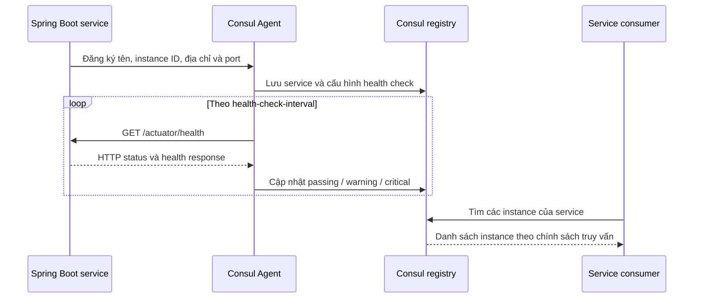

# Kiểm tra HTTP tới Actuator health và trạng thái passing, warning, critical

Trong Spring Cloud Service Discovery, đăng ký một instance vào Consul mới chỉ giúp các dịch vụ biết instance đó tồn tại. Client còn cần biết instance có đang nhận được lưu lượng hay không. Consul giải quyết phần này bằng health check: Consul Agent định kỳ gọi một endpoint của ứng dụng, ghi nhận kết quả vào registry và cung cấp trạng thái để client chọn instance phù hợp.

Bài học này tập trung vào HTTP health check gọi tới Spring Boot Actuator. Bạn sẽ cấu hình endpoint `/actuator/health`, hiểu Consul chuyển mã HTTP thành ba trạng thái `passing`, `warning`, `critical`, rồi kiểm tra kết quả từ ứng dụng và Consul. Đây là một phần trong vòng đời đăng ký, kiểm tra sức khỏe, load balancing và xử lý sai lệch registry khi triển khai microservice bằng Spring Cloud.

## 1. HTTP health check nằm ở đâu trong service discovery?

Một service thường được đăng ký với Consul cùng các thông tin như tên service, ID instance, địa chỉ IP và port. Khi có health check kiểu HTTP, Consul Agent sử dụng địa chỉ và port đã đăng ký, ghép với đường dẫn kiểm tra, sau đó gửi request theo chu kỳ.

Luồng cơ bản:



Có ba thành phần cần phân biệt:

- **Service registration** mô tả instance ở đâu và thuộc service nào.
- **Health check** xác minh instance có thể được truy cập và đáp ứng điều kiện kiểm tra hay không.
- **Service discovery** trả danh sách instance cho ứng dụng gọi dịch vụ. Spring Cloud có thể dùng `DiscoveryClient` và Spring Cloud LoadBalancer để tìm, chọn instance từ dữ liệu discovery.

Một instance có thể đã được đăng ký nhưng health check đang `critical`. Vì vậy, thấy service xuất hiện trong Consul Catalog chưa đủ để kết luận instance sẵn sàng nhận request.

## 2. Consul đánh giá HTTP response như thế nào?

Với HTTP health check, Consul gửi request tới URL đã cấu hình và chủ yếu đánh giá **mã trạng thái HTTP**. Consul không đọc nội dung JSON rồi tự diễn giải trường `status` của Actuator.

| Kết quả HTTP | Trạng thái Consul | Ý nghĩa |
| --- | --- | --- |
| Mã `2xx` | `passing` | Endpoint phản hồi thành công. |
| Mã `429` | `warning` | Endpoint phản hồi nhưng báo trạng thái cảnh báo theo quy ước của HTTP check. |
| Mã khác `2xx` và `429`, hoặc không kết nối được | `critical` | Kiểm tra thất bại; ví dụ endpoint trả `404`, `401`, `503`, bị timeout hoặc không truy cập được. |

Ví dụ, Actuator trả về:

```http
HTTP/1.1 200 OK
Content-Type: application/vnd.spring-boot.actuator.v3+json

{"status":"UP"}
```

Consul ghi nhận check là `passing` vì mã HTTP là `200`.

Nếu dependency quan trọng bị lỗi và Actuator trả:

```http
HTTP/1.1 503 Service Unavailable
Content-Type: application/vnd.spring-boot.actuator.v3+json

{"status":"DOWN"}
```

Consul ghi nhận `critical` vì mã HTTP là `503`. Nội dung `{"status":"DOWN"}` hữu ích cho người vận hành, nhưng chính mã `503` mới là tín hiệu HTTP mà Consul dùng để phân loại check.

Điểm cần nhớ: `warning` không tự động xuất hiện chỉ vì JSON của Actuator chứa một trạng thái có tên `WARNING`. Muốn Consul nhận `warning` qua HTTP check, endpoint phải trả mã `429`.

## 3. Cấu hình Actuator và Spring Cloud Consul

### 3.1. Thêm dependency

Ứng dụng cần Spring Boot Actuator để cung cấp endpoint health và Spring Cloud Consul Discovery để đăng ký service với Consul. Ví dụ dependency Maven:

```xml
<dependencies>
    <dependency>
        <groupId>org.springframework.boot</groupId>
        <artifactId>spring-boot-starter-actuator</artifactId>
    </dependency>

    <dependency>
        <groupId>org.springframework.cloud</groupId>
        <artifactId>spring-cloud-starter-consul-discovery</artifactId>
    </dependency>
</dependencies>
```

Hãy quản lý phiên bản Spring Boot và Spring Cloud bằng các BOM tương thích với nhau theo release train của dự án; không tự chọn hai phiên bản độc lập chỉ dựa trên ví dụ này.

### 3.2. Mở endpoint health và khai báo HTTP check

Ví dụ `application.yml` cho service tên `order-service`:

```yaml
spring:
  application:
    name: order-service
  cloud:
    consul:
      host: localhost
      port: 8500
      discovery:
        register: true
        health-check-path: /actuator/health
        health-check-interval: 10s
        query-passing: true

management:
  endpoints:
    web:
      exposure:
        include: health
  endpoint:
    health:
      show-details: never
```

Các thuộc tính quan trọng:

- `spring.application.name` là tên service mà các consumer dùng để tìm kiếm.
- `spring.cloud.consul.discovery.register` bật đăng ký instance với Consul.
- `health-check-path` chỉ định đường dẫn HTTP mà Consul Agent gọi. Đường dẫn mặc định thường là `/actuator/health`; khai báo tường minh giúp cấu hình dễ đọc và dễ đối chiếu.
- `health-check-interval` đặt chu kỳ kiểm tra. Ví dụ `10s` nghĩa là Agent kiểm tra định kỳ mỗi 10 giây.
- `query-passing: true` yêu cầu truy vấn discovery chỉ trả về instance có check ở trạng thái `passing`. Khi dùng tùy chọn này, instance `warning` hoặc `critical` sẽ không nằm trong kết quả truy vấn passing.
- `management.endpoints.web.exposure.include` cho phép truy cập endpoint health qua HTTP.
- `show-details: never` tránh đưa chi tiết nội bộ của các health indicator ra response HTTP. Consul chỉ cần mã trạng thái để kiểm tra.

Các tên thuộc tính và mặc định có thể thay đổi theo phiên bản Spring Cloud Consul. Hãy đối chiếu cấu hình với phiên bản dependency thực tế của ứng dụng.

### 3.3. Đảm bảo Agent gọi đúng địa chỉ

Consul Agent phải truy cập được địa chỉ và port đã đăng ký. Kiểm tra các trường hợp sau khi triển khai:

- Ứng dụng chạy trong container nhưng đăng ký `localhost`; từ góc nhìn của Consul Agent, `localhost` có thể trỏ tới chính container hoặc máy khác với dự kiến.
- Actuator dùng `management.server.port` riêng, trong khi service đăng ký port ứng dụng. Khi đó cần cấu hình URL/port health check phù hợp với phiên bản Spring Cloud Consul và topology thực tế.
- Ứng dụng đổi `management.endpoints.web.base-path` hoặc đổi base path của health endpoint nhưng `health-check-path` vẫn giữ giá trị cũ.
- Firewall, network policy, proxy hoặc cấu hình TLS ngăn Consul Agent kết nối tới endpoint.

Hãy kiểm tra URL từ chính môi trường mạng mà Consul Agent sử dụng. Một lệnh `curl` chạy thành công trên máy phát triển chưa chứng minh Agent cũng truy cập được URL đó.

## 4. Kiểm tra kết quả từ ứng dụng và Consul

Trước tiên, gọi trực tiếp endpoint của ứng dụng:

```bash
curl -i http://localhost:8080/actuator/health
```

Khi ứng dụng khỏe, kết quả thường có mã `200` và body chứa `"status":"UP"`. Nếu ứng dụng đang ở môi trường container hoặc host khác, thay `localhost:8080` bằng địa chỉ mà Consul Agent thực sự truy cập.

Tiếp theo, xem các health check của service qua HTTP API của Consul:

```bash
curl http://localhost:8500/v1/health/checks/order-service
```

API trả danh sách check gắn với service, trong đó trường `Status` thể hiện `passing`, `warning` hoặc `critical`. Có thể xem các instance đang passing bằng:

```bash
curl "http://localhost:8500/v1/health/service/order-service?passing"
```

Bạn cũng có thể mở giao diện Consul UI, chọn service `order-service`, rồi xem từng instance và health check tương ứng. Khi đối chiếu, hãy kiểm tra đúng service ID, địa chỉ, port và thời điểm cập nhật; một service có thể có nhiều instance và mỗi instance có trạng thái riêng.

## 5. Ánh xạ trạng thái Actuator sang mã HTTP

Spring Boot Actuator có cơ chế ánh xạ trạng thái sức khỏe sang HTTP status. Theo cấu hình mặc định, `DOWN` và `OUT_OF_SERVICE` thường trả `503`; `UP` trả `200`. Vì Consul đánh giá mã HTTP, ánh xạ này giúp trạng thái lỗi của ứng dụng được phản ánh thành `critical` trong registry.

Nếu hệ thống thực sự cần trạng thái cảnh báo, có thể tạo một `HealthIndicator` trả về trạng thái tùy chỉnh `WARNING` và ánh xạ trạng thái đó sang HTTP `429`. Ví dụ cấu hình:

```yaml
management:
  endpoint:
    health:
      status:
        http-mapping:
          down: 503
          out-of-service: 503
          warning: 429
```

Sau đó, một health indicator có thể trả về trạng thái `WARNING` khi dịch vụ vẫn xử lý request nhưng đang có điều kiện cần theo dõi. Hãy giữ lại ánh xạ `down` và `out-of-service` khi khai báo mapping tùy chỉnh để lỗi nghiêm trọng tiếp tục trả `503`.

Chỉ dùng `warning` khi consumer và đội vận hành đã thống nhất ý nghĩa của trạng thái này. Nếu bật `query-passing: true`, instance `warning` sẽ bị loại khỏi truy vấn passing giống như instance không khỏe; vì vậy hãy cân nhắc liệu trạng thái cảnh báo có nên tiếp tục nhận traffic hay không.

## 6. Chọn nội dung health check phù hợp

Endpoint health nên phản ánh khả năng phục vụ request của instance. Nếu chỉ kiểm tra tiến trình còn chạy, instance có thể được đánh dấu `passing` dù database hoặc dependency thiết yếu đã mất kết nối. Ngược lại, đưa mọi dependency phụ vào health check có thể khiến cả service bị loại khỏi discovery khi một thành phần không ảnh hưởng đến luồng nghiệp vụ chính gặp sự cố.

Với Spring Boot, có thể dùng health group để tách readiness khỏi các thông tin sức khỏe khác. Ví dụ, nếu phiên bản Spring Boot và cấu hình ứng dụng đã bật readiness probe, có thể trỏ Consul tới `/actuator/health/readiness`. Chỉ sử dụng đường dẫn này sau khi xác minh health group thực sự tồn tại và được expose qua HTTP; nếu không, Consul sẽ nhận `404` và chuyển check sang `critical`.

Một endpoint phù hợp cần đáp ứng các tiêu chí:

1. Trả lời nhanh và ổn định để không tạo timeout giả.
2. Được Consul Agent truy cập qua mạng nội bộ bằng đúng địa chỉ và port đã đăng ký.
3. Phản ánh các điều kiện thật sự quyết định instance có thể nhận traffic.
4. Không tiết lộ credential, connection string hoặc chi tiết hạ tầng trong response.
5. Có hành vi HTTP status nhất quán giữa môi trường local, staging và production.

Nếu endpoint yêu cầu xác thực, hãy cấu hình cơ chế truy cập phù hợp cho Consul Agent theo phiên bản Spring Cloud Consul đang dùng. Không nên mở rộng endpoint chi tiết ra Internet chỉ để health check hoạt động.

## 7. Xử lý các tình huống thường gặp

| Hiện tượng | Nguyên nhân cần kiểm tra | Cách xử lý |
| --- | --- | --- |
| Ứng dụng trả `200` khi gọi local nhưng Consul báo `critical` | Agent dùng địa chỉ hoặc port khác; sai network route; firewall chặn; URL đăng ký không truy cập được từ Agent | Kiểm tra địa chỉ instance trong Consul và gọi đúng URL từ cùng network với Agent. |
| Consul nhận `404` | Sai `health-check-path`; đổi Actuator base path; health group chưa được tạo hoặc expose | Đồng bộ lại path và xác minh endpoint bằng `curl -i`. |
| Consul nhận `401` hoặc `403` | Security filter yêu cầu xác thực hoặc chặn request từ Agent | Cấp quyền truy cập tối thiểu cho Agent hoặc cấu hình header được hỗ trợ. |
| Consul nhận `503` | Actuator báo `DOWN`/`OUT_OF_SERVICE`; health indicator phụ thuộc bị lỗi; ứng dụng chưa sẵn sàng | Đọc response health trong môi trường nội bộ và xác định indicator gây lỗi. |
| Trạng thái chuyển `critical` dù endpoint đôi lúc trả `200` | Endpoint phản hồi chậm, timeout, lỗi mạng chập chờn hoặc chu kỳ kiểm tra quá dày | Đo thời gian phản hồi, xử lý nguyên nhân chậm và chọn interval phù hợp. |
| Instance ở `warning` nhưng không xuất hiện khi discovery | Đang bật `query-passing: true` nên chỉ instance passing được truy vấn | Kiểm tra check trả `429`; quyết định warning có được phép nhận traffic hay không. |
| Service có trong Catalog nhưng consumer không tìm thấy instance | Instance đã đăng ký nhưng health check không passing, hoặc consumer đang lọc passing | Xem `/v1/health/checks/{service}` và cấu hình truy vấn discovery. |

Health check chạy theo chu kỳ nên trạng thái trong Consul có thể trễ so với thay đổi vừa xảy ra trong ứng dụng. Khi điều tra, hãy so sánh thời điểm request, thời điểm check gần nhất và interval đã cấu hình.

## 8. Quy trình kiểm tra nhanh

Khi một instance không được chọn bởi service discovery, thực hiện lần lượt:

1. Xác nhận instance đã đăng ký đúng tên, ID, địa chỉ và port trong Consul.
2. Đọc `health-check-path` và ghép với địa chỉ/port thực tế để xác định URL đầy đủ.
3. Gọi URL đó từ môi trường mạng của Consul Agent và xem cả HTTP status lẫn response body.
4. Đọc danh sách check qua `/v1/health/checks/{service}` để xác định check nào đang lỗi.
5. Nếu check `critical`, xử lý lỗi kết nối, path, quyền truy cập hoặc health indicator. Nếu check `warning`, kiểm tra vì sao endpoint trả `429`.
6. Kiểm tra chính sách truy vấn của consumer, đặc biệt `query-passing`, rồi xác minh instance đã xuất hiện trong kết quả discovery.

Kết hợp log của ứng dụng, log Consul Agent và health API sẽ giúp phân biệt lỗi trong ứng dụng với lỗi mạng hoặc cấu hình registry.

## 9. Ghi nhớ

- Đăng ký service và health check là hai việc khác nhau: instance có thể tồn tại trong registry nhưng không khỏe.
- Consul HTTP check phân loại dựa trên mã HTTP: `2xx` là `passing`, `429` là `warning`, các kết quả khác hoặc lỗi kết nối là `critical`.
- Actuator cung cấp thông tin sức khỏe; HTTP status mapping quyết định tín hiệu mà Consul nhìn thấy.
- Endpoint phải truy cập được từ Consul Agent qua địa chỉ và port đã đăng ký.
- `query-passing: true` giúp consumer chỉ nhận instance passing, nhưng cũng có nghĩa instance warning bị loại khỏi kết quả truy vấn.

Khi các quy tắc này được cấu hình nhất quán, Consul có thể cung cấp danh sách instance đáng tin cậy hơn cho `DiscoveryClient` và Spring Cloud LoadBalancer, giúp các microservice tránh gửi request tới instance đang gặp sự cố.
