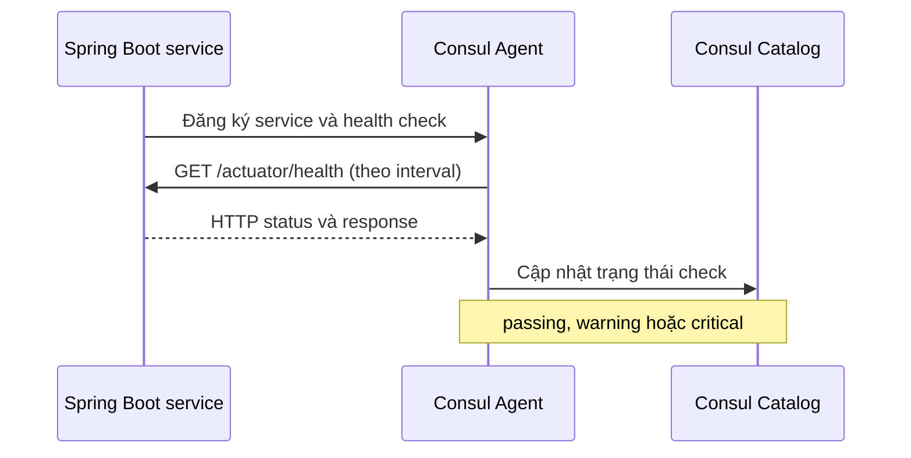
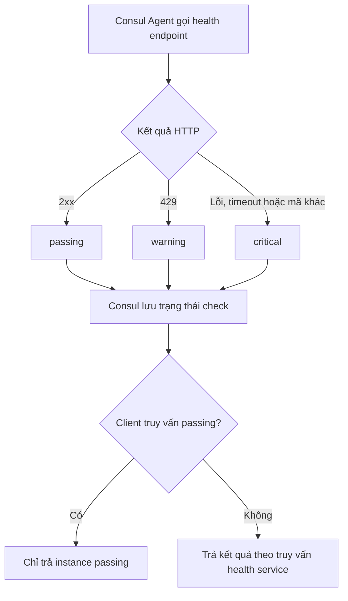

# Cấu hình đường dẫn, chu kỳ và thời gian chờ kiểm tra sức khỏe

Trong Spring Cloud Service Discovery, đăng ký một instance vào Consul mới chỉ cho Consul biết tên dịch vụ, địa chỉ và cổng của instance. Để biết instance đó có còn phục vụ request được hay không, Consul cần thực hiện health check. Spring Cloud Consul hỗ trợ cấu hình endpoint kiểm tra, chu kỳ gọi và thời gian chờ thông qua các thuộc tính `spring.cloud.consul.discovery.health-check-*`.

Ba tham số cần hiểu rõ là:

- **Đường dẫn (`health-check-path`):** endpoint mà Consul gọi để kiểm tra trạng thái ứng dụng.
- **Chu kỳ (`health-check-interval`):** khoảng thời gian giữa các lần kiểm tra.
- **Thời gian chờ (`health-check-timeout`):** thời lượng tối đa Consul chờ một lần kiểm tra hoàn tất trước khi coi lần kiểm tra đó là thất bại.

Đường dẫn sai có thể khiến một ứng dụng đang chạy bị đánh dấu không khỏe. Chu kỳ quá dài làm phát hiện sự cố chậm; thời gian chờ quá ngắn có thể tạo ra cảnh báo giả khi hệ thống đang chịu tải. Vì vậy, cần cấu hình ba tham số dựa trên endpoint thực tế và đặc tính vận hành của dịch vụ.

## 1. Cơ chế HTTP health check mặc định

Khi ứng dụng dùng Spring Cloud Consul Discovery và đăng ký dịch vụ, Spring Cloud Consul mặc định tạo một HTTP health check trong Consul. Consul Agent chịu trách nhiệm gửi request đến endpoint của instance. Với ứng dụng Spring Boot có Actuator, đường dẫn mặc định là `/actuator/health`; chu kỳ mặc định là `10s`.

Luồng cơ bản:



Consul thực hiện health check từ góc nhìn mạng của Consul Agent. Vì vậy, endpoint phải truy cập được từ agent thực hiện check, không chỉ truy cập được từ máy phát triển hoặc từ bên trong ứng dụng. Địa chỉ service, cổng, giao thức, DNS, firewall và network policy đều có thể ảnh hưởng kết quả.

HTTP check gửi `GET` theo mặc định. Consul đánh giá trạng thái dựa trên mã HTTP trả về:

| Mã phản hồi | Trạng thái check | Ý nghĩa |
|---|---|---|
| `200`–`299` | `passing` | Endpoint phản hồi thành công |
| `429` | `warning` | Endpoint đang giới hạn request |
| Các mã khác hoặc request thất bại | `critical` | Check không đạt, ví dụ 404, 503, lỗi kết nối hoặc timeout |

Consul không mặc định phân tích JSON body của Actuator để tự diễn giải các trường `status` hoặc `components`; mã HTTP là tín hiệu quan trọng của HTTP check. Spring Boot Actuator ánh xạ trạng thái health thành HTTP status theo cấu hình health endpoint và status mapping của ứng dụng.

## 2. Cấu hình đường dẫn health check

Thuộc tính `spring.cloud.consul.discovery.health-check-path` xác định path mà Consul dùng để gọi health endpoint. Giá trị mặc định là `/actuator/health`.

Ví dụ cấu hình ứng dụng:

```yaml
spring:
  application:
    name: catalog-service
  cloud:
    consul:
      host: consul-agent.internal
      port: 8500
      discovery:
        register: true
        register-health-check: true
        health-check-path: /actuator/health
```

Ứng dụng cần có Spring Boot Actuator và health endpoint phải được bật, có thể truy cập tại path đã khai báo. Nếu endpoint đã đổi path, hãy cập nhật thuộc tính discovery tương ứng. Ví dụ, khi ứng dụng có context path `/catalog`, endpoint có thể là `/catalog/actuator/health`; khi management server dùng context path riêng `/ops`, endpoint có thể là `/ops/actuator/health`. Hãy xác nhận URL thực tế theo cấu hình `server.servlet.context-path`, `management.server.servlet.context-path` và `management.endpoints.web.base-path` của ứng dụng.

Ví dụ cấu hình khi management endpoint được đặt dưới context path `/ops`:

```yaml
management:
  server:
    servlet:
      context-path: /ops

spring:
  cloud:
    consul:
      discovery:
        health-check-path: /ops/actuator/health
```

Không ghép context path hai lần. Nếu endpoint đã nằm dưới `/ops/actuator/health`, cấu hình path thành `/ops/ops/actuator/health` sẽ khiến Consul nhận lỗi 404. Tương tự, nếu management server chạy trên port riêng, cần kiểm tra service và management service được Spring Cloud Consul đăng ký cùng endpoint mà từng health check thực sự sử dụng.

Nếu cần chỉ định một URL đầy đủ để ghi đè cách Spring Cloud Consul dựng URL từ địa chỉ service và path, có thể xem xét `spring.cloud.consul.discovery.health-check-url`. Thuộc tính này hữu ích khi endpoint kiểm tra nằm ở host hoặc port khác. Chỉ dùng URL có thể truy cập được từ Consul Agent.

Để tắt việc đăng ký HTTP health check, có thể đặt:

```yaml
spring:
  cloud:
    consul:
      discovery:
        register-health-check: false
```

Đây là lựa chọn có chủ đích cho môi trường hoặc loại service không cung cấp endpoint phù hợp. Khi tắt check, Consul không còn tín hiệu HTTP định kỳ để xác nhận instance còn khỏe.

## 3. Cấu hình chu kỳ kiểm tra

`spring.cloud.consul.discovery.health-check-interval` quyết định tần suất Consul Agent gọi endpoint. Giá trị mặc định của Spring Cloud Consul là `10s`. Có thể dùng chuỗi thời lượng như `10s`, `15s` hoặc `1m`.

```yaml
spring:
  cloud:
    consul:
      discovery:
        health-check-path: /actuator/health
        health-check-interval: 15s
```

Chu kỳ ngắn giúp phát hiện endpoint ngừng hoạt động sớm hơn, nhưng làm tăng số request kiểm tra và công việc của agent cùng ứng dụng. Chu kỳ dài giảm tần suất kiểm tra nhưng kéo dài khoảng thời gian trước khi Consul nhận ra sự cố. Ví dụ, một service có 40 instance và interval `10s` tạo ra xấp xỉ 4 lần kiểm tra mỗi giây cho toàn bộ các instance, nếu mỗi instance có một HTTP check như cấu hình ví dụ.

Khi chọn interval, cần cân nhắc:

- **Mức độ quan trọng của dịch vụ:** dịch vụ xử lý giao dịch quan trọng có thể cần phát hiện lỗi nhanh hơn một dịch vụ nền ít ảnh hưởng.
- **Tải của endpoint:** health endpoint nên nhẹ, không thực hiện truy vấn nặng hoặc gọi tuần tự nhiều hệ thống phụ thuộc ở mỗi lần check.
- **Số lượng instance:** hàng trăm instance với interval rất ngắn có thể tạo lượng request kiểm tra đáng kể.
- **Khả năng chịu lỗi tạm thời:** mạng có thể chậm trong thời gian ngắn; interval và timeout cần tránh biến dao động nhỏ thành chuỗi cảnh báo liên tục.

Không nên chọn interval chỉ để đạt thời gian phát hiện thấp nhất. Hãy đo chi phí endpoint và thời gian phát hiện sự cố thực tế trong môi trường có tải.

## 4. Cấu hình thời gian chờ

`spring.cloud.consul.discovery.health-check-timeout` đặt giới hạn thời gian cho một lần kiểm tra. Nếu endpoint không trả kết quả trong khoảng thời gian này, lần kiểm tra được xem là thất bại.

```yaml
spring:
  cloud:
    consul:
      discovery:
        health-check-interval: 15s
        health-check-timeout: 3s
```

Trong ví dụ, Consul có thể chờ tối đa 3 giây cho một request health check, còn chu kỳ kiểm tra được đặt là 15 giây. Đây là giá trị minh họa; cần điều chỉnh dựa trên độ trễ bình thường và mức tải của hệ thống.

Trong bảng thuộc tính Spring Cloud Consul, `health-check-timeout` không có giá trị mặc định được khai báo. Nếu không đặt thuộc tính này, Consul sử dụng mặc định của HTTP check; tài liệu Consul hiện hành nêu mặc định là `10s`. Nên cấu hình rõ timeout khi cần kiểm soát thời gian phát hiện lỗi và tránh hiểu nhầm rằng giá trị trống có nghĩa là chờ vô hạn.

Phân biệt hai thuộc tính có tên gần giống nhau:

| Thuộc tính | Điều khiển điều gì? | Ví dụ |
|---|---|---|
| `health-check-timeout` | Thời gian tối đa cho một request check | `3s` |
| `health-check-critical-timeout` | Khoảng thời gian service ở trạng thái `critical` trước khi Consul tự deregister service | `30m` |

`health-check-critical-timeout` không phải timeout của HTTP request. Đây là cơ chế dọn đăng ký sau khi service đã ở trạng thái lỗi kéo dài; chỉ cấu hình khi chính sách vận hành cho phép tự động xóa đăng ký và phiên bản Consul đang dùng hỗ trợ thuộc tính đó.

Một số nguyên tắc chọn timeout:

1. Đo thời gian phản hồi bình thường của health endpoint trong điều kiện tải đại diện.
2. Đặt timeout lớn hơn độ trễ bình thường có biên dự phòng hợp lý.
3. Đặt timeout đủ ngắn để phát hiện endpoint treo trong thời gian chấp nhận được.
4. Thường chọn timeout nhỏ hơn interval để mỗi lần kiểm tra có giới hạn rõ ràng trước chu kỳ tiếp theo.
5. Nếu endpoint phụ thuộc database hoặc dịch vụ khác, xác định rõ health check đang kiểm tra khả năng sống của tiến trình hay mức độ sẵn sàng của toàn bộ dependency.

Timeout quá ngắn có thể làm instance khỏe bị đánh dấu `critical` khi hệ thống chịu tải hoặc mạng dao động. Timeout quá dài khiến Consul mất nhiều thời gian mới ghi nhận một lần kiểm tra thất bại.

## 5. Ví dụ cấu hình hoàn chỉnh

Ví dụ sau dùng Actuator health endpoint, kiểm tra mỗi 15 giây và giới hạn thời gian chờ ở 3 giây:

```yaml
server:
  port: 8080

management:
  endpoints:
    web:
      exposure:
        include: health,info
  endpoint:
    health:
      show-details: never

spring:
  application:
    name: catalog-service
  cloud:
    consul:
      host: localhost
      port: 8500
      discovery:
        register: true
        register-health-check: true
        health-check-path: /actuator/health
        health-check-interval: 15s
        health-check-timeout: 3s
        query-passing: true
```

Ý nghĩa các thuộc tính chính:

| Thuộc tính | Ý nghĩa |
|---|---|
| `register` | Cho phép đăng ký service với Consul |
| `register-health-check` | Đăng ký health check cùng service; mặc định là `true` |
| `health-check-path` | Path mà HTTP check gọi; mặc định `/actuator/health` |
| `health-check-interval` | Chu kỳ kiểm tra; mặc định `10s` |
| `health-check-timeout` | Giới hạn thời gian chờ cho một lần check; nếu bỏ trống, Consul áp dụng mặc định của HTTP check |
| `query-passing` | Khi `true`, yêu cầu truy vấn health service chỉ trả các instance có check `passing` |

`query-passing` có ý nghĩa với phía ứng dụng tra cứu dịch vụ: nó yêu cầu Consul lọc danh sách instance theo trạng thái passing. Thuộc tính này mặc định là `false`, vì vậy không nên mặc định rằng mọi truy vấn discovery đều tự loại bỏ instance không khỏe. Nếu muốn client nhận danh sách đã lọc theo health check, hãy cấu hình thuộc tính này phù hợp và kiểm thử hành vi của phiên bản Spring Cloud Consul đang dùng.

## 6. Cách health check ảnh hưởng đến service discovery

Health check cập nhật trạng thái của instance trong Consul Catalog. Trạng thái này là tín hiệu để các thành phần khác quyết định instance nào nên được sử dụng.



Health check và discovery là hai bước liên quan nhưng khác nhau. Consul ghi nhận trạng thái check; ứng dụng gọi dịch vụ cần truy vấn theo chính sách phù hợp. `query-passing=true` giúp Spring Cloud Consul yêu cầu Consul chỉ trả các instance passing. Nếu không bật, ứng dụng phải hiểu rằng danh sách trả về có thể chứa instance đang warning hoặc critical, tùy loại truy vấn và dữ liệu trong Consul.

Health check cũng không thay thế load balancing, retry hay circuit breaker. Nó cung cấp tín hiệu sức khỏe để quá trình discovery hoặc thành phần định tuyến sử dụng. Ứng dụng vẫn cần xử lý lỗi mạng và lỗi xảy ra giữa hai lần kiểm tra.

## 7. Headers, HTTPS và bảo vệ health endpoint

Nếu health endpoint yêu cầu header xác thực, Spring Cloud Consul hỗ trợ cấu hình `spring.cloud.consul.discovery.health-check-headers`. Ví dụ minh họa:

```yaml
spring:
  cloud:
    consul:
      discovery:
        health-check-headers:
          X-Health-Check-Key: ${CONSUL_HEALTH_CHECK_KEY}
```

Giá trị bí mật nên được cấp qua secret manager hoặc biến môi trường được bảo vệ. Không commit token thật vào repository hoặc đặt bí mật trong tài liệu cấu hình mẫu.

Với endpoint HTTPS, Consul mặc định xác minh chứng chỉ TLS. Chứng chỉ cần hợp lệ với hostname được gọi và agent phải tin cậy CA tương ứng. Thuộc tính `spring.cloud.consul.discovery.health-check-tls-skip-verify` có thể bỏ qua xác minh chứng chỉ, nhưng làm giảm khả năng xác thực máy chủ và không nên bật trong production như một cách sửa lỗi chứng chỉ. Hãy cài CA đúng hoặc dùng hostname khớp chứng chỉ.

Health endpoint cũng cần tránh lộ thông tin nội bộ. Có thể giới hạn chi tiết trả về từ Actuator, giới hạn network access và chỉ cấp quyền truy cập cho các Consul Agent cần thực hiện check. Nếu endpoint yêu cầu xác thực, cấu hình header phải tương thích với chính sách bảo mật và vòng đời secret.

## 8. HTTP check và TTL heartbeat

HTTP check là cơ chế mặc định: Consul Agent chủ động gọi endpoint của service. Spring Cloud Consul cũng hỗ trợ TTL check, trong đó ứng dụng chủ động gửi heartbeat đến Consul Agent. Đây là hai cách cung cấp tín hiệu sức khỏe khác nhau.

Ví dụ bật heartbeat TTL:

```yaml
spring:
  cloud:
    consul:
      discovery:
        heartbeat:
          enabled: true
          ttl: 30s
```

Với TTL check, ứng dụng phải gửi cập nhật trạng thái đúng hạn. Nếu Consul không nhận được heartbeat trước khi TTL hết hạn, check chuyển sang `critical`. Thuộc tính `heartbeat.ttl` là thời hạn heartbeat, không phải `health-check-timeout` của HTTP request và cũng không phải `health-check-interval` của HTTP check.

TTL có thể hữu ích khi Consul Agent không thể chủ động gọi endpoint của ứng dụng nhưng ứng dụng có thể gửi heartbeat ra ngoài. Đổi lại, ứng dụng phải thực hiện heartbeat đáng tin cậy và có chiến lược xử lý khi không gửi được. Không nên bật TTL chỉ vì muốn thay đổi chu kỳ HTTP check; với HTTP check, hãy cấu hình `health-check-interval` và `health-check-timeout`.

## 9. Kiểm tra và xử lý sự cố

Khi một instance liên tục ở trạng thái `critical`, hãy kiểm tra từ chính vị trí mạng của Consul Agent:

1. **Xác nhận URL:** kiểm tra scheme, hostname, port, context path, management context path và endpoint base path. Path phải trỏ đúng tới health endpoint thực tế.
2. **Gọi endpoint:** gửi request từ node hoặc container có Consul Agent. Ví dụ: `curl -i http://127.0.0.1:8080/actuator/health`. Kiểm tra mã HTTP, DNS, route và firewall.
3. **Kiểm tra Actuator:** xác nhận dependency Actuator có mặt, health endpoint được bật và được expose qua web.
4. **Kiểm tra timeout:** so sánh thời gian phản hồi thực tế với `health-check-timeout`; xem log ứng dụng và Consul Agent để phân biệt timeout với lỗi HTTP.
5. **Kiểm tra interval:** xác nhận giá trị duration đã được nạp đúng từ profile và không quá ngắn so với tải của endpoint.
6. **Kiểm tra TLS và headers:** xác minh CA, hostname, chứng chỉ, header xác thực và quyền truy cập endpoint.
7. **Kiểm tra truy vấn discovery:** xác nhận `query-passing` có được bật nếu ứng dụng chỉ muốn nhận instance passing.

Một số triệu chứng thường gặp:

| Triệu chứng | Nguyên nhân thường gặp | Hướng xử lý |
|---|---|---|
| Check trả `404` | Sai `health-check-path`, context path hoặc base path | Gọi endpoint thực tế và cập nhật path |
| Check trả `401` hoặc `403` | Endpoint yêu cầu xác thực hoặc chặn agent | Cấu hình header phù hợp và quyền truy cập |
| Check trả `503` | Actuator báo trạng thái không khỏe hoặc ứng dụng chưa sẵn sàng | Xem chi tiết health indicator và dependency |
| Check timeout | Endpoint chậm, mạng lỗi hoặc timeout đặt quá thấp | Đo latency, kiểm tra mạng và điều chỉnh timeout |
| Check luôn `critical` dù ứng dụng hoạt động | Agent gọi sai host/port hoặc không truy cập được endpoint | Kiểm tra service address và kết nối từ agent |
| Instance lỗi vẫn xuất hiện trong kết quả discovery | Truy vấn không lọc trạng thái passing | Đánh giá và bật `query-passing` nếu phù hợp |

Sau khi sửa cấu hình, xác nhận Consul Agent đã nhận cấu hình health check mới và trạng thái check đã cập nhật. Không chỉ dựa vào việc ứng dụng khởi động thành công: đăng ký service thành công không chứng minh health endpoint có thể được agent truy cập.

## 10. Kết luận

Trong Spring Cloud Consul, `health-check-path` xác định endpoint, `health-check-interval` điều khiển tần suất kiểm tra và `health-check-timeout` giới hạn thời gian chờ cho từng request. Giá trị mặc định thường dùng là `/actuator/health` và `10s`; timeout HTTP của Consul cũng mặc định là `10s` nếu không được đặt rõ. Cấu hình đúng phải phản ánh path thực tế, khả năng truy cập từ Consul Agent và độ trễ bình thường của ứng dụng.

Health check cung cấp trạng thái cho Consul, còn việc lọc instance trong discovery cần được cấu hình và kiểm chứng riêng. Khi triển khai, hãy kết hợp endpoint nhẹ, interval và timeout phù hợp, kiểm tra TLS/header, rồi xác nhận client chỉ nhận các instance đáp ứng chính sách sức khỏe mong muốn.

## Tài liệu tham khảo

- [Spring Cloud Consul — Service Discovery và HTTP Health Check](https://docs.spring.io/spring-cloud-consul/reference/discovery.html)
- [Spring Cloud Consul — Common Application Properties](https://docs.spring.io/spring-cloud-consul/reference/appendix.html)
- [HashiCorp Consul — Health Check Configuration Reference](https://developer.hashicorp.com/consul/docs/reference/service/health-check)
- [HashiCorp Consul — Define Health Checks](https://developer.hashicorp.com/consul/docs/register/health-check/vm)
