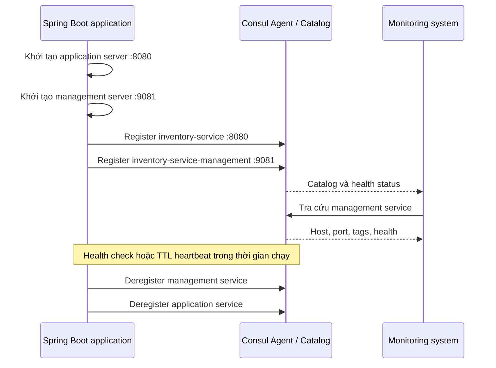

# Xử lý cổng quản trị riêng và dịch vụ quản trị đăng ký kèm

Một ứng dụng Spring Boot thường có cổng nhận request nghiệp vụ và các endpoint quản trị như health, info hoặc metrics. Nếu tất cả endpoint dùng chung một cổng, Consul chỉ cần một service registration để định vị ứng dụng. Khi management server chạy trên một cổng khác, Spring Cloud Consul có thể đăng ký thêm một service riêng dành cho quản trị.

Ví dụ, `inventory-service` nhận request nghiệp vụ ở cổng `8080`, còn Spring Boot Actuator chạy ở cổng `9081`. Consul sẽ có hai bản ghi: service nghiệp vụ `inventory-service` và service quản trị `inventory-service-management`. Bản ghi thứ hai cho phép hệ thống vận hành tìm đúng cổng quản trị mà không làm consumer nghiệp vụ gọi nhầm endpoint nội bộ.

Bài học thuộc chương `Sức khỏe với Consul` trong module `SPRING_CLOUD_SERVICE_DISCOVERY`. Module giúp người học hiểu cơ chế khám phá instance theo tên dịch vụ qua `DiscoveryClient`, `ServiceRegistry`, Eureka hoặc Consul, cùng vòng đời đăng ký, health check, load balancing, bảo mật và xử lý sai lệch registry. Nội dung này tập trung vào cách tách management port, cách Consul đăng ký dịch vụ quản trị đi kèm và cách kiểm tra health check của từng registration.

## 1. Phân biệt cổng ứng dụng và cổng quản trị

Spring Boot có hai nhóm cổng cần phân biệt:

- `server.port`: cổng của web server phục vụ API hoặc giao diện nghiệp vụ.
- `management.server.port`: cổng riêng của management web server, dùng cho các endpoint quản trị của Actuator.

Nếu không cấu hình `management.server.port` riêng, các endpoint quản trị thường dùng chung web server với ứng dụng. Khi đặt `management.server.port` khác `server.port`, Spring Boot chạy management server trên cổng riêng. Ví dụ:

```yaml
server:
  port: 8080

management:
  server:
    port: 9081
  endpoints:
    web:
      base-path: /actuator
      exposure:
        include: health,info
```

Trong ví dụ, request nghiệp vụ đi qua cổng `8080`; endpoint Actuator được phục vụ qua cổng `9081`, chẳng hạn `/actuator/health`. Việc expose endpoint và cách bảo vệ chúng vẫn phải được cấu hình riêng. Chỉ đặt cổng quản trị không tự động làm cho mọi endpoint Actuator được công khai.

### 1.1. Vì sao nên tách management port?

Tách cổng quản trị có thể giúp:

- Giới hạn truy cập health, metrics và thông tin vận hành trong mạng nội bộ.
- Áp dụng firewall hoặc network policy riêng cho traffic quản trị.
- Tách quyền truy cập của hệ thống giám sát khỏi consumer nghiệp vụ.
- Tránh để API nghiệp vụ vô tình trở thành điểm truy cập cho endpoint quản trị.
- Dễ định tuyến traffic từ Consul Agent hoặc nền tảng monitoring tới endpoint health.

Tách cổng không tự tạo ra ranh giới bảo mật hoàn chỉnh. Nếu cổng quản trị vẫn được mở rộng rãi hoặc endpoint không có xác thực phù hợp, thông tin nhạy cảm vẫn có thể bị truy cập.

## 2. Consul đăng ký management service như thế nào?

Spring Cloud Consul dùng `spring.application.name` làm service name mặc định và tự đăng ký ứng dụng theo lifecycle của Spring Cloud. Khi management server port khác application port, Spring Cloud Consul đăng ký thêm một management service riêng.

Ví dụ:

```yaml
spring:
  application:
    name: inventory-service

server:
  port: 8080

management:
  server:
    port: 9081
```

Với cấu hình trên, Consul Catalog có hai service:

| Loại registration | Service ID | Service name | Port |
|---|---|---|---:|
| Application service | `inventory-service` | `inventory-service` | 8080 |
| Management service | `inventory-service-management` | `inventory-service-management` | 9081 |

Hai registration cùng đại diện cho một instance ứng dụng trên cùng host, nhưng có mục đích và cổng truy cập khác nhau. Consumer nghiệp vụ tra cứu `inventory-service`; hệ thống quản trị có thể tra cứu `inventory-service-management`.

### 2.1. Management service kế thừa định danh từ application service

Management service kế thừa instance ID và service name từ application service, sau đó thêm suffix quản trị. Mặc định suffix là `management`.

Nếu cấu hình tên và ID riêng:

```yaml
spring:
  application:
    name: inventory-service
  cloud:
    consul:
      discovery:
        instance-id: inventory-node-01
        service-name: commerce-${spring.application.name}

management:
  server:
    port: 9081
```

Các định danh minh họa sẽ là:

| Registration | ID | Name |
|---|---|---|
| Application | `inventory-node-01` | `commerce-inventory-service` |
| Management | `inventory-node-01-management` | `commerce-inventory-service-management` |

Điều này giúp phân biệt các registration nhưng vẫn giữ quan hệ giữa chúng. Nếu chạy nhiều replica, instance ID của từng replica phải duy nhất; không dùng một ID cố định cho nhiều process đồng thời.

## 3. Các thuộc tính cấu hình management registration

Spring Cloud Consul cung cấp các thuộc tính để tùy chỉnh service quản trị:

| Thuộc tính | Ý nghĩa |
|---|---|
| `management.server.port` | Cổng mà Spring Boot management server thực sự lắng nghe. |
| `spring.cloud.consul.discovery.management-port` | Cổng được công bố trong management service registration; mặc định lấy từ management port. |
| `spring.cloud.consul.discovery.management-suffix` | Suffix gắn vào ID và tên management service; mặc định là `management`. |
| `spring.cloud.consul.discovery.management-tags` | Các tag gắn cho management service; tài liệu Spring Cloud Consul mô tả tag mặc định là `management`. |
| `spring.cloud.consul.discovery.management-metadata` | Metadata riêng của management service. |
| `spring.cloud.consul.discovery.management-enable-tag-override` | Cho phép tag override đối với management service theo khả năng của Consul và phiên bản integration. |

Hai thuộc tính cổng có trách nhiệm khác nhau. `management.server.port` làm management web server lắng nghe trên cổng thực tế. `management-port` quyết định cổng mà Spring Cloud Consul công bố cho management service. Nếu đặt hai giá trị không khớp, Consul có thể lưu một địa chỉ mà endpoint không lắng nghe.

Thông thường, nếu management server đã chạy ở `9081`, có thể bỏ `management-port` vì nó mặc định lấy management port. Chỉ đặt `management-port` khi cần tùy chỉnh cổng được đăng ký và đã bảo đảm endpoint thực tế có thể truy cập ở cổng đó.

## 4. Cấu hình hoàn chỉnh cho một service

Ví dụ sau đăng ký application service trên cổng `8080` và management service trên cổng `9081`:

```yaml
spring:
  application:
    name: inventory-service
  cloud:
    consul:
      host: consul.internal
      port: 8500
      discovery:
        register: true
        management-port: 9081
        management-suffix: management
        management-tags:
          - management
          - internal
        management-metadata:
          visibility: operations
        health-check-path: /actuator/health
        health-check-interval: 15s

server:
  port: 8080

management:
  server:
    port: 9081
  endpoints:
    web:
      base-path: /actuator
      exposure:
        include: health,info
  endpoint:
    health:
      show-details: when_authorized
```

Trong ví dụ:

- Consul Agent nằm ở `consul.internal:8500`.
- Application service được đăng ký với tên `inventory-service` và cổng `8080`.
- Management service được đăng ký với tên `inventory-service-management` và cổng `9081`.
- Management service có tag `management`, `internal` và metadata `visibility=operations`.
- Consul HTTP health check dùng đường dẫn `/actuator/health` với chu kỳ `15s`.

`management-port: 9081` được đặt tường minh để người đọc thấy rõ cổng công bố. Nếu giá trị này trùng `management.server.port`, có thể bỏ dòng `management-port` và dùng mặc định. Trong môi trường container hoặc Kubernetes, phải bảo đảm cổng quản trị được expose và định tuyến từ Consul Agent tới đúng container/pod.

### 4.1. Chỉ thay đổi tag và metadata quản trị

Tag và metadata quản trị được cấu hình riêng để consumer hoặc công cụ vận hành nhận biết registration này:

```yaml
spring:
  cloud:
    consul:
      discovery:
        management-tags:
          - management
          - monitoring
        management-metadata:
          owner: platform-ops
          access: private
```

Tag giúp phân loại hoặc lọc kết quả tra cứu. Metadata cung cấp dữ liệu bổ sung cho thành phần sử dụng Consul. Cả tag và metadata đều không thay thế ACL, authentication hoặc firewall; không dùng chúng như cơ chế bảo vệ duy nhất cho management endpoint.

## 5. Health check cho application và management service

Consul thường tạo HTTP health check khi Spring Cloud Consul đăng ký service. Theo cấu hình mặc định phổ biến, Consul gọi `/actuator/health` theo chu kỳ `10s`; nếu check thất bại, service instance được đánh dấu `critical`.

Các thuộc tính thường dùng:

| Thuộc tính | Mục đích |
|---|---|
| `spring.cloud.consul.discovery.health-check-path` | Đường dẫn HTTP được gọi để kiểm tra sức khỏe; mặc định `/actuator/health`. |
| `spring.cloud.consul.discovery.health-check-interval` | Chu kỳ kiểm tra; mặc định phổ biến là `10s`. |
| `spring.cloud.consul.discovery.health-check-timeout` | Thời gian chờ phản hồi health check. |
| `spring.cloud.consul.discovery.health-check-url` | URL đầy đủ tùy chỉnh để ghi đè URL được tạo từ địa chỉ và cổng service. |
| `spring.cloud.consul.discovery.register-health-check` | Bật hoặc tắt việc đăng ký HTTP health check. |

Khi management server dùng cổng riêng, cần kiểm tra health check thực tế mà Consul lưu cho từng registration. Đặc biệt, xác nhận host, port và path của check có trỏ tới endpoint đang lắng nghe hay không. Nếu endpoint Actuator chỉ được mở ở management port nhưng check của application service lại gọi cùng path trên application port, check đó có thể thất bại.

Đường dẫn health cũng phải khớp với context path và management endpoint base path. Ví dụ, nếu endpoint thực tế là `/admin/actuator/health`, cấu hình `/actuator/health` sẽ trả về `404`:

```yaml
management:
  server:
    port: 9081
    servlet:
      context-path: /admin
  endpoints:
    web:
      base-path: /actuator

spring:
  cloud:
    consul:
      discovery:
        health-check-path: /admin/actuator/health
        health-check-interval: 15s
```

Đây là ví dụ về cách ghép context path và endpoint base path. Hãy xác minh URL cuối cùng bằng cách gọi trực tiếp từ mạng mà Consul Agent sử dụng. Nếu cấu hình một `health-check-url` đầy đủ, cần bảo đảm hostname, scheme, port và path trong URL đều truy cập được từ Agent.

### 5.1. Đọc trạng thái health trong Consul

Consul thường hiển thị trạng thái check như:

| Trạng thái | Ý nghĩa vận hành |
|---|---|
| `passing` | Health check thành công. |
| `warning` | Check đang cảnh báo theo kết quả mà check script/endpoint trả về. |
| `critical` | Check thất bại hoặc endpoint không phản hồi theo yêu cầu. |

Một registration có thể tồn tại trong Catalog nhưng bị đánh dấu `critical`. Vì vậy, khi kiểm tra management service, cần đọc cả service entry và health check của nó. Chỉ nhìn thấy tên service trong Catalog chưa đủ để kết luận management endpoint đang khỏe.

### 5.2. Dùng TTL check khi HTTP check không phù hợp

Với TTL check, ứng dụng gửi heartbeat tới Consul Agent thay vì để Agent chủ động gọi HTTP endpoint. Cách này có thể phù hợp khi không muốn Agent truy cập trực tiếp management port, nhưng ứng dụng phải gửi heartbeat đúng chu kỳ và xử lý trạng thái khi heartbeat thất bại.

Ví dụ cấu hình TTL heartbeat theo Spring Cloud Consul:

```yaml
spring:
  cloud:
    consul:
      discovery:
        heartbeat:
          enabled: true
          ttl: 10s
```

TTL check thay đổi bên chịu trách nhiệm phát tín hiệu sức khỏe. Nó không tự xác minh rằng HTTP endpoint quản trị có thể truy cập được từ hệ thống monitoring. Nếu mục tiêu là kiểm tra khả năng truy cập thực tế của management endpoint, cần có một check phù hợp với đường mạng mà công cụ giám sát sẽ sử dụng.

## 6. Kiểm tra hai registration trong Consul Catalog

Sau khi ứng dụng khởi động, mở giao diện Consul hoặc dùng HTTP API để xác nhận cả hai service đã được đăng ký.

Đọc application service:

```bash
curl http://consul.internal:8500/v1/catalog/service/inventory-service
```

Đọc management service:

```bash
curl http://consul.internal:8500/v1/catalog/service/inventory-service-management
```

Đọc health của application service:

```bash
curl http://consul.internal:8500/v1/health/service/inventory-service
```

Đọc health của management service:

```bash
curl http://consul.internal:8500/v1/health/service/inventory-service-management
```

Các API trên là ví dụ với Consul HTTP API mặc định; môi trường thực tế có thể yêu cầu ACL token, HTTPS hoặc datacenter/namespace phù hợp. Không đưa token thật vào tài liệu hoặc shell history dùng chung.

Khi đọc response, kiểm tra:

1. Có đủ hai service name hay không.
2. ID của management service có suffix đúng không.
3. Cả hai có cùng địa chỉ host phù hợp hay không.
4. Application service có port nghiệp vụ, management service có management port không.
5. Tag và metadata của management service có đúng cấu hình không.
6. Health check có trỏ tới endpoint và port có thể truy cập không.
7. Registration có được gỡ khi instance dừng hay không.

Nếu dùng `spring.cloud.consul.discovery.query-passing=true`, discovery query có thể yêu cầu Consul chỉ trả các service có check passing. Điều này ảnh hưởng kết quả khám phá, nhưng không thay thế việc kiểm tra trực tiếp các check trong Catalog.

## 7. Truy cập management service có kiểm soát

Management service tồn tại trong Consul Catalog nên các thành phần có quyền tra cứu có thể tìm ra service ID của nó. Điều này tiện cho monitoring nội bộ, nhưng cũng làm tăng yêu cầu kiểm soát quyền.

Các nguyên tắc nên áp dụng:

- Chỉ cho Consul Agent, hệ thống monitoring và mạng vận hành truy cập management port.
- Không đưa management service vào luồng định tuyến API công khai hoặc route nghiệp vụ mặc định.
- Dùng Consul ACL để giới hạn quyền đọc/đăng ký service theo policy phù hợp.
- Dùng firewall, security group hoặc Kubernetes NetworkPolicy để giới hạn nguồn truy cập port quản trị.
- Bật TLS cho endpoint quản trị khi phù hợp và cấu hình xác thực cho các endpoint nhạy cảm.
- Chỉ expose các endpoint Actuator cần thiết, chẳng hạn `health` và `info`; cân nhắc tách quyền cho `metrics`, `env`, `configprops` hoặc các endpoint nhạy cảm khác.
- Không đưa password, token, key hoặc dữ liệu bí mật vào tag và metadata.
- Đặt `management.endpoint.health.show-details` theo chính sách bảo mật; không công khai chi tiết dependency cho mọi client.

Tag `management` hoặc `internal` chỉ giúp phân loại. Một consumer có quyền truy cập Catalog vẫn có thể đọc tên, địa chỉ và port; ACL và network policy mới là lớp kiểm soát truy cập thực sự.

## 8. Vòng đời đăng ký và hủy đăng ký

Spring Cloud Consul thường tự quản lý registration theo lifecycle của ứng dụng. Khi application server và management server đã khởi tạo, integration có thể đăng ký application service và management service. Khi ứng dụng dừng có kiểm soát, hai registration được hủy theo lifecycle và cấu hình deregistration.



Thứ tự chi tiết và thời điểm đăng ký phụ thuộc phiên bản Spring Boot, Spring Cloud Consul và lifecycle integration. Khi kiểm thử shutdown, xác minh cả hai service được gỡ hoặc chuyển trạng thái theo cấu hình.

Một số thuộc tính liên quan:

| Thuộc tính | Ý nghĩa |
|---|---|
| `spring.cloud.consul.discovery.register` | Bật/tắt đăng ký service của ứng dụng. Nếu tắt, application và management registration đều không được đăng ký theo cơ chế này. |
| `spring.cloud.consul.discovery.deregister` | Điều khiển việc tự động hủy đăng ký khi ứng dụng dừng. |
| `spring.cloud.consul.discovery.lifecycle.enabled` | Bật/tắt lifecycle quản lý auto-registration của Consul integration. |
| `spring.cloud.service-registry.auto-registration.enabled` | Cấu hình chung của Spring Cloud để bật/tắt auto-registration. |

Không tắt `register` nếu vẫn muốn application service xuất hiện trong Consul nhưng chỉ muốn thay đổi cách truy cập management service; thuộc tính đó tác động tới đăng ký của ứng dụng nói chung. Nếu cần bỏ riêng management registration, kiểm tra khả năng cấu hình của release train đang sử dụng hoặc thiết kế lifecycle tùy chỉnh có chủ đích.

## 9. Xử lý lỗi thường gặp

| Hiện tượng | Nguyên nhân có thể | Cách kiểm tra |
|---|---|---|
| Chỉ thấy application service, không thấy management service | Management port chưa được tách, hai port bằng nhau hoặc management server chưa khởi tạo. | Kiểm tra `management.server.port`, port thực tế và log auto-registration. |
| Management service có nhưng port sai | `management-port` không khớp port listener hoặc cấu hình override sai. | So sánh Consul Catalog với `management.server.port` và port đang lắng nghe. |
| Management service ở `critical` | Health check không tới được host/port/path hoặc endpoint trả lỗi. | Kiểm tra URL check, context path, network policy và Actuator. |
| Application service cũng bị `critical` | Check của application registration không truy cập được endpoint được cấu hình. | Kiểm tra health check của từng registration; không giả định hai check dùng cùng cổng đúng. |
| Consul Agent không kết nối được management port | Firewall, container port mapping hoặc network policy chặn Agent. | Thử gọi endpoint từ chính node/mạng của Agent. |
| Consumer nghiệp vụ phát hiện management service | Consumer tra cứu sai suffix hoặc route dùng wildcard quá rộng. | Kiểm tra service ID và tag filter trong discovery/route. |
| Service name bị trùng | Nhiều instance dùng cùng ID hoặc cấu hình service name không phù hợp. | Kiểm tra instance ID, service name và số replica. |
| Management service còn sau khi ứng dụng dừng | Deregistration bị tắt, shutdown không hoàn tất hoặc agent/server chưa đồng bộ. | Kiểm tra `deregister`, lifecycle log và TTL/check status. |
| Health endpoint trả `404` | Base path hoặc servlet context path không khớp. | Gọi URL thực tế và cập nhật `health-check-path`. |
| Health endpoint trả `401` hoặc `403` | Endpoint yêu cầu xác thực nhưng Consul check không có header phù hợp. | Kiểm tra security policy và `health-check-headers`; không bỏ xác thực chỉ để làm check xanh. |

### 9.1. Kiểm tra từng tầng theo thứ tự

Khi management service không hoạt động, thực hiện lần lượt:

1. Kiểm tra Spring Boot có mở management port thật hay không.
2. Gọi `/actuator/health` từ máy chạy ứng dụng để xác minh endpoint.
3. Gọi cùng URL từ máy hoặc network namespace của Consul Agent.
4. Đọc service registration và health check trong Consul Catalog.
5. So sánh address, port, scheme và path trong check với endpoint thật.
6. Kiểm tra ACL, token, TLS, firewall và network policy.
7. Kiểm tra tag và service ID mà consumer hoặc monitoring đang tra cứu.
8. Kiểm tra log auto-registration và deregistration của Spring Cloud Consul.

Không chỉ dựa vào log “registered” để kết luận management endpoint có thể truy cập. Registration thành công và health check passing là hai điều kiện khác nhau.

## 10. Kiểm thử trước khi triển khai production

Một bài kiểm thử tích hợp nên xác minh cả application service và management service:

- Khởi động ứng dụng với `server.port` và `management.server.port` khác nhau.
- Kiểm tra Consul Catalog có hai registration với ID, name và port đúng.
- Kiểm tra management service có suffix và tag đúng.
- Gọi health endpoint từ máy chạy ứng dụng và từ mạng Consul Agent.
- Tạm thời làm endpoint health thất bại để xác nhận Consul cập nhật check status.
- Khôi phục endpoint và xác nhận status trở lại passing.
- Dừng ứng dụng có kiểm soát và xác nhận cả hai registration được deregister.
- Khởi động nhiều replica để xác nhận instance ID không trùng.
- Xác minh consumer nghiệp vụ chỉ tra cứu application service, còn monitoring chỉ truy cập management service.
- Kiểm tra ACL và network policy từ các nguồn được phép và không được phép.

## 11. Các hiểu nhầm thường gặp

**“Đặt `management-port` là đủ để mở cổng quản trị.”** Không đúng. `management-port` điều khiển cổng công bố trong Consul registration. `management.server.port` mới cấu hình cổng management server thực sự lắng nghe.

**“Management service là một ứng dụng Spring Boot thứ hai.”** Không đúng. Đây là registration bổ sung cho cùng một ứng dụng instance, dùng để định vị endpoint quản trị trên cổng riêng.

**“Có registration trong Catalog nghĩa là health đang passing.”** Không đúng. Cần đọc health check của service và kiểm tra trạng thái riêng.

**“Tag `management` bảo vệ endpoint khỏi consumer.”** Không đúng. Tag chỉ phân loại hoặc hỗ trợ lọc; ACL và network policy mới kiểm soát quyền truy cập.

**“Tắt `spring.cloud.consul.discovery.register` chỉ tắt management registration.”** Không đúng. Thuộc tính này tắt đăng ký service của ứng dụng nói chung, bao gồm application registration.

**“Health check mặc định luôn đúng khi dùng management port riêng.”** Không đúng. Path, port, context path, authentication và network path phải khớp với endpoint thực tế. Kiểm tra URL check mà Consul đã lưu.

## 12. Checklist triển khai

| Nhóm | Câu hỏi cần xác nhận |
|---|---|
| Port | `server.port` và `management.server.port` có đúng và khác nhau khi cần tách không? |
| Registration | Consul có tạo application service và management service không? |
| Identity | ID, service name và suffix có đúng, không trùng giữa các replica không? |
| Management port | `management-port` có khớp cổng management server đang lắng nghe không? |
| Tags/metadata | `management-tags` và `management-metadata` có đúng mục đích không? |
| Health | Check URL, path, interval và timeout có phù hợp với endpoint không? |
| Network | Consul Agent và monitoring có truy cập được management port không? |
| Security | ACL, TLS, firewall, authentication và endpoint exposure đã được cấu hình chưa? |
| Discovery | Consumer nghiệp vụ có tra cứu đúng application service không? |
| Lifecycle | Cả hai registration có được hủy khi ứng dụng dừng không? |
| Observability | Có log và metric cho registration, health check và deregistration không? |
| Compatibility | Spring Boot, Spring Cloud Consul và Consul Agent có tương thích theo phiên bản triển khai không? |

## Kết luận

Khi Spring Boot chạy management server trên một cổng khác application server, Spring Cloud Consul có thể đăng ký thêm management service trong Consul Catalog. Application service tiếp tục đại diện cho traffic nghiệp vụ; management service dùng suffix mặc định `management` và công bố management port để monitoring hoặc hệ thống vận hành tìm đúng endpoint quản trị.

Hãy phân biệt `management.server.port` với `spring.cloud.consul.discovery.management-port`, cấu hình suffix, tags và metadata phù hợp, rồi xác minh từng registration cùng health check trong Consul. Cổng quản trị cần được bảo vệ bằng ACL, TLS và network policy; tag chỉ hỗ trợ phân loại. Registration, health check và khả năng truy cập thực tế là ba điều cần kiểm tra riêng để vận hành service discovery an toàn.

## Tài liệu tham khảo

- [Spring Cloud Consul – Service Discovery](https://docs.spring.io/spring-cloud-consul/reference/discovery.html): đăng ký management service riêng, management port/suffix/tags, HTTP health check và TTL check.
- [Spring Cloud Consul – Common Application Properties](https://docs.spring.io/spring-cloud-consul/reference/appendix.html): danh sách thuộc tính `management-port`, `management-suffix`, `management-tags`, `management-metadata` và các tùy chọn health check.
- [Spring Boot – Actuator](https://docs.spring.io/spring-boot/reference/actuator/index.html): cấu hình management server và endpoint quản trị.
