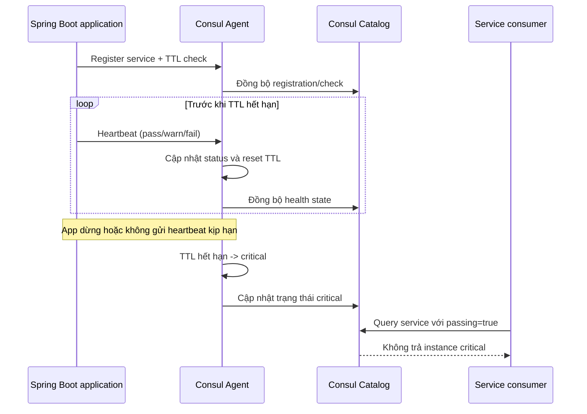

# Kiểm tra bằng TTL và cơ chế heartbeat của ứng dụng

Consul có thể kiểm tra một service bằng cách chủ động gọi vào endpoint của ứng dụng (HTTP health check), hoặc chờ chính ứng dụng gửi nhịp báo sống (TTL heartbeat). Với TTL check, Consul Agent cấp một khoảng thời gian hiệu lực. Ứng dụng phải cập nhật trạng thái check trước khi khoảng thời gian đó hết hạn; nếu không, Consul chuyển check sang `critical`.

Spring Cloud Consul có sẵn cơ chế heartbeat nền để thực hiện việc cập nhật TTL. Khi bật cơ chế này, ứng dụng gửi tín hiệu tới Consul Agent theo chu kỳ và trạng thái gửi đi có thể được lấy từ Spring Boot Actuator hoặc một `ApplicationStatusProvider` tùy chỉnh. Điều này hữu ích khi agent không thể gọi ngược vào service, nhưng đòi hỏi ứng dụng và đường kết nối tới agent phải hoạt động đủ tốt để gia hạn TTL.

## 1. TTL check hoạt động như thế nào?

TTL (time to live) là thời gian tối đa Consul chờ một lần cập nhật trạng thái mới cho check. Khi đăng ký TTL check, Consul Agent theo dõi đồng hồ TTL. Mỗi lần nhận update hợp lệ, agent cập nhật trạng thái và đặt lại đồng hồ. Nếu hết TTL mà không có update, check tự chuyển sang `critical`.



TTL check có ba trạng thái quan trọng:

| Trạng thái | Ý nghĩa | Tác động thông thường |
|---|---|---|
| `passing` | Ứng dụng báo đang khỏe | Instance có thể được truy vấn khi consumer yêu cầu passing checks |
| `warning` | Ứng dụng vẫn hoạt động nhưng có cảnh báo | Instance vẫn được giữ trong registry; consumer có thể quyết định có chấp nhận hay không |
| `critical` | Ứng dụng báo lỗi hoặc TTL đã hết hạn | Instance không còn vượt qua truy vấn yêu cầu tất cả checks passing |

TTL hết hạn không đồng nghĩa service registration lập tức bị xóa. Check chuyển `critical`; record có thể vẫn tồn tại trong Catalog để quan sát và phục hồi. Việc tự deregister sau một khoảng critical dài là chính sách riêng, ví dụ `DeregisterCriticalServiceAfter`, và cần cấu hình phù hợp.

## 2. TTL heartbeat khác HTTP health check

Spring Cloud Consul mặc định tạo HTTP health check gọi `/actuator/health` mỗi 10 giây. Trong cách này, Consul Agent chủ động gọi vào ứng dụng. TTL check thay thế cách đó bằng việc ứng dụng chủ động gửi heartbeat tới Consul Agent.

| Tiêu chí | HTTP health check | TTL heartbeat |
|---|---|---|
| Bên khởi tạo kiểm tra | Consul Agent | Ứng dụng Spring Boot |
| Hướng mạng | Agent gọi tới endpoint của service | Ứng dụng gọi tới API của Agent |
| Yêu cầu chính | Agent truy cập được đúng hostname, port, path, scheme và auth | Ứng dụng truy cập được Agent và gửi heartbeat trước hạn TTL |
| Khi process bị treo | Agent không nhận được phản hồi hoặc timeout | Scheduler của ứng dụng không gửi heartbeat; TTL hết hạn |
| Khi ứng dụng không truy cập được Agent | HTTP check vẫn có thể chạy nếu Agent gọi được ứng dụng | Heartbeat không gia hạn được và check có thể thành critical |
| Tín hiệu sức khỏe | Kết quả request HTTP | Trạng thái ứng dụng gửi trong heartbeat |

Chọn HTTP check khi agent có thể gọi được endpoint của service và muốn Consul tự kiểm tra từ bên ngoài. Chọn TTL khi ứng dụng có thể chủ động báo trạng thái nhưng agent không thể truy cập ngược vào service, hoặc muốn gửi trạng thái dựa trên logic nội bộ.

Không bật hai cơ chế với kỳ vọng chúng tự động bổ trợ nhau. Theo tài liệu Spring Cloud Consul, TTL check là lựa chọn thay cho HTTP check mặc định. Sau khi cấu hình, hãy kiểm tra check thực tế mà agent đã đăng ký để xác nhận loại check đang hoạt động.

## 3. Bật heartbeat trong Spring Cloud Consul

Thêm dependency discovery vào ứng dụng:

```xml
<dependency>
    <groupId>org.springframework.cloud</groupId>
    <artifactId>spring-cloud-starter-consul-discovery</artifactId>
</dependency>

<dependency>
    <groupId>org.springframework.boot</groupId>
    <artifactId>spring-boot-starter-actuator</artifactId>
</dependency>
```

Không ghim version riêng cho starter Spring Cloud nếu dự án đã import Spring Cloud BOM tương thích với Spring Boot.

Cấu hình `application.yml` để bật TTL heartbeat:

```yaml
spring:
  application:
    name: inventory-service
  cloud:
    consul:
      host: ${CONSUL_HOST:localhost}
      port: ${CONSUL_PORT:8500}
      discovery:
        register: true
        deregister: true
        heartbeat:
          enabled: true
          ttl: 30s
          use-actuator-health: true
```

Ý nghĩa:

- `register: true`: đăng ký service vào Consul.
- `deregister: true`: hủy đăng ký khi ứng dụng shutdown có kiểm soát.
- `heartbeat.enabled: true`: bật cơ chế TTL heartbeat do Spring Cloud Consul quản lý.
- `heartbeat.ttl: 30s`: thời gian TTL được gắn cho check; nếu không có update trước hạn, Consul chuyển check sang critical.
- `heartbeat.use-actuator-health: true`: lấy trạng thái sức khỏe hiện tại từ Actuator để quyết định trạng thái gửi cho TTL check.

Theo thuộc tính mặc định của Spring Cloud Consul hiện hành, `heartbeat.enabled` mặc định là `false`, `heartbeat.ttl` mặc định `30s`, `heartbeat.use-actuator-health` mặc định `true` và `heartbeat.reregister-service-on-failure` mặc định `false`. Vì heartbeat mặc định tắt, chỉ thêm starter Consul Discovery chưa đủ để ứng dụng tự gửi TTL heartbeat.

## 4. Chu kỳ gửi heartbeat và khoảng an toàn

TTL là thời hạn Consul chờ cập nhật; lịch gửi heartbeat là nhịp mà ứng dụng chủ động cập nhật check. Hai giá trị này liên quan nhưng không phải cùng một khái niệm. Ứng dụng cần gửi trước khi TTL hết hạn để có khoảng dư cho scheduler delay, network latency, agent load và thời gian xử lý request.

Spring Cloud Consul cung cấp thuộc tính `spring.cloud.consul.discovery.heartbeat.interval-ratio` để điều chỉnh tỷ lệ lập lịch heartbeat so với TTL. Tài liệu thuộc tính hiện hành liệt kê thuộc tính này nhưng không công bố một giá trị mặc định cố định trong bảng properties. Vì vậy, hãy kiểm tra phiên bản Spring Cloud Consul đang dùng và thử nghiệm trước khi override.

Ví dụ đặt TTL 30 giây và điều chỉnh tỷ lệ gửi heartbeat:

```yaml
spring:
  cloud:
    consul:
      discovery:
        heartbeat:
          enabled: true
          ttl: 30s
          interval-ratio: 0.5
```

Giá trị `0.5` ở đây là ví dụ cấu hình, không phải khẳng định mặc định của mọi phiên bản. Mục tiêu là để lần gia hạn đến sớm hơn thời điểm TTL hết hạn. Không cấu hình lịch gửi đúng bằng TTL vì chỉ một lần scheduler hoặc mạng chậm cũng có thể làm check hết hạn.

Chọn TTL dựa trên mục tiêu phát hiện lỗi và độ trễ có thể chấp nhận:

- TTL quá ngắn: ứng dụng có thể bị đánh dấu critical trong lúc GC pause, CPU quá tải, scheduler trễ hoặc mạng tạm thời nghẽn.
- TTL quá dài: process đã dừng có thể còn được xem là khỏe trong thời gian lâu hơn.
- Heartbeat quá dày: tăng request tới agent và tải xử lý không cần thiết.
- Khoảng dư quá nhỏ: một đợt trễ ngắn có thể khiến check chuyển critical dù ứng dụng vẫn hoạt động.

Không xem TTL là SLA chính xác về thời gian loại instance khỏi traffic. Sau khi check chuyển critical, Consul còn phải đồng bộ trạng thái vào Catalog và consumer phải truy vấn dữ liệu mới.

## 5. Trạng thái TTL được lấy từ Actuator như thế nào?

Khi `use-actuator-health` bật, Spring Cloud Consul đọc trạng thái từ Spring Boot Actuator Health endpoint trước khi gửi heartbeat. Health group gốc được sử dụng mặc định. Có thể chọn một health group khác bằng `actuator-health-group`.

Ví dụ dùng group `readiness`:

```yaml
management:
  endpoints:
    web:
      exposure:
        include: health,info
  endpoint:
    health:
      probes:
        enabled: true
      group:
        readiness:
          include: readinessState,db

spring:
  cloud:
    consul:
      discovery:
        heartbeat:
          enabled: true
          ttl: 30s
          use-actuator-health: true
          actuator-health-group: readiness
```

Group `readiness` chỉ nên gồm những thành phần thật sự quyết định service có thể nhận request hay không. Ví dụ, nếu database là dependency bắt buộc cho mọi request, có thể đưa `db` vào group. Không thêm tất cả dependency một cách máy móc; một hệ thống có thể vẫn phục vụ một phần chức năng khi một dependency phụ bị lỗi.

Đặc biệt, tránh tạo vòng phụ thuộc sức khỏe. Nếu health group được dùng để gia hạn TTL lại chứa một health indicator kiểm tra chính Consul Agent/cluster, sự cố Consul có thể làm ứng dụng không gửi trạng thái passing dù ứng dụng vẫn xử lý request nghiệp vụ. Hãy chọn các tín hiệu phản ánh khả năng phục vụ của service và thiết kế rõ việc Consul có phải dependency bắt buộc hay không.

### 5.1. Khi không có Actuator endpoint

Tài liệu Spring Cloud Consul nêu rõ: nếu health endpoint không có (Actuator chưa được thêm, endpoint bị tắt hoặc ứng dụng không phải Spring Boot Actuator app), TTL status được giả định là khỏe. Đây là hành vi dễ tạo false positive: ứng dụng có thể gửi heartbeat passing dù không có phép kiểm tra sức khỏe thực tế.

Trong môi trường production, nên:

1. Thêm Actuator và bảo đảm endpoint health có sẵn nếu muốn dùng health status.
2. Chỉ định `actuator-health-group` khi root group chứa quá nhiều indicator hoặc có dependency không phù hợp.
3. Kiểm tra kết quả health group ngay trong ứng dụng trước khi bật TTL heartbeat.
4. Nếu không muốn phụ thuộc Actuator, cung cấp `ApplicationStatusProvider` tùy chỉnh.

Có thể tắt hoàn toàn việc đọc Actuator bằng `spring.cloud.consul.discovery.heartbeat.use-actuator-health: false`. Chỉ làm vậy khi có một cơ chế trạng thái khác hoặc chủ đích luôn báo passing đã được đánh giá rõ ràng.

## 6. Cung cấp trạng thái tùy chỉnh bằng ApplicationStatusProvider

Không phải ứng dụng nào cũng có thể biểu diễn readiness chỉ bằng health indicator tiêu chuẩn. Spring Cloud Consul cho phép triển khai `ApplicationStatusProvider` để quyết định trạng thái TTL.

Ví dụ minh họa:

```java
@Component
class InventoryApplicationStatusProvider implements ApplicationStatusProvider {

    private final InventoryReadiness readiness;

    InventoryApplicationStatusProvider(InventoryReadiness readiness) {
        this.readiness = readiness;
    }

    @Override
    public CheckStatus currentStatus() {
        if (readiness.isReady()) {
            return CheckStatus.PASSING;
        }

        return CheckStatus.CRITICAL;
    }
}
```

`InventoryReadiness` ở đây là thành phần nghiệp vụ của ứng dụng, còn `ApplicationStatusProvider` và `CheckStatus` là API Spring Cloud Consul. Đăng ký provider vào application context theo cơ chế bean mà phiên bản thư viện yêu cầu. Nếu ứng dụng có nhiều mức suy giảm, có thể cân nhắc trả `WARNING` thay vì `CRITICAL` khi service vẫn xử lý được request nhưng có giới hạn.

Trạng thái tùy chỉnh nên phản ánh khả năng phục vụ của instance. Không chỉ kiểm tra process còn sống; cũng không đưa một dependency không thiết yếu vào điều kiện critical. Nếu provider ném exception, cần xử lý lỗi rõ ràng để không vô tình gửi một trạng thái khỏe.

## 7. Spring Cloud Consul gửi heartbeat tới đâu?

Ứng dụng gửi heartbeat tới Consul Agent được cấu hình qua `spring.cloud.consul.host` và `spring.cloud.consul.port` (mặc định `localhost:8500`). Agent quản lý check cục bộ và đồng bộ trạng thái vào Consul Catalog. Ứng dụng không gửi TTL update trực tiếp tới mọi Consul server trong cluster.

Consul Agent cung cấp các endpoint TTL:

| Endpoint | Trạng thái được đặt | Công dụng |
|---|---|---|
| `PUT /v1/agent/check/pass/{check_id}` | `passing` | Báo check khỏe và gia hạn TTL |
| `PUT /v1/agent/check/warn/{check_id}` | `warning` | Báo đang suy giảm nhưng vẫn hoạt động và gia hạn TTL |
| `PUT /v1/agent/check/fail/{check_id}` | `critical` | Báo check lỗi và gia hạn TTL |
| `PUT /v1/agent/check/update/{check_id}` | Trạng thái truyền trong JSON | Cập nhật status và output tùy chọn |

Ví dụ gửi heartbeat passing thủ công:

```bash
curl --request PUT \
  http://127.0.0.1:8500/v1/agent/check/pass/service:inventory-service
```

Ví dụ gửi trạng thái critical kèm ghi chú:

```bash
curl --request PUT \
  --data '{"Status":"critical","Output":"Database pool exhausted"}' \
  http://127.0.0.1:8500/v1/agent/check/update/service:inventory-service
```

Đây là ví dụ gọi Consul Agent HTTP API trực tiếp để kiểm tra hoặc tích hợp thủ công. Khi dùng Spring Cloud Consul heartbeat, thư viện tự lập lịch gửi heartbeat; không cần viết một scheduler thứ hai gọi `check/pass` cho cùng check.

Check ID trong URL phải là ID thực tế đã đăng ký. Đừng luôn giả định ID là `service:{service-name}`; hãy xem danh sách check của agent để lấy đúng ID:

```bash
curl http://127.0.0.1:8500/v1/agent/checks
```

Consul Agent API yêu cầu quyền ghi node/service khi ACL được bật. Trong tài liệu API, các thao tác TTL update yêu cầu quyền `node:write` và `service:write`. Hãy cấp token có quyền tối thiểu cần thiết và cấu hình qua secret/environment thay vì ghi token vào source code.

## 8. Theo dõi TTL check trong Consul

Liệt kê check mà agent cục bộ đang quản lý:

```bash
curl http://127.0.0.1:8500/v1/agent/checks
```

Tra cứu health check của service:

```bash
curl http://127.0.0.1:8500/v1/health/service/inventory-service
```

Chỉ lấy các instance có mọi health check ở trạng thái passing:

```bash
curl "http://127.0.0.1:8500/v1/health/service/inventory-service?passing=true"
```

Phân biệt hai nguồn dữ liệu:

- `/v1/agent/checks` cho biết trạng thái check mà agent cục bộ đang quản lý.
- `/v1/health/service/{name}` trả kết quả truy vấn health/catalog từ Consul server.

Trong một khoảng ngắn, hai kết quả có thể chưa giống nhau do agent cần đồng bộ Catalog hoặc cluster đang có vấn đề. Nếu heartbeat API trả thành công nhưng consumer vẫn thấy trạng thái cũ, hãy kiểm tra cả hai lớp và timestamp cập nhật.

## 9. Reregister khi heartbeat thất bại

Spring Cloud Consul có thuộc tính `spring.cloud.consul.discovery.heartbeat.reregister-service-on-failure`. Mặc định là `false`. Khi bật, Spring Cloud Consul có thể thử đăng ký lại service khi heartbeat thất bại và thỏa điều kiện re-registration mà thư viện xử lý.

```yaml
spring:
  cloud:
    consul:
      discovery:
        heartbeat:
          enabled: true
          ttl: 30s
          reregister-service-on-failure: true
```

Re-registration có thể giúp khi Consul Agent vừa restart và check/service registration cục bộ đã mất. Nó không sửa được ứng dụng bị deadlock, network partition kéo dài, sai ACL token hoặc endpoint Consul không thể truy cập. Hãy bật sau khi hiểu hành vi của phiên bản đang dùng và theo dõi log đăng ký lại.

Đừng coi re-registration là cơ chế khôi phục duy nhất. Cần theo dõi lỗi heartbeat, trạng thái agent, service registration và khả năng tự phục hồi của ứng dụng. Nếu một lần lỗi tạm thời làm scheduler ngừng chạy, việc đăng ký lại cũng không có tác dụng cho đến khi lịch heartbeat tiếp tục.

## 10. Dọn service critical và vòng đời ứng dụng

TTL check chuyển critical khi hết hạn nhưng không tự động xóa service registration ngay lập tức. Consul cho phép cấu hình `DeregisterCriticalServiceAfter` để deregister service nếu check liên tục critical quá thời hạn. Đây là chính sách dọn record, khác với TTL dùng để phát hiện lỗi ban đầu.

Chọn thời hạn deregister dài hơn khoảng outage có thể phục hồi. Nếu đặt quá ngắn, một đợt mạng lỗi hoặc Consul Agent restart có thể làm service bị xóa dù process vẫn chạy. Nếu không cấu hình, record critical có thể tiếp tục tồn tại để điều tra hoặc phục hồi.

Khi shutdown có kiểm soát, Spring Cloud Consul thường deregister service theo lifecycle nếu `spring.cloud.consul.discovery.deregister=true`. Khi process bị kill đột ngột, không có cơ hội deregister; TTL giúp phát hiện heartbeat đã dừng. Cần thử riêng graceful shutdown và process crash vì hai trường hợp có đường xử lý khác nhau.

## 11. Sự cố thường gặp và cách xử lý

| Hiện tượng | Nguyên nhân có thể | Hướng kiểm tra |
|---|---|---|
| Service liên tục chuyển `critical` dù ứng dụng vẫn chạy | Heartbeat không tới Agent kịp hạn; scheduler trễ; TTL quá ngắn | Kiểm tra log heartbeat, network tới Agent, CPU/GC pause và TTL |
| Check luôn `passing` dù service không khỏe | Không có Actuator endpoint nên status bị giả định khỏe; `use-actuator-health=false`; provider luôn trả passing | Kiểm tra dependency Actuator, health group và `ApplicationStatusProvider` |
| Không thấy TTL check trong Consul | `heartbeat.enabled` chưa bật; service chưa đăng ký; nhầm Agent hoặc check ID | Kiểm tra profile/config hiệu lực, `/v1/agent/checks` và registration log |
| Agent báo `Unknown check ID` | Check đã bị xóa, Agent restart hoặc dùng sai check ID | Lấy check ID mới từ `/v1/agent/checks`; xác minh re-registration |
| Heartbeat lỗi sau khi Agent restart | Registration/check cục bộ không còn tồn tại hoặc Agent chưa sẵn sàng | Kiểm tra log 404, `reregister-service-on-failure` và lifecycle registration |
| Agent local thấy passing nhưng consumer thấy critical | Catalog chưa đồng bộ hoặc query đang tới server/partition khác | Đối chiếu `/v1/agent/checks`, health API, datacenter, namespace và ACL |
| Ứng dụng không gửi heartbeat khi Consul lỗi | Không truy cập được Agent, token hết hạn hoặc request timeout | Kiểm tra Consul host/port, TLS, ACL, retry và network policy |
| Service critical không biến mất khỏi Catalog | TTL chỉ đổi trạng thái; chưa cấu hình critical deregistration timeout | Kiểm tra `DeregisterCriticalServiceAfter` và policy dọn record |

### 11.1. Quy trình chẩn đoán theo thứ tự

1. Xác nhận profile đang active và `spring.cloud.consul.discovery.heartbeat.enabled=true` trong cấu hình hiệu lực.
2. Kiểm tra service registration và TTL check đã được tạo trên đúng Consul Agent.
3. Đọc `TTL`, `Status`, `Output` và `CheckID` từ `/v1/agent/checks`.
4. Kiểm tra ứng dụng có gửi heartbeat định kỳ và request tới Agent có thành công không.
5. Nếu dùng Actuator, gọi health group được cấu hình và xác nhận status không bị giả định khỏe.
6. Đối chiếu trạng thái agent local với Consul Health API và Catalog.
7. Kiểm tra ACL token, TLS, DNS, port và network policy.
8. Nếu Agent vừa restart, xác minh service/check được đăng ký lại và scheduler tiếp tục gia hạn.
9. Ghi thời điểm heartbeat cuối, thời điểm TTL hết hạn, thời điểm check chuyển critical và thời điểm consumer ngừng nhận instance.

## 12. Thực hành kiểm chứng TTL heartbeat

Thực hiện trong môi trường development với một Consul Agent và một Spring Boot service:

1. Khởi động Consul Agent và xác nhận API tại `localhost:8500` truy cập được.
2. Khởi động ứng dụng có `spring-cloud-starter-consul-discovery`, Actuator và heartbeat enabled.
3. Dùng `/v1/agent/checks` xác nhận check của service có loại TTL và trạng thái ban đầu.
4. Đợi vài chu kỳ heartbeat; xác nhận status vẫn `passing` và TTL được gia hạn.
5. Làm health group chuyển `DOWN` hoặc cho custom provider trả `CRITICAL`; xác nhận Consul nhận trạng thái critical.
6. Khôi phục health group/provider; xác nhận check trở lại passing.
7. Dừng process đột ngột; không gửi heartbeat nữa và đo thời gian check chuyển critical.
8. Khởi động lại service; xác nhận registration và heartbeat được khôi phục.
9. Thử restart Consul Agent; kiểm tra check ID, re-registration và log của scheduler.

Không thử network partition hoặc dừng agent trên production nếu chưa có kế hoạch kiểm soát tác động. Ghi timestamp từng mốc để đánh giá thời gian phát hiện lỗi thực tế.

## 13. Checklist triển khai

- [ ] Đã bật `spring.cloud.consul.discovery.heartbeat.enabled`.
- [ ] Đã chọn TTL đủ dài cho network, scheduler và tải thực tế.
- [ ] Heartbeat được gửi trước hạn TTL với khoảng dư an toàn.
- [ ] Đã xác định `use-actuator-health` và health group được sử dụng.
- [ ] Nếu không dùng Actuator, đã cung cấp status provider hoặc chấp nhận rõ hành vi mặc định.
- [ ] Không tạo vòng phụ thuộc giữa health group và Consul Agent.
- [ ] Đã kiểm tra check ID, status và output từ Consul Agent.
- [ ] ACL token có quyền tối thiểu để cập nhật TTL check và được lưu an toàn.
- [ ] Đã quyết định có bật `reregister-service-on-failure` hay không.
- [ ] Đã có chính sách deregister cho service critical kéo dài.
- [ ] Đã kiểm thử graceful shutdown, process crash và Consul Agent restart.
- [ ] Consumer chỉ nhận instance theo health state mong muốn, ví dụ `passing=true`.

## Tài liệu tham khảo

- [Spring Cloud Consul 5.1.0 — Service Discovery, TTL Health Check và TTL Application Status](https://docs.spring.io/spring-cloud-consul/reference/discovery.html)
- [Spring Cloud Consul — Common Application Properties](https://docs.spring.io/spring-cloud-consul/reference/appendix.html)
- [Consul Agent HTTP API — Check](https://developer.hashicorp.com/consul/api-docs/agent/check)
- [Consul — Define Health Checks and TTL Checks](https://developer.hashicorp.com/consul/docs/register/health-check/vm)
