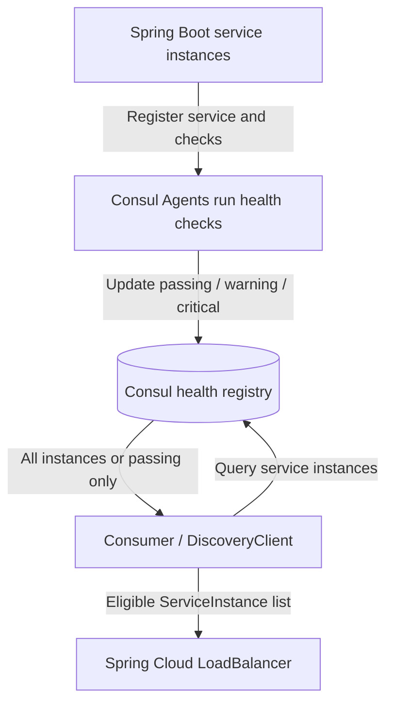

# Lọc các instance đạt kiểm tra sức khỏe khi truy vấn

Consul lưu thông tin đăng ký của service và trạng thái health check của từng node, service instance. Khi consumer tìm `order-service`, câu hỏi không chỉ là service có đăng ký hay không mà còn là instance nào đang đủ khỏe để nhận request.

Consul cung cấp health API để truy vấn instance theo trạng thái kiểm tra. Tham số `passing` chỉ trả về các instance có tất cả health check liên quan ở trạng thái `passing`. Spring Cloud Consul Discovery có thuộc tính `spring.cloud.consul.discovery.query-passing` để bật cách lọc này cho các truy vấn instance qua `DiscoveryClient`. Bài học này giải thích cách lọc hoạt động, cách cấu hình và kiểm chứng kết quả, cũng như những giới hạn cần hiểu khi dùng trạng thái health để chọn instance.

## 1. Từ đăng ký service tới truy vấn instance khỏe

Khi ứng dụng đăng ký với Consul, registry lưu service name, service ID, địa chỉ, port, tag và metadata. Các health check được gắn với node hoặc service registration và được Consul Agent cập nhật theo chu kỳ.

Ví dụ một service có ba instance:

| Instance | Địa chỉ | Trạng thái health check |
| --- | --- | --- |
| `order-a` | `10.0.0.11:8080` | `passing` |
| `order-b` | `10.0.0.12:8080` | `warning` |
| `order-c` | `10.0.0.13:8080` | `critical` |

Nếu consumer truy vấn tất cả instance, nó có thể nhận cả ba bản ghi. Nếu consumer chỉ muốn instance khỏe, truy vấn với `passing` sẽ chỉ trả `order-a`.



Luồng có ba bước độc lập:

- **Registration:** instance xuất hiện trong Consul Catalog.
- **Health check:** Consul Agent cập nhật trạng thái kiểm tra cho node và service.
- **Health-aware discovery:** consumer yêu cầu Consul chỉ trả instance đáp ứng điều kiện health, sau đó LoadBalancer chọn một instance trong danh sách đó.

Một instance có thể còn tồn tại trong Catalog nhưng không được trả về trong truy vấn `passing`. Đây là hành vi mong muốn khi consumer cần tránh gửi request tới instance đang lỗi.

## 2. Ba trạng thái health của Consul

Consul health check thường có ba trạng thái:

| Trạng thái | Ý nghĩa | Có được trả về với `passing`? |
| --- | --- | --- |
| `passing` | Check thành công; instance đáp ứng điều kiện mà check đang đo. | Có |
| `warning` | Check đang cảnh báo nhưng chưa được đánh dấu thất bại nghiêm trọng. | Không |
| `critical` | Check thất bại hoặc điều kiện kiểm tra không đáp ứng. | Không |

Tham số `passing` áp dụng ở mức node/service entry: Consul chỉ trả những entry mà **tất cả check liên quan** đều `passing`. Vì vậy, một check `warning` cũng đủ khiến instance bị loại khỏi kết quả passing, dù các check khác của instance vẫn passing.

Ví dụ, nếu `order-a` có hai check:

```text
HTTP /actuator/health       passing
Database connectivity      passing
```

instance được xem là passing. Nếu check database chuyển sang `warning`:

```text
HTTP /actuator/health       passing
Database connectivity      warning
```

instance không còn xuất hiện trong truy vấn `?passing` vì không phải tất cả check đều passing.

Lưu ý rằng health check của node cũng có thể ảnh hưởng đến các service đăng ký trên node đó. Do đó, một lỗi node-level check có thể khiến nhiều service instance trên cùng node không còn đạt điều kiện passing.

## 3. Truy vấn Consul Health API trực tiếp

API thường dùng để lấy các instance của một service là:

```text
GET /v1/health/service/{service}
```

Không có tham số `passing`, API trả về các service entry cùng thông tin check của chúng, kể cả những entry có trạng thái `warning` hoặc `critical`.

Thêm tham số `passing` để lọc:

```bash
curl "http://localhost:8500/v1/health/service/order-service?passing"
```

Kết quả chỉ còn các entry có tất cả check liên quan đang passing. Có thể kết hợp với datacenter:

```bash
curl "http://localhost:8500/v1/health/service/order-service?passing&dc=dc1"
```

Nếu Consul bật ACL, request cần token có quyền đọc service/health tương ứng. Ví dụ truyền token qua biến môi trường:

```bash
curl -H "X-Consul-Token: ${CONSUL_HTTP_TOKEN}" \
  "http://localhost:8500/v1/health/service/order-service?passing"
```

Tránh ghi token trực tiếp vào script hoặc log. Trong PowerShell, cú pháp biến môi trường là `$env:CONSUL_HTTP_TOKEN`; hãy bảo đảm token được cấp trong đúng shell đang chạy lệnh.

### 3.1. So sánh với Catalog API

Catalog API:

```bash
curl "http://localhost:8500/v1/catalog/service/order-service"
```

Health API:

```bash
curl "http://localhost:8500/v1/health/service/order-service"
```

Hai API trả dữ liệu với mục đích khác nhau:

| API | Mục đích | Lọc theo health? |
| --- | --- | --- |
| `/v1/catalog/service/{service}` | Xem các registration trong Catalog. | Không phải API lọc health; bản ghi có thể vẫn xuất hiện dù check lỗi. |
| `/v1/health/service/{service}` | Xem service instance kèm các check liên quan. | Có; thêm `?passing` để chỉ lấy entry khỏe. |
| `/v1/health/checks/{service}` | Xem các health check gắn với service. | Trả check và trạng thái để chẩn đoán. |

Đừng dùng số bản ghi từ Catalog API để kết luận có bao nhiêu instance đang sẵn sàng. Hãy xem Health API và các check thực tế.

## 4. Bật query-passing trong Spring Cloud Consul

Spring Cloud Consul Discovery có thuộc tính `query-passing`. Khi bật, truy vấn instance qua discovery yêu cầu Consul chỉ trả về các instance có health check passing.

Ví dụ `application.yml`:

```yaml
spring:
  application:
    name: order-consumer
  cloud:
    consul:
      host: ${CONSUL_HOST:localhost}
      port: ${CONSUL_PORT:8500}
      discovery:
        query-passing: true
```

Các điểm cần nhớ:

- `spring.cloud.consul.discovery.query-passing: true` bật lọc passing cho truy vấn service instance của Consul Discovery Client.
- Khi thuộc tính là `false`, discovery có thể trả về cả instance `warning` hoặc `critical` tùy kết quả Health API và cấu hình registry.
- Thuộc tính này điều khiển cách consumer truy vấn; nó không thay đổi trạng thái health đã lưu trong Consul.
- Nó không tự tạo health check. Service vẫn phải đăng ký check phù hợp, chẳng hạn HTTP check tới Actuator.
- Giá trị mặc định thường là `false`; hãy kiểm tra reference của đúng phiên bản Spring Cloud Consul đang dùng.

Nếu ứng dụng chỉ cần truy vấn instance khỏe, hãy bật `query-passing` ở consumer. Không cần đặt thuộc tính này giống nhau trên mọi service provider: provider chịu trách nhiệm đăng ký health check; consumer quyết định có yêu cầu lọc passing khi truy vấn hay không.

## 5. Sử dụng DiscoveryClient và LoadBalancer

Khi `query-passing` được bật, `DiscoveryClient` của Spring Cloud Consul sẽ nhận danh sách instance theo điều kiện passing của Consul.

Ví dụ inject `DiscoveryClient`:

```java
import java.util.List;

import org.springframework.cloud.client.ServiceInstance;
import org.springframework.cloud.client.discovery.DiscoveryClient;
import org.springframework.web.bind.annotation.GetMapping;
import org.springframework.web.bind.annotation.RestController;

@RestController
public class OrderDiscoveryController {

    private final DiscoveryClient discoveryClient;

    public OrderDiscoveryController(DiscoveryClient discoveryClient) {
        this.discoveryClient = discoveryClient;
    }

    @GetMapping("/discovery/orders")
    public List<ServiceInstance> findHealthyOrders() {
        return discoveryClient.getInstances("order-service");
    }
}
```

Với `query-passing: true`, danh sách trả về chỉ gồm instance có check passing theo Consul. Nếu không có instance nào passing, `getInstances("order-service")` có thể trả danh sách rỗng.

Spring Cloud LoadBalancer có thể dùng danh sách đó để chọn instance khi consumer gọi bằng logical service name:

```java
@Bean
@LoadBalanced
RestTemplate restTemplate() {
    return new RestTemplate();
}

public String getOrders() {
    return restTemplate.getForObject(
            "http://order-service/api/orders",
            String.class
    );
}
```

Luồng lựa chọn:

1. Consumer gọi `order-service` bằng logical name.
2. Spring Cloud LoadBalancer yêu cầu danh sách instance từ DiscoveryClient.
3. Consul Discovery truy vấn Health API với hoặc không có điều kiện `passing` tùy cấu hình.
4. LoadBalancer chọn một instance trong danh sách được trả về.
5. HTTP client gửi request tới địa chỉ instance đã chọn.

`query-passing` quyết định danh sách ứng viên được discovery trả về. Nó không phải thuật toán round-robin và không tự quyết định instance nào được chọn khi có nhiều instance passing.

## 6. Điều gì xảy ra khi instance warning hoặc critical?

Giả sử Consul có ba instance:

```text
order-a  passing
order-b  warning
order-c  critical
```

Kết quả phụ thuộc query:

| Truy vấn | Kết quả |
| --- | --- |
| `/v1/health/service/order-service` | `order-a`, `order-b`, `order-c` cùng trạng thái checks |
| `/v1/health/service/order-service?passing` | Chỉ `order-a` |
| Discovery với `query-passing: false` | Có thể nhận cả ba instance, kèm trạng thái check trong dữ liệu Consul. |
| Discovery với `query-passing: true` | Chỉ nhận `order-a`. |

Khi `order-b` chuyển từ `warning` về `passing`, instance có thể xuất hiện lại trong truy vấn passing sau lần check và lần truy vấn tiếp theo. Khi `order-a` chuyển thành `critical`, nó sẽ bị loại khỏi danh sách passing sau khi Consul cập nhật trạng thái check.

Việc chuyển trạng thái không nhất thiết xảy ra tức thì. Độ trễ phụ thuộc `health-check-interval`, timeout, thời gian cập nhật của Agent, tần suất truy vấn của consumer và cache của discovery/load balancer.

## 7. Thiết kế health check để lọc đúng instance

Lọc `passing` chỉ hữu ích khi health check phản ánh đúng khả năng nhận request của instance. Một endpoint chỉ trả `200 OK` vì JVM còn chạy có thể không đủ nếu service không thể truy cập database hoặc dependency bắt buộc.

Với Spring Boot Actuator, có thể dùng readiness health group nếu phiên bản ứng dụng hỗ trợ và endpoint đã được expose:

```yaml
management:
  endpoints:
    web:
      exposure:
        include: health
  endpoint:
    health:
      probes:
        enabled: true
      show-details: never

spring:
  cloud:
    consul:
      discovery:
        health-check-path: /actuator/health/readiness
        health-check-interval: 10s
        query-passing: true
```

Chỉ dùng `/actuator/health/readiness` sau khi xác nhận health group có tồn tại trong phiên bản Spring Boot đang dùng. Nếu endpoint trả `404`, Consul sẽ đánh dấu check không passing và instance có thể bị lọc khỏi discovery.

Chọn các dependency đưa vào readiness một cách có chủ đích:

- Database bắt buộc cho hầu hết request có thể là một phần của readiness.
- Một hệ thống analytics hoặc dịch vụ phụ không ảnh hưởng tới luồng request chính có thể không nên làm instance bị loại hoàn toàn.
- Check cần phản hồi nhanh, có timeout hợp lý và không tạo tải lớn khi được gọi định kỳ.
- Endpoint health không nên tiết lộ credential, connection string hoặc chi tiết hạ tầng nhạy cảm.

Nếu một instance có nhiều check, hãy nhớ `?passing` yêu cầu tất cả check liên quan đều passing. Một check phụ ở trạng thái warning cũng có thể làm instance bị loại khỏi danh sách.

## 8. Xử lý khi không còn instance passing

Khi tất cả instance chuyển sang `warning` hoặc `critical`, truy vấn `passing` trả về danh sách rỗng. LoadBalancer không có instance để chọn và lời gọi service thường thất bại trước khi request được gửi tới provider.

Đây là tình huống cần có hành vi dự phòng rõ ràng:

1. Kiểm tra Health API không có `passing` entry vì health check thực sự lỗi hay vì check cấu hình sai.
2. Kiểm tra từng check trong `/v1/health/checks/{service}` để tìm check gây trạng thái warning/critical.
3. Xác minh endpoint check có thể truy cập từ Consul Agent và trả HTTP status đúng.
4. Nếu lỗi tạm thời, khôi phục dependency hoặc endpoint để check trở lại passing.
5. Thiết kế timeout, retry có giới hạn và circuit breaker ở consumer để tránh tạo tải dây chuyền.
6. Chỉ cân nhắc bỏ lọc passing như một quyết định vận hành có chủ đích; hiểu rằng consumer có thể gọi instance đang unhealthy.

Không nên tự động fallback sang tất cả instance unhealthy trong production nếu health check đang phản ánh một dependency bắt buộc. Việc đó có thể làm tăng lỗi và tạo hiệu ứng retry storm. Ngược lại, nếu check quá nghiêm ngặt hoặc bao gồm dependency không thiết yếu, hãy điều chỉnh readiness để phản ánh đúng khả năng phục vụ thay vì vô hiệu hóa lọc health.

## 9. Cache và độ trễ cập nhật

Consul Agent thực hiện health check theo chu kỳ, nên trạng thái trả về là kết quả gần nhất mà Consul đã ghi nhận, không phải phép kiểm tra trực tiếp tại đúng thời điểm consumer gọi service.

Ngoài ra, có thể có nhiều lớp cache:

- Consul Agent và Consul Server duy trì trạng thái check/registry.
- Spring Cloud Consul hoặc discovery client có thể cache dữ liệu theo cấu hình và phiên bản.
- Spring Cloud LoadBalancer có thể có cache instance list nếu supplier chain được cấu hình caching.
- Một số ứng dụng còn cache kết quả discovery riêng.

Nếu instance vừa chuyển sang `critical` nhưng consumer vẫn gọi được tới nó, hãy kiểm tra thời điểm check gần nhất và thời gian cache trước khi kết luận `query-passing` không hoạt động. Tránh bật nhiều lớp cache không cần thiết vì dữ liệu health cũ có thể tồn tại lâu hơn.

## 10. Quy trình kiểm tra từ Consul tới ứng dụng

Khi consumer vẫn nhận instance không khỏe hoặc không tìm thấy instance nào, thực hiện theo thứ tự:

1. Gọi `/v1/health/checks/{service}` để xem từng check và trạng thái hiện tại.
2. Gọi `/v1/health/service/{service}` để xem các service entry cùng check liên quan.
3. Thêm `?passing` và so sánh số entry với kết quả không lọc.
4. Kiểm tra `spring.cloud.consul.discovery.query-passing` trong profile và property source đang active của consumer.
5. Gọi `DiscoveryClient.getInstances(serviceId)` để xem danh sách instance mà ứng dụng thực sự nhận.
6. Kiểm tra supplier/cache của Spring Cloud LoadBalancer nếu danh sách hoặc lựa chọn instance khác với DiscoveryClient.
7. Xác minh endpoint health, địa chỉ, port và network từ góc nhìn Consul Agent.

Các lệnh mẫu:

```bash
# Trạng thái các check của service
curl "http://localhost:8500/v1/health/checks/order-service"

# Tất cả instance và các check liên quan
curl "http://localhost:8500/v1/health/service/order-service"

# Chỉ instance có mọi check passing
curl "http://localhost:8500/v1/health/service/order-service?passing"

# Registration trong Catalog, không dùng để kết luận health
curl "http://localhost:8500/v1/catalog/service/order-service"
```

Nếu Consul bật ACL, thêm header token phù hợp cho từng request. Hãy chạy lệnh từ đúng network và datacenter mà consumer đang sử dụng.

## 11. Lỗi thường gặp

| Hiện tượng | Nguyên nhân có thể | Cách xử lý |
| --- | --- | --- |
| Catalog có instance nhưng DiscoveryClient không trả về | Instance có check warning/critical và `query-passing` đang bật | Kiểm tra Health API và trạng thái của tất cả check liên quan. |
| `?passing` vẫn trả instance không mong muốn | Instance có thể chưa có check phản ánh readiness, hoặc check gần nhất vẫn passing | Xem danh sách check, bổ sung check phù hợp và xác minh thời điểm cập nhật. |
| `?passing` trả danh sách rỗng | Tất cả instance có ít nhất một check không passing, hoặc health check chưa được đăng ký đúng | Kiểm tra `/v1/health/checks/{service}`, endpoint, timeout và network của Agent. |
| `query-passing: true` không có tác dụng trong ứng dụng | Property đặt sai cấp YAML, sai profile hoặc phiên bản Spring Cloud Consul không hỗ trợ như dự kiến | Kiểm tra property source, dependency version và log request Health API. |
| Một instance warning bị loại dù HTTP check passing | Có check khác hoặc node-level check đang warning/critical | Kiểm tra tất cả check gắn với node và service entry. |
| Instance đã phục hồi nhưng chưa xuất hiện lại | Agent chưa chạy lần check tiếp theo hoặc discovery/load balancer còn cache | Kiểm tra check interval, lần cập nhật cuối và cache TTL. |
| Consumer vẫn gọi instance critical | `query-passing` đang false, consumer dùng cache cũ hoặc gọi qua đường không dùng Consul LoadBalancer | Kiểm tra cấu hình discovery, cache và đường gọi thực tế. |

## 12. Ghi nhớ

- Consul Health API `/v1/health/service/{service}` trả service instance kèm health check; thêm `?passing` để chỉ lấy entry có tất cả check liên quan ở trạng thái passing.
- `warning` và `critical` đều bị loại khỏi kết quả `passing`.
- `spring.cloud.consul.discovery.query-passing: true` bật lọc passing cho truy vấn instance qua Spring Cloud Consul Discovery.
- Lọc health không xóa registration khỏi Catalog và không thay đổi trạng thái check đã lưu trong Consul.
- Nếu không còn instance passing, DiscoveryClient có thể trả danh sách rỗng; consumer cần xử lý lỗi, timeout và retry có giới hạn.
- Chất lượng lọc phụ thuộc health check có phản ánh đúng readiness hay không, cùng độ trễ cập nhật và cache.

Khi bật lọc passing và thiết kế health check đúng với khả năng phục vụ, consumer có thể nhận danh sách instance phù hợp hơn để Spring Cloud LoadBalancer chọn, giảm nguy cơ gửi request tới service đang gặp sự cố.

## Tài liệu tham khảo

- [Consul HTTP API: Health](https://developer.hashicorp.com/consul/api-docs/health)
- [Spring Cloud Consul: Discovery Client](https://docs.spring.io/spring-cloud-consul/reference/discovery.html)
