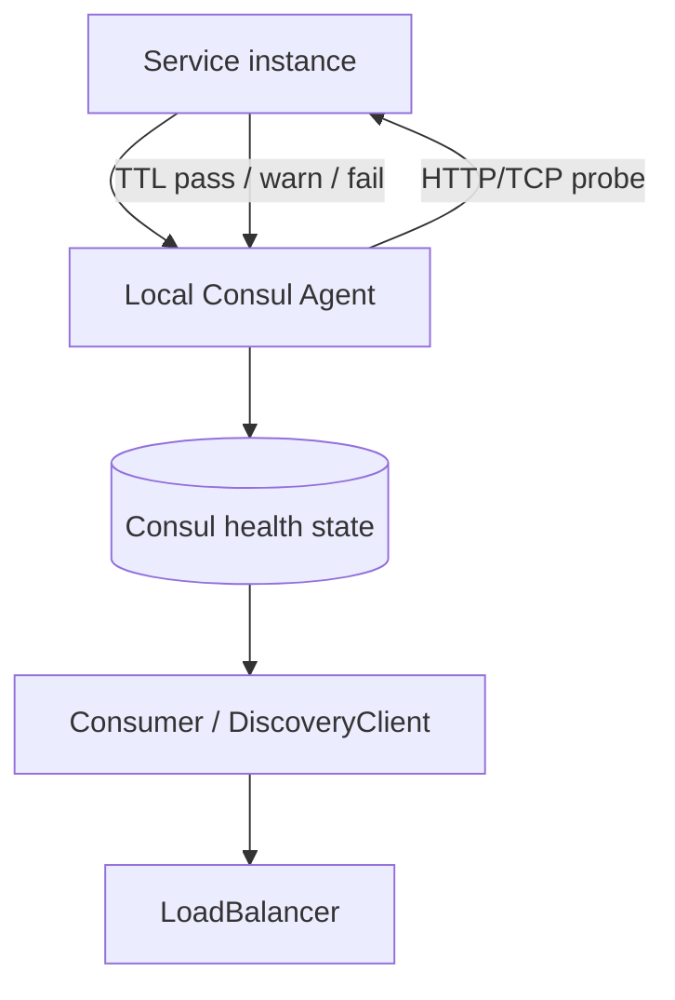

# Đánh đổi giữa HTTP check, TTL heartbeat và mức tải kiểm tra

Consul cần biết một service instance có còn đủ khả năng phục vụ hay không để trả trạng thái sức khỏe cho consumer. Hai cách phổ biến là **HTTP check** và **TTL check (heartbeat)**. HTTP check để Consul Agent chủ động gọi endpoint của ứng dụng theo chu kỳ; TTL check để ứng dụng chủ động báo trạng thái tốt cho Consul Agent trước khi bộ đếm thời gian hết hạn.

Không có cách nào tốt nhất cho mọi service. HTTP check xác minh được một đường truy cập cụ thể từ agent tới ứng dụng nhưng tạo request kiểm tra định kỳ. TTL heartbeat nhẹ hơn về mặt kiểm tra endpoint và cho phép ứng dụng tự đánh giá readiness, nhưng phụ thuộc vào việc heartbeat được phát ra đúng lúc và gắn với sức khỏe thật của tiến trình. Khi chọn, cần cân bằng độ chính xác phát hiện lỗi, độ trễ, tải kiểm tra và độ phức tạp vận hành.

## Consul health check hoạt động ở đâu?

Consul Agent quản lý service registration và các health check được khai báo cho agent đó. Agent thực hiện HTTP/TCP/script check theo chu kỳ hoặc nhận cập nhật TTL từ ứng dụng, sau đó đồng bộ trạng thái check vào Consul catalog/health state để consumer tra cứu.

Các trạng thái thường gặp:

| Trạng thái | Ý nghĩa | Tác động khi tra cứu health |
|---|---|---|
| `passing` | Check thành công; service đáp ứng điều kiện kiểm tra | Có thể được trả về khi consumer chỉ yêu cầu service passing |
| `warning` | Có cảnh báo nhưng check chưa ở mức lỗi nghiêm trọng | Consumer cần quyết định có chấp nhận instance cảnh báo hay không |
| `critical` | Check thất bại hoặc TTL đã hết hạn | Thường bị loại khỏi truy vấn chỉ lấy instance passing |

Catalog registration và health status là hai lớp dữ liệu có liên quan nhưng khác nhau. Một instance có thể vẫn tồn tại trong catalog trong khi check đang `critical`; consumer phải chọn API hoặc chế độ truy vấn phù hợp. Nếu dùng Consul health API với tham số `passing`, chỉ các instance có trạng thái phù hợp mới được trả về.



HTTP check và TTL check đều cập nhật health state của service; chúng khác nhau ở bên khởi tạo phép kiểm tra và tín hiệu mà phép kiểm tra chứng minh được.

## HTTP check: Consul chủ động gọi endpoint

Với HTTP check, Consul Agent gửi request tới endpoint của service theo một khoảng thời gian. Endpoint thường là readiness endpoint như `/actuator/health/readiness`, để phản ánh khả năng nhận request nghiệp vụ thay vì chỉ xác nhận tiến trình còn sống.

Ví dụ service definition:

```json
{
  "service": {
    "name": "inventory-service",
    "id": "inventory-1",
    "address": "10.0.1.12",
    "port": 8080,
    "check": {
      "http": "http://10.0.1.12:8080/actuator/health/readiness",
      "method": "GET",
      "interval": "15s",
      "timeout": "3s"
    }
  }
}
```

Agent sẽ gọi endpoint khoảng mỗi 15 giây và chờ tối đa 3 giây cho một lần kiểm tra. Nếu request timeout hoặc nhận kết quả không đạt điều kiện thành công, check có thể chuyển sang `critical` theo quy tắc của Consul. Hãy kiểm tra mã trạng thái HTTP và cách endpoint biểu diễn trạng thái sức khỏe theo phiên bản Consul đang chạy.

### HTTP check phát hiện được điều gì?

- Agent có thể kết nối tới địa chỉ và port đã đăng ký.
- Endpoint HTTP cụ thể có thể trả kết quả readiness/health.
- Các phụ thuộc được endpoint đưa vào health aggregation, ví dụ database hoặc message broker, có thể ảnh hưởng tới kết quả.
- Đường mạng từ agent tới service có thể được kiểm tra trực tiếp.

HTTP check chỉ xác minh endpoint được cấu hình. Nếu `/actuator/health` chỉ trả `UP` khi JVM còn sống nhưng không kiểm tra readiness, Consul có thể tiếp tục đánh dấu service passing dù API nghiệp vụ không còn nhận tải. Ngược lại, nếu endpoint kiểm tra quá nhiều dependency, một sự cố phụ thuộc không thiết yếu có thể làm instance bị loại khỏi discovery.

### Ưu điểm và chi phí

- **Ưu điểm:** kiểm tra được đường HTTP thực tế từ agent; dễ quan sát; có thể dùng readiness endpoint và mã trạng thái rõ ràng.
- **Chi phí:** mỗi check tạo request định kỳ, xử lý HTTP và có thể chạy logic kiểm tra dependency; khi số instance tăng, số request tăng tương ứng.
- **Rủi ro:** endpoint nặng hoặc check quá dày có thể tự tạo tải; một dependency chậm có thể khiến nhiều instance đồng loạt chuyển critical.

## TTL check: ứng dụng chủ động gửi heartbeat

Với TTL check, Consul Agent giữ một bộ đếm thời gian cho check. Ứng dụng hoặc một thành phần giám sát nội bộ phải cập nhật trạng thái check trước khi TTL hết hạn. Nếu không có cập nhật đúng hạn, agent chuyển check sang `critical`.

Ví dụ service definition:

```json
{
  "service": {
    "name": "inventory-service",
    "id": "inventory-1",
    "address": "10.0.1.12",
    "port": 8080,
    "check": {
      "ttl": "30s"
    }
  }
}
```

Khi ứng dụng đánh giá mình sẵn sàng, nó gửi lệnh `pass` tới Consul Agent cục bộ. API check update sử dụng check ID đã đăng ký:

```bash
curl --request PUT \
  http://127.0.0.1:8500/v1/agent/check/pass/service:inventory-1
```

`service:inventory-1` là ví dụ check ID mặc định thường được tạo cho service check; nếu service definition chỉ định check ID khác, phải dùng đúng ID đó. Khi cần, ứng dụng cũng có thể báo `warn` hoặc `fail` bằng các endpoint tương ứng. Trong môi trường bật ACL, request cập nhật check cần token có quyền agent phù hợp; không nhúng token trực tiếp vào mã nguồn.

### TTL heartbeat phát hiện được điều gì?

TTL check chứng minh rằng ứng dụng hoặc thành phần chịu trách nhiệm heartbeat vẫn có thể gửi cập nhật tới agent trong thời gian quy định. Nó không tự kiểm tra đường HTTP từ agent tới endpoint nghiệp vụ. Nếu heartbeat chạy trong một scheduler độc lập vẫn hoạt động trong khi request handler bị treo, check có thể tiếp tục passing dù service không thực sự sẵn sàng.

Để TTL phản ánh đúng readiness, chỉ gửi `pass` sau khi đánh giá các điều kiện cần thiết: ứng dụng đã khởi tạo xong, thread pool còn khả năng nhận việc, kết nối bắt buộc còn hoạt động và trạng thái shutdown chưa bắt đầu. Không nên dùng một timer mù luôn gửi pass chỉ vì tiến trình JVM còn sống.

### Ưu điểm và chi phí

- **Ưu điểm:** không cần agent gọi endpoint health nặng theo chu kỳ; ứng dụng có thể dùng logic nội bộ để quyết định trạng thái; phù hợp với worker hoặc service không có endpoint HTTP.
- **Chi phí:** phải xây dựng và vận hành vòng lặp heartbeat; ứng dụng cần quyền cập nhật check trên agent; lỗi trong scheduler hoặc token có thể làm TTL hết hạn.
- **Rủi ro:** heartbeat có thể báo khỏe sai nếu không gắn với readiness thực tế; cần xử lý khi agent local mất kết nối hoặc check ID thay đổi.

## So sánh HTTP check và TTL heartbeat

| Tiêu chí | HTTP check | TTL heartbeat |
|---|---|---|
| Bên khởi tạo | Consul Agent chủ động gọi service | Ứng dụng chủ động gửi trạng thái tới agent |
| Tín hiệu kiểm tra | Endpoint HTTP và đường mạng agent → service | Ứng dụng còn gửi heartbeat tới agent |
| Yêu cầu ứng dụng | Có endpoint kiểm tra phù hợp | Có logic heartbeat và đánh giá readiness |
| Độ trễ phát hiện | Phụ thuộc interval, timeout và số lần fail được cấu hình | Phụ thuộc TTL và thời điểm heartbeat cuối cùng |
| Tải chính | Request probe định kỳ và xử lý endpoint | Request cập nhật TTL định kỳ và xử lý heartbeat |
| Phù hợp | Web/API có readiness endpoint nhẹ | Worker, service không có HTTP endpoint hoặc readiness cần logic nội bộ |
| Điểm yếu | Có thể tạo tải probe và kiểm tra quá sâu | Có thể báo khỏe sai nếu heartbeat tách rời luồng phục vụ |

HTTP check chủ động kiểm tra một endpoint từ góc nhìn của agent. TTL check nhận lời khai sức khỏe từ ứng dụng. Nếu cần kiểm chứng cả khả năng phục vụ nội bộ lẫn khả năng truy cập qua mạng, có thể kết hợp hai check nhưng cần tính tổng chi phí và tránh hai check kiểm tra trùng cùng một điều kiện.

## Độ trễ phát hiện và chọn chu kỳ

Với HTTP check có interval là `I`, Consul Agent thường chờ tới lần chạy kế tiếp để phát hiện thay đổi. Nếu service chết ngay sau một lần check thành công, thời gian chờ trước lần probe tiếp theo có thể gần `I`, sau đó cộng thêm thời gian request timeout và chính sách chuyển trạng thái của check. Nếu cấu hình ngưỡng liên tiếp hoặc cơ chế tương tự ở lớp giám sát, cần tính thêm số lần kiểm tra thất bại.

Với TTL check có TTL là `T`, khi ứng dụng ngừng heartbeat ngay sau lần cập nhật thành công, check chỉ chuyển critical sau khi TTL hết hạn. Nếu heartbeat được gửi đều mỗi `H` giây và `H` nhỏ hơn đáng kể so với `T`, hệ thống có khoảng dự phòng cho jitter và pause.

Ví dụ tham khảo:

| Kiểu check | Chu kỳ / TTL | Độ trễ xấu nhất gần đúng trong điều kiện bình thường |
|---|---:|---|
| HTTP | interval 15s, timeout 3s | Gần 15s chờ lần probe tiếp theo, cộng thời gian probe và xử lý trạng thái |
| TTL | TTL 30s, heartbeat mỗi 10s | Tối đa gần 30s từ lần pass cuối tới khi TTL hết hạn |

Đây là cách ước lượng đơn giản, không phải SLA. Agent scheduling, tải máy, mạng, thời gian xử lý check, trạng thái retry và đồng bộ health state có thể làm thời gian thực tế dài hơn.

Nguyên tắc chọn TTL và heartbeat:

- Chọn TTL lớn hơn heartbeat interval nhiều lần để hấp thụ jitter và pause ngắn.
- Gửi heartbeat ở khoảng một nửa hoặc một phần ba TTL như điểm khởi đầu, sau đó đo trong môi trường thật.
- Thêm jitter nhỏ nếu hàng loạt instance có thể khởi động cùng lúc để tránh heartbeat dồn vào một thời điểm.
- Đặt timeout HTTP đủ dài cho độ trễ endpoint bình thường nhưng ngắn hơn nhiều so với interval để một lần check không chồng lấn quá lâu.
- Đừng chọn interval quá ngắn chỉ để có cảm giác phát hiện nhanh; hãy xem tải probe và độ ổn định của endpoint.

## Ước lượng tải kiểm tra theo số instance

Với HTTP check, nếu có `N` instance và mỗi instance có một check chạy mỗi `I` giây, số request probe trung bình toàn hệ thống xấp xỉ:

```text
HTTP probes per second ≈ N / I
```

Nếu mỗi instance có `K` check độc lập:

```text
HTTP probes per second ≈ N × K / I
```

Ví dụ có 1.200 instance, mỗi instance có một HTTP check interval 10 giây:

```text
1.200 / 10 = 120 HTTP probes/second
```

Đây là tổng số probe trung bình trên toàn cụm. Mỗi Consul Agent thường chạy check cho các service mà agent đó quản lý, vì vậy tải được phân tán theo số agent và số check local. Tuy nhiên, endpoint ứng dụng vẫn nhận tổng lượng request tương ứng. Nếu health endpoint gọi database hoặc nhiều dependency, chi phí thực tế có thể lớn hơn đáng kể so với một request HTTP nhẹ.

Với TTL check, số lần cập nhật heartbeat cũng xấp xỉ `N / H` request mỗi giây nếu mỗi instance gửi một lần mỗi `H` giây. Khác biệt chính là request được gửi từ ứng dụng tới agent local và không buộc agent thực hiện HTTP probe vào service. TTL không loại bỏ hoàn toàn tải điều khiển: agent vẫn phải xử lý cập nhật và đồng bộ trạng thái check.

Ví dụ 1.200 instance gửi TTL heartbeat mỗi 10 giây:

```text
1.200 / 10 = 120 TTL updates/second
```

Con số request mỗi giây có thể tương đương HTTP check trong ví dụ, nhưng chi phí trên service endpoint và đường mạng khác nhau. TTL chuyển trách nhiệm đánh giá readiness sang ứng dụng; HTTP chuyển trách nhiệm probe sang agent. Vì vậy, so sánh tải cần tính CPU, network, logic endpoint, số agent, ACL, đồng bộ trạng thái và chi phí vận hành heartbeat.

## Giảm tải mà vẫn phát hiện đủ nhanh

### Giữ health endpoint nhẹ

HTTP check nên gọi readiness endpoint có thời gian phản hồi ổn định. Không nên thực hiện truy vấn nghiệp vụ nặng, quét dữ liệu lớn hoặc gọi nhiều dịch vụ downstream theo chuỗi mỗi lần probe. Với dependency quan trọng, cân nhắc health indicator có timeout ngắn và phân biệt trạng thái readiness với trạng thái liveness.

### Chọn interval theo mức độ quan trọng

Không phải mọi service đều cần cùng chu kỳ. Service nhận traffic người dùng hoặc xử lý thanh toán có thể cần phát hiện nhanh hơn worker batch ít nhạy với thời gian. Chọn interval/TTL theo mục tiêu phục hồi và khả năng chịu lỗi của consumer.

### Tránh đồng bộ hóa các lần kiểm tra

Khi hàng trăm instance khởi động cùng lúc và cùng dùng interval cố định, probe có thể tạo thành các đợt tải đột biến. Có thể phân tán thời điểm khởi chạy, thêm jitter cho heartbeat do ứng dụng quản lý hoặc chia đều replica theo thời gian triển khai. Kiểm tra khả năng cấu hình jitter của phiên bản agent/client đang dùng.

### Giới hạn số check trùng lặp

Đừng tạo nhiều HTTP check giống nhau cho cùng một instance nếu chúng đều kiểm tra một readiness endpoint và dẫn tới cùng một quyết định. Nếu cần kiểm tra nhiều dependency, hãy xác định dependency nào thực sự quyết định instance có nhận traffic hay không; các kiểm tra chỉ phục vụ cảnh báo có thể được theo dõi riêng.

### Chọn TTL có dự phòng

TTL quá ngắn khiến pause GC, CPU contention hoặc một lần agent restart ngắn có thể làm check chuyển critical. TTL quá dài làm phát hiện instance mất chậm. Hãy đo phân phối thời gian heartbeat trong điều kiện tải cao rồi chọn TTL có khoảng dự phòng đủ lớn so với percentile trễ quan sát được.

## Khi nào nên dùng từng loại?

| Bối cảnh | Lựa chọn gợi ý | Lý do |
|---|---|---|
| REST API có readiness endpoint nhẹ | HTTP check | Agent xác minh được endpoint mà consumer kỳ vọng gọi |
| Worker không mở cổng HTTP | TTL check | Worker tự báo trạng thái thông qua agent local |
| Readiness phụ thuộc logic nội bộ phức tạp | TTL check hoặc check kết hợp | Ứng dụng có ngữ cảnh tốt hơn để quyết định có nhận việc không |
| Cần xác minh agent có thể kết nối endpoint từ mạng thực tế | HTTP check | Probe đi qua đường mạng từ agent tới service |
| Có số lượng instance rất lớn và endpoint check tốn tài nguyên | TTL hoặc HTTP check nhẹ với interval hợp lý | Tránh tạo lượng probe nặng theo chu kỳ |
| Cần cả readiness nội bộ và reachability HTTP | Kết hợp có chọn lọc | Hai tín hiệu bổ sung nhau, nhưng tăng số check và độ phức tạp |

Đối với API, HTTP check thường là lựa chọn dễ hiểu nếu endpoint readiness phản ánh đúng khả năng phục vụ. Với worker, TTL thường tự nhiên hơn. Nếu dùng TTL, cần bảo đảm heartbeat ngừng khi service không còn đủ khả năng xử lý công việc.

## Kết hợp HTTP và TTL mà không tạo hai nguồn sự thật

Có thể khai báo cả HTTP check và TTL check cho một service khi chúng kiểm tra hai khía cạnh khác nhau. Ví dụ HTTP check xác minh endpoint có thể truy cập từ agent; TTL heartbeat phản ánh ứng dụng đã hoàn tất khởi tạo và còn đủ tài nguyên để nhận request.

Khi kết hợp:

1. Đặt tên check và mô tả mục đích riêng biệt để người vận hành biết check nào đang fail.
2. Không để TTL heartbeat luôn pass độc lập với readiness thực tế.
3. Xác định consumer dùng truy vấn chỉ lấy passing; nếu một check critical thì service có thể bị loại khỏi kết quả đó.
4. Cân nhắc tổng tải: một HTTP probe cộng một TTL update trên mỗi instance.
5. Theo dõi nguyên nhân chuyển critical và quy trình phục hồi từng check.

Không nên dùng hai check trùng lặp chỉ để “an toàn hơn”. Nếu cả hai cùng kiểm tra một endpoint, chúng có thể tạo thêm tải mà không cung cấp thêm thông tin đáng kể.

## Cấu hình bằng Spring Cloud Consul

Spring Cloud Consul có thể tự đăng ký service và cấu hình HTTP health check dựa trên các thuộc tính discovery. Ví dụ cấu hình HTTP check:

```yaml
spring:
  application:
    name: inventory-service
  cloud:
    consul:
      host: localhost
      port: 8500
      discovery:
        register: true
        health-check-path: /actuator/health/readiness
        health-check-interval: 15s
        health-check-timeout: 3s
```

Các thuộc tính health check có thể thay đổi theo phiên bản Spring Cloud Consul; cần đối chiếu reference của release train mà dự án dùng. Đảm bảo endpoint readiness được expose và agent có thể truy cập địa chỉ/port đã đăng ký. Nếu ứng dụng chạy trong container, địa chỉ quảng bá không được là `localhost` trừ khi agent và service thực sự ở cùng network namespace.

Với TTL heartbeat, Spring Cloud Consul có cơ chế tích hợp heartbeat ở các phiên bản hỗ trợ. Hãy xác minh tên property, cách tạo TTL check và chu kỳ heartbeat trong tài liệu đúng phiên bản trước khi bật. Nếu tự quản lý TTL qua Consul Agent API, ứng dụng phải lưu check ID, gửi pass định kỳ, xử lý lỗi agent và bảo đảm heartbeat dừng khi readiness chuyển critical hoặc tiến trình shutdown.

Ví dụ cập nhật TTL trực tiếp bằng API là thao tác với Consul Agent cục bộ, không phải gửi request tới Consul server bất kỳ:

```bash
curl --request PUT \
  --header "X-Consul-Token: ${CONSUL_AGENT_TOKEN}" \
  http://127.0.0.1:8500/v1/agent/check/pass/service:inventory-1
```

Trong production, lấy token từ secret manager hoặc biến môi trường được bảo vệ. Không commit token vào YAML hoặc mã nguồn. Check ID trong ví dụ cần khớp với check đã đăng ký trên agent.

## Bảo mật và vận hành

- Chỉ cho Consul Agent truy cập các health endpoint cần thiết; không mở endpoint quản trị cho mạng không tin cậy.
- Nếu health endpoint cần authentication, cấu hình header/token phù hợp cho HTTP check và quản lý secret an toàn.
- Với TTL update, cấp ACL token có quyền cập nhật check trên agent ở phạm vi tối thiểu cần thiết.
- Không trả thông tin bí mật, connection string hoặc chi tiết hạ tầng nhạy cảm trong response health.
- Theo dõi số lượng check, thời gian phản hồi, tỷ lệ critical/warning, số TTL update thất bại và độ trễ đồng bộ trạng thái.
- Cấu hình `deregister_critical_service_after` chỉ khi muốn agent tự gỡ service sau khi check critical liên tục trong một khoảng thời gian; không dùng nó thay cho việc hiểu và sửa nguyên nhân check fail.

## Đo tải và chọn cấu hình trong thực tế

Có thể lập một thử nghiệm với cùng số lượng instance và cùng readiness semantics:

1. Đăng ký một nhóm instance với HTTP check, interval 10s và timeout 2s.
2. Đo số request tới health endpoint, CPU của agent và ứng dụng, độ trễ response và thời gian từ lúc dừng service tới khi check critical.
3. Đăng ký nhóm tương đương với TTL 30s và heartbeat 10s.
4. Đo số TTL update, CPU agent, CPU ứng dụng, thời gian phát hiện khi heartbeat ngừng và khi readiness chủ động báo fail.
5. Tăng số instance theo từng mức và quan sát tải tổng cũng như tải trên từng agent.
6. Tạo tình huống endpoint chậm, agent mất kết nối, JVM pause và shutdown có kiểm soát.
7. So sánh độ trễ phát hiện, tỷ lệ false critical và chi phí tài nguyên của hai phương án.

Các số liệu cần ghi nhận:

| Chỉ số | Vì sao cần đo? |
|---|---|
| Số check trên mỗi agent | Xác định phân bố tải kiểm tra |
| HTTP requests/second | Đo tải probe thực tế lên endpoint |
| TTL updates/second | Đo tải heartbeat do ứng dụng tạo ra |
| p95/p99 thời gian health endpoint | Chọn timeout không quá sát với độ trễ bình thường |
| Thời gian từ lỗi tới `critical` | Đánh giá detection delay |
| Tỷ lệ false critical | Phát hiện cấu hình quá nhạy với jitter hoặc pause |
| CPU/network của agent và service | So sánh chi phí vận hành |

Không chỉ đo tải trung bình. Hãy kiểm tra lúc rolling deployment hoặc scale-out, vì hàng loạt instance có thể khởi động và bắt đầu check/heartbeat gần như cùng lúc.

## Lỗi thường gặp

| Triệu chứng | Nguyên nhân có thể | Cách xử lý |
|---|---|---|
| HTTP check liên tục critical | Sai address/port/path, agent không truy cập được endpoint hoặc timeout quá ngắn | Gọi endpoint từ chính agent host/container và kiểm tra timeout |
| HTTP check passing dù API không dùng được | Endpoint chỉ kiểm tra liveness hoặc không bao gồm readiness | Dùng readiness endpoint phản ánh khả năng nhận traffic |
| TTL check critical dù service vẫn chạy | Heartbeat scheduler dừng, agent không truy cập được hoặc TTL quá ngắn | Kiểm tra log heartbeat, check ID, ACL và tăng dự phòng TTL |
| TTL check passing dù worker bị treo | Heartbeat thread vẫn chạy độc lập với luồng xử lý | Chỉ gửi pass khi worker thực sự đủ khả năng nhận việc |
| Agent/ứng dụng chịu tải cao vì check | Interval quá ngắn, nhiều check trùng hoặc health endpoint nặng | Giảm số check, làm nhẹ endpoint và điều chỉnh interval |
| Nhiều instance cùng chuyển critical | Dependency chung lỗi hoặc check bị đồng bộ thời điểm | Phân biệt lỗi hệ thống với lỗi instance; thêm jitter và timeout hợp lý |
| Service vẫn nằm trong catalog dù critical | Check status và deregistration là hai cơ chế khác nhau | Kiểm tra truy vấn `passing` và cấu hình thời gian deregister critical nếu cần |

## Nguyên tắc lựa chọn

1. Chọn HTTP check khi cần xác minh endpoint thực sự truy cập được từ Consul Agent và có readiness endpoint nhẹ.
2. Chọn TTL khi ứng dụng cần tự quyết định readiness, không có endpoint HTTP hoặc có thể phát heartbeat đáng tin cậy.
3. Với TTL, heartbeat phải gắn với khả năng phục vụ thật; dừng hoặc báo fail khi ứng dụng không còn sẵn sàng.
4. Ước lượng tổng tải bằng số instance, số check và chu kỳ; tính cả endpoint work lẫn request cập nhật TTL.
5. Chọn interval/TTL theo detection target và số liệu p95/p99, có dự phòng cho jitter, pause và mạng.
6. Tránh check trùng lặp, endpoint nặng và các chu kỳ đồng bộ tạo burst.
7. Chỉ kết hợp HTTP và TTL khi hai check bổ sung tín hiệu khác nhau.
8. Kiểm thử scale-out, rolling deployment, agent restart, network partition và dependency outage.

## Kết luận

HTTP check là phép kiểm tra chủ động từ Consul Agent tới endpoint của service; TTL heartbeat là tín hiệu do ứng dụng chủ động gửi để gia hạn trạng thái khỏe. HTTP check cho biết đường truy cập và readiness endpoint có đáp ứng hay không, nhưng tạo request probe theo chu kỳ. TTL giảm nhu cầu probe endpoint và cho phép ứng dụng dùng logic nội bộ, nhưng chỉ đáng tin khi heartbeat gắn chặt với khả năng phục vụ. Khi quy mô tăng, tải của cả hai phụ thuộc số instance, số check và chu kỳ. Hãy chọn cơ chế theo tín hiệu cần xác minh, đo detection delay và tài nguyên thực tế, rồi điều chỉnh TTL/interval có dự phòng thay vì chỉ giảm chu kỳ để phát hiện nhanh hơn.
