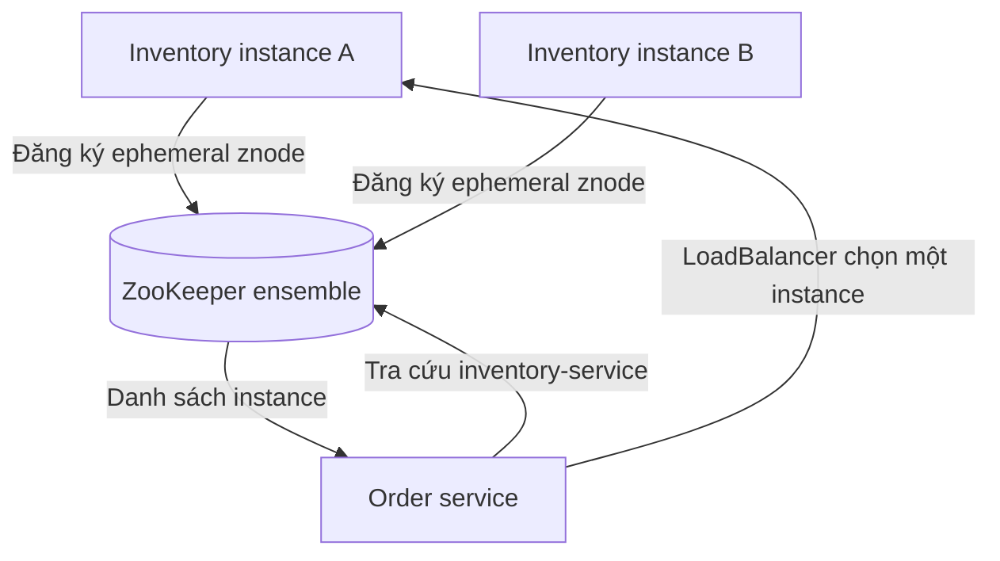

# Vai trò của Zookeeper và Curator trong khám phá dịch vụ

Trong hệ thống microservice, một dịch vụ có thể chạy trên nhiều instance và địa chỉ của từng instance có thể thay đổi sau mỗi lần triển khai hoặc mở rộng. Consumer cần một cách tìm instance theo tên logic như `inventory-service`, còn provider cần công bố vị trí và trạng thái của mình. ZooKeeper có thể đảm nhiệm vai trò lưu trữ phối hợp tập trung cho danh bạ này; Apache Curator cung cấp API cấp cao giúp ứng dụng Java làm việc với ZooKeeper an toàn và thuận tiện hơn.

Trong phạm vi Spring Cloud, cần phân biệt ba lớp trách nhiệm:

- **ZooKeeper** là hệ thống phối hợp phân tán, cung cấp cây dữ liệu, session, cơ chế đồng bộ và thông báo thay đổi. Nó không tự hiểu khái niệm microservice hay kiểm tra sức khỏe HTTP của ứng dụng.
- **Curator** là thư viện client cho Java. Curator Framework quản lý kết nối và thao tác với ZooKeeper; các recipe và module như Service Discovery xây dựng các mẫu phối hợp phổ biến trên những primitive đó.
- **Spring Cloud Zookeeper Discovery** tích hợp ZooKeeper vào abstraction khám phá dịch vụ của Spring Cloud, giúp ứng dụng tra cứu bằng `DiscoveryClient` và kết hợp với Spring Cloud LoadBalancer.

## ZooKeeper giải quyết phần nào của bài toán discovery?

Nếu `order-service` gọi `inventory-service` qua một IP được ghi cố định trong cấu hình, địa chỉ đó có thể lỗi thời khi container được tạo lại. Nếu có nhiều instance, consumer còn phải biết instance nào đang hoạt động và chọn một instance để gửi request.

ZooKeeper cung cấp một không gian tên phân cấp gồm các nút dữ liệu gọi là **znode**. Ứng dụng có thể quy ước một đường dẫn làm gốc cho danh bạ dịch vụ, chẳng hạn:

```text
/services
  /inventory-service
    /instance-a
    /instance-b
  /pricing-service
    /instance-c
```

Mỗi nút instance có thể chứa dữ liệu mô tả host, port, instance ID, phiên bản hoặc metadata định tuyến. Provider tạo hoặc cập nhật znode khi tham gia hệ thống; consumer đọc các instance con dưới service ID để tìm đích gọi. Đây là quy ước do ứng dụng hoặc thư viện discovery xây dựng, không phải ZooKeeper tự động phát hiện tiến trình đang mở cổng nào.



ZooKeeper phù hợp với dữ liệu phối hợp nhỏ, cần được nhiều tiến trình quan sát và cập nhật có kiểm soát. Không nên dùng nó như cơ sở dữ liệu nghiệp vụ hoặc nơi lưu payload lớn. Danh bạ discovery chỉ cần giữ thông tin đủ để định vị và lựa chọn instance.

## Các khái niệm ZooKeeper quan trọng

### Znode và cấu trúc cây

Znode là đơn vị dữ liệu trong cây ZooKeeper. Một znode có đường dẫn duy nhất, có thể chứa một lượng dữ liệu nhỏ và có thể có các znode con. Ví dụ, `/services/inventory-service/instance-a` biểu diễn một instance thuộc dịch vụ `inventory-service`.

ZooKeeper hỗ trợ nhiều loại znode. Trong discovery, hai loại thường được quan tâm là:

- **Persistent znode:** tồn tại cho đến khi client xóa nó hoặc một thao tác quản trị xóa nó. Có thể dùng để tạo nút gốc `/services` hoặc nút đại diện cho service ID.
- **Ephemeral znode:** gắn với session của client tạo ra nó. Khi session kết thúc hoặc hết hạn, ZooKeeper tự xóa ephemeral znode và các nút ephemeral con của nó.

Một mẫu thường gặp là tạo đường dẫn service bằng persistent znode và tạo mỗi instance bằng ephemeral znode. Khi instance dừng có kiểm soát, ứng dụng nên xóa đăng ký trước khi đóng client. Nếu tiến trình chết đột ngột và session hết hạn, ZooKeeper sẽ loại bỏ đăng ký tạm thời.

Ephemeral znode không thể có con. Vì vậy, nếu thiết kế cây có nhiều tầng, hãy đặt ephemeral node ở tầng lá, còn các nút cha dùng loại persistent. Nếu nhiều instance có thể đăng ký cùng lúc, mỗi instance cần một đường dẫn riêng; có thể dùng ephemeral sequential node để ZooKeeper cấp hậu tố tuần tự, hoặc dùng instance ID duy nhất do ứng dụng tạo.

### Session và heartbeat

Khi Curator client kết nối, ZooKeeper tạo hoặc tiếp tục một session có timeout. Client gửi heartbeat để duy trì session. Nếu server không nhận được heartbeat trong khoảng thời gian cho phép, session có thể hết hạn và các ephemeral znode thuộc session đó bị xóa.

Điểm cần hiểu rõ là **mất kết nối tạm thời không đồng nghĩa session đã hết hạn ngay lập tức**. Khi mạng bị gián đoạn, client có thể chưa biết session còn hiệu lực hay không. Trong Curator, các trạng thái kết nối thường gặp gồm:

| Trạng thái | Ý nghĩa vận hành |
|---|---|
| `CONNECTED` | Client đã kết nối và có thể thao tác với ZooKeeper. |
| `SUSPENDED` | Kết nối bị gián đoạn; client chưa thể xác nhận trạng thái session. Cần thận trọng với các thao tác phụ thuộc vào quyền sở hữu ephemeral node. |
| `RECONNECTED` | Client kết nối lại và session cũ vẫn được duy trì. |
| `LOST` | Session đã hết hạn hoặc không thể khôi phục; ephemeral znode cũ đã bị xóa và ứng dụng phải đăng ký lại khi có session mới. |

Tên và hành vi chi tiết cần đối chiếu phiên bản Curator đang dùng, nhưng nguyên tắc vận hành vẫn là: khi ở trạng thái không chắc chắn, không được giả định đăng ký vẫn còn hiệu lực; khi session mất, phải tạo lại đăng ký.

### Watch và thông báo thay đổi

Consumer có thể đặt watch để được thông báo khi znode hoặc danh sách con thay đổi. Chẳng hạn, `order-service` theo dõi các instance con của `/services/inventory-service`; khi một instance được thêm hoặc xóa, consumer nhận thông báo rồi đọc lại danh sách mới.

Watch cơ bản của ZooKeeper là thông báo một lần: sau khi sự kiện xảy ra, client thường phải đăng ký watch mới nếu muốn tiếp tục theo dõi. Một số sự kiện có thể được gộp khi client mất kết nối hoặc xử lý chậm, do đó watch không nên được hiểu như một luồng sự kiện đảm bảo ghi nhận mọi thay đổi theo thứ tự. Consumer nên dùng sự kiện làm tín hiệu để tải lại trạng thái hiện tại.

Curator cung cấp các recipe và cache cấp cao để giảm việc tự quản lý watch. Dù sử dụng cache nào, ứng dụng vẫn phải xử lý trường hợp cache cũ, kết nối bị ngắt và cần đồng bộ lại sau khi kết nối phục hồi.

### Quorum và tính sẵn sàng của ensemble

Trong triển khai thực tế, ZooKeeper thường chạy thành một **ensemble** gồm nhiều server. Các thao tác ghi cần quorum để thống nhất trạng thái. Vì vậy, số lượng node lẻ thường được chọn để chịu được lỗi một số server mà vẫn giữ đa số.

Ví dụ, ensemble ba node có thể tiếp tục phục vụ khi một node hỏng vì hai node còn lại vẫn tạo thành đa số. Nếu mất quorum, hệ thống không thể tiếp tục xử lý ghi theo cách bảo đảm nhất quán; client có thể gặp lỗi hoặc chờ kết nối. Discovery phụ thuộc vào registry nên cần giám sát quorum và lập kế hoạch khôi phục ensemble.

## Curator làm cho việc sử dụng ZooKeeper dễ quản lý hơn

Curator là thư viện client Java của Apache, không phải một registry server độc lập. Curator Framework quản lý kết nối, retry và vòng đời client. Các module recipe cung cấp cách dùng đã được chuẩn hóa cho những mẫu như leader election, distributed lock, cache và service discovery.

Trong bài toán khám phá dịch vụ, module Curator Service Discovery cung cấp các abstraction chính:

| Thành phần | Vai trò |
|---|---|
| `ServiceDiscovery` | Quản lý đăng ký, hủy đăng ký và truy vấn các service instance dưới một base path. |
| `ServiceInstance` | Mô tả một instance gồm tên dịch vụ, địa chỉ, cổng, ID và payload tùy chọn. |
| `ServiceProvider` | Cung cấp instance cho consumer theo chiến lược lựa chọn đã cấu hình. |
| `ServiceCache` | Cache danh sách instance và cập nhật khi dữ liệu discovery thay đổi. |
| `ProviderStrategy` | Quy định cách chọn instance, ví dụ vòng tròn (round robin) hoặc chiến lược tùy biến. |

Curator giúp ứng dụng tránh phải tự viết toàn bộ logic tạo znode, quản lý session, watch và đồng bộ lại. Tuy vậy, ứng dụng vẫn phải quản lý lifecycle của client và các đối tượng discovery, chọn chiến lược retry phù hợp và phản ứng đúng với trạng thái kết nối.

## Luồng đăng ký và tra cứu với Curator

Một luồng điển hình có thể diễn ra như sau:

1. Provider khởi tạo `CuratorFramework` với địa chỉ ensemble và retry policy, sau đó mở kết nối.
2. Provider tạo `ServiceDiscovery` với base path, ví dụ `/services`.
3. Provider tạo `ServiceInstance` với service name, địa chỉ có thể truy cập từ consumer, port và payload cần thiết.
4. Provider gọi `registerService`. Curator ghi thông tin instance vào ZooKeeper theo mô hình đăng ký của thư viện.
5. Consumer truy vấn các instance theo service name, hoặc tạo `ServiceProvider` để chọn một instance theo chiến lược.
6. Khi provider dừng, nó hủy đăng ký và đóng các tài nguyên. Nếu tiến trình chết đột ngột, ephemeral node được dọn khi session hết hạn.
7. Khi session bị mất, provider phải đăng ký lại bằng session mới; consumer phải làm mới cache hoặc danh sách instance sau khi kết nối được khôi phục.

Ví dụ khởi tạo client và service discovery bằng Curator:

```java
import org.apache.curator.framework.CuratorFramework;
import org.apache.curator.framework.CuratorFrameworkFactory;
import org.apache.curator.retry.ExponentialBackoffRetry;
import org.apache.curator.x.discovery.ServiceDiscovery;
import org.apache.curator.x.discovery.ServiceDiscoveryBuilder;
import org.apache.curator.x.discovery.ServiceInstance;

import java.io.Closeable;
import java.util.concurrent.TimeUnit;

public class InventoryRegistration implements Closeable {
    private final CuratorFramework client;
    private final ServiceDiscovery<InstanceMetadata> discovery;
    private ServiceInstance<InstanceMetadata> registeredInstance;

    public InventoryRegistration(String connectString) throws Exception {
        this.client = CuratorFrameworkFactory.newClient(
            connectString,
            new ExponentialBackoffRetry(1_000, 3)
        );
        this.client.start();
        if (!this.client.blockUntilConnected(10, TimeUnit.SECONDS)) {
            this.client.close();
            throw new IllegalStateException("Cannot connect to ZooKeeper");
        }

        this.discovery = ServiceDiscoveryBuilder
            .builder(InstanceMetadata.class)
            .client(client)
            .basePath("/services")
            .build();
        this.discovery.start();
    }

    public void register(String host, int port) throws Exception {
        ServiceInstance<InstanceMetadata> instance = ServiceInstance
            .<InstanceMetadata>builder()
            .name("inventory-service")
            .address(host)
            .port(port)
            .payload(new InstanceMetadata("v1"))
            .build();

        discovery.registerService(instance);
        this.registeredInstance = instance;
    }

    @Override
    public void close() throws java.io.IOException {
        if (registeredInstance != null) {
            discovery.unregisterService(registeredInstance);
        }
        discovery.close();
        client.close();
    }
}

class InstanceMetadata {
    private String version;

    public InstanceMetadata() {}

    public InstanceMetadata(String version) {
        this.version = version;
    }

    public String getVersion() {
        return version;
    }

    public void setVersion(String version) {
        this.version = version;
    }
}
```

Đoạn mã minh họa cách đăng ký, không phải một ứng dụng Spring Boot hoàn chỉnh. Trong ứng dụng thật, nên tạo client và `ServiceDiscovery` dưới dạng bean có lifecycle rõ ràng, chờ kết nối sẵn sàng trước khi công bố instance, và bảo đảm `host` là địa chỉ mà consumer truy cập được. Payload nên là dữ liệu nhỏ, có thể serialize ổn định và không chứa mật khẩu hay token.

Consumer có thể truy vấn trực tiếp danh sách instance:

```java
var instances = discovery.queryForInstances("inventory-service");
for (var instance : instances) {
    System.out.println(instance.getAddress() + ":" + instance.getPort());
}
```

Hoặc dùng `ServiceProvider` để chọn instance thay vì tự chọn thủ công:

```java
import org.apache.curator.x.discovery.ServiceProvider;
import org.apache.curator.x.discovery.strategies.RoundRobinStrategy;

ServiceProvider<InstanceMetadata> provider = discovery
    .serviceProviderBuilder()
    .serviceName("inventory-service")
    .providerStrategy(new RoundRobinStrategy<>())
    .build();

provider.start();
try {
    ServiceInstance<InstanceMetadata> selected = provider.getInstance();
    if (selected != null) {
        // Gửi request tới selected.getAddress() và selected.getPort().
    }
} finally {
    provider.close();
}
```

Trong ví dụ, `RoundRobinStrategy` phân phối lựa chọn theo vòng tròn trên danh sách instance mà provider đang biết. Đây là chiến lược lựa chọn, không phải health check. Consumer vẫn cần timeout, xử lý lỗi kết nối và chính sách retry có giới hạn vì một instance có thể hỏng ngay sau khi được chọn.

## Tích hợp ZooKeeper với Spring Cloud

Spring Cloud Zookeeper cung cấp integration để ứng dụng Spring dùng ZooKeeper làm service registry. Starter phổ biến là `spring-cloud-starter-zookeeper-discovery`; phiên bản của nó nên được quản lý qua Spring Cloud BOM tương thích với phiên bản Spring Boot của dự án. Khi cần gọi dịch vụ theo tên và cân bằng tải phía client, thêm Spring Cloud LoadBalancer tương ứng.

Ví dụ dependency Maven, với phiên bản được quản lý bởi dependency management của Spring Cloud:

```xml
<dependencies>
    <dependency>
        <groupId>org.springframework.cloud</groupId>
        <artifactId>spring-cloud-starter-zookeeper-discovery</artifactId>
    </dependency>
    <dependency>
        <groupId>org.springframework.cloud</groupId>
        <artifactId>spring-cloud-starter-loadbalancer</artifactId>
    </dependency>
</dependencies>
```

Cấu hình provider:

```yaml
spring:
  application:
    name: inventory-service
  cloud:
    zookeeper:
      connect-string: zk-1:2181,zk-2:2181,zk-3:2181
      discovery:
        enabled: true
        register: true
        root: /services
        instance-id: ${spring.application.name}:${server.port}
        prefer-ip-address: true
```

`spring.application.name` trở thành service ID để consumer tra cứu. `connect-string` trỏ tới ensemble ZooKeeper có thể truy cập từ ứng dụng. `root` xác định đường dẫn gốc của danh bạ; `instance-id` cần duy nhất trong phạm vi dịch vụ. Khi chạy nhiều instance trên cùng host, cần bảo đảm cổng hoặc thành phần ID khác nhau. Cấu hình địa chỉ quảng bá phải phù hợp với mạng mà consumer sử dụng.

Consumer có thể tra cứu thông qua abstraction chung `DiscoveryClient`:

```java
import java.util.List;

import org.springframework.cloud.client.ServiceInstance;
import org.springframework.cloud.client.discovery.DiscoveryClient;
import org.springframework.stereotype.Service;

@Service
public class InventoryLookup {
    private final DiscoveryClient discoveryClient;

    public InventoryLookup(DiscoveryClient discoveryClient) {
        this.discoveryClient = discoveryClient;
    }

    public List<ServiceInstance> findInstances() {
        return discoveryClient.getInstances("inventory-service");
    }
}
```

Với lời gọi HTTP thông thường, có thể dùng tên dịch vụ làm host logic và để Spring Cloud LoadBalancer chọn instance:

```java
import org.springframework.boot.web.client.RestTemplateBuilder;
import org.springframework.cloud.client.loadbalancer.LoadBalanced;
import org.springframework.context.annotation.Bean;
import org.springframework.context.annotation.Configuration;
import org.springframework.web.client.RestTemplate;

@Configuration
class HttpClientConfiguration {
    @Bean
    @LoadBalanced
    RestTemplate inventoryRestTemplate(RestTemplateBuilder builder) {
        return builder.build();
    }
}
```

Sau đó lời gọi có thể dùng URL như `http://inventory-service/api/items/42`. LoadBalancer phối hợp với discovery client để tìm và chọn instance. Cách này giúp consumer không phải tự viết thuật toán chọn instance. Nếu ứng dụng chỉ cần tra cứu danh sách hoặc metadata đặc thù, `DiscoveryClient` vẫn có thể được sử dụng trực tiếp.

Tên thuộc tính và khả năng tích hợp có thể thay đổi theo dòng phiên bản Spring Cloud. Cần kiểm tra tài liệu đúng release train, dependency BOM và cấu hình starter đang sử dụng; không trộn tùy tiện phiên bản Curator, Spring Boot và Spring Cloud.

## Health check, trạng thái registry và tính đúng đắn

Một điểm dễ hiểu nhầm là ephemeral znode không phải health check của ứng dụng. Nó chỉ cho biết ZooKeeper còn xem session của client là tồn tại. Tiến trình có thể vẫn giữ session nhưng endpoint HTTP đã treo, kết nối cơ sở dữ liệu đã hỏng hoặc ứng dụng chưa sẵn sàng phục vụ.

Vì vậy, khi thiết kế discovery cần phối hợp nhiều tín hiệu:

- **Readiness:** chỉ đăng ký hoặc đưa instance vào nhận tải khi ứng dụng đã sẵn sàng phục vụ request.
- **Liveness:** phát hiện tiến trình không còn khả năng hoạt động và cần khởi động lại.
- **ZooKeeper session:** phát hiện client mất kết nối trong thời gian đủ dài và dọn ephemeral node khi session hết hạn.
- **Consumer timeout và xử lý lỗi:** bảo vệ lời gọi trong khoảng thời gian registry hoặc cache chưa phản ánh sự cố.

Không nên coi việc znode còn tồn tại là bằng chứng endpoint đang khỏe. Nếu cần loại instance theo health check HTTP hoặc TCP, phải tích hợp cơ chế kiểm tra phù hợp hoặc cập nhật trạng thái đăng ký theo readiness của ứng dụng.

### Xử lý sai lệch registry và cache

Registry và consumer cache có thể không đồng bộ tức thời với mạng. Một instance vừa chết có thể vẫn xuất hiện trong kết quả tra cứu cho đến khi session hết hạn và cache được cập nhật. Ngược lại, instance mới có thể đã khởi động nhưng chưa đăng ký thành công hoặc chưa xuất hiện trong cache.

Các nguyên tắc xử lý:

1. Dùng instance ID duy nhất và đường dẫn đăng ký ổn định theo quy ước.
2. Khi shutdown có kiểm soát, hủy đăng ký trước khi đóng Curator client.
3. Theo dõi `ConnectionState`; khi `SUSPENDED`, hạn chế công bố hoặc tin vào thay đổi trạng thái chưa xác nhận; khi `LOST`, tạo lại đăng ký sau khi client có session mới.
4. Sau khi reconnect, tải lại danh sách hoặc làm mới service cache thay vì chỉ dựa vào watch cũ.
5. Đặt timeout cho request, giới hạn retry và tránh retry đồng thời quá nhiều khi một dịch vụ vừa phục hồi.
6. Quan sát số instance đăng ký, thời gian session, lỗi kết nối ZooKeeper, cache refresh và tỷ lệ request thất bại.

Curator có thể tự xử lý một phần reconnect và recipe, nhưng không thay thế logic readiness, xử lý lỗi request hoặc chính sách phục hồi của ứng dụng. Cần kiểm tra hành vi cụ thể của phiên bản thư viện và cấu hình đang triển khai.

## Bảo mật và vận hành ZooKeeper

ZooKeeper chứa thông tin định vị các dịch vụ nội bộ, vì vậy cần được xem là hạ tầng nhạy cảm. Một cấu hình discovery có thể đúng về mặt chức năng nhưng vẫn tạo rủi ro nếu mọi workload đều được quyền đọc, ghi hoặc xóa toàn bộ cây dữ liệu.

- **Phân quyền ACL:** giới hạn quyền tạo, đọc, cập nhật và xóa znode theo service hoặc nhóm workload. Không dùng quyền mở rộng cho mọi client trong môi trường sản xuất.
- **Xác thực và mã hóa:** bật cơ chế xác thực phù hợp và TLS theo khả năng của phiên bản ZooKeeper/Curator; quản lý credential an toàn và luân chuyển định kỳ.
- **Phân đoạn mạng:** chỉ cho phép provider, consumer và thành phần quản trị cần thiết kết nối các cổng ZooKeeper; không công khai ensemble ra mạng không tin cậy.
- **Bảo vệ dữ liệu đăng ký:** không đưa secret, token truy cập hay dữ liệu cá nhân vào payload hoặc metadata.
- **Giám sát ensemble:** theo dõi quorum, độ trễ request, số lượng connection, session hết hạn, dung lượng snapshot/transaction log và tình trạng từng server.
- **Sao lưu và phục hồi:** xây dựng quy trình backup, khôi phục và nâng cấp ensemble; kiểm thử tình huống mất node hoặc mất quorum.

Khi chọn ZooKeeper làm registry, đội ngũ phải sẵn sàng vận hành thêm một cụm hạ tầng có yêu cầu về quorum, session và dung lượng. Với hệ thống nhỏ hoặc nền tảng đã có registry khác, cần cân nhắc chi phí vận hành và mức độ phù hợp trước khi bổ sung ZooKeeper.

## Khi nào nên dùng ZooKeeper và Curator?

ZooKeeper và Curator phù hợp khi hệ thống đã sử dụng ZooKeeper cho phối hợp phân tán, cần một registry dựa trên znode và muốn tận dụng Curator Service Discovery hoặc Spring Cloud Zookeeper. Curator đặc biệt hữu ích khi ứng dụng Java cần thao tác discovery trực tiếp hoặc cần các recipe phối hợp khác.

Trước khi lựa chọn, hãy cân nhắc:

| Câu hỏi | Điều cần xác định |
|---|---|
| Đã có ZooKeeper ensemble chưa? | Nếu chưa, phải tính thêm công sức triển khai, giám sát, backup và nâng cấp. |
| Có cần discovery theo service ID không? | Curator và Spring Cloud Zookeeper cung cấp abstraction để biểu diễn service instance và tra cứu. |
| Cần health check ở mức nào? | Session/ephemeral node chỉ phản ánh vòng đời kết nối; readiness và health check của ứng dụng vẫn cần thiết. |
| Consumer có cần cân bằng tải không? | Kết hợp Spring Cloud LoadBalancer hoặc chiến lược provider phù hợp. |
| Có yêu cầu bảo mật và cô lập tenant không? | Thiết kế ACL, xác thực, TLS, phân đoạn mạng và cấu trúc base path ngay từ đầu. |
| Đội ngũ có thể vận hành quorum không? | Registry cần ensemble ổn định và quy trình ứng phó khi mất quorum. |

ZooKeeper cung cấp primitive phối hợp và lưu trữ trạng thái; Curator đóng gói các primitive thành API discovery dễ dùng hơn; Spring Cloud Zookeeper kết nối registry đó với hệ sinh thái Spring. Khi hiểu đúng ranh giới giữa session, health check, cache và load balancing, nhóm có thể dùng discovery để tìm instance linh hoạt mà vẫn xử lý được các khoảng thời gian registry chưa phản ánh kịp trạng thái thực tế.
