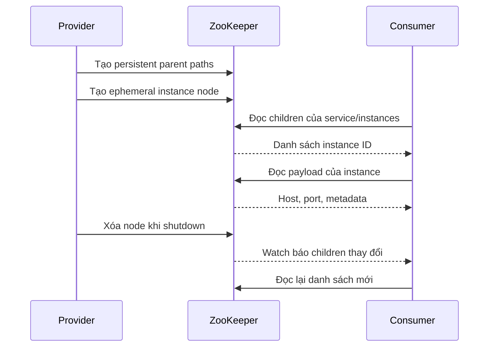

# Znode, nút tạm thời và cấu trúc đường dẫn đăng ký

Khi dùng ZooKeeper làm nơi lưu danh bạ dịch vụ, mỗi provider cần công bố một bản ghi để consumer tìm được địa chỉ của nó. ZooKeeper biểu diễn bản ghi bằng **znode** trong một cây đường dẫn phân cấp. Cách chọn loại znode và tổ chức đường dẫn quyết định cách hệ thống xử lý instance khởi động, dừng, mất kết nối và đăng ký lại.

Một quy ước phổ biến là đặt các dịch vụ dưới một nút gốc như `/services`, mỗi service có một nhánh riêng và mỗi instance có một nút lá riêng:

```text
/services                              (persistent)
  /inventory-service                   (persistent)
    /instances                        (persistent)
      /instance-01                    (ephemeral)
      /instance-02                    (ephemeral)
  /pricing-service                    (persistent)
    /instances                        (persistent)
      /instance-01                    (ephemeral)
```

Các nút cha giữ cấu trúc danh bạ lâu dài; nút lá đại diện cho instance đang đăng ký và được gắn với session của provider. Khi session hết hạn, ZooKeeper xóa nút ephemeral tương ứng. Consumer chỉ cần đọc các nút con dưới `/services/inventory-service/instances` để lấy danh sách instance, sau đó đọc dữ liệu của từng nút để biết địa chỉ và metadata.

Trong module `SPRING_CLOUD_SERVICE_DISCOVERY`, mô hình này giúp giải thích phần lưu trữ phía sau cơ chế khám phá theo service ID. Spring Cloud Zookeeper và Curator có thể quản lý việc tạo, đọc và xóa các znode này thay cho ứng dụng. Dù dùng abstraction nào, người thiết kế vẫn cần hiểu quy tắc về loại nút, session và cấu trúc path để vận hành registry chính xác.

## Znode là gì?

Znode là một nút trong cây dữ liệu của ZooKeeper. Mỗi znode có một đường dẫn tuyệt đối duy nhất, ví dụ `/services/inventory-service/instances/instance-01`. Znode có thể chứa một vùng dữ liệu nhỏ và có thể có các nút con, trừ những giới hạn riêng của loại nút ephemeral.

Một znode thường được dùng để lưu một trong các loại thông tin sau:

- **Nút cấu trúc:** đánh dấu namespace, service name hoặc nhóm instance, chẳng hạn `/services` và `/services/inventory-service/instances`.
- **Bản ghi instance:** chứa host, port, giao thức, instance ID, vùng triển khai hoặc metadata cần cho định tuyến.
- **Trạng thái phối hợp:** dùng trong các bài toán đồng bộ khác như leader election hoặc distributed lock. Đây là mục đích khác với bản ghi service discovery.

Dữ liệu của znode được lưu dưới dạng byte. Ứng dụng có thể tuần tự hóa JSON, Avro hoặc định dạng phù hợp khác, nhưng nên giữ payload nhỏ và có schema rõ ràng. Không lưu object nghiệp vụ lớn, file, mật khẩu hoặc token truy cập trong znode. Consumer cần biết định dạng và phiên bản payload để giải mã an toàn.

Ví dụ payload cho một instance:

```json
{
  "serviceId": "inventory-service",
  "instanceId": "inventory-01",
  "host": "10.0.1.12",
  "port": 8080,
  "scheme": "http",
  "zone": "ap-southeast-1a",
  "version": "v1"
}
```

Payload này chỉ mô tả vị trí và metadata định tuyến. Nó không chứng minh endpoint đang khỏe. Việc kiểm tra readiness và health check cần được thiết kế riêng ở tầng ứng dụng hoặc hạ tầng triển khai.

## Các loại znode liên quan đến đăng ký dịch vụ

ZooKeeper hỗ trợ các loại nút kết hợp hai thuộc tính: persistent hoặc ephemeral, và có hoặc không có hậu tố tuần tự. Với service discovery, cần hiểu bốn loại cơ bản.

| Loại znode | Vòng đời | Tên nút | Trường hợp sử dụng |
|---|---|---|---|
| `PERSISTENT` | Tồn tại đến khi được xóa rõ ràng | Đúng path được yêu cầu | Nút gốc, service name, thư mục `instances` |
| `EPHEMERAL` | Tồn tại trong session tạo ra nó | Đúng path được yêu cầu | Bản ghi instance có ID ổn định |
| `PERSISTENT_SEQUENTIAL` | Tồn tại đến khi được xóa | ZooKeeper thêm hậu tố số tăng dần | Hàng đợi hoặc bản ghi cần thứ tự tạo lâu dài |
| `EPHEMERAL_SEQUENTIAL` | Bị xóa khi session hết hạn | ZooKeeper thêm hậu tố số tăng dần | Bản ghi tạm thời cần tên duy nhất do ZooKeeper cấp |

### Persistent node: giữ cấu trúc danh bạ

`PERSISTENT` phù hợp cho các nút cha không đại diện cho một tiến trình đang sống. Ví dụ, `/services`, `/services/inventory-service` và `/services/inventory-service/instances` có thể tồn tại ngay cả khi dịch vụ chưa có instance nào.

Nhờ có các nút cha ổn định, provider chỉ cần tạo hoặc xóa nút instance của mình. Việc một instance dừng không làm mất namespace của dịch vụ. Các nút persistent không tự biến mất khi client ngắt kết nối, vì vậy cần có quy trình dọn dẹp nếu ứng dụng tạo các nút cấu trúc động mà không còn sử dụng.

### Ephemeral node: gắn bản ghi với session

`EPHEMERAL` là loại nút thường dùng cho đăng ký instance. Khi client tạo ephemeral node, ZooKeeper gắn node đó với session hiện tại của client. Nếu session bị đóng hoặc hết hạn, node sẽ được xóa tự động.

Ví dụ, `inventory-service` có hai instance. Mỗi instance mở một session riêng và đăng ký một ephemeral node:

```text
/services/inventory-service/instances/instance-01
/services/inventory-service/instances/instance-02
```

Khi `instance-01` dừng có kiểm soát, nó nên xóa node đăng ký trước khi đóng session. Nếu tiến trình bị kill hoặc máy chủ hỏng, ZooKeeper sẽ xóa node khi xác định session đã hết hạn. Consumer quan sát danh sách con và cập nhật danh sách instance có thể gọi.

Ephemeral node có hai giới hạn quan trọng:

1. Một ephemeral node không thể có node con. Vì vậy, không đặt `/instances` làm ephemeral nếu bên dưới nó còn các node instance. Hãy giữ `/instances` persistent và chỉ tạo các node instance ở tầng lá dưới nó.
2. Node ephemeral thuộc về session đã tạo ra nó. Một client khác không thể tiếp quản node đó bằng cách ghi đè. Nếu session cũ hết hạn, provider phải tạo đăng ký mới bằng session mới.

Ephemeral node phản ánh vòng đời session, không phản ánh đầy đủ sức khỏe của ứng dụng. Một tiến trình có thể vẫn gửi heartbeat tới ZooKeeper nhưng API HTTP đã treo. Ngược lại, một đợt gián đoạn mạng có thể làm client tạm thời không kết nối được dù tiến trình vẫn chạy. Vì vậy, không nên dùng sự tồn tại của ephemeral node làm health check duy nhất.

### Sequential node: tạo tên instance duy nhất

Với `PERSISTENT_SEQUENTIAL` hoặc `EPHEMERAL_SEQUENTIAL`, ứng dụng truyền một path prefix; ZooKeeper tự thêm hậu tố số tăng dần để tạo tên node. Ví dụ, tạo dưới prefix `/services/inventory-service/instances/instance-` có thể trả về:

```text
/services/inventory-service/instances/instance-0000000042
```

Đặc tính này hữu ích khi nhiều provider cùng đăng ký mà không cần phối hợp để tự cấp ID. Trong discovery, kết hợp `EPHEMERAL_SEQUENTIAL` tạo ra một nút instance có tên duy nhất trong nhánh cha và tự được dọn theo session.

Hậu tố tuần tự chỉ có ý nghĩa trong phạm vi parent path và cơ chế cấp số của ZooKeeper. Không nên xem nó là timestamp, ID toàn cục hay bằng chứng về thứ tự instance khỏe mạnh. Nếu ứng dụng cần ID ổn định xuyên suốt vòng đời triển khai, có thể dùng instance ID do nền tảng cấp và tạo `EPHEMERAL` với path chính xác.

## Thiết kế cấu trúc đường dẫn đăng ký

Một cấu trúc path tốt giúp consumer tra cứu nhanh, giới hạn quyền truy cập và tránh xung đột giữa các provider. Có thể bắt đầu bằng mẫu:

```text
/{root}/{namespace}/{serviceId}/instances/{instanceId}
```

Ví dụ:

```text
/services/production/inventory-service/instances/pod-a7f3
/services/production/inventory-service/instances/pod-b2c9
/services/production/pricing-service/instances/pod-c1d8
```

Các thành phần có ý nghĩa riêng:

| Thành phần | Ý nghĩa | Lưu ý thiết kế |
|---|---|---|
| `root` | Gốc chung của registry, ví dụ `/services` | Cấu hình thống nhất giữa provider và consumer |
| `namespace` | Môi trường, tenant hoặc miền triển khai | Chỉ thêm khi thực sự cần phân tách danh bạ |
| `serviceId` | Tên logic của dịch vụ, ví dụ `inventory-service` | Ổn định, dễ đọc và nhất quán với `spring.application.name` |
| `instances` | Nhánh chứa các bản ghi instance | Thường là persistent node |
| `instanceId` | Định danh một bản chạy cụ thể | Duy nhất trong service và namespace |

### Quy tắc đặt tên path

ZooKeeper path tuân theo quy tắc tên nút của ZooKeeper, không phải mọi chuỗi tùy ý đều hợp lệ. Một số nguyên tắc thực tế:

- Dùng các segment rõ ràng, không để service ID chứa dấu `/` vì dấu này phân tách các cấp của cây.
- Chuẩn hóa chữ hoa/thường và ký tự đặc biệt trước khi đăng ký; provider và consumer phải dùng cùng một quy tắc ánh xạ service ID.
- Không ghép trực tiếp dữ liệu người dùng vào path. Nếu ID đến từ nguồn bên ngoài, hãy kiểm tra hoặc mã hóa nó theo một quy ước an toàn.
- Không tạo path có dấu phân cách lặp, segment rỗng hoặc các segment đặc biệt không hợp lệ.
- Không đưa IP làm service ID. Địa chỉ IP là thuộc tính của instance và có thể thay đổi; tên dịch vụ là định danh logic ổn định.
- Giữ path ngắn, có cấu trúc và có thể quan sát qua công cụ quản trị ZooKeeper.

Nếu hai môi trường cùng dùng một ensemble, namespace giúp tách `/services/dev/...` khỏi `/services/production/...`. Tuy nhiên, namespace chỉ là phân tách logic. Nếu yêu cầu bảo mật cao, cần kết hợp ACL để workload của môi trường này không thể đọc hoặc sửa dữ liệu môi trường khác.

### Chọn instance ID

Instance ID cần phân biệt được các bản chạy đồng thời của cùng một dịch vụ. Một số nguồn ID thường dùng:

- Tên pod hoặc container do nền tảng điều phối cấp.
- Hostname kết hợp port khi mỗi host chạy nhiều instance.
- UUID được tạo khi khởi động tiến trình.
- Hậu tố tuần tự do ZooKeeper cấp khi dùng `EPHEMERAL_SEQUENTIAL`.

Không nên chỉ dùng `spring.application.name` làm instance ID vì nhiều replica của cùng một service sẽ ghi vào cùng một path. Nếu dùng path ổn định với `EPHEMERAL`, cần đảm bảo chỉ một tiến trình sở hữu ID đó tại một thời điểm. Nếu cần nhiều instance đồng thời mà không có nguồn ID đáng tin cậy, dùng sequential node là một lựa chọn.

## Đăng ký bằng Curator

Curator cung cấp API giúp tạo znode và quản lý kết nối tới ZooKeeper. Ví dụ sau minh họa cách tạo các nút cha persistent và một ephemeral node cho instance; ví dụ dùng Jackson Databind để serialize payload. Đây là cách làm ở mức primitive; trong ứng dụng Spring Cloud thông thường, starter discovery có thể đảm nhiệm phần lớn thao tác này.

```java
import com.fasterxml.jackson.databind.ObjectMapper;

import java.util.Map;

import org.apache.curator.framework.CuratorFramework;
import org.apache.zookeeper.CreateMode;
import org.apache.zookeeper.KeeperException;

public class ZookeeperServiceRegistration {
    private final CuratorFramework client;
    private final ObjectMapper objectMapper = new ObjectMapper();

    public ZookeeperServiceRegistration(CuratorFramework client) {
        this.client = client;
    }

    public String registerInventory(String instanceId,
                                    String host,
                                    int port) throws Exception {
        String instancesPath = "/services/inventory-service/instances";
        String instancePath = instancesPath + "/" + instanceId;

        // Tạo các nút cha persistent nếu chưa tồn tại.
        try {
            client.create()
                .creatingParentsIfNeeded()
                .forPath(instancesPath);
        } catch (KeeperException.NodeExistsException ignored) {
            // Nhánh instances đã được tạo bởi lần đăng ký trước hoặc replica khác.
        }

        byte[] payload = objectMapper.writeValueAsBytes(
            Map.of("host", host, "port", port));

        try {
            client.create()
                .withMode(CreateMode.EPHEMERAL)
                .forPath(instancePath, payload);
        } catch (KeeperException.NodeExistsException ex) {
            throw new IllegalStateException(
                "Instance path is already registered: " + instancePath, ex);
        }

        return instancePath;
    }

    public void unregister(String instancePath) throws Exception {
        try {
            client.delete().forPath(instancePath);
        } catch (KeeperException.NoNodeException ignored) {
            // Node đã được ZooKeeper dọn khi session hết hạn.
        }
    }
}
```

Ví dụ giả định `instanceId` đã được kiểm tra hợp lệ và `host` là địa chỉ mà consumer có thể truy cập. `ObjectMapper` serialize payload thành JSON bytes, tránh lỗi escape khi host hoặc metadata chứa ký tự đặc biệt. Cũng cần xử lý `NodeExistsException` theo chính sách của ứng dụng: lỗi này có thể chỉ ra ID bị trùng hoặc một đăng ký cũ vẫn còn hiệu lực.

Lệnh `creatingParentsIfNeeded()` giúp tạo các nút cha còn thiếu dưới dạng persistent. Nó không biến các nút cha thành ephemeral. Đối với path đăng ký, chỉ node instance cuối cùng được tạo với `CreateMode.EPHEMERAL`.

### Đăng ký bằng ephemeral sequential node

Nếu không có ID ổn định hoặc nhiều instance có thể khởi động đồng thời, có thể để ZooKeeper cấp hậu tố tuần tự. Trong cùng class đăng ký ở trên, phần tạo node có thể được thay bằng đoạn sau:

```java
String instancesPath = "/services/inventory-service/instances";
byte[] payloadBytes = objectMapper.writeValueAsBytes(
    Map.of("host", "10.0.1.12", "port", 8080));

String createdPath = client.create()
    .creatingParentsIfNeeded()
    .withMode(CreateMode.EPHEMERAL_SEQUENTIAL)
    .forPath(instancesPath + "/instance-", payloadBytes);
```

Giá trị trả về của `forPath` là path thực tế đã được tạo, ví dụ `/services/inventory-service/instances/instance-0000000042`. Provider nên lưu path trả về để hủy đăng ký có kiểm soát. Khi session hết hạn, ZooKeeper tự xóa node đó; nếu tạo session mới, provider phải đăng ký lại và sẽ nhận path mới.

### Cập nhật dữ liệu instance

Nếu địa chỉ hoặc metadata của instance thay đổi, provider có thể cập nhật dữ liệu node bằng `setData`. ZooKeeper gắn version với dữ liệu; ứng dụng có thể dùng version để tránh ghi đè cập nhật của client khác:

```java
client.setData()
    .withVersion(expectedVersion)
    .forPath(instancePath, updatedPayload);
```

Nếu version không còn khớp, ZooKeeper trả lỗi version conflict. Ứng dụng cần đọc lại dữ liệu và quyết định có áp dụng cập nhật mới hay không. Không nên dùng cập nhật vô điều kiện nếu nhiều thành phần có thể ghi vào cùng một node.

Trong thiết kế discovery, thông thường chỉ provider sở hữu instance mới được phép cập nhật node của chính nó. Consumer đọc dữ liệu và theo dõi thay đổi, không sửa địa chỉ của provider.

## Tra cứu và theo dõi các instance

Consumer bắt đầu bằng cách đọc danh sách node con dưới path của service. Sau đó đọc payload của từng instance để lấy địa chỉ:

```java
import java.nio.charset.StandardCharsets;
import java.util.List;

List<String> instanceIds = client.getChildren().forPath(
    "/services/inventory-service/instances");

for (String instanceId : instanceIds) {
    String path = "/services/inventory-service/instances/" + instanceId;
    byte[] data = client.getData().forPath(path);
    String payload = new String(data, StandardCharsets.UTF_8);
    System.out.println(instanceId + " -> " + payload);
}
```

Đoạn mã chỉ minh họa thao tác đọc. Trong hệ thống thật, node có thể bị xóa giữa lúc consumer đọc danh sách con và lúc đọc payload. Consumer cần xử lý `NoNodeException`, tải lại danh sách và tiếp tục với các instance còn tồn tại. Không nên giả định danh sách vừa đọc luôn đúng tại thời điểm request được gửi.

Để theo dõi thay đổi, consumer có thể đặt watch trên danh sách con hoặc dùng cache của Curator. Watch cơ bản của ZooKeeper là thông báo một lần; sau khi nhận sự kiện, client cần đăng ký lại watch hoặc dùng abstraction cache tự quản lý việc đó. Sau khi reconnect, hãy đồng bộ lại trạng thái hiện tại thay vì chỉ dựa vào những sự kiện có thể đã bỏ lỡ.



## Session, reconnect và đăng ký lại

Ephemeral node sống theo session ZooKeeper. Client gửi heartbeat để giữ session; nếu mạng bị ngắt, client có thể chuyển sang trạng thái `SUSPENDED`. Trong giai đoạn này, client chưa chắc session đã mất. Nếu kết nối được khôi phục trước khi session hết hạn, node ephemeral có thể vẫn tồn tại. Nếu session hết hạn, ZooKeeper xóa node và client không thể tiếp tục sở hữu đăng ký cũ.

Với Curator, cần quan sát các trạng thái kết nối:

| Trạng thái | Cách xử lý liên quan đến đăng ký |
|---|---|
| `CONNECTED` | Có thể thực hiện thao tác khi client và ứng dụng đã sẵn sàng. |
| `SUSPENDED` | Tạm coi trạng thái đăng ký là chưa chắc chắn; tránh quảng bá instance là khả dụng chỉ dựa trên cache cũ. |
| `RECONNECTED` | Kết nối đã phục hồi; nếu session cũ còn hiệu lực, đăng ký cũ vẫn tồn tại. Nếu trước đó đã mất session, cần tạo đăng ký mới theo trạng thái client. |
| `LOST` | Session đã hết hạn; ephemeral node cũ bị xóa. Provider cần đăng ký lại khi có session mới. |

Một trình tự phục hồi an toàn thường gồm:

1. Nhận biết kết nối bị gián đoạn và đánh dấu trạng thái discovery của instance là chưa chắc chắn.
2. Chờ Curator khôi phục kết nối hoặc tạo session mới theo lifecycle của client.
3. Nếu session cũ còn hiệu lực, xác nhận đăng ký hiện có; nếu session đã mất, tạo ephemeral node mới.
4. Consumer tải lại danh sách instance và làm mới cache.
5. Chỉ đưa instance vào nhận tải khi readiness của ứng dụng đạt yêu cầu.

Không nên tự tạo một persistent node để thay thế ephemeral node khi session mất. Làm vậy có thể để lại bản ghi tồn tại sau khi tiến trình chết và biến lỗi tạm thời thành stale registry kéo dài.

## ACL và quyền truy cập trên cấu trúc path

ZooKeeper ACL kiểm soát ai được đọc, ghi, tạo, xóa node hoặc thay đổi ACL. Khi thiết kế path theo service, có thể giới hạn quyền theo nhánh:

- Quản trị viên hoặc quy trình bootstrap tạo `/services` và các service parent.
- Provider được quyền tạo node con dưới nhánh service của mình và ghi dữ liệu node instance.
- Consumer chỉ có quyền đọc danh sách instance và payload cần thiết.
- Provider của dịch vụ A không được xóa hoặc ghi dữ liệu đăng ký của dịch vụ B.

Các quyền ACL quan trọng gồm `READ`, `WRITE`, `CREATE`, `DELETE` và `ADMIN`. Quyền tạo node con được kiểm tra trên parent; quyền xóa child cũng liên quan đến quyền `DELETE` trên parent. Vì thế, cấp quyền ở đúng cấp path là điều cần thiết. Chỉ tạo ACL trên node instance mà quên quyền trên parent có thể khiến provider không đăng ký được.

Nếu các namespace chia sẻ cùng một ensemble, hãy kết hợp path phân tách với ACL tương ứng. Path như `/services/production/...` tự nó không tạo ra ranh giới bảo mật. Cần bật xác thực client, quản lý credential và mã hóa kết nối theo yêu cầu của môi trường.

## Các lỗi thiết kế thường gặp

| Lỗi | Hậu quả | Cách xử lý |
|---|---|---|
| Tạo `/instances` dưới dạng ephemeral | Không thể tạo các node instance con | Để các node cha persistent, chỉ node instance là ephemeral |
| Dùng service name làm instance ID | Các replica ghi đè hoặc xung đột path | Tạo ID riêng cho từng replica |
| Dùng persistent node cho instance sống ngắn | Bản ghi còn lại sau khi tiến trình chết | Dùng ephemeral node gắn với session |
| Cho mọi service quyền ghi toàn bộ `/services` | Một provider có thể sửa hoặc xóa đăng ký của service khác | Giới hạn ACL theo nhánh service |
| Lưu secret trong payload | Credential bị lộ cho consumer có quyền đọc | Chỉ lưu metadata định tuyến, quản lý secret ở hệ thống chuyên dụng |
| Coi ephemeral node là health check | Instance treo vẫn có thể xuất hiện trong registry | Kết hợp readiness, health check và timeout |
| Chỉ đọc danh sách một lần rồi cache vô thời hạn | Consumer tiếp tục gọi instance đã bị xóa | Dùng watch/cache có refresh và xử lý reconnect |
| Ghép path từ dữ liệu chưa kiểm tra | Path sai cấu trúc hoặc truy cập nhầm nhánh | Chuẩn hóa service ID và instance ID trước khi đăng ký |

## Áp dụng với Spring Cloud Zookeeper và Curator Service Discovery

Trong ứng dụng Spring Cloud, starter Zookeeper Discovery có thể tự đăng ký service theo `spring.application.name` và cung cấp danh sách instance cho `DiscoveryClient`. Consumer dùng service ID để tra cứu; Spring Cloud LoadBalancer chọn một instance khi thực hiện lời gọi HTTP theo tên dịch vụ.

Một cấu hình minh họa:

```yaml
spring:
  application:
    name: inventory-service
  cloud:
    zookeeper:
      connect-string: zk-1:2181,zk-2:2181,zk-3:2181
      discovery:
        enabled: true
        register: true
        root: /services
```

Ở đây, `root` là gốc của cấu trúc đăng ký mà integration sử dụng. Service name và các thuộc tính instance được integration ánh xạ thành dữ liệu trong ZooKeeper. Không nên tự ý tạo, xóa hoặc sửa các path nội bộ do Spring Cloud Zookeeper quản lý khi ứng dụng đang chạy; hãy dùng API và cấu hình chính thức của integration để tránh phá vỡ schema mà consumer mong đợi.

Nếu dùng Curator Service Discovery trực tiếp, `ServiceDiscovery` và `ServiceInstance` cung cấp abstraction cao hơn thao tác znode thô. Provider đăng ký một instance, consumer truy vấn theo service name hoặc dùng `ServiceProvider` để chọn instance. Cách này giúp ứng dụng không phải tự quản lý mọi path và payload. Cần bảo đảm các provider và consumer dùng chung base path, serializer và quy ước service name.

Tên thuộc tính và hành vi chi tiết có thể thay đổi theo phiên bản Spring Cloud. Hãy quản lý dependency bằng Spring Cloud BOM tương thích với Spring Boot, sau đó kiểm tra tài liệu đúng release train trước khi đưa cấu hình vào môi trường sản xuất.

## Quy trình thiết kế và kiểm thử path đăng ký

Trước khi đưa registry vào sử dụng, nhóm có thể kiểm tra theo trình tự sau:

1. Xác định root path chung, namespace và quy tắc ánh xạ service ID.
2. Chọn cấu trúc parent persistent và node instance ephemeral; xác nhận không đặt ephemeral node ở vị trí cần có child.
3. Chọn instance ID ổn định hoặc dùng ephemeral sequential nếu cần ZooKeeper cấp tên duy nhất.
4. Quy định schema payload, phiên bản dữ liệu và các trường định tuyến cần thiết.
5. Cấu hình ACL trên root, service parent, instances parent và node instance; kiểm tra quyền create/read/write/delete thực tế.
6. Kiểm thử nhiều replica đăng ký đồng thời, một replica shutdown bình thường và một replica bị kill đột ngột.
7. Ngắt mạng trong thời gian ngắn rồi khôi phục; xác nhận hành vi `SUSPENDED`, `RECONNECTED` hoặc `LOST` và việc đăng ký lại.
8. Kiểm thử consumer đọc danh sách đúng lúc một node bị xóa; xác nhận ứng dụng xử lý `NoNodeException` và làm mới danh sách.
9. Đối chiếu registry với readiness và health check; xác nhận instance chưa sẵn sàng không nhận request.
10. Theo dõi số node, session hết hạn, lỗi ACL, lỗi tạo node, cache refresh và thời gian phát hiện instance mất.

Một thiết kế tốt giúp đường dẫn biểu diễn đúng quan hệ giữa dịch vụ và instance, loại node phản ánh đúng vòng đời của tiến trình, còn ACL giới hạn được quyền thao tác. Khi kết hợp các nguyên tắc này với session recovery, readiness và cache refresh, ZooKeeper có thể cung cấp danh bạ động để Spring Cloud tìm instance theo tên dịch vụ mà không phải lưu địa chỉ IP cố định trong cấu hình của từng consumer.
