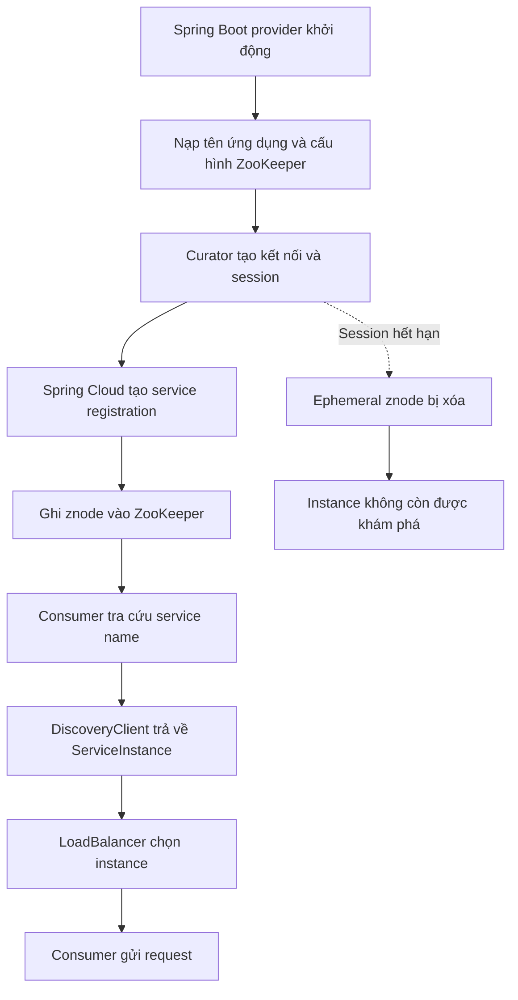

# Đăng ký ứng dụng bằng Spring Cloud Zookeeper Discovery

Spring Cloud Zookeeper Discovery cho phép ứng dụng Spring Boot đăng ký thông tin instance vào Apache ZooKeeper để các service khác có thể tìm thấy và gọi ứng dụng theo tên logic. Khi provider khởi động, discovery integration tạo registration gồm tên dịch vụ, định danh instance, địa chỉ kết nối và metadata rồi lưu thông tin đó trong ZooKeeper. Khi ứng dụng dừng hoặc phiên ZooKeeper hết hạn, registration được gỡ bỏ theo vòng đời của client.

Khác với Consul thường có agent chạy trên từng node, ứng dụng dùng Spring Cloud Zookeeper kết nối trực tiếp tới ZooKeeper ensemble thông qua client dựa trên Apache Curator. Vì vậy, cấu hình kết nối, session, ACL và địa chỉ ZooKeeper ảnh hưởng trực tiếp tới việc đăng ký.

## 1. Các thành phần trong luồng đăng ký

| Thành phần | Vai trò |
|---|---|
| Provider | Ứng dụng Spring Boot công bố instance của chính nó |
| Spring Cloud Zookeeper Discovery | Tích hợp discovery, tạo và quản lý registration |
| Apache Curator | Quản lý kết nối, session và thao tác với ZooKeeper |
| ZooKeeper ensemble | Lưu các znode chứa thông tin service instance và điều phối trạng thái cluster |
| Consumer | Tra cứu service ID để nhận danh sách instance |
| Spring Cloud LoadBalancer | Chọn instance phù hợp khi gọi theo service ID |

Ứng dụng thường khai báo tên logic bằng `spring.application.name`. Discovery integration dùng tên đó làm service name mặc định, trừ khi cấu hình có override. Nhiều instance của cùng một ứng dụng được nhóm dưới cùng service name; mỗi instance cần một định danh riêng.

Luồng tổng quát:



## 2. Thêm dependency

Trong Maven, thêm starter discovery tương ứng với Spring Cloud release train mà dự án đang sử dụng:

```xml
<dependency>
    <groupId>org.springframework.cloud</groupId>
    <artifactId>spring-cloud-starter-zookeeper-discovery</artifactId>
</dependency>
```

Nên quản lý phiên bản Spring Cloud bằng BOM tương thích với phiên bản Spring Boot của dự án, thay vì tự gán một phiên bản starter tùy ý. Starter đưa vào các thành phần cần thiết để ứng dụng kết nối ZooKeeper và cung cấp discovery integration.

Nếu ứng dụng cần gọi HTTP theo service ID bằng Spring Cloud LoadBalancer, hãy thêm dependency LoadBalancer phù hợp với release train đang dùng. Nếu dùng Actuator để quan sát readiness, thêm Spring Boot Actuator riêng.

## 3. Cấu hình kết nối ZooKeeper

Giả sử ZooKeeper đang chạy local và lắng nghe tại cổng `2181`. Cấu hình provider cơ bản:

```yaml
spring:
  application:
    name: inventory-service
  cloud:
    zookeeper:
      connect-string: localhost:2181
      discovery:
        enabled: true
        register: true
        root: /services

server:
  port: 8081
```

Ý nghĩa các thuộc tính:

- `spring.application.name`: tên logic của ứng dụng, ở đây là `inventory-service`.
- `spring.cloud.zookeeper.connect-string`: địa chỉ ZooKeeper client kết nối tới; có thể khai báo nhiều host trong ensemble, phân tách bằng dấu phẩy.
- `spring.cloud.zookeeper.discovery.enabled`: bật discovery integration của Spring Cloud Zookeeper.
- `spring.cloud.zookeeper.discovery.register`: cho phép ứng dụng đăng ký instance của chính nó.
- `spring.cloud.zookeeper.discovery.root`: znode gốc dùng để lưu thông tin service; giá trị mặc định thường là `/services`.

Tên thuộc tính và hành vi chi tiết có thể thay đổi theo phiên bản Spring Cloud Zookeeper. Hãy đối chiếu dependency/release train thực tế khi cấu hình các thuộc tính tùy chọn.

Với cấu hình trên, provider dùng service name `inventory-service` và cổng ứng dụng `8081`. Discovery client phải kết nối được tới ZooKeeper server và có quyền tạo, đọc, cập nhật hoặc xóa các znode mà integration sử dụng.

### Kết nối tới ensemble

Trong production, connect string thường chứa nhiều địa chỉ server:

```yaml
spring:
  cloud:
    zookeeper:
      connect-string: zk-1.internal:2181,zk-2.internal:2181,zk-3.internal:2181
```

Client có thể kết nối tới một thành viên khả dụng trong ensemble. ZooKeeper điều phối session và đồng bộ dữ liệu giữa các server theo cơ chế quorum. Chỉ khai báo nhiều địa chỉ không thay thế việc triển khai một ensemble đúng cấu hình; các node vẫn cần network, quorum, data directory và bảo mật phù hợp.

## 4. Service name và instance ID

### Service name

Service name là tên logic để consumer tra cứu. Theo cấu hình mặc định, nó thường lấy từ `spring.application.name`:

```yaml
spring:
  application:
    name: inventory-service
```

Các replica của dịch vụ tồn kho đều dùng cùng service name `inventory-service`. Không nên gắn hostname, IP, pod name hoặc port vào service name vì những giá trị đó thay đổi theo từng instance.

Nếu provider override tên service bằng cấu hình discovery riêng, consumer phải dùng đúng tên được đăng ký. Việc provider và consumer khác nhau về chữ hoa/thường, dấu gạch nối hoặc tên override có thể khiến lookup không tìm thấy instance.

### Instance ID

Instance ID phân biệt từng bản chạy của cùng một service. Ví dụ:

| Service name | Instance ID | Host | Port |
|---|---|---|---:|
| `inventory-service` | `inventory-node-a-8081` | `10.0.1.21` | 8081 |
| `inventory-service` | `inventory-node-b-8081` | `10.0.1.22` | 8081 |
| `inventory-service` | `inventory-node-c-8081` | `10.0.1.23` | 8081 |

Instance ID cần duy nhất trong phạm vi một service và ZooKeeper root. Nếu nhiều replica dùng chung ID, registration có thể ghi đè hoặc xung đột. Có thể cấu hình instance ID riêng qua thuộc tính discovery tương ứng của phiên bản đang dùng; định dạng ID mặc định do integration tạo có thể khác nhau theo phiên bản và môi trường.

Không nên giả định instance ID luôn là hostname hoặc luôn được tạo theo một công thức cố định. Khi cần ID ổn định, hãy khai báo rõ ràng và bảo đảm mỗi replica có giá trị riêng.

## 5. Host, port và địa chỉ mà consumer có thể truy cập

Registration cần công bố địa chỉ mạng mà consumer thực sự có thể kết nối. Port thường lấy từ server port của ứng dụng, nhưng host được quảng bá cần phù hợp với network topology.

Ví dụ ứng dụng có thể bind vào `0.0.0.0:8081` để nhận kết nối trên mọi interface, trong khi địa chỉ đăng ký cần là IP hoặc hostname có thể truy cập từ các consumer:

```text
Process bind:       0.0.0.0:8081
Advertised address: 10.0.1.21:8081
Consumer network:   10.0.1.21:8081
```

Nếu registration công bố `localhost` trong khi consumer chạy ở máy khác, consumer sẽ kết nối vào chính máy của nó. Nếu ứng dụng chạy trong container, cần tránh dùng loopback của container làm địa chỉ quảng bá cho các consumer bên ngoài container.

Spring Cloud Zookeeper có các thuộc tính discovery để điều chỉnh instance host, port và lựa chọn địa chỉ IP theo phiên bản. Chỉ override khi cần thiết và kiểm tra giá trị thực tế mà consumer nhận qua `ServiceInstance`.

## 6. Registration được lưu trong ZooKeeper như thế nào?

ZooKeeper tổ chức dữ liệu theo cây znode. Spring Cloud Zookeeper Discovery dùng một root path để nhóm các service registration. Với root mặc định `/services`, có thể hình dung cấu trúc như sau:

```text
/services
  /inventory-service
    /inventory-node-a-8081
    /inventory-node-b-8081
  /order-service
    /order-node-a-8082
```

Mỗi znode instance lưu thông tin mô tả service instance, bao gồm service name, instance ID, địa chỉ, port và metadata theo định dạng của discovery integration.

Đây là cách hình dung cấu trúc logic; tên node, payload và chi tiết serialization do Curator/Spring Cloud Zookeeper quản lý. Không nên tự ghi dữ liệu tùy ý vào các znode mà integration đang quản lý.

### Ephemeral znode và vòng đời session

Service registration thường được tạo dưới dạng ephemeral znode gắn với session ZooKeeper của client. Khi client deregister bình thường, znode được xóa. Nếu tiến trình chết đột ngột hoặc mất kết nối kéo dài tới mức session hết hạn, ZooKeeper cũng xóa ephemeral znode.

Cơ chế này giúp registration không tồn tại mãi sau khi client biến mất. Tuy nhiên:

- Một lần mất mạng ngắn chưa chắc làm session hết hạn ngay.
- Curator có thể thử reconnect trong giới hạn session timeout.
- Khi session hết hạn, client cần tạo session mới và registration cần được khôi phục theo lifecycle của integration.
- Consumer có thể thấy dữ liệu cũ trong một khoảng thời gian do cache hoặc thời gian cập nhật watcher.

Ephemeral znode phản ánh vòng đời session của client, không phải phép đo trực tiếp sức khỏe nghiệp vụ của HTTP endpoint.

## 7. Metadata trong registration

Metadata cho phép provider công bố thông tin bổ sung để consumer hoặc LoadBalancer có thể lọc và lựa chọn instance. Ví dụ:

```yaml
spring:
  cloud:
    zookeeper:
      discovery:
        metadata:
          zone: zone-a
          version: v2
          capability: inventory-read
```

Metadata có thể mô tả zone, version, nhóm triển khai hoặc năng lực của instance. Cần thống nhất tên key và kiểu dữ liệu giữa provider và consumer. Metadata không nên chứa password, token, private key hoặc thông tin nhạy cảm vì nhiều thành phần có thể đọc registration.

Không nên giả định metadata tự động tạo ra routing policy. Nếu muốn ưu tiên cùng zone hoặc chỉ chọn phiên bản tương thích, consumer cần có logic lọc hoặc LoadBalancer configuration phù hợp.

## 8. Đăng ký tự động và tắt đăng ký

Khi Spring Cloud Zookeeper Discovery được bật và registration được cho phép, ứng dụng thường tự đăng ký trong quá trình khởi động. Khi application context đóng bình thường, integration thực hiện deregistration theo vòng đời của client.

Có thể tắt đăng ký nếu ứng dụng chỉ là consumer:

```yaml
spring:
  cloud:
    zookeeper:
      discovery:
        enabled: true
        register: false
```

Cấu hình này giữ discovery integration để ứng dụng có thể tra cứu service, nhưng không đăng ký instance của chính nó. Ngược lại, nếu tắt `enabled`, discovery integration có thể không được khởi tạo và các bean discovery liên quan có thể không tồn tại.

Không nên nhầm `register: false` với việc xóa registration cũ đã có. Nếu một instance từng đăng ký và cấu hình được thay đổi trong khi tiến trình vẫn chạy, cần bảo đảm registration cũ được deregister đúng cách hoặc xử lý qua lifecycle của provider. Tránh xóa cả service root khi service còn các replica khỏe mạnh.

## 9. Consumer tra cứu instance

Spring Cloud cung cấp abstraction `DiscoveryClient` để consumer tra cứu service theo tên. Ví dụ:

```java
import java.util.List;

import org.springframework.cloud.client.ServiceInstance;
import org.springframework.cloud.client.discovery.DiscoveryClient;
import org.springframework.stereotype.Component;

@Component
public class InventoryDiscovery {

    private final DiscoveryClient discoveryClient;

    public InventoryDiscovery(DiscoveryClient discoveryClient) {
        this.discoveryClient = discoveryClient;
    }

    public List<ServiceInstance> findInstances() {
        return discoveryClient.getInstances("inventory-service");
    }
}
```

Danh sách trả về gồm các instance mà discovery client nhìn thấy tại thời điểm truy vấn. Mỗi `ServiceInstance` có thể cung cấp service ID, host, port, URI, secure flag và metadata.

Nếu danh sách rỗng, kiểm tra:

1. ZooKeeper client đã kết nối thành công chưa?
2. Provider đã đăng ký dưới đúng service name chưa?
3. Root path của provider và consumer có giống nhau không?
4. Registration còn tồn tại và session còn hợp lệ không?
5. Consumer có quyền đọc các znode cần thiết không?
6. Consumer có đang dùng cache hoặc dữ liệu cũ không?

### Gọi HTTP qua service ID bằng LoadBalancer

Nếu đã thêm Spring Cloud LoadBalancer và cấu hình HTTP client tương ứng, consumer có thể gọi bằng tên logic. Ví dụ với `RestTemplate`:

```java
import org.springframework.cloud.client.loadbalancer.LoadBalanced;
import org.springframework.context.annotation.Bean;
import org.springframework.context.annotation.Configuration;
import org.springframework.web.client.RestTemplate;

@Configuration
public class HttpClientConfiguration {

    @Bean
    @LoadBalanced
    RestTemplate restTemplate() {
        return new RestTemplate();
    }
}
```

Sau đó gọi:

```java
String url = "http://inventory-service/api/items/42";
Item item = restTemplate.getForObject(url, Item.class);
```

Với `RestTemplate` được đánh dấu `@LoadBalanced`, host `inventory-service` được xử lý như service ID. LoadBalancer lấy danh sách instance từ discovery integration và chọn đích cho request. Không dùng một `RestTemplate` thường rồi giả định nó tự tra cứu service ID.

## 10. Health check và giới hạn của ephemeral registration

ZooKeeper Discovery không nên được hiểu như một hệ thống active HTTP health check tự động tương đương Consul. Ephemeral znode gắn với session giúp registry nhận biết client còn duy trì session, nhưng điều đó không chứng minh ứng dụng vẫn xử lý được request nghiệp vụ.

Ví dụ, JVM vẫn giữ được session ZooKeeper nhưng endpoint HTTP có thể treo hoặc database đã mất kết nối. Khi đó znode có thể vẫn tồn tại dù provider không còn sẵn sàng.

Cần phân biệt:

| Tín hiệu | Cho biết điều gì? | Giới hạn |
|---|---|---|
| ZooKeeper session | Client còn giữ được session với ensemble | Không chứng minh HTTP endpoint hoặc nghiệp vụ khỏe |
| Ephemeral znode | Registration còn gắn với session hiện tại | Có thể còn tồn tại trong thời gian session timeout sau khi client mất kết nối |
| Spring Boot Actuator health | Các health indicator được cấu hình báo trạng thái ứng dụng | Chỉ có tác dụng định tuyến nếu được kết nối với cơ chế routing/health phù hợp |
| Consumer request | Thử nghiệm kết nối và xử lý thực tế | Cần timeout, retry và resilience |

Có thể thêm Actuator để quan sát readiness:

```yaml
management:
  endpoint:
    health:
      probes:
        enabled: true
```

Readiness endpoint giúp nền tảng điều phối hoặc công cụ giám sát xác định ứng dụng đã sẵn sàng. Tuy nhiên, chỉ bật Actuator không có nghĩa Spring Cloud Zookeeper tự động đọc endpoint này rồi xóa registration khi health thất bại. Nếu cần ngừng traffic theo readiness, phải thiết kế cơ chế phối hợp rõ ràng ở tầng deployment, gateway hoặc LoadBalancer.

## 11. Bảo mật và vận hành ZooKeeper

Registration chứa host, port và metadata của service. Quyền đọc/ghi ZooKeeper vì thế ảnh hưởng trực tiếp đến khả năng khám phá và định tuyến giữa các ứng dụng.

Trong môi trường thật, cần:

- Dùng ACL và cơ chế xác thực ZooKeeper để giới hạn ứng dụng chỉ được truy cập các path cần thiết.
- Không cấp quyền ghi toàn bộ cây znode cho mọi service nếu không cần.
- Bảo vệ kết nối client-server bằng TLS khi topology và phiên bản hỗ trợ.
- Không lưu bí mật trong metadata hoặc payload registration.
- Giới hạn network access tới cổng client của ZooKeeper; không expose trực tiếp ensemble ra mạng công cộng.
- Theo dõi session expiration, reconnect, lỗi tạo znode và số lượng registration.
- Thiết lập timeout/retry hợp lý để một đợt mạng chập chờn không gây đăng ký/xóa registration liên tục.

Nếu provider không có quyền tạo znode dưới root đã cấu hình, registration sẽ thất bại. Nếu consumer không có quyền đọc, service có thể đã tồn tại nhưng lookup vẫn trả về rỗng hoặc phát sinh lỗi truy cập tùy integration.

## 12. Lỗi thường gặp khi đăng ký

| Hiện tượng | Nguyên nhân có thể | Hướng xử lý |
|---|---|---|
| Ứng dụng không kết nối được ZooKeeper | Sai connect string, server chưa chạy hoặc network bị chặn | Kiểm tra host, port, log Curator và trạng thái ensemble |
| Provider khởi động nhưng không có service trong cây znode | Discovery tắt, register=false hoặc thiếu quyền ghi | Kiểm tra dependency, properties và ACL |
| Consumer không tìm thấy service | Service name/root path khác nhau hoặc registration chưa tồn tại | Đối chiếu `spring.application.name`, root và catalog path |
| Nhiều instance ghi đè nhau | Instance ID trùng | Tạo instance ID duy nhất cho mỗi replica |
| Instance cũ còn tồn tại sau khi process chết | Session chưa hết hạn hoặc client chưa mất session | Kiểm tra session timeout, reconnect và trạng thái ephemeral node |
| Instance biến mất khi mạng chập chờn | Session hết hạn do gián đoạn kéo dài | Điều chỉnh timeout/network và kiểm tra khả năng reconnect |
| Consumer nhận host không truy cập được | Provider quảng bá loopback hoặc IP nội bộ sai | Cấu hình advertised host có thể route từ consumer |
| Service tồn tại nhưng không khỏe | Session còn sống nhưng endpoint hoặc dependency nghiệp vụ lỗi | Kết hợp readiness/health monitoring và routing policy |

Khi điều tra, hãy đối chiếu service name, instance ID, root path và session của cùng một provider. Không xóa znode thủ công trong khi discovery client vẫn đang quản lý registration đó, vì client có thể tạo lại hoặc chuyển trạng thái không nhất quán.

## 13. Checklist triển khai provider

Trước khi đưa ứng dụng vào môi trường chạy, xác nhận:

1. Starter Spring Cloud Zookeeper Discovery tương thích với Spring Boot/Spring Cloud release train.
2. ZooKeeper connect string trỏ tới ensemble có thể truy cập.
3. `spring.application.name` là service name thống nhất với consumer.
4. Discovery được bật và registration được cho phép khi ứng dụng đóng vai trò provider.
5. Root path giống nhau giữa provider và consumer.
6. Mỗi replica có instance ID duy nhất.
7. Host và port được quảng bá có thể truy cập từ consumer.
8. Metadata có schema thống nhất và không chứa bí mật.
9. ACL cho phép thao tác đúng path cần thiết.
10. Có phương án xử lý session expiration, reconnect và graceful deregistration.
11. Readiness nghiệp vụ được quản lý riêng; không coi ephemeral znode là HTTP health check.
12. Consumer có timeout, retry có giới hạn và xử lý trường hợp không có instance.

Spring Cloud Zookeeper Discovery giúp ứng dụng đăng ký service một cách tự động thông qua ZooKeeper và Curator. Khi hiểu rõ service name, instance ID, root path, ephemeral znode và session lifecycle, ta có thể quản lý registration và tra cứu instance chính xác hơn. Để định tuyến an toàn, cần kết hợp registration với địa chỉ mạng có thể truy cập, readiness, ACL và cơ chế phục hồi khi session ZooKeeper thay đổi.
