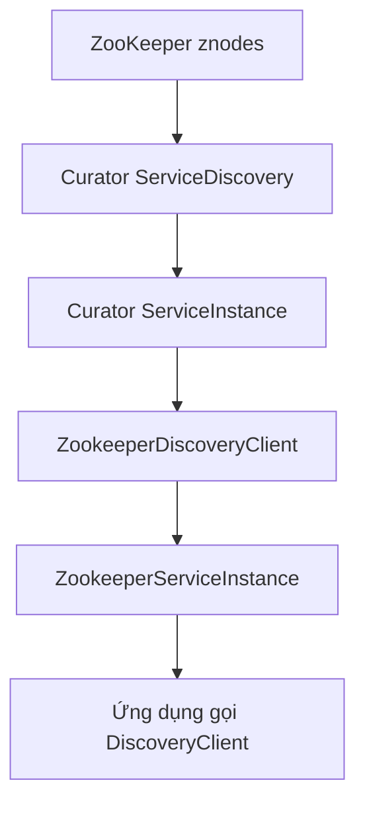
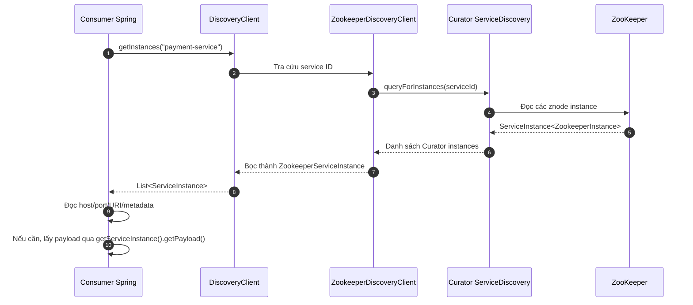

# Truy vấn `ServiceInstance` và đọc payload của bản đăng ký

## 1. Từ service name đến thông tin instance

Trong Spring Cloud Service Discovery, consumer thường biết tên logic của service, chẳng hạn `payment-service`, nhưng không biết trước host và port của từng bản chạy. `DiscoveryClient` cung cấp API chung để tra cứu các instance theo service ID. Với ZooKeeper, Spring Cloud triển khai API này bằng Curator Service Discovery.

Khi một ứng dụng đăng ký với ZooKeeper, nó công bố các thông tin như service name, instance ID, địa chỉ, port và metadata. Curator lưu bản đăng ký dưới dạng service instance trong cây znode. Khi consumer gọi `DiscoveryClient.getInstances("payment-service")`, Spring Cloud Zookeeper truy vấn Curator, nhận các đối tượng `ServiceInstance<ZookeeperInstance>` rồi bọc chúng thành `ZookeeperServiceInstance`, là implementation của Spring Cloud `ServiceInstance`.

Luồng dữ liệu có thể hình dung như sau:



Điểm cần phân biệt: `ServiceInstance` là góc nhìn chuẩn của Spring Cloud để ứng dụng tra cứu endpoint; `ZookeeperServiceInstance` là adapter riêng của Spring Cloud Zookeeper; `ZookeeperInstance` là payload mặc định được lưu kèm bản đăng ký trong ZooKeeper.

## 2. Cấu trúc bản đăng ký trong ZooKeeper

Spring Cloud Zookeeper sử dụng Curator Service Discovery Extension để đăng ký và tìm service. Root path mặc định của registry là `/services`. Mỗi service có một nhánh riêng và mỗi instance có một znode con, theo dạng khái niệm:

```text
/services
  /payment-service
    /payment-node-a
    /payment-node-b
  /inventory-service
    /inventory-node-a
```

Đường dẫn thực tế phụ thuộc `spring.cloud.zookeeper.discovery.root`, service name, instance ID và các cấu hình dependency/path. Curator quản lý việc tạo, cập nhật và xóa bản ghi. Với đăng ký động thông thường, instance được gắn với ZooKeeper session; khi session hết hạn, ephemeral znode sẽ được ZooKeeper dọn dẹp.

Một bản ghi có hai lớp dữ liệu cần hiểu:

1. **Thông tin service instance của Curator:** service name, instance ID, địa chỉ, port, SSL port, loại đăng ký, thời điểm đăng ký và URI specification.
2. **Payload của Spring Cloud:** đối tượng `ZookeeperInstance`, chứa ID, tên và map metadata của instance.

Payload là phần dữ liệu ứng dụng có thể dùng để trao đổi thông tin bổ sung. Nó không thay thế các trường địa chỉ/port của Curator ServiceInstance.

## 3. `DiscoveryClient` và `ServiceInstance` của Spring Cloud

### 3.1. Truy vấn theo service ID

Interface `org.springframework.cloud.client.discovery.DiscoveryClient` cung cấp các thao tác đọc chính:

| Phương thức | Ý nghĩa |
|---|---|
| `getServices()` | Lấy các service ID mà discovery client đang biết |
| `getInstances(serviceId)` | Lấy danh sách instance của một service ID |
| `description()` | Mô tả implementation discovery |

Mỗi phần tử trong danh sách là `org.springframework.cloud.client.ServiceInstance`. Các thuộc tính thường dùng:

| Getter | Nội dung |
|---|---|
| `getServiceId()` | Tên logic của service |
| `getInstanceId()` | ID duy nhất của bản chạy nếu implementation cung cấp |
| `getHost()` | Hostname hoặc địa chỉ IP |
| `getPort()` | Port phục vụ request |
| `isSecure()` | Endpoint sử dụng HTTPS hay không |
| `getUri()` | URI được tạo từ thông tin endpoint |
| `getMetadata()` | Map key/value metadata của instance |

### 3.2. Ví dụ truy vấn và đọc endpoint

```java
import java.net.URI;
import java.util.List;

import org.springframework.cloud.client.ServiceInstance;
import org.springframework.cloud.client.discovery.DiscoveryClient;
import org.springframework.stereotype.Service;

@Service
public class PaymentDiscoveryService {

    private final DiscoveryClient discoveryClient;

    public PaymentDiscoveryService(DiscoveryClient discoveryClient) {
        this.discoveryClient = discoveryClient;
    }

    public void printPaymentInstances() {
        List<ServiceInstance> instances =
                discoveryClient.getInstances("payment-service");

        if (instances == null || instances.isEmpty()) {
            System.out.println("Chưa tìm thấy payment-service");
            return;
        }

        for (ServiceInstance instance : instances) {
            URI uri = instance.getUri();

            System.out.printf(
                    "service=%s, instance=%s, host=%s, port=%d, secure=%s, uri=%s%n",
                    instance.getServiceId(),
                    instance.getInstanceId(),
                    instance.getHost(),
                    instance.getPort(),
                    instance.isSecure(),
                    uri
            );
        }
    }
}
```

Không giả định danh sách luôn có ít nhất một phần tử. `ZookeeperDiscoveryClient` trả danh sách rỗng nếu service chưa đăng ký hoặc nhánh tương ứng chưa tồn tại; lỗi kết nối/đọc ZooKeeper khác có thể được chuyển thành runtime exception. Vì vậy, ứng dụng cần phân biệt “không có instance” với “không truy cập được registry”.

### 3.3. Lấy danh sách service đã đăng ký

```java
List<String> serviceIds = discoveryClient.getServices();

for (String serviceId : serviceIds) {
    List<ServiceInstance> instances = discoveryClient.getInstances(serviceId);
    System.out.printf("%s có %d instance%n", serviceId, instances.size());
}
```

Danh sách service ID là snapshot tại thời điểm truy vấn. Nó có thể thay đổi khi instance đăng ký, hủy đăng ký hoặc ZooKeeper session hết hạn. Không nên đọc một lần rồi lưu vĩnh viễn nếu ứng dụng cần phản ứng với thay đổi của registry.

## 4. Đọc metadata qua `ServiceInstance`

Với phần lớn logic ứng dụng, `getMetadata()` là cách đơn giản nhất để đọc metadata mà service đăng ký đã công bố. Đoạn dưới đây giả sử `discoveryClient` đã được inject; `orElseThrow` xử lý trường hợp chưa có instance:

```java
import java.util.Map;

import org.springframework.cloud.client.ServiceInstance;

ServiceInstance instance = discoveryClient.getInstances("payment-service")
        .stream()
        .findFirst()
        .orElseThrow(() -> new IllegalStateException("payment-service chưa có instance"));

Map<String, String> metadata = instance.getMetadata();

if (metadata != null) {
    String apiVersion = metadata.get("api-version");
    String zone = metadata.get("zone");

    System.out.println("API version: " + apiVersion);
    System.out.println("Zone: " + zone);
}
```

Metadata thường chứa thông tin mô tả hoặc định tuyến bổ sung, ví dụ:

- `api-version`: phiên bản API mà instance cung cấp.
- `zone`: vùng hoặc availability zone của instance.
- `environment`: môi trường triển khai.
- `capability`: nhóm chức năng instance hỗ trợ.
- `context-path`: base path nếu consumer có quy ước đọc metadata này.

Metadata của Spring Cloud Zookeeper là map `String`–`String`. Không đưa mật khẩu, token, private key hoặc dữ liệu bí mật vào map vì các client có quyền đọc registry có thể đọc được metadata đó. Cũng không giả định load balancer tự hiểu mọi key tùy chỉnh; consumer phải có logic đọc và sử dụng chúng.

## 5. Payload mặc định `ZookeeperInstance` là gì?

Spring Cloud Zookeeper dùng `org.springframework.cloud.zookeeper.discovery.ZookeeperInstance` làm payload mặc định cho Curator Service Discovery. Payload này mô tả instance bằng ba thành phần chính:

| Trường | Ý nghĩa |
|---|---|
| `id` | Định danh nằm bên trong payload `ZookeeperInstance`; cần phân biệt với ID của Curator service instance |
| `name` | Tên service được đăng ký |
| `metadata` | Map key/value chứa metadata bổ sung |

Ví dụ payload ở mức khái niệm:

```json
{
  "id": "payment-node-a",
  "name": "payment-service",
  "metadata": {
    "api-version": "v2",
    "zone": "zone-a",
    "environment": "production"
  }
}
```

Đây là hình dạng logic của `ZookeeperInstance`, không phải cam kết về toàn bộ byte JSON được lưu trong znode. Curator tuần tự hóa một `ServiceInstance<ZookeeperInstance>` bao quanh payload; dữ liệu bên ngoài còn có thể chứa địa chỉ, port, SSL port, service type và URI specification. Serializer và chi tiết biểu diễn có thể khác theo phiên bản hoặc cấu hình.

### 5.1. Phân biệt payload với dữ liệu bao ngoài

Ví dụ rút gọn để hiểu quan hệ giữa hai lớp:

```text
Curator ServiceInstance
  name       = payment-service
  id         = registry-entry-a
  address    = 10.0.1.21
  port       = 8080
  sslPort    = null
  payload    = ZookeeperInstance
                 id       = spring-context-a
                 name     = payment-service
                 metadata = { api-version=v2, zone=zone-a }
```

Địa chỉ và port nằm ở thông tin service instance của Curator. Payload chứa ID riêng của `ZookeeperInstance`, tên và metadata theo mô hình Spring Cloud. Hai trường ID này không nên được mặc định là cùng một giá trị; nếu cần đối chiếu, hãy kiểm tra object thực tế và cấu hình của phiên bản đang dùng. Khi cần ID đăng ký, ưu tiên `ServiceInstance.getInstanceId()`; khi cần đọc payload, dùng `getServiceInstance().getPayload()`. Khi tạo URI để gọi service, dùng `ServiceInstance.getUri()` hoặc các trường host/port.

## 6. Truy cập payload cụ thể của ZooKeeper

Nếu chỉ cần metadata, ưu tiên `ServiceInstance.getMetadata()` để code không phụ thuộc implementation. Khi một thành phần tích hợp thực sự cần payload gốc, có thể ép kiểu sang `ZookeeperServiceInstance` và gọi `getServiceInstance().getPayload()`:

```java
import java.util.Map;

import org.apache.curator.x.discovery.ServiceInstance;
import org.springframework.cloud.client.discovery.DiscoveryClient;
import org.springframework.cloud.zookeeper.discovery.ZookeeperInstance;
import org.springframework.cloud.zookeeper.discovery.ZookeeperServiceInstance;

public class ZookeeperPayloadReader {

    private final DiscoveryClient discoveryClient;

    public ZookeeperPayloadReader(DiscoveryClient discoveryClient) {
        this.discoveryClient = discoveryClient;
    }

    public void readPayload() {
        org.springframework.cloud.client.ServiceInstance springInstance =
                discoveryClient.getInstances("payment-service")
                        .stream()
                        .findFirst()
                        .orElseThrow(() ->
                                new IllegalStateException("Không có payment-service"));

        if (!(springInstance instanceof ZookeeperServiceInstance)) {
            throw new IllegalStateException(
                    "Discovery implementation hiện tại không phải Zookeeper");
        }

        ZookeeperServiceInstance zookeeperInstance =
                (ZookeeperServiceInstance) springInstance;

        ServiceInstance<ZookeeperInstance> curatorInstance =
                zookeeperInstance.getServiceInstance();

        ZookeeperInstance payload = curatorInstance.getPayload();
        Map<String, String> metadata = payload.getMetadata();

        System.out.println("Payload id: " + payload.getId());
        System.out.println("Payload name: " + payload.getName());
        System.out.println("Metadata: " + metadata);
    }
}
```

`ZookeeperServiceInstance` là adapter triển khai Spring Cloud `ServiceInstance`; `getServiceInstance()` trả về đối tượng Curator gốc; `getPayload()` trên đối tượng Curator trả về `ZookeeperInstance`. Đây là đường truy cập dành riêng cho Spring Cloud Zookeeper, do đó code dùng nó sẽ phụ thuộc vào implementation này.

Nếu ứng dụng có thể đổi sang Eureka, Consul hoặc một discovery provider khác, hãy giữ logic nghiệp vụ ở `ServiceInstance` và metadata chung. Chỉ đặt đoạn ép kiểu này trong adapter tích hợp ZooKeeper, nơi dependency cụ thể đã được chấp nhận.

## 7. Cấu hình metadata khi đăng ký service

Spring Cloud Zookeeper cho phép khai báo metadata bằng `spring.cloud.zookeeper.discovery.metadata`. Ví dụ:

```yaml
spring:
  application:
    name: payment-service
  cloud:
    zookeeper:
      connect-string: localhost:2181
      discovery:
        root: /services
        register: true
        instance-id: payment-node-a
        instance-host: 10.0.1.21
        instance-port: 8080
        metadata:
          api-version: v2
          zone: zone-a
          environment: production
```

Ý nghĩa các thuộc tính:

- `connect-string`: địa chỉ ZooKeeper ensemble.
- `discovery.root`: root path chứa các service registration; mặc định thường là `/services`.
- `discovery.register`: bật/tắt đăng ký instance của ứng dụng.
- `instance-id`: ID dùng để phân biệt bản chạy.
- `instance-host` và `instance-port`: địa chỉ công bố cho consumer.
- `metadata`: các cặp key/value được đưa vào payload để client khác đọc.

Trong triển khai thật, host và port cần truy cập được từ network của consumer. Nếu chạy nhiều instance trên cùng máy, mỗi instance cần ID riêng. Có thể để Spring/Curator suy ra một số giá trị từ Environment, nhưng nên cấu hình rõ khi cần endpoint ổn định hoặc chạy sau container/proxy.

## 8. Đọc payload trực tiếp từ znode khi cần chẩn đoán

Trong trường hợp cần kiểm tra dữ liệu gốc, có thể dùng ZooKeeper CLI để xem cây registry. Với root mặc định:

```text
ls /services
ls /services/payment-service
get /services/payment-service/payment-node-a
```

Lệnh `ls` đầu tiên liệt kê service; lệnh thứ hai liệt kê các instance; lệnh `get` đọc dữ liệu của znode instance. Đường dẫn cụ thể phụ thuộc root, service name, instance ID và serializer đang dùng.

Nội dung đọc được là dữ liệu Curator đã tuần tự hóa, có thể bao gồm envelope của `ServiceInstance` cùng payload `ZookeeperInstance`. Không nên chỉnh sửa znode bằng tay để thay metadata trong môi trường đang chạy. Việc ghi trực tiếp có thể làm dữ liệu không khớp với serializer, registration lifecycle hoặc trạng thái mà Curator đang quản lý. Hãy cập nhật metadata thông qua cấu hình/`ServiceRegistry` hoặc cơ chế đăng ký mà ứng dụng sử dụng.

## 9. Instance status và metadata dành riêng cho Spring Cloud

Spring Cloud Zookeeper tận dụng payload linh hoạt để lưu trạng thái instance trong metadata. Khi cập nhật status qua `ServiceRegistry`, implementation ghi trạng thái vào một metadata key dành riêng. `ZookeeperServiceInstanceListSupplier` của Spring Cloud LoadBalancer có thể lọc instance có status khác `UP`; nếu status không có, implementation coi instance là `UP` để tương thích ngược.

Điều này có nghĩa metadata không phải lúc nào cũng chỉ chứa các key do ứng dụng tự định nghĩa. Khi đọc toàn bộ map, có thể gặp key nội bộ do Spring Cloud sử dụng. Không nên xóa hoặc ghi đè key chưa biết nếu không hiểu vai trò của nó.

Nếu cần thay đổi trạng thái đăng ký, hãy dùng `ServiceRegistry` hoặc `/serviceregistry` Actuator endpoint được cấu hình và bảo vệ phù hợp. Không cập nhật trực tiếp payload trong znode để giả lập trạng thái vì điều đó bỏ qua lifecycle và logic của Spring Cloud.

## 10. Kết hợp với Spring Cloud LoadBalancer

`DiscoveryClient.getInstances()` trả về danh sách instance; nó không tự chọn instance cho từng request. Với ứng dụng cần gọi service theo tên, có thể dùng Spring Cloud LoadBalancer để phân giải service ID và chọn instance.

Ví dụ tạo `RestTemplate` có load balancing:

```java
import org.springframework.cloud.client.loadbalancer.LoadBalanced;
import org.springframework.context.annotation.Bean;
import org.springframework.context.annotation.Configuration;
import org.springframework.web.client.RestTemplate;

@Configuration
public class HttpClientConfiguration {

    @Bean
    @LoadBalanced
    RestTemplate restTemplate() {
        return new RestTemplate();
    }
}
```

Ứng dụng cần có Spring Cloud LoadBalancer trên classpath (thường qua dependency `org.springframework.cloud:spring-cloud-starter-loadbalancer`) và quản lý phiên bản bằng Spring Cloud BOM tương thích với Spring Boot.

Sau đó gọi bằng service ID:

```java
@Service
public class PaymentClient {

    private final RestTemplate restTemplate;

    public PaymentClient(RestTemplate restTemplate) {
        this.restTemplate = restTemplate;
    }

    public PaymentResponse findPayment(String paymentId) {
        return restTemplate.getForObject(
                "http://payment-service/api/payments/{id}",
                PaymentResponse.class,
                paymentId
        );
    }
}
```

LoadBalancer dùng discovery implementation để lấy danh sách instance và chọn đích. Nếu ứng dụng chỉ cần gọi service, không cần ép kiểu `ZookeeperServiceInstance` hay tự đọc payload. Chỉ đọc payload khi cần logic đặc thù như chọn phiên bản API, zone hoặc capability mà chiến lược load balancing mặc định không xử lý.

## 11. Xử lý trường hợp không có instance hoặc dữ liệu bất thường

| Dấu hiệu | Nguyên nhân có thể | Hướng xử lý |
|---|---|---|
| `getInstances()` trả danh sách rỗng | Service chưa đăng ký, sai service ID hoặc znode chưa tồn tại | Kiểm tra `spring.application.name`, `discovery.root` và cây `/services` |
| `getServices()` rỗng | Chưa có service đăng ký hoặc discovery chưa sẵn sàng | Kiểm tra kết nối ZooKeeper, registration và log client |
| Có instance nhưng URI sai | Host/port/SSL port hoặc URI spec không đúng | Đối chiếu `instance-host`, `instance-port`, `instance-ssl-port`, `uri-spec` |
| Metadata không có key mong muốn | Producer chưa đăng ký key, sai tên key hoặc đang đọc instance khác | Kiểm tra cấu hình metadata và từng instance |
| Ép kiểu sang `ZookeeperServiceInstance` thất bại | Ứng dụng đang dùng discovery provider khác hoặc composite client trả implementation khác | Dùng `ServiceInstance` chung hoặc kiểm tra implementation trước khi cast |
| Payload null hoặc metadata null | Bản đăng ký cũ, payload tùy chỉnh hoặc dữ liệu không đầy đủ | Xử lý null và xác minh serializer/schema của producer |
| Instance cũ còn xuất hiện sau khi process chết | ZooKeeper session chưa hết hạn hoặc client đang reconnect | Kiểm tra session timeout và trạng thái Curator/ZooKeeper |

Một số nguyên tắc khi đọc dữ liệu:

- Không dùng `get(0)` trước khi kiểm tra danh sách rỗng.
- Không giả định tất cả instance có cùng metadata hoặc cùng phiên bản ứng dụng.
- Không giữ `ServiceInstance` hoặc URI như địa chỉ bất biến; registry có thể thay đổi.
- Xử lý lỗi ZooKeeper riêng với trường hợp service không tồn tại.
- Khi cần kiểm tra trạng thái sức khỏe, phân biệt bản ghi đăng ký với khả năng phục vụ request thực tế.

## 12. Sơ đồ đọc payload



## 13. Checklist khi truy vấn và đọc payload

- [ ] Dùng đúng service ID mà producer đăng ký.
- [ ] Kiểm tra danh sách rỗng trước khi chọn instance.
- [ ] Dùng `ServiceInstance` để đọc service ID, instance ID, host, port, URI, secure flag và metadata chung.
- [ ] Hiểu rằng `ZookeeperServiceInstance` là adapter của Spring Cloud Zookeeper.
- [ ] Chỉ cast sang `ZookeeperServiceInstance` khi thật sự cần Curator object hoặc payload riêng.
- [ ] Đọc payload qua `getServiceInstance().getPayload()` và xử lý null.
- [ ] Phân biệt trường endpoint của Curator với `ZookeeperInstance` payload.
- [ ] Giữ metadata là các cặp string, có quy ước key thống nhất và không chứa secret.
- [ ] Không chỉnh sửa znode trực tiếp trong luồng nghiệp vụ.
- [ ] Dùng Spring Cloud LoadBalancer để chọn instance cho request thay vì tự giữ một địa chỉ cố định.

## 14. Kết luận

Với Spring Cloud Zookeeper, `DiscoveryClient.getInstances(serviceId)` trả về danh sách `ServiceInstance` chuẩn của Spring. Implementation `ZookeeperDiscoveryClient` lấy các Curator service instance và chuyển chúng thành `ZookeeperServiceInstance`. Ứng dụng có thể đọc endpoint và metadata thông qua API chung mà không cần biết cấu trúc ZooKeeper.

Khi cần payload riêng của bản đăng ký, ép kiểu có kiểm tra sang `ZookeeperServiceInstance`, lấy Curator object qua `getServiceInstance()` rồi đọc `getPayload()` để nhận `ZookeeperInstance` gồm ID, tên và metadata. Hãy giữ cách đọc payload đặc thù trong lớp tích hợp ZooKeeper; phần lớn logic ứng dụng nên dùng `ServiceInstance` và `getMetadata()` để giảm phụ thuộc vào provider.

## Tài liệu tham khảo

- [Spring Cloud Zookeeper – Service Discovery](https://docs.spring.io/spring-cloud-zookeeper/reference/discovery.html)
- [Spring Cloud Zookeeper – Service Registry](https://docs.spring.io/spring-cloud-zookeeper/reference/service-registry.html)
- [Spring Cloud Zookeeper 4.1.2 – ZookeeperServiceInstance API](https://www.javadoc.io/static/org.springframework.cloud/spring-cloud-zookeeper-discovery/4.1.2/org/springframework/cloud/zookeeper/discovery/ZookeeperServiceInstance.html)
- [Spring Cloud Commons – ServiceInstance API](https://github.com/spring-cloud/spring-cloud-commons/blob/main/spring-cloud-commons/src/main/java/org/springframework/cloud/client/ServiceInstance.java)
