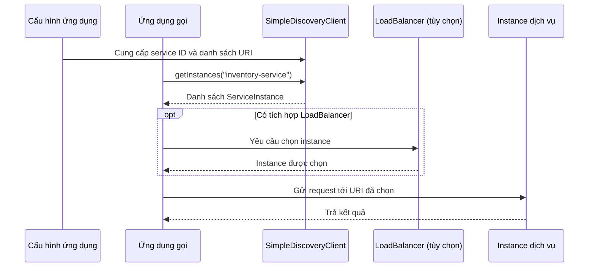

# Vai trò và điều kiện sử dụng SimpleDiscoveryClient

Trong kiến trúc microservice, một dịch vụ thường được gọi thông qua tên logic như `inventory-service` thay vì gắn cứng địa chỉ IP và cổng của một máy chủ. Cơ chế service discovery chuyển tên logic đó thành danh sách các địa chỉ có thể truy cập. Spring Cloud cung cấp `DiscoveryClient` làm API chung cho thao tác tra cứu này. Khi hệ thống có topology nhỏ và các địa chỉ ít thay đổi, `SimpleDiscoveryClient` có thể cung cấp danh sách instance trực tiếp từ cấu hình ứng dụng mà không cần triển khai một registry server riêng.

## 1. SimpleDiscoveryClient giải quyết vấn đề gì?

Giả sử `order-service` cần gọi `inventory-service`. Nếu mã nguồn chứa trực tiếp `http://10.20.0.15:8081`, ứng dụng sẽ phụ thuộc vào một địa chỉ cụ thể. Khi máy chủ được thay thế, chuyển môi trường hoặc đổi cổng, nhóm phát triển phải sửa mã nguồn hay phát hành lại ứng dụng gọi dịch vụ. Cách làm này cũng khiến việc chạy nhiều instance trở nên khó quản lý.

Thay vào đó, ứng dụng gọi tra cứu bằng service ID:

```text
inventory-service
        |
        v
  DiscoveryClient
        |
        v
  Danh sách ServiceInstance
        |
        v
  URI của các instance
```

`SimpleDiscoveryClient` là một implementation của Spring Cloud `DiscoveryClient`. Nó đọc các instance đã khai báo trong cấu hình, sau đó cung cấp chúng cho ứng dụng thông qua API discovery. Vì danh sách đến từ cấu hình tĩnh, ứng dụng không cần hỏi một máy chủ Eureka, Consul hay ZooKeeper để lấy danh sách đó.

Điểm cần phân biệt là `SimpleDiscoveryClient` chỉ cung cấp thông tin instance cho quá trình tra cứu. Nó không tự thực hiện lời gọi HTTP, không tự chọn instance để cân bằng tải và không vận hành một registry tập trung. Ứng dụng có thể dùng danh sách trả về để tự xử lý hoặc kết hợp với Spring Cloud LoadBalancer để chọn instance khi gọi dịch vụ.

## 2. Vai trò trong kiến trúc Spring Cloud

`SimpleDiscoveryClient` giúp ứng dụng phụ thuộc vào abstraction `DiscoveryClient` thay vì phụ thuộc vào một nhà cung cấp registry cụ thể. Mã nghiệp vụ có thể yêu cầu danh sách instance theo service ID; implementation phía dưới quyết định dữ liệu đến từ cấu hình tĩnh hay một hệ thống discovery khác.

| Thành phần | Vai trò | Trách nhiệm không thuộc về thành phần |
|---|---|---|
| `DiscoveryClient` | API tra cứu dịch vụ chung của Spring Cloud | Không quy định một registry cụ thể |
| `SimpleDiscoveryClient` | Trả về instance được khai báo trong cấu hình | Không đăng ký động, gia hạn lease hoặc tự kiểm tra sức khỏe instance |
| `ServiceInstance` | Biểu diễn một instance, gồm URI và metadata | Không bảo đảm endpoint đang hoạt động |
| Spring Cloud LoadBalancer | Có thể chọn một instance từ danh sách để gửi request | Không tự làm cho cấu hình tĩnh được cập nhật khi topology thay đổi |
| Ứng dụng gọi dịch vụ | Dùng URI hoặc client tích hợp để gửi request | Phải xử lý timeout, lỗi mạng và kết quả không có instance |

Hai thao tác tra cứu thường dùng của `DiscoveryClient` là:

- `getInstances(serviceId)`: lấy danh sách `ServiceInstance` đã khai báo cho service ID.
- `getServices()`: lấy các service ID mà discovery client biết.

Thông tin của một `ServiceInstance` có thể gồm URI, host, port, service ID và metadata. Metadata là dữ liệu bổ sung do cấu hình cung cấp; bản thân `SimpleDiscoveryClient` không biến metadata thành cơ chế kiểm tra sức khỏe hay định tuyến thông minh.

`SimpleDiscoveryClient` cũng cần được phân biệt với `ServiceRegistry`. `DiscoveryClient` phục vụ việc đọc thông tin instance. `ServiceRegistry` là abstraction cho các thao tác đăng ký và hủy đăng ký instance với registry. Cấu hình tĩnh của `SimpleDiscoveryClient` không tạo ra một vòng đời đăng ký động tương đương Eureka hoặc Consul.

## 3. Khai báo instance bằng cấu hình

Danh sách instance được đặt dưới prefix `spring.cloud.discovery.client.simple.instances`. Mỗi khóa con là service ID; giá trị là danh sách instance của dịch vụ đó. Ví dụ, `order-service` cần tìm hai instance của `inventory-service`:

```yaml
spring:
  cloud:
    discovery:
      client:
        simple:
          instances:
            inventory-service:
              - uri: http://inventory-1.internal:8081
                metadata:
                  zone: hcm-a
                  version: v1
              - uri: http://inventory-2.internal:8081
                metadata:
                  zone: hcm-b
                  version: v1
            payment-service:
              - uri: https://payment.internal:8443
```

Trong ví dụ trên:

- `inventory-service` và `payment-service` là các service ID mà ứng dụng gọi dùng để tra cứu.
- Mỗi phần tử trong danh sách `inventory-service` mô tả một instance có thể được gọi.
- `uri` chỉ đến địa chỉ mà ứng dụng gọi có thể truy cập. Hostname phải phân giải được và cổng phải mở từ góc nhìn mạng của ứng dụng gọi.
- `metadata` chứa thuộc tính bổ sung như vùng triển khai hoặc phiên bản. Ứng dụng hay bộ lọc được tích hợp có thể đọc các thuộc tính này nếu được thiết kế để sử dụng chúng.

Với file `.properties`, có thể khai báo tương đương bằng chỉ số phần tử:

```properties
spring.cloud.discovery.client.simple.instances.inventory-service[0].uri=http://inventory-1.internal:8081
spring.cloud.discovery.client.simple.instances.inventory-service[1].uri=http://inventory-2.internal:8081
```

Đặt cấu hình theo môi trường giúp mỗi môi trường sử dụng đúng địa chỉ của nó. Chẳng hạn, cấu hình phát triển có thể trỏ tới các container trên máy cá nhân, trong khi cấu hình kiểm thử và production trỏ tới hostname nội bộ tương ứng. Không nên đưa địa chỉ chỉ có thể truy cập từ máy phát triển vào cấu hình production.

## 4. Tra cứu instance qua DiscoveryClient

Khi Spring Cloud Commons và cấu hình discovery phù hợp có mặt trong ứng dụng, mã nguồn có thể phụ thuộc vào abstraction `DiscoveryClient`. Ví dụ sau lấy URI của các instance `inventory-service`:

```java
import java.net.URI;
import java.util.List;
import java.util.stream.Collectors;

import org.springframework.cloud.client.ServiceInstance;
import org.springframework.cloud.client.discovery.DiscoveryClient;
import org.springframework.stereotype.Service;

@Service
public class InventoryEndpointProvider {

    private final DiscoveryClient discoveryClient;

    public InventoryEndpointProvider(DiscoveryClient discoveryClient) {
        this.discoveryClient = discoveryClient;
    }

    public List<URI> findEndpoints() {
        List<ServiceInstance> instances =
                discoveryClient.getInstances("inventory-service");

        return instances.stream()
                .map(ServiceInstance::getUri)
                .collect(Collectors.toList());
    }
}
```

Phương thức trên trả về danh sách rỗng nếu không có instance để sử dụng. Mã gọi cần quyết định cách phản ứng với trường hợp đó, chẳng hạn trả lỗi phù hợp, ghi log hoặc thử lại theo chính sách của ứng dụng. Không nên giả định rằng service ID nào cũng luôn có ít nhất một instance.

Nếu ứng dụng chỉ cần gọi một dịch vụ, có thể kết hợp discovery với một HTTP client và Spring Cloud LoadBalancer. Khi đó, service ID được dùng làm tên đích logic, còn LoadBalancer chọn một instance từ danh sách mà discovery client cung cấp. Cần cấu hình đúng dependency và kiểu HTTP client được phiên bản Spring Cloud của dự án hỗ trợ. `SimpleDiscoveryClient` tự nó không thực hiện bước chọn instance này.

## 5. Luồng hoạt động



Luồng này cho thấy discovery và gọi dịch vụ là hai trách nhiệm riêng. Discovery cung cấp danh sách địa chỉ; client hoặc LoadBalancer sử dụng danh sách đó để thực hiện request. Nếu cấu hình chứa một endpoint đã ngừng hoạt động, `SimpleDiscoveryClient` vẫn có thể trả endpoint đó vì nó không tự xác nhận endpoint còn khỏe.

## 6. Khi nào nên sử dụng?

`SimpleDiscoveryClient` phù hợp khi danh sách instance ổn định, số lượng dịch vụ và instance nhỏ, đồng thời nhóm vận hành có thể quản lý địa chỉ bằng cấu hình. Các tình huống thường gặp gồm:

1. **Phát triển cục bộ:** các service chạy trên một tập container hoặc cổng cố định; cấu hình giúp lập trình viên thử giao tiếp liên service mà không cần dựng registry riêng.
2. **Kiểm thử tích hợp:** môi trường kiểm thử có topology xác định và được tạo lại theo một cấu hình đã biết.
3. **Triển khai nhỏ, ít thay đổi:** số instance ít, địa chỉ ổn định và quy trình phát hành có thể cập nhật cấu hình của các ứng dụng liên quan.
4. **Môi trường giới hạn hạ tầng:** không thể hoặc không cần vận hành thêm Eureka, Consul hay một hệ thống registry độc lập.
5. **Thử nghiệm hoặc minh họa API discovery:** cần hiểu cách ứng dụng tra cứu bằng service ID trước khi đưa vào một registry động.

Điều kiện quan trọng nhất là người vận hành phải biết danh sách instance và duy trì nó chính xác. Các hostname, cổng, giao thức và thông tin môi trường trong cấu hình phải tương ứng với những endpoint mà ứng dụng gọi thực sự truy cập được.

## 7. Khi nào không nên sử dụng?

Không nên chọn discovery tĩnh làm cơ chế chính nếu hệ thống thường xuyên tạo, hủy hoặc thay thế instance. Khi autoscaling, rolling deployment hoặc failover làm thay đổi topology, nhiều ứng dụng gọi phải nhận được danh sách mới đúng lúc. Cập nhật thủ công nhiều file cấu hình dễ tạo ra trạng thái lệch nhau.

Các dấu hiệu cho thấy nên cân nhắc Eureka, Consul hoặc cơ chế discovery của nền tảng triển khai gồm:

- Số lượng instance thay đổi thường xuyên hoặc được điều khiển bởi autoscaler.
- Cần đăng ký và hủy đăng ký instance tự động theo vòng đời ứng dụng.
- Cần health check, heartbeat hoặc loại bỏ instance không còn khỏe khỏi danh sách được quảng bá.
- Có nhiều ứng dụng gọi cần nhìn thấy một nguồn thông tin instance được cập nhật tập trung.
- Cần hỗ trợ triển khai phân tán, nhiều vùng hoặc nhiều cụm với chính sách định tuyến phức tạp.

Trong các trường hợp đó, registry động hoặc service discovery do nền tảng điều phối cung cấp thường phù hợp hơn. Việc lựa chọn cụ thể còn phụ thuộc hạ tầng: chẳng hạn Kubernetes có DNS và Service để định tuyến tới workload, trong khi Eureka hoặc Consul có mô hình registry riêng.

## 8. Giới hạn và trách nhiệm vận hành

Vì dữ liệu được khai báo tĩnh, cần hiểu rõ một số giới hạn trước khi đưa `SimpleDiscoveryClient` vào môi trường dùng chung:

- **Không tự phát hiện instance mới:** khi thêm hoặc xóa instance, cấu hình cần được cập nhật qua cơ chế quản lý cấu hình của ứng dụng.
- **Không tự kiểm tra sức khỏe:** endpoint chết vẫn có thể nằm trong danh sách. Nếu cần health check, phải bổ sung cơ chế phù hợp hoặc chuyển sang discovery có hỗ trợ chức năng này.
- **Không tự cân bằng tải:** trả về nhiều instance không đồng nghĩa request sẽ tự được phân phối. Cần LoadBalancer hoặc logic chọn instance riêng.
- **Không tự xử lý retry và circuit breaker:** ứng dụng vẫn cần chính sách timeout, retry có giới hạn, circuit breaker và xử lý lỗi phù hợp với loại request.
- **Có thể lệch cấu hình giữa các ứng dụng:** nếu mỗi ứng dụng giữ một bản danh sách khác nhau, các ứng dụng có thể gọi tới những instance khác nhau hoặc tới endpoint đã bị loại bỏ.
- **Phụ thuộc khả năng truy cập mạng:** địa chỉ hợp lệ về cú pháp vẫn có thể không truy cập được do DNS, firewall, network policy, port hoặc TLS.

Metadata cũng cần được sử dụng có chủ đích. Việc khai báo `zone` hay `version` không tự động bảo đảm LoadBalancer ưu tiên cùng vùng hoặc lọc đúng phiên bản. Phải có thành phần đọc metadata và thực hiện chính sách tương ứng. Không đưa mật khẩu, token hoặc dữ liệu bí mật vào metadata hay URI; dùng cơ chế quản lý secret và xác thực riêng.

## 9. Kiểm tra cấu hình và xử lý lỗi

Khi discovery không trả về instance mong muốn, hãy kiểm tra theo thứ tự sau:

1. **Service ID:** tên truyền vào `getInstances()` có khớp với khóa trong `spring.cloud.discovery.client.simple.instances` không?
2. **Prefix cấu hình:** các cấp `spring.cloud.discovery.client.simple.instances` có được đặt đúng cấu trúc YAML hoặc cú pháp `.properties` không?
3. **Profile đang hoạt động:** file cấu hình chứa danh sách instance có được nạp trong môi trường hiện tại không?
4. **URI:** mỗi instance có scheme, hostname và port phù hợp không? Dùng `https` khi endpoint yêu cầu TLS.
5. **Kết nối từ ứng dụng gọi:** thử phân giải DNS và kết nối tới host/port từ đúng container hoặc máy chạy ứng dụng gọi; kiểm tra firewall và network policy.
6. **Tích hợp gọi dịch vụ:** nếu `DiscoveryClient` trả đúng danh sách nhưng request vẫn thất bại, kiểm tra cấu hình HTTP client, LoadBalancer, timeout và chính sách xử lý lỗi.

Nếu danh sách instance thay đổi sau khi ứng dụng đã chạy, hãy xác minh cơ chế nạp lại cấu hình mà hệ thống đang sử dụng. Không mặc định rằng chỉnh sửa file trên đĩa sẽ làm discovery client cập nhật ngay trong tiến trình hiện tại. Với topology thường xuyên thay đổi, đây là dấu hiệu cần đánh giá lại lựa chọn discovery tĩnh.

## 10. Kết luận

`SimpleDiscoveryClient` cung cấp một cách tra cứu service ID thành danh sách `ServiceInstance` bằng cấu hình tĩnh. Nó hữu ích cho phát triển, kiểm thử và những triển khai nhỏ có topology ổn định, vì không cần vận hành registry server. Đổi lại, nhóm phát triển và vận hành phải tự duy trì danh sách endpoint, bảo đảm cấu hình nhất quán và xử lý các vấn đề sức khỏe, cân bằng tải, retry cùng cập nhật topology bằng những thành phần phù hợp.

Khi số lượng instance tăng, địa chỉ thay đổi thường xuyên hoặc hệ thống cần đăng ký và health check tự động, hãy cân nhắc một cơ chế discovery động như Eureka, Consul hoặc service discovery của nền tảng triển khai. Lựa chọn đúng phụ thuộc vào mức độ biến động của topology và năng lực vận hành mà hệ thống cần có.
