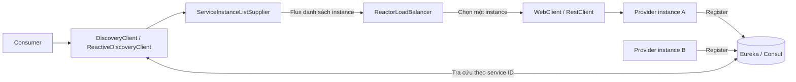
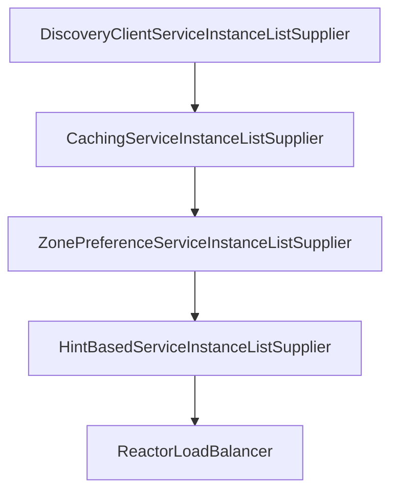
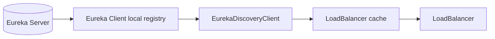

# ServiceInstanceListSupplier và nguồn danh sách từ DiscoveryClient

Khi một consumer gọi `catalog-service`, Spring Cloud LoadBalancer cần biết những instance nào có thể nhận request. `DiscoveryClient` cung cấp khả năng tra cứu instance theo service ID; `ServiceInstanceListSupplier` nối dữ liệu discovery đó với cơ chế chọn instance của LoadBalancer.

`ServiceInstanceListSupplier` là nguồn cung cấp danh sách `ServiceInstance` cho LoadBalancer. Nó có thể lấy dữ liệu từ `DiscoveryClient` hoặc `ReactiveDiscoveryClient`, sau đó kết hợp cache, health check, lọc theo zone, hint hoặc chính sách khác trước khi danh sách được dùng để chọn instance. Supplier không tự chọn server cho request; `ReactorLoadBalancer` mới thực hiện bước lựa chọn.

Bài học thuộc chương `Tích hợp gọi dịch vụ` trong module `SPRING_CLOUD_SERVICE_DISCOVERY`. Module giúp người học hiểu cách tìm instance bằng tên dịch vụ qua `DiscoveryClient`, `ServiceRegistry`, Eureka hoặc Consul, đồng thời nắm vòng đời đăng ký, health check, load balancing, bảo mật và xử lý sai lệch registry. Nội dung này tập trung vào vai trò của `ServiceInstanceListSupplier`, nguồn danh sách từ DiscoveryClient và cách xây dựng supplier chain phù hợp.

## 1. Vị trí của ServiceInstanceListSupplier trong luồng gọi dịch vụ

Provider đăng ký các instance vào registry như Eureka hoặc Consul. Consumer không cần biết trước IP và port của từng instance; nó dùng service ID. Discovery client tra cứu registry và cung cấp các `ServiceInstance`. LoadBalancer lấy danh sách này qua `ServiceInstanceListSupplier`, sau đó chọn một instance để HTTP client gửi request.



Mỗi thành phần có một trách nhiệm riêng:

| Thành phần | Trách nhiệm |
|---|---|
| Service Registry | Lưu registration do provider công bố và trạng thái theo mô hình của registry. |
| `DiscoveryClient` | Tra cứu instance theo service ID bằng API đồng bộ. |
| `ReactiveDiscoveryClient` | Tra cứu instance theo service ID bằng API reactive. |
| `ServiceInstanceListSupplier` | Cung cấp danh sách instance cho LoadBalancer, có thể kết hợp cache và các bộ lọc. |
| `ReactorLoadBalancer` | Chọn một `ServiceInstance` từ danh sách được cung cấp. |
| HTTP client | Gửi request tới host/port của instance đã chọn. |

`ServiceInstanceListSupplier` không thay thế `DiscoveryClient`, cũng không phải một registry mới. Nó là lớp tích hợp danh sách instance với LoadBalancer và cho phép bổ sung các bước xử lý trước khi chọn instance.

## 2. Hợp đồng ServiceInstanceListSupplier

`ServiceInstanceListSupplier` thuộc package `org.springframework.cloud.loadbalancer.core`. Hợp đồng cốt lõi biểu diễn một nguồn cung cấp các danh sách instance dưới dạng Reactor `Flux`:

```java
package org.springframework.cloud.loadbalancer.core;

import java.util.List;

import org.springframework.cloud.client.ServiceInstance;
import org.springframework.cloud.client.loadbalancer.Request;

import reactor.core.publisher.Flux;

public interface ServiceInstanceListSupplier
        extends java.util.function.Supplier<Flux<List<ServiceInstance>>> {

    String getServiceId();

    @Override
    Flux<List<ServiceInstance>> get();

    default Flux<List<ServiceInstance>> get(Request request) {
        return get();
    }

    static ServiceInstanceListSupplierBuilder builder() {
        return new ServiceInstanceListSupplierBuilder();
    }
}
```

Đoạn mã trên mô tả các phần quan trọng của API; hãy đối chiếu Javadoc theo release train mà dự án đang dùng khi cần kiểm tra chữ ký chi tiết.

| Thành phần | Ý nghĩa |
|---|---|
| `getServiceId()` | Trả về service ID mà supplier đang phục vụ, ví dụ `catalog-service`. |
| `get()` | Trả về `Flux<List<ServiceInstance>>`, tức publisher phát ra các danh sách instance. |
| `get(Request request)` | Cho phép supplier nhận thêm request context; mặc định có thể chuyển tiếp tới `get()`. |
| `builder()` | Tạo builder để lắp ghép supplier gốc và các supplier trang trí. |

Điểm cần chú ý là kiểu trả về `Flux<List<ServiceInstance>>`, không phải `Flux<ServiceInstance>`. Mỗi phần tử của Flux là một danh sách ứng viên tại một thời điểm hoặc theo cơ chế cập nhật của supplier. Khi không có instance, danh sách có thể rỗng; LoadBalancer khi đó không có đích để chọn.

`get(Request request)` mở đường cho các chính sách phụ thuộc request, chẳng hạn lọc instance theo hint hoặc dữ liệu phiên. Supplier thông thường chỉ trả danh sách theo service ID và không cần dùng request context.

## 3. Nguồn danh sách từ DiscoveryClient

Spring Cloud LoadBalancer cung cấp supplier dựa trên service discovery. Supplier này dùng discovery client có trong application context để lấy các instance của service ID mà LoadBalancer đang xử lý.

Có hai hướng tích hợp phổ biến:

| Builder method | Discovery API được dùng | Khi phù hợp |
|---|---|---|
| `withDiscoveryClient()` | `ReactiveDiscoveryClient` | Ứng dụng dùng discovery API reactive, phù hợp với pipeline WebFlux/Reactor. |
| `withBlockingDiscoveryClient()` | `DiscoveryClient` | Ứng dụng dùng discovery API đồng bộ/blocking, thường đi cùng RestTemplate hoặc RestClient. |

Trong các phiên bản Spring Cloud hiện hành, builder tách rõ hai cách tạo supplier. Không nên giả định `.withDiscoveryClient()` luôn tự chọn API blocking hay reactive theo HTTP client; hãy chọn method tương ứng với discovery client có trong ứng dụng và xác minh theo phiên bản.

### 3.1. Với ReactiveDiscoveryClient

Khi dùng `.withDiscoveryClient()`, supplier gốc dựa trên `ReactiveDiscoveryClient`. Luồng dữ liệu được biểu diễn bằng Reactor và có thể tham gia trực tiếp vào pipeline reactive của LoadBalancer.

```java
ServiceInstanceListSupplier supplier = ServiceInstanceListSupplier.builder()
        .withDiscoveryClient()
        .build(context);
```

Discovery integration của Eureka, Consul hoặc registry khác cần cung cấp reactive discovery client tương ứng. Nếu ứng dụng không có bean phù hợp, cấu hình supplier có thể không khởi tạo được.

### 3.2. Với DiscoveryClient đồng bộ

Nếu ứng dụng dùng API `DiscoveryClient` đồng bộ, builder có thể tạo supplier từ blocking client:

```java
ServiceInstanceListSupplier supplier = ServiceInstanceListSupplier.builder()
        .withBlockingDiscoveryClient()
        .build(context);
```

Supplier vẫn trả kết quả dưới dạng `Flux<List<ServiceInstance>>` để phù hợp với API của LoadBalancer. Điều đó không có nghĩa lời gọi discovery bên dưới tự nhiên trở thành non-blocking. Với stack blocking, thao tác tra cứu vẫn có đặc tính blocking của implementation.

### 3.3. Dữ liệu instance được chuyển tiếp

Supplier lấy danh sách từ discovery client. Mỗi `ServiceInstance` có thể chứa service ID, host, port, URI, cờ secure, instance ID và metadata. Các supplier phía sau có thể dùng metadata để lọc theo zone, hint, version hoặc weight.

Ví dụ registry trả về:

| Instance ID | Host:Port | Metadata |
|---|---|---|
| `catalog-a` | `10.0.1.21:8080` | `zone=zone-a`, `version=v1` |
| `catalog-b` | `10.0.1.22:8080` | `zone=zone-a`, `version=v2` |
| `catalog-c` | `10.0.2.31:8080` | `zone=zone-b`, `version=v2` |

Supplier gốc có thể đưa cả ba instance cho LoadBalancer. Các supplier trang trí có thể lọc theo zone hoặc request hint trước khi thuật toán chọn instance.

## 4. Supplier chain và mô hình delegate

Spring Cloud LoadBalancer cho phép ghép nhiều `ServiceInstanceListSupplier` theo dạng delegate chain. Supplier gốc lấy dữ liệu từ discovery; các supplier phía ngoài bổ sung cache hoặc lọc danh sách.



Ví dụ trên minh họa một chain có cache, lọc zone và hint. Thứ tự thực tế phải dựa trên chức năng của từng supplier. Cache thường đặt ngay sau supplier lấy dữ liệu qua mạng để tránh gọi discovery lặp lại, sau đó các bước lọc có thể thao tác trên danh sách đã lấy.

Các supplier thường gặp:

| Supplier | Vai trò |
|---|---|
| `DiscoveryClientServiceInstanceListSupplier` | Lấy danh sách instance từ `DiscoveryClient` hoặc `ReactiveDiscoveryClient`. |
| `CachingServiceInstanceListSupplier` | Cache danh sách instance do delegate cung cấp. |
| `ZonePreferenceServiceInstanceListSupplier` | Ưu tiên instance cùng zone dựa trên metadata và cấu hình zone. |
| `HintBasedServiceInstanceListSupplier` | Lọc theo hint từ request hoặc cấu hình. |
| `HealthCheckServiceInstanceListSupplier` | Kiểm tra sức khỏe endpoint của các instance theo lịch. |
| `SameInstancePreferenceServiceInstanceListSupplier` | Ưu tiên instance đã được chọn trước đó nếu nó còn trong danh sách. |
| `WeightedServiceInstanceListSupplier` | Gắn trọng số cho instance để LoadBalancer dùng khi lựa chọn. |

Supplier chain giúp tách phần lấy danh sách khỏi các chính sách lựa chọn. Có thể thay đổi cache hoặc bộ lọc mà không cần viết lại logic truy vấn registry.

## 5. Cấu hình supplier cho một service

Ví dụ cấu hình LoadBalancer riêng cho `catalog-service`, dùng reactive discovery, cache và ưu tiên cùng zone:

```java
import org.springframework.cloud.loadbalancer.core.ServiceInstanceListSupplier;
import org.springframework.context.ConfigurableApplicationContext;
import org.springframework.context.annotation.Bean;

public class CatalogLoadBalancerConfiguration {

    @Bean
    ServiceInstanceListSupplier serviceInstanceListSupplier(
            ConfigurableApplicationContext context) {
        return ServiceInstanceListSupplier.builder()
                .withDiscoveryClient()
                .withCaching()
                .withZonePreference()
                .build(context);
    }
}
```

Gắn cấu hình vào LoadBalancer client tương ứng:

```java
import org.springframework.cloud.loadbalancer.annotation.LoadBalancerClient;
import org.springframework.context.annotation.Configuration;

@Configuration
@LoadBalancerClient(
        value = "catalog-service",
        configuration = CatalogLoadBalancerConfiguration.class)
public class CatalogClientLoadBalancerSetup {
}
```

`value` là service ID mà cấu hình này áp dụng. Cấu hình của LoadBalancer client được tạo trong child context riêng theo service ID. Lớp cấu hình truyền vào `@LoadBalancerClient` nên nằm ngoài component scan thông thường hoặc không gắn `@Configuration` theo hướng dẫn của phiên bản Spring Cloud, để tránh vô tình áp dụng supplier tùy chỉnh cho tất cả service.

Nếu cần dùng blocking discovery, thay `.withDiscoveryClient()` bằng `.withBlockingDiscoveryClient()`. Nếu cần health check blocking, dùng `.withBlockingHealthChecks()` thay cho `.withHealthChecks()`.

### 5.1. Dependency cần có

Ứng dụng cần starter LoadBalancer và starter discovery tương ứng. Ví dụ:

```xml
<dependencies>
    <dependency>
        <groupId>org.springframework.cloud</groupId>
        <artifactId>spring-cloud-starter-loadbalancer</artifactId>
    </dependency>

    <dependency>
        <groupId>org.springframework.cloud</groupId>
        <artifactId>spring-cloud-starter-netflix-eureka-client</artifactId>
    </dependency>
</dependencies>
```

Nếu dùng Consul, thay Eureka starter bằng `spring-cloud-starter-consul-discovery`. Các dependency cần được quản lý bởi Spring Cloud BOM tương thích với phiên bản Spring Boot đang dùng; không trộn release train hoặc phiên bản starter tùy tiện.

## 6. CachingServiceInstanceListSupplier và độ mới danh sách

Tra cứu discovery có thể tạo request mạng hoặc đọc dữ liệu từ registry client. Khi số request lớn, LoadBalancer cache giúp giảm tần suất lấy danh sách từ supplier gốc.

Builder thêm cache bằng:

```java
ServiceInstanceListSupplier.builder()
        .withDiscoveryClient()
        .withCaching()
        .build(context);
```

LoadBalancer cache có các thuộc tính thường dùng:

```yaml
spring:
  cloud:
    loadbalancer:
      cache:
        enabled: true
        ttl: 35s
        capacity: 256
```

Tài liệu Spring Cloud LoadBalancer hiện hành mô tả TTL mặc định là `35s` và capacity mặc định là `256`; cần xác nhận lại với release train của dự án. Có thể dùng Caffeine làm cache backend nếu dependency Caffeine có trên classpath.

Cache giảm tải discovery nhưng tạo ra độ trễ cập nhật. Nếu instance vừa đăng ký hoặc vừa bị gỡ, consumer có thể tiếp tục nhận danh sách đã cache cho tới khi cache hết hạn hoặc được làm mới theo cơ chế đang dùng.

### 6.1. Tránh cache hai lần

Một số `DiscoveryClient` implementation đã có cache riêng. Eureka là ví dụ phổ biến: `EurekaDiscoveryClient` đọc registry local mà Eureka client đã tải từ server. Nếu tiếp tục bật cache LoadBalancer với TTL riêng, danh sách có thể đi qua hai tầng cache:



Hai TTL độc lập có thể cộng dồn độ trễ nhìn thấy thay đổi. Khi discovery implementation đã cache dữ liệu, hãy cân nhắc tắt LoadBalancer cache:

```yaml
spring:
  cloud:
    loadbalancer:
      cache:
        enabled: false
```

Không tắt cache theo thói quen. Hãy xác định cache nào đang hoạt động, chu kỳ refresh của Eureka/Consul client, TTL LoadBalancer và yêu cầu độ mới dữ liệu. Mục tiêu là tránh cache kép không chủ ý, đồng thời vẫn giữ hiệu năng phù hợp.

### 6.2. Vị trí cache trong chain

Khi tự xây dựng chain, đặt `CachingServiceInstanceListSupplier` ngay sau supplier truy vấn discovery qua mạng và trước các supplier lọc theo request. Như vậy, danh sách nguồn được cache; các bộ lọc có thể áp dụng theo từng request mà không làm cache chỉ giữ kết quả đã lọc cho một request cụ thể.

Nếu dùng `HealthCheckServiceInstanceListSupplier`, cần đọc hướng dẫn phiên bản vì supplier này có cơ chế cache riêng. Tránh ghép đồng thời nhiều tầng cache nếu không có chủ đích rõ ràng.

## 7. Lọc theo zone và metadata

`ZonePreferenceServiceInstanceListSupplier` ưu tiên các instance thuộc cùng zone với consumer. Zone thường được lấy từ metadata key `zone` hoặc cấu hình `spring.cloud.loadbalancer.zone`.

Ví dụ cấu hình zone cho Eureka instance:

```yaml
eureka:
  instance:
    metadata-map:
      zone: zone-a

spring:
  cloud:
    loadbalancer:
      zone: zone-a
```

Với supplier chain:

```java
return ServiceInstanceListSupplier.builder()
        .withDiscoveryClient()
        .withCaching()
        .withZonePreference()
        .build(context);
```

Nếu có instance cùng zone, supplier ưu tiên trả các instance đó. Nếu không xác định được zone hoặc không có instance cùng zone, hành vi fallback được tài liệu hiện hành mô tả là trả danh sách đã lấy từ delegate. Điều này giúp ứng dụng vẫn có thể gọi service ở zone khác khi không có instance cục bộ.

Với Consul hoặc registry khác, hãy bảo đảm metadata zone được công bố nhất quán và cấu hình zone của consumer phù hợp. Việc chỉ đặt `spring.cloud.loadbalancer.zone` không tự tạo metadata zone cho provider.

## 8. HealthCheckServiceInstanceListSupplier

`HealthCheckServiceInstanceListSupplier` có thể chủ động kiểm tra endpoint của các instance do supplier delegate cung cấp. Cơ chế này hữu ích trong những trường hợp discovery source không có health state đáng tin cậy, chẳng hạn `SimpleDiscoveryClient`, hoặc khi ứng dụng cần một health probe bổ sung cho tập instance nhỏ.

Ví dụ dùng health check reactive:

```java
return ServiceInstanceListSupplier.builder()
        .withDiscoveryClient()
        .withHealthChecks()
        .build(context);
```

Với stack blocking:

```java
return ServiceInstanceListSupplier.builder()
        .withBlockingDiscoveryClient()
        .withBlockingHealthChecks()
        .build(context);
```

Health check có thể được cấu hình bằng các thuộc tính dưới `spring.cloud.loadbalancer.health-check`, chẳng hạn initial delay, interval, path và port. Nếu dùng path mặc định `/actuator/health`, provider cần có Actuator hoặc endpoint tương đương. Có thể cấu hình path riêng cho từng service ID.

Ví dụ cấu hình path và chu kỳ kiểm tra:

```yaml
spring:
  cloud:
    loadbalancer:
      health-check:
        initial-delay: 5s
        interval: 25s
        path:
          default: /actuator/health
          catalog-service: /actuator/health
```

Tên và kiểu dữ liệu thuộc tính cần được đối chiếu với phiên bản Spring Cloud đang dùng; không bật health check theo lịch nếu endpoint chưa được expose hoặc không thể truy cập từ consumer.

Không nên thêm health-check supplier một cách máy móc khi dùng Eureka hoặc Consul. Các registry thật thường đã cung cấp trạng thái health trong kết quả discovery; tài liệu Spring Cloud LoadBalancer cho biết cơ chế kiểm tra bổ sung thường không cần thiết trong trường hợp này. Kiểm tra health check của registry trước để tránh probe trùng lặp, tăng tải hoặc tạo hai nguồn trạng thái khác nhau.

Nếu dùng health-check supplier, đặt nó ngay sau supplier lấy danh sách từ discovery và trước các supplier lọc khác. Supplier này có cơ chế cache riêng trong các phiên bản hiện hành; thường không cần bọc thêm `CachingServiceInstanceListSupplier` nếu điều đó tạo cache kép.

## 9. Hint, weight và cùng instance preference

Ngoài zone và health, supplier chain còn có thể áp dụng các chính sách khác.

### 9.1. Hint-based filtering

`HintBasedServiceInstanceListSupplier` lọc danh sách dựa trên hint của request hoặc cấu hình. Theo tài liệu hiện hành, header mặc định là `X-SC-LB-Hint`, và supplier so sánh giá trị hint với metadata key `hint` của instance.

Ví dụ metadata provider:

```yaml
eureka:
  instance:
    metadata-map:
      hint: internal
```

Có thể thêm `.withHints()` vào builder. Nếu không có hint, supplier giữ nguyên danh sách delegate. Theo tài liệu hiện hành, nếu không tìm được instance có metadata khớp hint, supplier trả lại danh sách từ delegate thay vì tự trả danh sách rỗng. Vì vậy, hint chỉ là cơ chế ưu tiên/lọc định tuyến; không dùng hint để thay thế authorization hoặc kiểm soát tenant.

### 9.2. Weighted supplier

`WeightedServiceInstanceListSupplier` cung cấp trọng số instance dựa trên metadata hoặc `WeightFunction`. Ví dụ:

```java
return ServiceInstanceListSupplier.builder()
        .withDiscoveryClient()
        .withWeighted()
        .build(context);
```

Theo cấu hình mặc định được tài liệu mô tả, supplier đọc metadata key `weight`; nếu không có trọng số thì dùng giá trị mặc định là `1`. Thuật toán LoadBalancer cần hỗ trợ sử dụng trọng số tương ứng. Chỉ thêm metadata `weight` không tự làm một HTTP client thông thường phân phối request theo trọng số nếu supplier và LoadBalancer chưa được cấu hình.

### 9.3. Same instance preference

`SameInstancePreferenceServiceInstanceListSupplier` ưu tiên instance đã được chọn trước đó nếu instance đó vẫn còn trong danh sách. Cơ chế này có thể hữu ích khi muốn giữ tính ổn định tương đối của instance giữa các request, nhưng không phải cam kết sticky session tuyệt đối và không nên giữ instance đã bị loại khỏi danh sách.

Các supplier có thể được ghép qua builder:

```java
return ServiceInstanceListSupplier.builder()
        .withDiscoveryClient()
        .withCaching()
        .withZonePreference()
        .withHints()
        .withSameInstancePreference()
        .build(context);
```

Hãy chọn những chính sách thực sự cần cho service. Quá nhiều bộ lọc có thể làm danh sách rỗng hoặc khiến việc giải thích vì sao một instance không được chọn trở nên khó khăn.

## 10. ServiceInstanceListSupplier không phải bộ chọn instance

Supplier chỉ cung cấp danh sách ứng viên sau khi lấy và xử lý dữ liệu. `ReactorLoadBalancer` mới chọn một instance trong danh sách. Các implementation phổ biến gồm round-robin và random; có thể cấu hình thuật toán riêng theo service ID.

Luồng khái quát:

1. HTTP client gửi request tới tên dịch vụ, ví dụ `http://catalog-service`.
2. LoadBalancer xác định service ID `catalog-service`.
3. LoadBalancer lấy supplier trong child context của service ID đó.
4. Supplier lấy danh sách từ DiscoveryClient và áp dụng chain.
5. LoadBalancer chọn một `ServiceInstance` từ danh sách cuối cùng.
6. HTTP client gửi request tới host/port của instance được chọn.

Vì supplier không lựa chọn instance, không nên tự lấy phần tử đầu tiên của danh sách và gọi đó là load balancing. Cũng không nên đặt thuật toán chọn instance vào một custom supplier nếu trách nhiệm đó thuộc `ReactorLoadBalancer`.

## 11. Tích hợp với WebClient

Trong ứng dụng reactive, `WebClient.Builder` có thể được đánh dấu `@LoadBalanced`. Khi đó, request dùng service ID sẽ được Spring Cloud LoadBalancer xử lý:

```java
import org.springframework.cloud.client.loadbalancer.LoadBalanced;
import org.springframework.context.annotation.Bean;
import org.springframework.context.annotation.Configuration;
import org.springframework.web.reactive.function.client.WebClient;

@Configuration
public class HttpClientConfiguration {

    @Bean
    @LoadBalanced
    WebClient.Builder loadBalancedWebClientBuilder() {
        return WebClient.builder();
    }
}
```

Consumer sử dụng:

```java
import org.springframework.cloud.client.loadbalancer.LoadBalanced;
import org.springframework.stereotype.Service;
import org.springframework.web.reactive.function.client.WebClient;
import reactor.core.publisher.Mono;

@Service
public class CatalogClient {

    private final WebClient webClient;

    public CatalogClient(@LoadBalanced WebClient.Builder builder) {
        this.webClient = builder
                .baseUrl("http://catalog-service")
                .build();
    }

    public Mono<Product> getProduct(String productId) {
        return webClient.get()
                .uri("/api/products/{id}", productId)
                .retrieve()
                .bodyToMono(Product.class);
    }
}
```

`Product` trong ví dụ là DTO do ứng dụng định nghĩa.

`WebClient` không tự gọi `DiscoveryClient` trong từng method của service. Nó chuyển request qua LoadBalancer filter; LoadBalancer lấy danh sách qua `ServiceInstanceListSupplier`, chọn instance rồi gửi request.

## 12. Khi nào cần custom ServiceInstanceListSupplier?

Supplier mặc định từ DiscoveryClient đáp ứng phần lớn nhu cầu. Chỉ nên viết custom supplier khi có quy tắc chọn danh sách mà các supplier sẵn có không đáp ứng, ví dụ:

- Chỉ cho consumer ở một tenant nhìn thấy instance có metadata tenant tương ứng.
- Lọc instance theo version API hoặc nhóm triển khai.
- Áp dụng chính sách locality riêng của tổ chức.
- Tích hợp nguồn danh sách đặc biệt ngoài DiscoveryClient.

Custom supplier thường kế thừa `DelegatingServiceInstanceListSupplier` để giữ nguyên nguồn dữ liệu bên dưới và chỉ thay đổi danh sách được phát ra.

Ví dụ lọc theo metadata `version`:

```java
import java.util.List;
import java.util.stream.Collectors;

import org.springframework.cloud.client.ServiceInstance;
import org.springframework.cloud.loadbalancer.core.DelegatingServiceInstanceListSupplier;
import org.springframework.cloud.loadbalancer.core.ServiceInstanceListSupplier;

import reactor.core.publisher.Flux;

public class VersionServiceInstanceListSupplier
        extends DelegatingServiceInstanceListSupplier {

    private final String requiredVersion;

    public VersionServiceInstanceListSupplier(
            ServiceInstanceListSupplier delegate,
            String requiredVersion) {
        super(delegate);
        this.requiredVersion = requiredVersion;
    }

    @Override
    public Flux<List<ServiceInstance>> get() {
        return delegate.get().map(instances -> instances.stream()
                .filter(instance -> requiredVersion.equals(
                        instance.getMetadata().get("version")))
                .collect(Collectors.toList()));
    }
}
```

Đây là ví dụ minh họa bộ lọc tĩnh. Nếu version phụ thuộc từng request, cần triển khai hoặc ghi đè `get(Request request)` và đọc request context phù hợp thay vì giữ một giá trị dùng chung cho mọi request. Trong môi trường đa luồng, không lưu request-specific state vào field dùng chung của supplier.

Khi custom supplier trả danh sách rỗng, LoadBalancer có thể không tìm được instance. Hãy quyết định rõ có fallback về danh sách gốc hay trả kết quả rỗng; fallback có thể làm mất ý nghĩa của chính sách tenant/version nếu áp dụng không cẩn thận.

## 13. Lỗi thường gặp và cách chẩn đoán

| Triệu chứng | Nguyên nhân có thể | Cách kiểm tra |
|---|---|---|
| Không tìm thấy bean `ServiceInstanceListSupplier` | Thiếu starter LoadBalancer hoặc custom configuration chưa được nạp. | Kiểm tra dependency, `@LoadBalancerClient` và child context. |
| Không có `DiscoveryClient` hoặc `ReactiveDiscoveryClient` | Thiếu registry starter hoặc loại client bị disable. | Kiểm tra Eureka/Consul starter và cấu hình discovery. |
| Supplier trả danh sách rỗng | Sai service ID, provider chưa đăng ký, health state không passing hoặc filter loại hết instance. | Đối chiếu Catalog/Dashboard, DiscoveryClient và từng bước chain. |
| Consumer thấy instance cũ | Cache ở registry client hoặc LoadBalancer chưa hết TTL. | Xác định cache đang bật và thời điểm refresh. |
| Instance cùng zone không được ưu tiên | Metadata `zone` thiếu hoặc cấu hình zone consumer không khớp. | Kiểm tra metadata instance và `spring.cloud.loadbalancer.zone`. |
| Health-check supplier loại hết instance | Path/port không đúng, endpoint cần auth hoặc health check không truy cập được. | Gọi endpoint từ góc nhìn mạng của consumer. |
| Danh sách thay đổi theo request không đúng | Supplier chỉ override `get()` nhưng bỏ qua request context. | Kiểm tra `get(Request request)` và delegate chain. |
| Cache có dữ liệu khác supplier gốc | Cache đặt sau filter hoặc có nhiều tầng cache. | Kiểm tra thứ tự delegate và TTL từng tầng. |
| Cấu hình một service ảnh hưởng service khác | Custom LoadBalancer configuration bị component scan thành cấu hình toàn cục. | Kiểm tra phạm vi `@LoadBalancerClient` và component scan. |

### 13.1. Quy trình kiểm tra theo tầng

Khi consumer không gọi được một service, thực hiện theo thứ tự:

1. Xác nhận service ID trong URL của HTTP client.
2. Kiểm tra registry có application và instance tương ứng hay không.
3. Gọi `DiscoveryClient` hoặc `ReactiveDiscoveryClient` để xác nhận danh sách gốc.
4. Kiểm tra supplier gốc và `getServiceId()`.
5. Kiểm tra từng supplier delegate: cache, health, zone, hint hoặc custom filter.
6. Kiểm tra danh sách cuối cùng mà LoadBalancer nhận được.
7. Kiểm tra thuật toán LoadBalancer và instance được chọn.
8. Gọi host/port từ góc nhìn consumer để xác minh DNS, firewall, TLS và endpoint.
9. Đối chiếu TTL cache và thời điểm registration thay đổi.

Không kết luận registry lỗi chỉ vì request thất bại. Lỗi có thể nằm ở service ID, filter, cache, thuật toán chọn instance hoặc network path tới provider.

## 14. Kiểm thử ServiceInstanceListSupplier

Khi viết custom supplier, nên kiểm thử các trường hợp:

- Delegate trả về nhiều instance.
- Delegate trả danh sách rỗng.
- Metadata thiếu hoặc không hợp lệ.
- Request context có và không có hint/version.
- Không có instance nào khớp bộ lọc.
- Delegate phát lỗi hoặc timeout.
- Cache trả dữ liệu cũ và sau TTL lấy dữ liệu mới.
- Supplier chain được tạo cho đúng service ID.

Có thể dùng `StepVerifier` để kiểm tra `Flux<List<ServiceInstance>>`:

```java
import static org.assertj.core.api.Assertions.assertThat;

import reactor.test.StepVerifier;

StepVerifier.create(supplier.get())
        .assertNext(instances -> {
            assertThat(instances).hasSize(2);
        })
        .verifyComplete();
```

Với custom supplier dựa trên request context, kiểm thử cả `get(request)` và `get()` để chắc chắn logic mặc định không bị thay đổi ngoài ý muốn. Nên dùng instance giả với host, port và metadata rõ ràng để kiểm tra bộ lọc một cách xác định.

## 15. Quan sát và vận hành

LoadBalancer có thể phát metric về request thành công, thất bại và request không lấy được instance. Có thể bật thống kê Micrometer theo cấu hình của phiên bản Spring Cloud đang dùng và cung cấp `MeterRegistry`.

Các tín hiệu hữu ích:

- Số lượng instance được DiscoveryClient trả về theo service ID.
- Số lượng instance sau từng bước lọc.
- Tỷ lệ danh sách rỗng.
- Thời gian lấy danh sách từ discovery.
- Cache hit/miss và tuổi cache nếu implementation cung cấp.
- Instance được chọn và tỷ lệ request lỗi theo instance.
- Thời gian từ khi provider đăng ký/deregister tới khi consumer nhìn thấy thay đổi.

Không ghi toàn bộ metadata nhạy cảm hoặc thông tin xác thực vào log. Khi debug, service ID, instance ID, zone, version và trạng thái thường đủ để tìm nguyên nhân mà không làm lộ secret.

## 16. Thực hành tốt

1. Dùng supplier dựa trên DiscoveryClient làm nguồn danh sách gốc khi ứng dụng đã có registry integration.
2. Chọn `.withDiscoveryClient()` cho `ReactiveDiscoveryClient` và `.withBlockingDiscoveryClient()` cho `DiscoveryClient` đồng bộ.
3. Giữ supplier chain đơn giản và chỉ thêm filter có yêu cầu cụ thể.
4. Đặt cache ngay sau supplier lấy dữ liệu từ discovery và trước các bộ lọc request-based.
5. Tránh cache kép nếu registry client như Eureka đã giữ local cache.
6. Không thêm health-check supplier trùng với health state mà registry đã cung cấp nếu không có lý do rõ ràng.
7. Dùng metadata có schema ổn định cho zone, hint, version hoặc weight.
8. Giữ request-specific state trong request context, không lưu vào field dùng chung của supplier.
9. Cấu hình LoadBalancer theo từng service ID khi chính sách khác nhau.
10. Kiểm thử danh sách rỗng, lỗi discovery, cache stale và fallback trước khi triển khai.

## Kết luận

`ServiceInstanceListSupplier` là cầu nối giữa dữ liệu service discovery và Spring Cloud LoadBalancer. Nó cung cấp `Flux<List<ServiceInstance>>`, gắn với một service ID và có thể lấy danh sách từ `ReactiveDiscoveryClient` hoặc `DiscoveryClient` thông qua builder. Các supplier delegate cho phép bổ sung cache, zone preference, hint, health check, weight và các chính sách lọc khác trước khi `ReactorLoadBalancer` chọn instance.

Khi thiết kế supplier chain, hãy phân biệt nguồn dữ liệu với bộ lọc và thuật toán chọn instance. Kiểm soát vị trí cache, tránh cache kép với Eureka, chỉ bật health check bổ sung khi cần và giới hạn cấu hình custom theo đúng service ID. Khi request thất bại, kiểm tra lần lượt registry, discovery client, supplier chain, cache, LoadBalancer và network path để tìm đúng tầng gây lỗi.

## Tài liệu tham khảo

- [Spring Cloud LoadBalancer](https://docs.spring.io/spring-cloud-commons/reference/spring-cloud-commons/loadbalancer.html): supplier dựa trên discovery, cache, zone preference, health check, hint, weight và cấu hình riêng theo service ID.
- [Spring Cloud Commons – Common Abstractions](https://docs.spring.io/spring-cloud-commons/reference/spring-cloud-commons/common-abstractions.html): abstraction `DiscoveryClient` và `ReactiveDiscoveryClient`.
- [Spring Cloud LoadBalancer API](https://javadoc.io/doc/org.springframework.cloud/spring-cloud-loadbalancer/latest/index.html): API và package của `ServiceInstanceListSupplier` cùng các implementation.
