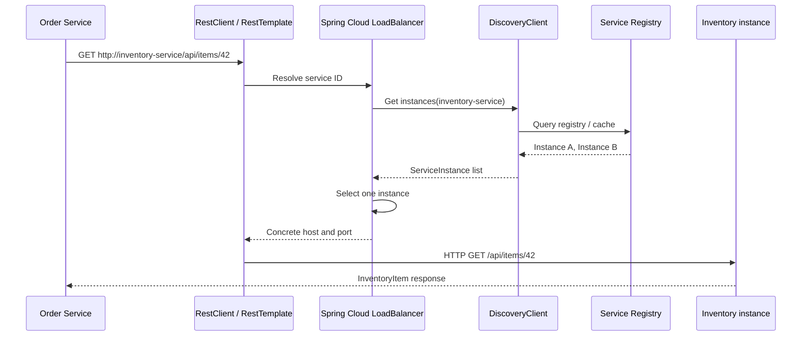

# Gọi tên dịch vụ bằng RestClient hoặc RestTemplate với @LoadBalanced

Trong microservice, consumer nên gọi provider bằng tên logic như `inventory-service` thay vì ghi cứng IP và port của một instance. Spring Cloud LoadBalancer kết hợp với service discovery để chuyển tên dịch vụ trong URL thành một instance cụ thể trước khi gửi HTTP request. Với các HTTP client đồng bộ của Spring, có thể bật cơ chế này bằng annotation `@LoadBalanced` trên bean `RestClient.Builder` hoặc `RestTemplate`.

Bài này hướng dẫn hai cách gọi phổ biến: `RestClient` cho ứng dụng dùng Spring Framework 6.1 trở lên và `RestTemplate` cho codebase đang sử dụng API cũ hơn. Cả hai đều dùng service ID trong URL, nhưng chỉ bean được đánh dấu `@LoadBalanced` mới có cơ chế phân giải tên dịch vụ qua LoadBalancer.

## Luồng xử lý khi gọi bằng service ID

Giả sử `order-service` cần lấy thông tin tồn kho từ `inventory-service`. Registry đang có hai instance:

```text
inventory-service
  instance A: 10.0.1.12:8080
  instance B: 10.0.1.13:8080
```

Consumer gọi URL có host là `inventory-service`. Với HTTP client đã tích hợp Spring Cloud LoadBalancer, request được xử lý theo luồng:

1. Code ứng dụng tạo request tới `http://inventory-service/...`.
2. LoadBalancer integration nhận ra host là service ID và yêu cầu danh sách instance từ discovery.
3. Discovery client truy vấn registry hoặc dữ liệu cache hiện có để lấy các instance của `inventory-service`.
4. LoadBalancer chọn một instance theo chính sách đang cấu hình.
5. HTTP client gửi request tới host và port của instance được chọn.
6. Response được trả về code gọi như một HTTP request thông thường.



`inventory-service` ở đây là service ID, không phải hostname mà DNS nhất thiết phải phân giải. `@LoadBalanced` bổ sung cơ chế chọn instance trước khi request được gửi ra mạng. Nếu dùng `RestClient` hoặc `RestTemplate` không có annotation này, client có thể cố phân giải `inventory-service` bằng DNS thông thường và gặp lỗi host không tồn tại.

## Dependency cần có

Ứng dụng cần Spring Cloud LoadBalancer và ít nhất một discovery integration cung cấp danh sách instance. Dependency thường được quản lý bằng Spring Cloud BOM tương thích với phiên bản Spring Boot.

Ví dụ Maven cho LoadBalancer:

```xml
<dependency>
    <groupId>org.springframework.cloud</groupId>
    <artifactId>spring-cloud-starter-loadbalancer</artifactId>
</dependency>
```

Thêm starter registry tương ứng nếu ứng dụng dùng registry thật, ví dụ:

| Registry | Dependency phổ biến |
|---|---|
| Eureka | `spring-cloud-starter-netflix-eureka-client` |
| Consul | `spring-cloud-starter-consul-discovery` |
| ZooKeeper | `spring-cloud-starter-zookeeper-discovery` |

Trong môi trường test đơn giản, `SimpleDiscoveryClient` có thể cung cấp instance tĩnh từ cấu hình mà không cần chạy registry server. Khi đó vẫn cần LoadBalancer nếu muốn gọi bằng service ID qua HTTP client.

## Gọi bằng RestClient và @LoadBalanced

`RestClient` là HTTP client đồng bộ có API fluent, được giới thiệu trong Spring Framework 6.1. Để gọi service theo tên, tạo bean `RestClient.Builder` với `@LoadBalanced`.

### Khai báo builder

```java
import org.springframework.cloud.client.loadbalancer.LoadBalanced;
import org.springframework.context.annotation.Bean;
import org.springframework.context.annotation.Configuration;
import org.springframework.web.client.RestClient;

@Configuration
public class HttpClientConfiguration {

    @Bean
    @LoadBalanced
    RestClient.Builder loadBalancedRestClientBuilder() {
        return RestClient.builder();
    }
}
```

`@LoadBalanced` đánh dấu builder này để Spring Cloud bổ sung interceptor hỗ trợ phân giải service ID. Nếu ứng dụng có nhiều `RestClient.Builder`, nên inject builder bằng qualifier tương ứng để tránh lấy nhầm builder không load-balanced.

### Tạo client gọi Inventory Service

```java
import org.springframework.cloud.client.loadbalancer.LoadBalanced;
import org.springframework.stereotype.Service;
import org.springframework.web.client.RestClient;

@Service
public class InventoryClient {
    private final RestClient restClient;

    public InventoryClient(@LoadBalanced RestClient.Builder builder) {
        this.restClient = builder.build();
    }

    public InventoryItem getItem(long id) {
        return restClient.get()
            .uri("http://inventory-service/api/items/{id}", id)
            .retrieve()
            .body(InventoryItem.class);
    }
}
```

Host `inventory-service` được LoadBalancer phân giải thành instance. Phần path `/api/items/{id}` và cách đọc response vẫn theo API của `RestClient`. `InventoryItem` là kiểu response do ứng dụng định nghĩa.

Có thể dùng các method HTTP khác tương tự:

```java
InventoryItem created = restClient.post()
    .uri("http://inventory-service/api/items")
    .body(new CreateInventoryItemRequest("SKU-42", 10))
    .retrieve()
    .body(InventoryItem.class);

restClient.delete()
    .uri("http://inventory-service/api/items/{id}", 42L)
    .retrieve()
    .toBodilessEntity();
```

### Dùng nhiều RestClient

Khi một ứng dụng gọi nhiều upstream hoặc cần cả request load-balanced và request tới URL cố định, nên đặt tên bean rõ ràng:

```java
@Configuration
public class HttpClientConfiguration {

    @Bean
    @LoadBalanced
    RestClient.Builder serviceRestClientBuilder() {
        return RestClient.builder();
    }

    @Bean
    RestClient.Builder externalRestClientBuilder() {
        return RestClient.builder();
    }
}
```

Inject `@LoadBalanced RestClient.Builder` cho lời gọi theo service ID; inject builder thường cho URL bên ngoài hoặc địa chỉ cố định. Tránh dùng nhầm builder vì URL dạng `http://inventory-service` chỉ hoạt động khi request đi qua LoadBalancer integration.

`RestClient.Builder` có thể được tùy biến với default header, request factory, message converter hoặc observation. Khi cấu hình nhiều client, hãy giữ các thiết lập riêng theo mục đích và tránh chia sẻ trạng thái builder có thể thay đổi ngoài ý muốn.

## Gọi bằng RestTemplate và @LoadBalanced

`RestTemplate` vẫn được hỗ trợ trong nhiều ứng dụng Spring Boot hiện hữu. Cách tích hợp tương tự: đánh dấu bean `RestTemplate` bằng `@LoadBalanced` để Spring Cloud gắn load-balancing interceptor.

### Khai báo bean

```java
import org.springframework.boot.web.client.RestTemplateBuilder;
import org.springframework.cloud.client.loadbalancer.LoadBalanced;
import org.springframework.context.annotation.Bean;
import org.springframework.context.annotation.Configuration;
import org.springframework.web.client.RestTemplate;

@Configuration
public class HttpClientConfiguration {

    @Bean
    @LoadBalanced
    RestTemplate inventoryRestTemplate(RestTemplateBuilder builder) {
        return builder.build();
    }
}
```

### Inject và gọi theo service ID

```java
import org.springframework.beans.factory.annotation.Qualifier;
import org.springframework.stereotype.Service;
import org.springframework.web.client.RestTemplate;

@Service
public class InventoryClient {
    private final RestTemplate restTemplate;

    public InventoryClient(
            @Qualifier("inventoryRestTemplate") RestTemplate restTemplate) {
        this.restTemplate = restTemplate;
    }

    public InventoryItem getItem(long id) {
        return restTemplate.getForObject(
            "http://inventory-service/api/items/{id}",
            InventoryItem.class,
            id
        );
    }
}
```

Với `@LoadBalanced RestTemplate`, `inventory-service` được hiểu là service ID. Không cần tự gọi `DiscoveryClient`, chọn instance rồi ghép host/port vào URL cho từng request.

`RestTemplate` là API đồng bộ đã có từ lâu. Với code mới trên Spring Framework 6.1+, có thể cân nhắc `RestClient` để dùng API fluent; không cần chuyển đổi ngay nếu ứng dụng hiện tại đang vận hành ổn định với `RestTemplate`.

## So sánh RestClient và RestTemplate

| Tiêu chí | RestClient | RestTemplate |
|---|---|---|
| API | Fluent API: `get()`, `post()`, `retrieve()` | Các method như `getForObject`, `postForEntity`, `exchange` |
| Cách tích hợp | Đánh dấu `RestClient.Builder` bằng `@LoadBalanced` | Đánh dấu bean `RestTemplate` bằng `@LoadBalanced` |
| Kiểu gọi | Đồng bộ, blocking | Đồng bộ, blocking |
| Phiên bản nền | Spring Framework 6.1+ | Có trong các dòng Spring Framework cũ hơn và mới hơn |
| Phù hợp | Code mới dùng API HTTP đồng bộ hiện đại | Ứng dụng hiện hữu hoặc thư viện đang phụ thuộc RestTemplate |

Cả hai đều dùng chung ý tưởng: service ID trong URI được LoadBalancer phân giải thành một `ServiceInstance`. Chọn client theo phiên bản Spring và chuẩn codebase; không trộn lẫn builder/bean thường với bean load-balanced.

## Cấu hình service ID và registry

Provider cần đăng ký một service ID ổn định. Với Spring Boot, `spring.application.name` thường được dùng làm tên service:

```yaml
spring:
  application:
    name: inventory-service
```

Consumer phải gọi đúng service ID mà provider công bố. Ví dụ provider đăng ký `inventory-service`, nhưng consumer gọi `http://inventory`, registry sẽ không tự hiểu hai tên này là một nếu không có alias hoặc quy tắc ánh xạ riêng.

Ví dụ consumer dùng Eureka:

```yaml
spring:
  application:
    name: order-service

eureka:
  client:
    service-url:
      defaultZone: http://eureka-server:8761/eureka/
    register-with-eureka: true
    fetch-registry: true
```

Với Consul hoặc ZooKeeper, thay cấu hình Eureka bằng starter và thuộc tính kết nối tương ứng. Code gọi qua `RestClient` hoặc `RestTemplate` không cần biết registry cụ thể nếu integration cung cấp `DiscoveryClient` cho Spring Cloud.

## LoadBalancer chọn instance như thế nào?

Sau khi discovery trả về danh sách instance, Spring Cloud LoadBalancer chọn một instance theo cấu hình. Trong cấu hình phổ biến, thuật toán mặc định là round robin: các request lần lượt được phân phối qua các instance trong danh sách. Có thể thay bằng chiến lược khác hoặc supplier tùy chỉnh theo nhu cầu.

Ví dụ danh sách có A, B và C:

```text
Request 1 -> instance A
Request 2 -> instance B
Request 3 -> instance C
Request 4 -> instance A
```

Đây là minh họa cho round robin, không phải cam kết mọi request sẽ phân bố đều tuyệt đối. Kết quả thực tế phụ thuộc số request đồng thời, danh sách instance, cache, retry, cấu hình supplier và chiến lược được ứng dụng sử dụng.

LoadBalancer không tự kiểm tra mọi endpoint nghiệp vụ trước mỗi request. Danh sách instance đến từ discovery/health integration; nếu registry hoặc cache còn instance cũ, request vẫn có thể được gửi tới địa chỉ đã ngừng hoạt động. Consumer cần timeout và xử lý lỗi kết nối.

## Xử lý trường hợp không có instance

Khi registry chưa có instance phù hợp, LoadBalancer không thể chọn đích. Lời gọi HTTP sẽ thất bại thay vì tự động chuyển sang một IP mặc định. Cần xử lý lỗi ở ranh giới client hoặc service layer:

```java
import org.springframework.stereotype.Service;
import org.springframework.web.client.RestClientException;

@Service
public class InventoryFacade {
    private final InventoryClient inventoryClient;

    public InventoryFacade(InventoryClient inventoryClient) {
        this.inventoryClient = inventoryClient;
    }

    public InventoryItem findItem(long id) {
        try {
            return inventoryClient.getItem(id);
        } catch (RestClientException ex) {
            // Ghi log có correlation ID và chuyển thành lỗi phù hợp của ứng dụng.
            throw new InventoryUnavailableException(
                "Inventory service is unavailable", ex);
        } catch (IllegalStateException ex) {
            // Một số implementation báo lỗi khi không có instance để chọn.
            throw new InventoryUnavailableException(
                "No inventory instance is available", ex);
        }
    }
}
```

Ví dụ trên minh họa ranh giới xử lý lỗi; trong ứng dụng thực tế cần xác định loại exception cụ thể mà phiên bản LoadBalancer/HTTP client phát ra khi không có instance và ánh xạ sang response hoặc retry policy phù hợp.

Không nên retry mọi lỗi vô điều kiện. Retry chỉ phù hợp khi request có thể thực hiện lại an toàn, có giới hạn số lần, backoff và timeout tổng. Với thao tác ghi, cần cân nhắc idempotency key hoặc cơ chế chống xử lý trùng.

## Timeout, retry và circuit breaker

Load balancing chỉ chọn đích; nó không thay thế chính sách độ tin cậy của HTTP client. Một lời gọi production nên xác định:

- **Connect timeout:** thời gian tối đa để thiết lập kết nối tới instance.
- **Response/read timeout:** thời gian tối đa chờ phản hồi.
- **Retry:** số lần thử lại có giới hạn và loại lỗi được phép thử lại.
- **Circuit breaker:** tạm ngừng gọi một upstream đang lỗi liên tục để bảo vệ consumer.
- **Bulkhead:** giới hạn tài nguyên dành cho lời gọi tới một dependency.

Không nên đặt timeout quá dài khiến thread của consumer bị giữ trong lúc provider đã lỗi. Cũng không nên retry đồng loạt với khoảng chờ bằng nhau vì có thể tạo retry storm khi dịch vụ vừa phục hồi. Dùng backoff và jitter nếu có retry.

## Phân biệt gọi qua LoadBalancer với tra cứu thủ công

Có hai cách làm khác nhau:

| Cách làm | Khi nên dùng | Điều cần tự quản lý |
|---|---|---|
| `@LoadBalanced RestClient` hoặc `RestTemplate` | HTTP request thông thường theo service ID | Timeout, lỗi, retry và cấu hình client |
| `DiscoveryClient.getInstances(serviceId)` | Cần metadata, tự xây dựng protocol hoặc định tuyến đặc thù | Chọn instance, cache, refresh, xử lý instance stale và ghép URI |

Ví dụ tra cứu thủ công:

```java
List<ServiceInstance> instances =
    discoveryClient.getInstances("inventory-service");

if (instances.isEmpty()) {
    throw new IllegalStateException("No inventory instance is available");
}

ServiceInstance selected = instances.get(0);
URI target = selected.getUri();
```

Đoạn mã chỉ minh họa đọc metadata; lấy phần tử đầu tiên không phải chiến lược cân bằng tải tốt cho production. Nếu tự chọn instance, ứng dụng phải tự xử lý phân phối tải, cache và trường hợp instance biến mất sau khi tra cứu. Với HTTP request thông thường, `@LoadBalanced` thường giúp tránh phải tự viết phần này.

## Những lỗi thường gặp

| Triệu chứng | Nguyên nhân có thể | Cách kiểm tra / xử lý |
|---|---|---|
| `UnknownHostException: inventory-service` | Client không được đánh dấu `@LoadBalanced` hoặc LoadBalancer dependency chưa có | Kiểm tra bean và dependency starter |
| Không có instance cho service ID | Provider chưa đăng ký, sai service ID hoặc registry chưa đồng bộ | Kiểm tra `spring.application.name`, registry và `DiscoveryClient.getInstances` |
| Bean injection bị ambiguous | Có nhiều `RestClient.Builder` hoặc `RestTemplate` | Dùng `@Qualifier` và đặt tên bean rõ ràng |
| Request luôn tới một instance | Chỉ có một instance khả dụng, cache hoặc strategy được tùy biến | Kiểm tra registry list, supplier và LoadBalancer configuration |
| Gọi được local nhưng lỗi trong container | Địa chỉ provider quảng bá không truy cập được từ consumer | Kiểm tra hostname, port, Docker/Kubernetes network và địa chỉ đăng ký |
| Vẫn gọi instance đã chết | Registry hoặc LoadBalancer cache còn stale | Kiểm tra health check, registry refresh, cache TTL và timeout |
| Request ghi bị thực hiện hai lần | Retry không xét idempotency | Giới hạn retry và dùng idempotency key cho thao tác phù hợp |

Khi điều tra, đi theo thứ tự: xác nhận service ID, kiểm tra registry có instance, xác nhận bean có `@LoadBalanced`, xem log LoadBalancer chọn instance nào và cuối cùng kiểm tra kết nối mạng tới host/port đó.

## Kiểm thử tích hợp

Có thể kiểm thử theo các bước:

1. Khởi động registry hoặc cấu hình `SimpleDiscoveryClient` với hai URI test cho `inventory-service`.
2. Khởi động hai HTTP server giả lập ở hai port khác nhau và trả về định danh instance trong response.
3. Khởi tạo `RestClient.Builder` hoặc `RestTemplate` có `@LoadBalanced`.
4. Gọi nhiều lần URL `http://inventory-service/...` và xác nhận request được phân phối theo strategy hiện tại.
5. Dừng một server và kiểm tra health/discovery cache được cập nhật theo cấu hình.
6. Kiểm tra trường hợp danh sách instance rỗng và xác nhận lỗi được xử lý ở service layer.
7. Chạy integration test với registry thật hoặc container khi cần xác minh đăng ký, heartbeat và deregistration.

Không nên chỉ kiểm tra bean đã được tạo. Test cần xác minh request thực sự được chuyển từ service ID tới địa chỉ instance và ứng dụng phản ứng đúng khi instance không còn khả dụng.

## Lưu ý phiên bản và lựa chọn API

`RestClient` yêu cầu Spring Framework 6.1 trở lên. Nếu dùng Spring Boot, chọn dòng Boot và Spring Cloud release train tương thích; không thêm một phiên bản `spring-cloud-starter-loadbalancer` tùy ý ngoài BOM. Tài liệu của release train đang dùng là nguồn xác nhận cuối cùng cho API và auto-configuration.

Với code mới trên nền tảng hỗ trợ, có thể ưu tiên `RestClient` cho lời gọi đồng bộ. Với ứng dụng hiện hữu dùng `RestTemplate`, tiếp tục sử dụng bean `@LoadBalanced` là lựa chọn hợp lệ trong phạm vi các phiên bản còn hỗ trợ. Nếu hệ thống cần non-blocking I/O, xem xét WebClient với `@LoadBalanced WebClient.Builder` hoặc HTTP client reactive tương ứng; đó là một cách tích hợp khác ngoài phạm vi hai client trong bài này.

## Checklist triển khai

1. Provider có `spring.application.name` ổn định và đăng ký đúng service ID.
2. Consumer có starter discovery tương ứng và kết nối được registry.
3. Consumer có `spring-cloud-starter-loadbalancer`.
4. Bean `RestClient.Builder` hoặc `RestTemplate` được đánh dấu `@LoadBalanced`.
5. Code inject đúng bean bằng qualifier khi có nhiều HTTP client.
6. URL dùng đúng service ID, ví dụ `http://inventory-service/api/items/42`.
7. Địa chỉ host/port của instance truy cập được từ network của consumer.
8. Có timeout và chính sách xử lý lỗi; retry có giới hạn và xét idempotency.
9. Kiểm thử danh sách rỗng, instance chết, registry chậm và cache stale.
10. Phiên bản Spring Boot/Spring Cloud được quản lý bằng BOM tương thích.

## Kết luận

`@LoadBalanced` cho phép `RestClient` hoặc `RestTemplate` gọi provider bằng tên dịch vụ thay vì địa chỉ instance cố định. Spring Cloud LoadBalancer nhận service ID trong URL, lấy danh sách instance từ discovery, chọn một đích rồi để HTTP client gửi request. Với `RestClient`, đánh dấu `RestClient.Builder`; với `RestTemplate`, đánh dấu bean `RestTemplate`. Cả hai cần LoadBalancer dependency, discovery integration và service ID khớp với tên provider đã đăng ký. Hãy kiểm tra bean, registry, địa chỉ mạng và chính sách timeout/retry để lời gọi hoạt động tin cậy khi instance thay đổi.
