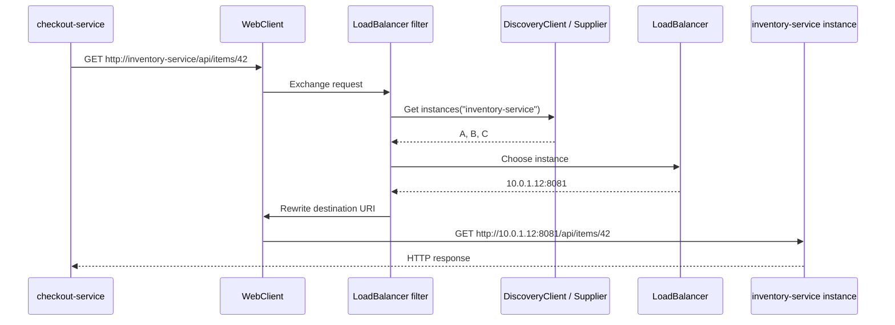

# Gọi tên dịch vụ bằng WebClient và bộ lọc cân bằng tải

Trong microservice, consumer nên gọi provider bằng tên dịch vụ logic như `inventory-service` thay vì ghi cứng IP và port của một instance. Spring Cloud LoadBalancer tích hợp với WebClient qua bộ lọc `ReactorLoadBalancerExchangeFilterFunction`: bộ lọc nhận URI có host là service ID, tìm danh sách instance từ service discovery, chọn một instance rồi chuyển request đến địa chỉ thật.

Để cơ chế này hoạt động, ứng dụng cần có discovery client tương ứng (Eureka, Consul hoặc provider khác), Spring Cloud LoadBalancer và một `WebClient.Builder` được đánh dấu `@LoadBalanced`. Một WebClient thông thường không tự hiểu service ID trong hostname.

## 1. Luồng gọi dịch vụ qua WebClient

Giả sử `checkout-service` cần gọi `inventory-service`, trong registry có ba instance:

| Service ID | Instance | Địa chỉ |
| --- | --- | --- |
| `inventory-service` | instance A | `10.0.1.11:8081` |
| `inventory-service` | instance B | `10.0.1.12:8081` |
| `inventory-service` | instance C | `10.0.2.21:8081` |

Consumer viết URL theo tên logic:

```text
http://inventory-service/api/items/42
```

Luồng xử lý:

1. `WebClient` nhận request có host là `inventory-service`.
2. `ReactorLoadBalancerExchangeFilterFunction` nhận ra request cần load balancing.
3. Spring Cloud LoadBalancer lấy danh sách `ServiceInstance` của service ID `inventory-service` từ `ServiceInstanceListSupplier`.
4. LoadBalancer chọn một instance theo chiến lược đã cấu hình.
5. Bộ lọc thay host và port trong request bằng địa chỉ của instance được chọn.
6. WebClient gửi HTTP request đến provider.



Consumer không cần biết instance cụ thể nào được chọn. Khi registry thay đổi, supplier có thể cung cấp danh sách mới và LoadBalancer tiếp tục chọn trong số instance khả dụng.

## 2. Chuẩn bị dependency

Consumer cần WebClient, discovery client và Spring Cloud LoadBalancer. Ví dụ với Eureka:

```xml
<dependencies>
    <dependency>
        <groupId>org.springframework.boot</groupId>
        <artifactId>spring-boot-starter-webflux</artifactId>
    </dependency>
    <dependency>
        <groupId>org.springframework.cloud</groupId>
        <artifactId>spring-cloud-starter-netflix-eureka-client</artifactId>
    </dependency>
    <dependency>
        <groupId>org.springframework.cloud</groupId>
        <artifactId>spring-cloud-starter-loadbalancer</artifactId>
    </dependency>
</dependencies>
```

Với Consul, thay Eureka starter bằng `spring-cloud-starter-consul-discovery`; giữ WebFlux và LoadBalancer. Cần import Spring Cloud BOM tương thích với phiên bản Spring Boot để các dependency dùng đúng release train.

`spring-boot-starter-webflux` cung cấp `WebClient` và Reactor. Nếu ứng dụng dùng Spring MVC nhưng muốn dùng WebClient cho HTTP outbound, có thể đưa WebFlux starter vào classpath; khi cả MVC và WebFlux cùng có mặt, Spring Boot thường chọn MVC làm web application type. Chỉ dùng WebFlux server khi ứng dụng thực sự muốn xử lý inbound request theo reactive stack.

## 3. Cấu hình discovery cho consumer

Ví dụ `checkout-service` dùng Eureka:

```yaml
spring:
  application:
    name: checkout-service

eureka:
  client:
    register-with-eureka: true
    fetch-registry: true
    service-url:
      defaultZone: ${EUREKA_SERVER_URL:http://localhost:8761/eureka/}
```

`fetch-registry: true` cho phép Eureka client tải danh sách service instance để discovery. `register-with-eureka` chỉ cần bật nếu `checkout-service` cũng muốn được service khác tìm thấy; nó không quyết định khả năng gọi outbound. Nếu consumer chỉ gọi service khác và không cung cấp API cho các service khác, có thể đặt `register-with-eureka: false`.

Với Consul, cấu hình tương ứng thường nằm dưới `spring.cloud.consul.discovery`:

```yaml
spring:
  application:
    name: checkout-service
  cloud:
    consul:
      host: ${CONSUL_HOST:localhost}
      port: ${CONSUL_PORT:8500}
      discovery:
        enabled: true
        register: true
```

Consumer cần truy cập được Consul agent và có quyền đọc service catalog/health theo ACL. Dù dùng Eureka hay Consul, LoadBalancer làm việc với abstraction `ServiceInstance` và service ID do discovery provider cung cấp.

## 4. Khai báo WebClient.Builder có LoadBalancer

Đây là phần cấu hình quan trọng nhất. Đánh dấu bean builder bằng `@LoadBalanced` để Spring Cloud cài filter phân giải service ID:

```java
package com.example.checkout.config;

import org.springframework.cloud.client.loadbalancer.LoadBalanced;
import org.springframework.context.annotation.Bean;
import org.springframework.context.annotation.Configuration;
import org.springframework.web.reactive.function.client.WebClient;

@Configuration
public class WebClientConfiguration {

    @Bean
    @LoadBalanced
    WebClient.Builder loadBalancedWebClientBuilder() {
        return WebClient.builder();
    }
}
```

`@LoadBalanced` là qualifier giúp Spring phân biệt builder dùng để gọi service ID. Spring Cloud LoadBalancer tự cấu hình `ReactorLoadBalancerExchangeFilterFunction` cho builder này. Không cần tự viết thuật toán chọn instance hoặc tự phân tích hostname trong URL.

Nếu ứng dụng đồng thời gọi URL cố định bên ngoài và gọi service ID nội bộ, có thể khai báo thêm một builder không có `@LoadBalanced`:

```java
@Bean
WebClient.Builder plainWebClientBuilder() {
    return WebClient.builder();
}
```

Sử dụng đúng builder theo mục đích. Builder thường không phân giải hostname theo registry; builder có `@LoadBalanced` mới xử lý service ID qua Spring Cloud LoadBalancer.

## 5. Gọi provider bằng service ID

Inject builder đã đánh dấu `@LoadBalanced`, sau đó build WebClient:

```java
package com.example.checkout.client;

import org.springframework.cloud.client.loadbalancer.LoadBalanced;
import org.springframework.stereotype.Component;
import org.springframework.web.reactive.function.client.WebClient;
import reactor.core.publisher.Mono;

@Component
public class InventoryClient {

    private final WebClient webClient;

    public InventoryClient(
            @LoadBalanced WebClient.Builder builder) {
        this.webClient = builder.build();
    }

    public Mono<ItemResponse> getItem(String itemId) {
        return webClient.get()
                .uri("http://inventory-service/api/items/{itemId}", itemId)
                .retrieve()
                .bodyToMono(ItemResponse.class);
    }
}
```

`inventory-service` trong URI là service ID, không phải DNS hostname. LoadBalancer chọn một instance rồi chuyển request đến host/port thực. Đường dẫn `/api/items/{itemId}` được giữ nguyên khi URI đích được thay thế.

Trong ví dụ, `ItemResponse` là DTO do ứng dụng định nghĩa. WebClient trả về `Mono<ItemResponse>` nên caller có thể compose với các thao tác reactive khác:

```java
public Mono<CheckoutView> prepareCheckout(String itemId) {
    return inventoryClient.getItem(itemId)
            .map(item -> new CheckoutView(item.id(), item.available()));
}
```

Nếu ứng dụng không dùng reactive end-to-end, có thể block ở ranh giới phù hợp của một luồng imperative, nhưng không nên gọi `.block()` trong event-loop thread của WebFlux vì có thể gây nghẽn hoặc lỗi runtime. Ưu tiên trả `Mono`/`Flux` xuyên suốt tầng reactive.

## 6. Bộ lọc cân bằng tải làm gì?

`ReactorLoadBalancerExchangeFilterFunction` là `ExchangeFilterFunction` tích hợp với WebClient. Nó tham gia chuỗi filter trước khi request được gửi qua connector HTTP.

Vai trò của filter:

- Nhận diện URI có host là service ID.
- Yêu cầu LoadBalancer chọn một `ServiceInstance` tương ứng.
- Tạo URI đích từ scheme, host và port của instance.
- Chuyển request đến URI đích bằng `ExchangeFunction` tiếp theo.
- Xử lý trường hợp không tìm được instance theo hành vi được cấu hình.

Khi không có instance phù hợp, Spring Cloud LoadBalancer mặc định thường trả `503 Service Unavailable`. Có thể cấu hình `spring.cloud.loadbalancer.use404=true` nếu muốn trường hợp không tìm thấy instance được biểu diễn thành `404 Not Found`; hãy cân nhắc semantics API và phiên bản đang dùng.

Không nên tự thay host của request bằng một địa chỉ lấy từ cache trong code nghiệp vụ nếu đã dùng LoadBalancer filter. Làm vậy tạo hai nơi chọn instance và dễ xung đột với retry, supplier hoặc health filtering.

### Phân biệt LoadBalancer filter và filter nghiệp vụ

WebClient hỗ trợ `ExchangeFilterFunction` cho các nhu cầu như correlation ID, authentication header, metrics hoặc logging. Những filter này không tự tìm instance.

| Filter | Trách nhiệm |
| --- | --- |
| `ReactorLoadBalancerExchangeFilterFunction` | Phân giải service ID và chọn instance |
| Correlation ID filter | Gắn request ID để theo dõi xuyên service |
| Authentication filter | Thêm access token hoặc header xác thực phù hợp |
| Logging/metrics filter | Ghi nhận thông tin request/response theo chính sách |
| Retry filter hoặc LoadBalancer retry integration | Thực hiện retry theo cấu hình và điều kiện an toàn |

Giữ filter nghiệp vụ tập trung và tránh ghi log token, dữ liệu cá nhân hoặc payload nhạy cảm. Không thêm một filter tự phân giải service ID song song với LoadBalancer filter.

## 7. Thêm ExchangeFilterFunction cho correlation ID

Ví dụ thêm correlation ID cho request đi ra:

```java
import java.util.UUID;

import org.springframework.context.annotation.Bean;
import org.springframework.context.annotation.Configuration;
import org.springframework.web.reactive.function.client.ClientRequest;
import org.springframework.web.reactive.function.client.ExchangeFilterFunction;
import reactor.core.publisher.Mono;

@Configuration
public class OutboundFilterConfiguration {

    @Bean
    ExchangeFilterFunction correlationIdFilter() {
        return ExchangeFilterFunction.ofRequestProcessor(request -> {
            ClientRequest updated = ClientRequest.from(request)
                    .headers(headers -> headers.set(
                            "X-Correlation-Id", UUID.randomUUID().toString()))
                    .build();
            return Mono.just(updated);
        });
    }
}
```

Có thể thêm filter này vào builder được đánh dấu `@LoadBalanced`:

```java
@Bean
@LoadBalanced
WebClient.Builder loadBalancedWebClientBuilder(
        ExchangeFilterFunction correlationIdFilter) {
    return WebClient.builder().filter(correlationIdFilter);
}
```

Spring Cloud tiếp tục bổ sung filter cân bằng tải cho builder đã được đánh dấu. Filter correlation ID chỉ bổ sung header; việc chọn instance vẫn do LoadBalancer đảm nhiệm.

Trong hệ thống có tracing, nên dùng trace context do Micrometer Tracing hoặc thư viện quan sát đang dùng quản lý thay vì tự sinh correlation ID độc lập cho mọi hop. Nếu nhận ID từ request inbound, cần kiểm tra/chuẩn hóa trước khi chuyển tiếp.

## 8. Thuật toán chọn instance

Sau khi nhận danh sách instance, LoadBalancer chọn một instance theo `ReactorLoadBalancer` được cấu hình cho service. Spring Cloud LoadBalancer thường dùng `RoundRobinLoadBalancer` làm mặc định: lần lượt chọn instance trong danh sách khả dụng.

Ví dụ ba instance A, B, C có thể được chọn theo chu kỳ:

```text
Request 1 -> A
Request 2 -> B
Request 3 -> C
Request 4 -> A
Request 5 -> B
```

Đây là mô tả đơn giản; nhiều consumer process có bộ đếm riêng, danh sách có thể thay đổi và một số instance có thể bị lọc. Vì vậy, không nên kỳ vọng thứ tự toàn hệ thống luôn là A-B-C chính xác.

LoadBalancer không mặc nhiên đảm bảo tải CPU, số request đang xử lý hoặc latency của các instance bằng nhau. Nếu cần chiến lược khác, có thể cấu hình một LoadBalancer implementation hoặc `ServiceInstanceListSupplier` phù hợp.

## 9. Tùy chỉnh chiến lược cho một service

Có thể dùng `@LoadBalancerClient` để chỉ định cấu hình LoadBalancer cho một service ID. Ví dụ chọn ngẫu nhiên thay vì round robin:

```java
import org.springframework.cloud.client.ServiceInstance;
import org.springframework.cloud.loadbalancer.annotation.LoadBalancerClient;
import org.springframework.cloud.loadbalancer.core.RandomLoadBalancer;
import org.springframework.cloud.loadbalancer.core.ReactorLoadBalancer;
import org.springframework.cloud.loadbalancer.core.ServiceInstanceListSupplier;
import org.springframework.cloud.loadbalancer.support.LoadBalancerClientFactory;
import org.springframework.context.annotation.Bean;
import org.springframework.core.env.Environment;
import org.springframework.boot.autoconfigure.SpringBootApplication;

@LoadBalancerClient(
        name = "inventory-service",
        configuration = InventoryLoadBalancerConfiguration.class
)
@SpringBootApplication
public class CheckoutApplication {
}

class InventoryLoadBalancerConfiguration {

    @Bean
    ReactorLoadBalancer<ServiceInstance> randomLoadBalancer(
            Environment environment,
            LoadBalancerClientFactory factory) {

        String serviceId = environment.getProperty(
                LoadBalancerClientFactory.PROPERTY_NAME);

        return new RandomLoadBalancer(
                factory.getLazyProvider(
                        serviceId, ServiceInstanceListSupplier.class),
                serviceId);
    }
}
```

Đây là ví dụ cấu hình theo service; API constructor và package có thể thay đổi theo phiên bản Spring Cloud. Cần dùng version tương thích với BOM của dự án.

Lớp `InventoryLoadBalancerConfiguration` không nên bị component scan như cấu hình mặc định toàn ứng dụng. Hãy đặt nó ngoài package scan của ứng dụng hoặc tổ chức package riêng, để cấu hình random chỉ áp dụng cho `inventory-service` theo `@LoadBalancerClient`.

Không chọn chiến lược ngẫu nhiên chỉ vì muốn phân tải. Hãy xác định yêu cầu thực tế: round robin đơn giản, random, ưu tiên zone gần, loại instance không khỏe, hoặc chính sách có trọng số. Mỗi chiến lược cần được kiểm tra với số lượng instance, cache và hành vi khi instance thay đổi.

## 10. Lọc instance theo zone hoặc health

LoadBalancer có thể dùng chuỗi `ServiceInstanceListSupplier` để lấy và biến đổi danh sách instance trước khi thuật toán chọn. Ví dụ, một supplier có thể:

- Lấy danh sách từ `DiscoveryClient`.
- Cache danh sách để giảm số lần truy vấn registry.
- Ưu tiên instance cùng zone với consumer.
- Lọc instance không phù hợp với metadata hoặc health policy.
- Áp dụng health check riêng nếu ứng dụng có endpoint và chính sách tương ứng.

Không nên lọc cứng chỉ còn một zone mà không có fallback. Nếu zone hiện tại không còn instance, consumer sẽ không tìm được đích dù các zone khác vẫn hoạt động. Chính sách thường dùng là ưu tiên local zone, sau đó fallback sang các zone khác.

Health của registry cũng có giới hạn. Một instance có thể được registry đánh dấu healthy nhưng request vẫn timeout do lỗi mạng hoặc lỗi ứng dụng xảy ra sau lần health check gần nhất. Kết hợp health filtering với timeout, circuit breaker và xử lý lỗi request.

## 11. Cấu hình theo từng service

`@LoadBalancerClient(name = "inventory-service", configuration = ...)` gắn một cấu hình riêng với service ID `inventory-service`. Đây là cách rõ ràng để thay đổi thuật toán hoặc chuỗi supplier cho một provider cụ thể mà không ảnh hưởng đến các service còn lại.

Tùy phiên bản Spring Cloud, một số thuộc tính như cache, health check và retry có thể được cấu hình bằng properties; những chính sách khác cần khai báo `ServiceInstanceListSupplier` hoặc `ReactorLoadBalancer` bean. Không sao chép tùy tiện tên property từ release train khác. Hãy kiểm tra reference của đúng phiên bản đang dùng và xác minh cấu hình hiệu lực trong test.

Nếu dùng `@LoadBalancerClient(name = "inventory-service", ...)`, tên trong annotation phải khớp chính xác với host/service ID trong URI `http://inventory-service/...` và service ID trong registry.

## 12. Xử lý lỗi khi gọi WebClient

Discovery và LoadBalancer giúp tìm địa chỉ, nhưng không bảo đảm request luôn thành công. Consumer vẫn phải xử lý:

- Không có instance: thường nhận `503 Service Unavailable` từ LoadBalancer.
- Provider trả lỗi HTTP: kiểm tra status và ánh xạ sang lỗi nghiệp vụ phù hợp.
- Timeout hoặc connection refused: instance có thể vừa dừng hoặc địa chỉ quảng bá không truy cập được.
- Lỗi decode response: DTO consumer không khớp schema response của provider.
- Registry/cache stale: danh sách instance chưa phản ánh thay đổi mới nhất.

Ví dụ xử lý status và timeout:

```java
import java.time.Duration;

public Mono<ItemResponse> getItem(String itemId) {
    return webClient.get()
            .uri("http://inventory-service/api/items/{itemId}", itemId)
            .retrieve()
            .onStatus(
                    status -> status.isError(),
                    response -> response.createException())
            .bodyToMono(ItemResponse.class)
            .timeout(Duration.ofSeconds(3));
}
```

`timeout` giới hạn thời gian chờ ở phía consumer. Hãy chọn timeout theo SLA của API và thời gian xử lý bình thường; timeout quá thấp gây lỗi giả, còn timeout quá cao giữ tài nguyên lâu khi provider đã gặp sự cố.

### Retry phải có điều kiện

Retry có thể hữu ích khi instance vừa bị loại khỏi registry hoặc lỗi mạng chỉ xảy ra tạm thời. Tuy nhiên:

- Chỉ retry số lần giới hạn và có backoff.
- Không retry vô điều kiện các request ghi hoặc thanh toán nếu chưa có idempotency key.
- Tránh retry ở nhiều tầng cùng lúc khiến số request tăng theo cấp số nhân.
- Kết hợp circuit breaker để ngừng gọi một dependency đang lỗi kéo dài.
- Ghi nhận instance/service ID và trace ID để điều tra.

## 13. Phân biệt URL service ID và URL cố định

| URL | Builder phù hợp | Cách xử lý |
| --- | --- | --- |
| `http://inventory-service/api/items` | `@LoadBalanced WebClient.Builder` | Host được xem là service ID và được LoadBalancer phân giải |
| `https://api.partner.example/v1/items` | WebClient builder thông thường | DNS/TLS kết nối trực tiếp đến host cố định |
| `http://localhost:8081/health` | WebClient builder thông thường | Kết nối trực tiếp đến localhost của process hiện tại |

Không dùng builder có LoadBalancer cho mọi URL một cách máy móc. Với host không phải service ID, builder thường có thể xử lý trực tiếp, nhưng nên tách client theo mục đích để cấu hình timeout, authentication và observability rõ ràng.

Ngược lại, nếu dùng builder thông thường cho `http://inventory-service`, WebClient sẽ cố phân giải `inventory-service` như hostname qua DNS. Nó không tự tra cứu Eureka hoặc Consul.

## 14. Kiểm tra hoạt động end-to-end

Một bài kiểm thử local có thể triển khai theo trình tự:

1. Khởi động Eureka Server hoặc Consul.
2. Khởi động hai hoặc ba instance `inventory-service` với cùng service ID nhưng port/instance ID khác nhau.
3. Kiểm tra các instance đã xuất hiện trong registry và địa chỉ quảng bá truy cập được.
4. Khởi động `checkout-service` với discovery client và LoadBalancer.
5. Gọi endpoint consumer có sử dụng WebClient.
6. Quan sát log provider để biết instance nào nhận request.
7. Dừng một provider và gọi lại để kiểm tra registry refresh và hành vi chọn instance.
8. Dừng toàn bộ provider và xác nhận consumer nhận lỗi phù hợp khi không còn instance.

Ví dụ chạy local:

```text
Eureka Server:       localhost:8761
inventory-service A: localhost:8081
inventory-service B: localhost:8083
checkout-service:    localhost:8082
```

Không thể đăng ký hai instance cùng một ID nếu muốn nhìn thấy chúng như hai bản chạy độc lập. Hãy đặt instance ID khác nhau, ví dụ `inventory-local-8081` và `inventory-local-8083`.

## 15. Lỗi thường gặp

| Triệu chứng | Nguyên nhân có thể | Cách kiểm tra và khắc phục |
| --- | --- | --- |
| `UnknownHostException: inventory-service` | WebClient không dùng builder `@LoadBalanced` | Inject đúng builder và kiểm tra bean qualifier |
| Không tìm thấy bean `WebClient.Builder` phù hợp | Thiếu WebFlux/WebClient hoặc cấu hình bean chưa có | Thêm WebFlux starter và khai báo builder |
| Không tìm thấy instance | Registry chưa có service, sai service ID hoặc fetch bị tắt | Kiểm tra dashboard/catalog, `spring.application.name` và fetch config |
| LoadBalancer trả 503 | Danh sách instance rỗng sau khi lọc hoặc registry chưa sẵn sàng | Kiểm tra supplier, health, zone filter và registry |
| Gọi được một instance nhưng instance khác timeout | Địa chỉ/port được quảng bá sai hoặc firewall không mở | Gọi trực tiếp từng URI từ network của consumer |
| Chỉ một instance nhận request | Trùng instance ID, cache chưa cập nhật hoặc chiến lược chọn | Kiểm tra registry, supplier cache và log LoadBalancer |
| `@LoadBalanced` không có tác dụng | Builder được tạo bằng `WebClient.create()` hoặc `WebClient.builder()` khác | Dùng builder bean đã đánh dấu `@LoadBalanced` |
| Filter correlation ID không chạy | Dùng WebClient khác hoặc filter không được gắn vào builder | Kiểm tra bean builder và chuỗi filter |
| Retry gây request trùng | Retry request không idempotent hoặc retry nhiều tầng | Dùng idempotency key và giới hạn retry tại một tầng |
| Cấu hình custom áp dụng cho mọi service | LoadBalancer config bị component scan toàn cục | Đặt cấu hình riêng ngoài package scan và gắn `@LoadBalancerClient` |

## 16. Bảo mật và quan sát

WebClient là điểm giao tiếp outbound nên cần áp dụng các nguyên tắc bảo mật và observability:

- Chỉ gọi service ID thuộc registry và namespace mà ứng dụng được phép truy cập.
- Không nhận tùy ý hostname/service ID từ input người dùng để tránh biến client thành đường SSRF.
- Truyền access token theo audience và scope phù hợp; không ghi token vào log.
- Dùng TLS khi service endpoint yêu cầu HTTPS và quản lý truststore/certificate đúng cách.
- Gắn trace/correlation context để theo dõi request qua nhiều service.
- Ghi nhận latency, status code, timeout, số lần retry và service ID.
- Không log toàn bộ payload hoặc header nhạy cảm.
- Giới hạn connection pool, timeout và concurrency theo tải dự kiến.

Khi LoadBalancer chọn một instance, log/trace nên giúp xác định service ID và instance đích mà không làm lộ dữ liệu nhạy cảm. Đây là thông tin hữu ích để điều tra sự cố registry stale hoặc một node cụ thể bị lỗi.

## 17. Checklist triển khai

- [ ] Có WebClient dependency và discovery client phù hợp.
- [ ] Có `spring-cloud-starter-loadbalancer` tương thích với Spring Cloud BOM.
- [ ] Khai báo `WebClient.Builder` với `@LoadBalanced`.
- [ ] Inject đúng builder vào client gọi service.
- [ ] Dùng service ID chính xác trong URI, ví dụ `http://inventory-service/...`.
- [ ] Xác nhận discovery trả về instance có host/port truy cập được.
- [ ] Hiểu LoadBalancer filter phân giải URI và chọn instance.
- [ ] Phân biệt filter cân bằng tải với filter correlation/auth/logging.
- [ ] Nếu tùy chỉnh thuật toán, giới hạn cấu hình theo đúng service ID.
- [ ] Có fallback zone/health phù hợp, không lọc cứng làm rỗng danh sách.
- [ ] Có timeout, xử lý status, retry có giới hạn và circuit breaker.
- [ ] Kiểm thử khi thêm/bớt instance và khi registry không có instance.
- [ ] Bảo vệ token, TLS, trace context và log outbound.

Gọi dịch vụ bằng WebClient và service ID giúp consumer tách khỏi địa chỉ vật lý của từng instance. `@LoadBalanced WebClient.Builder` kích hoạt bộ lọc Spring Cloud LoadBalancer để lấy danh sách instance, chọn đích và chuyển URI trước khi gửi request. Các filter WebClient khác có thể bổ sung tracing, authentication hoặc logging, còn chính sách chọn instance có thể tùy chỉnh theo từng service. Để lời gọi đáng tin cậy, vẫn cần kiểm soát health, timeout, retry, fallback và bảo mật ở tầng ứng dụng.
