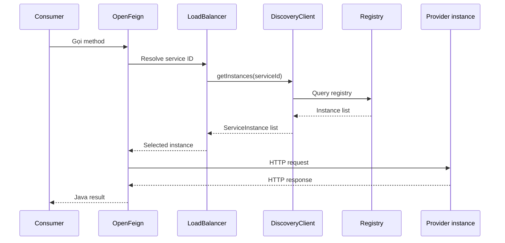

# OpenFeign dùng tên dịch vụ và sự khác biệt với URL cố định

Spring Cloud OpenFeign cho phép ứng dụng gọi HTTP API thông qua Java interface. Khi khai báo Feign client bằng tên dịch vụ và không chỉ định URL, Spring Cloud có thể dùng Service Discovery để tìm các instance đang hoạt động, sau đó Spring Cloud LoadBalancer chọn một instance cho request. Provider có thể tăng, giảm hoặc thay thế instance mà consumer không cần sửa IP.

Nếu khai báo URL cụ thể cho Feign client, request được gửi tới URL đó và bỏ qua việc chọn instance qua discovery/load balancing. Hai cách giải quyết hai nhu cầu khác nhau: tên dịch vụ phù hợp với microservice có instance động; URL cố định phù hợp với endpoint ổn định hoặc hệ thống bên ngoài.

## 1. Luồng gọi qua OpenFeign và Service Discovery

OpenFeign tạo implementation cho interface có annotation `@FeignClient`. Ứng dụng gọi method Java; Feign chuyển method, tham số và dữ liệu thành HTTP request, gửi request và chuyển response về kiểu Java đã khai báo.

Khi tích hợp Service Discovery, luồng gọi theo tên dịch vụ gồm:

1. Consumer gọi method trên Feign interface.
2. Feign tạo request và xác định tên client/service ID.
3. Spring Cloud LoadBalancer yêu cầu discovery integration lấy danh sách instance.
4. Discovery client đọc dữ liệu từ Eureka, Consul, ZooKeeper hoặc provider được cấu hình.
5. LoadBalancer chọn một instance phù hợp.
6. Request được gửi tới host và port của instance.
7. Response được chuyển lại cho method của Feign client.



Feign không tự duy trì danh sách instance. Discovery integration đảm nhiệm việc tìm instance; LoadBalancer đảm nhiệm việc chọn instance. Vì vậy, để gọi theo service ID, dự án cần discovery client tương ứng và Spring Cloud LoadBalancer.

## 2. Thêm dependency và bật Feign clients

Trong Maven, thêm OpenFeign starter:

```xml
<dependency>
    <groupId>org.springframework.cloud</groupId>
    <artifactId>spring-cloud-starter-openfeign</artifactId>
</dependency>
```

Để Feign gọi theo service ID, cần Spring Cloud LoadBalancer nếu dependency graph hiện tại chưa có:

```xml
<dependency>
    <groupId>org.springframework.cloud</groupId>
    <artifactId>spring-cloud-starter-loadbalancer</artifactId>
</dependency>
```

Provider và consumer cần discovery integration phù hợp, ví dụ Eureka Discovery Client, Consul Discovery hoặc Zookeeper Discovery. Quản lý phiên bản Spring Cloud bằng BOM tương thích với phiên bản Spring Boot; không tự chọn phiên bản starter riêng lẻ.

Bật Feign client trong ứng dụng:

```java
import org.springframework.boot.SpringApplication;
import org.springframework.boot.autoconfigure.SpringBootApplication;
import org.springframework.cloud.openfeign.EnableFeignClients;

@SpringBootApplication
@EnableFeignClients
public class OrderApplication {

    public static void main(String[] args) {
        SpringApplication.run(OrderApplication.class, args);
    }
}
```

Nếu interface nằm ngoài package component scan mặc định, chỉ rõ package:

```java
@EnableFeignClients(basePackages = "com.example.clients")
@SpringBootApplication
public class OrderApplication {
    // ...
}
```

## 3. Gọi theo tên dịch vụ: không khai báo URL

Giả sử `order-service` cần gọi API của `inventory-service`. Khai báo Feign interface:

```java
import org.springframework.cloud.openfeign.FeignClient;
import org.springframework.web.bind.annotation.GetMapping;
import org.springframework.web.bind.annotation.PathVariable;

@FeignClient(name = "inventory-service")
public interface InventoryClient {

    @GetMapping("/api/items/{itemId}")
    ItemResponse getItem(@PathVariable("itemId") String itemId);
}
```

Inject client vào service nghiệp vụ:

```java
import org.springframework.stereotype.Service;

@Service
public class OrderService {

    private final InventoryClient inventoryClient;

    public OrderService(InventoryClient inventoryClient) {
        this.inventoryClient = inventoryClient;
    }

    public ItemResponse checkItem(String itemId) {
        return inventoryClient.getItem(itemId);
    }
}
```

`name = "inventory-service"` là service ID. Không có thuộc tính `url`, vì vậy Spring Cloud OpenFeign có thể tạo client dùng LoadBalancer để tìm instance theo tên này.

Provider đăng ký cùng service ID:

```yaml
spring:
  application:
    name: inventory-service

server:
  port: 8081
```

Consumer phải kết nối được tới registry mà provider đăng ký. Ví dụ với Eureka:

```yaml
eureka:
  client:
    service-url:
      defaultZone: http://localhost:8761/eureka/
```

Với Consul hoặc ZooKeeper, cấu hình connect string và discovery settings theo provider. Tên trong `@FeignClient` phải khớp tên được công bố trong registry.

### Nhiều instance cùng service ID

Giả sử registry công bố:

| Service ID | Host | Port |
|---|---|---:|
| inventory-service | 10.0.1.21 | 8081 |
| inventory-service | 10.0.1.22 | 8081 |
| inventory-service | 10.0.1.23 | 8081 |

Feign client vẫn khai báo duy nhất `@FeignClient(name = "inventory-service")`. LoadBalancer chọn một instance từ danh sách discovery trả về theo chiến lược đang cấu hình. Khi thêm instance thứ tư, consumer không cần thay đổi interface hay sửa URL.

Service ID là tên logic, không phải hostname DNS hay IP. Trong cách gọi có LoadBalancer, `inventory-service` được giải quyết thông qua discovery integration của Spring Cloud.

## 4. Phân biệt name, contextId và url

| Thuộc tính | Ý nghĩa |
|---|---|
| `name` | Tên dịch vụ/client, thường là service ID khi dùng LoadBalancer |
| `contextId` | Định danh cấu hình riêng của Feign client trong application context |
| `url` | Địa chỉ đích cố định; khi được đặt, client không dùng LoadBalancer để tìm instance |
| `path` | Tiền tố path được ghép vào mapping của interface |
| `configuration` | Class cấu hình encoder, decoder, contract, logger hoặc thành phần client |

Ví dụ hai client gọi cùng service nhưng có cấu hình riêng:

```java
@FeignClient(
    name = "inventory-service",
    contextId = "inventoryReadClient"
)
public interface InventoryReadClient {
    // Read operations
}

@FeignClient(
    name = "inventory-service",
    contextId = "inventoryAdminClient"
)
public interface InventoryAdminClient {
    // Administrative operations
}
```

Hai client cùng dùng service ID `inventory-service` nhưng có `contextId` khác nhau để phân biệt cấu hình và bean. `contextId` không phải service ID mà registry lưu.

Ở các phiên bản hiện đại, nên dùng thuộc tính `name`. Thuộc tính cũ `serviceId` đã được thay thế/deprecated trong các phiên bản Spring Cloud OpenFeign; hãy theo API của release train dự án đang sử dụng.

## 5. Gọi bằng URL cố định

Nếu Feign client khai báo URL, request được gửi trực tiếp tới endpoint đó:

```java
@FeignClient(
    name = "inventoryClient",
    url = "http://inventory.internal.example:8081"
)
public interface InventoryFixedUrlClient {

    @GetMapping("/api/items/{itemId}")
    ItemResponse getItem(@PathVariable("itemId") String itemId);
}
```

Có thể đặt URL trong cấu hình thay vì hard-code:

```yaml
clients:
  inventory:
    url: http://inventory.internal.example:8081
```

Có thể tham chiếu property trực tiếp trên annotation:

```java
@FeignClient(
    name = "inventoryFixedClient",
    url = "${clients.inventory.url}"
)
public interface InventoryFixedUrlClient {
    // ...
}
```

Sau đó truyền property URL vào thuộc tính `url` của annotation theo placeholder Spring hoặc cấu hình URL cho Feign client theo tên client. Khi URL được đặt, `name` vẫn định danh Feign client, nhưng URL là đích gọi thực tế. OpenFeign không yêu cầu LoadBalancer chọn instance cho client đã có URL.

URL cố định phù hợp khi:

- Gọi API của đối tác hoặc dịch vụ SaaS có endpoint do nhà cung cấp công bố.
- Gọi gateway hoặc load balancer có hostname ổn định.
- Một dịch vụ chỉ có một endpoint được quản lý ngoài registry.
- Viết integration test cần trỏ tới mock server.
- Cần tạm thời gọi một endpoint cụ thể để chẩn đoán.

Không nên dùng URL cố định trỏ tới IP của pod/container có vòng đời ngắn. Khi instance bị thay thế hoặc địa chỉ thay đổi, consumer phải cập nhật cấu hình và triển khai lại hoặc refresh cấu hình theo cơ chế riêng.

## 6. So sánh cách chọn đích

| Tiêu chí | Feign dùng service name | Feign dùng URL cố định |
|---|---|---|
| Khai báo | `@FeignClient(name = "inventory-service")` | `@FeignClient(name = "inventoryClient", url = "...")` |
| Discovery lookup | Có, qua discovery integration | Không |
| LoadBalancer | Chọn instance theo service ID | Không chọn instance qua Spring Cloud LoadBalancer |
| Nhiều replica | Chọn trong danh sách instance | URL tự chịu trách nhiệm phân phối hoặc chỉ tới một đích |
| Thay đổi IP/port instance | Registry cập nhật, consumer tra cứu theo discovery | Phải cập nhật endpoint nếu URL thay đổi |
| Metadata và lọc instance | Có thể dùng qua discovery/LoadBalancer integration | Không có danh sách instance từ registry để lọc |
| Phụ thuộc registry | Có | Không |
| Phù hợp | Microservice nội bộ có instance động | API ngoài, gateway hoặc endpoint ổn định |

URL cố định không nhất thiết có nghĩa chỉ có một backend. URL đó có thể trỏ tới load balancer hoặc reverse proxy đang phân phối tới nhiều server. Điểm khác biệt là việc phân phối được thực hiện ở hạ tầng đằng sau URL, thay vì Spring Cloud LoadBalancer chọn từng instance từ registry.

## 7. Cấu hình theo tên client

Spring Cloud OpenFeign hỗ trợ cấu hình client theo tên. Ví dụ đặt timeout cho client dùng service ID:

```yaml
spring:
  cloud:
    openfeign:
      client:
        config:
          inventory-service:
            connectTimeout: 2000
            readTimeout: 3000
```

Với client URL cố định, có thể đặt URL và timeout theo tên client:

```yaml
spring:
  cloud:
    openfeign:
      client:
        config:
          inventoryFixedClient:
            url: http://inventory.internal.example:8081
            connectTimeout: 2000
            readTimeout: 3000
```

Khi URL được đặt qua thuộc tính cấu hình, Feign client cũng gọi endpoint cố định và không sử dụng LoadBalancer để chọn instance. Nếu URL được khai báo trực tiếp trên annotation, URL trong annotation được ưu tiên theo quy tắc cấu hình của Spring Cloud OpenFeign. Tránh đặt hai giá trị khác nhau khiến người vận hành khó xác định đích thực tế.

Tên key cấu hình client cần khớp với tên client mà OpenFeign nhận diện trong phiên bản đang dùng. Khi nhiều client dùng chung service name nhưng contextId khác nhau, hãy kiểm tra quy tắc đặt tên cấu hình và tách cấu hình khi cần.

## 8. Fallback, timeout và lỗi không tìm thấy instance

Dùng service name giúp thay đổi instance linh hoạt, nhưng không bảo đảm request luôn thành công. Những lỗi vẫn có thể xảy ra:

- Registry chưa có instance hoặc consumer chưa refresh dữ liệu.
- Tất cả instance đều không healthy.
- Host/port được đăng ký nhưng không thể truy cập từ consumer.
- Instance bị dừng sau khi LoadBalancer đã chọn.
- Provider phản hồi chậm hoặc lỗi HTTP.
- Network hoặc TLS gặp vấn đề.

Đặt connect timeout và read timeout phù hợp với SLA. Retry nên có giới hạn và chỉ áp dụng khi request có thể retry an toàn; với thao tác tạo thanh toán hoặc tạo đơn hàng, retry mù có thể gây thực hiện nghiệp vụ trùng lặp. Dùng idempotency key hoặc cơ chế chống xử lý lặp nếu cần.

Có thể khai báo fallback với circuit breaker khi dự án đã tích hợp Spring Cloud CircuitBreaker và cấu hình OpenFeign tương ứng. Fallback cần biểu diễn lỗi rõ ràng, không nên trả dữ liệu giả như thể request thành công.

Ví dụ bật hỗ trợ circuit breaker cho OpenFeign:

```yaml
spring:
  cloud:
    openfeign:
      circuitbreaker:
        enabled: true
```

Cấu hình trên chỉ có tác dụng khi dependency CircuitBreaker implementation phù hợp đã có trong dự án. Việc khai báo fallback/fallbackFactory và chính sách circuit breaker cần được thiết kế theo nghiệp vụ, không thay thế việc xử lý lỗi discovery hoặc cấu hình timeout.

## 9. Chuyển từ URL cố định sang service name

Một ứng dụng ban đầu có thể gọi provider bằng URL:

```java
@FeignClient(
    name = "inventoryClient",
    url = "http://localhost:8081"
)
public interface InventoryClient {
    // ...
}
```

Khi chuyển sang discovery, thay client bằng service ID:

```java
@FeignClient(name = "inventory-service")
public interface InventoryClient {
    // ...
}
```

Sau đó cần:

1. Bật discovery client phù hợp trong consumer.
2. Bảo đảm provider đăng ký dưới service ID `inventory-service`.
3. Thêm Spring Cloud LoadBalancer nếu chưa có.
4. Xóa URL cố định khỏi annotation hoặc cấu hình client.
5. Kiểm tra consumer nhận được instance qua DiscoveryClient.
6. Kiểm tra request qua Feign được định tuyến tới các instance.
7. Kiểm thử trường hợp registry chưa có instance và instance bị rút khỏi registry.

Chỉ đổi annotation từ URL sang name là chưa đủ nếu consumer chưa kết nối registry hoặc chưa có LoadBalancer. Ngược lại, khi vẫn còn URL trong cấu hình properties, client có thể tiếp tục gọi URL cố định dù annotation không còn URL; hãy kiểm tra cả hai nguồn cấu hình.

## 10. Lỗi thường gặp và cách xử lý

| Hiện tượng | Nguyên nhân có thể | Hướng xử lý |
|---|---|---|
| Không tạo được Feign bean | Chưa bật `@EnableFeignClients` hoặc package scan sai | Kiểm tra cấu hình và vị trí interface |
| Không có Feign load-balancing client | Thiếu Spring Cloud LoadBalancer hoặc discovery integration | Kiểm tra dependency và auto-configuration |
| Lỗi `No instances available` | Sai service ID, provider chưa đăng ký hoặc registry chưa có instance healthy | Đối chiếu tên trong registry và DiscoveryClient |
| Feign vẫn gọi endpoint cũ | URL còn trong annotation hoặc client properties | Kiểm tra `url` ở cả hai nguồn cấu hình |
| Gọi sai host/port | Provider công bố địa chỉ không truy cập được | Kiểm tra host, port và network từ consumer |
| Client gọi service name như hostname DNS | Dùng Feign thường hoặc URL cố định thay vì load-balanced client | Kiểm tra `@FeignClient` không có URL và dependency LoadBalancer |
| Timeout khi provider chậm | Connect/read timeout không phù hợp | Cấu hình timeout theo SLA và theo dõi latency |
| Fallback che mất lỗi thật | Fallback trả kết quả mặc định mà không ghi nhận nguyên nhân | Log/metric lỗi và phân biệt degraded response với thành công |
| Retry tạo giao dịch trùng | Retry thao tác không idempotent | Thiết kế idempotency và giới hạn retry |

Khi debug, hãy kiểm tra theo thứ tự: Feign bean đã được tạo chưa, client đang dùng URL hay service ID, LoadBalancer có tồn tại không, discovery client có trả instance không, và địa chỉ instance có kết nối được không.

## 11. Checklist chọn cách khai báo Feign client

Dùng service name khi:

1. Provider là microservice nội bộ đã đăng ký với Eureka, Consul, ZooKeeper hoặc discovery provider tương ứng.
2. Có thể chạy nhiều instance hoặc địa chỉ instance thay đổi theo triển khai.
3. Consumer cần LoadBalancer chọn instance.
4. Muốn dùng metadata hoặc chính sách chọn instance ở tầng ứng dụng.

Dùng URL cố định khi:

1. Endpoint do đối tác hoặc nền tảng bên ngoài cung cấp.
2. URL trỏ tới gateway/load balancer ổn định.
3. Integration test cần mock server hoặc endpoint cụ thể.
4. Không cần discovery lookup và client-side load balancing.

Trước khi phát hành, kiểm tra service ID, discovery registration, LoadBalancer dependency, URL override, timeout, retry và cách xử lý khi không có instance. OpenFeign giúp mã gọi HTTP gọn qua interface; lựa chọn giữa service name và URL quyết định ai chịu trách nhiệm tìm và chọn đích. Với microservice có instance động, service name kết hợp DiscoveryClient và LoadBalancer giúp consumer tách khỏi địa chỉ từng máy. Với endpoint ổn định hoặc bên ngoài, URL cố định thường đơn giản và dễ kiểm soát hơn.
