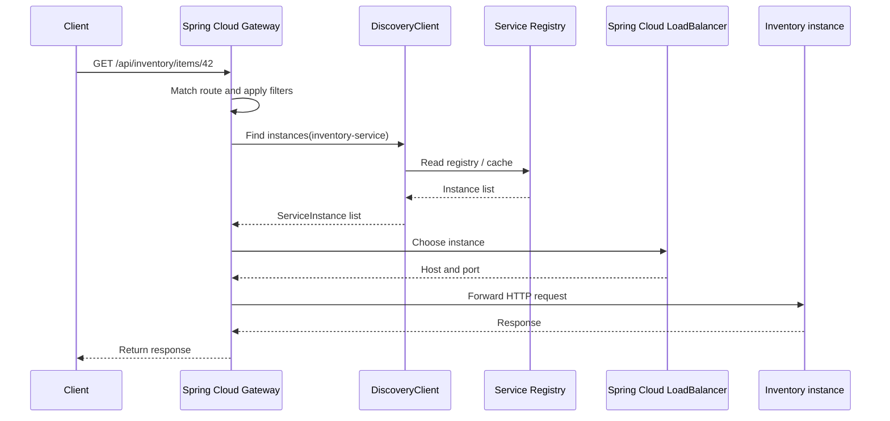

# Tích hợp Gateway với lb:// và giới hạn của tự tạo route từ discovery

Spring Cloud Gateway có thể định tuyến request tới microservice bằng service ID thay vì địa chỉ IP cố định. Khi route dùng URI `lb://inventory-service`, Gateway phối hợp với Spring Cloud LoadBalancer và discovery client để tìm một instance của `inventory-service`, chọn instance rồi chuyển tiếp request.

Gateway cũng có thể tự tạo route từ các service được đăng ký trong registry thông qua Discovery Locator. Tính năng này tiện khi hệ thống có nhiều service hoặc thay đổi thường xuyên, nhưng có thể làm lộ những service nội bộ nếu mọi service đăng ký đều tự động trở thành route có thể truy cập. Vì vậy, cần hiểu rõ sự khác nhau giữa route khai báo tường minh và route tự sinh, đồng thời kiểm soát danh sách service được phép công khai.

## Gateway, discovery và LoadBalancer phối hợp thế nào?

Ba thành phần có trách nhiệm riêng:

| Thành phần | Trách nhiệm |
|---|---|
| Spring Cloud Gateway | Nhận request, khớp route, chạy predicate/filter và chuyển tiếp tới upstream |
| DiscoveryClient | Tra cứu các instance đã đăng ký theo service ID |
| Spring Cloud LoadBalancer | Chọn một instance trong danh sách discovery trả về |

Với URI `lb://inventory-service`, Gateway hiểu `inventory-service` là service ID. LoadBalancer lấy danh sách instance từ discovery integration như Eureka, Consul hoặc ZooKeeper. Sau khi chọn một instance, Gateway gửi request tới host/port thực tế của instance đó.



`lb://` là scheme dành cho tích hợp load balancing. Nó không phải URL mà trình duyệt hoặc DNS có thể tự truy cập. URI `http://10.0.1.12:8080` trỏ trực tiếp tới một địa chỉ cụ thể; URI `lb://inventory-service` yêu cầu Gateway phân giải service ID khi xử lý request.

## Dependency cần thiết

Ứng dụng Gateway cần Spring Cloud Gateway, Spring Cloud LoadBalancer và một discovery integration nếu muốn tra cứu registry thật. Quản lý phiên bản bằng Spring Cloud BOM tương thích với Spring Boot.

Ví dụ các dependency Maven thường dùng trong ứng dụng Gateway WebFlux:

```xml
<dependency>
    <groupId>org.springframework.cloud</groupId>
    <artifactId>spring-cloud-starter-gateway</artifactId>
</dependency>
<dependency>
    <groupId>org.springframework.cloud</groupId>
    <artifactId>spring-cloud-starter-loadbalancer</artifactId>
</dependency>
<dependency>
    <groupId>org.springframework.cloud</groupId>
    <artifactId>spring-cloud-starter-netflix-eureka-client</artifactId>
</dependency>
```

Nếu dùng Consul hoặc ZooKeeper, thay Eureka starter bằng discovery starter tương ứng. Gateway cần một `DiscoveryClient` hoạt động để lấy instance. Nếu chỉ dùng URI cố định, không cần discovery cho route đó; tuy nhiên route `lb://` cần tích hợp LoadBalancer.

Các ví dụ YAML bên dưới dùng cấu hình Spring Cloud Gateway WebFlux phổ biến. Tên property và starter có thể khác giữa Gateway WebFlux, Gateway Server MVC và các release train; hãy đối chiếu tài liệu đúng phiên bản dự án.

## Khai báo route tường minh với lb://

Với route tường minh, nhóm phát triển chủ động quyết định path công khai, service ID đích, predicate để khớp request và filter để sửa path hoặc header.

Ví dụ route tới `inventory-service`:

```yaml
spring:
  cloud:
    gateway:
      routes:
        - id: inventory-api
          uri: lb://inventory-service
          predicates:
            - Path=/api/inventory/**
          filters:
            - StripPrefix=2
```

Request `GET /api/inventory/items/42` khớp predicate `Path=/api/inventory/**`. Filter `StripPrefix=2` bỏ hai segment `/api` và `/inventory`, vì vậy upstream nhận path `/items/42`.

Nếu upstream cần nhận `/inventory/items/42`, chỉ bỏ segment `/api` bằng `StripPrefix=1`. Nếu upstream cần một cấu trúc path khác, dùng `RewritePath` với biểu thức phù hợp. Cần xác minh path sau filter bằng integration test để tránh lỗi 404 do Gateway gửi sai đường dẫn.

Route có thể bổ sung filter theo yêu cầu:

```yaml
spring:
  cloud:
    gateway:
      routes:
        - id: inventory-api
          uri: lb://inventory-service
          predicates:
            - Path=/api/inventory/**
            - Method=GET,POST
          filters:
            - StripPrefix=2
            - AddRequestHeader=X-Gateway-Source, public-api
```

`Method=GET,POST` giới hạn method khớp route. `AddRequestHeader` thêm header vào request upstream. Header do client tự gửi không nên được tin cậy nếu có ý nghĩa bảo mật; Gateway cần xóa hoặc ghi đè các header nhạy cảm trước khi chuyển tiếp.

### Định tuyến nhiều service

Các route tường minh có thể khai báo nhiều service với path công khai khác nhau:

```yaml
spring:
  cloud:
    gateway:
      routes:
        - id: inventory-api
          uri: lb://inventory-service
          predicates:
            - Path=/api/inventory/**
          filters:
            - StripPrefix=2
        - id: order-api
          uri: lb://order-service
          predicates:
            - Path=/api/orders/**
          filters:
            - StripPrefix=1
```

Route `inventory-api` và `order-api` có ID riêng, dễ review, kiểm thử và áp dụng chính sách khác nhau. Đây thường là lựa chọn phù hợp cho API công khai vì danh sách endpoint được kiểm soát trong cấu hình hoặc mã nguồn.

## Discovery Locator tự tạo route

Spring Cloud Gateway có Discovery Locator để tạo route dựa trên các service mà `DiscoveryClient` nhìn thấy. Tính năng này thường bị tắt mặc định và được bật bằng cấu hình:

```yaml
spring:
  cloud:
    gateway:
      discovery:
        locator:
          enabled: true
          lower-case-service-id: true
```

Khi được bật, Gateway duyệt các service ID do discovery client cung cấp và tạo route cho từng service thỏa điều kiện. Cấu hình mặc định phổ biến tạo URI dạng `lb://<serviceId>`, predicate `Path=/<serviceId>/**` và filter `RewritePath` để bỏ prefix service ID trước khi chuyển request tới upstream.

Ví dụ service ID là `inventory-service`, route tự sinh thường nhận path như `/inventory-service/**` và chuyển tiếp tới `inventory-service` sau khi bỏ prefix. Chi tiết route ID, biểu thức predicate/filter và cách chuẩn hóa chữ hoa/thường phụ thuộc phiên bản Gateway.

`lower-case-service-id: true` hữu ích khi registry trả service ID viết hoa, chẳng hạn một số cấu hình Eureka, nhưng cần bảo đảm path mà client gọi dùng cùng quy ước chữ thường.

### Kiểm tra route tự sinh

Trong môi trường phát triển, có thể xem danh sách route qua endpoint Actuator Gateway nếu ứng dụng đã cấu hình endpoint tương ứng. Endpoint quản trị này có thể tiết lộ service ID, predicate, URI và filter nội bộ; chỉ expose trên mạng quản trị được bảo vệ.

Khi kiểm tra, xác nhận DiscoveryClient trả đúng service ID; route tự sinh có URI `lb://` đúng; predicate khớp path; RewritePath loại đúng prefix; LoadBalancer có instance để chọn; upstream nhận đúng path.

## Giới hạn của route tự sinh

Discovery Locator tạo route từ dữ liệu đăng ký, nhưng registry không phải danh sách API công khai. Mọi service xuất hiện trong registry không đồng nghĩa đều nên được expose qua Gateway.

### Có thể vô tình công khai service nội bộ

Nếu bật locator mà không giới hạn, service như `admin-service`, `internal-report-worker` hoặc `debug-service` có thể trở thành route. Nếu Gateway nằm ở mạng public và không có lớp bảo vệ đầy đủ, người dùng bên ngoài có thể thử gọi những service vốn chỉ dành cho traffic nội bộ.

Registry thường được thiết kế để các workload nội bộ tìm nhau. Nó không nhất thiết lưu thông tin phân loại public/private, quyền của người dùng hoặc API nào được phép công khai. Vì vậy, tự tạo route từ toàn bộ registry có thể vượt quá ranh giới bảo mật mà nhóm mong muốn.

### Không mô tả đầy đủ API contract

Discovery biết service ID, host, port và metadata. Nó không tự hiểu endpoint nghiệp vụ, phiên bản API, phương thức HTTP, schema request/response hoặc quy tắc phân quyền. Một route tới service không đồng nghĩa mọi path trên service đều là API hợp lệ.

### Route có thể thay đổi theo trạng thái registry

Khi service đăng ký, hủy đăng ký hoặc đổi service ID, tập route tự sinh có thể thay đổi theo discovery. Điều này tiện cho môi trường động nhưng làm khó việc review thay đổi API công khai, tài liệu hóa contract và kiểm soát tương thích giữa các client.

### Không thay thế xác thực và phân quyền

Discovery Locator chỉ tạo route; nó không tự xác thực người dùng hoặc quyết định người dùng được gọi API nào. Cần cấu hình Spring Security, OAuth2 Resource Server hoặc cơ chế xác thực phù hợp, cùng authorization theo route/API. Không coi việc service không được đăng ký là biện pháp bảo mật duy nhất.

### Có thể gây nhầm lẫn về path

Prefix mặc định chứa service ID và filter rewrite path có thể khác với URL công khai mà frontend mong muốn. Khi có nhiều service, path có thể không nhất quán hoặc làm lộ tên nội bộ. Route tường minh cho phép thiết kế API path ổn định độc lập với service ID.

### Phụ thuộc chất lượng registry và metadata

Route tự sinh chỉ tốt khi dữ liệu discovery đúng. Service ID sai, metadata thiếu, instance stale hoặc registry cache chưa cập nhật có thể khiến route tồn tại nhưng không có instance dùng được, hoặc route trỏ sai upstream.

## Giới hạn exposure bằng include-expression

Khi thực sự cần Discovery Locator, có thể giới hạn những service được tạo route bằng thuộc tính `include-expression`. Biểu thức SpEL được đánh giá trên service instance mà Discovery Locator nhận được; cú pháp và context cần xác minh theo phiên bản Gateway.

Có thể dùng allowlist service ID hoặc metadata được quản lý bởi quy trình đăng ký để chỉ tạo route cho những service được phép công khai. Ví dụ, chỉ chấp nhận service ID có tiền tố `public-`; biểu thức cụ thể cần được kiểm thử với dữ liệu `ServiceInstance` thực tế.

Chỉ pipeline đáng tin cậy mới nên có quyền ghi metadata đánh dấu service public. Nếu mọi workload đều có thể tự gắn metadata đó, bộ lọc route generation sẽ không tạo được ranh giới tin cậy.

`include-expression` là bộ lọc route generation, không phải authorization cho request. Ngay cả service được phép tạo route vẫn cần xác thực, phân quyền và kiểm tra path/API.

Nếu danh sách public API nhỏ và ổn định, route tường minh thường dễ kiểm soát hơn một biểu thức động.

## Route tường minh và route tự sinh: chọn cách nào?

| Tiêu chí | Route tường minh | Discovery Locator |
|---|---|---|
| Nguồn route | Cấu hình do nhóm quản lý | Danh sách service từ DiscoveryClient |
| Kiểm soát public path | Rõ ràng, có thể thiết kế độc lập service ID | Thường dựa trên service ID và default rewrite |
| Review thay đổi | Thấy được trong cấu hình/mã nguồn | Route thay đổi theo registry runtime |
| Phù hợp | API public, yêu cầu bảo mật và contract rõ | Lab, hệ thống nội bộ có kiểm soát hoặc môi trường service biến động mạnh |
| Rủi ro | Cần cập nhật cấu hình khi thêm route | Có thể expose service ngoài ý muốn hoặc tạo route không phù hợp |
| Tùy biến policy theo route | Dễ áp dụng filter/predicate riêng | Cấu hình chung hoặc biểu thức áp dụng cho nhiều route |

Có thể kết hợp cả hai: dùng route tường minh cho API public và locator giới hạn cho một nhóm service nội bộ. Tuy nhiên, cần tránh để hai route cùng khớp một path với thứ tự ưu tiên không rõ ràng. Hãy xem route thực tế trong Gateway actuator và viết test cho các path quan trọng.

## Bảo mật Gateway khi dùng lb://

Gateway thường là ranh giới nhận traffic từ bên ngoài. Khi route tới service nội bộ, cần bảo đảm các lớp bảo vệ:

- **Authentication:** xác minh danh tính người dùng hoặc client, ví dụ OAuth2/JWT.
- **Authorization:** kiểm tra scope/role/permission cho từng nhóm API.
- **Network policy:** chỉ cho Gateway truy cập các upstream cần thiết; hạn chế client bên ngoài gọi trực tiếp service nội bộ.
- **Header hygiene:** loại bỏ header giả mạo từ client và chỉ chuyển tiếp header đã được Gateway xác thực/tạo.
- **Rate limiting:** giới hạn lưu lượng theo client, user hoặc API khi phù hợp.
- **TLS:** mã hóa kết nối ở ranh giới public và giữa Gateway với upstream theo yêu cầu hệ thống.
- **Observability:** ghi correlation ID, route ID, service ID, status và latency; tránh ghi token hoặc dữ liệu nhạy cảm.

Ví dụ một route có filter giới hạn tốc độ có thể dùng Redis rate limiter hoặc cơ chế phù hợp của Gateway. Cấu hình chi tiết phụ thuộc cách định danh người dùng và backend limiter; không nên sao chép một key resolver mặc định mà chưa xác định chính sách quota.

Không nên dùng `include-expression` như lớp bảo vệ duy nhất. Route được tạo hay không tạo là quyết định cấu hình; quyền truy cập cần được kiểm tra trên mỗi request.

## Xử lý khi service không có instance

Route `lb://inventory-service` có thể tồn tại trong khi service chưa có instance passing hoặc registry đang lỗi. Khi đó, LoadBalancer không tìm được đích và Gateway trả lỗi upstream. Theo cấu hình phổ biến, trạng thái mặc định là `503 Service Unavailable`; Gateway có tùy chọn đổi trường hợp không có instance thành `404` trong một số phiên bản.

Đừng nhầm hai tình huống:

- **Không có route:** request không khớp route nào; Gateway thường trả `404 Not Found`.
- **Có route nhưng không có instance:** route `lb://` khớp nhưng LoadBalancer không tìm được instance; thường trả `503 Service Unavailable`.

Có thể xử lý lỗi bằng global error handling, fallback route hoặc circuit breaker khi phù hợp. Không nên fallback âm thầm tới một service khác nếu hai service không có cùng contract.

## Quan sát và chẩn đoán

Khi request không tới được upstream, kiểm tra theo thứ tự:

1. Route có tồn tại và được bật không?
2. Predicate có khớp request path, host và method không?
3. URI route có đúng `lb://<serviceId>` không?
4. DiscoveryClient có trả instance cho service ID đó không?
5. LoadBalancer có chọn được instance không?
6. Gateway có rewrite path đúng không?
7. Host/port instance có truy cập được từ network của Gateway không?
8. Upstream có trả response hoặc từ chối request vì authentication/authorization không?

Bật log có kiểm soát cho Gateway route matching, LoadBalancer và discovery client trong môi trường test. Actuator Gateway có thể hỗ trợ xem route; chỉ mở endpoint này trên mạng quản trị được bảo vệ. Metrics hữu ích gồm request count theo route, response status, latency upstream, lỗi no-instance và số instance được discovery trả về.

## Kiểm thử route lb://

Có thể xây dựng bài test với hai instance giả lập của `inventory-service` và một Gateway:

1. Đăng ký hoặc cấu hình hai instance của `inventory-service` trong registry/test discovery client.
2. Khai báo route `uri: lb://inventory-service` với path công khai cụ thể.
3. Gửi request tới Gateway và xác nhận một trong hai instance nhận request.
4. Kiểm tra upstream nhận đúng path sau `StripPrefix` hoặc `RewritePath`.
5. Dừng một instance và xác nhận request tiếp tục tới instance còn lại sau khi discovery/health cache cập nhật.
6. Xóa hết instance và xác nhận Gateway trả lỗi no-instance phù hợp.
7. Thử service ID không nằm trong allowlist để xác nhận không có route tự sinh.
8. Thử request không có token hoặc thiếu quyền để xác nhận security policy vẫn chặn.

Với Discovery Locator, kiểm tra thêm tập route sau khi service đăng ký và hủy đăng ký. Không chỉ kiểm tra route được tạo; phải xác minh route nào được tạo, path nào được expose và ai có thể gọi route đó.

## Lỗi thường gặp

| Triệu chứng | Nguyên nhân có thể | Cách xử lý |
|---|---|---|
| `lb://inventory-service` không được phân giải | Thiếu Spring Cloud LoadBalancer hoặc discovery integration | Kiểm tra dependency và `DiscoveryClient` bean |
| Route không khớp | Path predicate hoặc method sai | Kiểm tra route definition và request thực tế |
| Upstream trả 404 | Rewrite/StripPrefix làm path sai | Xác minh path upstream nhận được và điều chỉnh filter |
| Gateway tạo route cho service nội bộ | Discovery Locator bật mà không có allowlist | Tắt locator hoặc giới hạn bằng include-expression/metadata |
| Route tồn tại nhưng trả 503 | Không có instance khả dụng hoặc registry chưa cập nhật | Kiểm tra service ID, health status, registry và cache |
| Route tự sinh có path viết hoa | Service ID từ registry có chữ hoa và chưa chuẩn hóa | Xem xét `lower-case-service-id` và path client gọi |
| Service nhạy cảm bị truy cập qua Gateway | Thiếu authentication/authorization hoặc network policy | Bảo vệ từng API và giới hạn route exposure |
| Gateway chọn instance không truy cập được | Địa chỉ quảng bá sai hoặc instance stale | Kiểm tra host/port, health check và cache refresh |

## Checklist triển khai

1. Chọn route tường minh hay Discovery Locator dựa trên yêu cầu kiểm soát API.
2. Với route tường minh, dùng `lb://<serviceId>` và xác nhận service ID khớp registry.
3. Cài Spring Cloud LoadBalancer và discovery integration tương thích.
4. Kiểm tra Path predicate cùng `StripPrefix`/`RewritePath` bằng test.
5. Nếu bật locator, đặt `enabled=true` có chủ đích và giới hạn service được tạo route.
6. Không mặc định công khai mọi service có trong registry.
7. Cấu hình authentication, authorization, rate limit và network policy.
8. Bảo vệ Actuator Gateway và dashboard/REST API của registry.
9. Kiểm thử no-route, no-instance, instance stale và service vừa đăng ký/hủy đăng ký.
10. Theo dõi route, instance được chọn, upstream latency và lỗi 4xx/5xx.

## Kết luận

URI `lb://service-id` giúp Spring Cloud Gateway phối hợp với DiscoveryClient và Spring Cloud LoadBalancer để chọn instance động. Route tường minh phù hợp khi cần kiểm soát public path, API contract và chính sách từng service. Discovery Locator có thể tự tạo route từ registry, nhưng registry không phải allowlist API công khai; bật locator không giới hạn có thể làm lộ service nội bộ và tạo path không mong muốn. Hãy dùng route tường minh cho phần lớn API public, chỉ bật route tự sinh khi có nhu cầu rõ ràng, giới hạn service được expose và luôn áp dụng authentication/authorization ở từng request.
