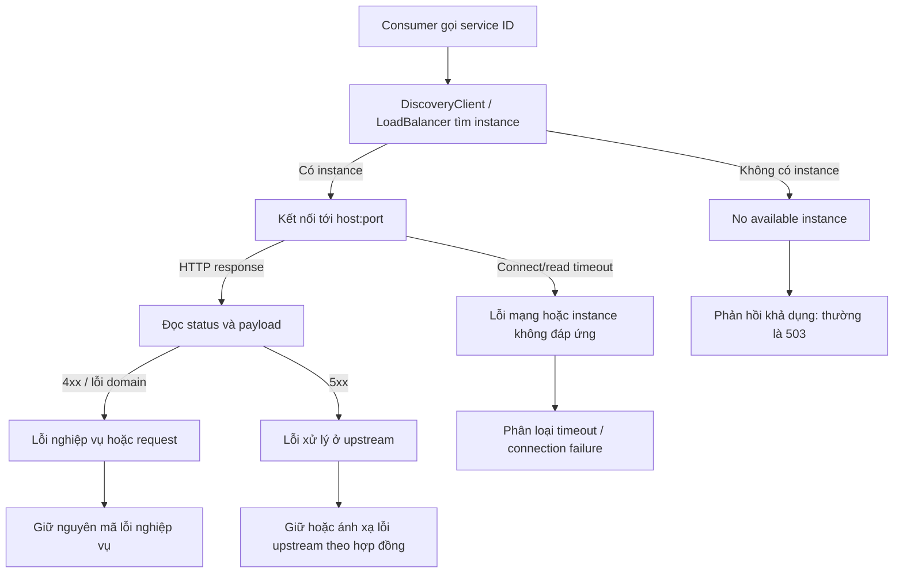

# Xử lý không có instance mà không che giấu lỗi nghiệp vụ

Khi consumer gọi một service qua Spring Cloud LoadBalancer, registry có thể tạm thời không trả về instance nào. Đây là lỗi khả dụng ở tầng service discovery: consumer chưa tìm được endpoint để gửi request. Nó khác với trường hợp đã kết nối được tới service nhưng nghiệp vụ trả về lỗi như không đủ số dư, không tìm thấy đơn hàng hoặc dữ liệu đầu vào không hợp lệ.

Cách xử lý đúng cần giữ nguyên ý nghĩa của lỗi. Không biến mọi exception thành dữ liệu mặc định, không trả `200 OK` cho một thao tác chưa thực hiện và không retry vô hạn. Hãy nhận diện lỗi không có instance, ánh xạ nó thành phản hồi khả dụng phù hợp, đồng thời để lỗi nghiệp vụ tiếp tục đi theo hợp đồng API của chúng.

## 1. Phân biệt lỗi discovery với lỗi nghiệp vụ

Một request đi qua service discovery có nhiều giai đoạn. Mỗi giai đoạn có thể thất bại theo cách khác nhau:



Phân biệt các trường hợp thường gặp:

| Tình huống | Điều đã xảy ra | Cách hiểu và xử lý |
|---|---|---|
| Không có instance | Discovery không tìm được `ServiceInstance` phù hợp cho service ID | Lỗi khả dụng của upstream; thường trả `503 Service Unavailable` |
| Connection refused | LoadBalancer đã chọn endpoint nhưng cổng không có process lắng nghe | Lỗi kết nối; ghi nhận endpoint và xử lý theo chính sách retry/circuit breaker |
| Connect/read timeout | Có endpoint nhưng không thiết lập được kết nối hoặc không nhận phản hồi đúng hạn | Lỗi mạng hoặc upstream chậm; không đồng nhất với danh sách discovery rỗng |
| HTTP `400`, `401`, `403`, `404`, `409`, `422` | Upstream đã trả phản hồi HTTP | Giữ ý nghĩa lỗi request, xác thực hoặc nghiệp vụ; không đổi thành lỗi discovery |
| HTTP `500`, `502`, `503`, `504` | Upstream hoặc gateway trả lỗi server | Phân loại lỗi upstream theo status và hợp đồng; không tự coi tất cả là không có instance |
| Lỗi domain trong payload | Upstream xử lý được request nhưng nghiệp vụ từ chối | Trả lỗi domain tương ứng, ví dụ `INSUFFICIENT_BALANCE` hoặc `ORDER_STATE_INVALID` |

Ví dụ: `inventory-service` không có instance là vấn đề khả dụng. Nhưng nếu `inventory-service` còn hoạt động và trả `409 STOCK_NOT_AVAILABLE`, consumer không được chuyển phản hồi đó thành `503` hay trả một danh sách hàng hóa rỗng giả tạo.

## 2. DiscoveryClient trả rỗng và LoadBalancer báo lỗi như thế nào?

API blocking `DiscoveryClient.getInstances(serviceId)` có thể trả về danh sách rỗng khi không tìm thấy instance. Danh sách rỗng là một kết quả hợp lệ của lookup; nó không tự động mang theo thông tin vì sao không có instance.

Spring Cloud LoadBalancer sử dụng `ServiceInstanceListSupplier` để lấy danh sách instance và chọn một endpoint. Không nên giả định mọi HTTP client đều phát ra cùng một exception khi danh sách rỗng. Trong Spring Cloud Commons 5.1.0, `BlockingLoadBalancerClient.execute()` ném `IllegalStateException` với thông báo `No instances available for <serviceId>` khi không chọn được instance; `BlockingLoadBalancerClient.choose(serviceId)` trả `null` nếu không có instance được chọn. Reactive exchange filter có đường xử lý riêng, vì vậy cần kiểm tra exception/cause thực tế theo phiên bản và integration đang dùng.

`IllegalStateException` là loại lỗi rộng và cũng có thể biểu thị lỗi lập trình hoặc trạng thái ứng dụng khác. Không bắt mọi `IllegalStateException` ở controller advice rồi coi đó là lỗi discovery. Một cách tạo ranh giới rõ là gọi `LoadBalancerClient.choose(serviceId)`, kiểm tra kết quả `null`, rồi chuyển thành exception riêng của ứng dụng trước khi gọi endpoint đã chọn. Sau khi đã chọn instance, lỗi kết nối, timeout, TLS, HTTP status hoặc lỗi deserialize có thể phát sinh từ tầng khác.

### 2.1. Kiểm tra lookup khi chẩn đoán

```java
import java.util.List;

import org.springframework.cloud.client.ServiceInstance;
import org.springframework.cloud.client.discovery.DiscoveryClient;
import org.springframework.stereotype.Component;

@Component
class DiscoveryProbe {

    private final DiscoveryClient discoveryClient;

    DiscoveryProbe(DiscoveryClient discoveryClient) {
        this.discoveryClient = discoveryClient;
    }

    List<ServiceInstance> inventoryInstances() {
        return discoveryClient.getInstances("inventory-service");
    }
}
```

Đoạn code trên giúp chẩn đoán danh sách mà `DiscoveryClient` nhìn thấy. Không nên dùng mẫu `if (getInstances(id).isEmpty())` rồi sau đó mới gửi request qua LoadBalancer như một cơ chế bảo đảm. Registry có thể thay đổi giữa hai thao tác (time-of-check to time-of-use); request thực tế vẫn phải xử lý trường hợp LoadBalancer không tìm được instance.

## 3. Ánh xạ lỗi không có instance thành HTTP 503

Với API gateway hoặc REST API, `503 Service Unavailable` thường phù hợp khi service phụ thuộc hiện không có instance khả dụng. Hãy ánh xạ exception riêng của ứng dụng bằng `@RestControllerAdvice` và trả một mã lỗi ổn định. Exception này được tạo ở adapter gọi service sau khi xác nhận LoadBalancer không chọn được instance.

Ví dụ dùng Spring Boot `ProblemDetail`:

```java
import org.springframework.http.HttpStatus;
import org.springframework.http.ProblemDetail;
import org.springframework.http.ResponseEntity;
import org.springframework.web.bind.annotation.ExceptionHandler;
import org.springframework.web.bind.annotation.RestControllerAdvice;

@RestControllerAdvice
class UpstreamAvailabilityAdvice {

    @ExceptionHandler(InventoryUnavailableException.class)
    ResponseEntity<ProblemDetail> handleNoInstance(
            InventoryUnavailableException exception) {

        ProblemDetail problem = ProblemDetail.forStatusAndDetail(
                HttpStatus.SERVICE_UNAVAILABLE,
                "Hiện không có instance khả dụng của dịch vụ phụ thuộc.");
        problem.setTitle("Upstream service unavailable");
        problem.setProperty("code", "UPSTREAM_NO_INSTANCE");

        return ResponseEntity
                .status(HttpStatus.SERVICE_UNAVAILABLE)
                .body(problem);
    }
}
```

Response minh họa:

```json
{
  "type": "about:blank",
  "title": "Upstream service unavailable",
  "status": 503,
  "detail": "Hiện không có instance khả dụng của dịch vụ phụ thuộc.",
  "code": "UPSTREAM_NO_INSTANCE"
}
```

Không đưa hostname nội bộ, địa chỉ registry, stack trace hoặc token vào response gửi cho caller. Các chi tiết đó nên nằm trong log/trace nội bộ có kiểm soát.

Chỉ bắt exception ứng dụng đã định nghĩa cho trường hợp này. Không viết handler tổng quát bắt `Exception` hoặc `IllegalStateException` rồi luôn trả 503, vì lỗi lập trình, lỗi xác thực và lỗi nghiệp vụ cũng sẽ bị che giấu.

## 4. Bọc lỗi ở tầng client để giữ hợp đồng của ứng dụng

Trong nhiều ứng dụng, tốt hơn là chuyển exception của thư viện discovery thành exception ở tầng ứng dụng. Điều này giúp controller không phụ thuộc trực tiếp vào Spring Cloud.

Ví dụ dưới đây chủ động chọn instance trước, sau đó dùng một `RestClient` thông thường để gọi URI vật lý. Cách này tạo được ranh giới kiểu dữ liệu rõ ràng khi không có instance, thay vì phải suy luận từ một `IllegalStateException` tổng quát do integration ném ra:

```java
import java.net.URI;

import org.springframework.cloud.client.ServiceInstance;
import org.springframework.cloud.client.loadbalancer.LoadBalancerClient;
import org.springframework.stereotype.Component;
import org.springframework.web.util.UriComponentsBuilder;
import org.springframework.web.client.RestClient;

@Component
class InventoryGateway {

    private final LoadBalancerClient loadBalancerClient;
    private final RestClient restClient = RestClient.create();

    InventoryGateway(LoadBalancerClient loadBalancerClient) {
        this.loadBalancerClient = loadBalancerClient;
    }

    InventoryResponse getInventory(String sku) {
        ServiceInstance instance = loadBalancerClient.choose("inventory-service");
        if (instance == null) {
            throw new InventoryUnavailableException(
                    "Không tìm được instance inventory-service");
        }

        URI target = UriComponentsBuilder.fromUri(instance.getUri())
                .path("/api/items/{sku}")
                .buildAndExpand(sku)
                .toUri();

        return restClient.get()
                .uri(target)
                .retrieve()
                .body(InventoryResponse.class);
    }
}
```

`LoadBalancerClient.choose()` dùng thuật toán chọn instance đã cấu hình và trả `null` nếu không có instance được chọn. `InventoryUnavailableException` là exception do ứng dụng định nghĩa. Controller advice có thể ánh xạ exception này sang `503` và mã `UPSTREAM_NO_INSTANCE`. Các lỗi HTTP mà `RestClient.retrieve()` chuyển thành `RestClientResponseException` vẫn được xử lý theo status/payload của upstream; lỗi kết nối tới endpoint đã chọn cũng giữ loại riêng, không gộp chúng vào `InventoryUnavailableException`.

Ví dụ exception ứng dụng:

```java
class InventoryUnavailableException extends RuntimeException {

    InventoryUnavailableException(String message) {
        super(message);
    }

    InventoryUnavailableException(String message, Throwable cause) {
        super(message, cause);
    }
}
```

Nếu dùng trực tiếp `@LoadBalanced RestClient` hoặc `WebClient` filter thay vì chọn instance trước, hãy kiểm tra exception/cause mà đúng phiên bản integration phát ra. Với blocking `BlockingLoadBalancerClient.execute()`, thông báo `IllegalStateException` hiện tại có dạng `No instances available for <serviceId>`; đây là chi tiết implementation, không nên dùng chuỗi message làm hợp đồng API lâu dài. Nếu cần phân loại ổn định, đặt một adapter riêng quanh LoadBalancer và chuyển tín hiệu no-instance đã xác nhận thành exception ứng dụng.

## 5. Với WebClient: chỉ xử lý đúng lỗi discovery

Với `WebClient` có filter LoadBalancer, pipeline reactive cần giữ nguyên các lỗi không liên quan. Mẫu minh họa khi exception được phát ra trực tiếp:

```java
return webClient.get()
        .uri("http://inventory-service/api/items/{sku}", sku)
        .retrieve()
        .bodyToMono(InventoryResponse.class)
        .onErrorMap(
                NoInstanceSignal.class,
                exception -> new InventoryUnavailableException(
                        "Không tìm được instance inventory-service", exception));
```

`NoInstanceSignal` trong ví dụ là exception do adapter reactive của ứng dụng định nghĩa sau khi kiểm tra response từ `ReactiveLoadBalancer` và xác nhận `hasServer()` là `false`; nó không phải class Spring Cloud. `onErrorMap` chỉ chuyển đổi loại exception đã chỉ định. HTTP 4xx/5xx, timeout hoặc lỗi deserialize tiếp tục giữ loại lỗi riêng của chúng. Với reactive integration, không dùng một class exception giả định cho mọi phiên bản; hãy quan sát exception/cause thực tế và chỉ map tín hiệu no-instance đã xác nhận.

Không dùng `onErrorResume(Throwable.class, error -> Mono.just(defaultValue))` cho toàn bộ pipeline. Cách này biến mọi lỗi thành dữ liệu thành công giả, làm caller không thể phân biệt upstream không có instance với nghiệp vụ từ chối request.

## 6. Khi nào nên fallback?

Fallback chỉ hợp lệ khi có một kết quả thay thế được nghiệp vụ cho phép. Fallback không có nghĩa là bỏ qua lỗi và trả về bất kỳ giá trị mặc định nào.

| Trường hợp | Fallback có thể chấp nhận | Điều kiện |
|---|---|---|
| Đọc thông tin sản phẩm | Trả cache gần nhất kèm `stale=true` và thời điểm cập nhật | Caller chấp nhận dữ liệu cũ và response thể hiện rõ độ cũ |
| Đọc nội dung ít quan trọng | Trả bản snapshot hoặc dữ liệu tĩnh | Dữ liệu dự phòng có nguồn gốc và giới hạn rõ |
| Gửi email/thông báo | Đưa command vào durable queue và trả `202 Accepted` | Message đã được ghi bền vững và có cơ chế xử lý lại |
| Tính năng tùy chọn | Bỏ qua tính năng và trả trạng thái degraded rõ ràng | Chức năng đó không ảnh hưởng tính đúng đắn của giao dịch chính |
| Thanh toán/chuyển tiền/đặt hàng | Thường trả lỗi khả dụng và yêu cầu caller thử lại theo hợp đồng | Không được giả lập giao dịch thành công hoặc thất bại khi chưa biết kết quả thực |

Không nên:

- Trả `200 OK` cùng `[]` khi không có instance của service cần thiết để đọc dữ liệu.
- Trả số dư `0`, giá `0` hoặc trạng thái `SUCCESS` khi service nguồn không phản hồi.
- Bỏ qua lỗi inventory rồi xác nhận đơn hàng đã đặt nếu không có reservation hợp lệ.
- Trả `202 Accepted` khi command chưa được ghi vào queue hoặc kho bền vững.
- Trả dữ liệu cache cũ mà không đánh dấu rõ stale hoặc không kiểm tra thời hạn cho phép.

Fallback phải có ngữ nghĩa rõ ràng. Nếu không có dữ liệu thay thế an toàn, hãy trả lỗi khả dụng thay vì giả vờ nghiệp vụ đã hoàn tất.

## 7. Retry có giới hạn và đúng loại lỗi

Retry có thể hữu ích khi registry vừa thay đổi hoặc một instance vừa được đăng ký, nhưng retry không tự tạo ra instance. Nếu danh sách discovery vẫn rỗng, gọi lại liên tục thường chỉ tăng tải và độ trễ.

Nguyên tắc:

1. Đặt tổng deadline cho toàn bộ request; mỗi lần retry phải nằm trong ngân sách đó.
2. Dùng số lần retry nhỏ, exponential backoff và jitter để tránh nhiều consumer retry đồng thời.
3. Chỉ retry lỗi có khả năng phục hồi và thao tác an toàn/idempotent.
4. Không retry lỗi validation, authentication, authorization hoặc lỗi domain như `409`/`422`.
5. Không retry vô hạn `InventoryUnavailableException` hoặc tín hiệu no-instance của integration; có thể cân nhắc một lần thử lại ngắn nếu biết registry đang trong giai đoạn cập nhật và request còn đủ deadline.
6. Với thao tác ghi, dùng idempotency key hoặc cơ chế chống xử lý trùng trước khi retry sau timeout.

Ví dụ phân loại chính sách:

| Loại lỗi | Retry mặc định? | Ghi chú |
|---|---|---|
| Không có instance | Không retry liên tục; chỉ retry ngắn có điều kiện | Ưu tiên chờ registry/cache cập nhật trong deadline |
| Connect timeout / connection reset | Có thể retry có giới hạn | Chỉ với thao tác an toàn hoặc idempotent |
| Read timeout sau khi gửi lệnh ghi | Không tự retry nếu chưa biết server đã xử lý hay chưa | Có thể đã thực hiện thành công nhưng response bị mất |
| HTTP 400/401/403/404/409/422 | Không | Sửa request, quyền hoặc điều kiện nghiệp vụ |
| HTTP 429/503 từ upstream | Tùy `Retry-After`, deadline và hợp đồng | Backoff, giới hạn concurrency |
| HTTP 500 | Tùy tính chất lỗi và thao tác | Không mặc định mọi 500 đều transient |

Không cấu hình đồng thời retry ở nhiều tầng mà không tính tổng số lần. Ví dụ gateway retry 3 lần, service gọi tiếp retry 3 lần và client SDK retry 3 lần có thể tạo tới 27 request tới upstream.

## 8. Circuit breaker và fallback không được nuốt lỗi

Circuit breaker bảo vệ hệ thống khi upstream lỗi liên tục bằng cách mở mạch và từ chối lời gọi mới trong một khoảng thời gian. Khi mạch mở, caller có thể nhận `CallNotPermittedException` hoặc exception đặc thù của integration.

Fallback của circuit breaker cần phân biệt:

- Không có instance: lỗi khả dụng do discovery.
- Circuit breaker mở: upstream bị đánh giá đang không ổn định.
- Lỗi HTTP/domain: upstream đã phản hồi và cần giữ ý nghĩa response.

Nếu dùng fallback method tổng quát nhận `Throwable`, hãy phân loại exception bên trong. Chỉ trả dữ liệu dự phòng với những lỗi mà nghiệp vụ cho phép; với lỗi domain, rethrow hoặc chuyển nguyên vẹn sang lớp xử lý tương ứng. Một fallback trả `null` hoặc object mặc định cho mọi lỗi khiến telemetry báo thành công trong khi giao dịch thực tế thất bại.

Ví dụ logic fallback có điều kiện (mã giả):

```java
InventoryResult fallback(String sku, Throwable cause) {
    if (cause instanceof InventoryUnavailableException
            || cause instanceof CallNotPermittedException) {
        return cache.findFreshEnough(sku)
                .<InventoryResult>map(value ->
                        new StaleInventoryResult(value, true))
                .orElseThrow(() -> new InventoryUnavailableException(
                        "Inventory tạm thời không khả dụng", cause));
    }

    // Lỗi nghiệp vụ hoặc lỗi không được phép fallback phải tiếp tục nổi lên.
    throw new UpstreamCallFailedException("Inventory call failed", cause);
}
```

Đây là logic minh họa; kiểu kết quả và exception cần được định nghĩa theo ứng dụng. Nếu `cause` bọc lỗi gốc, hãy unwrap theo loại exception cụ thể. Không dùng `instanceof Exception` tổng quát để coi mọi lỗi là lỗi khả dụng.

## 9. Thiết kế hợp đồng lỗi nhất quán

API của consumer nên trả mã lỗi ổn định để caller có thể quyết định thử lại hay hiển thị thông báo. Ví dụ:

| HTTP status | Error code | Ý nghĩa | Caller nên làm gì? |
|---:|---|---|---|
| `503` | `UPSTREAM_NO_INSTANCE` | Không tìm được instance phù hợp | Có thể thử lại sau theo backoff và deadline |
| `503` | `UPSTREAM_CIRCUIT_OPEN` | Circuit breaker đang mở | Chờ khoảng thời gian recovery rồi thử lại nếu request còn hiệu lực |
| `504` | `UPSTREAM_TIMEOUT` | Quá thời gian chờ upstream | Với lệnh ghi, kiểm tra idempotency/trạng thái trước khi gửi lại |
| `502` | `UPSTREAM_BAD_RESPONSE` | Gateway nhận response không hợp lệ từ upstream | Thử lại chỉ khi phù hợp |
| `400` / `422` | `VALIDATION_FAILED` | Request không hợp lệ | Sửa dữ liệu, không retry tự động |
| `404` | `RESOURCE_NOT_FOUND` | Resource không tồn tại | Xử lý như kết quả nghiệp vụ |
| `409` | `BUSINESS_CONFLICT` | Trạng thái nghiệp vụ xung đột | Làm mới trạng thái hoặc yêu cầu hành động khác |

Không bắt buộc mọi ứng dụng phải dùng đúng các mã trên, nhưng cần một quy ước thống nhất giữa service, gateway và client. Nếu upstream đã trả một mã domain có ý nghĩa, giữ lại mã đó thay vì ánh xạ tất cả về `UPSTREAM_UNAVAILABLE`.

## 10. Logging, metrics và tracing

Để chẩn đoán service không có instance, log cần cho biết service ID và giai đoạn thất bại. Nên ghi:

- Service ID mà consumer đang tra cứu.
- Tên client gọi (`RestClient`, `WebClient`, Feign hoặc gateway) và operation.
- Exception class cùng cause chain đã được phân loại.
- Trace ID/correlation ID và deadline còn lại.
- Số lần retry và trạng thái circuit breaker.
- Số instance mà discovery supplier trả về nếu có thể quan sát an toàn.

Không log token, credential, payload nhạy cảm hoặc toàn bộ metadata có thể chứa secret. Tránh đưa instance ID, request ID hoặc user ID làm metric label có cardinality cao; dùng service ID và error category có tập giá trị giới hạn.

Metric hữu ích:

| Metric | Mục đích |
|---|---|
| `upstream_no_instance_total` | Số lần không tìm thấy instance theo service ID |
| `upstream_call_failures_total` | Phân loại lỗi kết nối, timeout, HTTP và domain |
| `upstream_call_duration` | Theo dõi latency của lời gọi upstream |
| `loadbalancer_instances_available` | Quan sát số instance khả dụng nếu supplier expose metric phù hợp |
| `retry_attempts_total` | Phát hiện retry storm hoặc retry không hiệu quả |
| `circuitbreaker_state` | Quan sát trạng thái closed/open/half-open |

Alert nên phân biệt service không có instance với upstream trả 5xx hoặc business error. Nếu chỉ theo dõi tỷ lệ HTTP 5xx tổng hợp, nhóm vận hành sẽ khó biết vấn đề nằm ở registry, mạng hay logic service.

## 11. Thực hành kiểm chứng các loại lỗi

Tạo một consumer gọi `inventory-service` bằng service ID qua Spring Cloud LoadBalancer. Thử lần lượt:

1. **Không có registration:** dừng tất cả instance hoặc dùng service ID sai. Xác nhận lỗi được phân loại là `UPSTREAM_NO_INSTANCE` và trả 503.
2. **Có instance nhưng port sai:** xác nhận đây là connection failure, không phải no-instance.
3. **Instance trả 404:** xác nhận response giữ mã `RESOURCE_NOT_FOUND` hoặc hợp đồng tương đương.
4. **Instance trả 409:** xác nhận lỗi domain được chuyển tới caller và không bị fallback thành danh sách rỗng.
5. **Instance trả 500:** quan sát upstream error; không mặc định chuyển thành lỗi discovery.
6. **Bật circuit breaker:** làm upstream lỗi liên tục, xác nhận trạng thái open được ghi nhận riêng.
7. **Bật fallback cache:** chỉ cho phép fallback khi lỗi thuộc nhóm khả dụng; xác nhận response có cờ `stale` và timestamp.
8. **Thử timeout trên thao tác ghi:** xác minh idempotency key hoặc quy trình tra cứu trạng thái trước retry.

Trong mỗi lần thử, ghi lại exception/cause, HTTP status, error code, retry count và trace ID. Kiểm tra cả log lẫn response của API để bảo đảm không có lỗi nghiệp vụ nào bị biến thành thành công giả.

## 12. Checklist triển khai

- [ ] Đã phân biệt empty discovery result với connect/read timeout và HTTP response.
- [ ] Đã xác định tín hiệu no-instance thực tế của blocking/reactive integration và chuyển nó thành exception ứng dụng có kiểu rõ ràng.
- [ ] Không dùng handler tổng quát biến mọi exception thành HTTP 503.
- [ ] Lỗi domain và HTTP 4xx được giữ nguyên ý nghĩa.
- [ ] Lỗi upstream 5xx/timeout có mã lỗi riêng và chính sách rõ ràng.
- [ ] Fallback chỉ được dùng khi có dữ liệu thay thế an toàn và thể hiện rõ trạng thái degraded/stale.
- [ ] Không trả success giả, số liệu mặc định hoặc `202` khi nghiệp vụ chưa hoàn tất/command chưa được lưu bền vững.
- [ ] Retry có giới hạn, backoff, jitter, deadline và idempotency phù hợp.
- [ ] Circuit breaker phân biệt lỗi khả dụng với lỗi nghiệp vụ.
- [ ] Log/metric/trace phân biệt no-instance, network, HTTP và domain failures.
- [ ] Đã thử nghiệm khi registry rỗng, endpoint lỗi, upstream trả 4xx/5xx và circuit breaker mở.

## Tài liệu tham khảo

- [Spring Cloud Commons — LoadBalancer: No available instance and client integration](https://docs.spring.io/spring-cloud-commons/reference/spring-cloud-commons/loadbalancer.html)
- [Spring Cloud Commons — BlockingLoadBalancerClient source](https://github.com/spring-cloud/spring-cloud-commons/blob/main/spring-cloud-loadbalancer/src/main/java/org/springframework/cloud/loadbalancer/blocking/client/BlockingLoadBalancerClient.java)
- [Spring Cloud Commons — DiscoveryClient and service instance abstractions](https://docs.spring.io/spring-cloud-commons/reference/spring-cloud-commons/common-abstractions.html)
- [Spring Cloud CircuitBreaker — Resilience4j integration and fallback](https://docs.spring.io/spring-cloud-circuitbreaker/reference/spring-cloud-circuitbreaker.html)
- [Spring Framework — REST Clients and error handling](https://docs.spring.io/spring-framework/reference/integration/rest-clients.html)
- [RFC 9110 — HTTP Semantics: 502, 503 and 504](https://www.rfc-editor.org/rfc/rfc9110.html)
