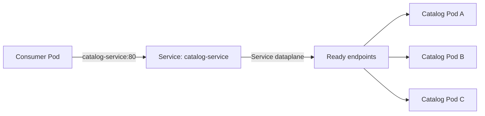
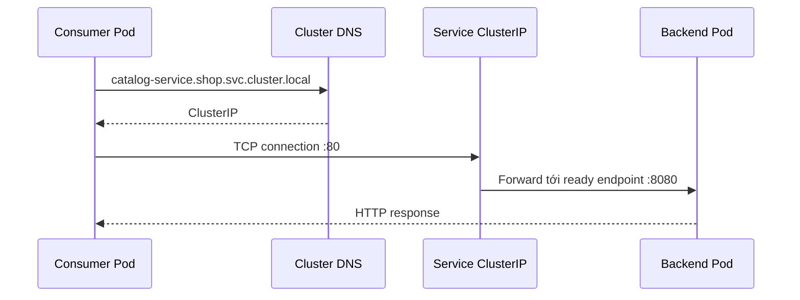
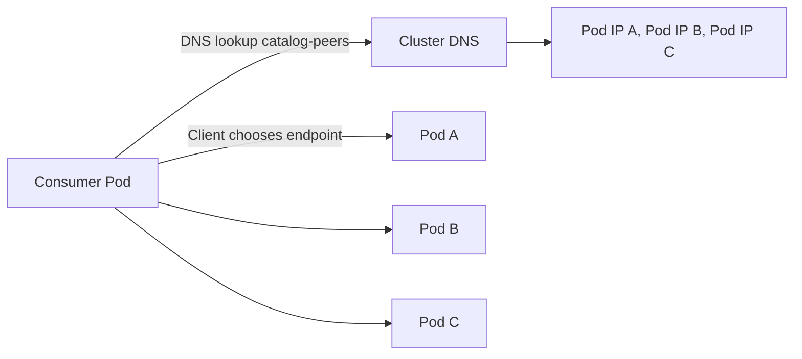

# Khám phá bằng Kubernetes Service và DNS

Kubernetes có sẵn cơ chế service discovery thông qua đối tượng `Service` và DNS nội bộ. Một ứng dụng trong cluster có thể gọi dịch vụ khác bằng tên ổn định như `catalog-service` thay vì phải lưu IP của từng Pod. Kubernetes duy trì danh sách backend phù hợp với Service và chuyển traffic tới các endpoint đang sẵn sàng.

Spring Cloud Kubernetes có thể bổ sung một cách khám phá ở phía ứng dụng: `DiscoveryClient` đọc thông tin Service và endpoint từ Kubernetes API, rồi trả về các `ServiceInstance` để Spring Cloud LoadBalancer lựa chọn. Hai cách này cùng dựa trên Kubernetes nhưng có hành vi khác nhau. DNS của Service thông thường trả về ClusterIP và để dataplane của Kubernetes phân phối traffic; discovery theo endpoint có thể trả về từng Pod IP để client-side load balancing chọn instance.

Bài học thuộc chương `Khám phá trên Kubernetes` trong module `SPRING_CLOUD_SERVICE_DISCOVERY`. Module giúp người học hiểu cách tìm instance theo tên dịch vụ qua `DiscoveryClient`, `ServiceRegistry`, Eureka hoặc Consul, cùng vòng đời đăng ký, health check, load balancing, bảo mật và xử lý sai lệch registry. Nội dung này tập trung vào Kubernetes Service, DNS, EndpointSlice và cách tích hợp chúng với Spring Cloud.

## 1. Kubernetes Service giải quyết vấn đề gì?

Pod có địa chỉ IP riêng, nhưng Pod có thể bị thay thế khi Deployment rollout, scale hoặc tự phục hồi sau lỗi. Nếu consumer lưu IP Pod, địa chỉ đó có thể không còn đúng sau lần triển khai tiếp theo.

`Service` tạo một điểm truy cập ổn định cho một nhóm Pod. Service thường dùng selector để chọn Pod theo label. Kubernetes control plane theo dõi các Pod phù hợp và cập nhật danh sách endpoint cho Service. Consumer chỉ cần biết tên Service và cổng mà Service công bố.



Các thành phần có vai trò riêng:

| Thành phần | Vai trò |
|---|---|
| Pod | Chạy một hoặc nhiều container; địa chỉ Pod có thể thay đổi trong vòng đời workload. |
| Service | Cung cấp tên và địa chỉ ổn định cho nhóm backend. |
| Selector | Chọn Pod có label khớp với Service. |
| EndpointSlice | Lưu các địa chỉ backend và thông tin endpoint cho Service. |
| Cluster DNS | Tạo DNS record để Pod có thể tìm Service bằng tên. |
| Service dataplane | Chuyển traffic từ Service IP tới một backend phù hợp. |

Với Service thông thường, consumer không cần gọi Kubernetes API hoặc duy trì danh sách Pod IP. DNS và dataplane của Kubernetes xử lý phần định vị và phân phối traffic.

## 2. Khai báo Service cho một ứng dụng Spring Boot

Giả sử ứng dụng `catalog-service` chạy HTTP trên cổng container `8080`. Deployment gắn label `app: catalog-service`; Service chọn các Pod có label đó và công bố cổng `80`.

```yaml
apiVersion: apps/v1
kind: Deployment
metadata:
  name: catalog-service
  namespace: shop
spec:
  replicas: 3
  selector:
    matchLabels:
      app: catalog-service
  template:
    metadata:
      labels:
        app: catalog-service
    spec:
      containers:
        - name: app
          image: example/catalog-service:1.0.0
          ports:
            - name: http
              containerPort: 8080
          readinessProbe:
            httpGet:
              path: /actuator/health/readiness
              port: http
            periodSeconds: 5
---
apiVersion: v1
kind: Service
metadata:
  name: catalog-service
  namespace: shop
spec:
  type: ClusterIP
  selector:
    app: catalog-service
  ports:
    - name: http
      protocol: TCP
      port: 80
      targetPort: http
```

Trong cấu hình này:

- `metadata.name` của Service là `catalog-service`.
- `metadata.namespace` là `shop`.
- `selector` khớp với label của Pod do Deployment tạo ra.
- `port: 80` là cổng consumer gọi trên Service.
- `targetPort: http` tham chiếu tới container port có tên `http`, tức `8080`.
- Readiness probe quyết định khi nào Pod đủ điều kiện nhận traffic.

Đường dẫn `/actuator/health/readiness` cần Spring Boot Actuator và readiness health group được bật/phơi bày theo cấu hình ứng dụng. Nếu dự án dùng endpoint khác, thay `path` bằng endpoint readiness thực tế; không trỏ probe tới một URL chưa tồn tại.

`spring.application.name` trong ứng dụng Spring Boot không tự tạo Kubernetes Service. Service là một Kubernetes resource cần được khai báo bằng manifest, Helm chart, Kustomize hoặc công cụ triển khai tương ứng. Nếu Spring Cloud Kubernetes cần tra cứu service theo tên ứng dụng, nên thống nhất tên Service với `spring.application.name`.

## 3. DNS của Kubernetes Service

Khi cluster DNS được cấu hình, Kubernetes tự tạo DNS record cho Service. Trong cùng namespace, Pod có thể gọi bằng tên ngắn:

```text
http://catalog-service
```

Pod ở namespace khác cần thêm namespace:

```text
http://catalog-service.shop
```

Tên đầy đủ thường có dạng:

```text
<service>.<namespace>.svc.<cluster-domain>
```

Ví dụ với cluster domain mặc định phổ biến `cluster.local`:

```text
catalog-service.shop.svc.cluster.local
```

Cluster domain có thể được quản trị viên cấu hình khác `cluster.local`. Vì vậy, khi cần FQDN đầy đủ, hãy xác minh domain thực tế của cluster thay vì hardcode một giá trị giả định.

### 3.1. Tên ngắn và search domain

Kubernetes thường cấu hình `/etc/resolv.conf` trong Pod với các search suffix như:

```text
shop.svc.cluster.local
svc.cluster.local
cluster.local
```

Nhờ đó, truy vấn `catalog-service` có thể được mở rộng thành tên trong namespace hiện tại. Đây là lý do tên ngắn hoạt động trong cùng namespace. Từ namespace khác, dùng `catalog-service.shop` hoặc FQDN để tránh tra cứu nhầm một Service cùng tên ở namespace hiện tại.

### 3.2. DNS A/AAAA và SRV

Với Service thông thường, DNS A hoặc AAAA record trỏ tới ClusterIP của Service. Với Service có port được đặt tên, Kubernetes còn có thể tạo SRV record để tra cứu tên port, protocol và địa chỉ dịch vụ.

Ví dụ Service có port tên `http`:

```text
_http._tcp.catalog-service.shop.svc.cluster.local
```

Ứng dụng HTTP thông thường vẫn cần biết cổng để gọi; DNS A/AAAA không tự thêm port vào URL. SRV hữu ích cho client có hỗ trợ truy vấn loại record này.

## 4. ClusterIP Service: DNS trả về một địa chỉ ổn định

`ClusterIP` là loại Service mặc định. Kubernetes cấp một virtual IP ổn định trong cluster. DNS tên Service phân giải về ClusterIP đó; Service dataplane (kube-proxy hoặc cơ chế thay thế trong cluster) chuyển kết nối tới một backend phù hợp.



DNS không trả danh sách IP Pod trong trường hợp Service ClusterIP thông thường. Phân phối traffic diễn ra ở Service dataplane. Do đó, khi dùng URL `http://catalog-service`, ứng dụng không nhất thiết phải tích hợp `DiscoveryClient` hoặc Spring Cloud LoadBalancer.

Ví dụ cấu hình `WebClient` gọi trực tiếp DNS của Kubernetes:

```java
import org.springframework.stereotype.Service;
import org.springframework.web.reactive.function.client.WebClient;
import reactor.core.publisher.Mono;

@Service
public class CatalogClient {

    private final WebClient webClient;

    public CatalogClient(WebClient.Builder builder) {
        this.webClient = builder
                .baseUrl("http://catalog-service.shop.svc.cluster.local")
                .build();
    }

    public Mono<Product> getProduct(String id) {
        return webClient.get()
                .uri("/api/products/{id}", id)
                .retrieve()
                .bodyToMono(Product.class);
    }
}
```

Ví dụ giả định Service công bố cổng HTTP `80` và cluster domain là `cluster.local`. Nếu Service dùng cổng khác, thêm `:<service-port>` vào base URL. `Product` là DTO do ứng dụng định nghĩa.

### 4.1. Kubernetes thực hiện load balancing ở đâu?

Với ClusterIP Service, client gửi request tới một virtual IP. Kubernetes dataplane chọn một endpoint phù hợp để chuyển traffic. Ứng dụng không nhận danh sách từng Pod chỉ bằng cách phân giải DNS tên Service.

Điều này thường được gọi là server-side hoặc platform-side service discovery/load balancing. Consumer biết Service name và port; Kubernetes xử lý việc ánh xạ tới backend.

Không nên nhầm ClusterIP DNS với DNS round-robin cho từng Pod. A record của Service thông thường trỏ tới ClusterIP; danh sách backend nằm trong EndpointSlice và được dataplane sử dụng.

## 5. Headless Service: DNS trả về địa chỉ Pod

Có những ứng dụng cần biết từng Pod, ví dụ StatefulSet, hệ thống cluster nội bộ hoặc ứng dụng tự quản lý topology. Khi đó có thể tạo headless Service bằng cách đặt `clusterIP: None`.

```yaml
apiVersion: v1
kind: Service
metadata:
  name: catalog-peers
  namespace: shop
spec:
  clusterIP: None
  selector:
    app: catalog-service
  ports:
    - name: http
      port: 8080
      targetPort: http
```

Headless Service không có ClusterIP. Kubernetes không tạo virtual IP hoặc thực hiện proxy/load balancing cho Service này. DNS trả về các địa chỉ IP của endpoint Pod được chọn bởi Service.



Client phải xử lý tập địa chỉ trả về và tự chọn endpoint, hoặc sử dụng thư viện có cơ chế phân phối phù hợp. Thứ tự các địa chỉ DNS trả về không phải hợp đồng load-balancing ổn định.

### 5.1. Khi nào dùng ClusterIP, khi nào dùng headless?

| Tiêu chí | ClusterIP Service | Headless Service |
|---|---|---|
| Cluster IP | Có virtual IP. | Không cấp ClusterIP. |
| DNS A/AAAA | Trả ClusterIP. | Trả các IP endpoint Pod. |
| Load balancing của nền tảng | Service dataplane phân phối tới backend. | Không có proxy hoặc load balancing của Service. |
| Consumer cần biết Pod IP | Không. | Có thể cần để tự chọn endpoint. |
| Trường hợp điển hình | API service thông thường. | StatefulSet, peer discovery hoặc client tự quản lý topology. |

Headless Service không tự làm ứng dụng có khả năng cân bằng tải tốt. Nếu client chỉ lấy địa chỉ đầu tiên trong DNS response, nó có thể dồn toàn bộ traffic vào một Pod. Cần có thuật toán chọn, retry, timeout và cập nhật danh sách địa chỉ phù hợp.

### 5.2. DNS record cho Pod trong StatefulSet

Khi kết hợp headless Service với StatefulSet, mỗi Pod có thể có DNS name ổn định theo ordinal, chẳng hạn:

```text
catalog-0.catalog-peers.shop.svc.cluster.local
catalog-1.catalog-peers.shop.svc.cluster.local
catalog-2.catalog-peers.shop.svc.cluster.local
```

Các record riêng cho Pod phụ thuộc hostname/subdomain và cấu hình workload. Với Pod chưa Ready, DNS record có thể không được công bố theo mặc định; `publishNotReadyAddresses` có thể thay đổi hành vi khi ứng dụng cần khám phá peer trước khi readiness đạt.

## 6. EndpointSlice và vòng đời endpoint

`EndpointSlice` là API Kubernetes dùng để biểu diễn các backend của Service theo nhóm. Control plane tự tạo EndpointSlice cho Service có selector và cập nhật khi Pod phù hợp được thêm, xóa hoặc thay đổi trạng thái.

EndpointSlice có thể chứa:

- Địa chỉ endpoint, thường là Pod IP.
- Port và protocol của endpoint.
- Thông tin node và zone liên quan.
- Conditions như `ready`, `serving` và `terminating` theo phiên bản/API.
- Reference tới target Pod nếu endpoint đại diện cho Pod.

Readiness có vai trò quan trọng. Pod đang chạy nhưng chưa Ready thường không được chọn làm backend phục vụ traffic thông thường. Khi readiness probe thất bại, endpoint có thể không còn đủ điều kiện nhận traffic; khi Pod trở lại Ready, endpoint có thể được đưa vào danh sách phục vụ.

Lưu ý rằng liveness probe và readiness probe có mục đích khác nhau:

- Readiness trả lời ứng dụng đã sẵn sàng nhận request hay chưa.
- Liveness giúp kubelet quyết định container có cần được khởi động lại hay không.
- Startup probe bảo vệ ứng dụng khởi động chậm khỏi bị liveness/readiness kiểm tra quá sớm.

Không dùng liveness để thay thế readiness. Nếu ứng dụng còn khởi động hoặc đang warm-up nhưng vẫn sống, readiness nên giữ Pod khỏi Service endpoints cho đến khi có thể phục vụ.

### 6.1. Kiểm tra EndpointSlice

Các lệnh hữu ích:

```bash
kubectl get service catalog-service -n shop
kubectl get endpointslice -n shop \
  -l kubernetes.io/service-name=catalog-service
kubectl describe service catalog-service -n shop
kubectl get pods -n shop -l app=catalog-service -o wide
```

Nếu Service tồn tại nhưng EndpointSlice không có endpoint phù hợp, hãy kiểm tra selector, label Pod, readiness và port. Không nên chỉ kiểm tra DNS vì DNS record của ClusterIP vẫn có thể phân giải dù Service chưa có backend hoạt động.

## 7. Spring Cloud Kubernetes DiscoveryClient

Kubernetes native DNS phù hợp khi consumer chỉ cần gọi một Service endpoint. Trong một số hệ thống, ứng dụng cần danh sách từng instance để áp dụng client-side load balancing, lọc metadata, chọn zone hoặc dùng abstraction chung với Eureka/Consul. Spring Cloud Kubernetes cung cấp `DiscoveryClient` để truy vấn Service và endpoint từ Kubernetes.

Với discovery client, luồng khái quát là:

1. Ứng dụng gọi `getServices()` để lấy các tên Service có thể khám phá.
2. Ứng dụng gọi `getInstances("catalog-service")` để lấy danh sách `ServiceInstance`.
3. Discovery implementation đọc dữ liệu Service/endpoint từ Kubernetes API hoặc cache/lister của client.
4. Spring Cloud LoadBalancer có thể dùng danh sách instance để chọn một Pod endpoint.

Ví dụ dùng abstraction:

```java
import java.util.List;

import org.springframework.cloud.client.ServiceInstance;
import org.springframework.cloud.client.discovery.DiscoveryClient;
import org.springframework.stereotype.Service;

@Service
public class KubernetesCatalogDiscovery {

    private final DiscoveryClient discoveryClient;

    public KubernetesCatalogDiscovery(DiscoveryClient discoveryClient) {
        this.discoveryClient = discoveryClient;
    }

    public List<ServiceInstance> findCatalogInstances() {
        return discoveryClient.getInstances("catalog-service");
    }
}
```

Spring Cloud Kubernetes có các lựa chọn implementation dựa trên Fabric8 Kubernetes Client, Kubernetes Java Client và HTTP-based DiscoveryClient dùng DiscoveryServer. Dependency cần chọn theo loại client mong muốn và release train Spring Cloud Kubernetes tương thích với Spring Boot.

Ví dụ dependency Fabric8:

```xml
<dependency>
    <groupId>org.springframework.cloud</groupId>
    <artifactId>spring-cloud-starter-kubernetes-fabric8</artifactId>
</dependency>
```

Ví dụ dependency Kubernetes Java Client:

```xml
<dependency>
    <groupId>org.springframework.cloud</groupId>
    <artifactId>spring-cloud-starter-kubernetes-client</artifactId>
</dependency>
```

HTTP-based `spring-cloud-starter-kubernetes-discoveryclient` được thiết kế để dùng với Spring Cloud Kubernetes DiscoveryServer; đây là kiến trúc có thành phần server riêng, không nên nhầm với client Fabric8/Kubernetes Java truy cập API trực tiếp.

## 8. ServiceInstance được tạo từ Kubernetes Service như thế nào?

`DiscoveryClient.getInstances(serviceId)` trả về `List<ServiceInstance>`. Mỗi instance có các trường thông thường như instance ID, service ID, host, port, URI và metadata. Spring Cloud Kubernetes có thể bổ sung namespace, Pod metadata, Service labels, annotations và loại Service tùy cấu hình.

Với Service có nhiều endpoint, danh sách instance có thể đại diện cho các địa chỉ backend riêng. Host thường là endpoint IP; với `ExternalName`, host có thể là tên DNS bên ngoài.

Việc chọn port cần được xác định rõ. Tài liệu Spring Cloud Kubernetes hiện hành mô tả thứ tự lựa chọn gồm:

1. Nếu Service chỉ có một port, dùng port đó.
2. Nếu Service có label `primary-port-name`, dùng port có tên được label chỉ định.
3. Nếu không có label, dùng `spring.cloud.kubernetes.discovery.primary-port-name` nếu được cấu hình.
4. Nếu chưa xác định được, tìm port tên `https` hoặc `http`.
5. Cuối cùng mới dùng port đầu tiên trong danh sách; lựa chọn này có thể không xác định nếu thứ tự thay đổi.

Vì vậy, nên đặt tên port rõ ràng trong Service manifest, ví dụ `http` hoặc `https`, hoặc cấu hình `primary-port-name` khi Service có nhiều port.

### 8.1. Readiness và include-not-ready-addresses

Mặc định, Spring Cloud Kubernetes không đưa các endpoint chưa được Kubernetes đánh dấu Ready vào kết quả discovery. Có thể bật:

```yaml
spring:
  cloud:
    kubernetes:
      discovery:
        include-not-ready-addresses: true
```

Tùy chọn này hữu ích cho công cụ monitoring cần kiểm tra endpoint của Pod chưa Ready. Với consumer nghiệp vụ, bật nó có thể khiến LoadBalancer gửi traffic tới instance chưa sẵn sàng. Chỉ dùng khi có mục đích rõ ràng và chính sách chọn endpoint phù hợp.

### 8.2. ExternalName Service

`ExternalName` Service ánh xạ một tên trong DNS nội bộ sang hostname DNS bên ngoài bằng CNAME. Nó không đại diện cho tập Pod nội bộ và không có ClusterIP như Service thông thường.

Spring Cloud Kubernetes không bao gồm `ExternalName` trong discovery theo mặc định. Muốn `DiscoveryClient` trả loại Service này, có thể bật:

```yaml
spring:
  cloud:
    kubernetes:
      discovery:
        include-external-name-services: true
```

Hãy lưu ý khác biệt hostname khi gọi HTTP/HTTPS: hostname trong URL ảnh hưởng HTTP Host header và TLS certificate validation. Không phải mọi giao thức đều hoạt động như mong đợi khi thay hostname bằng alias `ExternalName`.

## 9. Namespace và phạm vi khám phá

Kubernetes Service được đặt trong namespace. Tên `catalog-service` có thể tồn tại đồng thời ở nhiều namespace. Vì vậy, discovery client cần có phạm vi namespace rõ ràng.

Spring Cloud Kubernetes hỗ trợ các cách cấu hình phổ biến:

- Một namespace: mặc định theo quy tắc namespace resolution.
- Một danh sách namespace cụ thể: chỉ tìm Service trong các namespace đã chọn.
- Tất cả namespace: cho phép tìm rộng trong cluster nhưng có thể tăng tải Kubernetes API và bộ nhớ ứng dụng.

Ví dụ chọn hai namespace:

```yaml
spring:
  cloud:
    kubernetes:
      discovery:
        namespaces:
          - shop
          - payments
```

Hoặc tìm trong tất cả namespace:

```yaml
spring:
  cloud:
    kubernetes:
      discovery:
        all-namespaces: true
```

Chỉ bật all-namespaces khi có yêu cầu thực tế. Nếu nhiều namespace chứa Service cùng tên, `getServices()` trả về các tên Service duy nhất; tên trùng không tự cho biết namespace mong muốn. Cần dùng phạm vi namespace và metadata để tránh chọn nhầm service.

### 9.1. Lọc Service bằng label

Có thể giới hạn Service được discovery bằng label selector:

```yaml
spring:
  cloud:
    kubernetes:
      discovery:
        service-labels:
          team: commerce
          exposure: internal
```

Chỉ các Service có labels tương ứng mới được đưa vào kết quả. Lọc label cũng giúp giảm số Service mà lister phải theo dõi trong namespace lớn. Cần phân biệt Service labels với Pod labels: Service selector chọn Pod; Service metadata labels lọc đối tượng Service trong Spring Cloud Kubernetes discovery.

## 10. Spring Cloud Kubernetes LoadBalancer: POD và SERVICE mode

Spring Cloud Kubernetes tích hợp Spring Cloud LoadBalancer với hai mode chính:

| Mode | Cách định tuyến | Phân phối traffic |
|---|---|---|
| `POD` | Dùng `DiscoveryClient` lấy danh sách instance/endpoint của service ID. | Spring Cloud LoadBalancer chọn Pod endpoint ở phía client. |
| `SERVICE` | Tìm Kubernetes Service và dùng địa chỉ Service DNS/port. | Kubernetes Service dataplane phân phối tới backend. |

Mode mặc định được tài liệu Spring Cloud Kubernetes hiện hành mô tả là `POD`. Có thể chọn `SERVICE`:

```yaml
spring:
  cloud:
    kubernetes:
      loadbalancer:
        mode: SERVICE
```

Với `POD` mode, request tới `catalog-service` gọi `DiscoveryClient.getInstances("catalog-service")`, rồi LoadBalancer chọn một instance. Cách này hữu ích khi cần client-side selection, metadata hoặc chính sách LoadBalancer.

Với `SERVICE` mode, LoadBalancer tìm Kubernetes Service phù hợp và tạo địa chỉ theo dạng:

```text
<service>.<namespace>.svc.<cluster-domain>:<service-port>
```

Cluster domain mặc định phổ biến là `cluster.local` và có thể cấu hình qua `spring.cloud.kubernetes.loadbalancer.clusterDomain`. Nếu Service có nhiều port, nên đặt tên port rõ ràng và cấu hình `portName` phù hợp; tài liệu hiện hành dùng `http` làm tên port mặc định để tìm khi Service có nhiều port.

Ví dụ:

```yaml
spring:
  cloud:
    kubernetes:
      loadbalancer:
        mode: SERVICE
        cluster-domain: cluster.local
        port-name: http
```

Không nên dùng `POD` và `SERVICE` mode như thể chúng có cùng tầng cân bằng tải. Với `POD`, Spring Cloud LoadBalancer chọn endpoint. Với `SERVICE`, Kubernetes Service xử lý việc phân phối backend sau khi request tới Service address.

### 10.1. Khi nào chọn mode nào?

Chọn `SERVICE` hoặc gọi DNS trực tiếp khi ứng dụng chỉ cần địa chỉ ổn định của Service, muốn để Kubernetes dataplane xử lý backend selection hoặc muốn tích hợp tự nhiên với service mesh.

Chọn `POD` khi ứng dụng cần danh sách endpoint ở phía client, muốn dùng Spring Cloud LoadBalancer policies hoặc cần áp dụng metadata/zone filter. Khi đó cần quản lý quyền đọc Kubernetes API, namespace scope, cache và refresh dữ liệu.

Tránh vô tình xếp chồng nhiều tầng load balancing mà không có chủ đích. Ví dụ, nếu client chọn Pod trực tiếp ở POD mode thì không cần đưa request qua một ClusterIP Service khác để chọn Pod lần nữa.

## 11. Tên Kubernetes Service và spring.application.name

Spring Cloud Kubernetes dùng tên Kubernetes Service (`metadata.name`) làm tên service trong discovery. `spring.application.name` không tự đổi tên resource Kubernetes.

Một số thành phần Spring Cloud cần tìm local service instance bằng application name. Để các thành phần đó hoạt động đúng, nên thống nhất:

```yaml
spring:
  application:
    name: catalog-service
```

và Kubernetes Service:

```yaml
apiVersion: v1
kind: Service
metadata:
  name: catalog-service
```

Nếu hai tên khác nhau, `DiscoveryClient.getInstances("catalog-service")` vẫn tra cứu theo Kubernetes Service name; không mặc nhiên dùng `spring.application.name` để đổi tên Service trong cluster.

## 12. Bảo mật khi dùng Kubernetes DiscoveryClient

DNS lookup tên Service không cần ứng dụng gọi Kubernetes API. Ngược lại, Spring Cloud Kubernetes DiscoveryClient dùng Kubernetes client để đọc Service và endpoint cần có quyền phù hợp.

Khi chạy trong Pod, Kubernetes thường cấp ServiceAccount token theo cấu hình workload. Cần áp dụng RBAC tối thiểu cho ServiceAccount của ứng dụng:

- Chỉ cho phép đọc (`get`, `list`, `watch`) các resource cần thiết.
- Giới hạn namespace nếu ứng dụng chỉ cần khám phá trong một vài namespace.
- Cấp quyền với Service và endpoint resource mà phiên bản/client đang dùng theo dõi, chẳng hạn EndpointSlice hoặc Endpoints.
- Không cấp quyền tạo, sửa hoặc xóa Service/Pod cho consumer chỉ có nhiệm vụ discovery.
- Không chia sẻ ServiceAccount có quyền quản trị cluster cho mọi microservice.

Ví dụ khung Role chỉ minh họa nguyên tắc read-only trong một namespace; danh sách resource chính xác phải đối chiếu với client và phiên bản Spring Cloud Kubernetes đang dùng:

```yaml
apiVersion: rbac.authorization.k8s.io/v1
kind: Role
metadata:
  name: service-discovery-reader
  namespace: shop
rules:
  - apiGroups: [""]
    resources:
      - services
      - endpoints
    verbs: ["get", "list", "watch"]
  - apiGroups: ["discovery.k8s.io"]
    resources:
      - endpointslices
    verbs: ["get", "list", "watch"]
```

Nếu dùng nhiều namespace, cần RoleBinding tương ứng ở từng namespace hoặc ClusterRole/ClusterRoleBinding có phạm vi được kiểm soát. Không cấp quyền rộng hơn chỉ để xử lý lỗi `Forbidden`; hãy xác định chính xác resource và namespace mà discovery client đang truy cập.

DNS discovery cũng không thay thế bảo mật mạng. NetworkPolicy, service mesh authorization, TLS và authentication ở endpoint vẫn cần được cấu hình để kiểm soát ai được gọi Service.

## 13. Cập nhật danh sách và cache

Kubernetes liên tục cập nhật Service và EndpointSlice khi Pod scale, rollout hoặc thay đổi readiness. Các client có thể quan sát thay đổi bằng DNS query, watch Kubernetes API hoặc cache nội bộ.

Với Spring Cloud Kubernetes, một số implementation dùng lister/cache được cập nhật bất đồng bộ từ Kubernetes API. Discovery client có thể theo dõi service catalog và phát heartbeat event để các thành phần liên quan nhận biết thay đổi. Tài liệu hiện hành mô tả catalog watcher cần bật scheduling và có chu kỳ cấu hình được; hành vi cụ thể phụ thuộc client implementation và release train.

Vì vậy, sau khi Pod mới Ready hoặc Pod cũ bị xóa, không nên giả định mọi consumer lập tức nhìn thấy cùng danh sách. Độ trễ có thể đến từ:

- Readiness và thời gian cập nhật EndpointSlice.
- DNS cache trong JVM, libc hoặc DNS resolver.
- Cache/lister của Spring Cloud Kubernetes DiscoveryClient.
- Cache của Spring Cloud LoadBalancer nếu dùng POD mode.
- Connection pool giữ kết nối tới endpoint cũ.

Khi điều tra instance cũ, cần xác định đang dùng DNS/ClusterIP hay danh sách Pod từ DiscoveryClient. Hai cơ chế có cache và đường cập nhật khác nhau.

## 14. Kiểm tra Service discovery bằng kubectl và DNS

Khi consumer không gọi được `catalog-service`, thực hiện theo thứ tự:

**Bước 1 – Kiểm tra Service.**

```bash
kubectl get svc catalog-service -n shop -o wide
kubectl describe svc catalog-service -n shop
```

Xác nhận Service tồn tại, đúng namespace, ClusterIP, selector và port.

**Bước 2 – Kiểm tra Pod và label.**

```bash
kubectl get pods -n shop -l app=catalog-service -o wide
```

Xác nhận Pod có label khớp selector và trạng thái Ready.

**Bước 3 – Kiểm tra EndpointSlice.**

```bash
kubectl get endpointslice -n shop \
  -l kubernetes.io/service-name=catalog-service -o wide
```

Xác nhận có endpoint IP và port phù hợp. Nếu không có endpoint, kiểm tra selector và readiness trước khi điều tra DNS.

**Bước 4 – Kiểm tra DNS từ consumer Pod.**

```bash
kubectl exec -n shop deploy/order-service -- \
  nslookup catalog-service.shop.svc.cluster.local
```

Với ClusterIP Service, kết quả cần phân giải về ClusterIP. Với headless Service, kết quả có thể chứa nhiều Pod IP.

**Bước 5 – Kiểm tra HTTP.**

```bash
kubectl exec -n shop deploy/order-service -- \
  curl -i http://catalog-service.shop.svc.cluster.local/actuator/health
```

Lệnh giả định Service port `80` và endpoint health được expose tại path trên. Điều chỉnh path, port, TLS và authentication theo ứng dụng.

**Bước 6 – Nếu dùng Spring Cloud Kubernetes DiscoveryClient.** Kiểm tra starter, namespace scope, ServiceAccount/RBAC, label filter, port selection và log lister/watch. So sánh `getInstances()` với EndpointSlice để xác định sai lệch nằm ở API discovery hay Service resource.

## 15. Lỗi thường gặp và cách xử lý

| Triệu chứng | Nguyên nhân có thể | Cách kiểm tra |
|---|---|---|
| DNS `catalog-service` không phân giải | Sai namespace, Service chưa tồn tại hoặc cluster DNS lỗi. | Kiểm tra `kubectl get svc`, `/etc/resolv.conf` và CoreDNS. |
| DNS phân giải nhưng HTTP timeout | Service không có ready endpoint, port/targetPort sai hoặc NetworkPolicy chặn. | Kiểm tra EndpointSlice, port mapping và network policy. |
| Service có nhưng EndpointSlice rỗng | Selector không khớp Pod label hoặc Pod chưa Ready. | So sánh selector/labels và readiness probe. |
| Consumer namespace khác không tìm thấy tên ngắn | Tên ngắn được phân giải trong namespace hiện tại. | Dùng `service.namespace` hoặc FQDN. |
| Spring DiscoveryClient trả danh sách rỗng | Sai service ID, namespace scope, filter hoặc thiếu quyền API. | Kiểm tra `getServices`, `getInstances`, log và RBAC. |
| Discovery trả sai port | Service có nhiều port và chọn port không rõ ràng. | Đặt tên port `http`/`https` hoặc cấu hình `primary-port-name`. |
| Consumer gọi Pod chưa Ready | Bật `include-not-ready-addresses` hoặc health/readiness cấu hình sai. | Kiểm tra property và EndpointSlice conditions. |
| Service name trùng ở nhiều namespace | Discovery tìm nhiều namespace nhưng service ID chỉ có tên. | Giới hạn namespaces hoặc lọc theo namespace/label. |
| Headless DNS trả nhiều IP nhưng traffic dồn vào một Pod | Client không phân phối tập IP hoặc cache DNS lâu. | Kiểm tra resolver và thuật toán chọn endpoint phía client. |
| Kubernetes API trả `403 Forbidden` | ServiceAccount thiếu RBAC cho resource/namespace. | Kiểm tra Role, RoleBinding và quyền get/list/watch. |
| `ExternalName` không được discovery | Tùy chọn include ExternalName đang tắt. | Bật `include-external-name-services` nếu phù hợp. |

## 16. Những hiểu nhầm thường gặp

**“DNS của ClusterIP Service trả về IP của từng Pod.”** Không đúng. DNS của Service thông thường trả ClusterIP; headless Service mới trả tập endpoint IP.

**“Kubernetes Service tự động là Eureka.”** Không đúng. Service/DNS là cơ chế discovery native của Kubernetes. Spring Cloud Kubernetes DiscoveryClient là abstraction phía ứng dụng đọc dữ liệu từ Kubernetes API.

**“spring.application.name tạo Kubernetes Service.”** Không đúng. Service phải được khai báo như Kubernetes resource. Tên discovery lấy từ `metadata.name` của Service.

**“Headless Service tự cân bằng tải.”** Không đúng. Nó không có ClusterIP và không có proxy/load balancing của Service. Client cần xử lý tập endpoint.

**“Pod Running nghĩa là Service sẽ gửi traffic tới Pod.”** Không đủ. Readiness quyết định Pod có đủ điều kiện nhận traffic hay không.

**“Dùng DiscoveryClient thì không cần RBAC.”** Không đúng. DiscoveryClient đọc Kubernetes API cần quyền phù hợp; DNS lookup Service không cần quyền API đó.

**“Cluster domain luôn là cluster.local.”** Không đúng. Đây là giá trị mặc định phổ biến, nhưng cluster có thể dùng domain khác.

## 17. Checklist thiết kế và vận hành

| Nhóm | Câu hỏi |
|---|---|
| Service | Service có đúng tên, namespace, selector và type không? |
| Port | `port`, `targetPort` và tên port có khớp ứng dụng không? |
| EndpointSlice | Có backend Ready với địa chỉ và port hợp lệ không? |
| DNS | Tên ngắn, namespace-qualified name và cluster FQDN có phân giải đúng không? |
| ClusterIP/headless | Đã chọn đúng mô hình server-side hay client-side discovery chưa? |
| Readiness | Probe có phản ánh đúng khả năng nhận traffic không? |
| Spring DiscoveryClient | Đã chọn đúng starter/client và namespace scope chưa? |
| LoadBalancer | Đang dùng POD hay SERVICE mode; có tránh load balancing chồng tầng không? |
| Port selection | Service có một port hoặc port name rõ ràng không? |
| RBAC | ServiceAccount chỉ có quyền đọc resource và namespace cần thiết không? |
| Cache | Đã xem xét DNS cache, discovery lister và LoadBalancer cache chưa? |
| Security | NetworkPolicy, TLS và authentication ở endpoint đã được áp dụng chưa? |
| Observability | Có log DNS, EndpointSlice, discovery result và lỗi gọi endpoint không? |

## Kết luận

Kubernetes Service và DNS cung cấp service discovery native cho ứng dụng chạy trong cluster. Với ClusterIP Service, DNS trả về một địa chỉ ổn định và Service dataplane phân phối traffic tới các endpoint phù hợp. Với headless Service, DNS trả về địa chỉ Pod để client tự lựa chọn. EndpointSlice là nguồn dữ liệu quan trọng để hiểu backend nào đang Ready và được gắn với Service.

Spring Cloud Kubernetes DiscoveryClient bổ sung khả năng lấy danh sách `ServiceInstance` từ Kubernetes API, còn Spring Cloud Kubernetes LoadBalancer có thể chạy ở `POD` mode để chọn endpoint phía client hoặc `SERVICE` mode để dùng Service DNS. Khi triển khai, hãy xác định rõ mô hình discovery, namespace, port, readiness, cache và RBAC. Việc phân biệt DNS ClusterIP với danh sách Pod endpoint giúp tránh cấu hình load balancing chồng tầng và rút ngắn thời gian chẩn đoán lỗi.

## Tài liệu tham khảo

- [Kubernetes – Service](https://kubernetes.io/docs/concepts/services-networking/service/): ClusterIP, headless Service, EndpointSlice và cách khám phá Service.
- [Kubernetes – DNS for Services and Pods](https://kubernetes.io/docs/concepts/services-networking/dns-pod-service/): DNS A/AAAA, SRV, namespace và cluster domain.
- [Kubernetes – EndpointSlices](https://kubernetes.io/docs/concepts/services-networking/endpoint-slices/): cách Kubernetes quản lý backend endpoint theo Service.
- [Spring Cloud Kubernetes – DiscoveryClient](https://docs.spring.io/spring-cloud-kubernetes/reference/discovery-client.html): Service discovery, namespace scope, filters và `ServiceInstance`.
- [Spring Cloud Kubernetes – LoadBalancer](https://docs.spring.io/spring-cloud-kubernetes/reference/load-balancer.html): POD/SERVICE mode và lựa chọn port/Service DNS.
