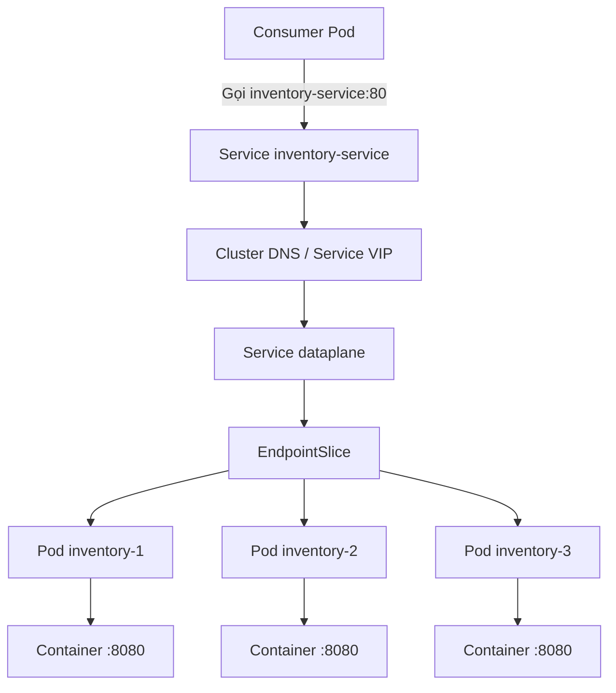

# Service, Pod và các endpoint trong mô hình khám phá

Trong Kubernetes, Pod là nơi chạy container, Service cung cấp một điểm truy cập ổn định cho nhóm Pod, còn EndpointSlice lưu danh sách địa chỉ backend mà Service có thể chuyển traffic tới. Ba đối tượng này phối hợp để ứng dụng gọi dịch vụ bằng tên ổn định mà không cần theo dõi IP thay đổi của từng Pod.

Đây là nền tảng của service discovery trên Kubernetes. Khi Pod được tạo mới, bị thay thế hoặc không còn sẵn sàng, Kubernetes cập nhật các endpoint tương ứng. Consumer tiếp tục gọi Service bằng DNS hoặc dùng Spring Cloud Kubernetes để khám phá instance, tùy mô hình tích hợp của ứng dụng.

## 1. Vai trò của Pod, Service và EndpointSlice

| Đối tượng | Vai trò | Đặc điểm cần nhớ |
|---|---|---|
| Pod | Đơn vị triển khai chạy một hoặc nhiều container cùng network namespace | Có IP riêng, vòng đời ngắn; IP có thể đổi khi Pod được thay thế |
| Service | Định nghĩa một nhóm backend và cung cấp địa chỉ truy cập ổn định | Thường chọn Pod bằng label selector |
| EndpointSlice | Lưu các địa chỉ và port backend của Service theo từng nhóm nhỏ | Được control plane cập nhật từ Pod phù hợp với selector và trạng thái endpoint |
| DNS trong cluster | Ánh xạ tên Service sang địa chỉ Service hoặc danh sách endpoint | Giúp consumer không cần ghi cứng IP |
| kube-proxy hoặc dataplane tương đương | Thực hiện chuyển tiếp traffic từ Service tới backend | Theo dõi Service và EndpointSlice để cập nhật quy tắc mạng |

Một Pod có thể bị xóa và tạo lại với IP khác. Nếu consumer gọi trực tiếp Pod IP, ứng dụng phải tự cập nhật địa chỉ mỗi khi workload thay đổi. Service giải quyết vấn đề này bằng tên DNS và địa chỉ ảo ổn định trong phạm vi cluster.

EndpointSlice là nguồn dữ liệu backend hiện đại mà Kubernetes dùng để biểu diễn endpoint. Resource Endpoints kiểu cũ vẫn có thể xuất hiện trong cluster, nhưng EndpointSlice được thiết kế để mở rộng tốt hơn khi Service có nhiều backend.

## 2. Quan hệ giữa Service, Pod và EndpointSlice

Service thường dùng selector để tìm các Pod có label phù hợp. Control plane theo dõi Pod và tạo/cập nhật EndpointSlice tương ứng. EndpointSlice chứa địa chỉ Pod, port và thông tin liên hệ tới Pod đích.



Luồng cập nhật thông thường:

1. Deployment tạo Pod và gắn label vào Pod template.
2. Service selector khớp với label của các Pod.
3. Kubernetes EndpointSlice controller tạo hoặc cập nhật EndpointSlice cho Service.
4. EndpointSlice công bố địa chỉ, port và trạng thái của các endpoint.
5. Dataplane trong cluster cập nhật cách chuyển traffic tới backend phù hợp.
6. Consumer gọi Service bằng DNS name hoặc ClusterIP ổn định.

Service không lưu bản sao container hay trực tiếp quản lý vòng đời Pod. Deployment/StatefulSet quản lý workload; Service định nghĩa cách truy cập; EndpointSlice mô tả các backend hiện có.

## 3. Ví dụ Service chọn Pod bằng label selector

Giả sử ứng dụng tồn kho chạy trong namespace `shop`. Deployment tạo các Pod có label `app: inventory`. Service chọn những Pod đó:

```yaml
apiVersion: v1
kind: Service
metadata:
  name: inventory-service
  namespace: shop
spec:
  type: ClusterIP
  selector:
    app: inventory
  ports:
    - name: http
      protocol: TCP
      port: 80
      targetPort: http
```

Container trong Pod khai báo port có tên `http`:

```yaml
apiVersion: apps/v1
kind: Deployment
metadata:
  name: inventory
  namespace: shop
spec:
  replicas: 3
  selector:
    matchLabels:
      app: inventory
  template:
    metadata:
      labels:
        app: inventory
    spec:
      containers:
        - name: inventory
          image: example/inventory:1.0
          ports:
            - name: http
              containerPort: 8080
              protocol: TCP
```

Ở đây:

- `spec.selector.app: inventory` của Service khớp với label trên Pod.
- `port: 80` là cổng Service mà consumer gọi.
- `targetPort: http` là cổng đích trên Pod; tên này được ánh xạ tới container port `8080`.
- `type: ClusterIP` tạo một địa chỉ Service nội bộ trong cluster.

Service có thể chọn nhiều Pod cùng lúc. Khi số replica tăng từ ba lên năm và các Pod mới có label phù hợp, endpoint controller cập nhật EndpointSlice để phản ánh backend mới.

### Selector phải khớp chính xác

Nếu Service selector là `app: inventory` nhưng Pod có label `app: inventory-v2`, Service không chọn được Pod đó. Service vẫn có thể tồn tại và DNS vẫn phân giải được ClusterIP, nhưng không có backend phù hợp để xử lý request.

Khi debug, cần đối chiếu selector của Service với label thực tế của Pod:

```bash
kubectl get service inventory-service -n shop
kubectl get pods -n shop --show-labels
kubectl describe service inventory-service -n shop
```

Nếu không thấy endpoint, kiểm tra selector, namespace, Pod labels và trạng thái readiness.

## 4. EndpointSlice chứa những thông tin gì?

Một EndpointSlice thường chứa:

- `addresses`: địa chỉ IP của endpoint.
- `ports`: port và protocol được công bố trong slice.
- `targetRef`: tham chiếu tới đối tượng đích, thường là Pod.
- `nodeName`: node đang chạy Pod, nếu có.
- `zone`: vùng topology của endpoint, nếu được cung cấp.
- `conditions.ready`: endpoint có sẵn sàng nhận traffic thông thường hay không.
- `conditions.serving`: endpoint hiện có đang phục vụ hay không.
- `conditions.terminating`: endpoint đang trong quá trình kết thúc hay không.

Ví dụ minh họa cấu trúc EndpointSlice do Kubernetes quản lý:

```yaml
apiVersion: discovery.k8s.io/v1
kind: EndpointSlice
metadata:
  name: inventory-service-abcde
  namespace: shop
  labels:
    kubernetes.io/service-name: inventory-service
addressType: IPv4
ports:
  - name: http
    protocol: TCP
    port: 8080
endpoints:
  - addresses:
      - 10.42.1.17
    conditions:
      ready: true
      serving: true
      terminating: false
    targetRef:
      kind: Pod
      name: inventory-7c9d8f-abcde
```

Tên EndpointSlice, IP, Pod và các điều kiện trong ví dụ chỉ nhằm minh họa. EndpointSlice thực tế do control plane tạo và có thể chia thành nhiều slice khi số endpoint tăng. Không nên sửa trực tiếp slice do controller quản lý nếu Service đang dùng selector.

Có thể xem EndpointSlice của Service bằng:

```bash
kubectl get endpointslice -n shop \
  -l kubernetes.io/service-name=inventory-service
```

Xem chi tiết:

```bash
kubectl describe endpointslice -n shop inventory-service-abcde
```

Tên slice thực tế cần lấy từ kết quả lệnh list; không giả định luôn là `inventory-service-abcde`.

## 5. EndpointSlice và Endpoints kiểu cũ

Kubernetes từng dùng resource `Endpoints` để biểu diễn danh sách địa chỉ backend. Resource này vẫn có thể được quan sát bằng lệnh:

```bash
kubectl get endpoints inventory-service -n shop
```

Tuy nhiên, `Endpoints` có giới hạn khi Service có số lượng backend lớn. EndpointSlice chia endpoint thành nhiều slice, hỗ trợ metadata và điều kiện endpoint rõ ràng hơn, đồng thời giúp control plane cập nhật dữ liệu theo từng phần.

| Tiêu chí | Endpoints | EndpointSlice |
|---|---|---|
| Mô hình | Một resource tập hợp địa chỉ backend | Có thể có nhiều slice cho một Service |
| Quy mô lớn | Khó mở rộng hiệu quả khi nhiều endpoint | Chia nhỏ và cập nhật theo slice |
| Điều kiện endpoint | Biểu diễn hạn chế hơn | Có ready, serving, terminating |
| Topology | Ít thông tin hơn | Có thể mang node và zone |
| Vai trò hiện nay | API tương thích cũ | API được khuyến nghị cho endpoint discovery |

Khi đọc dữ liệu vận hành hiện đại, nên ưu tiên EndpointSlice. Resource Endpoints có thể vẫn được tạo để tương thích, nhưng không nên xây integration mới phụ thuộc vào các giới hạn của resource cũ.

## 6. Readiness quyết định endpoint có nhận traffic hay không

Pod tồn tại không có nghĩa ứng dụng trong Pod đã sẵn sàng. Kubernetes sử dụng readiness probe để xác định container có thể nhận traffic hay chưa.

Ví dụ Deployment cấu hình readiness probe:

```yaml
apiVersion: apps/v1
kind: Deployment
metadata:
  name: inventory
  namespace: shop
spec:
  replicas: 3
  selector:
    matchLabels:
      app: inventory
  template:
    metadata:
      labels:
        app: inventory
    spec:
      containers:
        - name: inventory
          image: example/inventory:1.0
          ports:
            - name: http
              containerPort: 8080
          readinessProbe:
            httpGet:
              path: /actuator/health/readiness
              port: http
            initialDelaySeconds: 5
            periodSeconds: 5
```

Khi readiness probe thất bại, Pod có thể vẫn ở trạng thái Running nhưng điều kiện Ready là false. Với Service thông thường, EndpointSlice phản ánh endpoint chưa sẵn sàng; dataplane sẽ không chọn endpoint đó cho traffic bình thường.

Phân biệt ba trạng thái probe:

- **Liveness:** xác định container có cần được khởi động lại hay không.
- **Readiness:** xác định Pod có nên nhận traffic hay không.
- **Startup:** cho ứng dụng thêm thời gian khởi tạo trước khi liveness/readiness bắt đầu đánh giá theo cấu hình.

Không dùng liveness thay cho readiness. Một ứng dụng có thể còn sống nhưng chưa kết nối xong database hoặc chưa nạp dữ liệu cần thiết. Nếu liveness chỉ dựa trên việc tiến trình còn chạy, Pod không nhất thiết phải restart; readiness mới là tín hiệu để rút endpoint khỏi traffic.

### Endpoint đang kết thúc

Khi Pod bị xóa, endpoint có thể được đánh dấu `terminating` trong EndpointSlice. Điều kiện `serving` và `ready` giúp dataplane và hệ thống điều phối xử lý quá trình drain. Cách endpoint terminating được sử dụng phụ thuộc phiên bản Kubernetes, cấu hình Service và implementation dataplane.

Với rollout an toàn, ứng dụng nên có graceful shutdown, readiness chuyển false trước khi kết thúc, thời gian drain phù hợp và `terminationGracePeriodSeconds` đủ cho request đang chạy. Không nên chỉ xóa Pod ngay lập tức rồi kỳ vọng mọi consumer đã kịp cập nhật cache.

## 7. Service ClusterIP và DNS ổn định

Với Service kiểu ClusterIP, Kubernetes cấp một virtual IP ổn định trong phạm vi cluster. DNS nội bộ công bố tên Service trỏ tới ClusterIP đó.

Ví dụ trong cùng namespace `shop`, consumer có thể gọi:

```text
http://inventory-service
```

Từ namespace khác, có thể dùng tên đầy đủ:

```text
http://inventory-service.shop.svc.cluster.local
```

Tên đầy đủ có cấu trúc:

```text
<service>.<namespace>.svc.cluster.local
```

Consumer gọi Service IP/hostname; dataplane chuyển traffic tới một endpoint phù hợp. Consumer không cần biết Pod IP. Khi Pod được thay thế, Service DNS và ClusterIP vẫn giữ nguyên, trong khi EndpointSlice được cập nhật.

ClusterIP không phải IP của một Pod cụ thể. Đây là địa chỉ ảo đại diện cho Service. Cách thực hiện chuyển tiếp phụ thuộc dataplane: kube-proxy có thể lập quy tắc iptables/IPVS hoặc cluster có thể dùng giải pháp eBPF tương đương.

## 8. Headless Service: DNS trả về địa chỉ Pod

Headless Service được khai báo bằng `clusterIP: None`. Kubernetes không cấp ClusterIP cho Service này. Thay vào đó, DNS có thể trả về các địa chỉ endpoint trực tiếp, tùy trạng thái endpoint và cấu hình publish-not-ready-addresses.

Ví dụ:

```yaml
apiVersion: v1
kind: Service
metadata:
  name: inventory-headless
  namespace: shop
spec:
  clusterIP: None
  selector:
    app: inventory
  ports:
    - name: http
      port: 8080
      targetPort: http
```

Khác biệt chính:

| ClusterIP Service | Headless Service |
|---|---|
| Có virtual IP ổn định | Không có ClusterIP |
| DNS thường trả về ClusterIP | DNS có thể trả về địa chỉ endpoint |
| Dataplane chọn backend khi gửi traffic tới Service | Client có thể nhận nhiều địa chỉ Pod và tự lựa chọn |
| Phù hợp với lời gọi service thông thường | Hữu ích khi client cần biết từng member/endpoint |

Headless Service thường được dùng cùng StatefulSet khi ứng dụng cần danh tính mạng ổn định cho từng Pod, ví dụ cụm database hoặc hệ thống phân tán. Trong trường hợp này, DNS có thể công bố tên riêng của từng Pod dưới domain của headless Service.

Không nên chọn headless Service chỉ vì muốn “cân bằng tải tốt hơn”. Client cần hiểu DNS trả về nhiều địa chỉ, xử lý cache, retry và loại endpoint không sẵn sàng. Với ứng dụng HTTP thông thường, ClusterIP thường đơn giản hơn.

## 9. Service không có selector và endpoint bên ngoài

Không phải Service nào cũng chọn Pod bằng selector. Một Service có thể không khai báo selector, trong khi EndpointSlice được quản lý thủ công hoặc bởi controller khác để trỏ tới endpoint bên ngoài cluster.

Mô hình này hữu ích khi:

- Cần công bố một dịch vụ chạy trên VM hoặc hệ thống ngoài Kubernetes.
- Cần chuyển tiếp tới backend có địa chỉ được quản lý bởi hệ thống khác.
- Muốn dùng cùng một tên Service trong cluster nhưng backend nằm ngoài Pod.

Ví dụ Service không selector:

```yaml
apiVersion: v1
kind: Service
metadata:
  name: legacy-payment
  namespace: shop
spec:
  ports:
    - name: https
      port: 443
      protocol: TCP
```

Với Service không có selector, Kubernetes không tự tạo EndpointSlice dựa trên Pod labels. Người vận hành hoặc controller cần tạo EndpointSlice phù hợp, dùng label `kubernetes.io/service-name` trùng tên Service và khai báo địa chỉ endpoint hợp lệ.

Không nên tạo EndpointSlice trỏ tới địa chỉ loopback hoặc địa chỉ không thể route từ node/Pod. Cũng cần bảo đảm endpoint port và protocol khớp với Service port.

Một trường hợp khác là Service kiểu `ExternalName`. Loại này tạo ánh xạ DNS CNAME tới hostname bên ngoài; nó không hoạt động như Service selector có ClusterIP và EndpointSlice backend thông thường.

## 10. Các loại Service và phạm vi truy cập

Các loại Service phổ biến:

| Type | Mục đích | Đặc điểm |
|---|---|---|
| ClusterIP | Truy cập nội bộ cluster | Mặc định; cung cấp virtual IP ổn định |
| NodePort | Mở một port trên các node | Cho phép truy cập qua địa chỉ node và port được cấp |
| LoadBalancer | Expose Service qua load balancer bên ngoài | Phụ thuộc cloud provider hoặc implementation hỗ trợ |
| ExternalName | Ánh xạ tên Service tới hostname ngoài | DNS CNAME, không chọn Pod bằng selector |

NodePort và LoadBalancer thay đổi cách Service được truy cập từ bên ngoài, nhưng backend vẫn được biểu diễn bằng endpoint. Khi Service có selector, EndpointSlice vẫn chứa các Pod phù hợp và dataplane chuyển traffic tới backend theo cấu hình.

Cần phân biệt:

- `port`: cổng consumer gọi trên Service.
- `targetPort`: cổng ứng dụng trên endpoint/Pod.
- `nodePort`: cổng được mở trên node khi dùng Service type NodePort hoặc LoadBalancer theo cấu hình.

Nhầm port và targetPort là nguyên nhân thường gặp khiến Service tồn tại nhưng request không tới đúng cổng ứng dụng.

## 11. Service discovery trong Spring Cloud Kubernetes

Spring Cloud Kubernetes cung cấp integration để ứng dụng Spring Cloud khám phá dịch vụ dựa trên các đối tượng Kubernetes. Tùy phiên bản và cấu hình, discovery client có thể lấy thông tin từ Service và endpoint liên quan trong namespace được phép truy cập.

Ở mức ứng dụng, consumer có thể dùng abstraction Spring Cloud:

```java
import java.util.List;

import org.springframework.cloud.client.ServiceInstance;
import org.springframework.cloud.client.discovery.DiscoveryClient;
import org.springframework.stereotype.Component;

@Component
public class InventoryLookup {

    private final DiscoveryClient discoveryClient;

    public InventoryLookup(DiscoveryClient discoveryClient) {
        this.discoveryClient = discoveryClient;
    }

    public List<ServiceInstance> findInstances() {
        return discoveryClient.getInstances("inventory-service");
    }
}
```

Danh sách `ServiceInstance` là góc nhìn của discovery integration, không phải bản sao đầy đủ của mọi trường Kubernetes API. Việc ánh xạ Service, Pod và EndpointSlice thành instance có thể khác theo chế độ discovery, provider client và phiên bản Spring Cloud Kubernetes.

Nếu chỉ cần gọi một Kubernetes Service bằng DNS, ứng dụng có thể dùng hostname của Service mà không cần triển khai thêm Eureka hoặc Consul. Nếu cần client-side selection, metadata hoặc abstraction thống nhất giữa nhiều nền tảng, Spring Cloud Kubernetes Discovery và Spring Cloud LoadBalancer có thể hữu ích.

Khi dùng `@FeignClient(name = "inventory-service")` hoặc HTTP client có `@LoadBalanced`, bảo đảm discovery integration được bật và service name khớp Service trong Kubernetes. Nếu dùng URL cố định, request đi thẳng tới URL đó và không dựa vào ServiceInstance selection của LoadBalancer.

## 12. Quan sát và debug Service/Pod/EndpointSlice

Các lệnh hữu ích:

```bash
kubectl get services -n shop
kubectl get pods -n shop -o wide --show-labels
kubectl describe service inventory-service -n shop
kubectl get endpointslices -n shop \
  -l kubernetes.io/service-name=inventory-service
```

Để xem YAML:

```bash
kubectl get service inventory-service -n shop -o yaml
kubectl get endpointslices -n shop \
  -l kubernetes.io/service-name=inventory-service -o yaml
```

Khi Service không có backend, kiểm tra theo thứ tự:

1. Service có tồn tại trong đúng namespace không?
2. Selector của Service có khớp label Pod không?
3. Pod có được tạo và ở trạng thái Ready không?
4. EndpointSlice có địa chỉ Pod và port đúng không?
5. Readiness probe có thất bại hoặc path/port sai không?
6. Service port và targetPort có khớp với container listener không?
7. NetworkPolicy, firewall hoặc dataplane có chặn traffic không?
8. Consumer có gọi đúng DNS name/namespace không?

| Hiện tượng | Nguyên nhân có thể | Hướng xử lý |
|---|---|---|
| Service có ClusterIP nhưng không gọi được | Không có endpoint hoặc targetPort sai | Kiểm tra selector và EndpointSlice |
| EndpointSlice rỗng | Pod label không khớp hoặc chưa có Pod phù hợp | Đối chiếu selector với Pod labels |
| Pod Running nhưng không nhận traffic | Readiness false | Kiểm tra readiness probe và health endpoint |
| Consumer gọi Pod IP cũ | Ứng dụng lưu địa chỉ Pod thay vì dùng Service | Dùng Service DNS hoặc discovery client |
| DNS trả ClusterIP nhưng request timeout | Dataplane, network policy hoặc backend lỗi | Kiểm tra endpoint, kube-proxy/eBPF và network |
| Headless Service không trả địa chỉ mong muốn | Endpoint chưa ready hoặc DNS cache | Kiểm tra EndpointSlice conditions và DNS policy |
| Endpoint có port sai | Service targetPort không khớp container port | Dùng named port hoặc sửa targetPort |
| Service không tự tạo endpoint | Service không có selector | Quản lý EndpointSlice bằng controller hoặc khai báo phù hợp |

Đừng chỉ kiểm tra Pod ở trạng thái Running. Cần xem Ready condition và EndpointSlice để biết endpoint có được công bố cho traffic hay không.

## 13. Checklist thiết kế mô hình khám phá

Trước khi triển khai, hãy xác nhận:

1. Deployment/StatefulSet gắn label ổn định cho Pod template.
2. Service selector khớp chính xác các label cần chọn.
3. Service port và targetPort ánh xạ đúng cổng ứng dụng.
4. Readiness probe phản ánh khả năng nhận request nghiệp vụ.
5. EndpointSlice chứa đúng địa chỉ, port và trạng thái endpoint.
6. Consumer dùng Service DNS hoặc discovery client thay vì giữ Pod IP.
7. Chọn ClusterIP hay headless Service theo cách client cần truy cập backend.
8. Nếu Service không selector, có controller/quy trình quản lý EndpointSlice rõ ràng.
9. Có graceful shutdown và drain endpoint khi rollout.
10. NetworkPolicy và DNS cho phép consumer kết nối backend.
11. Spring Cloud Kubernetes có quyền đọc đúng namespace và resource cần thiết.
12. Có log/metric để đối chiếu Service, Pod, EndpointSlice và kết quả lookup.

Service cung cấp tên và điểm truy cập ổn định, Pod là nơi chạy ứng dụng, còn EndpointSlice phản ánh các backend thực tế mà Service có thể sử dụng. Khi selector, readiness, port mapping và DNS được cấu hình đúng, Kubernetes có thể cập nhật endpoint theo vòng đời Pod mà consumer không cần theo dõi IP của từng instance. Đây là nền tảng để Spring Cloud Kubernetes và các client load-balanced gọi dịch vụ ổn định trong môi trường Kubernetes.
