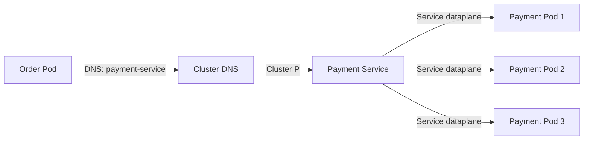
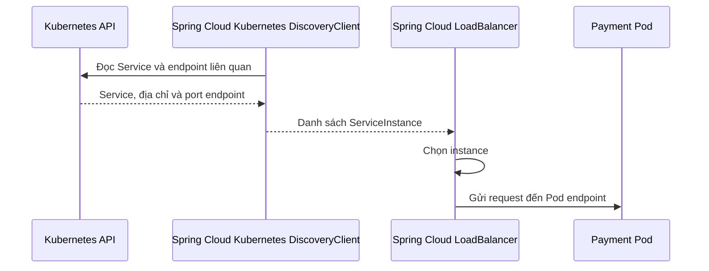

# So sánh DNS với Spring Cloud Kubernetes DiscoveryClient

Trong Kubernetes, một ứng dụng có thể tìm dịch vụ bằng DNS nội bộ của cluster hoặc thông qua `DiscoveryClient` của Spring Cloud Kubernetes. Cả hai cách đều giúp consumer tìm được endpoint của service, nhưng chúng hoạt động ở các lớp khác nhau và trả về mức thông tin khác nhau.

DNS cung cấp tên ổn định cho Kubernetes Service. Với Service thông thường, DNS phân giải tên thành ClusterIP; dataplane của Kubernetes chuyển request đến một backend phù hợp. Với headless Service, DNS có thể trả về địa chỉ của các Pod thay vì một ClusterIP. Trong khi đó, Spring Cloud Kubernetes `DiscoveryClient` truy vấn Kubernetes API để lấy thông tin service và instance, sau đó biểu diễn instance bằng `ServiceInstance` của Spring Cloud.

Trong module `SPRING_CLOUD_SERVICE_DISCOVERY`, mục tiêu là tìm instance bằng tên dịch vụ qua các abstraction như `DiscoveryClient` và sử dụng thông tin đó với load balancing. Vì vậy, cần hiểu khi nào DNS đã đủ, khi nào ứng dụng cần danh sách instance ở tầng Spring và cách tránh tạo hai lớp load balancing ngoài ý muốn.

## 1. Hai cơ chế nằm ở hai lớp khác nhau

### 1.1. Kubernetes DNS

Kubernetes DNS cung cấp tên miền nội bộ cho Service và một số loại workload. Ví dụ Service `payment-service` trong namespace `commerce` thường có tên đầy đủ:

```text
payment-service.commerce.svc.cluster.local
```

`cluster.local` là cluster domain mặc định thường gặp; cluster có thể được cấu hình domain khác. Pod trong cùng namespace thường có thể dùng tên ngắn `payment-service`; Pod ở namespace khác nên dùng tên có namespace hoặc FQDN để tránh phân giải nhầm.

Với Service có ClusterIP, DNS thường trả về địa chỉ ClusterIP của Service. Consumer gửi request đến IP ảo này; Kubernetes Service dataplane (ví dụ kube-proxy hoặc cơ chế dataplane thay thế) chuyển request đến một endpoint phù hợp.

Với headless Service (`clusterIP: None`), DNS trả về địa chỉ của các endpoint thay vì một ClusterIP duy nhất. Khi đó, client có thể nhận nhiều địa chỉ và cách phân phối request phụ thuộc DNS resolver, client và cache.

### 1.2. Spring Cloud Kubernetes DiscoveryClient

Spring Cloud Kubernetes cung cấp implementation của `org.springframework.cloud.client.discovery.DiscoveryClient`. Implementation này sử dụng Kubernetes API để khám phá Service và các endpoint/instance liên quan. Nó chuyển dữ liệu đó thành danh sách `ServiceInstance`, gồm các thông tin như service ID, host, port, URI và metadata.

Consumer có thể gọi:

```java
discoveryClient.getInstances("payment-service");
```

để nhận danh sách instance của service theo service ID. Danh sách này có thể được đưa vào Spring Cloud LoadBalancer để chọn một Pod endpoint ở phía client, hoặc được ứng dụng đọc để áp dụng chính sách riêng.

`DiscoveryClient` không đơn thuần là một DNS resolver. Nó làm việc với Kubernetes API và resource trong cluster. Vì vậy, ứng dụng cần dependency Spring Cloud Kubernetes phù hợp và quyền RBAC để đọc các resource mà implementation sử dụng.

## 2. Luồng DNS cho Service có ClusterIP

Giả sử có một Service `payment-service` trong namespace `commerce`:

```yaml
apiVersion: v1
kind: Service
metadata:
  name: payment-service
  namespace: commerce
spec:
  type: ClusterIP
  selector:
    app: payment
  ports:
    - name: http
      port: 80
      targetPort: 8080
```

DNS tạo bản ghi cho Service. Từ Pod trong namespace `commerce`, ứng dụng có thể gọi:

```text
http://payment-service
```

hoặc từ namespace khác:

```text
http://payment-service.commerce.svc.cluster.local
```

Tên này phân giải đến ClusterIP của Service. Request đến port `80` được chuyển tiếp đến `targetPort: 8080` của một Pod phù hợp với selector và endpoint hiện tại.



Consumer chỉ cần biết một DNS name và port của Service. Kubernetes chịu trách nhiệm phân phối request đến các backend. Ứng dụng không cần đọc từng Pod IP hoặc tự chọn một Pod.

## 3. DNS cho headless Service

Headless Service được khai báo bằng `clusterIP: None`:

```yaml
apiVersion: v1
kind: Service
metadata:
  name: payment-headless
  namespace: commerce
spec:
  clusterIP: None
  selector:
    app: payment
  ports:
    - name: http
      port: 8080
      targetPort: 8080
```

Với headless Service, DNS có thể trả về nhiều địa chỉ Pod:

```text
payment-headless.commerce.svc.cluster.local
    -> 10.10.1.21
    -> 10.10.2.34
    -> 10.10.3.18
```

Client nhận nhiều địa chỉ và có thể chọn một địa chỉ theo hành vi của resolver hoặc HTTP client. Thứ tự bản ghi, thời gian cache và chiến lược thử địa chỉ khác nhau giữa các client; không nên giả định mọi client sẽ round-robin giống nhau.

Headless Service thường hữu ích khi ứng dụng cần biết từng endpoint, chẳng hạn StatefulSet, hệ thống phân tán có peer identity hoặc ứng dụng tự quản lý kết nối đến từng thành viên. Với StatefulSet và headless Service, mỗi Pod có thể có DNS name ổn định theo ordinal, ví dụ `payment-0.payment-headless.commerce.svc.cluster.local`.

## 4. Luồng Spring Cloud Kubernetes DiscoveryClient

Với Spring Cloud Kubernetes DiscoveryClient, ứng dụng sử dụng Kubernetes API để tìm service và instance. Một luồng khái quát:

1. Provider tạo Kubernetes Service và Pod theo manifest/deployment.
2. Kubernetes cập nhật Service cùng thông tin endpoint tương ứng khi Pod phù hợp selector và điều kiện sẵn sàng.
3. Discovery client của ứng dụng consumer truy vấn resource cần thiết qua Kubernetes API.
4. Implementation chuyển các endpoint thành `ServiceInstance`.
5. Consumer hoặc Spring Cloud LoadBalancer chọn một instance để gọi.



Resource và cơ chế cập nhật cụ thể phụ thuộc phiên bản Spring Cloud Kubernetes. Một số phiên bản/tùy chọn làm việc với Endpoints, phiên bản mới có thể hỗ trợ EndpointSlices hoặc cơ chế tương ứng. Cần kiểm tra tài liệu release train đang dùng và quyền RBAC thực tế, không giả định mọi phiên bản truy vấn cùng một loại resource.

Khác với DNS ClusterIP, discovery client có thể cung cấp danh sách địa chỉ instance cho ứng dụng. Điều này hữu ích khi cần client-side load balancing, đọc metadata hoặc áp dụng logic chọn instance ở tầng Spring.

## 5. So sánh trực tiếp

| Tiêu chí | Kubernetes DNS | Spring Cloud Kubernetes DiscoveryClient |
|---|---|---|
| Nguồn dữ liệu | Bản ghi DNS được tạo từ Service/endpoint theo quy tắc Kubernetes DNS. | Kubernetes API và resource discovery mà integration hỗ trợ. |
| Kết quả điển hình | ClusterIP cho Service thông thường; nhiều endpoint IP cho headless Service. | Danh sách `ServiceInstance` với host, port và metadata. |
| Load balancing | Thường do Service dataplane xử lý với ClusterIP; headless phụ thuộc client/resolver. | Có thể kết hợp Spring Cloud LoadBalancer để chọn instance phía client. |
| Phụ thuộc Spring | Không; mọi ngôn ngữ và HTTP client dùng được DNS. | Có; cần Spring Cloud Kubernetes Discovery dependency và cấu hình tương thích. |
| Quyền truy cập Kubernetes API | Ứng dụng chỉ dùng DNS và gọi Service thường không cần quyền đọc Service/Endpoint qua API. | ServiceAccount/RBAC cần quyền đọc các resource mà discovery implementation sử dụng. |
| Metadata instance | DNS không cung cấp map metadata của từng instance theo API `ServiceInstance`. | Có thể cung cấp metadata từ Kubernetes Service/Pod/endpoint theo khả năng implementation. |
| Phạm vi khám phá | Theo DNS name và namespace/domain. | Có thể giới hạn hoặc mở rộng namespace theo cấu hình và RBAC. |
| Tích hợp ứng dụng | Dùng hostname như endpoint thông thường. | Dùng `DiscoveryClient`, `ServiceInstance` và các abstraction Spring Cloud. |
| Thay đổi endpoint | DNS và Service dataplane cập nhật theo thay đổi Service/endpoint; resolver có thể cache. | Discovery client quan sát resource qua API; cache/watch/refresh tùy implementation và phiên bản. |
| Độ phức tạp | Thấp, phù hợp gọi service thông thường. | Cao hơn, hữu ích khi cần danh sách instance và policy phía client. |

Hai cách không loại trừ nhau ở cấp cluster, nhưng mỗi request path nên có một mô hình phân phối traffic rõ ràng.

## 6. Khi nào nên dùng DNS?

DNS thường là lựa chọn phù hợp khi consumer chỉ cần gọi một service endpoint ổn định do Kubernetes quản lý.

Chọn DNS nếu:

- Ứng dụng chỉ cần gọi một Service bằng hostname và port.
- Không cần tự đọc danh sách Pod instance.
- Muốn Kubernetes Service dataplane chịu trách nhiệm phân phối traffic.
- Muốn giữ ứng dụng ít phụ thuộc Spring Cloud và Kubernetes API.
- Có nhiều ngôn ngữ hoặc runtime khác nhau cùng gọi service.
- Service có ClusterIP ổn định và endpoint được quản lý bằng selector/readiness.

Ví dụ trong Spring Boot, có thể dùng `WebClient` thông thường:

```java
import org.springframework.context.annotation.Bean;
import org.springframework.context.annotation.Configuration;
import org.springframework.web.reactive.function.client.WebClient;

@Configuration
public class PaymentClientConfiguration {

    @Bean
    WebClient paymentWebClient(WebClient.Builder builder) {
        return builder
                .baseUrl("http://payment-service.commerce.svc.cluster.local")
                .build();
    }
}
```

Request được gửi đến DNS name của Kubernetes Service. Ứng dụng không cần inject `DiscoveryClient` hay biết Pod IP.

## 7. Khi nào nên dùng Spring Cloud Kubernetes DiscoveryClient?

DiscoveryClient phù hợp khi ứng dụng cần biết danh sách instance thay vì chỉ biết một Service virtual IP.

Chọn DiscoveryClient nếu:

- Cần lấy danh sách `ServiceInstance` và tự chọn endpoint ở phía client.
- Cần đọc metadata hoặc thông tin của từng instance cho policy định tuyến.
- Cần tích hợp với Spring Cloud LoadBalancer và các abstraction discovery hiện có.
- Cần áp dụng logic lựa chọn theo zone, version, label hoặc capability.
- Muốn dùng cùng API `DiscoveryClient` khi thay đổi discovery provider trong hệ sinh thái Spring Cloud.
- Cần khám phá service trong namespace được chỉ định theo cấu hình và quyền RBAC.

Ví dụ đọc instance:

```java
import java.util.List;

import org.springframework.cloud.client.ServiceInstance;
import org.springframework.cloud.client.discovery.DiscoveryClient;
import org.springframework.stereotype.Service;

@Service
public class PaymentDiscoveryService {

    private final DiscoveryClient discoveryClient;

    public PaymentDiscoveryService(DiscoveryClient discoveryClient) {
        this.discoveryClient = discoveryClient;
    }

    public List<ServiceInstance> findPaymentInstances() {
        return discoveryClient.getInstances("payment-service");
    }

    public void logInstances() {
        for (ServiceInstance instance : findPaymentInstances()) {
            System.out.printf(
                    "id=%s host=%s port=%d uri=%s metadata=%s%n",
                    instance.getInstanceId(),
                    instance.getHost(),
                    instance.getPort(),
                    instance.getUri(),
                    instance.getMetadata()
            );
        }
    }
}
```

Nếu danh sách rỗng, cần kiểm tra service ID, namespace discovery, selector/endpoint, quyền RBAC và trạng thái sẵn sàng của Pod. `DiscoveryClient` chỉ trả dữ liệu mà implementation quan sát được; nó không bảo đảm endpoint luôn còn sống tại thời điểm request thực sự được gửi.

## 8. Tích hợp DiscoveryClient với Spring Cloud LoadBalancer

Khi dùng DiscoveryClient, có thể dùng Spring Cloud LoadBalancer để chọn một `ServiceInstance` thay vì tự chọn thủ công.

Ví dụ tạo `WebClient` có load balancing:

```java
import org.springframework.cloud.client.loadbalancer.LoadBalanced;
import org.springframework.context.annotation.Bean;
import org.springframework.context.annotation.Configuration;
import org.springframework.web.reactive.function.client.WebClient;

@Configuration
public class LoadBalancedClientConfiguration {

    @Bean
    @LoadBalanced
    WebClient.Builder loadBalancedWebClientBuilder() {
        return WebClient.builder();
    }
}
```

Gọi service bằng service ID:

```java
webClientBuilder.build()
        .get()
        .uri("http://payment-service/api/payments/42")
        .retrieve()
        .bodyToMono(String.class);
```

Để hoạt động, ứng dụng cần Spring Cloud LoadBalancer và Spring Cloud Kubernetes DiscoveryClient được cấu hình tương thích. LoadBalancer yêu cầu danh sách instance theo service ID, chọn một instance và tạo request đến host/port của instance đó.

Với DNS, URL thường là `http://payment-service.commerce.svc.cluster.local/...` và không cần `@LoadBalanced`. Không dùng service DNS ClusterIP như thể nó là danh sách Pod instance nếu mục tiêu là client-side load balancing.

## 9. Tránh double load balancing

Một lỗi thiết kế phổ biến là kết hợp DNS ClusterIP với client-side load balancing theo cách không chủ đích.

Ví dụ không cần thiết:

1. Discovery client trả về các instance nhưng host của mỗi instance lại được cấu hình thành cùng một DNS name ClusterIP.
2. Spring Cloud LoadBalancer chọn một `ServiceInstance`.
3. Request được gửi đến ClusterIP.
4. Kubernetes Service dataplane lại chọn một Pod khác.

Trong tình huống này, lần chọn của Spring Cloud không quyết định Pod cuối cùng nhận request. Kubernetes tiếp tục load balance ở lớp Service. Việc ghi log instance được chọn có thể không phản ánh Pod thực tế xử lý request.

Hãy chọn một trong hai mô hình cho một request path:

- **DNS + ClusterIP:** ứng dụng gọi Service DNS; Kubernetes chọn backend.
- **DiscoveryClient + Pod endpoints:** ứng dụng lấy Pod endpoint; Spring Cloud LoadBalancer chọn backend trực tiếp.

Có thể kết hợp nhiều lớp khi có lý do cụ thể, nhưng phải hiểu rõ lớp nào chọn endpoint cuối cùng, cách health được áp dụng và cách quan sát request.

## 10. Readiness, health và endpoint được công bố

DNS và DiscoveryClient đều phụ thuộc vào trạng thái Service/endpoint mà Kubernetes công bố, nhưng cách tiêu thụ thông tin khác nhau.

- Với Service thông thường, DNS vẫn cung cấp tên ClusterIP ổn định khi endpoint thay đổi. Dataplane sử dụng danh sách endpoint phù hợp để chuyển traffic.
- Với headless Service, DNS trả về các địa chỉ endpoint; resolver có thể cache kết quả nên ứng dụng có thể tiếp tục dùng địa chỉ cũ trong một khoảng thời gian.
- DiscoveryClient lấy thông tin endpoint từ Kubernetes API theo khả năng của integration. Việc endpoint có được lọc theo readiness hay bao gồm địa chỉ chưa sẵn sàng phụ thuộc cấu hình và phiên bản.
- `publishNotReadyAddresses` có thể thay đổi việc công bố endpoint chưa ready cho một số mục đích như peer discovery; không bật tùy chọn này nếu consumer không được phép gọi Pod chưa sẵn sàng.

Readiness probe và liveness probe có mục tiêu khác nhau. Readiness quyết định Pod có nên nhận traffic; liveness giúp phát hiện tiến trình cần restart. Không dùng liveness để thay thế readiness trong việc điều khiển endpoint.

Ngay cả khi endpoint được đánh dấu ready, request vẫn có thể thất bại do process dừng ngay sau khi discovery, lỗi mạng hoặc timeout. Consumer cần timeout, retry có giới hạn và xử lý lỗi kết nối.

## 11. Cấu hình Spring Cloud Kubernetes Discovery

Dependency và thuộc tính chính xác phụ thuộc release train Spring Cloud và phiên bản Spring Cloud Kubernetes. Một cấu hình minh họa có thể giới hạn discovery trong namespace ứng dụng:

```yaml
spring:
  application:
    name: order-service
  cloud:
    kubernetes:
      discovery:
        enabled: true
        all-namespaces: false
```

Khi dùng namespace cụ thể, có thể cấu hình danh sách namespace được khám phá theo thuộc tính mà phiên bản đang dùng hỗ trợ. Không bật khám phá toàn bộ namespace nếu ứng dụng chỉ cần một phạm vi nhỏ.

Spring Cloud Kubernetes có thể cần ServiceAccount với quyền đọc Service và các resource endpoint liên quan. Quyền cụ thể thay đổi theo phiên bản và implementation, ví dụ quyền `get`, `list` hoặc `watch` trên `services`, `endpoints` hoặc `endpointslices`. Hãy cấp quyền tối thiểu theo resource thực sự được client sử dụng.

Nếu chỉ gọi Service bằng DNS, ứng dụng không cần quyền đọc Kubernetes API chỉ để phân giải tên. Kubernetes DNS và Service dataplane cung cấp đường truy cập mà không yêu cầu ứng dụng có quyền liệt kê Pod hoặc Service.

## 12. Phạm vi namespace và tên service

DNS name của Service có namespace rõ ràng:

```text
payment-service.commerce.svc.cluster.local
```

Tên ngắn `payment-service` thường được phân giải theo search domain của Pod, nên trong namespace khác có thể trỏ đến một Service khác cùng tên hoặc không phân giải được.

Với DiscoveryClient, service ID thường là tên Kubernetes Service. Việc tìm kiếm ở namespace nào phụ thuộc cấu hình discovery và quyền của ServiceAccount. Nếu có hai namespace cùng có Service tên `payment-service`, cần dùng phạm vi namespace rõ ràng hoặc một quy ước tên/namespace để tránh nhầm lẫn.

Ví dụ một ứng dụng ở namespace `orders` muốn gọi service ở namespace `commerce`:

```text
DNS: payment-service.commerce.svc.cluster.local
DiscoveryClient: khám phá namespace commerce theo cấu hình được hỗ trợ
```

Không giả định `DiscoveryClient.getInstances("payment-service")` luôn tra cứu mọi namespace. Hãy kiểm tra cấu hình `all-namespaces`/namespace list và RBAC.

## 13. Metadata và khả năng định tuyến

DNS cung cấp tên và địa chỉ, không cung cấp map metadata của từng instance theo abstraction `ServiceInstance`. DiscoveryClient có thể trả metadata dựa trên Service/Pod hoặc endpoint resource mà integration hỗ trợ.

Metadata có thể được dùng để:

- Ưu tiên zone hoặc region gần consumer.
- Phân biệt version hoặc nhóm rollout nếu thông tin được công bố.
- Lọc instance theo label hoặc thuộc tính được ánh xạ.
- Hỗ trợ quan sát và chẩn đoán từng endpoint.

Không phải mọi label của Pod đều tự động xuất hiện trong `ServiceInstance.metadata`. Cần xác minh mapping của phiên bản Spring Cloud Kubernetes đang dùng. Nếu chính sách dựa trên label, hãy xác định label được đọc từ Service hay Pod và cách nó được ánh xạ.

DNS thường phù hợp khi không cần metadata; DiscoveryClient phù hợp khi ứng dụng cần dùng metadata trong policy lựa chọn instance. Metadata không thay thế health/readiness và không bảo đảm endpoint còn hoạt động.

## 14. Bảo mật và độ sẵn sàng

### 14.1. DNS path

- Bảo đảm CoreDNS hoặc DNS provider của cluster sẵn sàng và có thể truy cập từ Pod.
- Kiểm tra NetworkPolicy cho phép truy vấn DNS UDP/TCP port 53.
- Theo dõi DNS cache và TTL khi endpoint thay đổi.
- Không công khai Service nội bộ bằng Service type hoặc ingress không cần thiết.

### 14.2. DiscoveryClient path

- Dùng ServiceAccount riêng cho workload.
- Cấp RBAC tối thiểu trên namespace và resource cần đọc.
- Không bật `all-namespaces` nếu không có nhu cầu.
- Bảo vệ Kubernetes API bằng cơ chế xác thực và TLS do cluster cung cấp.
- Theo dõi lỗi `Forbidden`, lỗi watch/list và độ trễ cập nhật endpoint.
- Tránh log dữ liệu metadata nhạy cảm hoặc token ServiceAccount.

Hai cơ chế có điểm lỗi khác nhau: DNS phụ thuộc DNS service và resolver; DiscoveryClient phụ thuộc Kubernetes API, RBAC và cache/watch của integration. Thiết kế consumer vẫn cần timeout và fallback phù hợp.

## 15. Các lỗi thường gặp

| Hiện tượng | Nguyên nhân có thể | Hướng kiểm tra |
|---|---|---|
| DNS không phân giải được Service | Sai tên/namespace, CoreDNS lỗi hoặc Pod DNS config sai. | Dùng `nslookup`/`getent hosts` trong Pod consumer; kiểm tra Service và CoreDNS. |
| DNS phân giải nhưng request timeout | ClusterIP/port sai, không có endpoint ready hoặc NetworkPolicy chặn. | Kiểm tra Service, EndpointSlice/Endpoints, port và network policy. |
| Tên ngắn hoạt động trong namespace này nhưng không hoạt động ở namespace khác | Search domain khác nhau. | Dùng FQDN có namespace. |
| Headless DNS trả IP cũ | Resolver/client cache hoặc TTL chưa hết. | Kiểm tra TTL, resolver cache và vòng đời Pod. |
| DiscoveryClient trả danh sách rỗng | Sai service ID, namespace filter, Service chưa có endpoint hoặc RBAC. | Kiểm tra Service, endpoint resource, namespace config và log API. |
| DiscoveryClient lỗi `Forbidden` | ServiceAccount thiếu quyền đọc resource. | Xem lỗi API và cấp RBAC tối thiểu cho resource cần thiết. |
| DiscoveryClient trả host/port sai | Service port/targetPort hoặc mapping endpoint không đúng. | Đối chiếu Service spec với endpoint và `ServiceInstance`. |
| LoadBalancer không tìm thấy service | Thiếu dependency, không có DiscoveryClient phù hợp hoặc service ID sai. | Kiểm tra classpath, bean và service ID. |
| Request đi qua hai lần load balancing | Dùng DiscoveryClient chọn instance nhưng host vẫn là ClusterIP. | Chọn rõ client-side Pod selection hoặc ClusterIP dataplane. |
| Instance chưa ready vẫn được trả về | Cấu hình include not-ready/publishNotReadyAddresses hoặc semantics phiên bản. | Kiểm tra readiness và cấu hình discovery endpoint. |

## 16. Quy trình kiểm chứng trong cluster

Có thể so sánh hai cơ chế bằng cùng một service:

1. Kiểm tra Service và endpoint:

   ```bash
   kubectl get service payment-service -n commerce
   kubectl get endpoints payment-service -n commerce
   kubectl get endpointslices -n commerce -l kubernetes.io/service-name=payment-service
   ```

2. Từ Pod consumer, kiểm tra DNS:

   ```bash
   nslookup payment-service.commerce.svc.cluster.local
   ```

3. Gọi Service qua DNS và port Service:

   ```bash
   curl -v http://payment-service.commerce.svc.cluster.local:80/actuator/health
   ```

4. Trong ứng dụng Spring, kiểm tra danh sách `ServiceInstance`:

   ```java
   discoveryClient.getInstances("payment-service").forEach(instance ->
           System.out.printf("%s %s:%d%n",
                   instance.getInstanceId(),
                   instance.getHost(),
                   instance.getPort()));
   ```

5. Nếu dùng DiscoveryClient, kiểm tra ServiceAccount có quyền đọc resource mà integration yêu cầu.
6. Gửi request qua Spring Cloud LoadBalancer và xác định endpoint Pod thực tế nhận request.
7. Thử xóa một Pod trong môi trường kiểm thử, quan sát DNS/endpoint/discovery cập nhật và đo thời gian consumer ngừng gọi Pod cũ.
8. Kiểm tra trường hợp tất cả endpoint không ready để xác nhận ứng dụng xử lý danh sách rỗng hoặc lỗi phụ thuộc đúng cách.

Lệnh và resource endpoint có thể khác theo phiên bản Kubernetes. Với cluster mới, EndpointSlice thường là nguồn endpoint quan trọng; vẫn nên kiểm tra cả resource mà Spring Cloud Kubernetes integration đang dùng.

## 17. Ma trận lựa chọn

| Nhu cầu | Lựa chọn gợi ý | Lý do |
|---|---|---|
| Gọi một Service ổn định trong cluster | DNS + ClusterIP | Đơn giản, không cần Spring discovery hay RBAC đọc API. |
| Ứng dụng đa ngôn ngữ cùng gọi service | DNS | Không phụ thuộc framework Java/Spring. |
| Cần danh sách Pod endpoint trong Java/Spring | Spring Cloud Kubernetes DiscoveryClient | Trả về `ServiceInstance` để ứng dụng xử lý. |
| Cần client-side load balancing theo metadata | DiscoveryClient + Spring Cloud LoadBalancer | Có thể xây policy lựa chọn ở phía consumer. |
| Cần identity ổn định từng Pod | Headless Service và DNS theo StatefulSet; hoặc DiscoveryClient | DNS per-Pod hoặc danh sách instance tùy nhu cầu. |
| Không muốn cấp quyền đọc Kubernetes API cho ứng dụng | DNS + ClusterIP | Chỉ cần truy cập DNS và Service network. |
| Cần tra cứu service qua namespace cụ thể | DNS FQDN hoặc DiscoveryClient có namespace scope | Cả hai cần quy ước namespace rõ ràng; DiscoveryClient còn cần RBAC. |

## Kết luận

Kubernetes DNS cung cấp tên ổn định cho Service và thường để Kubernetes dataplane phân phối request qua ClusterIP. Headless Service có thể công bố nhiều Pod IP để client tự lựa chọn. Spring Cloud Kubernetes `DiscoveryClient` truy vấn Kubernetes API và ánh xạ endpoint thành `ServiceInstance`, nhờ đó ứng dụng Spring có thể lấy danh sách instance, đọc metadata và kết hợp Spring Cloud LoadBalancer.

Hãy chọn DNS khi chỉ cần gọi một Service endpoint ổn định và muốn giữ ứng dụng đơn giản. Chọn DiscoveryClient khi cần danh sách instance và policy phía client. Tránh gửi request qua cả client-side load balancing và ClusterIP một cách ngoài ý muốn; đồng thời kiểm tra namespace, readiness, RBAC, DNS cache và khả năng kết nối từ Pod consumer.

## Tài liệu tham khảo

- [Kubernetes — DNS for Services and Pods](https://kubernetes.io/docs/concepts/services-networking/dns-pod-service/)
- [Kubernetes — Services, Load Balancing, and Networking](https://kubernetes.io/docs/concepts/services-networking/service/)
- [Spring Cloud Kubernetes — Discovery](https://docs.spring.io/spring-cloud-kubernetes/reference/discovery-client.html)
- [Spring Cloud Commons — DiscoveryClient](https://docs.spring.io/spring-cloud-commons/reference/spring-cloud-commons/common-abstractions.html)
