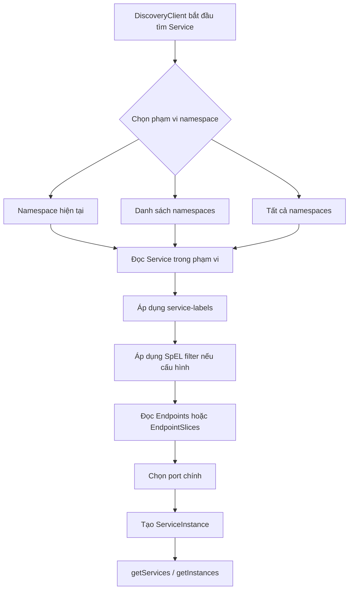

# Giới hạn khám phá theo namespace, nhãn và cổng dịch vụ

## 1. Vì sao cần giới hạn phạm vi discovery?

Trong Kubernetes, mỗi Service thuộc một namespace và có thể có nhiều cổng. Một ứng dụng Spring Cloud thường chỉ cần tìm một nhóm service liên quan đến chức năng của nó, chẳng hạn các service của nhóm thanh toán trong namespace `payments`. Nếu DiscoveryClient đọc quá rộng, ứng dụng phải xử lý nhiều dữ liệu hơn, tăng số tài nguyên cần theo dõi trên Kubernetes API Server và có thể nhìn thấy các service trùng tên ở nhiều namespace.

Spring Cloud Kubernetes cho phép giới hạn discovery theo ba chiều chính:

- **Namespace:** xác định những namespace nào được tìm kiếm.
- **Nhãn và biểu thức lọc:** chọn những Kubernetes Service phù hợp trong phạm vi namespace đó.
- **Cổng dịch vụ:** xác định cổng nào của Service được dùng để tạo `ServiceInstance` khi một Service khai báo nhiều cổng.

Ba chiều này giải quyết các câu hỏi khác nhau. Namespace giới hạn miền tìm kiếm; nhãn và filter giới hạn tập Service; port selection chọn endpoint cho một Service đã được tìm thấy. Chúng không thay thế quyền truy cập Kubernetes RBAC và cũng không tự tạo cơ chế cân bằng tải.

## 2. DiscoveryClient của Spring Cloud Kubernetes đọc những gì?

Spring Cloud Kubernetes cung cấp implementation của `org.springframework.cloud.client.discovery.DiscoveryClient`. Tùy starter, implementation có thể dùng Fabric8 Kubernetes Client, Kubernetes Java Client hoặc HTTP DiscoveryClient kết nối tới Spring Cloud Kubernetes DiscoveryServer.

DiscoveryClient tra cứu Kubernetes Service và các endpoint tương ứng. Từ đó, `getInstances(serviceId)` trả về danh sách `ServiceInstance` với các thông tin như:

- Service ID và instance ID.
- Host của endpoint, thường là địa chỉ IP của endpoint/pod.
- Port được chọn từ cấu hình Service và endpoint tương ứng.
- URI và scheme (`http` hoặc `https`).
- Metadata như namespace, Service labels, annotations, ports và loại Service nếu các tùy chọn metadata tương ứng được bật.

`getServices()` trả về tên Service theo `metadata.name`. Nếu nhiều namespace có Service cùng tên, danh sách tên là duy nhất; vì vậy, tên Service một mình không đủ để phân biệt namespace. Khi cần phân biệt các instance, đọc namespace trong metadata của `ServiceInstance` hoặc tránh tạo tên Service trùng nhau trong phạm vi discovery đang dùng.

Spring Cloud Kubernetes DiscoveryClient là một lựa chọn ở tầng Spring. Kubernetes vẫn cung cấp DNS nội bộ cho Service, ví dụ `payment-api.payments.svc.cluster.local`. Nếu ứng dụng chỉ cần gọi một Kubernetes Service ổn định và không cần lấy danh sách endpoint hay metadata qua Spring, DNS của Kubernetes có thể đã đáp ứng đủ.

## 3. Giới hạn theo namespace

Spring Cloud Kubernetes hỗ trợ ba cách xác định namespace để tìm Service. Nên chọn một phạm vi phù hợp với topology và quyền truy cập của ứng dụng.

### 3.1. Chỉ tìm trong namespace hiện tại

Đây là hành vi mặc định khi không khai báo `spring.cloud.kubernetes.discovery.namespaces` và không bật `all-namespaces`. Spring Cloud Kubernetes cần xác định namespace hiện tại của ứng dụng. Cách phân giải namespace được thực hiện theo thứ tự best-effort, thường gồm:

1. Giá trị `spring.cloud.kubernetes.client.namespace` nếu được cấu hình.
2. File namespace được chỉ định qua `spring.cloud.kubernetes.client.service-account-namespace-path`.
3. File mặc định do Kubernetes mount trong Pod: `/var/run/secrets/kubernetes.io/serviceaccount/namespace`.
4. API hoặc cấu hình namespace riêng của Kubernetes client đang sử dụng, nếu có.

Ví dụ cấu hình rõ namespace:

```yaml
spring:
  cloud:
    kubernetes:
      client:
        namespace: payments
```

Trong Pod, Kubernetes thường mount namespace của ServiceAccount vào file service account. Nếu ứng dụng chạy ngoài cluster, file này có thể không tồn tại; khi đó hãy cấu hình namespace rõ ràng hoặc cấu hình client tương ứng.

### 3.2. Chỉ tìm trong một danh sách namespace

Khi một ứng dụng cần tìm Service ở một số namespace cụ thể, khai báo danh sách `spring.cloud.kubernetes.discovery.namespaces`:

```yaml
spring:
  cloud:
    kubernetes:
      discovery:
        namespaces:
          - payments
          - shared-platform
          - identity
```

DiscoveryClient chỉ tìm các Service trong ba namespace đã khai báo. Cách này phù hợp khi một ứng dụng cần gọi một số miền chức năng dùng chung, nhưng vẫn muốn giữ phạm vi rõ ràng.

Với file properties, có thể khai báo theo chỉ số:

```properties
spring.cloud.kubernetes.discovery.namespaces[0]=payments
spring.cloud.kubernetes.discovery.namespaces[1]=shared-platform
spring.cloud.kubernetes.discovery.namespaces[2]=identity
```

Nếu dùng HTTP-based DiscoveryClient, cấu hình namespace phải được đặt ở Spring Cloud Kubernetes DiscoveryServer vì chính server là thành phần truy cập Kubernetes API. Với Fabric8 hoặc Kubernetes Java Client chạy trực tiếp trong ứng dụng, cấu hình được đặt ở ứng dụng đó.

### 3.3. Tìm trong tất cả namespace

Có thể bật tìm kiếm toàn cluster:

```yaml
spring:
  cloud:
    kubernetes:
      discovery:
        all-namespaces: true
```

Tùy chọn này hữu ích cho công cụ quản trị hoặc thành phần cần quan sát toàn cluster. Với service nghiệp vụ thông thường, phạm vi toàn cluster có thể làm tăng lượng Service/Endpoints cần đọc và cache, tăng tải Kubernetes API Server, đồng thời đòi hỏi quyền truy cập rộng hơn.

Không nên bật `all-namespaces` chỉ để khắc phục lỗi không tìm thấy Service. Trước tiên, xác minh namespace hiện tại, cấu hình `namespaces`, tên Service và RBAC. Chọn namespace rõ ràng thường dễ kiểm soát hơn.

### 3.4. Không nhầm namespace của client với namespace của Service

Namespace là một phần của định danh tài nguyên Kubernetes. Hai Service có cùng tên ở hai namespace khác nhau là hai tài nguyên khác nhau:

```text
payments/payment-api
identity/payment-api
```

Khi DiscoveryClient tìm cả hai namespace, `getServices()` có thể chỉ trả về một tên `payment-api` vì danh sách service ID là duy nhất. `getInstances("payment-api")` có thể trả về instance đến từ nhiều namespace đã chọn. Hãy đọc metadata namespace của từng `ServiceInstance` nếu ứng dụng cần phân biệt chúng.

## 4. Lọc Service bằng metadata labels

### 4.1. `service-labels` lọc nhãn của Kubernetes Service

Thuộc tính `spring.cloud.kubernetes.discovery.service-labels` nhận một map key/value. DiscoveryClient chỉ lấy các Service có đủ những cặp nhãn được khai báo trong `metadata.labels` của chính đối tượng Service.

Ví dụ cấu hình:

```yaml
spring:
  cloud:
    kubernetes:
      discovery:
        service-labels:
          discovery: enabled
          team: payments
          environment: production
```

Một Service phù hợp có thể khai báo:

```yaml
apiVersion: v1
kind: Service
metadata:
  name: payment-api
  namespace: payments
  labels:
    discovery: enabled
    team: payments
    environment: production
    app.kubernetes.io/name: payment-api
spec:
  selector:
    app.kubernetes.io/name: payment-api
  ports:
    - name: http
      port: 80
      targetPort: 8080
```

Service phải có cả ba nhãn với giá trị tương ứng mới được chọn. Các nhãn bổ sung khác không ảnh hưởng việc khớp.

### 4.2. Phân biệt `metadata.labels` và `spec.selector`

Hai trường này thường bị nhầm lẫn:

| Trường | Nằm ở đâu | Mục đích |
|---|---|---|
| `metadata.labels` | Metadata của đối tượng Service | Gắn nhãn cho chính Service; Spring Cloud Kubernetes dùng chúng cho `service-labels` và filter |
| `spec.selector` | Spec của Service | Chọn các Pod mà Service chuyển tiếp traffic tới |
| `metadata.labels` của Pod | Metadata của Pod | Có thể được đưa vào metadata của `ServiceInstance` nếu bật tùy chọn pod metadata |

Ví dụ `spec.selector.app` khớp Pod label `app`, nhưng điều đó không tự làm cho Service khớp `service-labels.app`. Nếu muốn lọc discovery theo `app`, phải khai báo `metadata.labels.app` trên Service.

Kubernetes labels là cặp key/value dùng để nhóm và chọn tài nguyên. Chúng không phải cơ chế bảo mật hoặc phân quyền. Muốn giới hạn ai được đọc Service, cần dùng Kubernetes RBAC.

### 4.3. Lợi ích và giới hạn của `service-labels`

Spring Cloud Kubernetes sử dụng lister/cache bất đồng bộ để lấy Service. Lọc bằng `service-labels` giúp thu nhỏ tập Service cần quan tâm, đặc biệt khi namespace có nhiều Service. Hãy dùng nhãn ổn định, có quy ước rõ ràng, ví dụ `team`, `environment`, `discovery` hoặc `app.kubernetes.io/part-of`.

Không nên dùng nhãn thay đổi liên tục như build timestamp hoặc pod hash làm tiêu chí lọc Service. Nếu nhãn cần đổi, hãy cập nhật Service manifest và xác minh cache discovery đã nhận thay đổi.

## 5. Lọc nâng cao bằng SpEL `filter`

Khi map `service-labels` chưa đủ biểu đạt điều kiện, có thể dùng:

```yaml
spring:
  cloud:
    kubernetes:
      discovery:
        filter: "#root.metadata.labels['tier'] == 'backend' and #root.metadata.namespace == 'payments'"
```

`filter` là biểu thức SpEL được đánh giá trên đối tượng Kubernetes Service sau khi Service đã được lấy từ API. Kiểu đối tượng gốc phụ thuộc Kubernetes client:

- Với Fabric8 client, biểu thức được đánh giá trên `io.fabric8.kubernetes.api.model.Service`.
- Với Kubernetes Java Client, biểu thức được đánh giá trên `io.kubernetes.client.openapi.models.V1Service`.
- Với HTTP DiscoveryClient, filter được cấu hình ở DiscoveryServer và dùng model Kubernetes tương ứng với server.

SpEL được đánh giá trong read-only context. Không gọi method trên object như `metadata.name.startsWith('pay')` hoặc `metadata.labels.containsKey('tier')`. Dùng toán tử, regex `matches` và truy cập map bằng key, ví dụ:

```yaml
spring:
  cloud:
    kubernetes:
      discovery:
        filter: "#root.metadata.namespace matches '^pay.*' and #root.metadata.labels['tier'] == 'backend'"
```

Nếu dùng HTTP DiscoveryServer, cấu hình filter trong deployment của server, ví dụ biến môi trường:

```yaml
env:
  - name: SPRING_CLOUD_KUBERNETES_DISCOVERY_FILTER
    value: "#root.metadata.namespace matches '^pay.*'"
```

Hãy kiểm tra model và biểu thức theo đúng client đang dùng. Một SpEL hợp lệ với Fabric8 model không nhất thiết dùng được nếu kiểu dữ liệu đầu vào là model của Kubernetes Java Client.

### 5.1. Kết hợp namespace, labels và filter

Một cấu hình điển hình có thể giới hạn namespace trước, sau đó chọn Service theo nhãn:

```yaml
spring:
  cloud:
    kubernetes:
      discovery:
        namespaces:
          - payments
          - shared-platform
        service-labels:
          discovery: enabled
          environment: production
        filter: "#root.metadata.labels['tier'] == 'backend'"
```

Hãy coi các điều kiện này là các lớp thu hẹp tập Service: namespace xác định nơi tìm, `service-labels` yêu cầu các cặp nhãn, còn `filter` loại thêm Service không thỏa biểu thức. Nếu một Service không xuất hiện, kiểm tra từng lớp theo thứ tự để xác định điều kiện nào loại nó.

## 6. Chọn cổng chính khi Service có nhiều cổng

### 6.1. Vì sao cần chỉ định cổng?

Một Kubernetes Service có thể công bố nhiều port, ví dụ cổng HTTP cho nghiệp vụ, cổng HTTPS và cổng metrics. `DiscoveryClient` phải chọn một port chính để tạo `ServiceInstance` cho service ID. Nếu chọn sai, ứng dụng có thể gọi nhầm metrics endpoint hoặc cổng không phục vụ request nghiệp vụ.

Kubernetes Service port có các trường quan trọng:

| Trường | Ý nghĩa |
|---|---|
| `name` | Tên của port trong Service; dùng để phân biệt nhiều port |
| `port` | Cổng mà Service công bố cho client của Service |
| `targetPort` | Cổng backend trên Pod mà Service chuyển tiếp tới; có thể là số hoặc tên port của container |
| `protocol` | Giao thức mạng, thường là TCP |

Ví dụ một Service có HTTP và metrics:

```yaml
apiVersion: v1
kind: Service
metadata:
  name: payment-api
  namespace: payments
  labels:
    discovery: enabled
    primary-port-name: http
spec:
  selector:
    app.kubernetes.io/name: payment-api
  ports:
    - name: http
      protocol: TCP
      port: 80
      targetPort: 8080
    - name: metrics
      protocol: TCP
      port: 9090
      targetPort: 9090
```

Port `http` là cổng ứng dụng; `metrics` dành cho scraping. Label `primary-port-name: http` cho Spring Cloud Kubernetes biết tên port chính cần chọn. Trong kết quả discovery dựa trên endpoint, địa chỉ host và port được ghép từ endpoint tương ứng; không nên tự giả định `targetPort` luôn bằng `port`.

### 6.2. Thứ tự chọn port của DiscoveryClient

Theo quy tắc của Spring Cloud Kubernetes, khi chọn port cho `ServiceInstance`, thứ tự ưu tiên là:

1. Nếu Service có label `primary-port-name`, chọn port có tên trùng với giá trị label.
2. Nếu không có label đó, dùng `spring.cloud.kubernetes.discovery.primary-port-name`.
3. Nếu không cấu hình hai cách trên, tìm port tên `https`.
4. Nếu không có, tìm port tên `http`.
5. Nếu vẫn không tìm thấy, dùng port đầu tiên trong danh sách.

Phương án cuối có thể không xác định ổn định khi Service có nhiều port. Vì vậy, với Service nhiều cổng, nên đặt label `primary-port-name` hoặc cấu hình `primary-port-name` trong ứng dụng.

Ví dụ chọn port `http` bằng cấu hình ứng dụng:

```yaml
spring:
  cloud:
    kubernetes:
      discovery:
        primary-port-name: http
```

Label trên Service phù hợp khi muốn chính Service tự mô tả cổng ưu tiên. Thuộc tính cấu hình phù hợp khi một ứng dụng consumer muốn áp dụng quy ước chọn cổng chung cho các Service mà nó khám phá.

### 6.3. Không có port và nhiều Service port

Nếu Service không khai báo port, DiscoveryClient có thể tạo `ServiceInstance` với port `0`; endpoint như vậy không thể dùng để gọi HTTP bình thường. Nếu Service có đúng một port, port đó được chọn. Với nhiều port, hãy đặt tên từng port và chọn cổng chính tường minh.

Không nên dựa vào thứ tự phần tử trong `spec.ports` để quyết định cổng nghiệp vụ. Thay đổi thứ tự manifest có thể làm thay đổi port được chọn ở fallback cuối cùng.

### 6.4. Đánh dấu endpoint HTTPS

Spring Cloud Kubernetes xác định `secure` theo các tín hiệu như:

- Label `secured` của Service có giá trị `true`, `on`, `yes` hoặc `1`.
- Nếu label không có, annotation `secured` với các giá trị tương ứng.
- Port thuộc `spring.cloud.kubernetes.discovery.known-secure-ports` (mặc định thường gồm `443` và `8443`).
- Tên port là `https`.

Ví dụ:

```yaml
metadata:
  labels:
    secured: "true"
    primary-port-name: https
spec:
  ports:
    - name: https
      port: 443
      targetPort: 8443
```

Đánh dấu `secured` chỉ giúp DiscoveryClient/LoadBalancer xác định scheme. Nó không tự cấu hình TLS trên ứng dụng, certificate, truststore hoặc NetworkPolicy. Service backend phải thực sự phục vụ HTTPS trên endpoint đã chọn.

## 7. Metadata cổng và metadata của ServiceInstance

Spring Cloud Kubernetes có thể đưa labels, annotations và port definitions của Service vào `ServiceInstance.getMetadata()`. Các tùy chọn thường dùng:

| Thuộc tính | Mặc định phổ biến | Ý nghĩa |
|---|---:|---|
| `spring.cloud.kubernetes.discovery.metadata.add-labels` | `true` | Thêm Service labels vào metadata |
| `spring.cloud.kubernetes.discovery.metadata.add-annotations` | `true` | Thêm Service annotations vào metadata |
| `spring.cloud.kubernetes.discovery.metadata.add-ports` | `true` | Thêm tên và thông tin port vào metadata |
| `spring.cloud.kubernetes.discovery.metadata.labels-prefix` | rỗng | Prefix cho key labels |
| `spring.cloud.kubernetes.discovery.metadata.annotations-prefix` | rỗng | Prefix cho key annotations |
| `spring.cloud.kubernetes.discovery.metadata.ports-prefix` | `port.` | Prefix cho key port |
| `spring.cloud.kubernetes.discovery.metadata.add-pod-labels` | `false` | Thêm Pod labels vào metadata |
| `spring.cloud.kubernetes.discovery.metadata.add-pod-annotations` | `false` | Thêm Pod annotations vào metadata |

Ví dụ bật metadata cần thiết:

```yaml
spring:
  cloud:
    kubernetes:
      discovery:
        metadata:
          add-labels: true
          add-annotations: true
          add-ports: true
          labels-prefix: "label."
          annotations-prefix: "annotation."
          ports-prefix: "port."
          add-pod-labels: true
          add-pod-annotations: true
```

Metadata có thể chứa namespace của instance (`k8s_namespace`), loại Service (`type`, ví dụ `ClusterIP` hoặc `ExternalName`) và thông tin Pod nếu đã bật. Các key tùy chỉnh không tự thay đổi routing; consumer phải đọc và áp dụng chúng nếu cần.

Mặc định, `ExternalName` Service không được đưa vào kết quả discovery. Nếu cần loại Service này, bật `spring.cloud.kubernetes.discovery.include-external-name-services=true`. Endpoint chưa được Kubernetes đánh dấu ready thường không được đưa vào danh sách; `spring.cloud.kubernetes.discovery.include-not-ready-addresses=true` có thể bật để phục vụ mục đích quan sát/monitoring, nhưng không nên dùng danh sách not-ready làm nguồn traffic bình thường.

## 8. RBAC: bộ lọc discovery không phải ranh giới bảo mật

`namespaces`, `service-labels` và `filter` quyết định ứng dụng muốn nhìn thấy gì. Kubernetes RBAC quyết định ServiceAccount được phép đọc tài nguyên nào. Một ứng dụng có thể cấu hình chỉ tìm `payments`, nhưng nếu ServiceAccount có quyền `list` toàn cluster thì quyền thực tế vẫn rộng hơn phạm vi discovery.

Với Fabric8 hoặc Kubernetes Java Client chạy trong ứng dụng, ServiceAccount của Pod ứng dụng cần quyền phù hợp. Với HTTP-based DiscoveryClient, thành phần gọi Kubernetes API là DiscoveryServer; quyền cần cấp cho ServiceAccount của DiscoveryServer, còn client ứng dụng gọi HTTP API của server.

Ví dụ Role chỉ đọc Service và Endpoints trong một namespace:

```yaml
apiVersion: rbac.authorization.k8s.io/v1
kind: Role
metadata:
  name: spring-discovery-reader
  namespace: payments
rules:
  - apiGroups: [""]
    resources: ["services", "endpoints"]
    verbs: ["get", "list", "watch"]
```

Gắn Role vào ServiceAccount:

```yaml
apiVersion: rbac.authorization.k8s.io/v1
kind: RoleBinding
metadata:
  name: spring-discovery-reader
  namespace: payments
subjects:
  - kind: ServiceAccount
    name: payment-app
    namespace: payments
roleRef:
  apiGroup: rbac.authorization.k8s.io
  kind: Role
  name: spring-discovery-reader
```

Nếu discovery cần nhiều namespace chọn lọc, có thể tạo RoleBinding trong từng namespace và tham chiếu cùng một ClusterRole chứa các quyền đọc cần thiết. Chỉ dùng ClusterRoleBinding khi thực sự cần đọc toàn cluster; tránh cấp `cluster-admin` cho ứng dụng chỉ để tra cứu Service.

Nếu bật `spring.cloud.kubernetes.discovery.use-endpoint-slices=true`, cần bổ sung quyền `get`, `list`, `watch` trên tài nguyên `endpointslices` thuộc API group `discovery.k8s.io`. Nếu bật Pod labels/annotations, xác minh thêm quyền đọc Pod theo client và phiên bản đang dùng. Hãy kiểm tra `kubectl auth can-i` bằng đúng ServiceAccount để xác nhận quyền thực tế.

## 9. Cấu hình hoàn chỉnh theo một phạm vi cụ thể

Ví dụ consumer chỉ khám phá Service của môi trường production thuộc hai namespace `payments` và `shared-platform`, đồng thời chỉ nhận Service có nhãn discovery phù hợp và chọn cổng HTTP:

```yaml
spring:
  application:
    name: payment-worker
  cloud:
    kubernetes:
      client:
        namespace: payments
      discovery:
        namespaces:
          - payments
          - shared-platform
        service-labels:
          discovery: enabled
          environment: production
        primary-port-name: http
        include-not-ready-addresses: false
        metadata:
          add-labels: true
          add-annotations: false
          add-ports: true
```

Trong cấu hình này:

- Chỉ hai namespace đã liệt kê được tìm kiếm.
- Service phải có cả `discovery=enabled` và `environment=production` trong `metadata.labels`.
- `primary-port-name: http` chọn cổng có tên `http` khi Service có nhiều cổng và không có label `primary-port-name` ghi đè.
- Endpoint chưa ready không được đưa vào danh sách thông thường.
- Metadata labels và ports được đưa vào `ServiceInstance` để consumer có thể kiểm tra.

Nếu ứng dụng dùng HTTP DiscoveryServer, hãy chuyển cấu hình namespace/label/filter tới DiscoveryServer theo hướng dẫn của phiên bản tương ứng. Không giả định cấu hình trong consumer tự thay đổi phạm vi truy cập Kubernetes của server.

## 10. Kiểm tra kết quả discovery

Sau khi cấu hình, kiểm tra từ đúng môi trường chạy DiscoveryClient:

1. Xác nhận namespace thực tế và các namespace trong `spring.cloud.kubernetes.discovery.namespaces`.
2. Kiểm tra Service tồn tại bằng `kubectl get services -n payments --show-labels`.
3. Đối chiếu `metadata.labels` của Service với `service-labels` và biểu thức `filter`.
4. Kiểm tra `spec.ports`, tên port, `port`, `targetPort` và endpoint tương ứng.
5. Kiểm tra endpoint ready bằng `kubectl get endpoints` hoặc `kubectl get endpointslices` nếu dùng EndpointSlice.
6. Kiểm tra RBAC bằng `kubectl auth can-i list services --as=system:serviceaccount:payments:payment-app -n payments` và các tài nguyên endpoints tương ứng.
7. Gọi `DiscoveryClient.getServices()` và `getInstances("payment-api")`; đọc host, port, URI, namespace và metadata của từng instance.

Ví dụ code kiểm tra instance:

```java
import java.util.List;

import org.springframework.cloud.client.ServiceInstance;
import org.springframework.cloud.client.discovery.DiscoveryClient;
import org.springframework.stereotype.Component;

@Component
public class PaymentServiceInspector {

    private final DiscoveryClient discoveryClient;

    public PaymentServiceInspector(DiscoveryClient discoveryClient) {
        this.discoveryClient = discoveryClient;
    }

    public void inspect() {
        List<ServiceInstance> instances =
                discoveryClient.getInstances("payment-api");

        for (ServiceInstance instance : instances) {
            System.out.printf(
                    "service=%s host=%s port=%d uri=%s metadata=%s%n",
                    instance.getServiceId(),
                    instance.getHost(),
                    instance.getPort(),
                    instance.getUri(),
                    instance.getMetadata()
            );
        }
    }
}
```

Nếu kết quả rỗng, kiểm tra namespace trước, rồi labels/filter, cuối cùng RBAC và trạng thái endpoints. Nếu có instance nhưng port sai, kiểm tra `primary-port-name`, label `primary-port-name` và tên các mục trong `spec.ports`.

## 11. Các lỗi thường gặp

| Dấu hiệu | Nguyên nhân có thể | Cách xử lý |
|---|---|---|
| Không tìm thấy Service ở namespace khác | Mặc định chỉ tìm namespace hiện tại | Khai báo `namespaces` hoặc bật `all-namespaces` khi thực sự cần |
| Namespace hiện tại không xác định được | Thiếu cấu hình namespace và không đọc được ServiceAccount namespace file | Cấu hình `spring.cloud.kubernetes.client.namespace` và kiểm tra mount |
| Service tồn tại nhưng bị loại khỏi discovery | `service-labels` hoặc SpEL không khớp | Kiểm tra `metadata.labels` trên Service, không chỉ Pod labels hoặc `spec.selector` |
| Có Service nhưng `getInstances()` rỗng | Không có endpoint ready, sai port hoặc thiếu quyền đọc Endpoints | Kiểm tra Endpoints/EndpointSlices, readiness và RBAC |
| Service trùng tên ở nhiều namespace | `serviceId` chỉ là tên Service và `getServices()` trả tên duy nhất | Đọc metadata namespace và giới hạn namespace rõ ràng |
| Instance dùng nhầm port metrics | Service có nhiều port và fallback chọn port đầu tiên | Đặt label `primary-port-name` hoặc cấu hình `primary-port-name` |
| URI dùng HTTP thay vì HTTPS | Chưa đánh dấu `secured`, tên port hoặc secure port chưa đúng | Kiểm tra label/annotation `secured`, port name và `known-secure-ports` |
| Ứng dụng bị `Forbidden` khi gọi API | ServiceAccount thiếu quyền `get/list/watch` | Cấp Role/RoleBinding tối thiểu cho namespace cần đọc |
| HTTP DiscoveryServer không áp dụng filter | Cấu hình đặt ở client thay vì server | Đặt thuộc tính tương ứng trong Deployment/env của DiscoveryServer |

## 12. Sơ đồ thứ tự giới hạn discovery



RBAC được Kubernetes API Server kiểm tra khi client hoặc DiscoveryServer đọc tài nguyên ở mỗi bước. Nếu không đủ quyền, quá trình có thể lỗi trước khi ứng dụng nhận được danh sách kết quả.

## 13. Checklist triển khai

- [ ] Chọn namespace hiện tại, danh sách namespace hoặc toàn cluster theo nhu cầu thật.
- [ ] Xác minh namespace hiện tại được phân giải đúng trong môi trường chạy.
- [ ] Gắn labels lên `metadata.labels` của Service nếu dùng `service-labels`.
- [ ] Phân biệt Service labels với Pod labels và `spec.selector`.
- [ ] Dùng SpEL filter chỉ khi map labels chưa đủ; kiểm tra model theo Kubernetes client.
- [ ] Với HTTP DiscoveryServer, cấu hình namespace/filter ở server và đồng bộ phiên bản client/server.
- [ ] Đặt tên rõ ràng cho từng Service port và cấu hình `primary-port-name` khi có nhiều port.
- [ ] Xác minh scheme HTTP/HTTPS bằng label/annotation `secured` và cấu hình TLS thực tế.
- [ ] Cấp RBAC tối thiểu cho Service, Endpoints và EndpointSlices nếu được sử dụng.
- [ ] Kiểm tra kết quả `ServiceInstance` từ đúng namespace và network của ứng dụng.

## 14. Kết luận

Giới hạn discovery trong Spring Cloud Kubernetes bắt đầu bằng việc chọn namespace phù hợp, sau đó lọc Service theo `metadata.labels` hoặc SpEL, cuối cùng chọn đúng cổng để tạo `ServiceInstance`. `namespaces` và `all-namespaces` quyết định phạm vi tìm kiếm; `service-labels` và `filter` thu hẹp tập Service; `primary-port-name` xác định cổng chính khi Service có nhiều cổng.

Hãy giữ phạm vi namespace nhỏ nhất đáp ứng nhu cầu, dùng nhãn ổn định trên đối tượng Service, đặt tên port rõ ràng và cấp RBAC tối thiểu. Việc cấu hình đúng các lớp này giúp consumer tìm đúng service và endpoint, đồng thời giảm tải discovery và tránh nhìn thấy tài nguyên ngoài phạm vi cần thiết.

## Tài liệu tham khảo

- [Spring Cloud Kubernetes – DiscoveryClient for Kubernetes](https://docs.spring.io/spring-cloud-kubernetes/reference/discovery-client.html)
- [Spring Cloud Kubernetes – Common application properties](https://docs.spring.io/spring-cloud-kubernetes/reference/appendix.html)
- [Spring Cloud Kubernetes – LoadBalancer for Kubernetes](https://docs.spring.io/spring-cloud-kubernetes/reference/load-balancer.html)
- [Kubernetes – Labels and Selectors](https://kubernetes.io/docs/concepts/overview/working-with-objects/labels/)
- [Kubernetes – Services and networking](https://kubernetes.io/docs/concepts/services-networking/service/)
