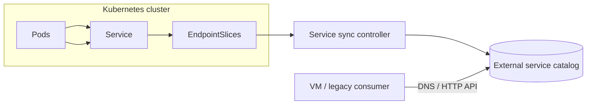

# Khi nào cần kết hợp Kubernetes với sổ đăng ký ngoài cụm

Kubernetes đã có cơ chế service discovery riêng. Một `Service` gom các Pod backend thành một địa chỉ ổn định; DNS trong cluster giúp workload tìm service bằng tên; EndpointSlice theo dõi danh sách endpoint và trạng thái sẵn sàng. Vì vậy, nếu toàn bộ ứng dụng chạy trong một cluster và chỉ cần gọi các service nội bộ, bạn thường không cần dựng thêm Eureka hoặc Consul.

Sổ đăng ký ngoài cụm trở nên hữu ích khi ranh giới của Kubernetes không còn trùng với ranh giới giao tiếp của hệ thống: một phần workload vẫn chạy trên VM hoặc bare metal, nhiều cluster cần chia sẻ service, ứng dụng cũ chỉ biết Eureka/Consul, hoặc tổ chức cần một catalog chung cho nhiều nền tảng. Bài học này giúp xác định lúc nào discovery native của Kubernetes đã đủ, lúc nào nên dùng Spring Cloud Kubernetes, và lúc nào cần tích hợp registry như Consul hoặc Eureka.

## 1. Kubernetes đã cung cấp những gì?

### 1.1. Service tạo địa chỉ ổn định cho nhóm Pod

Pod có vòng đời ngắn và IP có thể thay đổi khi được tạo lại. Kubernetes `Service` cung cấp một tên và endpoint ổn định để client không cần theo dõi từng Pod. Với Service thông thường, control plane tìm Pod theo selector và cập nhật EndpointSlice khi tập backend thay đổi.

Ví dụ Service `inventory` trong namespace `shop`:

```yaml
apiVersion: v1
kind: Service
metadata:
  name: inventory
  namespace: shop
spec:
  selector:
    app: inventory
  ports:
    - name: http
      port: 80
      targetPort: 8080
```

Pod trong cùng namespace có thể gọi service bằng:

```text
http://inventory
```

Pod ở namespace khác có thể dùng tên đầy đủ hơn:

```text
http://inventory.shop.svc.cluster.local
```

`cluster.local` là cluster domain thường gặp, nhưng cluster có thể cấu hình domain khác. Hãy kiểm tra DNS search domain của Pod hoặc cấu hình cluster thay vì hard-code hậu tố này vào mọi môi trường.

Service mặc định có type `ClusterIP`, cung cấp địa chỉ nội bộ cluster. Kubernetes DNS phân giải tên service; cơ chế Service networking định tuyến tới các backend phù hợp. `NodePort`, `LoadBalancer` hoặc Ingress/Gateway phục vụ các nhu cầu truy cập từ ngoài cluster, nhưng bản thân chúng không tạo một catalog discovery dùng chung cho nhiều runtime.

### 1.2. EndpointSlice theo dõi các backend

EndpointSlice lưu địa chỉ và điều kiện của endpoint thuộc một Service. Controller của Kubernetes cập nhật EndpointSlice khi Pod phù hợp với selector được thêm, xóa hoặc thay đổi trạng thái.

Các điều kiện thường gặp:

- `ready`: endpoint đủ điều kiện nhận traffic thông thường; với Pod, trạng thái này gắn với điều kiện Ready.
- `serving`: endpoint đang phục vụ.
- `terminating`: endpoint đang trong quá trình kết thúc.

Readiness probe của Pod ảnh hưởng tới việc endpoint có được xem là sẵn sàng hay không. Liveness probe quyết định khi nào kubelet cần khởi động lại container; nó không thay thế readiness. Vì vậy, Kubernetes Service đã có một vòng đời cập nhật endpoint theo sức khỏe của workload.

Kiểm tra endpoint của Service:

```bash
kubectl get service inventory -n shop
kubectl get endpointslice -n shop \
  -l kubernetes.io/service-name=inventory
```

Nếu Service không có backend, kiểm tra selector, label của Pod và readiness trước khi thêm registry khác.

### 1.3. Headless Service và truy cập từng Pod

Nếu cần client nhìn thấy địa chỉ từng Pod thay vì một ClusterIP, có thể dùng headless Service:

```yaml
apiVersion: v1
kind: Service
metadata:
  name: inventory-headless
  namespace: shop
spec:
  clusterIP: None
  selector:
    app: inventory
  ports:
    - name: http
      port: 8080
      targetPort: 8080
```

DNS của headless Service có thể trả các địa chỉ backend thay vì một virtual IP. Kiểu này hữu ích cho StatefulSet hoặc client cần kết nối trực tiếp từng member. Hãy xác định rõ client có cần biết từng instance hay chỉ cần một endpoint ổn định trước khi chọn headless Service.

## 2. Khi nào discovery native của Kubernetes là đủ?

Kubernetes Service và DNS thường là lựa chọn đơn giản nhất khi tất cả điều kiện sau đúng:

- Provider và consumer đều chạy trong cùng một Kubernetes cluster.
- Service có thể được truy cập bằng DNS và port ổn định.
- Kubernetes là nguồn quản lý chính của vòng đời Pod và endpoint.
- Readiness, Service selector và EndpointSlice đáp ứng được yêu cầu lọc backend.
- Không cần VM, bare-metal workload hoặc ứng dụng bên ngoài cluster truy vấn cùng một catalog.
- Không cần một service identity/catalog chung vượt qua nhiều cluster hoặc runtime.

Ví dụ, `order-service` gọi `inventory-service` trong cùng cluster chỉ cần URL `http://inventory.shop.svc.cluster.local`. Thêm Eureka hoặc Consul chỉ để đổi tên DNS thành service ID thường tạo thêm server, credential, đồng bộ registration và một lớp trạng thái cần vận hành.

| Nhu cầu | Cơ chế phù hợp để bắt đầu |
| --- | --- |
| Gọi service nội bộ trong một cluster | Kubernetes Service + DNS |
| Phân phối traffic tới Pod Ready | Service networking + EndpointSlice |
| Cần danh sách instance/metadata qua Spring API | Spring Cloud Kubernetes `DiscoveryClient` |
| Cần địa chỉ từng Pod cho StatefulSet | Headless Service và DNS |
| Cần truy cập một backend bên ngoài cluster bằng DNS | Service `ExternalName` hoặc Service không selector kèm EndpointSlice, tùy yêu cầu |
| Cần một catalog dùng chung cho VM, Kubernetes và nhiều cluster | Cân nhắc Consul hoặc một registry ngoài cụm |

Không cần registry ngoài cụm chỉ vì ứng dụng được viết bằng Spring Cloud. Spring Cloud có thể dùng Kubernetes làm nguồn discovery thông qua Spring Cloud Kubernetes, hoặc dùng trực tiếp DNS của Service.

## 3. Spring Cloud Kubernetes không phải registry ngoài cụm

Nếu mã nguồn cần API `DiscoveryClient` thay vì tự gọi hostname, Spring Cloud Kubernetes cung cấp implementation đọc Kubernetes Service/endpoint. Đây vẫn là discovery dựa trên Kubernetes API, không phải một registry server độc lập như Eureka hoặc Consul.

Ví dụ dependency Maven với Fabric8 client:

```xml
<dependency>
    <groupId>org.springframework.cloud</groupId>
    <artifactId>spring-cloud-starter-kubernetes-fabric8</artifactId>
</dependency>
```

Spring Cloud Kubernetes cũng hỗ trợ Kubernetes Java Client; starter cụ thể và phiên bản cần khớp release train Spring Cloud của dự án. Sau khi cấu hình, ứng dụng có thể inject `DiscoveryClient`:

```java
import java.util.List;

import org.springframework.cloud.client.ServiceInstance;
import org.springframework.cloud.client.discovery.DiscoveryClient;
import org.springframework.stereotype.Service;

@Service
public class InventoryLookup {

    private final DiscoveryClient discoveryClient;

    public InventoryLookup(DiscoveryClient discoveryClient) {
        this.discoveryClient = discoveryClient;
    }

    public List<ServiceInstance> findInstances() {
        return discoveryClient.getInstances("inventory");
    }
}
```

Tên Service Kubernetes là nguồn tên discovery. `spring.application.name` không tự đổi tên Kubernetes Service; nếu Spring Cloud component cần xác định service cục bộ, hãy giữ tên Service và `spring.application.name` nhất quán.

### 3.1. Giới hạn namespace và quyền truy cập

Discovery client cần biết sẽ tìm service ở namespace nào. Có thể giới hạn một namespace mặc định hoặc chỉ định các namespace cụ thể. Cấu hình tìm tất cả namespace có thể làm tăng số đối tượng cần đọc và tải lên Kubernetes API; chỉ bật khi thực sự cần.

Khi discovery client truy vấn Kubernetes API trực tiếp, Pod cần ServiceAccount và RBAC phù hợp. Cấp quyền tối thiểu cho đúng namespace và đúng tài nguyên mà phiên bản/client đang dùng cần đọc, thường là `get`, `list`, `watch` đối với Service và endpoint resource tương ứng. Nếu dùng EndpointSlice, cần quyền trên `discovery.k8s.io/endpointslices`. Không cấp `cluster-admin` chỉ để discovery hoạt động.

Kiểm tra quyền trong môi trường triển khai:

```bash
kubectl auth can-i list services \
  --as=system:serviceaccount:shop:order-consumer -n shop

kubectl auth can-i list endpointslices \
  --as=system:serviceaccount:shop:order-consumer -n shop
```

Tài liệu Spring Cloud Kubernetes cho phép giới hạn namespace và lọc service bằng label; đây là cách kiểm soát phạm vi discovery trước khi cân nhắc catalog bên ngoài.

## 4. Khi nào cần sổ đăng ký ngoài cụm?

### 4.1. Hệ thống chạy đồng thời trên Kubernetes và VM/bare metal

Một số thành phần chưa thể chuyển lên Kubernetes, chẳng hạn ứng dụng Java cũ, batch worker, dịch vụ chạy trên máy vật lý hoặc database nội bộ. Các workload này không thể mặc định truy cập Kubernetes Service DNS hay API server.

Một registry chung như Consul có thể lưu service của cả Kubernetes lẫn non-Kubernetes node. Workload trong cluster và ngoài cluster có thể tra cứu qua Consul DNS/HTTP API, miễn là địa chỉ backend có thể định tuyến từ phía gọi.

Ví dụ:

```text
Kubernetes cluster                 Datacenter / VM network
  order-service Pods               legacy-pricing VM
  inventory-service Pods           payment-adapter VM
          \                           /
           \                         /
            Consul service catalog
              - inventory-service
              - legacy-pricing
              - payment-adapter
```

Đây là trường hợp registry ngoài cụm có giá trị rõ: nó cung cấp một góc nhìn discovery chung qua ranh giới runtime.

### 4.2. Nhiều Kubernetes cluster cần khám phá lẫn nhau

Service DNS mặc định có phạm vi một cluster. Nếu `cluster-a` cần gọi service ở `cluster-b`, tên `inventory.shop.svc.cluster.local` của cluster-a không tự phân giải thành endpoint ở cluster-b.

Có nhiều lựa chọn:

- Dùng Multi-Cluster Services API (`ServiceExport`/`ServiceImport`) nếu nền tảng và implementation hỗ trợ.
- Dùng service mesh hoặc cơ chế federation phù hợp với topology mạng.
- Đồng bộ service vào Consul để có catalog chung cho nhiều cluster và workload ngoài Kubernetes.
- Dùng gateway hoặc endpoint tĩnh nếu chỉ có một vài kết nối có phạm vi rõ ràng.

Không nên mặc định rằng mọi hệ thống nhiều cluster đều cần Eureka/Consul. MCS API và các triển khai như Cilium Cluster Mesh hoặc dịch vụ multi-cluster của nhà cung cấp cloud có thể đáp ứng nhu cầu cross-cluster mà vẫn giữ mô hình Kubernetes Service.

Ví dụ MCS API khái quát:

```yaml
apiVersion: multicluster.x-k8s.io/v1alpha1
kind: ServiceExport
metadata:
  name: inventory
  namespace: shop
```

Một implementation MCS sẽ tạo/import biểu diễn service ở cluster nhận. DNS thường có dạng `inventory.shop.svc.clusterset.local` theo MCS DNS convention. API group, CRD, DNS và khả năng hỗ trợ phụ thuộc implementation; hãy dùng tài liệu của nền tảng đang triển khai thay vì áp dụng manifest này một cách mặc định.

### 4.3. Ứng dụng ngoài cluster cần cùng catalog với Pod

Nếu consumer chạy trên VM cần tìm một Pod trong Kubernetes, hoặc một Pod cần gọi VM service, một registry chung có thể làm điểm gặp giữa hai phía. Kubernetes Service có thể được expose ra ngoài bằng LoadBalancer/NodePort, nhưng điều đó chỉ tạo đường truy cập mạng; client ngoài cluster vẫn cần biết service nào đang tồn tại và địa chỉ nào hiện hành.

Consul service sync có thể đồng bộ Kubernetes Service sang Consul Catalog và đồng bộ một số Consul service thành Kubernetes Service. Nhờ đó, node ngoài cluster có thể dùng Consul DNS/HTTP API để tìm service Kubernetes, còn Pod có thể tìm một số service ngoài cluster qua DNS/Kubernetes Service.

### 4.4. Cần một service catalog và chính sách chung nhiều runtime

Registry ngoài cụm có thể hữu ích khi tổ chức cần:

- Một danh mục service tập trung qua nhiều datacenter, cluster hoặc runtime.
- Metadata/tag/health check có quy ước chung cho các workload không chạy Kubernetes.
- Cơ chế ACL và phân quyền discovery tập trung.
- Service mesh hoặc kết nối mã hóa/xác thực giữa workload Kubernetes và workload ngoài cluster.
- Hỗ trợ ứng dụng cũ đã tích hợp Eureka/Consul và chưa thể chuyển sang Kubernetes API/DNS.
- Giai đoạn migration mà provider/consumer đang phân tán giữa môi trường cũ và mới.

Các nhu cầu này phải được xác nhận bằng yêu cầu vận hành cụ thể. Nếu chỉ cần một hostname ổn định trong cluster, registry ngoài cụm thường là chi phí không cần thiết.

## 5. Chọn mô hình tích hợp

Có ba cách tổ chức thường gặp.

### 5.1. Ứng dụng trong Pod tự đăng ký với registry ngoài

Ứng dụng chạy trong Pod dùng Eureka Client hoặc Spring Cloud Consul để đăng ký chính nó vào server bên ngoài. Cách này phù hợp khi muốn giữ hành vi Spring Cloud hiện có trong giai đoạn migration hoặc khi service cần đăng ký với catalog dùng chung.

Ví dụ cấu hình Eureka Client:

```yaml
spring:
  application:
    name: order-service

eureka:
  client:
    register-with-eureka: true
    fetch-registry: true
    service-url:
      defaultZone: ${EUREKA_SERVER_URL}
  instance:
    prefer-ip-address: true
    metadata-map:
      runtime: kubernetes
      cluster: ${K8S_CLUSTER_NAME}
      namespace: ${POD_NAMESPACE}
```

Ví dụ này minh họa đăng ký vào Eureka Server có thể truy cập qua `EUREKA_SERVER_URL`. Cần truyền `POD_NAMESPACE` và `K8S_CLUSTER_NAME` qua môi trường hoặc Downward API; `prefer-ip-address` chỉ thay cách công bố host, không bảo đảm IP Pod có thể định tuyến từ VM hay cluster khác.

Eureka Client không tự đọc Kubernetes Service và EndpointSlice để tạo registration. Với mô hình này, mỗi ứng dụng Pod chủ động đăng ký instance của chính nó. Nếu muốn đưa cả Kubernetes Service hoặc workload không tích hợp Eureka vào cùng registry, cần một bridge/controller do hệ thống triển khai và vận hành; phải xác định rõ cách đồng bộ endpoint, metadata và deregistration.

Với Consul, ứng dụng thường kết nối tới Consul Agent/HTTP endpoint theo cấu hình Spring Cloud Consul. Trong production, cần xử lý ACL token, TLS, network route và deregistration khi Pod kết thúc. Không nhúng token vào image hoặc commit secret vào YAML nguồn.

### 5.2. Đồng bộ Kubernetes Service vào Consul

Nếu không muốn từng ứng dụng tự đăng ký, Consul Kubernetes integration có thể đồng bộ service catalog. Cấu hình Helm của `consul-k8s` có thể bật đồng bộ hai chiều hoặc chỉ một hướng:

```yaml
syncCatalog:
  enabled: true
  toConsul: true
  toK8S: false
```

Ví dụ trên chỉ đồng bộ Kubernetes Service sang Consul. Nếu cần chiều ngược lại, có thể bật `toK8S` theo hướng dẫn của phiên bản Helm chart đang dùng. Có thể giới hạn namespace/service được đồng bộ để tránh đưa mọi service nội bộ vào catalog chung.

Trước khi bật sync, xác định endpoint nào được đăng ký. Việc đồng bộ ClusterIP hoặc Pod IP không tự tạo route mạng từ VM/cluster khác tới các địa chỉ private đó. Nếu consumer ở ngoài cluster, cần network connectivity, routable address, gateway hoặc service mesh phù hợp.

Không bật Service Sync cho cùng một service đã được Consul Service Mesh tự đăng ký bằng sidecar; hai cơ chế cùng quản lý một service có thể tạo registration trùng. Thực hiện theo hướng dẫn sync enable/disable của đúng phiên bản Consul K8s.

### 5.3. Dùng Kubernetes làm nguồn, registry ngoài làm catalog liên kết

Trong mô hình này, Kubernetes là nguồn quản lý vòng đời Pod và Service; controller/sync process phản chiếu endpoint cần thiết sang registry ngoài. Ứng dụng Kubernetes có thể tiếp tục dùng Service DNS, trong khi consumer ngoài cluster dùng Consul hoặc registry chung.



Điểm quyết định là hướng đồng bộ và nguồn dữ liệu có thẩm quyền. Nếu Kubernetes quản lý Pod, không nên để một quy trình độc lập tạo registration thứ hai cho cùng endpoint mà không có quy tắc ID, ownership và cleanup rõ ràng.

## 6. Consul, Eureka hay Kubernetes native?

| Tiêu chí | Kubernetes Service / DNS | Spring Cloud Kubernetes | Consul | Eureka |
| --- | --- | --- | --- | --- |
| Phạm vi tự nhiên | Một cluster | Kubernetes API và namespace được cấp quyền | Nhiều runtime/datacenter theo topology Consul | Các ứng dụng đã tích hợp Eureka qua mạng tới server |
| Nguồn dữ liệu | Service, selector, EndpointSlice | Kubernetes Service/endpoint | Consul Catalog và các integration/sync | Eureka Client registration và peer registry |
| Cần server registry riêng | Không | Không, dùng Kubernetes API | Có Consul agent/server tùy kiến trúc | Có Eureka Server/cụm peer |
| Health/lifecycle | Readiness, EndpointSlice, Service controller | Đọc endpoint/service từ Kubernetes API | Health check, catalog, service sync, mesh | Heartbeat/lease và Eureka registry behavior |
| Workload ngoài Kubernetes | Cần cấu hình endpoint/network riêng | Hạn chế theo phạm vi Kubernetes API và service type | Hỗ trợ VM/non-Kubernetes rõ ràng | Phù hợp nếu ứng dụng ngoài đã dùng Eureka Client |
| Multi-cluster | Không tự động qua DNS cluster-local | Phụ thuộc API/implementation được cấu hình | Có thể dùng federation/peering/catalog integration | Có thể dùng peer/registry chung nếu mạng và topology phù hợp |
| Vận hành | Ít thành phần nhất trong cluster | RBAC và API access | Thêm control plane, ACL, TLS, sync/mesh | Thêm server, peer, client heartbeat và cấu hình mạng |

Chọn cơ chế theo ranh giới cần khám phá. Kubernetes native thường tối ưu cho workload trong cluster; Spring Cloud Kubernetes giúp giữ abstraction `DiscoveryClient`; Consul phù hợp với catalog đa runtime; Eureka phù hợp khi hệ sinh thái ứng dụng đã dựa vào Eureka và cần registry chung.

## 7. Health check và trạng thái endpoint giữa hai hệ thống

Kubernetes readiness và health check của registry ngoài không hoàn toàn giống nhau:

- Readiness quyết định Pod có được xem là sẵn sàng trong EndpointSlice/Service traffic hay không.
- Consul health check hoặc Eureka lease/heartbeat cập nhật trạng thái trong registry ngoài.
- Service sync phải phản ánh đúng vòng đời endpoint và xóa/đánh dấu endpoint khi Pod bị xóa hoặc không còn ready, theo semantics của integration.

Nếu hai hệ thống đều kiểm tra sức khỏe, hãy xác định mục tiêu mỗi check. Ví dụ readiness có thể kiểm tra ứng dụng đã sẵn sàng nhận request; Consul check có thể xác nhận endpoint có thể truy cập từ mạng của Consul Agent. Hai kết quả có thể khác nhau nếu có network partition giữa Agent và Pod.

Khi một Pod không còn Ready, EndpointSlice sẽ phản ánh trạng thái mới. Tuy nhiên, registration ở registry ngoài chỉ thay đổi khi ứng dụng deregister, health check cập nhật hoặc sync controller reconcile. Vì vậy, có thể tồn tại một khoảng thời gian endpoint cũ còn được nhìn thấy ở registry ngoài. Đo và cấu hình thời gian hội tụ, health interval, TTL và cache theo yêu cầu availability.

Không nên dùng cùng một health check cho mọi tầng mà không xét đường mạng thực tế. Endpoint có thể reachable từ Pod cùng cluster nhưng không reachable từ VM; hoặc registry agent có thể không truy cập được Pod dù Pod vẫn Ready.

## 8. Tránh hai nguồn sự thật và registration trùng

Kết hợp hai hệ thống dễ tạo sai lệch nếu cả hai cùng nghĩ mình là chủ sở hữu của cùng một endpoint.

Các nguyên tắc nên áp dụng:

1. **Chọn nguồn có thẩm quyền:** Kubernetes quản lý Pod/Service trong cluster; registry ngoài quản lý service ngoài cluster hoặc giữ bản sao được đồng bộ có kiểm soát.
2. **Chọn hướng sync:** Kubernetes sang Consul, Consul sang Kubernetes, hoặc hai chiều. Không bật hai chiều chỉ vì chart hỗ trợ.
3. **Định danh rõ:** giữ service name, namespace, cluster và instance identity để phân biệt registration cùng tên từ các môi trường khác nhau.
4. **Quy định cleanup:** khi Pod bị xóa, deployment scale down hoặc sync process ngừng, xác định thành phần nào deregister endpoint cũ.
5. **Tránh sync lặp:** không để application tự register và sync controller cùng đăng ký một instance nếu không có quy tắc ownership/deduplication.
6. **Giới hạn phạm vi:** chỉ export/sync service mà consumer bên ngoài thực sự cần; không công bố toàn bộ service nội bộ mặc định.
7. **Kiểm tra reachability:** địa chỉ trong catalog phải được consumer truy cập qua network thật, không chỉ đúng về mặt IP/port.

Một registry trả về endpoint stale có thể khiến LoadBalancer gửi request tới Pod đã kết thúc. Khi đó, kiểm tra cả trạng thái Kubernetes, EndpointSlice, registry catalog và thời điểm sync gần nhất thay vì chỉ xóa bản ghi thủ công.

## 9. Bảo mật khi kết hợp registry

Khi discovery vượt qua ranh giới cluster, phạm vi truy cập cũng mở rộng. Cần kiểm soát cả API Kubernetes lẫn registry ngoài:

- Dùng ServiceAccount riêng cho ứng dụng hoặc sync controller; cấp RBAC tối thiểu.
- Bảo vệ Consul/Eureka endpoint bằng network policy, firewall, TLS và cơ chế xác thực phù hợp.
- Dùng ACL/token riêng cho service sync; lưu trong Secret hoặc secret manager và xoay vòng định kỳ.
- Chỉ đồng bộ metadata cần thiết; không đưa secret, credential hoặc thông tin nội bộ nhạy cảm vào service metadata.
- Không expose Kubernetes API server hoặc Consul HTTP API ra Internet chỉ để discovery hoạt động.
- Giới hạn service được export theo namespace, label hoặc annotation; phân quyền ai có thể export service.
- Đảm bảo địa chỉ Pod/VM công bố không tạo đường truy cập vượt qua network policy hoặc ranh giới bảo mật dự kiến.

Discovery chỉ cho biết một endpoint tồn tại và có thể đủ điều kiện được chọn. Nó không thay thế authentication, authorization, mTLS hay network segmentation khi service giao tiếp.

## 10. Quy trình ra quyết định

Khi thiết kế discovery cho một service mới, trả lời lần lượt:

1. Consumer có chạy trong cùng Kubernetes cluster với provider không? Nếu có, thử Service DNS trước.
2. Consumer có cần danh sách từng instance hoặc metadata qua API không? Nếu có, xem Spring Cloud Kubernetes `DiscoveryClient`.
3. Có consumer trên VM, bare metal, cluster khác hoặc ứng dụng legacy cần cùng catalog không? Nếu có, xác định một registry ngoài hoặc cơ chế multi-cluster.
4. Chỉ có nhiều Kubernetes cluster hay còn nhiều runtime? Với nhiều cluster thuần Kubernetes, so sánh MCS API/service mesh với registry chung.
5. Backend address có routable từ consumer ở ngoài cluster không? Nếu không, giải quyết network/gateway/mesh trước khi đồng bộ catalog.
6. Ai là nguồn sự thật và ai chịu trách nhiệm deregistration? Viết rõ trước khi bật sync.
7. Health semantics, TTL/cache, ACL và RBAC đã được kiểm thử chưa?

Quyết định cuối cùng nên dựa trên ma trận consumer/provider:

| Provider | Consumer | Gợi ý ban đầu |
| --- | --- | --- |
| Kubernetes | Kubernetes cùng cluster | Service + DNS; Spring Cloud Kubernetes nếu cần `DiscoveryClient`. |
| Kubernetes cluster A | Kubernetes cluster B | MCS API hoặc service mesh multi-cluster; Consul nếu cần catalog đa runtime. |
| Kubernetes | VM/bare metal | Consul service sync hoặc registry chung; xác minh Pod IP có thể định tuyến. |
| VM/bare metal | Kubernetes | Đồng bộ service Kubernetes vào catalog chung hoặc dùng gateway/endpoint quản lý rõ ràng. |
| Kubernetes và VM hỗn hợp | Kubernetes và VM hỗn hợp | Registry ngoài như Consul có thể làm catalog chung; quy định ownership và network trước. |

## 11. Kiểm tra và troubleshooting

### 11.1. Xác minh discovery native

```bash
kubectl get svc -n shop
kubectl get pods -n shop -l app=inventory
kubectl get endpointslice -n shop \
  -l kubernetes.io/service-name=inventory
kubectl describe service inventory -n shop
```

Nếu DNS không phân giải, kiểm tra CoreDNS và namespace search path. Nếu EndpointSlice rỗng, kiểm tra selector, label và readiness. Nếu endpoint có nhưng kết nối thất bại, kiểm tra port/targetPort, NetworkPolicy và CNI/network route.

### 11.2. Xác minh Spring Cloud Kubernetes

- Kiểm tra starter/client implementation và release train tương thích.
- Kiểm tra ServiceAccount, Role/ClusterRole và RoleBinding.
- Giới hạn namespace discovery để tránh đọc quá rộng.
- Kiểm tra `DiscoveryClient.getServices()` và `getInstances(serviceId)`.
- Nếu dùng EndpointSlice mode, bảo đảm cluster hỗ trợ API và RBAC có quyền `get`, `list`, `watch` resource đó.

### 11.3. Xác minh registry ngoài và sync

- Kiểm tra catalog có đúng service name, namespace, cluster và instance ID.
- So sánh endpoint trong registry với EndpointSlice và Pod IP/port thực tế.
- Kiểm tra lần reconcile/sync cuối cùng và log của sync controller.
- Kiểm tra ACL token, TLS, DNS và route từ consumer tới backend.
- Kiểm tra registration trùng hoặc bản ghi cũ sau scale down/rollout.
- Thử gọi endpoint từ đúng mạng của consumer, không chỉ từ bên trong Pod provider.

| Triệu chứng | Nguyên nhân có thể | Hướng xử lý |
| --- | --- | --- |
| Pod gọi được bằng DNS nhưng VM không tìm thấy service | DNS cluster-local không được VM phân giải | Dùng registry chung, gateway hoặc DNS federation phù hợp. |
| Consul thấy service nhưng VM không kết nối được | Catalog chứa Pod IP private không routable từ VM | Thiết kế network route, gateway hoặc chỉ sync endpoint có thể truy cập. |
| Registry còn endpoint sau khi Pod bị xóa | Sync/deregistration trễ hoặc registration do hai thành phần sở hữu | Kiểm tra controller, TTL, health check và ownership. |
| Spring Cloud Kubernetes trả danh sách rỗng | Sai namespace, RBAC thiếu, Service không có endpoint Ready hoặc service name sai | Kiểm tra namespace, `kubectl auth can-i`, EndpointSlice và Service name. |
| Một service xuất hiện hai lần trong Consul | App tự register đồng thời với service sync hoặc service mesh | Chọn một cơ chế sở hữu và loại sync trùng. |
| Service ở cluster khác không được phân giải | DNS cluster-local không có scope cross-cluster hoặc MCS/federation chưa cấu hình | Dùng MCS API, service mesh hoặc registry federation đã được hỗ trợ. |

## 12. Ghi nhớ

- Kubernetes Service, DNS và EndpointSlice thường đủ cho discovery nội bộ trong một cluster.
- Spring Cloud Kubernetes cung cấp `DiscoveryClient` đọc Kubernetes Service/endpoint; nó không phải registry server ngoài cụm.
- Registry ngoài có giá trị khi cần catalog chung cho Kubernetes, VM, bare metal, ứng dụng legacy hoặc nhiều môi trường.
- Nhiều cluster không đồng nghĩa bắt buộc phải dùng Eureka/Consul; MCS API và service mesh multi-cluster là các lựa chọn khác.
- Consul service sync có thể đồng bộ catalog hai chiều, nhưng cần chú ý network reachability và tránh sync trùng với Consul Service Mesh.
- Chọn một nguồn có thẩm quyền cho vòng đời endpoint; xác định rõ hướng sync, identity, health check và cleanup.
- Bảo vệ Kubernetes API bằng RBAC và registry bằng TLS/ACL; discovery không thay thế bảo mật giao tiếp.

## Tài liệu tham khảo

- [Kubernetes: Service và service discovery](https://kubernetes.io/docs/concepts/services-networking/service/)
- [Kubernetes: EndpointSlices](https://kubernetes.io/docs/concepts/services-networking/endpoint-slices/)
- [Spring Cloud Kubernetes: DiscoveryClient](https://docs.spring.io/spring-cloud-kubernetes/reference/discovery-client.html)
- [Consul: Service sync giữa Kubernetes và Consul](https://docs.hashicorp.com/consul/docs/register/service/k8s/service-sync)
- [Kubernetes Multi-Cluster Services API (KEP-1645)](https://github.com/kubernetes/enhancements/blob/master/keps/sig-multicluster/1645-multi-cluster-services-api/README.md)
