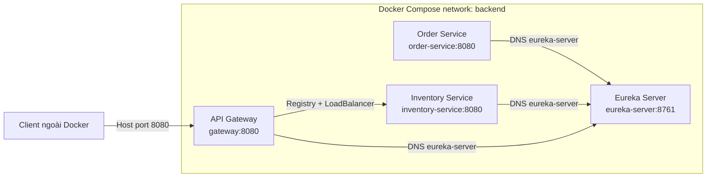

# Hostname, DNS nội bộ và mạng Docker Compose

Khi chạy microservice bằng Docker Compose, mỗi container có network namespace và địa chỉ IP riêng. Địa chỉ IP có thể thay đổi khi container được tạo lại, vì vậy cấu hình ứng dụng nên dùng hostname hoặc tên service có thể phân giải ổn định trong mạng Compose thay vì ghi cứng IP.

Docker Compose cung cấp DNS nội bộ để các service cùng network tìm nhau bằng tên service hoặc network alias. Spring Cloud Service Discovery như Eureka hoặc Consul là một lớp khác: registry lưu service ID, địa chỉ instance và trạng thái đăng ký để consumer tra cứu. Hai lớp này có thể cùng hoạt động. Docker DNS giúp các container kết nối tới registry và các địa chỉ mạng; registry giúp ứng dụng tìm instance theo service ID.

## Docker Compose tạo DNS nội bộ như thế nào?

Khi chạy `docker compose up`, Compose thường tạo một network mặc định cho project. Các service gắn vào cùng network có thể phân giải nhau bằng tên service. Ví dụ, service `eureka-server` có thể được truy cập từ `order-service` qua hostname `eureka-server`.



Trong ví dụ này, `eureka-server`, `inventory-service`, `order-service` và `gateway` là tên service trong Compose. DNS nội bộ phân giải tên đó thành địa chỉ container trên network chung.

Đặc điểm quan trọng:

- Tên service ổn định qua lần recreate container, trong khi IP container có thể thay đổi.
- DNS nội bộ chỉ có hiệu lực với container gắn vào cùng network hoặc network có thể kết nối.
- Một service có thể được gắn vào nhiều network và có các alias khác nhau trên từng network.
- Không cần khai báo `container_name` chỉ để các service gọi nhau bằng tên.
- Không nên ghi cứng IP container vào `application.yml`, biến môi trường hoặc Eureka client config.

## Tên service, hostname và network alias

Trong Docker Compose, tên service là tên DNS phổ biến và dễ quản lý nhất. Ví dụ:

```yaml
services:
  eureka-server:
    image: example/eureka-server:1.0

  order-service:
    image: example/order-service:1.0
```

Từ container `order-service`, hostname `eureka-server` có thể được phân giải nếu cả hai cùng network. Compose cũng cho phép khai báo alias riêng theo network:

```yaml
services:
  eureka-server:
    image: example/eureka-server:1.0
    networks:
      backend:
        aliases:
          - discovery.internal

  order-service:
    image: example/order-service:1.0
    networks:
      - backend

networks:
  backend:
```

Khi đó, `order-service` có thể kết nối bằng `eureka-server` hoặc `discovery.internal`. Alias chỉ có ý nghĩa trên network mà nó được khai báo. Nếu nhiều container cùng đăng ký một alias, DNS có thể trả về nhiều địa chỉ; chỉ dùng alias dùng chung khi muốn hành vi đó.

Không nên nhầm ba khái niệm:

| Giá trị | Ý nghĩa | Ví dụ |
|---|---|---|
| Compose service name | Tên service được Compose dùng để tạo DNS record | `inventory-service` |
| Container hostname | Hostname bên trong container; có thể được đặt riêng | `inventory-node-a` |
| Network alias | Tên bổ sung chỉ có hiệu lực trong một network | `inventory.internal` |

`container_name` đặt tên container ở cấp Docker daemon nhưng làm giảm khả năng scale service thành nhiều container. Với ứng dụng cần nhiều replica, ưu tiên service name, network alias và hostname/instance ID riêng thay vì gắn một `container_name` cố định.

## Phân biệt DNS Compose với Spring Cloud Service Discovery

Docker DNS và registry giải quyết hai câu hỏi khác nhau:

| Cơ chế | Tra cứu theo | Dữ liệu trả về | Phạm vi điển hình |
|---|---|---|---|
| Docker Compose DNS | Tên service hoặc network alias | Địa chỉ IP của container trên network | Container cùng network |
| Eureka / Consul / ZooKeeper | Service ID | Các instance, host, port và metadata đã đăng ký | Các ứng dụng được cấu hình kết nối registry |
| Spring Cloud LoadBalancer | Service ID từ HTTP URI hoặc API | Một instance được chọn từ danh sách discovery | Consumer/Gateway có LoadBalancer |

Ví dụ gọi trực tiếp qua Docker DNS:

```text
http://inventory-service:8080/api/items/42
```

Ví dụ gọi qua Spring Cloud LoadBalancer:

```text
http://inventory-service/api/items/42
```

URL thứ hai chỉ hoạt động khi request đi qua HTTP client có tích hợp `@LoadBalanced` hoặc cơ chế LoadBalancer tương ứng. Host `inventory-service` trong trường hợp này là service ID được discovery tra cứu, không phải yêu cầu DNS Compose phân giải trực tiếp.

Compose DNS có thể thuận tiện cho một lab nhỏ hoặc một service đơn giản. Tuy nhiên, DNS không tự cung cấp metadata nghiệp vụ, health status theo registry, zone, version hay chính sách chọn instance của Spring Cloud. Nó cũng không thay thế Eureka/Consul nếu ứng dụng cần các khả năng đó.

## `localhost` bên trong container luôn trỏ về chính container đó

Đây là lỗi cấu hình phổ biến nhất khi chuyển ứng dụng từ chạy trực tiếp trên máy sang Docker Compose.

- Từ máy host, `localhost:8761` có thể trỏ tới cổng Eureka được publish ra host.
- Từ container `order-service`, `localhost:8761` trỏ tới chính container `order-service`, không phải container `eureka-server`.
- Từ container `inventory-service`, `localhost:8080` trỏ tới chính inventory container.

Vì vậy, cấu hình Eureka client trong container phải dùng tên service Compose:

```yaml
eureka:
  client:
    service-url:
      defaultZone: http://eureka-server:8761/eureka/
```

Trong khi đó, nếu chạy một ứng dụng Java trực tiếp trên máy host để thử nghiệm, ứng dụng đó có thể dùng `http://localhost:8761/eureka/` khi Compose đã publish cổng 8761 ra host.

Không dùng `localhost` làm địa chỉ instance mà Eureka đăng ký nếu consumer chạy trong container khác. Khi consumer gọi địa chỉ đó, nó sẽ kết nối vào chính container consumer và thường gặp connection refused.

## Port mapping: cổng host khác cổng container

Khai báo `ports` theo dạng `HOST_PORT:CONTAINER_PORT` để publish cổng container ra máy host:

```yaml
services:
  eureka-server:
    image: example/eureka-server:1.0
    ports:
      - "8761:8761"

  inventory-service:
    image: example/inventory-service:1.0
    ports:
      - "18081:8080"
```

Từ máy host:

```text
http://localhost:8761
http://localhost:18081
```

Từ container khác trên cùng Compose network:

```text
http://eureka-server:8761
http://inventory-service:8080
```

Container `inventory-service` vẫn lắng nghe cổng 8080 bên trong network; cổng 18081 chỉ là cổng host được ánh xạ tới đó. Container khác không gọi `inventory-service:18081` trừ khi ứng dụng thực sự lắng nghe cổng đó bên trong container.

Không cần publish mọi cổng service ra host. Thông thường chỉ publish Gateway hoặc những endpoint cần truy cập từ máy phát triển; registry và service nội bộ có thể chỉ mở trên network backend.

`expose` có thể được dùng để mô tả cổng mà service cung cấp cho các container khác, nhưng nó không tạo ra một cơ chế bảo mật riêng và không thay thế network membership. Các container cùng network vẫn có thể kết nối tới cổng đang lắng nghe dù không khai báo `expose`.

## Khai báo network riêng cho backend và gateway

Mạng Compose mặc định thường đủ cho lab. Với cấu trúc rõ ràng hơn, có thể tách network bên ngoài và network nội bộ:

```yaml
services:
  gateway:
    image: example/gateway:1.0
    ports:
      - "8080:8080"
    networks:
      - edge
      - backend

  eureka-server:
    image: example/eureka-server:1.0
    networks:
      - backend

  inventory-service:
    image: example/inventory-service:1.0
    networks:
      - backend

  order-service:
    image: example/order-service:1.0
    networks:
      - backend

networks:
  edge:
  backend:
```

Trong cấu hình này, Gateway tham gia cả `edge` và `backend`; các service và registry chỉ tham gia `backend`. Client bên ngoài truy cập Gateway qua host port 8080. Các service backend không cần được publish trực tiếp ra host.

Một container chỉ phân giải được tên service trên network mà nó cùng tham gia. Nếu `order-service` không cùng network với `eureka-server`, tên `eureka-server` sẽ không phân giải từ `order-service`, kể cả khi service đang chạy.

Có thể khai báo `external: true` để nhiều Compose project cùng tham gia một network đã được tạo trước. Khi làm vậy, cần quản lý vòng đời network và tên alias để tránh xung đột giữa các project.

## Cấu hình Eureka Server và client trong Compose

### Eureka Server

Với Eureka Server chạy độc lập một node trong lab, cấu hình server có thể là:

```yaml
server:
  port: 8761

spring:
  application:
    name: eureka-server

eureka:
  client:
    register-with-eureka: false
    fetch-registry: false
```

Eureka Server vẫn phục vụ API registry ở cổng 8761. Hai cờ `register-with-eureka` và `fetch-registry` tắt hoạt động client peer của node standalone; chúng không tắt HTTP server.

### Eureka client

Các service chạy trong Compose cần dùng hostname của service Eureka:

```yaml
spring:
  application:
    name: inventory-service

eureka:
  client:
    service-url:
      defaultZone: http://eureka-server:8761/eureka/
    register-with-eureka: true
    fetch-registry: true
  instance:
    prefer-ip-address: true
```

`prefer-ip-address: true` yêu cầu Eureka Client ưu tiên quảng bá IP của instance thay vì hostname. Trong Compose, IP container thường có thể được các container cùng network truy cập. Cần xác minh địa chỉ thực tế xuất hiện trong Eureka Dashboard và thử kết nối từ Gateway/consumer.

Điểm quan trọng là địa chỉ được quảng bá trong `ServiceInstance` phải truy cập được từ consumer. Nếu registry lưu `localhost`, IP thuộc một network khác hoặc hostname không phân giải trong network của consumer, tra cứu có thể thành công nhưng lời gọi nghiệp vụ vẫn thất bại.

Với nhiều replica, mỗi instance cần một địa chỉ có thể truy cập riêng và instance ID duy nhất. Không để mọi replica đăng ký cùng một địa chỉ không phân biệt được. Khi scale service, tránh `container_name` cố định và kiểm tra từng bản ghi đăng ký trên registry.

### Cấu hình qua biến môi trường

Có thể truyền cấu hình Spring Boot bằng biến môi trường trong Compose:

```yaml
services:
  order-service:
    image: example/order-service:1.0
    environment:
      SPRING_APPLICATION_NAME: order-service
      EUREKA_CLIENT_SERVICEURL_DEFAULTZONE: http://eureka-server:8761/eureka/
      EUREKA_INSTANCE_PREFER_IP_ADDRESS: "true"
    networks:
      - backend
```

Tên biến môi trường tuân theo quy tắc relaxed binding của Spring Boot. Với property dạng map như `service-url.defaultZone`, hãy kiểm tra giá trị đã bind đúng bằng cấu hình runtime hoặc log khởi động của phiên bản đang dùng. Nếu muốn dễ đọc và tránh nhầm tên biến, có thể mount `application-docker.yml` vào container rồi bật profile `docker`.

## Ví dụ Docker Compose hoàn chỉnh

Ví dụ dưới đây minh họa một Eureka Server, hai service backend và một Gateway. Tên image chỉ là placeholder; thay bằng image đã build của dự án.

```yaml
services:
  eureka-server:
    image: example/eureka-server:1.0
    ports:
      - "8761:8761"
    networks:
      - backend
    healthcheck:
      test: ["CMD-SHELL", "curl -fsS http://localhost:8761/actuator/health || exit 1"]
      interval: 10s
      timeout: 3s
      retries: 12
      start_period: 20s

  inventory-service:
    image: example/inventory-service:1.0
    environment:
      SPRING_APPLICATION_NAME: inventory-service
      EUREKA_CLIENT_SERVICEURL_DEFAULTZONE: http://eureka-server:8761/eureka/
      EUREKA_INSTANCE_PREFER_IP_ADDRESS: "true"
    depends_on:
      eureka-server:
        condition: service_healthy
    networks:
      - backend

  order-service:
    image: example/order-service:1.0
    environment:
      SPRING_APPLICATION_NAME: order-service
      EUREKA_CLIENT_SERVICEURL_DEFAULTZONE: http://eureka-server:8761/eureka/
      EUREKA_INSTANCE_PREFER_IP_ADDRESS: "true"
    depends_on:
      eureka-server:
        condition: service_healthy
    networks:
      - backend

  gateway:
    image: example/gateway:1.0
    ports:
      - "8080:8080"
    environment:
      SPRING_APPLICATION_NAME: gateway
      EUREKA_CLIENT_SERVICEURL_DEFAULTZONE: http://eureka-server:8761/eureka/
      EUREKA_INSTANCE_PREFER_IP_ADDRESS: "true"
    depends_on:
      eureka-server:
        condition: service_healthy
    networks:
      - edge
      - backend

networks:
  edge:
  backend:
```

Healthcheck ở trên yêu cầu image Eureka có lệnh `curl` và endpoint Actuator health được bật, truy cập được. Nếu image không có `curl`, hãy cài công cụ kiểm tra phù hợp hoặc dùng một healthcheck tương ứng có sẵn trong image. Không expose endpoint health quản trị công khai chỉ để phục vụ healthcheck.

`depends_on` với `condition: service_healthy` giúp Compose chờ healthcheck của Eureka Server đạt trạng thái healthy trước khi tạo service phụ thuộc trong các phiên bản Compose hỗ trợ điều kiện này. Nó không bảo đảm registry đã đồng bộ đầy đủ hoặc provider đã đăng ký xong. Ứng dụng vẫn cần retry/backoff khi kết nối registry và xử lý trường hợp registry tạm thời chưa sẵn sàng.

## Consul và ZooKeeper cũng cần hostname có thể phân giải

Nguyên tắc DNS Compose không phụ thuộc registry cụ thể. Nếu dùng Consul, client cần kết nối tới Consul Agent/server bằng service name:

```yaml
spring:
  cloud:
    consul:
      host: consul-agent
      port: 8500
      discovery:
        register: true
```

Với ZooKeeper:

```yaml
spring:
  cloud:
    zookeeper:
      connect-string: zk-1:2181,zk-2:2181,zk-3:2181
      discovery:
        register: true
```

Các hostname `consul-agent`, `zk-1`, `zk-2` và `zk-3` phải là service name hoặc alias có thể phân giải từ container ứng dụng. Nếu registry chạy ở một Compose project khác, hai project cần dùng chung external network hoặc một endpoint có thể định tuyến tới nhau.

Với health check, Consul Agent phải truy cập được địa chỉ và port mà service đăng ký. Không chỉ kiểm tra client có kết nối được tới Consul; hãy kiểm tra cả đường từ agent tới endpoint health của provider.

## Địa chỉ bind và địa chỉ quảng bá phải phù hợp

Ứng dụng Spring Boot thường lắng nghe trên mọi interface khi không cấu hình `server.address` riêng. Nếu đặt `server.address: 127.0.0.1`, ứng dụng chỉ nhận kết nối loopback bên trong container và container khác không thể truy cập qua network.

Trong container, không nên bind service vào loopback nếu cần nhận traffic từ container khác. Có thể bỏ `server.address` để dùng mặc định phù hợp hoặc đặt `server.address: 0.0.0.0` khi cấu hình ứng dụng yêu cầu.

Cần phân biệt:

- **Bind address:** interface mà process lắng nghe.
- **Advertised address:** hostname/IP mà registry công bố cho consumer.
- **Published host port:** cổng trên máy host ánh xạ tới cổng container.

Ba giá trị này có thể khác nhau. Ví dụ, ứng dụng lắng nghe `0.0.0.0:8080`, Eureka quảng bá IP container `172.20.0.5:8080`, còn máy host truy cập qua `localhost:18081`. Consumer trong Compose phải dùng địa chỉ quảng bá mà nó truy cập được; nó không dùng host port 18081.

## Docker DNS khi scale nhiều replica

Compose có thể tạo nhiều container cho cùng một service bằng lệnh scale, ví dụ:

```bash
docker compose up -d --scale inventory-service=3
```

Không khai báo `container_name` cố định cho service cần scale. Mỗi replica có container và IP riêng. Compose DNS có thể trả về nhiều địa chỉ cho tên service, nhưng DNS round-robin không tương đương với một registry có health state và metadata của từng instance.

Khi dùng Eureka/Consul, mỗi replica nên đăng ký instance riêng với địa chỉ và instance ID phân biệt. Gateway dùng `lb://inventory-service` để LoadBalancer chọn một trong các instance registry trả về. Không nên để mọi replica cùng quảng bá `localhost` hoặc một IP không truy cập được từ Gateway.

Nếu publish cùng một host port cố định cho tất cả replica, Compose không thể gán cùng cổng host đó cho nhiều container. Thông thường chỉ publish Gateway; các replica backend dùng cổng nội bộ trên network.

## `depends_on` không thay thế retry và readiness

`depends_on` chủ yếu điều khiển thứ tự khởi tạo container. Nếu không dùng health condition, Compose có thể tạo container client ngay sau khi tạo container registry, trong khi ứng dụng registry vẫn đang khởi động.

Ngay cả khi dùng `condition: service_healthy`, registry có thể healthy ở mức HTTP nhưng chưa sẵn sàng phục vụ mọi thao tác nghiệp vụ. Provider cần retry kết nối, đăng ký lại sau lỗi tạm thời và consumer cần xử lý danh sách instance rỗng khi khởi động.

Không nên dùng thời gian `sleep` cố định làm giải pháp readiness. Healthcheck, retry có backoff và timeout hữu hạn giúp hệ thống phản ứng tốt hơn với thời gian khởi động khác nhau.

## Container cần truy cập dịch vụ đang chạy trên máy host

`localhost` trong container không trỏ tới máy host. Trên Docker Desktop, hostname `host.docker.internal` thường được cung cấp để container gọi dịch vụ đang chạy trên host:

```text
http://host.docker.internal:9000
```

Trên Docker Engine Linux, có thể cần khai báo host gateway rõ ràng trong Compose:

```yaml
services:
  order-service:
    extra_hosts:
      - "host.docker.internal:host-gateway"
```

Chỉ dùng cách này khi container thực sự cần gọi một tiến trình chạy ngoài Docker. Với các service cũng nằm trong Compose, ưu tiên service name trên network chung.

## Kiểm tra DNS và kết nối từ trong container

Khi một service không kết nối được registry hoặc provider, hãy kiểm tra từ chính network namespace của container gọi đi. Các lệnh dưới đây cần công cụ tương ứng có trong image:

```bash
# Xem trạng thái service
docker compose ps

# Xem log registry
docker compose logs eureka-server

# Kiểm tra DNS nội bộ nếu image có getent
docker compose exec order-service getent hosts eureka-server

# Kiểm tra HTTP endpoint nếu image có curl
docker compose exec order-service curl -v http://eureka-server:8761/actuator/health

# Xem network mà Compose tạo
docker network ls
```

Nếu image tối giản không có `getent`, `nslookup` hoặc `curl`, dùng một container debug tạm thời gắn vào cùng network để kiểm tra. Không cài công cụ chẩn đoán vào image production chỉ để xử lý một lần.

Có thể xem chi tiết network và endpoint container:

```bash
docker network inspect <project>_backend
docker compose config
```

`docker compose config` giúp xác nhận cấu hình Compose sau khi merge file và nội suy biến môi trường. Không chia sẻ output nếu trong đó có secret được nội suy trực tiếp.

## Lỗi thường gặp

| Triệu chứng | Nguyên nhân có thể | Cách xử lý |
|---|---|---|
| Container gọi `localhost:8761` nhưng connection refused | `localhost` trỏ về chính container client | Dùng `http://eureka-server:8761/eureka/` |
| Host gọi được Eureka nhưng container không gọi được | Chỉ kiểm tra host port, container không cùng network hoặc dùng sai hostname | Kiểm tra network membership và dùng service name với container port |
| Eureka dashboard có instance nhưng Gateway không gọi được | Registry quảng bá `localhost`, IP sai network hoặc port không đúng | Kiểm tra advertised address từ góc nhìn Gateway |
| DNS không phân giải tên service | Hai container không có network chung hoặc service name/alias sai | Kiểm tra Compose network và alias |
| Request nội bộ dùng host port và thất bại | Nhầm `HOST_PORT` với `CONTAINER_PORT` | Dùng service name và cổng container |
| App bind `127.0.0.1` nên container khác không truy cập được | Server chỉ lắng nghe loopback | Bind vào interface phù hợp, thường là `0.0.0.0` |
| Sau recreate container, kết nối tới IP cũ | Cấu hình ghi cứng IP container | Dùng service DNS hoặc registry cập nhật instance |
| Scale service nhưng các instance bị trùng hoặc không truy cập được | `container_name` cố định hoặc advertised address/instance ID không riêng | Bỏ container_name cố định và kiểm tra từng registration |
| Client khởi động trước registry | Chỉ dựa vào thứ tự tạo container | Dùng healthcheck, depends_on condition và retry/backoff trong ứng dụng |

## Checklist triển khai

1. Đặt tên service Compose ổn định và dùng tên đó cho kết nối nội bộ.
2. Đảm bảo các container cần liên lạc cùng tham gia ít nhất một network.
3. Dùng service name/alias thay vì IP container ghi cứng.
4. Không dùng `localhost` để gọi container khác.
5. Phân biệt host port và container port; service nội bộ dùng container port.
6. Bảo đảm ứng dụng bind trên interface có thể nhận kết nối từ network.
7. Kiểm tra địa chỉ mà Eureka/Consul quảng bá có thể truy cập từ consumer.
8. Với nhiều replica, bảo đảm mỗi instance có registration và instance ID phù hợp.
9. Dùng healthcheck và retry/backoff; không coi `depends_on` là bảo đảm readiness tuyệt đối.
10. Chỉ publish cổng cần thiết ra host và giới hạn registry/backend trong network phù hợp.

## Kết luận

Docker Compose DNS cho phép các container cùng network tìm nhau bằng tên service hoặc network alias, nên ứng dụng không cần phụ thuộc vào IP container có thể thay đổi. Spring Cloud Service Discovery bổ sung registry theo service ID, metadata và trạng thái instance. Khi kết hợp hai lớp, hãy dùng service name như `eureka-server` để client kết nối registry, bảo đảm địa chỉ instance mà registry quảng bá truy cập được từ consumer, phân biệt host port với container port và không dùng `localhost` giữa các container. Healthcheck, retry và kiểm tra network từ bên trong container giúp việc triển khai ổn định hơn.
