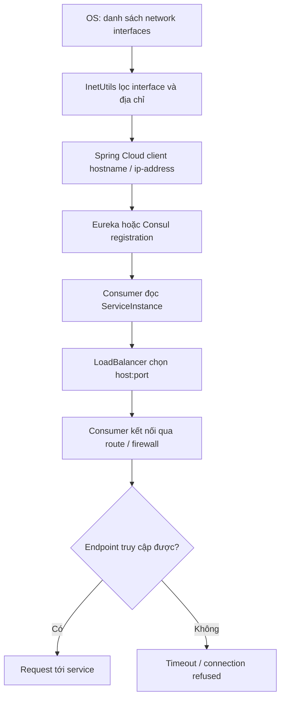

# Dịch vụ nhiều giao diện mạng và lựa chọn InetUtils

Một máy chủ hoặc container có thể có nhiều địa chỉ mạng cùng lúc: card Ethernet, Wi-Fi, VPN, Docker bridge, interface của Kubernetes, interface quản trị và loopback. Khi ứng dụng Spring Cloud tự phát hiện địa chỉ để đăng ký vào Eureka hoặc Consul, địa chỉ được chọn có thể không phải địa chỉ mà consumer truy cập được.

`InetUtils` trong Spring Cloud Commons hỗ trợ tìm hostname và IP phù hợp từ các network interface của máy. Có thể lọc interface theo tên, ưu tiên dải địa chỉ, hoặc giới hạn địa chỉ site-local. Tuy nhiên, chọn đúng IP chỉ là một phần của bài toán: địa chỉ được quảng bá trong registry còn phải khớp với cổng ứng dụng, firewall, route mạng và góc nhìn của consumer.

## 1. Vì sao máy nhiều interface dễ đăng ký sai địa chỉ?

Giả sử một máy chạy `inventory-service` có các interface:

| Interface | Địa chỉ ví dụ | Mục đích | Consumer có thể truy cập? |
|---|---|---|---|
| `lo` | `127.0.0.1` | Loopback nội bộ | Chỉ process trên cùng network namespace |
| `eth0` | `10.42.1.20` | Mạng ứng dụng | Có, từ subnet service |
| `docker0` | `172.17.0.1` | Docker bridge trên host | Thường chỉ phù hợp cho host/container cùng bridge |
| `tun0` | `10.8.0.12` | VPN quản trị | Chỉ các node có route VPN |
| `eth1` | `192.168.50.20` | Mạng quản trị hoặc storage | Không nhất thiết consumer service truy cập được |

Nếu service đăng ký `172.17.0.1` hoặc `10.8.0.12` trong khi consumer chỉ route được tới `10.42.1.20`, registry vẫn có thể hiển thị instance `UP`, nhưng request thực tế sẽ timeout hoặc connection refused.

Đường đi của địa chỉ có thể hình dung như sau:



## 2. InetUtils làm nhiệm vụ gì?

`InetUtils` tìm một địa chỉ không phải loopback phù hợp và tạo thông tin host gồm hostname và IP. Spring Cloud Commons sử dụng thông tin này làm host information chung, có thể được các thành phần discovery dùng khi không có cấu hình quảng bá riêng.

Việc lựa chọn chịu ảnh hưởng bởi các bộ lọc:

1. Interface phải đang hoạt động và không nằm trong `ignored-interfaces`.
2. Địa chỉ loopback không được dùng làm địa chỉ quảng bá thông thường.
3. Nếu cấu hình `preferred-networks`, địa chỉ cần khớp với một mẫu mạng được ưu tiên.
4. Nếu `use-only-site-local-interfaces` bật, chỉ địa chỉ mà Java nhận diện là site-local mới đủ điều kiện.
5. Nếu không tìm được host phù hợp hoặc xảy ra lỗi, InetUtils có thể trả về hostname/IP mặc định đã cấu hình.

Không nên phụ thuộc vào thứ tự interface mà hệ điều hành trả về. Thứ tự enumeration có thể khác giữa máy, hệ điều hành, container và lần khởi động. Khi có nhiều NIC, hãy khai báo tiêu chí chọn rõ ràng thay vì giả định `eth0` luôn được chọn.

`InetUtils` không:

- Mở cổng hoặc bind web server vào interface.
- Tạo route giữa các subnet hoặc cấu hình firewall.
- Kiểm tra consumer có thể kết nối tới địa chỉ đã chọn hay không.
- Tự thay thế địa chỉ do Eureka/Consul được cấu hình tường minh.
- Bảo đảm địa chỉ đã đăng ký luôn đúng sau khi mạng thay đổi.

## 3. Các thuộc tính InetUtils quan trọng

Các thuộc tính hiện hành trong Spring Cloud Commons 5.1.0:

| Thuộc tính | Mặc định | Tác dụng |
|---|---|---|
| `spring.cloud.inetutils.ignored-interfaces` | Danh sách rỗng | Các Java regular expression dùng để bỏ qua tên network interface |
| `spring.cloud.inetutils.preferred-networks` | Danh sách rỗng | Các Java regular expression dùng để ưu tiên địa chỉ IP thuộc những dải mạng mong muốn |
| `spring.cloud.inetutils.use-only-site-local-interfaces` | `false` | Chỉ chấp nhận địa chỉ site-local khi bật |
| `spring.cloud.inetutils.default-hostname` | `localhost` | Hostname dự phòng khi không xác định được hostname |
| `spring.cloud.inetutils.default-ip-address` | `127.0.0.1` | IP dự phòng khi không tìm được địa chỉ phù hợp |
| `spring.cloud.inetutils.timeout-seconds` | `1` | Thời gian chờ tính hostname, tính bằng giây |

Điểm dễ nhầm: `use-only-site-local-interfaces` mặc định là `false`. Spring Cloud không tự giới hạn việc chọn địa chỉ vào các dải private chỉ vì ứng dụng dùng service discovery. Nếu máy có nhiều interface, hãy cấu hình `preferred-networks` hoặc `ignored-interfaces` theo topology thực tế.

`default-ip-address: 127.0.0.1` là giá trị dự phòng khi việc phát hiện địa chỉ thất bại, không phải cách cấu hình để ép service quảng bá loopback. Nếu registry nhận `127.0.0.1` trên một máy chạy phân tán, consumer ở máy khác sẽ kết nối về loopback của chính nó.

## 4. Bỏ qua interface không dùng cho service discovery

`spring.cloud.inetutils.ignored-interfaces` nhận danh sách regular expression áp dụng cho tên interface. Ví dụ, nếu Docker bridge, virtual Ethernet và VPN quản trị không được dùng làm endpoint service:

```yaml
spring:
  cloud:
    inetutils:
      ignored-interfaces:
        - docker0
        - veth.*
        - br-.*
        - tun.*
```

Ý nghĩa:

- `docker0`: bỏ qua interface Docker bridge có tên chính xác `docker0`.
- `veth.*`: bỏ qua interface có tên bắt đầu bằng `veth`.
- `br-.*`: bỏ qua bridge interface có tên bắt đầu bằng `br-`.
- `tun.*`: bỏ qua interface VPN dạng `tun0`, `tun1` nếu chúng không phục vụ traffic service.

Đây là regex, không phải danh sách địa chỉ IP. Ví dụ `10.42.*` không nên đặt trong `ignored-interfaces` để lọc IP; hãy dùng `preferred-networks` cho mục đích đó.

Không sao chép nguyên danh sách ví dụ vào mọi môi trường. Một interface `br-*` hoặc `tun*` có thể chính là đường mạng hợp lệ trong hạ tầng của bạn. Chỉ bỏ qua interface sau khi xác định vai trò và route của nó.

## 5. Ưu tiên dải địa chỉ bằng preferred-networks

`spring.cloud.inetutils.preferred-networks` nhận danh sách regular expression khớp với địa chỉ IP. Khi muốn service quảng bá địa chỉ từ subnet ứng dụng `10.42.0.0/16`, có thể cấu hình:

```yaml
spring:
  cloud:
    inetutils:
      preferred-networks:
        - '^10\.42\..*'
```

Ví dụ trên ưu tiên địa chỉ bắt đầu bằng `10.42.`. Nếu có nhiều subnet hợp lệ, liệt kê từng mẫu:

```yaml
spring:
  cloud:
    inetutils:
      preferred-networks:
        - '^10\.42\..*'
        - '^10\\.43\\..*'
```

Trong YAML dùng chuỗi single-quoted để giữ nguyên dấu backslash của regex. Mẫu này là ví dụ cho IPv4; với IPv6, hãy viết regex phù hợp với cách địa chỉ được biểu diễn trong môi trường và kiểm tra kết quả thực tế.

`preferred-networks` chọn theo địa chỉ, còn `ignored-interfaces` loại theo tên interface. Hai thuộc tính giải quyết hai vấn đề khác nhau và có thể dùng cùng nhau: bỏ interface không mong muốn trước, sau đó giới hạn địa chỉ thuộc dải mạng có thể quảng bá.

Không viết regex quá rộng như `^10\\..*` nếu máy có nhiều mạng `10/8` cho các mục đích khác nhau. Hãy chọn subnet cụ thể mà consumer có route tới.

## 6. Chỉ dùng địa chỉ site-local

Có thể bật `use-only-site-local-interfaces` để chỉ chấp nhận địa chỉ mà `InetAddress.isSiteLocalAddress()` nhận diện là site-local:

```yaml
spring:
  cloud:
    inetutils:
      use-only-site-local-interfaces: true
```

Đối với IPv4, các dải private thường gặp là `10.0.0.0/8`, `172.16.0.0/12` và `192.168.0.0/16`. Tuy nhiên, site-local là khái niệm do Java định nghĩa; không nên đồng nhất nó với mọi chính sách mạng riêng của tổ chức hoặc với một subnet duy nhất.

Bật thuộc tính này không giải quyết được trường hợp máy có hai NIC đều mang địa chỉ site-local, ví dụ `10.42.1.20` cho ứng dụng và `192.168.50.20` cho quản trị. Khi đó vẫn cần `preferred-networks` hoặc bỏ qua interface quản trị.

## 7. Cấu hình kết hợp cho máy nhiều NIC

Giả sử consumer chỉ truy cập service qua subnet `10.42.0.0/16`, còn `docker0`, `veth*` và `tun*` không được dùng. Có thể cấu hình:

```yaml
spring:
  cloud:
    inetutils:
      ignored-interfaces:
        - docker0
        - veth.*
        - tun.*
      preferred-networks:
        - '^10\.42\..*'
      use-only-site-local-interfaces: true
      timeout-seconds: 2
```

Trong cấu hình này:

- Interface Docker/VPN bị loại khỏi quá trình dò host.
- Chỉ địa chỉ thuộc dải `10.42.*` được ưu tiên làm host information.
- Site-local filter bổ sung điều kiện địa chỉ thuộc phạm vi local theo Java.
- Timeout hostname được tăng lên 2 giây để phù hợp môi trường có DNS nội bộ phản hồi chậm hơn mặc định.

`timeout-seconds` ảnh hưởng việc tính hostname, không phải timeout kết nối HTTP tới service, không phải timeout đăng ký Consul/Eureka và cũng không phải thời gian chờ route mạng.

Nếu cấu hình không tìm thấy địa chỉ phù hợp, kiểm tra regex và interface trước khi thay `default-ip-address`. Việc đổi fallback thành một IP tĩnh không thay thế cho lựa chọn interface đúng.

## 8. InetUtils và địa chỉ mà Eureka/Consul quảng bá

InetUtils cung cấp host information chung cho Spring Cloud, nhưng registry integration có thể cho phép đặt địa chỉ cụ thể. Nếu cấu hình registry tường minh, hãy kiểm tra giá trị cuối cùng mà registry nhận được.

### 8.1. Eureka

Với Eureka Client, có thể chọn đăng ký bằng IP và đặt địa chỉ cụ thể:

```yaml
eureka:
  instance:
    prefer-ip-address: true
    ip-address: ${SERVICE_ADVERTISE_IP:10.42.1.20}
```

Nếu muốn quảng bá hostname thay cho IP:

```yaml
eureka:
  instance:
    prefer-ip-address: false
    hostname: ${SERVICE_ADVERTISE_HOST:inventory-1.internal}
```

`prefer-ip-address` quyết định Eureka dùng IP thay hostname khi tạo host name cho instance. Nếu muốn consumer gọi IP cụ thể, đặt đồng thời `prefer-ip-address: true` và `ip-address`; chỉ đặt `ip-address` trong khi vẫn ưu tiên hostname không bảo đảm địa chỉ đó trở thành host dùng để kết nối. Nếu muốn consumer gọi DNS, đặt `hostname` và giữ `prefer-ip-address: false`. Sau khi đăng ký, kiểm tra trường host name thực tế mà Eureka trả về để xác nhận giá trị consumer sẽ dùng.

### 8.2. Consul

Spring Cloud Consul cũng cho phép đặt địa chỉ quảng bá:

```yaml
spring:
  cloud:
    consul:
      discovery:
        prefer-ip-address: true
        ip-address: ${SERVICE_ADVERTISE_IP:10.42.1.20}
```

Hoặc quảng bá hostname:

```yaml
spring:
  cloud:
    consul:
      discovery:
        prefer-ip-address: false
        hostname: ${SERVICE_ADVERTISE_HOST:inventory-1.internal}
```

Agent Consul là nơi nhận request đăng ký; `ip-address`/`hostname` ở discovery là endpoint service mà consumer sẽ truy cập. Không lấy nhầm địa chỉ Consul Agent làm địa chỉ của ứng dụng.

## 9. Địa chỉ quảng bá khác với địa chỉ bind của server

Đây là hai cấu hình có mục đích khác nhau:

| Cấu hình | Vai trò |
|---|---|
| `server.address` | Địa chỉ interface mà embedded web server bind để lắng nghe request |
| `spring.cloud.inetutils.*` | Quy tắc Spring Cloud dò hostname/IP của máy |
| `eureka.instance.ip-address` / `hostname` | Địa chỉ Eureka quảng bá cho instance |
| `spring.cloud.consul.discovery.ip-address` / `hostname` | Địa chỉ Consul ghi vào service registration |

Ví dụ `server.address: 0.0.0.0` cho phép web server lắng nghe trên mọi IPv4 interface phù hợp. Nó không nói với Eureka hoặc Consul rằng consumer phải gọi địa chỉ nào. Ngược lại, đăng ký `10.42.1.20` không tự bảo đảm ứng dụng đang bind vào interface đó hoặc firewall cho phép traffic.

Để service có thể được gọi, ba yếu tố phải thống nhất:

1. Ứng dụng lắng nghe trên đúng port/interface.
2. Registry lưu địa chỉ mà consumer có thể route tới.
3. Firewall, security group, container network và route cho phép consumer kết nối.

## 10. Docker, Kubernetes, VPN và máy phát triển

| Môi trường | Vấn đề thường gặp | Cách chọn địa chỉ |
|---|---|---|
| Máy developer có Wi-Fi + VPN | InetUtils có thể thấy IP VPN hoặc Wi-Fi không cùng mạng với consumer | Dùng `preferred-networks` cho subnet cần thiết hoặc cấu hình IP/hostname quảng bá rõ ràng |
| Docker host | `docker0`, bridge hoặc `veth*` có thể được chọn thay interface service | Bỏ qua interface bridge không dùng; quảng bá địa chỉ DNS/IP mà consumer container có thể truy cập |
| Container cùng Docker network | IP bridge host có thể không route từ container khác | Dùng service/container DNS và container port nếu topology hỗ trợ |
| Kubernetes Pod | Pod có nhiều interface hoặc sidecar network; địa chỉ host khác pod IP | Xác định consumer gọi Pod IP, Kubernetes Service DNS hay headless service; cấu hình registry phù hợp với mô hình đó |
| VM nhiều NIC | Interface quản trị/storage có thể được chọn | Chỉ định preferred subnet và xác minh route hai chiều |

Trong Kubernetes, nếu các service đã được gọi qua Kubernetes Service DNS, cân nhắc dùng cơ chế discovery phù hợp với nền tảng thay vì tự quảng bá một địa chỉ pod qua registry khác. Nếu tích hợp Eureka/Consul, hãy xác định consumer cần gọi Pod IP, service virtual IP hay DNS nội bộ và cấu hình nhất quán.

## 11. Kiểm tra địa chỉ trước và sau khi đăng ký

Trước khi chỉnh InetUtils, xem danh sách interface và địa chỉ thực tế trên máy chạy service.

Linux:

```bash
ip -br addr
ip route
ip route get 10.42.2.30
```

Windows PowerShell:

```powershell
Get-NetIPConfiguration
Get-NetIPAddress
```

Kiểm tra từ chính môi trường consumer (cùng container/network namespace nếu có):

```bash
nc -vz 10.42.1.20 8081
curl -v http://10.42.1.20:8081/actuator/health
```

Thay IP và port bằng endpoint thực tế được registry trả về. Lệnh `nc`/`curl` kiểm tra khả năng kết nối từ consumer; ping thành công không chứng minh cổng TCP ứng dụng mở.

Trong ứng dụng Spring, có thể log host information mà InetUtils phát hiện:

```java
import org.springframework.boot.ApplicationRunner;
import org.springframework.context.annotation.Bean;
import org.springframework.context.annotation.Configuration;
import org.springframework.cloud.commons.util.InetUtils;

@Configuration
class NetworkDiagnosticsConfiguration {

    @Bean
    ApplicationRunner logDetectedHost(InetUtils inetUtils) {
        return args -> {
            InetUtils.HostInfo host = inetUtils.findFirstNonLoopbackHostInfo();
            System.out.printf(
                    "InetUtils hostname=%s ip=%s%n",
                    host.getHostname(), host.getIpAddress());
        };
    }
}
```

Bean `InetUtils` có sẵn khi cấu hình auto-configuration Spring Cloud Commons tương ứng được nạp. Đoạn log này cho biết host information mà InetUtils tìm được; hãy đối chiếu riêng với instance metadata trong Eureka/Consul để biết integration có override địa chỉ hay không.

Không expose thông tin interface, IP nội bộ hoặc cấu hình mạng qua endpoint công khai. Log chẩn đoán nên được giới hạn quyền truy cập.

## 12. Quy trình xử lý khi registry lưu sai IP

1. Lấy `address`/host/port thực tế từ Eureka Dashboard, Eureka REST API hoặc Consul Catalog.
2. Kiểm tra interface và IP trên đúng máy/container đang chạy producer.
3. Log `InetUtils.HostInfo` để biết địa chỉ được phát hiện tự động.
4. Kiểm tra `ignored-interfaces`, `preferred-networks` và `use-only-site-local-interfaces` trong cấu hình hiệu lực.
5. Kiểm tra `eureka.instance.ip-address`, `eureka.instance.hostname`, `prefer-ip-address` hoặc các thuộc tính tương ứng của Consul.
6. Kiểm tra `server.address` và `server.port` để xác nhận server đang bind/listen đúng.
7. Từ network namespace của consumer, thử TCP/HTTP tới đúng địa chỉ và port trong registry.
8. Nếu host information đúng nhưng registry sai, tập trung vào thuộc tính override và cấu hình profile/environment.
9. Nếu registry đúng nhưng consumer không kết nối được, điều tra route, firewall, security group, DNS và port mapping.
10. Sau khi sửa, khởi động lại hoặc đăng ký lại instance, rồi xác nhận registry đã nhận địa chỉ mới.

Đừng sửa bằng cách đổi ngẫu nhiên `server.port`, `default-ip-address` hoặc tắt health check. Trước tiên xác định địa chỉ sai được tạo ở lớp nào.

## 13. Các lỗi thường gặp

| Hiện tượng | Nguyên nhân | Cách xử lý |
|---|---|---|
| Registry lưu IP `127.0.0.1` | InetUtils không tìm được địa chỉ phù hợp và dùng fallback | Kiểm tra log dò interface, DNS và cấu hình filter; không dùng loopback cho consumer ở máy khác |
| Registry lưu IP Docker bridge | Interface bridge chưa bị bỏ qua hoặc được ưu tiên | Thêm regex chính xác vào `ignored-interfaces` hoặc giới hạn `preferred-networks` |
| Registry lưu IP VPN | VPN interface được xem là địa chỉ hợp lệ | Bỏ qua interface VPN nếu consumer không dùng route đó, hoặc chọn subnet ứng dụng rõ ràng |
| Máy có hai IP private nhưng chọn nhầm | `use-only-site-local-interfaces` chỉ lọc site-local, không phân biệt subnet ứng dụng và quản trị | Cấu hình `preferred-networks` theo subnet cụ thể |
| Đổi `server.address` nhưng registry vẫn quảng bá IP cũ | Bind address và advertised address là hai cấu hình khác nhau | Kiểm tra InetUtils và thuộc tính riêng của Eureka/Consul |
| `preferred-networks` không khớp | Regex không đúng với chuỗi IP hoặc escape sai trong YAML | Kiểm tra regex và giá trị IP thực; dùng single-quoted YAML string |
| Consumer truy cập được từ host nhưng không từ container | Route/network namespace khác nhau | Kiểm tra từ đúng container/pod của consumer, dùng DNS/IP và port nội bộ thích hợp |
| Hostname đăng ký không phân giải được | DNS nội bộ hoặc search domain không đồng nhất | Dùng FQDN có thể phân giải từ consumer hoặc đăng ký IP có route |

## 14. Checklist trước khi triển khai

- [ ] Đã liệt kê interface và địa chỉ IP trên đúng host/container chạy service.
- [ ] Đã xác định subnet mà consumer thực sự có thể truy cập.
- [ ] Đã cấu hình `ignored-interfaces` theo tên interface không dùng.
- [ ] Đã cấu hình `preferred-networks` nếu máy có nhiều subnet hợp lệ.
- [ ] Đã hiểu `use-only-site-local-interfaces` mặc định là `false` và bật nó khi có lý do.
- [ ] Không dùng `default-ip-address` như một cách ép IP quảng bá.
- [ ] Đã phân biệt địa chỉ InetUtils với `server.address` bind address.
- [ ] Đã kiểm tra các override riêng của Eureka hoặc Consul.
- [ ] Hostname/IP và port trong registry có thể truy cập từ consumer.
- [ ] Đã kiểm tra Docker/Kubernetes port mapping, DNS và route.
- [ ] Đã xác nhận địa chỉ mới trong registry sau khi cập nhật cấu hình.
- [ ] Không công khai log hoặc endpoint chứa thông tin mạng nội bộ.

## Tài liệu tham khảo

- [Spring Cloud Commons 5.1.0 — Ignore Network Interfaces và InetUtils](https://docs.spring.io/spring-cloud-commons/reference/spring-cloud-commons/common-abstractions.html)
- [Spring Cloud Commons 5.1.0 — Configuration Properties](https://docs.spring.io/spring-cloud-commons/reference/configprops.html)
- [Spring Cloud Commons — HostInfoEnvironmentPostProcessor source](https://github.com/spring-cloud/spring-cloud-commons/blob/main/spring-cloud-commons/src/main/java/org/springframework/cloud/client/HostInfoEnvironmentPostProcessor.java)
- [Java InetAddress — isSiteLocalAddress](https://docs.oracle.com/en/java/javase/21/docs/api/java.base/java/net/InetAddress.html#isSiteLocalAddress())
- [Spring Cloud Netflix — Eureka Instance Configuration](https://docs.spring.io/spring-cloud-netflix/reference/spring-cloud-netflix.html)
- [Spring Cloud Consul — Service Discovery Configuration](https://docs.spring.io/spring-cloud-consul/reference/discovery.html)
