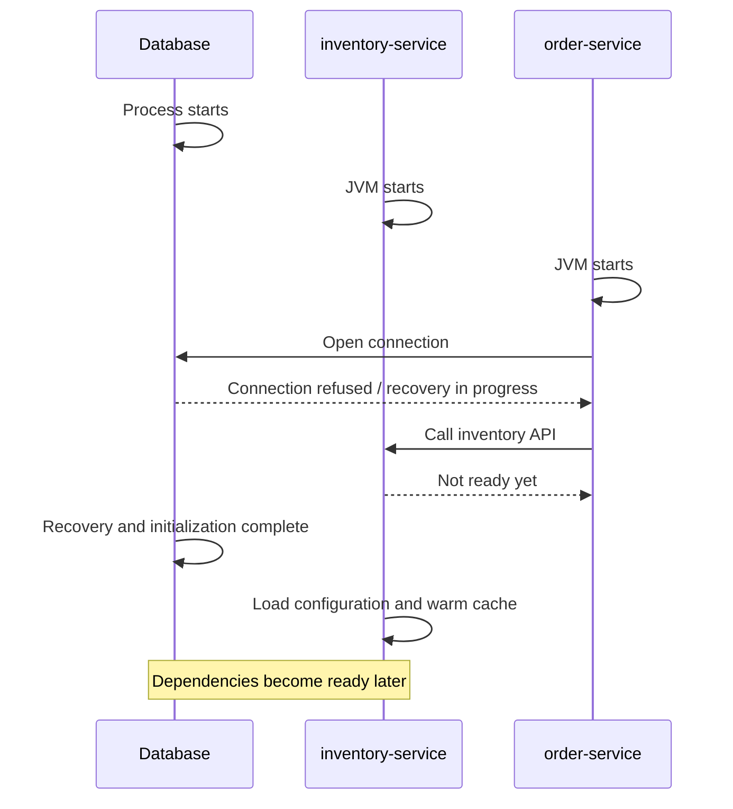
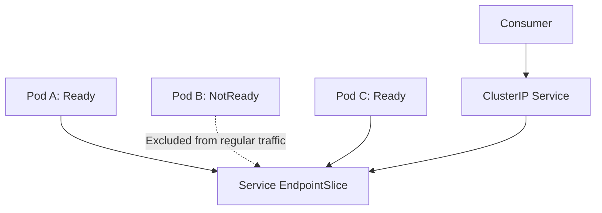
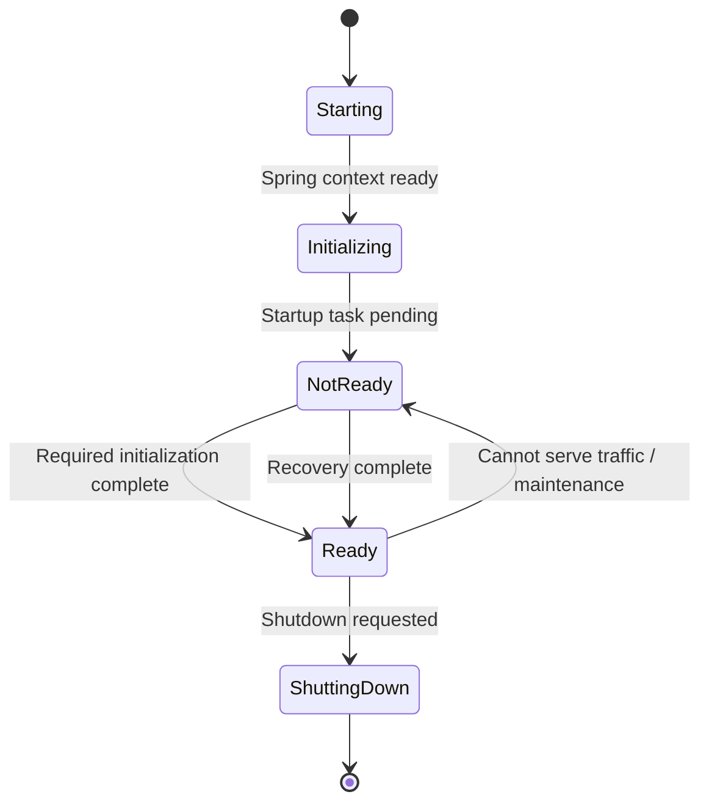

# Khởi động theo mức sẵn sàng thay vì chỉ theo thứ tự tiến trình

Trong hệ thống microservice, việc một tiến trình đã chạy không có nghĩa dịch vụ đó đã sẵn sàng nhận request. Database có thể cần thời gian phục hồi, registry có thể chưa nhận registration, ứng dụng có thể còn tải cấu hình hoặc warm-up cache. Nếu chỉ khởi động các tiến trình theo thứ tự, consumer vẫn có thể gọi provider quá sớm và nhận lỗi kết nối.

Thiết kế tốt cần phân biệt **started** với **ready**. Orchestrator có thể khởi động dependency trước, nhưng ứng dụng vẫn phải xác định khi nào nó có thể phục vụ traffic. Readiness probe, health check, retry có backoff và graceful shutdown giúp hệ thống phối hợp theo trạng thái thực tế thay vì dựa vào một khoảng delay cố định.

Bài học thuộc chương `Mạng và triển khai` trong module `SPRING_CLOUD_SERVICE_DISCOVERY`. Module giúp người học hiểu cơ chế tìm instance theo tên dịch vụ qua `DiscoveryClient`, `ServiceRegistry`, Eureka hoặc Consul, vòng đời đăng ký, health check, load balancing, bảo mật và xử lý sai lệch registry. Nội dung này tập trung vào khởi động dựa trên readiness để các service chỉ nhận traffic khi đã có thể xử lý request.

## 1. Vì sao thứ tự khởi động không đủ?

Giả sử `order-service` cần gọi `inventory-service` và database. Một kịch bản khởi động có thể diễn ra như sau:

1. Container database được tạo và process database bắt đầu chạy.
2. Container `inventory-service` được tạo và JVM bắt đầu khởi động.
3. Container `order-service` được tạo vì các container phụ thuộc đã ở trạng thái running.
4. `order-service` gọi database hoặc `inventory-service` trong khi dependency vẫn đang recovery hoặc chưa mở listener.
5. Request đầu tiên thất bại dù các process đều tồn tại.

Lệnh `docker compose up` hoặc một script shell có thể kiểm soát thứ tự tạo process. Tuy nhiên, trạng thái `running` chỉ cho biết container/process đang chạy; nó không chứng minh database đã nhận query, HTTP server đã phục vụ hoặc service đã đăng ký xong.



Một `sleep 30` không giải quyết căn nguyên. Máy nhanh có thể chỉ cần vài giây; database đang phục hồi sau crash có thể cần lâu hơn. Delay cố định vừa làm chậm môi trường bình thường vừa không bảo đảm môi trường chậm sẽ sẵn sàng.

## 2. Phân biệt process state, liveness và readiness

Ba khái niệm cần được tách biệt:

| Trạng thái | Câu hỏi | Hành động phù hợp |
|---|---|---|
| Started | Process/container đã được tạo và đang chạy chưa? | Xác nhận tiến trình tồn tại. |
| Liveness | Ứng dụng còn có khả năng tiếp tục hoạt động không? | Nếu lỗi không thể tự phục hồi, orchestrator có thể restart. |
| Readiness | Instance đã có thể nhận traffic nghiệp vụ chưa? | Nếu chưa, tạm ngừng gửi traffic tới instance nhưng giữ process chạy. |

Một ứng dụng có thể `started` nhưng chưa `ready` trong lúc khởi tạo. Nó cũng có thể `live` nhưng `not ready` khi đang warm-up, bảo trì hoặc mất một dependency thiết yếu. Ngược lại, một process bị deadlock có thể vẫn còn PID nhưng không còn `live`.

Readiness là tín hiệu điều khiển traffic; liveness là tín hiệu phục hồi process. Dùng cùng một phép kiểm tra cho cả hai mà không cân nhắc có thể khiến orchestrator restart ứng dụng chỉ vì dependency bên ngoài đang gặp sự cố.

## 3. Docker Compose: chờ dependency healthy

Docker Compose có `depends_on` để sắp xếp thứ tự khởi động. Cú pháp ngắn chỉ thể hiện dependency được start trước; Compose không mặc định chờ ứng dụng bên dưới sẵn sàng.

Để chờ một dependency đạt health check, dùng cú pháp dài với `condition: service_healthy`. Ví dụ:

```yaml
services:
  order-service:
    build: ./order-service
    environment:
      SPRING_DATASOURCE_URL: jdbc:postgresql://db:5432/orders
    depends_on:
      db:
        condition: service_healthy
      inventory-service:
        condition: service_healthy

  db:
    image: postgres:16
    environment:
      POSTGRES_DB: orders
      POSTGRES_USER: app
      POSTGRES_PASSWORD: change-me-in-local-dev
    healthcheck:
      test: ["CMD-SHELL", "pg_isready -U $${POSTGRES_USER} -d $${POSTGRES_DB}"]
      interval: 5s
      timeout: 3s
      retries: 12
      start_period: 20s

  inventory-service:
    build: ./inventory-service
    healthcheck:
      test: ["CMD-SHELL", "curl -fsS http://localhost:8080/actuator/health/readiness || exit 1"]
      interval: 5s
      timeout: 3s
      retries: 12
      start_period: 30s
```

Trong ví dụ:

- `db` chỉ được xem là healthy khi `pg_isready` xác nhận PostgreSQL có thể nhận kết nối.
- `inventory-service` được kiểm tra qua endpoint readiness, không chỉ qua trạng thái process.
- Compose đợi các dependency có `service_healthy` trước khi tạo `order-service`.
- `start_period` cho dependency thời gian khởi động trước khi các lần check thất bại được tính theo chính sách health check.

Lệnh `curl` yêu cầu image `inventory-service` có cài curl. Nếu image tối giản không có công cụ đó, hãy dùng một health check phù hợp có sẵn trong image hoặc một cơ chế kiểm tra khác; không thêm package chỉ để làm probe nếu có lựa chọn gọn hơn.

### 3.1. Các condition của depends_on

| Condition | Ý nghĩa |
|---|---|
| `service_started` | Dependency đã được start; không đợi health check. |
| `service_healthy` | Dependency có health check và đã đạt trạng thái healthy. |
| `service_completed_successfully` | Dependency chạy xong và exit thành công, phù hợp với migration hoặc job khởi tạo một lần. |

Ví dụ migration chạy trước ứng dụng:

```yaml
services:
  order-service:
    build: ./order-service
    depends_on:
      migrate:
        condition: service_completed_successfully

  migrate:
    image: example/order-migrations:1.0.0
    command: ["./run-migrations"]
```

Chỉ dùng `service_completed_successfully` cho công việc có vòng đời hoàn tất, không dùng cho database hoặc service phải tiếp tục chạy.

### 3.2. Giới hạn của Compose dependency

`depends_on: service_healthy` giúp điều phối lúc Compose khởi động project. Nó không biến dependency thành luôn sẵn sàng trong suốt vòng đời ứng dụng. Nếu database healthy lúc đầu nhưng mất kết nối sau đó, `order-service` vẫn phải tự xử lý reconnect, timeout và retry.

Health check cũng cần đo đúng khả năng phục vụ. Một lệnh chỉ kiểm tra TCP port có thể pass trong khi database vẫn đang recovery hoặc chưa chấp nhận query nghiệp vụ. Ưu tiên lệnh kiểm tra trạng thái thực sự cần thiết, ví dụ `pg_isready` cho PostgreSQL.

## 4. Kubernetes: readinessProbe điều khiển traffic

Kubernetes không bảo đảm các Deployment khởi động theo thứ tự phụ thuộc. Các Pod có thể được tạo đồng thời. Thay vì cố gắng sắp xếp toàn bộ process, Kubernetes dùng probe để xác định container đã khởi động, còn sống và sẵn sàng nhận traffic hay chưa.

Ba loại probe có trách nhiệm khác nhau:

| Probe | Khi nào chạy? | Khi thất bại |
|---|---|---|
| `startupProbe` | Trong giai đoạn khởi động; chạy trước liveness/readiness nếu được cấu hình. | Kubelet dừng container sau khi vượt `failureThreshold`; restart theo restart policy. |
| `livenessProbe` | Định kỳ sau khi startup probe thành công hoặc theo cấu hình nếu không có startup probe. | Kubelet restart container sau số lần thất bại liên tiếp cho phép. |
| `readinessProbe` | Trong suốt vòng đời container. | Pod được đánh dấu not ready và không nhận traffic thông thường qua Service. |

Khi `startupProbe` được khai báo, Kubernetes chưa chạy liveness và readiness probe cho tới khi startup probe thành công. Đây là cách bảo vệ ứng dụng khởi động chậm khỏi bị liveness probe restart quá sớm.

### 4.1. Ví dụ Deployment với ba probe

```yaml
apiVersion: apps/v1
kind: Deployment
metadata:
  name: order-service
  namespace: shop
spec:
  replicas: 3
  selector:
    matchLabels:
      app: order-service
  template:
    metadata:
      labels:
        app: order-service
    spec:
      terminationGracePeriodSeconds: 40
      containers:
        - name: app
          image: example/order-service:1.0.0
          ports:
            - name: http
              containerPort: 8080
          startupProbe:
            httpGet:
              path: /actuator/health/liveness
              port: http
            periodSeconds: 10
            timeoutSeconds: 3
            failureThreshold: 30
          livenessProbe:
            httpGet:
              path: /actuator/health/liveness
              port: http
            periodSeconds: 10
            timeoutSeconds: 3
            failureThreshold: 3
          readinessProbe:
            httpGet:
              path: /actuator/health/readiness
              port: http
            periodSeconds: 5
            timeoutSeconds: 2
            failureThreshold: 3
            successThreshold: 1
```

Với `periodSeconds: 10` và `failureThreshold: 30`, startup probe cho phép khoảng thời gian kiểm tra tối đa xấp xỉ 300 giây trước khi container bị xem là không khởi động được (thời gian thực tế còn phụ thuộc thời điểm probe và timeout). Khi startup probe pass, liveness và readiness mới bắt đầu.

Readiness probe tiếp tục chạy sau startup. Nếu ứng dụng tạm thời chưa sẵn sàng, Pod vẫn chạy nhưng bị loại khỏi các endpoint phục vụ traffic thông thường. Khi readiness trở lại thành công, endpoint có thể được đưa lại vào Service.

### 4.2. Service chỉ gửi traffic tới endpoint sẵn sàng

Kubernetes cập nhật EndpointSlice dựa trên trạng thái Pod và Service selector. Khi readiness probe thất bại, endpoint của Pod không còn đủ điều kiện nhận traffic thông thường từ Service. Đây là cơ chế quan trọng để một instance khởi động chậm hoặc đang phục hồi không nhận request quá sớm.



Readiness probe không khởi động Pod theo thứ tự. Nó chỉ điều khiển khi nào Pod được đưa vào danh sách backend có thể nhận traffic.

## 5. Spring Boot Actuator và ApplicationAvailability

Spring Boot cung cấp `ApplicationAvailability` để biểu diễn trạng thái sẵn sàng của ứng dụng. Với Actuator, hai trạng thái quan trọng được cung cấp qua health group:

- `/actuator/health/liveness`: phản ánh `LivenessState`.
- `/actuator/health/readiness`: phản ánh `ReadinessState`.

Spring Boot tự quản lý các trạng thái này theo vòng đời ứng dụng. Trong quá trình khởi động, readiness ở trạng thái `REFUSING_TRAFFIC`. Sau khi context được tạo và các startup runners hoàn tất, ứng dụng chuyển sang `ACCEPTING_TRAFFIC`. Khi graceful shutdown bắt đầu, readiness chuyển lại sang `REFUSING_TRAFFIC` để ngừng nhận request mới.

Cấu hình ví dụ:

```yaml
management:
  endpoints:
    web:
      exposure:
        include: health,info
  endpoint:
    health:
      probes:
        enabled: true
```

Trong Kubernetes, Spring Boot tự động cấu hình liveness/readiness health group khi môi trường phù hợp. Có thể bật tường minh `management.endpoint.health.probes.enabled` để thể hiện ý định cấu hình.

### 5.1. Chạy startup task trước khi ứng dụng ready

Nếu ứng dụng cần tải cấu hình bắt buộc, kiểm tra schema hoặc warm-up dữ liệu trước khi nhận request, có thể thực hiện công việc đồng bộ trong `ApplicationRunner` hoặc `CommandLineRunner`. Spring Boot chỉ phát sự kiện `ApplicationReadyEvent` sau khi các runner hoàn tất, và readiness chuyển sang `ACCEPTING_TRAFFIC` ở giai đoạn đó.

Ví dụ:

```java
import org.springframework.boot.ApplicationArguments;
import org.springframework.boot.ApplicationRunner;
import org.springframework.stereotype.Component;

@Component
public class InitialDataLoader implements ApplicationRunner {

    private final CatalogCache catalogCache;

    public InitialDataLoader(CatalogCache catalogCache) {
        this.catalogCache = catalogCache;
    }

    @Override
    public void run(ApplicationArguments args) {
        catalogCache.loadRequiredData();
    }
}
```

Trong ví dụ, `loadRequiredData()` hoàn tất trước khi runner trả về. Nếu dữ liệu bắt buộc chưa tải được, runner có thể ném exception để startup thất bại theo chính sách ứng dụng; nếu lỗi có thể phục hồi, có thể giữ process sống nhưng cần thiết kế readiness và retry phù hợp.

Nếu khởi động một tác vụ bất đồng bộ rồi trả về ngay, Spring Boot có thể hoàn tất startup trước khi tác vụ đó xong. Trong trường hợp đó, phải điều khiển readiness state rõ ràng hoặc chờ tác vụ bắt buộc hoàn thành trước khi runner kết thúc. Không giả định framework tự biết một background future còn đang chạy.

### 5.2. Điều khiển readiness trong runtime

Khi ứng dụng cần tạm ngừng nhận traffic để bảo trì hoặc phục hồi một tài nguyên nội bộ, có thể phát `AvailabilityChangeEvent`:

```java
import org.springframework.boot.availability.AvailabilityChangeEvent;
import org.springframework.boot.availability.ReadinessState;
import org.springframework.context.ApplicationEventPublisher;
import org.springframework.stereotype.Component;

@Component
public class TrafficReadiness {

    private final ApplicationEventPublisher events;

    public TrafficReadiness(ApplicationEventPublisher events) {
        this.events = events;
    }

    public void stopReceivingTraffic() {
        AvailabilityChangeEvent.publish(
                events, this, ReadinessState.REFUSING_TRAFFIC);
    }

    public void allowTraffic() {
        AvailabilityChangeEvent.publish(
                events, this, ReadinessState.ACCEPTING_TRAFFIC);
    }
}
```

Khi gọi `stopReceivingTraffic()`, health group readiness phản ánh trạng thái không nhận traffic; Kubernetes sẽ cập nhật Pod readiness sau lần probe tiếp theo. Chỉ gọi `allowTraffic()` sau khi ứng dụng đã phục hồi và thực sự sẵn sàng.

Không dùng readiness như một công tắc tùy tiện để che lỗi. Cần có điều kiện rõ ràng để chuyển trạng thái và metric/log cho biết vì sao instance đang `REFUSING_TRAFFIC`.

## 6. Liveness không nên phụ thuộc mọi hệ thống bên ngoài

Liveness trả lời câu hỏi process có cần được restart để phục hồi hay không. Nếu database tạm thời mất kết nối nhưng ứng dụng vẫn có thể reconnect, liveness không nên thất bại chỉ vì database đang down.

Nếu mọi replica cùng kiểm tra database trong liveness, một sự cố database có thể khiến tất cả Pod bị restart. Các Pod mới lại cùng kết nối database trong lúc database đang quá tải, tạo thành vòng lặp restart và làm sự cố nặng hơn.

Readiness có thể kiểm tra dependency thiết yếu nếu instance không thể phục vụ bất kỳ request quan trọng nào khi dependency đó down. Tuy nhiên, cần đánh giá kỹ:

- Dependency có bắt buộc cho mọi request không?
- Ứng dụng có thể dùng cache, queue, fallback hoặc circuit breaker không?
- Nếu dependency dùng chung cho toàn bộ replica bị down, việc đưa tất cả replica ra khỏi Service có giúp ích không?
- Có nguy cơ readiness flap khiến traffic liên tục dồn sang các instance còn lại không?

Spring Boot mặc định không đưa health check của hệ thống ngoài vào readiness group. Đây là chủ ý để ứng dụng chọn dependency nào thật sự quyết định khả năng nhận traffic. Không thêm tất cả `HealthIndicator` vào readiness một cách máy móc.

## 7. Readiness, service discovery và đăng ký instance

Trong Kubernetes, readiness được dùng trực tiếp để xác định Pod có xuất hiện trong endpoint phục vụ traffic của Service hay không. Vì vậy, một Pod có thể đã chạy và được discovery theo một số API nhưng vẫn chưa được Service định tuyến request nghiệp vụ.

Với Eureka hoặc Consul, cần phân biệt registration với trạng thái health:

- Registration công bố instance và địa chỉ của nó.
- Health check hoặc trạng thái service cho biết instance có đủ điều kiện được discovery/traffic hay không theo cấu hình integration.
- Consumer có thể có cache registry riêng nên thay đổi readiness/health không nhất thiết xuất hiện tức thời.

Không giả định auto-registration của mọi registry tự động chờ Spring Boot readiness. Hành vi phụ thuộc integration và phiên bản. Nếu registry có health check, hãy cấu hình check phản ánh đúng endpoint readiness. Nếu integration hỗ trợ trạng thái `OUT_OF_SERVICE` hoặc trạng thái tương đương, dùng đúng lifecycle API để rút instance khỏi traffic khi cần.

Ví dụ, với Consul, HTTP check có thể gọi endpoint readiness; với Eureka, health check integration có thể dùng trạng thái sức khỏe của ứng dụng. Cần xác minh trạng thái được publish và cách consumer lọc instance trong cấu hình thực tế.

## 8. Retry, backoff và circuit breaker khi dependency chưa sẵn sàng

Readiness giúp tránh nhận traffic quá sớm, nhưng không loại bỏ lỗi mạng hoặc dependency thay đổi sau khi ứng dụng đã ready. Consumer vẫn cần xử lý tình huống service chưa sẵn sàng, registry chưa cập nhật hoặc connection vừa bị ngắt.

Các nguyên tắc:

1. Dùng connect timeout và response timeout hữu hạn.
2. Retry với số lần giới hạn và exponential backoff.
3. Thêm jitter để nhiều replica không retry cùng thời điểm.
4. Chỉ retry thao tác an toàn hoặc có idempotency key.
5. Dùng circuit breaker để ngăn request liên tục dồn vào dependency đang lỗi.
6. Reconnect connection pool hoặc client khi endpoint được phục hồi theo cơ chế thư viện.
7. Phát metric cho retry, timeout, circuit state và thời gian dependency phục hồi.

Ví dụ Reactor retry có giới hạn:

```java
import java.time.Duration;

import reactor.util.retry.Retry;

public Mono<Product> loadProduct(String id) {
    return catalogClient.getProduct(id)
            .retryWhen(Retry.backoff(3, Duration.ofMillis(200))
                    .maxBackoff(Duration.ofSeconds(2))
                    .jitter(0.5));
}
```

Đoạn mã minh họa retry tối đa ba lần với backoff và jitter. Trong ứng dụng thực tế, cần lọc loại lỗi được retry và bảo đảm thao tác có thể retry an toàn. Không retry mọi lỗi 4xx hoặc mọi exception một cách mù quáng.

## 9. Graceful shutdown và rút instance khỏi traffic

Readiness không chỉ quan trọng lúc startup. Khi triển khai phiên bản mới hoặc scale down, instance cần ngừng nhận request mới trước khi process bị dừng.

Spring Boot hỗ trợ graceful shutdown:

```yaml
server:
  shutdown: graceful

spring:
  lifecycle:
    timeout-per-shutdown-phase: 30s
```

Khi shutdown bắt đầu, Spring Boot chuyển readiness sang `REFUSING_TRAFFIC`, sau đó cho phép request đang xử lý hoàn tất trong thời gian grace period. Trên Kubernetes, cấu hình `terminationGracePeriodSeconds` đủ dài để phối hợp thời gian rút endpoint và xử lý request.

Ví dụ:

```yaml
spec:
  terminationGracePeriodSeconds: 40
  containers:
    - name: app
      lifecycle:
        preStop:
          exec:
            command: ["sh", "-c", "sleep 5"]
```

`preStop` trong ví dụ tạo một khoảng ngắn để endpoint update lan truyền trước khi container dừng; giá trị thực tế cần đo và không nên thay thế readiness hoặc graceful shutdown. Khi Pod bị xóa, EndpointSlice cũng cập nhật điều kiện endpoint; kubelet gửi tín hiệu dừng sau hook và ứng dụng cần hoàn tất trong grace period.

Không dùng `sleep` dài như một cơ chế readiness. Nếu cần drain traffic, dùng readiness state, lifecycle hook phù hợp và thời gian graceful shutdown được đo theo request thực tế.

## 10. Ví dụ tổng hợp: ứng dụng chỉ ready khi database và cache đã khởi tạo

Một ứng dụng có thể cần database để xử lý mọi request ghi và cần cache dữ liệu danh mục trước khi phục vụ. Quy trình hợp lý:

1. JVM và Spring context khởi động.
2. Liveness chỉ xác nhận ứng dụng còn hoạt động, không phụ thuộc database.
3. `ApplicationRunner` kiểm tra kết nối database và tải dữ liệu cache bắt buộc.
4. Nếu initialization hoàn tất, Spring Boot chuyển readiness sang `ACCEPTING_TRAFFIC`.
5. Kubernetes readiness probe pass và Pod được đưa vào EndpointSlice phục vụ Service.
6. Nếu cache nội bộ bị mất trong runtime và ứng dụng không thể phục vụ, ứng dụng có thể chuyển readiness về `REFUSING_TRAFFIC` trong khi tiếp tục thử phục hồi.
7. Khi phục hồi hoàn tất, readiness trở lại `ACCEPTING_TRAFFIC`.



Không phải mọi dependency đều cần được kiểm tra trước khi nhận traffic. Nếu cache chỉ tối ưu hiệu năng và có thể được nạp lazy, có thể không cần giữ toàn bộ replica ở trạng thái not-ready trong thời gian warm-up.

## 11. Chẩn đoán khi ứng dụng khởi động nhưng chưa nhận traffic

| Triệu chứng | Nguyên nhân có thể | Hướng kiểm tra |
|---|---|---|
| Container running nhưng Compose không start consumer | Dependency chưa đạt `service_healthy`. | Đọc health status và output lệnh healthcheck. |
| Pod Running nhưng `READY 0/1` | Readiness probe thất bại hoặc startup probe chưa pass. | `kubectl describe pod`, events và log endpoint probe. |
| Pod liên tục restart khi khởi động | Startup/liveness probe quá gắt hoặc ứng dụng thực sự không tiến triển. | Kiểm tra `failureThreshold`, `periodSeconds`, startup log và resource limit. |
| Pod Ready dù ứng dụng chưa tải dữ liệu | Probe chỉ kiểm tra port hoặc endpoint không phản ánh readiness. | Dùng `/actuator/health/readiness` và trạng thái `ApplicationAvailability`. |
| Tất cả Pod cùng bị NotReady khi database down | Readiness phụ thuộc một database dùng chung. | Đánh giá dependency có thực sự bắt buộc cho mọi request hay có fallback. |
| Instance có trong Eureka/Consul nhưng request lỗi | Registration xuất hiện trước khi health/ready hoặc cache chưa cập nhật. | Kiểm tra health check, trạng thái registry và discovery cache. |
| Shutdown làm mất request đang xử lý | Grace period ngắn hoặc không bật graceful shutdown. | Kiểm tra readiness transition, preStop, timeout và termination grace period. |
| Consumer retry dồn dập khi provider chưa ready | Retry không có backoff/jitter hoặc số lần quá lớn. | Giới hạn retry, thêm backoff/jitter và circuit breaker. |

Các lệnh Kubernetes hữu ích:

```bash
kubectl get pods -n shop
kubectl describe pod <pod-name> -n shop
kubectl get endpointslice -n shop \
  -l kubernetes.io/service-name=order-service
kubectl logs <pod-name> -n shop --previous
```

Với Docker Compose:

```bash
docker compose ps
docker compose logs db
docker compose logs inventory-service
docker inspect --format '{{json .State.Health}}' <container-name>
```

Kiểm tra trạng thái probe và health check từ chính runtime thực hiện probe. Một endpoint gọi được từ laptop không chứng minh kubelet hoặc Docker healthcheck có cùng network path, DNS, port và credential.

## 12. Các hiểu nhầm thường gặp

**“depends_on nghĩa là dependency đã sẵn sàng.”** Không đúng với `service_started`; chỉ `service_healthy` mới đợi health check của dependency trong Compose.

**“Kubernetes khởi động Pod theo thứ tự dependency.”** Không đúng. Pod có thể được tạo đồng thời; readiness điều khiển traffic sau khi container chạy.

**“Readiness thất bại sẽ restart container.”** Không đúng. Readiness đưa Pod ra khỏi traffic của Service; liveness hoặc startup probe mới có thể khiến container bị restart.

**“Liveness nên kiểm tra database để chắc toàn hệ thống khỏe.”** Không nên. Dependency ngoài bị lỗi có thể khiến mọi replica restart cùng lúc và tạo cascading failure.

**“Mở cổng HTTP là đủ để xem ứng dụng ready.”** Không đủ. Listener có thể mở trước khi startup task hoặc dữ liệu bắt buộc hoàn tất.

**“Readiness thay thế retry.”** Không đúng. Dependency vẫn có thể lỗi sau khi ứng dụng ready; retry và timeout vẫn cần trong runtime.

**“Đăng ký vào registry đồng nghĩa instance sẵn sàng.”** Không đúng. Registration và health/readiness là các tín hiệu riêng; cần cấu hình integration để registry và consumer hiểu trạng thái phục vụ.

## 13. Checklist thiết kế readiness-based startup

| Nhóm | Câu hỏi cần xác nhận |
|---|---|
| Dependency | Dependency nào bắt buộc trước request đầu tiên? |
| Startup | Có startup task nào phải hoàn tất trước khi nhận traffic không? |
| Process | Process running có bị nhầm với service ready không? |
| Compose | Dependency có healthcheck phù hợp và `service_healthy` không? |
| Kubernetes | Đã phân biệt startupProbe, livenessProbe và readinessProbe chưa? |
| Spring Boot | Readiness endpoint có phản ánh đúng `ApplicationAvailability` không? |
| External checks | Readiness có kiểm tra đúng dependency thiết yếu, tránh phụ thuộc thừa không? |
| Registry | Eureka/Consul registration có health check hoặc status integration phù hợp không? |
| Retry | Consumer có timeout, retry giới hạn, backoff và jitter không? |
| Shutdown | Readiness có chuyển sang refusing traffic trước khi process dừng không? |
| Observability | Có log/metric về startup duration, readiness transition, probe failure và dependency recovery không? |
| Security | Health endpoint chỉ lộ thông tin cần thiết và được bảo vệ phù hợp không? |

## Kết luận

Khởi động theo mức sẵn sàng giúp microservice tránh nhận traffic khi dependency, cấu hình hoặc dữ liệu khởi tạo chưa hoàn tất. Docker Compose có thể chờ dependency đạt `service_healthy`; Kubernetes dùng `startupProbe`, `readinessProbe` và `livenessProbe` cho các mục đích khác nhau; Spring Boot cung cấp `ApplicationAvailability` và Actuator health groups để phản ánh readiness/liveness của ứng dụng.

Readiness quyết định instance có nhận traffic hay không, liveness quyết định khi nào cần restart, còn startup probe bảo vệ giai đoạn khởi động dài. Với Eureka hoặc Consul, cần xác minh registration và health status được tích hợp đúng; với mọi nền tảng, consumer vẫn cần timeout, retry có backoff, circuit breaker và graceful shutdown. Khi thiết kế dựa trên trạng thái thực tế thay vì delay cố định, hệ thống khởi động ổn định hơn và giảm lỗi dây chuyền trong quá trình deploy hoặc phục hồi.

## Tài liệu tham khảo

- [Spring Boot – Actuator Endpoints and Kubernetes Probes](https://docs.spring.io/spring-boot/reference/actuator/endpoints.html): `ApplicationAvailability`, liveness/readiness health groups và các lưu ý khi kiểm tra dependency bên ngoài.
- [Kubernetes – Liveness, Readiness and Startup Probes](https://kubernetes.io/docs/concepts/workloads/pods/probes/): hành vi và cách cấu hình ba loại probe.
- [Docker Compose – Control startup and shutdown order](https://docs.docker.com/compose/how-tos/startup-order/): `depends_on`, `service_healthy` và healthcheck.
