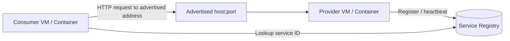
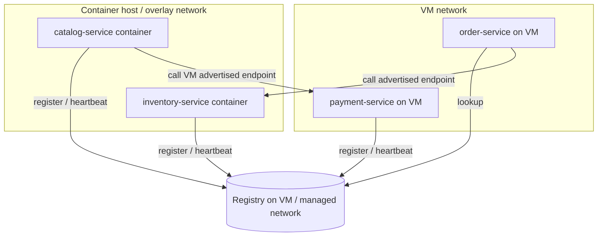

# Triển khai trên máy ảo, container và môi trường lai

Trong hệ thống Spring Cloud Service Discovery, service registry giúp provider công bố instance và consumer tìm địa chỉ để gọi. Khi triển khai trên máy ảo (VM), container hoặc kết hợp cả hai, vấn đề quan trọng là địa chỉ mà provider đăng ký phải có thể truy cập từ mạng của consumer.

Registry chỉ lưu thông tin instance như service ID, host, port, scheme và metadata. Nó không tự tạo route qua NAT, không mở firewall, không publish port container và không làm cho IP riêng của container trở nên truy cập được từ VM. Vì vậy, thiết kế discovery phải đi cùng thiết kế DNS, routing, port mapping và security giữa các vùng mạng.

## 1. Phân biệt discovery plane và service traffic

Có hai luồng mạng riêng biệt:

- **Discovery plane:** provider kết nối registry để đăng ký/heartbeat; consumer kết nối registry để tra cứu instance.
- **Service traffic:** sau khi nhận danh sách instance, consumer kết nối trực tiếp tới host và port được quảng bá (hoặc tới proxy/load balancer được quảng bá).



Một cấu hình có thể đăng ký thành công nhưng lời gọi vẫn thất bại. Ví dụ, container đăng ký IP nội bộ `172.20.0.5:8080`; registry lưu địa chỉ này bình thường, nhưng consumer ở VM không có route tới Docker bridge network. Consumer tra cứu thành công, LoadBalancer chọn instance, rồi kết nối timeout.

Do đó, cần kiểm tra riêng ba điều kiện:

1. Provider truy cập được registry.
2. Consumer truy cập được registry.
3. Consumer truy cập được địa chỉ instance mà registry trả về.

Nếu provider sử dụng active health check (ví dụ Consul agent gọi HTTP/TCP check), cần thêm điều kiện thứ tư: health checker phải truy cập được địa chỉ và port của provider từ chính network nơi checker chạy.

## 2. Ba loại địa chỉ cần phân biệt

| Khái niệm | Ý nghĩa | Ví dụ |
|---|---|---|
| Bind address | Địa chỉ interface mà tiến trình lắng nghe | `0.0.0.0:8080` |
| Advertised address | Host và port provider công bố trong registry | `inventory-vm-01.internal:8080` |
| Consumer reachable address | Địa chỉ mà consumer thực sự route và kết nối được | `10.10.4.21:8080` |

Ba giá trị này có thể khác nhau. Ứng dụng thường bind vào `0.0.0.0` để nhận kết nối trên các interface, nhưng không nên quảng bá `0.0.0.0` cho consumer. Đây là địa chỉ bind có ý nghĩa đặc biệt, không phải địa chỉ đích có thể route.

Với container, cổng ứng dụng bên trong container có thể là `8080`, trong khi Docker publish ra host port `18081`. Consumer bên ngoài Docker network phải dùng địa chỉ host và port được publish, không dùng container port nếu không có route trực tiếp tới container network.

Ví dụ:

```text
Application listener:       0.0.0.0:8080
Container address:          172.20.0.5:8080
Docker host published port: docker-node-01.internal:18081
VM consumer can reach:      docker-node-01.internal:18081
```

Trong trường hợp này, provider cần quảng bá `docker-node-01.internal:18081` nếu consumer ở VM không thể truy cập IP container. Nếu consumer cùng overlay network và có thể truy cập trực tiếp container, địa chỉ quảng bá có thể khác. Một registration chỉ chứa một endpoint mặc định; nếu nhiều nhóm consumer có đường mạng khác nhau, phải chọn địa chỉ chung có thể truy cập từ tất cả hoặc thiết kế các endpoint/proxy/registry view riêng.

## 3. Triển khai trên máy ảo

Trong mô hình VM, mỗi service thường chạy như một process hoặc system service trên một máy có hostname/IP tương đối ổn định. Có thể dùng private DNS name hoặc IP nội bộ làm địa chỉ quảng bá.

Ví dụ:

- Eureka Server: `registry.internal.example:8761`
- Provider: `inventory-vm-01.internal.example:8081`
- Consumer: `order-vm-02.internal.example`

Provider cần kết nối được tới registry; consumer cũng cần kết nối tới registry và địa chỉ provider.

### Cấu hình provider trên VM với Eureka

```yaml
spring:
  application:
    name: inventory-service

server:
  port: 8081

eureka:
  client:
    service-url:
      defaultZone: http://registry.internal.example:8761/eureka/
  instance:
    hostname: inventory-vm-01.internal.example
    prefer-ip-address: false
    instance-id: ${spring.application.name}:${eureka.instance.hostname}:${server.port}
```

Trong ví dụ:

- `hostname` là địa chỉ mà provider công bố.
- `prefer-ip-address: false` yêu cầu Eureka dùng hostname thay vì ưu tiên IP.
- `instance-id` giúp phân biệt registration của từng process.
- `defaultZone` là địa chỉ Eureka Server mà client sử dụng.

Hostname phải phân giải được từ consumer và trỏ tới địa chỉ có thể truy cập. Nếu DNS nội bộ không đồng nhất giữa các subnet, có thể dùng IP private ổn định và cấu hình phù hợp. Không dùng IP public nếu traffic nội bộ cần đi qua private network.

### Kiểm tra trên VM

Trên provider, xác minh process đang lắng nghe đúng cổng:

```bash
ss -lntp
```

Từ consumer, kiểm tra DNS và kết nối:

```bash
getent hosts inventory-vm-01.internal.example
nc -vz inventory-vm-01.internal.example 8081
```

Có thể dùng `curl` tới health endpoint của provider. Kiểm tra từ consumer quan trọng hơn chỉ kiểm tra localhost trên provider, vì firewall hoặc routing có thể chặn traffic giữa hai máy.

## 4. Triển khai trong container

Container có network namespace riêng. Địa chỉ `127.0.0.1` bên trong container trỏ về chính container đó; nó không trỏ tới VM host, registry container khác hoặc container peer.

Có hai mô hình kết nối thường gặp:

- **Cùng Docker network/overlay:** container có thể gọi nhau bằng DNS name hoặc alias của network.
- **Khác network hoặc consumer ở VM:** cần địa chỉ host/port được publish, routing tới overlay network, hoặc một proxy/load balancer có địa chỉ routable.

### Registry chạy ngoài container

Giả sử Eureka Server chạy trên VM tại `registry.internal.example:8761`. Container provider kết nối tới registry qua DNS/network của host:

```yaml
spring:
  application:
    name: inventory-service

server:
  port: 8080

eureka:
  client:
    service-url:
      defaultZone: http://registry.internal.example:8761/eureka/
```

Không đặt `defaultZone` thành `http://localhost:8761/eureka/` trừ khi Eureka Server thật sự chạy trong cùng network namespace với provider. Trong container, localhost là chính container provider.

### Publish port để VM consumer gọi được container

Giả sử container nghe cổng `8080` và Docker host publish cổng `18081`:

```yaml
services:
  inventory:
    image: example/inventory:1.0
    ports:
      - "18081:8080"
```

Nếu consumer nằm ngoài Docker network, endpoint được quảng bá cần trỏ tới hostname/IP của Docker host và port `18081`. Với Eureka, có thể cấu hình riêng hostname và non-secure port được công bố:

```yaml
eureka:
  instance:
    hostname: docker-node-01.internal.example
    prefer-ip-address: false
    non-secure-port: 18081
```

Ứng dụng vẫn lắng nghe cổng `8080` bên trong container; `non-secure-port` ở ví dụ là cổng consumer truy cập qua host mapping. Phải xác minh cấu hình này với phiên bản Spring Cloud Netflix đang dùng và kiểm tra Eureka dashboard/API xem host/port thực tế đã được đăng ký đúng chưa.

Nếu chạy nhiều replica trên cùng một Docker host, không thể để tất cả cùng quảng bá một cặp host/port nhưng lại mong consumer được chọn từng container độc lập. Cần một trong các cách:

- Mỗi container có một port host duy nhất và được quảng bá riêng.
- Dùng overlay network với địa chỉ endpoint riêng mà mọi consumer có route tới.
- Đặt một load balancer/reverse proxy ổn định trước nhóm container và đăng ký endpoint proxy như một đích chung, nếu muốn cân bằng tải ở lớp hạ tầng.

Không dùng địa chỉ container bridge riêng nếu consumer bên ngoài bridge không thể route tới nó.

## 5. Triển khai trong môi trường lai VM và container

Môi trường lai thường có registry tập trung và provider/consumer ở nhiều dạng triển khai:

- Eureka/Consul/ZooKeeper chạy trên VM hoặc nền tảng quản lý riêng.
- Một số provider chạy trực tiếp trên VM.
- Một số provider chạy trong Docker hoặc container platform.
- Consumer có thể chạy trên VM, container hoặc cả hai.

Ví dụ kiến trúc:



Để mô hình này hoạt động, cần một network path hai chiều theo đúng vai trò:

| Nguồn | Đích | Mục đích |
|---|---|---|
| VM provider | Registry | Đăng ký và heartbeat |
| Container provider | Registry | Đăng ký và heartbeat |
| VM consumer | Registry | Tra cứu instance |
| Container consumer | Registry | Tra cứu instance |
| VM consumer | Container advertised endpoint | Gọi container provider |
| Container consumer | VM advertised endpoint | Gọi VM provider |
| Health checker | Provider endpoint | Active health check nếu provider sử dụng |

Kết nối tới registry không tự động đồng nghĩa với kết nối được tới provider. Khi consumer nhận danh sách instance, mỗi địa chỉ trong danh sách phải có route từ network của consumer.

### Chọn địa chỉ quảng bá dùng chung

Nếu VM và container consumer cùng gọi một provider, địa chỉ quảng bá phải truy cập được từ cả hai phía. Ví dụ có thể dùng:

- Private DNS name phân giải thành địa chỉ host/port được định tuyến từ cả hai network.
- Internal load balancer có route từ các subnet VM và container.
- Overlay network được kết nối có kiểm soát với mạng VM.
- API gateway hoặc reverse proxy cho các service cần một endpoint chung.

Nếu không thể tạo một endpoint chung, có thể cần các service registration riêng theo network zone, registry view riêng hoặc policy chọn instance theo zone. Không nên kỳ vọng LoadBalancer tự biết một IP chỉ truy cập được từ một subnet là không phù hợp với consumer hiện tại nếu không cấu hình zone/metadata và filtering.

## 6. DNS, routing và firewall

Service discovery dựa vào địa chỉ đã công bố; vì thế DNS và network phải được chuẩn bị trước.

### DNS

- Dùng hostname nội bộ ổn định cho VM.
- Bảo đảm container có thể phân giải hostname registry.
- Bảo đảm VM có thể phân giải hostname của Docker host hoặc load balancer.
- Tránh hostname chỉ tồn tại trong Docker embedded DNS nếu consumer ở ngoài Docker network.
- Kiểm tra split-horizon DNS: cùng một tên có thể trả về IP khác nhau tùy subnet; điều này chỉ phù hợp nếu mọi kết quả đều dẫn tới endpoint có thể truy cập.

### Routing và firewall

Mở đúng các luồng cần thiết:

- Provider tới cổng client/API của registry.
- Consumer tới cổng client/API của registry.
- Consumer tới cổng advertised của provider hoặc load balancer.
- Health checker tới cổng health endpoint nếu dùng active check.
- Các kết nối peer/cluster nội bộ giữa registry node nếu triển khai registry thành cụm.

Không mở toàn bộ dải port chỉ để “cho discovery chạy”. Hãy lập bảng nguồn, đích, port, protocol và mục đích; chỉ cho phép các subnet hoặc workload cần thiết. Với registry có ACL/TLS, mở mạng không thay thế xác thực và mã hóa.

### NAT và port mapping

NAT thay đổi địa chỉ/port mà consumer nhìn thấy. Registry phải lưu endpoint ở phía có thể route từ consumer. Đăng ký địa chỉ private container nhưng không có route qua NAT sẽ khiến lookup thành công nhưng request thất bại.

Nếu có nhiều consumer ở nhiều network, hãy kiểm tra chiều kết nối từ từng network. NAT outbound thường cho phép provider chủ động kết nối tới registry nhưng không tự tạo inbound path để consumer gọi provider.

## 7. Health check phải chạy từ đúng vị trí mạng

Health check có thể được thực hiện theo nhiều cách:

- Eureka client heartbeat: provider chủ động gửi heartbeat tới Eureka Server; đây là tín hiệu client còn liên lạc với registry, không phải mặc định là server chủ động gọi HTTP health endpoint.
- Consul active HTTP/TCP check: agent thực hiện check tới địa chỉ được cấu hình. Agent phải route được tới host/port đó.
- ZooKeeper discovery: registration có thể gắn với session/ephemeral znode; session còn sống không chứng minh HTTP endpoint khỏe.
- Kubernetes readiness: control plane dùng readiness để cập nhật điều kiện endpoint; đây là cơ chế của nền tảng Kubernetes.

Cần phân biệt health của process, readiness nghiệp vụ và khả năng consumer kết nối qua mạng. Một health check thành công từ bên trong container không chứng minh VM consumer có thể truy cập endpoint được quảng bá.

Ví dụ, container gọi `http://localhost:8080/actuator/health` thành công nhưng VM consumer không route được tới `172.20.0.5:8080`. Ứng dụng vẫn healthy nội bộ, nhưng service call từ VM thất bại. Nên kiểm tra endpoint từ đúng network vantage point của checker và consumer.

## 8. Cấu hình theo profile và môi trường

Có thể dùng profile để tách địa chỉ registry và advertised address:

```yaml
# application-vm.yml
server:
  port: 8081

eureka:
  client:
    service-url:
      defaultZone: http://registry.internal.example:8761/eureka/
  instance:
    hostname: inventory-vm-01.internal.example
    prefer-ip-address: false
```

```yaml
# application-container.yml
server:
  port: 8080

eureka:
  client:
    service-url:
      defaultZone: http://registry.internal.example:8761/eureka/
  instance:
    hostname: docker-node-01.internal.example
    prefer-ip-address: false
    non-secure-port: 18081
```

Kích hoạt profile phù hợp khi chạy ứng dụng. Không nên để profile local với `localhost` được bật nhầm trong môi trường container hoặc production.

Trong các hệ thống dùng Consul, cần kiểm tra thuộc tính công bố địa chỉ như hostname/IP, port và health-check address theo đúng Spring Cloud Consul version. Với ZooKeeper, cần kiểm tra host/port instance mà integration ghi vào registration và đảm bảo consumer có thể route tới địa chỉ đó. Các tên property và khả năng override khác nhau giữa provider; không sao chép cấu hình Eureka sang Consul hoặc ZooKeeper.

## 9. Bảo mật trong mạng đa môi trường

Môi trường lai thường có nhiều subnet, host và nhóm vận hành. Bảo mật cần áp dụng ở cả registry và service endpoint:

- Dùng TLS cho kết nối consumer/provider tới registry khi hạ tầng hỗ trợ.
- Bật authentication/ACL/token theo provider để chỉ workload được phép mới có thể đăng ký hoặc đọc service.
- Dùng TLS hoặc cơ chế xác thực service-to-service cho traffic nghiệp vụ.
- Không đưa secret, password, token hay private key vào metadata.
- Giới hạn firewall theo subnet và port cụ thể.
- Không quảng bá endpoint quản trị hoặc cổng debug ra các network không cần thiết.
- Xác minh hostname trong chứng thư TLS khớp với hostname mà registry công bố.
- Theo dõi registration bất thường, instance trùng ID và thay đổi địa chỉ không được phê duyệt.

Một registration hợp lệ không phải bằng chứng rằng provider đáng tin cậy. Registry bảo vệ metadata và hỗ trợ discovery; xác thực kết nối và quyền gọi API vẫn phải được triển khai riêng.

## 10. Rollout và thay đổi địa chỉ instance

Khi VM được thay thế, container được reschedule hoặc host port thay đổi, advertised address có thể thay đổi. Cần có quy trình cập nhật registry:

1. Khởi động instance mới với địa chỉ có thể truy cập.
2. Xác minh instance đăng ký đúng service ID, host và port.
3. Kiểm tra từ các network consumer rằng endpoint mới có thể kết nối.
4. Chờ discovery cache và LoadBalancer nhận dữ liệu mới.
5. Chuyển traffic sang instance mới theo rollout policy.
6. Drain request của instance cũ.
7. Deregister và dừng instance cũ.
8. Xác minh không còn consumer gọi địa chỉ cũ.

Không xóa instance cũ ngay khi process mới vừa khởi động. Cần tính đến thời gian heartbeat, cache refresh, health check và DNS TTL nếu đường gọi dùng DNS. Với container ephemeral, tránh đăng ký IP tạm thời mà consumer không thể route hoặc giữ registration cũ sau khi container đã bị thay thế.

## 11. Troubleshooting theo đường đi của request

Khi consumer gọi service ID nhưng request timeout hoặc không có instance, kiểm tra theo thứ tự:

1. Provider có kết nối registry và registration thành công không?
2. Consumer có kết nối registry và lấy được danh sách instance không?
3. Service ID có khớp tên provider đăng ký không?
4. Registry trả về host/port nào?
5. Hostname đó phân giải ra địa chỉ nào từ consumer network?
6. Route và firewall có cho phép consumer tới endpoint không?
7. Nếu endpoint là container, port mapping hoặc overlay route đã đúng chưa?
8. Ứng dụng có thật sự lắng nghe trên target port không?
9. Health checker chạy ở đâu và có route tới provider không?
10. Cache, heartbeat, session hoặc deregistration có làm dữ liệu cũ tồn tại không?

| Hiện tượng | Nguyên nhân có thể | Hướng xử lý |
|---|---|---|
| Provider không đăng ký được | Container/VM không truy cập được registry, sai URL hoặc ACL | Kiểm tra DNS, route, firewall, TLS và credential |
| Consumer tìm thấy instance nhưng timeout | Advertised host/port không route được | Kiểm tra từ consumer tới đúng địa chỉ registry trả về |
| Registry lưu IP container `172.x` | Provider tự quảng bá container bridge IP | Quảng bá host/published port hoặc dùng overlay route |
| Container không kết nối registry bằng localhost | `localhost` trỏ về container hiện tại | Dùng DNS/IP của registry có thể truy cập |
| VM gọi được provider nhưng container không gọi được | Hai network có route/firewall khác nhau | Kiểm tra subnet, security group và advertised address |
| Health check passing nhưng request consumer lỗi | Checker và consumer ở network vantage point khác nhau | Test từ consumer network và kiểm tra port mapping |
| Nhiều replica có cùng endpoint | Cùng host/port được đăng ký cho nhiều container | Cấp port riêng, overlay IP riêng hoặc dùng proxy/LB |
| Instance cũ còn trong registry | Deregistration/heartbeat/session chưa hội tụ | Kiểm tra lifecycle và cache của provider |
| TLS handshake lỗi sau khi đổi hostname | Certificate không khớp advertised hostname | Cấp chứng thư đúng SAN và cấu hình trust |

Một cách debug hữu ích là lấy chính host/port từ registry rồi chạy `nslookup`, `getent hosts`, `nc` hoặc `curl` từ consumer. Không kiểm tra một địa chỉ tự suy đoán khác với địa chỉ mà LoadBalancer thực sự chọn.

## 12. Checklist triển khai VM, container và hybrid

Trước khi đưa service vào hoạt động, xác nhận:

1. Provider và consumer đều kết nối được registry từ network của chúng.
2. Service ID nhất quán giữa provider, registry và consumer.
3. Bind address không bị nhầm với advertised address.
4. Advertised host/port có thể truy cập từ mọi network consumer cần hỗ trợ.
5. Container không quảng bá loopback hoặc bridge IP không thể route.
6. Port mapping hoặc overlay network được cấu hình rõ ràng.
7. DNS phân giải nhất quán và hostname TLS khớp.
8. Firewall cho phép đúng luồng registry, service traffic và health check.
9. Health check được kiểm tra từ đúng vị trí mạng.
10. Instance ID duy nhất và registration được deregister khi dừng.
11. Profile VM/container không bị kích hoạt nhầm.
12. Rollout có bước kiểm tra endpoint mới, cache hội tụ và drain endpoint cũ.
13. Metadata không chứa bí mật; registry và service traffic có authentication/TLS phù hợp.
14. Có giám sát registration, heartbeat, health, timeout và tỷ lệ lỗi kết nối theo từng network zone.

Triển khai service discovery trên VM, container hay môi trường lai đều dựa trên cùng nguyên tắc: provider công bố một địa chỉ, registry phân phối thông tin đó, consumer phải có đường mạng tới địa chỉ được công bố. Khi tách bạch discovery plane với service traffic và kiểm chứng advertised address từ từng network consumer, hệ thống có thể thay đổi instance mà không buộc ứng dụng phụ thuộc vào IP tạm thời của máy hoặc container.
