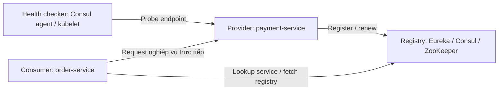

# Kiểm tra đường mạng riêng cho đăng ký, kiểm tra sức khỏe và gọi dịch vụ

Trong hệ thống microservice, một service instance có thể xuất hiện khỏe mạnh trong registry nhưng request thực tế vẫn thất bại. Nguyên nhân thường không nằm ở thuật toán discovery mà ở đường mạng giữa các thành phần: provider không kết nối được registry, health checker không truy cập được endpoint kiểm tra, hoặc consumer không thể gọi địa chỉ mà provider đã công bố.

Khi vận hành Spring Cloud Service Discovery, cần kiểm tra riêng ba luồng mạng: **provider → registry** để đăng ký và gia hạn; **health checker → provider** để kiểm tra sức khỏe khi cơ chế sử dụng active probe; và **consumer → provider** để gửi request nghiệp vụ. Ba luồng có nguồn, đích, port và chính sách bảo mật khác nhau. Mở đúng một port không có nghĩa cả ba luồng đều hoạt động.

Nội dung thuộc module `SPRING_CLOUD_SERVICE_DISCOVERY`, tập trung vào việc tìm instance theo tên dịch vụ qua `DiscoveryClient`, `ServiceRegistry`, Eureka, Consul hoặc ZooKeeper. Phần này hướng dẫn lập ma trận kết nối, kiểm tra DNS, routing, firewall, NetworkPolicy, TLS và chẩn đoán từ đúng vị trí mạng của từng bên.

## 1. Phân biệt ba luồng mạng

### 1.1. Provider đăng ký với registry

Provider là ứng dụng cung cấp dịch vụ, ví dụ `payment-service`. Khi khởi động, ứng dụng gửi thông tin service name, instance ID, địa chỉ, port và metadata đến registry. Trong thời gian hoạt động, provider tiếp tục gửi heartbeat, renew lease hoặc duy trì session tùy công nghệ.

Luồng phổ biến:

```text
payment-service instance
        |
        | Register / heartbeat / renew / deregister
        v
Eureka Server / Consul Agent or Server / ZooKeeper ensemble
```

Đây thường là kết nối đi từ provider đến registry. Nếu provider nằm trong subnet riêng, cần bảo đảm DNS của registry phân giải được và firewall/security group cho phép kết nối đến đúng endpoint registry. Với kết nối TCP có trạng thái, response thường đi về trên kết nối đã được thiết lập; không cần mở một port nguồn cố định từ registry về provider chỉ để trả lời heartbeat.

### 1.2. Health checker kiểm tra provider

Một số cơ chế health check chủ động tạo kết nối từ thành phần kiểm tra đến endpoint của provider. Ví dụ Consul agent có thể gọi HTTP health-check URL của service. Kubernetes kubelet thực hiện readiness/liveness probe đến Pod. Khi đó, luồng là:

```text
Consul agent / Kubernetes node kubelet / external monitor
        |
        | HTTP / TCP / gRPC health probe
        v
payment-service health endpoint
```

Health checker phải truy cập được địa chỉ và port được cấu hình cho check. Nếu service chỉ cho phép consumer subnet mà không cho phép subnet của Consul agent hoặc node, request nghiệp vụ có thể hoạt động nhưng health check vẫn thất bại.

Không phải mọi registry đều chủ động gọi endpoint của provider. Với Eureka, cách phổ biến là Eureka Client gửi heartbeat đến Eureka Server; trạng thái ứng dụng có thể được tích hợp qua health indicator để client cập nhật status. Eureka Server không mặc định liên tục gọi `healthCheckUrl` của mọi instance như một active HTTP probe. Cần phân biệt rõ cơ chế đang sử dụng trước khi mở firewall.

### 1.3. Consumer gọi provider

Consumer là ứng dụng cần sử dụng dịch vụ, ví dụ `order-service`. Consumer tra cứu service name, nhận một hoặc nhiều `ServiceInstance`, sau đó kết nối đến hostname/IP và port được công bố.

```text
order-service consumer
        |
        | HTTP / HTTPS / gRPC request
        v
payment-service advertised host:port
```

Đây là luồng data plane của request nghiệp vụ. Registry chỉ giúp consumer tìm địa chỉ; registry không tự chuyển tiếp request qua nó. Nếu provider công bố IP nội bộ không thể định tuyến từ consumer, discovery có thể trả về instance hợp lệ nhưng request vẫn timeout.

## 2. Lập ma trận nguồn, đích và port trước khi mở mạng

Không nên bắt đầu bằng cách mở rộng firewall cho toàn bộ subnet. Hãy ghi rõ thành phần nào cần kết nối đến thành phần nào, giao thức nào và mục đích gì.

| Luồng | Nguồn | Đích | Giao thức/port | Mục đích |
|---|---|---|---|---|
| Đăng ký/heartbeat Eureka | Provider instance | Eureka Server | TCP, thường `8761` nếu dùng cấu hình mặc định | Register, renew, fetch registry, deregister. |
| Peer Eureka | Eureka Server node | Eureka Server peer | TCP, thường cùng cổng HTTP(S) của Eureka, ví dụ `8761` | Peer replication và registry exchange. |
| Đăng ký Consul qua agent | Provider instance | Consul agent/API | TCP, thường `8500` HTTP hoặc `8501` HTTPS | Service registration, catalog/health API và TTL update tùy cấu hình. |
| Consul agent health check | Consul agent node | Provider health endpoint | TCP, port service, ví dụ `8080` hoặc `8443` | Active HTTP/TCP/gRPC check nếu được cấu hình. |
| Client ZooKeeper | Provider/consumer | ZooKeeper client endpoint | TCP, thường `2181` hoặc secure client port đã cấu hình | Tạo/đọc znode và duy trì session. |
| DNS | Provider, consumer, health checker | DNS resolver nội bộ | UDP/TCP `53` | Phân giải registry host, service hostname và endpoint. |
| Kubernetes API discovery | Spring Cloud Kubernetes client | Kubernetes API server | TCP, thường `6443` hoặc endpoint API do cluster công bố | Đọc Service, Endpoints/EndpointSlices và resource liên quan. |
| Kubernetes health probe | Node kubelet | Pod IP và probe port | TCP/HTTP/gRPC theo probe | Readiness, liveness và startup probe. |
| Request nghiệp vụ | Consumer | Provider instance hoặc Kubernetes Service | TCP, port service được công bố | HTTP, HTTPS, gRPC hoặc giao thức ứng dụng. |

Các port trong bảng là giá trị mặc định thường gặp hoặc ví dụ, không phải quy tắc bắt buộc. Môi trường có thể đổi port, dùng TLS, proxy, service mesh hoặc load balancer. Hãy lấy endpoint thực tế từ cấu hình và registry trước khi tạo rule.

### 2.1. Phân biệt cổng client và cổng cluster nội bộ

Một số nền tảng có các port nội bộ riêng cho giao tiếp giữa node registry. Ví dụ ZooKeeper thường dùng `2181` cho client, `2888` cho peer synchronization và `3888` cho leader election. Ứng dụng microservice thông thường chỉ cần kết nối client endpoint; không mở port quorum `2888`/`3888` cho mọi provider và consumer. Tương tự, Consul có port RPC/gossip nội bộ giữa agent/server; chỉ mở theo topology Consul, không coi chúng là port gọi service nghiệp vụ.

## 3. Sơ đồ các đường mạng cần hoạt động



Sơ đồ nhấn mạnh hai loại kết nối khác nhau: consumer có thể gọi registry để tra cứu, nhưng sau khi chọn instance thì request nghiệp vụ thường đi trực tiếp đến provider. Health checker chỉ tạo kết nối riêng nếu mô hình health check yêu cầu.

## 4. Xác định địa chỉ registry và địa chỉ service

Hai địa chỉ thường bị nhầm lẫn:

- **Registry endpoint:** địa chỉ provider/consumer dùng để kết nối đến Eureka, Consul, ZooKeeper hoặc Kubernetes API.
- **Advertised service endpoint:** hostname/IP và port mà provider công bố để consumer gọi.

Ví dụ:

```yaml
spring:
  application:
    name: payment-service
  cloud:
    consul:
      host: consul.internal.example
      port: 8500
      discovery:
        hostname: payment-01.internal.example
        port: 8080
```

`consul.host:port` là endpoint registry mà provider sử dụng để đăng ký. `discovery.hostname` và `discovery.port` là endpoint được công bố cho consumer. Mở firewall đến Consul không tự động cho phép consumer gọi `payment-01:8080`; hai đường cần rule riêng.

Với Eureka, `eureka.client.service-url.defaultZone` là registry endpoint; `eureka.instance.hostname`, `ip-address`, `prefer-ip-address` và port xác định thông tin instance được công bố. Với ZooKeeper, `spring.cloud.zookeeper.connect-string` là ensemble endpoint; `instance-host` và `instance-port` là địa chỉ service. Với Kubernetes, API server endpoint phục vụ discovery client, còn Service DNS/ClusterIP hoặc Pod IP phục vụ request nghiệp vụ.

Không công bố `localhost`, `127.0.0.1` hoặc `0.0.0.0` cho consumer ở máy khác. `0.0.0.0` là địa chỉ bind wildcard; loopback chỉ trỏ về chính máy hoặc container đang kết nối.

## 5. Kiểm tra luồng provider đến registry

Khi provider không xuất hiện trên registry, kiểm tra từ chính môi trường chạy provider theo thứ tự sau.

### 5.1. Kiểm tra DNS của registry

```bash
getent hosts eureka.internal.example
getent hosts consul.internal.example
```

Trên Windows có thể dùng:

```powershell
Resolve-DnsName eureka.internal.example
Resolve-DnsName consul.internal.example
```

Nếu DNS không phân giải được, kiểm tra private DNS zone, search domain, resolver cấu hình cho VM/container/Pod và DNS forwarding giữa các VPC hoặc subnet. Không thay hostname bằng IP tạm thời nếu kiến trúc dựa trên DNS failover hoặc TLS certificate theo hostname.

### 5.2. Kiểm tra TCP đến registry

```bash
nc -vz eureka.internal.example 8761
nc -vz consul.internal.example 8500
nc -vz zk-1.internal.example 2181
```

Lệnh chỉ kiểm tra khả năng thiết lập TCP connection; nó không xác nhận API, xác thực hoặc đăng ký ứng dụng thành công. Nếu TCP timeout, kiểm tra route, firewall, security group, NetworkPolicy, NAT và listener ở phía đích. Nếu connection refused, thường cần kiểm tra service có đang listen trên port đó hay không, địa chỉ bind và port mapping.

### 5.3. Kiểm tra HTTP/TLS của registry

Với Eureka hoặc Consul HTTP API, kiểm tra endpoint health/API theo cấu hình môi trường:

```bash
curl -v http://eureka.internal.example:8761/eureka/apps
curl -v http://consul.internal.example:8500/v1/status/leader
```

Nếu registry dùng HTTPS:

```bash
curl -v https://consul.internal.example:8501/v1/status/leader
openssl s_client -connect consul.internal.example:8501 \
  -servername consul.internal.example
```

HTTP `401` hoặc `403` cho biết đã có phản hồi từ server nhưng có thể thiếu thông tin xác thực hoặc quyền. Đừng xem mọi mã HTTP khác `200` là lỗi mạng. Hãy phân biệt lỗi TCP, TLS handshake, xác thực, ACL và lỗi nghiệp vụ API.

Với ZooKeeper, kiểm tra TCP đến client port không đủ để xác nhận session/ACL hoạt động. Dùng log Curator/Spring Cloud Zookeeper và công cụ quản trị ZooKeeper để xác minh client kết nối ensemble, xác thực và có quyền trên root znode.

### 5.4. Kiểm tra cấu hình và log provider

- Đối chiếu registry URL, port, scheme và profile đang hoạt động.
- Kiểm tra `register-with-eureka`, `spring.cloud.consul.discovery.register` hoặc cấu hình registration tương ứng.
- Kiểm tra instance ID, hostname/IP và port được công bố.
- Kiểm tra ACL token, credentials, TLS truststore và client certificate nếu có.
- Đọc log registration, heartbeat, renew, session expiration hoặc lỗi `Connection refused`, `UnknownHost`, `Timeout`, `SSLHandshakeException`, `401`, `403`.

## 6. Kiểm tra luồng health checker đến provider

Health check cần được kiểm tra từ đúng máy hoặc agent thực hiện probe. Một lệnh `curl` chạy trên provider đến `localhost` không chứng minh Consul agent hoặc kubelet có thể truy cập endpoint.

### 6.1. Consul active health check

Nếu Consul service registration khai báo HTTP check, Consul agent thực hiện request đến URL được cấu hình. Ví dụ:

```yaml
spring:
  cloud:
    consul:
      discovery:
        health-check-path: /actuator/health
        health-check-interval: 15s
        health-check-timeout: 5s
```

Trong mô hình agent-based, nguồn của probe thường là Consul agent đang quản lý service registration. Firewall/NetworkPolicy cần cho phép agent subnet hoặc agent Pod truy cập port service. Nếu health check chạy từ một Consul agent khác, cần xác minh chính xác agent nào thực hiện check và địa chỉ nào được dùng.

Kiểm tra từ node/Pod của agent:

```bash
curl -v http://payment-01.internal.example:8080/actuator/health
```

Nếu check dùng HTTPS, cần xác minh CA, hostname verification và client certificate theo cấu hình. Không tắt TLS verification để làm cho check chuyển sang passing.

Consul có thể sử dụng HTTP, TCP, gRPC hoặc TTL check tùy cấu hình. Với TTL check, ứng dụng/agent cập nhật trạng thái theo cơ chế TTL; không có nghĩa Consul liên tục gọi HTTP endpoint của provider.

### 6.2. Eureka health status

Với Eureka, luồng mặc định quan trọng là client gửi heartbeat đến server. `eureka.client.healthcheck.enabled` có thể tích hợp trạng thái health của Spring Boot Actuator vào trạng thái instance mà client công bố. Điều này khác với việc Eureka Server chủ động gọi `/actuator/health` của provider.

Vì vậy, khi Eureka instance ở trạng thái không mong muốn, hãy kiểm tra:

- Provider có kết nối được Eureka Server để renew hay không.
- Health indicator trong provider có phản ánh đúng trạng thái ứng dụng hay không.
- Cấu hình health check integration được đặt đúng nơi theo phiên bản Spring Cloud Netflix.
- Instance status có được client cập nhật và server nhận được hay không.

Chỉ mở luồng server → provider cho health probe nếu hệ thống có một monitor hoặc cơ chế riêng thực sự gọi endpoint đó.

### 6.3. Kubernetes readiness và liveness probe

Kubernetes kubelet trên node thực hiện probe đến container/Pod theo cấu hình Pod. Ví dụ:

```yaml
containers:
  - name: payment
    image: example/payment-service:2.8.1
    ports:
      - name: http
        containerPort: 8080
    readinessProbe:
      httpGet:
        path: /actuator/health/readiness
        port: http
      periodSeconds: 10
      timeoutSeconds: 2
    livenessProbe:
      httpGet:
        path: /actuator/health/liveness
        port: http
      periodSeconds: 20
      timeoutSeconds: 2
```

Kubelet cần truy cập được Pod endpoint và port đã khai báo. Hành vi NetworkPolicy đối với traffic do node/host tạo ra phụ thuộc CNI và nền tảng Kubernetes; không mặc định rằng rule ingress từ Pod selector cũng kiểm soát giống hệt kubelet probe. Khi probe timeout, kiểm tra node-to-Pod route, CNI, host firewall và chính sách mạng của nhà cung cấp.

Readiness quyết định Pod có được đưa vào endpoint phục vụ traffic; liveness quyết định khi nào kubelet cần restart container. Không dùng liveness để kiểm tra mọi dependency từ xa nếu điều đó có thể gây restart dây chuyền. Health endpoint cần nhanh, ổn định và phản ánh đúng điều kiện nhận traffic.

## 7. Kiểm tra luồng consumer đến provider

Consumer phải kết nối được địa chỉ mà discovery trả về. Hãy lấy `host`, `port`, `secure` và `uri` từ `ServiceInstance` hoặc dashboard registry, rồi kiểm tra từ consumer.

### 7.1. Xác minh địa chỉ được công bố

Ví dụ dùng `DiscoveryClient`:

```java
for (ServiceInstance instance :
        discoveryClient.getInstances("payment-service")) {
    System.out.printf("id=%s host=%s port=%d secure=%s uri=%s%n",
            instance.getInstanceId(),
            instance.getHost(),
            instance.getPort(),
            instance.isSecure(),
            instance.getUri());
}
```

Đối chiếu kết quả với địa chỉ bind của provider, port thực tế, DNS và network route. Một instance `UP` không đảm bảo địa chỉ advertise phù hợp với mọi consumer. Nếu provider nằm trong private subnet, consumer ở subnet/VPC khác cần route hoặc peering/VPN tương ứng.

### 7.2. Kiểm tra DNS và TCP từ consumer

```bash
getent hosts payment-01.internal.example
nc -vz payment-01.internal.example 8080
```

Trên Windows:

```powershell
Resolve-DnsName payment-01.internal.example
Test-NetConnection payment-01.internal.example -Port 8080
```

Nếu DNS trả về IP cũ hoặc IP thuộc interface không thể định tuyến, sửa advertised hostname/IP. Nếu TCP timeout, kiểm tra route, firewall và NetworkPolicy ở cả consumer và provider. Nếu connection refused, kiểm tra listener, bind address, port và trạng thái tiến trình.

### 7.3. Kiểm tra HTTP và TLS

```bash
curl -v http://payment-01.internal.example:8080/actuator/health
curl -v https://payment-02.internal.example:8443/actuator/health
```

Với HTTPS, kiểm tra certificate chain và SAN tương ứng với hostname/IP consumer dùng. Nếu request dùng hostname nhưng certificate chỉ có IP SAN, hoặc ngược lại, hostname verification có thể thất bại dù TCP kết nối được.

Không dùng `curl -k` làm bằng chứng rằng TLS production đã đúng. Tùy chọn đó bỏ qua xác minh certificate; chỉ có thể dùng trong kiểm tra cô lập để phân biệt lỗi handshake với lỗi routing, sau đó vẫn phải xác minh trust chain đúng cách.

## 8. Đường mạng riêng trong Kubernetes

Khi chạy trên Kubernetes, cần phân biệt traffic đến Kubernetes API, traffic DNS, traffic health probe và traffic giữa Pod.

| Luồng | Nguồn | Đích | Ghi chú |
|---|---|---|---|
| DNS lookup | Pod | CoreDNS hoặc DNS service | UDP/TCP 53; kiểm tra NetworkPolicy egress và ingress DNS. |
| Discovery API | Pod consumer | Kubernetes API server | Thường TCP 6443 hoặc endpoint cluster; cần ServiceAccount/RBAC. |
| Service request | Consumer Pod | ClusterIP/Service port hoặc Pod IP | Cần CNI, route và NetworkPolicy cho phép. |
| Readiness/liveness | Node kubelet | Pod IP/probe port | Phụ thuộc node-to-Pod path và CNI behavior. |
| External health check | Load balancer/monitor | Ingress, NodePort hoặc Pod endpoint | Cần rule từ subnet nguồn thực tế của monitor. |

### 8.1. Ví dụ NetworkPolicy cho provider

Ví dụ sau minh họa policy giới hạn ingress vào `payment-service` chỉ từ namespace consumer và namespace health checker. Nhãn namespace và port cần thay theo cluster thực tế:

```yaml
apiVersion: networking.k8s.io/v1
kind: NetworkPolicy
metadata:
  name: payment-allow-consumer-and-health
  namespace: commerce
spec:
  podSelector:
    matchLabels:
      app: payment
  policyTypes:
    - Ingress
  ingress:
    - from:
        - namespaceSelector:
            matchLabels:
              kubernetes.io/metadata.name: orders
      ports:
        - protocol: TCP
          port: 8080
    - from:
        - namespaceSelector:
            matchLabels:
              kubernetes.io/metadata.name: observability
      ports:
        - protocol: TCP
          port: 8080
```

Policy này chỉ minh họa traffic từ Pod consumer và health checker chạy trong namespace `observability`. Nếu Consul agent chạy trên VM ngoài cluster, cần rule theo CIDR hoặc cơ chế policy mà CNI hỗ trợ. Nếu health probe do kubelet trên node tạo ra, phải kiểm tra cách CNI xử lý traffic từ node; không mặc định namespace selector bao phủ luồng này.

### 8.2. Ví dụ egress từ provider đến registry và DNS

Nếu namespace dùng default-deny egress, provider cần được phép truy cập DNS và registry. Ví dụ cho registry chạy trong namespace `platform` với Pod label `app: eureka-server`:

```yaml
apiVersion: networking.k8s.io/v1
kind: NetworkPolicy
metadata:
  name: payment-allow-registry-egress
  namespace: commerce
spec:
  podSelector:
    matchLabels:
      app: payment
  policyTypes:
    - Egress
  egress:
    - to:
        - namespaceSelector:
            matchLabels:
              kubernetes.io/metadata.name: platform
          podSelector:
            matchLabels:
              app: eureka-server
      ports:
        - protocol: TCP
          port: 8761
    - to:
        - namespaceSelector:
            matchLabels:
              kubernetes.io/metadata.name: kube-system
          podSelector:
            matchLabels:
              k8s-app: kube-dns
      ports:
        - protocol: UDP
          port: 53
        - protocol: TCP
          port: 53
```

Tên label CoreDNS, namespace, port và cách định danh endpoint API server có thể khác giữa các cluster. Nếu provider/consumer dùng Spring Cloud Kubernetes DiscoveryClient, cần thêm egress đến Kubernetes API server (thường TCP `6443`, hoặc endpoint do cluster công bố). API server thường nằm ngoài Pod selector của ví dụ, nên rule có thể cần `ipBlock` cho control-plane CIDR hoặc cơ chế policy riêng theo CNI/nền tảng. NetworkPolicy chỉ có hiệu lực nếu CNI triển khai hỗ trợ. Egress policy cũng cần cho phép các dependency khác của ứng dụng như database, message broker hoặc telemetry endpoint; ví dụ trên chỉ minh họa hai luồng discovery và DNS.

NetworkPolicy là additive: nhiều policy có thể cùng cho phép traffic. Khi debug, cần xem toàn bộ policy áp dụng cho Pod và kiểm tra behavior của CNI, không chỉ đọc một YAML đơn lẻ.

## 9. Đường mạng riêng giữa các subnet hoặc VPC

Trong hạ tầng VM hoặc cloud, các thành phần có thể nằm ở nhiều subnet/VPC. Cần kiểm tra cả route hai chiều và chính sách lọc ở từng lớp.

- **Route table:** subnet nguồn có route đến subnet đích qua peering, VPN, transit gateway hoặc network appliance phù hợp.
- **Security group:** rule ingress ở đích cho phép nguồn cần thiết; rule egress ở nguồn cho phép port đích.
- **Network ACL/firewall:** kiểm tra cả chiều đi và chiều về. NACL stateless cần rule cho ephemeral return ports theo thiết kế nền tảng.
- **NAT:** địa chỉ nguồn sau NAT có thể khác CIDR mà firewall đang cho phép; health checker có thể có source IP riêng.
- **Private DNS:** zone được liên kết hoặc forward đến đúng VPC; record trỏ đến địa chỉ reachable.
- **Proxy/service mesh:** sidecar, egress gateway hoặc proxy có thể thay đổi source IP, port và TLS termination.

Không mở toàn bộ CIDR nội bộ nếu chỉ cần cho phép một nhóm provider hoặc consumer. Dùng source CIDR/subnet, security group reference hoặc workload identity phù hợp với nền tảng để giới hạn quyền truy cập.

## 10. TLS, xác thực và quyền truy cập registry

Kết nối mạng thành công mới chỉ là bước đầu. Registry và service endpoint có thể yêu cầu TLS, mTLS, ACL token hoặc credentials.

| Thành phần | Kiểm soát cần kiểm tra |
|---|---|
| Provider → Eureka | HTTPS nếu bật, truststore/CA, client authentication nếu có, quyền truy cập endpoint Eureka. |
| Provider/consumer → Consul | HTTPS, ACL token, policy cho service registration/catalog/health query; agent API có thể khác server API. |
| Provider/consumer → ZooKeeper | Client port bảo mật, SASL/ACL, quyền trên root znode và node con. |
| Consumer → provider | HTTPS/mTLS, certificate SAN, authorization và port ứng dụng. |
| Kubernetes discovery client → API server | ServiceAccount token, TLS CA và RBAC tối thiểu. |
| Health checker → provider | Credential/header/client certificate nếu endpoint health được bảo vệ; tránh để probe lộ dữ liệu nhạy cảm. |

Không đưa token hoặc password vào URL, log, metadata registry hoặc NetworkPolicy. Không giải quyết lỗi certificate bằng cách tắt xác minh TLS trong production.

## 11. Bảng chẩn đoán theo triệu chứng

| Triệu chứng | Luồng cần kiểm tra trước | Nguyên nhân thường gặp |
|---|---|---|
| Provider không xuất hiện trong registry | Provider → registry | DNS sai, egress bị chặn, sai port, ACL/authentication lỗi, registration tắt. |
| Provider xuất hiện rồi biến mất | Provider ↔ registry | Heartbeat/session mất, lease hết hạn, ZooKeeper session timeout, agent không nhận TTL update. |
| Consul health check chuyển critical | Health checker → provider | Agent không route được đến health URL, sai port/path, timeout hoặc TLS/auth lỗi. |
| Eureka instance `DOWN` dù HTTP endpoint hoạt động | Provider → Eureka và health integration | Status được client công bố không đúng, health indicator lỗi hoặc heartbeat không ổn định. |
| Kubernetes Pod không Ready | Kubelet → Pod | Probe path/port sai, app bind sai interface, node-to-Pod path lỗi hoặc probe timeout. |
| Consumer thấy instance nhưng request timeout | Consumer → provider | Advertised IP không routable, firewall/NetworkPolicy chặn, NAT/route sai. |
| Consumer nhận connection refused | Consumer → provider | Process không listen, port sai, container port mapping sai hoặc endpoint vừa dừng. |
| DNS hoạt động nhưng service call thất bại | Consumer → provider | DNS trả IP đúng nhưng port/firewall/provider endpoint không hoạt động. |
| TCP thành công nhưng API trả `401`/`403` | Ứng dụng/registry auth | Thiếu token, role, ACL hoặc authorization policy. |
| TCP thành công nhưng TLS handshake thất bại | TLS giữa hai bên | CA không tin cậy, SAN không khớp, protocol/cipher hoặc mTLS thiếu client cert. |

## 12. Quy trình kiểm tra sự cố có hệ thống

Khi một service discovery flow bị lỗi, thực hiện theo trình tự để không nhầm lỗi của một luồng với luồng khác:

1. **Ghi nhận endpoint:** lấy registry host/port, advertised service host/port, health-check URL và nguồn thực hiện probe.
2. **Xác định nguồn mạng:** chạy lệnh kiểm tra từ provider, consumer hoặc health checker tương ứng; không dùng máy quản trị làm đại diện cho mọi nguồn.
3. **Kiểm tra DNS:** xác nhận hostname phân giải đúng IP trong đúng namespace/VPC/container.
4. **Kiểm tra route và TCP:** kiểm tra route table, security group, firewall, NetworkPolicy, NAT và listener.
5. **Kiểm tra TLS:** xác minh CA, SAN, client certificate và thời hạn chứng thư.
6. **Kiểm tra xác thực:** kiểm tra Eureka/Consul/ZooKeeper ACL hoặc Kubernetes RBAC.
7. **Kiểm tra protocol/application:** gọi đúng API hoặc health path; phân biệt HTTP status với lỗi mạng.
8. **Đối chiếu registry:** xác nhận instance ID, host, port, status và metadata mà registry đang lưu.
9. **Kiểm tra cache consumer:** xác định discovery client và load balancer đã nhận dữ liệu mới chưa.
10. **Kiểm tra request nghiệp vụ:** gửi request từ consumer thực tế và đối chiếu log provider để biết request có đến đích không.

Một cách khoanh vùng hữu ích là so sánh cùng endpoint từ ba vị trí: provider tự gọi, health checker gọi và consumer gọi. Nếu provider gọi được `localhost` nhưng health checker không gọi được hostname, vấn đề có thể nằm ở advertised address hoặc ingress rule. Nếu health checker gọi được nhưng consumer không gọi được, kiểm tra source subnet/namespace của consumer và policy tương ứng.

## 13. Nguyên tắc thiết kế firewall và NetworkPolicy

- Mỗi rule cần có nguồn, đích, protocol, port và mục đích rõ ràng.
- Chỉ cho provider kết nối đến registry endpoint cần thiết; không mở cổng quản trị registry cho mọi workload.
- Chỉ cho health checker truy cập đúng health endpoint và port cần thiết.
- Chỉ cho consumer hợp lệ gọi port nghiệp vụ của provider.
- Tách cổng client của ZooKeeper khỏi cổng quorum giữa các server.
- Tách Consul API/agent port khỏi RPC/gossip port nội bộ của cluster.
- Cho phép DNS UDP và TCP 53 đến resolver được chỉ định nếu policy mặc định chặn egress.
- Giữ đường response/ephemeral port phù hợp với firewall stateful hoặc NACL stateless.
- Dùng TLS/mTLS và ACL/RBAC; firewall không thay thế xác thực ở tầng ứng dụng.
- Theo dõi log firewall, flow log, CNI policy drop và connection metrics để xác định nguồn bị chặn.
- Khi thay đổi policy, kiểm tra lần lượt registration, health check và request nghiệp vụ để xác nhận đúng luồng.

## 14. Checklist trước khi đưa vào production

- Đã vẽ sơ đồ nguồn/đích cho provider → registry, health checker → provider và consumer → provider.
- Registry endpoint và advertised service endpoint được ghi riêng, không nhầm lẫn.
- DNS private zone phân giải đúng từ tất cả nguồn cần thiết.
- Route, peering/VPN, security group, firewall và NetworkPolicy cho phép đúng port.
- Provider có thể register/heartbeat/renew và deregister theo cơ chế registry.
- Health checker truy cập được endpoint từ đúng node/agent và nhận status mong muốn.
- Consumer kết nối được hostname/IP và port mà `ServiceInstance` trả về.
- Port HTTP/HTTPS/gRPC khớp với listener thực tế và port mapping.
- TLS certificate SAN khớp advertised address; CA và client certificate được tin cậy.
- ACL token, ZooKeeper ACL hoặc Kubernetes RBAC có quyền tối thiểu.
- Không mở ZooKeeper quorum hoặc Consul gossip/RPC cho các workload không cần thiết.
- Đã kiểm tra cả trường hợp instance dừng, registry tạm mất kết nối và endpoint đổi địa chỉ.
- Có log/metrics/flow logs để theo dõi registration failure, health failure và request connection failure.

## Kết luận

Đường mạng riêng cho service discovery gồm ba luồng độc lập: provider kết nối registry để đăng ký và duy trì trạng thái; health checker kết nối provider nếu cơ chế sử dụng active probe; consumer kết nối trực tiếp đến endpoint được công bố để gửi request. Mỗi luồng cần được kiểm tra từ đúng nguồn mạng và có rule DNS, route, firewall, port, TLS và quyền truy cập tương ứng.

Khi instance có trong registry nhưng request thất bại, hãy xác minh advertised address và luồng consumer → provider. Khi provider không đăng ký được, kiểm tra provider → registry. Khi health chuyển unhealthy, xác định chính xác thành phần nào thực hiện probe và kiểm tra đường health checker → provider. Phân tách ba luồng như vậy giúp khoanh vùng lỗi nhanh và tạo chính sách mạng tối thiểu, dễ kiểm soát trong production.
