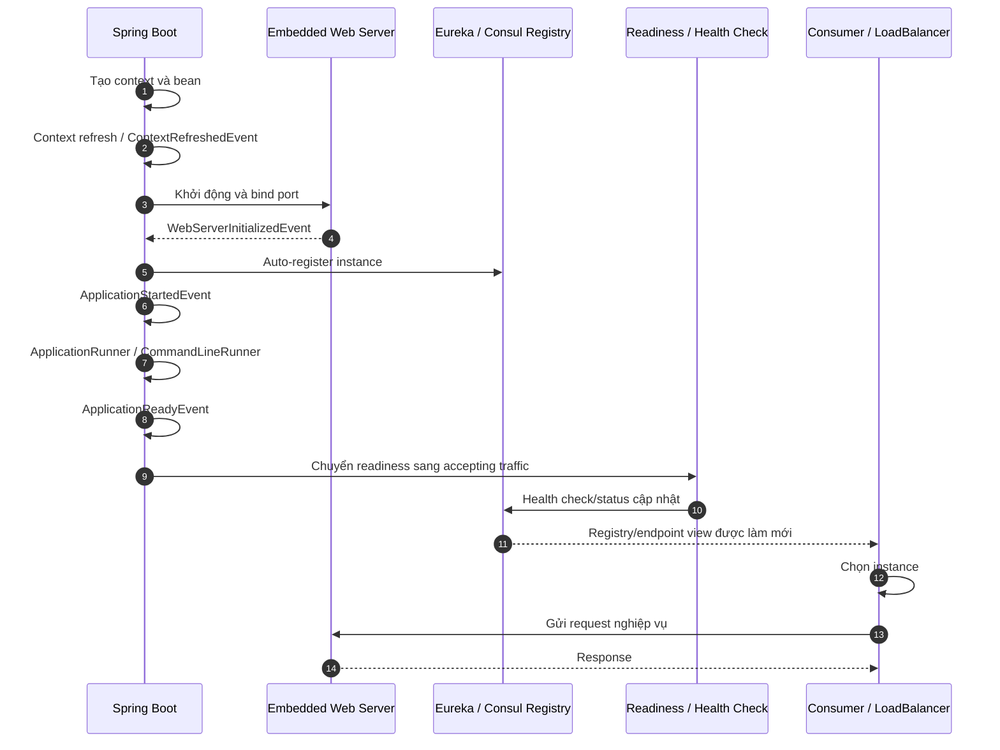

# Thứ tự khởi tạo ứng dụng, đăng ký và nhận lưu lượng

## 1. Vì sao phải hiểu đúng thứ tự vòng đời?

Một microservice có thể mở cổng HTTP trước khi hoàn tất khởi tạo nghiệp vụ, được ghi vào registry trước khi các consumer nhìn thấy bản ghi, hoặc đã xuất hiện trong registry nhưng chưa đủ điều kiện nhận request. Vì vậy, ba trạng thái sau không đồng nghĩa:

- **Process đang chạy:** JVM/container đã khởi động.
- **Instance đã đăng ký:** Eureka, Consul hoặc Kubernetes có thông tin về instance/endpoint.
- **Instance sẵn sàng nhận traffic:** ứng dụng đã hoàn tất warm-up, dependency bắt buộc hoạt động và cơ chế readiness cho phép định tuyến request tới instance.

Trong Spring Cloud Service Discovery, `DiscoveryClient` giúp consumer tìm instance theo service ID; `ServiceRegistry` và auto-registration quản lý việc đăng ký; load balancer chọn instance cho request. Muốn tránh request tới một instance chưa sẵn sàng, cần phối hợp lifecycle của Spring Boot với health check/readiness và cơ chế cập nhật registry.

## 2. Bốn mốc cần phân biệt

| Mốc | Ý nghĩa | Có thể nhận traffic chưa? |
|---|---|---|
| Process started | JVM hoặc container đã chạy | Chưa thể kết luận |
| Web server initialized | Embedded server đã khởi động và có cổng thực tế | Cổng đã được bind, nhưng readiness vẫn có thể đang từ chối traffic |
| Service registered | Registry đã nhận bản ghi instance | Có thể được consumer khám phá, nhưng chưa chắc sẵn sàng |
| Ready / accepting traffic | Warm-up và readiness check đạt yêu cầu | Có thể đưa vào tập endpoint nhận traffic |

Đặc biệt, việc server bind cổng và việc ứng dụng sẵn sàng là hai việc khác nhau. Nếu cổng đã mở nhưng ứng dụng còn nạp cache, chạy migration hoặc chờ dependency, một request đến quá sớm có thể lỗi dù health endpoint hoặc registry cuối cùng sẽ báo trạng thái tốt.

## 3. Trình tự khởi động trong Spring Boot

Với ứng dụng Spring Boot có web server, trình tự khái niệm thường diễn ra như sau:

1. **Tạo `SpringApplication` và chuẩn bị Environment:** đọc cấu hình, profile, biến môi trường và khởi tạo ApplicationContext.
2. **Tạo bean:** dependency injection, constructor, `@PostConstruct` và các bước khởi tạo bean diễn ra. Các bước này nên tập trung vào cấu hình/trạng thái cục bộ.
3. **Context refresh hoàn tất:** Spring phát `ContextRefreshedEvent`; với ứng dụng web, web server được khởi động và công bố port thực tế trong giai đoạn hoàn tất refresh.
4. **Phát `WebServerInitializedEvent`:** Spring thông báo web server đã sẵn sàng và có port. Spring Cloud Commons auto-registration lắng nghe event này để đăng ký service với registry. Chi tiết phụ thuộc starter và implementation.
5. **Phát `ApplicationStartedEvent`:** Spring Boot báo context đã refresh; liveness chuyển sang `CORRECT`, còn readiness vẫn là `REFUSING_TRAFFIC` trong khi runners chưa hoàn tất.
6. **Chạy `ApplicationRunner` và `CommandLineRunner`:** ứng dụng có thể thực hiện warm-up, kiểm tra cấu hình hoặc nạp dữ liệu cần thiết.
7. **Phát `ApplicationReadyEvent`:** startup của ứng dụng hoàn tất; ngay sau event, Spring Boot chuyển readiness sang `ACCEPTING_TRAFFIC` theo cơ chế availability.
8. **Health check và discovery hội tụ:** Eureka/Consul cập nhật trạng thái, hoặc Kubernetes readiness probe thành công và endpoint được đưa vào tập endpoint sẵn sàng. Consumer làm mới registry/cache rồi load balancer có thể chọn instance.

Đây là thứ tự khái niệm, không phải cam kết mọi thành phần mạng hoàn tất đồng bộ ở từng mốc. Registration, health check, replication, endpoint controller và cache của consumer đều có thể chạy bất đồng bộ.

Điểm quan trọng là `WebServerInitializedEvent` và đăng ký service có thể xuất hiện trước `ApplicationReadyEvent`. Trong khoảng thời gian runner đang chạy, Spring Boot vẫn giữ readiness ở `REFUSING_TRAFFIC`; web server có thể từ chối request theo availability state. Với Eureka hoặc Consul, không nên giả định việc đăng ký tự động sẽ tự chờ warm-up hoàn tất: cần tích hợp health status/readiness và bảo đảm consumer chỉ chọn instance đủ điều kiện.

### 3.1. Các event quan trọng

| Event / callback | Thời điểm | Nên dùng cho |
|---|---|---|
| Constructor / `@PostConstruct` | Khi bean hiện tại được tạo | Gán dependency, kiểm tra cấu hình cục bộ, khởi tạo trạng thái đơn giản |
| `ContextRefreshedEvent` | ApplicationContext đã refresh | Công việc phụ thuộc context đã tạo; vẫn cần xem xét runner và readiness |
| `WebServerInitializedEvent` | Web server đã khởi động và công bố port thực tế | Hạ tầng Spring Cloud biết port để auto-register; ứng dụng hiếm khi cần tự đăng ký thủ công |
| `ApplicationStartedEvent` | Sau context refresh, trước runners | Ghi nhận liveness và bắt đầu công việc startup tiếp theo |
| `ApplicationRunner` / `CommandLineRunner` | Sau context refresh, trước ready event | Warm-up, nạp cache hoặc kiểm tra dependency có timeout |
| `ApplicationReadyEvent` | Sau khi runners hoàn tất | Logic cần ứng dụng hoàn tất startup; không bảo đảm registry của toàn cụm đã hội tụ |
| `@PreDestroy` / shutdown callback | Context đang đóng | Dừng tác vụ nền, giải phóng tài nguyên; tránh bắt đầu discovery mới |

Không nên gọi service từ xa trong constructor hoặc `@PostConstruct` chỉ để kiểm tra service khác. Ở thời điểm đó, registry có thể chưa fetch xong, service phụ thuộc có thể chưa đăng ký và một exception có thể làm toàn bộ context không khởi động được.

## 4. Warm-up và readiness của ứng dụng

Một ứng dụng có thể cần hoàn thành các công việc sau trước khi nhận request:

- Nạp cache dữ liệu hoặc cấu hình vào bộ nhớ.
- Tạo connection pool và kiểm tra kết nối database bắt buộc.
- Khởi tạo consumer, producer hoặc subscription cần thiết.
- Nạp model, rule hoặc tài nguyên lớn.
- Hoàn tất migration hoặc kiểm tra schema nếu quy trình triển khai yêu cầu.
- Kiểm tra dependency bắt buộc theo chính sách của service.

Các công việc này nên được tổ chức trong runner hoặc thành phần startup riêng, có timeout và log rõ ràng. Nếu công việc bắt buộc thất bại, ứng dụng có thể fail startup hoặc giữ readiness ở trạng thái từ chối traffic. Nếu dependency chỉ phục vụ một tính năng tùy chọn, cân nhắc cho ứng dụng khởi động ở chế độ degraded và trả lỗi có kiểm soát cho riêng tính năng đó.

Ví dụ dùng `ApplicationRunner` để nạp cache trước khi Spring Boot phát `ApplicationReadyEvent`:

```java
import org.springframework.boot.ApplicationArguments;
import org.springframework.boot.ApplicationRunner;
import org.springframework.stereotype.Component;

@Component
public class StartupWarmup implements ApplicationRunner {

    private final ReferenceDataCache cache;

    public StartupWarmup(ReferenceDataCache cache) {
        this.cache = cache;
    }

    @Override
    public void run(ApplicationArguments args) {
        // Nên đặt timeout cho I/O và giới hạn retry nếu phải gọi hệ thống khác.
        cache.loadRequiredData();
    }
}
```

Spring Boot chỉ phát `ApplicationReadyEvent` sau khi runner hoàn tất. Nếu warm-up thất bại và exception thoát khỏi runner, startup có thể thất bại; hãy chọn chính sách fail-fast hoặc degraded mode theo mức độ bắt buộc của dữ liệu. Tránh chờ vô hạn vào một service khác vì các service có thể phụ thuộc vòng tròn vào nhau và cùng không thể chuyển sang trạng thái ready.

### 4.1. Liveness và readiness khác nhau

Spring Boot Actuator hỗ trợ hai nhóm health probe:

| Probe | Câu hỏi | Khi thất bại |
|---|---|---|
| Liveness | Process có còn sống và có khả năng tiếp tục chạy không? | Nền tảng có thể khởi động lại container/process |
| Readiness | Instance hiện có thể nhận request không? | Nền tảng/registry nên ngừng gửi traffic mới tới instance |

Không nên đưa mọi dependency bên ngoài vào liveness. Ví dụ database tạm thời mất kết nối không nhất thiết có nghĩa JVM bị treo; nếu liveness phụ thuộc database, nhiều pod có thể bị restart đồng loạt và làm sự cố nặng hơn. Readiness phù hợp hơn để phản ánh instance chưa thể phục vụ request do dependency bắt buộc không sẵn sàng.

Có thể bật health probes của Spring Boot:

```yaml
management:
  endpoint:
    health:
      probes:
        enabled: true
  endpoints:
    web:
      exposure:
        include: health,info
```

Các endpoint thường dùng là `/actuator/health/liveness` và `/actuator/health/readiness`. Cần bảo đảm endpoint được expose, truy cập được từ probe và được bảo vệ phù hợp. Không expose toàn bộ Actuator ra mạng công khai chỉ để dùng health check.

### 4.2. Đọc trạng thái availability trong code

Spring Boot cung cấp `ApplicationAvailability` để kiểm tra trạng thái readiness/liveness:

```java
import org.springframework.boot.availability.ApplicationAvailability;
import org.springframework.boot.availability.ReadinessState;
import org.springframework.stereotype.Component;

@Component
public class TrafficReadiness {

    private final ApplicationAvailability availability;

    public TrafficReadiness(ApplicationAvailability availability) {
        this.availability = availability;
    }

    public boolean isReady() {
        return availability.getReadinessState() == ReadinessState.ACCEPTING_TRAFFIC;
    }
}
```

Nếu ứng dụng có một giai đoạn warm-up bổ sung sau startup, có thể công bố `ReadinessState.REFUSING_TRAFFIC` trong khi làm việc rồi chuyển sang `ACCEPTING_TRAFFIC` khi hoàn tất bằng `AvailabilityChangeEvent`. Hãy kiểm tra đúng API theo phiên bản Spring Boot đang dùng và bảo đảm health readiness endpoint phản ánh availability state đó.

## 5. Khi nào service được đăng ký?

### 5.1. Spring Cloud auto-registration

Khi thêm starter discovery tương ứng và bật auto-registration, Spring Cloud thường quản lý đăng ký theo lifecycle. Với các ứng dụng web, auto-registration cần biết cổng server thực tế; vì vậy `WebServerInitializedEvent` là mốc quan trọng. Không nên đồng thời tự gọi `ServiceRegistry.register()` trong `@PostConstruct` nếu starter đã tự đăng ký, vì có thể tạo đăng ký trùng hoặc sai lifecycle.

Nếu ứng dụng không dùng web server hoặc dùng port/endpoint đặc biệt, cách xác định địa chỉ đăng ký phụ thuộc implementation và cấu hình. Hãy kiểm tra `ServiceRegistry`, `AutoServiceRegistration` và thuộc tính của starter đang dùng thay vì giả định mọi registry có cùng thời điểm đăng ký.

### 5.2. Eureka

Với Eureka Client:

- Ứng dụng công bố `InstanceInfo` gồm app name, instance ID, host/IP, port, status và metadata.
- Auto-registration đưa instance lên Eureka Server khi client/lifecycle đã khởi tạo đủ thông tin, thường gắn với web server initialization.
- Client gửi heartbeat để gia hạn lease và tải registry theo chu kỳ.
- Consumer có thể chưa thấy instance ngay vì fetch cache và peer replication có độ trễ.
- Trạng thái `UP` trong registry không tự chứng minh mọi API nghiệp vụ đều khỏe; cần tích hợp health indicator hoặc health check handler phù hợp.

Ví dụ cấu hình health check tích hợp của Eureka Client:

```yaml
eureka:
  client:
    register-with-eureka: true
    fetch-registry: true
    healthcheck:
      enabled: true
```

Tính năng health check này cần được cấu hình và kiểm thử theo phiên bản Spring Cloud Netflix đang dùng. Nếu readiness của ứng dụng có điều kiện riêng, hãy bảo đảm health status được ánh xạ đúng sang trạng thái Eureka; không mặc định chỉ bật heartbeat là đã kiểm tra readiness.

Khi cần rút instance khỏi traffic trước khi shutdown, có thể chuyển trạng thái Eureka sang `OUT_OF_SERVICE` bằng API quản lý instance, chờ thay đổi lan tới consumer rồi drain request. Khi context đóng bình thường, Eureka Client thực hiện deregistration theo lifecycle.

### 5.3. Consul

Với Spring Cloud Consul:

- Ứng dụng đăng ký service qua Consul Agent theo cấu hình discovery.
- Bản đăng ký có thể kèm health check HTTP, TCP, TTL hoặc loại check được hỗ trợ.
- Consul Agent chạy check và cập nhật trạng thái service trong catalog/health API.
- Consumer có thể truy vấn instance passing hoặc dùng DNS/HTTP API.
- Khi ứng dụng dừng bình thường, lifecycle có thể deregister service; nếu process chết hoặc agent mất liên lạc, TTL/check và chính sách deregistration xử lý trạng thái theo cấu hình.

Ví dụ cấu hình health check HTTP ở mức khái niệm:

```yaml
spring:
  cloud:
    consul:
      discovery:
        register: true
        health-check-path: /actuator/health/readiness
        health-check-interval: 10s
```

Tên thuộc tính và mặc định có thể thay đổi theo release. Endpoint được Consul Agent gọi phải truy cập được từ node/agent, không chỉ từ bên trong ứng dụng. Nếu Actuator nằm trên management port riêng, cần công bố đúng host, port và scheme.

### 5.4. Kubernetes

Kubernetes có mô hình khác Eureka và Consul. Ứng dụng thường không tự ghi một bản đăng ký instance vào registry riêng. Kubernetes Service là tài nguyên khai báo; EndpointSlice controller theo dõi Pod/Service selector và cập nhật danh sách endpoint. Readiness probe của Pod quyết định Pod có đủ điều kiện được xem là endpoint sẵn sàng hay không.

Luồng thường gặp:

1. Deployment tạo Pod.
2. Container khởi động và Spring Boot bind cổng.
3. Spring hoàn tất startup và readiness endpoint báo thành công.
4. Kubelet thực hiện readiness probe thành công.
5. EndpointSlice controller cập nhật endpoint ở trạng thái ready.
6. Kubernetes Service routing và/hoặc Spring Cloud Kubernetes DiscoveryClient nhìn thấy endpoint theo cơ chế tương ứng.

Ví dụ readiness/liveness probe:

```yaml
spec:
  containers:
    - name: payment-service
      ports:
        - name: http
          containerPort: 8080
      readinessProbe:
        httpGet:
          path: /actuator/health/readiness
          port: http
        periodSeconds: 5
        failureThreshold: 3
      livenessProbe:
        httpGet:
          path: /actuator/health/liveness
          port: http
        periodSeconds: 10
        failureThreshold: 3
```

Đây là cấu hình minh họa; điều chỉnh `initialDelaySeconds`, `timeoutSeconds`, `periodSeconds` và failure threshold theo thời gian startup thực tế. Readiness probe thất bại sẽ loại endpoint khỏi tập sẵn sàng, nhưng không restart container. Liveness probe thất bại có thể khiến kubelet restart container.

Với ứng dụng có startup dài, có thể thêm `startupProbe`. Khi startup probe chưa thành công, kubelet chưa chạy liveness và readiness probe; điều này giúp tránh restart ứng dụng chỉ vì liveness bắt đầu kiểm tra trước khi startup hoàn tất:

```yaml
startupProbe:
  httpGet:
    path: /actuator/health/liveness
    port: http
  periodSeconds: 5
  failureThreshold: 30
```

Giá trị trên cho phép tối đa khoảng 150 giây trước khi startup probe thất bại (không tính các yếu tố scheduling/timeout khác). Chọn ngưỡng theo thời gian khởi động thực tế và giữ readiness probe riêng để quyết định khi nào Pod nhận traffic.

## 6. Từ đăng ký đến lúc consumer gửi request

Một instance chỉ có thể nhận traffic qua discovery/load balancing sau khi nhiều điều kiện được đáp ứng:

1. Registry đã nhận bản ghi instance hoặc Kubernetes đã tạo endpoint.
2. Endpoint có địa chỉ, port và scheme mà consumer truy cập được.
3. Health/readiness policy đánh dấu instance đủ điều kiện nhận traffic.
4. Thay đổi đã lan tới registry peer/cache hoặc endpoint view mà consumer sử dụng.
5. Consumer đã refresh dữ liệu discovery hoặc load balancer đã lấy được danh sách instance mới.
6. Request được tạo với đúng protocol, port và path; network policy/firewall cho phép kết nối.

Với client-side discovery, consumer thường lấy danh sách `ServiceInstance` qua `DiscoveryClient` rồi Spring Cloud LoadBalancer chọn một instance. Với Kubernetes Service DNS/VIP, kube-proxy hoặc data plane tương ứng định tuyến tới endpoint ready. Hai đường này có thể cùng tồn tại trong một hệ thống, nhưng cần xác định request thực sự đi theo đường nào để tránh hiểu nhầm registry đã cập nhật thì mọi client đều lập tức thấy thay đổi.

### 6.1. Độ trễ hội tụ

Giữa lúc service sẵn sàng và lúc request đầu tiên đến instance có thể có độ trễ:

| Thành phần | Nguồn độ trễ |
|---|---|
| Eureka | Health status update, heartbeat, server processing, peer replication và client registry fetch interval |
| Consul | Health check interval, agent/server catalog update, query mode và cache của consumer |
| Kubernetes | Readiness probe interval, kubelet update, EndpointSlice controller và data plane propagation |
| Consumer | Discovery cache, refresh interval, DNS cache và load balancer cache |

Không nên giả định thời gian bằng không. Hãy đo từ lúc ứng dụng bắt đầu đến lúc endpoint được consumer nhìn thấy, rồi đo riêng thời gian rút endpoint khi readiness chuyển sang false.

## 7. Sơ đồ trình tự khởi động và nhận traffic



Sơ đồ mô tả một luồng phổ biến cho registry kiểu Eureka/Consul. Trong Kubernetes, thay bước auto-register bằng Service/EndpointSlice controller và readiness probe; ứng dụng thường không tự đăng ký Pod vào registry. Các bước registration, health check và refresh có thể chạy song song hoặc trễ nhau tùy implementation.

## 8. Ngăn traffic đến instance chưa sẵn sàng

Chỉ đăng ký service không đủ để kiểm soát traffic. Cần có một readiness gate mà cơ chế định tuyến thực sự sử dụng:

- Với Kubernetes, cấu hình `readinessProbe` trỏ tới readiness endpoint và không dùng `publishNotReadyAddresses` nếu không có lý do đặc biệt.
- Với Consul, health check phải phản ánh readiness và consumer phải truy vấn instance passing khi chọn traffic.
- Với Eureka, health status phải được cập nhật đúng; consumer/load balancer cần loại instance `DOWN` hoặc `OUT_OF_SERVICE` theo implementation.
- Với custom registry hoặc client cache, cần quy định trạng thái nào được phép nhận traffic và thời gian tối đa chấp nhận dữ liệu cũ.

Nếu một service phụ thuộc vào warm-up lâu, có thể giữ readiness ở `REFUSING_TRAFFIC` cho tới khi hoàn tất. Nếu startup phụ thuộc service khác, dùng retry có backoff và timeout; tránh vòng lặp vô hạn trong constructor hoặc runner vì có thể làm cả deployment không tiến triển.

## 9. Thứ tự shutdown và rút traffic

Khởi động an toàn cần có shutdown tương ứng. Mục tiêu là ngừng nhận request mới, cho request đang chạy hoàn tất trong giới hạn thời gian, rồi mới đóng server và đăng ký service.

Một trình tự tham khảo:

1. Bắt đầu shutdown hoặc nhận tín hiệu scale-down.
2. Chuyển readiness sang `REFUSING_TRAFFIC` hoặc đánh dấu instance `OUT_OF_SERVICE`/critical theo registry.
3. Chờ thay đổi lan tới endpoint/registry và consumer trong một khoảng thời gian có giới hạn.
4. Drain request đang xử lý; ngừng nhận request mới ở tầng server hoặc proxy.
5. Dừng scheduler, consumer và background worker theo thứ tự phù hợp.
6. Để Spring đóng context và để discovery client deregister/cleanup.
7. Process kết thúc trước khi hết termination grace period.

Thứ tự chi tiết phụ thuộc nền tảng. Kubernetes cập nhật trạng thái terminating/ready của endpoint trong quá trình xóa Pod; `preStop` hook và `terminationGracePeriodSeconds` có thể giúp điều phối nhưng việc cập nhật EndpointSlice và data plane là bất đồng bộ. Đừng giả định mọi proxy và consumer đều ngừng gửi request ngay khi Pod nhận SIGTERM.

### 9.1. Graceful shutdown trong Spring Boot

Có thể bật graceful shutdown cho embedded web server:

```yaml
server:
  shutdown: graceful

spring:
  lifecycle:
    timeout-per-shutdown-phase: 20s
```

Thời gian trên chỉ là ví dụ. Hãy đặt timeout phù hợp với request dài nhất, thời gian drain và `terminationGracePeriodSeconds` của Kubernetes. Nếu grace period của nền tảng ngắn hơn thời gian Spring cần, process có thể bị kill trước khi hoàn tất cleanup.

### 9.2. Khác biệt theo registry

| Nền tảng | Rút instance khỏi traffic | Dọn đăng ký |
|---|---|---|
| Eureka | Chuyển status sang `OUT_OF_SERVICE`/`DOWN` và để consumer cập nhật registry | Eureka Client deregister khi shutdown bình thường; nếu chết đột ngột, lease/eviction xử lý |
| Consul | Health check chuyển critical hoặc deregister service theo lifecycle | Client/agent deregister; nếu mất liên lạc, check/TTL và policy xử lý |
| Kubernetes | Readiness false hoặc Pod termination làm endpoint không còn ready cho Service routing | EndpointSlice controller cập nhật endpoint; Pod/Service được quản lý bởi Kubernetes |

Với Eureka/Consul, không nên chỉ dựa vào deregistration ở giây cuối cùng vì consumer có thể giữ cache cũ. Hãy đánh dấu không nhận traffic trước, chờ propagation có giới hạn, drain rồi mới đóng.

## 10. Cấu hình minh họa cho ứng dụng Spring Boot trên Kubernetes

Ứng dụng có Actuator readiness/liveness:

```yaml
management:
  endpoint:
    health:
      probes:
        enabled: true
  endpoints:
    web:
      exposure:
        include: health,info

server:
  shutdown: graceful

spring:
  lifecycle:
    timeout-per-shutdown-phase: 20s
```

Deployment sử dụng probe:

```yaml
apiVersion: apps/v1
kind: Deployment
metadata:
  name: payment-service
spec:
  replicas: 3
  selector:
    matchLabels:
      app: payment-service
  template:
    metadata:
      labels:
        app: payment-service
    spec:
      terminationGracePeriodSeconds: 40
      containers:
        - name: payment-service
          image: example/payment-service:1.0.0
          ports:
            - name: http
              containerPort: 8080
          readinessProbe:
            httpGet:
              path: /actuator/health/readiness
              port: http
            periodSeconds: 5
            timeoutSeconds: 2
            failureThreshold: 2
          livenessProbe:
            httpGet:
              path: /actuator/health/liveness
              port: http
            periodSeconds: 10
            timeoutSeconds: 2
            failureThreshold: 3
```

Service:

```yaml
apiVersion: v1
kind: Service
metadata:
  name: payment-service
spec:
  selector:
    app: payment-service
  ports:
    - name: http
      port: 80
      targetPort: http
```

Trong cấu hình này, Kubernetes Service chỉ chuyển traffic tới Pod có endpoint ready theo trạng thái do control plane cập nhật. Spring Boot readiness phản ánh ứng dụng đã hoàn tất startup; Kubernetes readiness probe là cơ chế đưa trạng thái đó vào quyết định định tuyến.

## 11. Các lỗi thường gặp

| Dấu hiệu | Nguyên nhân có thể | Hướng xử lý |
|---|---|---|
| Instance xuất hiện trong registry nhưng request trả 503/500 | Đăng ký trước khi warm-up hoàn tất hoặc health status chưa phản ánh readiness | Dùng readiness gate và kiểm tra status/health integration |
| `@PostConstruct` không tìm thấy service khác | Registry cache hoặc service phụ thuộc chưa sẵn sàng | Chuyển logic sang runner/ready phase với timeout và retry |
| Eureka dashboard báo `UP` nhưng database lỗi | Heartbeat không đại diện đầy đủ cho health nghiệp vụ | Tích hợp Actuator health check/custom handler phù hợp |
| Consul có service nhưng query passing không trả instance | Health check chưa passing hoặc endpoint check sai | Kiểm tra agent, check path/port, interval và readiness endpoint |
| Pod Running nhưng Service không gửi traffic | Readiness probe thất bại hoặc EndpointSlice chưa cập nhật | Kiểm tra `/actuator/health/readiness`, probe và EndpointSlice |
| Consumer vẫn gọi instance vừa dừng | Registry propagation/cache/DNS còn cũ | Đo refresh interval, dùng retry/fallback và graceful drain |
| Shutdown bị kill trước khi drain xong | Grace period ngắn hơn thời gian cleanup | Đồng bộ timeout Spring, preStop và termination grace period |
| Startup treo khi dependency chưa có | Runner chờ vô hạn hoặc retry không giới hạn | Dùng bounded retry, backoff và quyết định fail/degraded rõ ràng |

## 12. Cách kiểm thử trình tự lifecycle

Không chỉ kiểm thử rằng service xuất hiện trong dashboard. Hãy đo cả thời điểm bắt đầu, readiness và traffic thực tế:

1. Khởi động service với dependency khỏe; ghi timestamp khi process start, web server initialized, registration hoàn tất, `ApplicationReadyEvent` và readiness probe passing.
2. Gọi liên tục qua đúng đường traffic production (Kubernetes Service, Spring Cloud LoadBalancer hoặc gateway) trong startup; xác nhận không có request tới instance trước readiness.
3. Làm chậm warm-up có chủ đích; xác minh instance chưa được chọn trong giai đoạn readiness từ chối traffic.
4. Làm dependency bắt buộc chuyển lỗi sau khi service đang chạy; xác minh readiness thay đổi và traffic được rút theo chính sách.
5. Scale down một instance; đo thời gian từ lúc readiness false/OUT_OF_SERVICE tới khi consumer ngừng gửi request mới.
6. Gửi request dài trong lúc shutdown; xác minh request được drain hoặc bị kết thúc theo timeout đã thiết kế.
7. Mô phỏng registry/network chậm; xác minh cache cũ, retry và fallback không tạo vòng gọi vô hạn.

Các chỉ số nên ghi nhận gồm startup duration, time-to-register, time-to-ready, time-to-first-successful-request, endpoint propagation delay, request lỗi trong rollout, drain duration và shutdown duration.

## 13. Nguyên tắc cần nhớ

- Process chạy, web server mở cổng, instance đăng ký và instance sẵn sàng nhận traffic là các mốc khác nhau.
- Spring Cloud auto-registration thường bắt đầu khi web server đã có port; điều đó có thể xảy ra trước `ApplicationReadyEvent`.
- Dùng runner cho warm-up và `ApplicationReadyEvent` cho logic sau startup; không gọi service từ xa trong constructor hoặc `@PostConstruct`.
- Readiness quyết định nhận traffic; liveness quyết định có nên restart process. Không trộn hai mục tiêu.
- Eureka/Consul cần health status và propagation; Kubernetes dùng readiness probe và EndpointSlice để điều khiển endpoint ready.
- Discovery cache và load balancer có độ trễ; không giả định thay đổi registry có hiệu lực tức thì trên mọi consumer.
- Shutdown cần rút traffic trước, drain request rồi để Spring/registry cleanup; đặt grace period đủ dài.

## 14. Kết luận

Một service chỉ nên nhận lưu lượng sau khi Spring Boot hoàn tất startup cần thiết, ứng dụng báo readiness thành công và cơ chế định tuyến đã nhìn thấy endpoint đủ điều kiện. Trong Spring Cloud, auto-registration có thể xảy ra ngay sau khi web server bind port, trước khi `ApplicationReadyEvent` được phát. Vì vậy, đăng ký thành công không đồng nghĩa ứng dụng đã sẵn sàng.

Hãy dùng readiness để kiểm soát traffic, health check để cập nhật trạng thái registry, theo dõi độ trễ propagation và triển khai graceful shutdown có drain. Khi kiểm thử, đo thời gian từ process start đến request thành công đầu tiên và từ lúc rút readiness đến khi request mới ngừng tới instance; hai khoảng thời gian này cho biết lifecycle discovery có đáp ứng yêu cầu vận hành hay không.

## Tài liệu tham khảo

- [Spring Boot – Application Events and Listeners](https://docs.spring.io/spring-boot/3.5/reference/features/spring-application.html)
- [Spring Boot – Application Availability and Probes](https://docs.spring.io/spring-boot/3.5/reference/actuator/endpoints.html#actuator.endpoints.kubernetes-probes)
- [Spring Cloud Commons – AbstractAutoServiceRegistration](https://github.com/spring-cloud/spring-cloud-commons/blob/main/spring-cloud-commons/src/main/java/org/springframework/cloud/client/serviceregistry/AbstractAutoServiceRegistration.java)
- [Spring Cloud Consul – Service Discovery](https://docs.spring.io/spring-cloud-consul/reference/discovery.html)
- [Kubernetes – Liveness, Readiness and Startup Probes](https://kubernetes.io/docs/concepts/configuration/liveness-readiness-startup-probes/)
