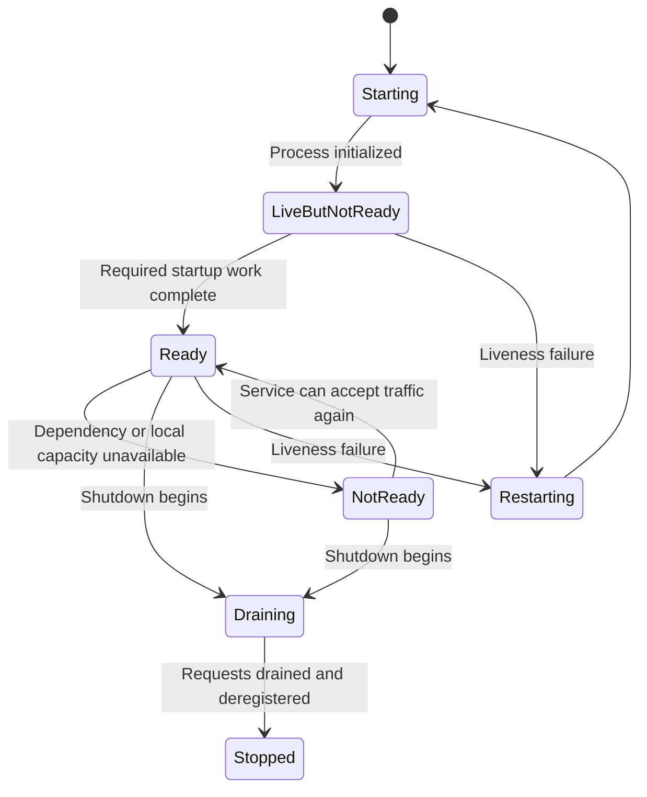
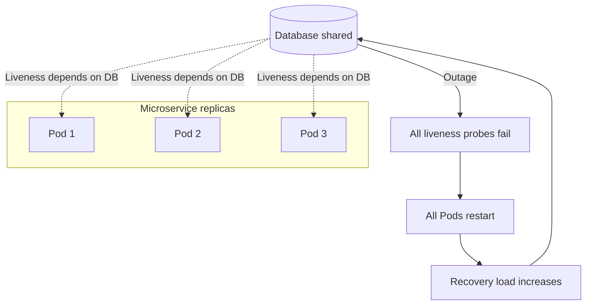

# Liên hệ giữa liveness, readiness và health check của sổ đăng ký

Trong microservice, một ứng dụng có thể đang chạy nhưng chưa sẵn sàng nhận request; cũng có thể vẫn trả lời health endpoint trong khi một dependency quan trọng đã lỗi. Vì vậy, cần phân biệt **liveness**, **readiness** và **health check của service registry**. Ba tín hiệu này có liên quan nhưng phục vụ các quyết định khác nhau: Kubernetes quyết định khi nào restart hoặc đưa Pod vào Service endpoints, còn Eureka/Consul quyết định instance nào được công bố hoặc trả về cho consumer.

Nếu dùng chung một endpoint `/actuator/health` cho mọi mục đích mà không hiểu semantics, hệ thống dễ restart dây chuyền khi database tạm thời lỗi, gửi traffic đến Pod chưa khởi tạo xong hoặc giữ một instance lỗi trong registry. Bài này trình bày cách thiết kế các tín hiệu, tích hợp Spring Boot Actuator với Kubernetes, và đồng bộ trạng thái phù hợp với Eureka hoặc Consul.

## 1. Ba khái niệm cần tách biệt

### Liveness: tiến trình còn sống và có thể tiếp tục chạy?

Liveness trả lời câu hỏi: tiến trình có đang ở trạng thái mà nó có thể tiếp tục hoạt động, hay đã rơi vào trạng thái treo/hỏng không thể tự phục hồi?

Trong Kubernetes, khi liveness probe thất bại đủ số lần liên tiếp, kubelet sẽ restart container. Vì vậy, liveness nên phản ánh lỗi nội tại của tiến trình như deadlock, event loop bị kẹt hoặc trạng thái không thể phục hồi bằng cách tiếp tục chạy.

Không nên đưa database, message broker, Eureka hoặc Consul vào liveness một cách mặc định. Nếu một dependency dùng chung tạm thời bị lỗi, mọi Pod có thể cùng fail liveness và bị restart đồng loạt, làm tăng tải lúc hệ thống đang suy giảm.

### Readiness: instance có thể nhận traffic lúc này không?

Readiness trả lời câu hỏi: ứng dụng đã khởi tạo đủ và hiện có thể xử lý request nghiệp vụ chưa?

Trong Kubernetes, Pod không Ready sẽ bị loại khỏi danh sách endpoint thông thường của Service. Container vẫn chạy; readiness failure không tự restart container. Khi readiness trở lại thành công, Pod được đưa trở lại endpoints.

Readiness có thể xét trạng thái khởi tạo, khả năng phục vụ request, pool connection hoặc dependency thực sự bắt buộc cho request. Tuy nhiên, cần cân nhắc tác động khi đưa dependency dùng chung vào readiness: nếu database chung gặp sự cố, tất cả Pod có thể cùng bị đánh dấu NotReady, khiến không còn backend phục vụ các request có thể vẫn xử lý được.

### Registry health check: registry có nên công bố instance cho consumer không?

Registry health check là tín hiệu mà Eureka, Consul hoặc discovery implementation dùng để đánh giá instance khi trả kết quả tra cứu hoặc cập nhật trạng thái service. Nó có thể dựa vào heartbeat/lease, HTTP/TCP check hoặc trạng thái được ứng dụng publish.

Registry health không nhất thiết đồng nghĩa với Kubernetes readiness hoặc liveness. Ví dụ:

- Eureka nhận heartbeat để gia hạn lease; health status của instance có thể được cập nhật riêng qua health handler.
- Consul agent có thể gọi HTTP health endpoint theo chu kỳ và đánh dấu check `passing`, `warning` hoặc `critical`.
- Kubernetes tự quản lý Service endpoints dựa trên readiness của Pod; ứng dụng không cần ghi đăng ký instance vào một registry riêng nếu chỉ dùng Kubernetes Service DNS.

## 2. Bảng so sánh phạm vi và hành động

| Tín hiệu | Ai đánh giá? | Khi thất bại | Hành động chính |
| --- | --- | --- | --- |
| Liveness | Kubelet qua liveness probe | Đạt ngưỡng thất bại liên tiếp | Restart container |
| Readiness | Kubelet qua readiness probe | Pod không Ready | Loại Pod khỏi Service endpoints thông thường |
| Startup probe | Kubelet trong giai đoạn khởi động | Chưa hoàn tất khởi động trong giới hạn cấu hình | Tiếp tục chờ hoặc restart khi vượt ngưỡng; liveness/readiness chưa được thực hiện cho đến khi startup thành công |
| Eureka heartbeat/lease | Eureka Server và Eureka Client | Không gia hạn lease trong thời gian quy định | Instance có thể hết lease/evict |
| Eureka application health status | HealthCheckHandler và Eureka Client | Health được ánh xạ sang trạng thái instance | Consumer có thể không chọn instance không ở trạng thái UP |
| Consul health check | Consul agent | Check HTTP/TCP/script thất bại | Instance chuyển sang `warning` hoặc `critical`; truy vấn `passing=true` sẽ loại instance không passing |
| Kubernetes Service endpoints | Kubernetes control plane | Pod readiness thất bại | EndpointSlice đánh dấu endpoint không Ready cho traffic thông thường |

Startup probe là cơ chế của Kubernetes để bảo vệ ứng dụng khởi động chậm. Nó không thay thế liveness/readiness và không phải health check của service registry.

## 3. Trạng thái trong vòng đời một Pod

Một ứng dụng thường đi qua các giai đoạn sau:

1. Container bắt đầu chạy và JVM khởi động.
2. Ứng dụng nạp cấu hình, khởi tạo bean và mở server socket.
3. Startup probe xác nhận giai đoạn khởi động đã qua giới hạn cần bảo vệ.
4. Liveness xác nhận tiến trình còn hoạt động; readiness vẫn có thể chưa đạt.
5. Ứng dụng hoàn tất các bước bắt buộc và chuyển readiness sang `ACCEPTING_TRAFFIC`.
6. Kubernetes đưa Pod vào Service endpoints; registry riêng cũng cần nhận trạng thái phù hợp.
7. Khi shutdown, ứng dụng chuyển readiness sang không nhận traffic, drain request đang xử lý và deregister khỏi registry theo lifecycle.



Một Pod có thể ở trạng thái Live nhưng NotReady trong lúc warm-up. Đây là hành vi mong muốn: tiến trình có thể tiếp tục chạy để hoàn tất khởi tạo mà chưa nhận traffic từ Service.

## 4. Spring Boot Actuator cung cấp health groups

Spring Boot Actuator có các health indicator và health group. Khi bật hỗ trợ Kubernetes probes, ứng dụng có thể cung cấp hai endpoint riêng:

- `/actuator/health/liveness`
- `/actuator/health/readiness`

Trong Spring Boot hiện đại, health probe groups có thể được tự bật khi ứng dụng phát hiện đang chạy trong Kubernetes. Khi chạy ngoài Kubernetes hoặc muốn cấu hình tường minh, có thể bật bằng property:

```yaml
management:
  endpoint:
    health:
      probes:
        enabled: true
  endpoints:
    web:
      exposure:
        include: health,info
```

Các group này phản ánh `LivenessState` và `ReadinessState` do Spring Boot quản lý. Ứng dụng có thể chuyển readiness state khi quá trình khởi tạo hoặc shutdown thay đổi.

Ví dụ cấu hình nhóm readiness có thêm một health indicator bắt buộc:

```yaml
management:
  endpoint:
    health:
      probes:
        enabled: true
      group:
        readiness:
          include: readinessState,db
```

Chỉ thêm `db` nếu ứng dụng thực sự không thể xử lý bất kỳ request nghiệp vụ nào khi database không sẵn sàng. Không thêm database hoặc dịch vụ ngoài vào liveness group. Cũng không đưa toàn bộ health indicators vào readiness một cách máy móc.

Nếu Actuator chạy trên cổng quản trị riêng, cần bảo đảm probe có thể truy cập cổng đó và network policy cho phép kubelet kiểm tra. Một số hệ thống cấu hình management port riêng nên cần kiểm tra đường dẫn và cổng thực tế.

## 5. Chủ động chuyển ReadinessState trong ứng dụng

Spring Boot cung cấp `ApplicationAvailability` để đọc trạng thái và `AvailabilityChangeEvent` để phát sự kiện thay đổi. Nếu bước khởi tạo là công việc đồng bộ, có thể thực hiện trong `ApplicationRunner` hoặc `CommandLineRunner`; Spring Boot chỉ chuyển readiness sang `ACCEPTING_TRAFFIC` sau khi các runner hoàn tất. Với warm-up bất đồng bộ hoặc một thành phần cần chủ động ngừng nhận traffic trong lúc chạy, có thể phát sự kiện:

```java
import org.springframework.boot.availability.AvailabilityChangeEvent;
import org.springframework.boot.availability.ReadinessState;
import org.springframework.context.ApplicationEventPublisher;
import org.springframework.stereotype.Component;

@Component
public class ReadinessController {

    private final ApplicationEventPublisher publisher;

    public ReadinessController(ApplicationEventPublisher publisher) {
        this.publisher = publisher;
    }

    public void markReadyAfterWarmup() {
        AvailabilityChangeEvent.publish(
                publisher,
                this,
                ReadinessState.ACCEPTING_TRAFFIC);
    }

    public void stopAcceptingTraffic() {
        AvailabilityChangeEvent.publish(
                publisher,
                this,
                ReadinessState.REFUSING_TRAFFIC);
    }
}
```

Trong code production, gọi `markReadyAfterWarmup()` khi warm-up thực sự hoàn tất và phát `REFUSING_TRAFFIC` qua `stopAcceptingTraffic()` tại lifecycle hook phù hợp. Không phát `ACCEPTING_TRAFFIC` ngay khi socket mở nếu các bước tải model, nạp cache hoặc kết nối bắt buộc chưa xong.

## 6. Cấu hình startup, liveness và readiness probe trên Kubernetes

Ví dụ Deployment dùng ba probe riêng:

```yaml
apiVersion: apps/v1
kind: Deployment
metadata:
  name: inventory-service
  namespace: commerce
spec:
  replicas: 3
  selector:
    matchLabels:
      app: inventory-service
  template:
    metadata:
      labels:
        app: inventory-service
    spec:
      containers:
        - name: application
          image: example/inventory-service:2.4.1
          ports:
            - name: http
              containerPort: 8080
          startupProbe:
            httpGet:
              path: /actuator/health/liveness
              port: http
            periodSeconds: 10
            timeoutSeconds: 2
            failureThreshold: 30
          livenessProbe:
            httpGet:
              path: /actuator/health/liveness
              port: http
            periodSeconds: 10
            timeoutSeconds: 2
            failureThreshold: 3
          readinessProbe:
            httpGet:
              path: /actuator/health/readiness
              port: http
            periodSeconds: 5
            timeoutSeconds: 2
            failureThreshold: 2
            successThreshold: 1
```

Trong ví dụ:

- `startupProbe` cho phép ứng dụng có thời gian khởi động dài. Khi startup probe chưa thành công, kubelet chưa chạy liveness và readiness probe.
- `livenessProbe` kiểm tra tiến trình có còn sống và phản hồi health endpoint không. Khi thất bại đủ ngưỡng, kubelet restart container.
- `readinessProbe` kiểm tra ứng dụng có thể nhận traffic không. Khi thất bại, Pod bị loại khỏi endpoints thông thường nhưng container tiếp tục chạy.
- `failureThreshold` và `periodSeconds` quyết định khoảng thời gian chờ trước khi kubelet hành động; hãy tính toán dựa trên thời gian khởi động và mức chịu lỗi thực tế.

Ví dụ dùng cùng endpoint liveness cho startup probe để bảo đảm JVM và Actuator đã khởi động. Nếu ứng dụng có bước bootstrap riêng kéo dài sau khi endpoint liveness đã trả UP, hãy tạo startup health group/indicator riêng hoặc dùng một endpoint phản ánh đúng hoàn tất khởi tạo. Startup probe không nên chờ một dependency ngoài nếu việc đó có thể kéo dài vô hạn.

## 7. Không trộn dependency ngoài vào liveness

Một lỗi thiết kế phổ biến là để liveness kiểm tra database, Kafka, Redis, Eureka và mọi API phụ thuộc. Khi một hệ thống dùng chung bị lỗi, tất cả instance có thể cùng bị restart:



Kết quả có thể là database đang phục hồi lại phải chịu thêm kết nối từ toàn bộ Pod khởi động lại. Hãy giữ liveness tập trung vào khả năng tự phục hồi của process. Dùng readiness để điều khiển traffic nếu dependency thực sự quyết định khả năng phục vụ, đồng thời cân nhắc fallback hoặc degraded mode.

Readiness không nên là danh sách mọi dependency có thể kiểm tra. Chỉ đưa vào những dependency mà request được phục vụ không thể thành công nếu thiếu chúng. Nếu chỉ một số endpoint phụ thuộc database, có thể để ứng dụng Ready và trả lỗi có kiểm soát cho riêng endpoint đó, thay vì loại toàn bộ instance khỏi traffic.

## 8. Registry health với Eureka

Eureka có hai cơ chế thường bị nhầm lẫn:

1. **Heartbeat/lease:** Eureka Client định kỳ gửi renew để server biết instance còn duy trì session đăng ký. Nếu heartbeat không đến trong thời gian lease, server có thể loại instance theo cơ chế eviction.
2. **Application health status:** Eureka Client có thể publish trạng thái health của ứng dụng để server/consumer biết instance đang `UP`, `DOWN` hoặc `OUT_OF_SERVICE`.

Trong Spring Cloud Netflix, có thể bật tích hợp health handler bằng:

```yaml
eureka:
  client:
    healthcheck:
      enabled: true
```

Đặt thuộc tính này trong `application.yml` của ứng dụng. Tích hợp health check giúp Eureka Client dùng trạng thái Actuator/Spring health để cập nhật trạng thái instance. Cần xác minh cách ánh xạ status của phiên bản Spring Cloud Netflix đang sử dụng.

Điểm quan trọng:

- Heartbeat thành công không có nghĩa ứng dụng đang Ready.
- Instance có thể vẫn gửi heartbeat nhưng được đánh dấu `OUT_OF_SERVICE` hoặc trạng thái không phục vụ.
- Consumer cần lọc/chọn các instance có trạng thái phù hợp; không chỉ dựa vào việc instance còn xuất hiện trong registry.
- Nếu không bật health integration, Eureka có thể chủ yếu dựa vào heartbeat/lease và trạng thái instance mặc định.

Không nên dùng một health indicator phụ thuộc vào chính Eureka registry để quyết định health publish lên Eureka. Điều đó tạo vòng phụ thuộc: registry lỗi làm ứng dụng tự đánh dấu không khỏe và có thể khiến discovery suy giảm thêm.

## 9. Registry health với Consul

Consul agent thực hiện health check đã khai báo cho service. Spring Cloud Consul Discovery thường cho phép cấu hình HTTP health check:

```yaml
spring:
  application:
    name: inventory-service
  cloud:
    consul:
      host: ${CONSUL_HOST:localhost}
      port: ${CONSUL_PORT:8500}
      discovery:
        enabled: true
        register: true
        service-name: inventory-service
        health-check-path: /actuator/health/readiness
        health-check-interval: 10s
        prefer-ip-address: true

management:
  endpoint:
    health:
      probes:
        enabled: true
  endpoints:
    web:
      exposure:
        include: health
```

Trong ví dụ, Consul agent gọi endpoint readiness theo chu kỳ. Nếu endpoint trả trạng thái không thành công, Consul đánh dấu check không passing. Consumer có thể truy vấn health service và lọc `passing=true` để chỉ nhận instance đạt check.

Chỉ dùng `/actuator/health/readiness` nếu agent có thể truy cập endpoint và semantics phù hợp với traffic. Nếu endpoint chỉ bind vào loopback bên trong container, agent ở host hoặc container khác có thể không truy cập được. Hãy kiểm tra hostname/IP và port được đăng ký, network policy và firewall.

Consul có thể vẫn giữ service trong catalog khi check ở trạng thái `critical`; việc có bị deregister sau một khoảng thời gian hay không phụ thuộc cấu hình như critical service timeout và policy triển khai. Không giả định check fail luôn xóa service ngay lập tức.

## 10. Kubernetes Service endpoints và Spring Cloud Kubernetes

Khi dùng Kubernetes Service làm cơ chế discovery, control plane theo dõi Pod được chọn bởi Service selector và trạng thái readiness của chúng. EndpointSlice phản ánh các backend; Pod chưa Ready thường không được chọn cho traffic Service thông thường.

Điều này có nghĩa:

- Liveness probe điều khiển restart container.
- Readiness probe ảnh hưởng trạng thái Ready của Pod.
- Kubernetes Service/EndpointSlice phản ánh backend đủ điều kiện nhận traffic.
- Spring Cloud Kubernetes DiscoveryClient có thể đọc Service và Endpoint/EndpointSlice để cung cấp instance cho ứng dụng.

Trong mô hình này, ứng dụng thường không tự đăng ký và deregister Service instance bằng một API registry riêng. Kubernetes controller duy trì endpoints dựa trên Pod và Service. Nếu bật `publishNotReadyAddresses` trên Service, endpoint chưa Ready có thể được công bố cho mục đích đặc biệt; không bật tùy tiện cho service nhận traffic nghiệp vụ.

Nếu consumer gọi Service bằng DNS như `inventory-service.commerce.svc.cluster.local`, DNS và dataplane xử lý định tuyến đến backend. Nếu dùng DiscoveryClient để lấy từng instance và tự cân bằng tải, discovery implementation cần quyền đọc resource phù hợp và consumer phải xử lý cache/độ mới dữ liệu.

## 11. Nên dùng endpoint health nào cho registry?

Không có một lựa chọn duy nhất cho mọi hệ thống. Hãy xác định registry cần loại trừ instance trong tình huống nào:

| Nhu cầu | Endpoint/tín hiệu gợi ý | Lưu ý |
| --- | --- | --- |
| Process bị treo, cần restart | Liveness | Chỉ kiểm tra lỗi nội tại có thể phục hồi bằng restart |
| Ứng dụng chưa khởi tạo xong | Readiness | Chưa nhận traffic nhưng process vẫn tiếp tục chạy |
| Provider không thể phục vụ request nghiệp vụ | Readiness hoặc registry health được ánh xạ từ readiness | Chọn dependency bắt buộc và tránh loại mọi instance vì một dependency không thiết yếu |
| Registry cần phát hiện client chết | Eureka lease/heartbeat hoặc Consul agent check | Đây là cơ chế registry, không thay thế readiness của ứng dụng |
| Pod không được Kubernetes Service gửi traffic | Kubernetes readiness probe | EndpointSlice cập nhật theo trạng thái Pod |
| Khởi động lâu, tránh restart quá sớm | Startup probe | Chỉ bảo vệ giai đoạn startup, không thay readiness |

Với Consul, dùng readiness endpoint cho HTTP check thường hợp lý nếu readiness phản ánh khả năng nhận traffic. Với Eureka, bật health handler để trạng thái ứng dụng được publish. Với Kubernetes Service, readiness probe đã trực tiếp điều khiển endpoint eligibility.

## 12. Graceful shutdown và deregistration

Khi triển khai rolling update hoặc Pod bị terminate, cần cho hệ thống thời gian ngừng nhận request mới và xử lý request đang chạy:

1. Ứng dụng chuyển readiness sang `REFUSING_TRAFFIC`.
2. Kubernetes cập nhật trạng thái endpoint để ngừng gửi traffic mới đến Pod.
3. Registry riêng nhận trạng thái không phục vụ hoặc deregistration theo lifecycle.
4. Ứng dụng drain các request đang xử lý.
5. Spring Boot đóng server và tài nguyên trước khi hết `terminationGracePeriodSeconds`.

Ví dụ cấu hình Spring Boot:

```yaml
server:
  shutdown: graceful

spring:
  lifecycle:
    timeout-per-shutdown-phase: 20s
```

Trong Deployment, `terminationGracePeriodSeconds` phải lớn hơn thời gian drain dự kiến và các bước cleanup. Có thể dùng `preStop` hook nếu cần khoảng chờ để endpoint propagation hoàn tất, nhưng phải tính thời gian đó vào tổng grace period.

Không nên chỉ dựa vào deregistration khi process bị kill -9 hoặc node mất điện. Với các trường hợp đột ngột, registry cần heartbeat/lease hoặc health check để phát hiện instance không còn hoạt động.

## 13. Ví dụ thiết kế hoàn chỉnh cho một provider

Một provider Spring Boot chạy trong Kubernetes, đăng ký với Consul, có thể dùng cấu hình sau:

```yaml
spring:
  application:
    name: inventory-service
  cloud:
    consul:
      host: ${CONSUL_HOST:consul-agent}
      port: 8500
      discovery:
        enabled: true
        register: true
        service-name: inventory-service
        health-check-path: /actuator/health/readiness
        health-check-interval: 10s
  lifecycle:
    timeout-per-shutdown-phase: 20s

management:
  endpoint:
    health:
      probes:
        enabled: true
  endpoints:
    web:
      exposure:
        include: health,info

server:
  shutdown: graceful
```

Deployment khai báo startup, liveness và readiness probe theo các endpoint Actuator đã bật. Consul agent phải có thể truy cập `/actuator/health/readiness` qua địa chỉ instance được đăng ký. Nếu dùng Eureka thay Consul, bỏ cấu hình Consul và bật Eureka health integration phù hợp.

Trong ví dụ production, hãy xác định rõ readiness có bao gồm database hay không. Nếu database chỉ cần cho một số endpoint, cân nhắc giữ service Ready và xử lý lỗi ở các endpoint phụ thuộc database thay vì loại toàn bộ instance.

## 14. Kiểm thử hành vi health end-to-end

Không chỉ kiểm tra endpoint trả `UP`; cần kiểm tra hành động mà nền tảng thực hiện:

1. Khởi động Pod mới và xác nhận startup probe bảo vệ giai đoạn khởi động.
2. Trước khi ứng dụng sẵn sàng, xác nhận liveness có thể UP nhưng readiness chưa đạt.
3. Xác nhận Pod chưa Ready không nhận traffic qua Kubernetes Service.
4. Khi readiness chuyển UP, xác nhận EndpointSlice cập nhật và traffic được gửi đến Pod.
5. Làm liveness thất bại có kiểm soát trong môi trường test; xác nhận kubelet restart container sau ngưỡng đã cấu hình.
6. Nếu dùng Consul, làm readiness endpoint thất bại và xác nhận check chuyển `critical`/không passing.
7. Nếu dùng Eureka, thay đổi health state và xác nhận instance status được publish theo health handler.
8. Khôi phục health và xác nhận Pod/registry trở lại trạng thái phục vụ.
9. Terminate Pod bình thường và xác nhận readiness giảm trước khi shutdown, request đang xử lý được drain.
10. Mô phỏng kill đột ngột để kiểm tra lease/health check phát hiện instance chết.

Nên thực hiện test với một replica hoặc môi trường staging. Không cố tình làm liveness thất bại trên toàn bộ replica production để thử hành vi restart.

## 15. Lỗi thiết kế thường gặp

| Cách làm | Hậu quả | Cách cải thiện |
| --- | --- | --- |
| Dùng `/actuator/health` chung cho mọi probe | Liveness, readiness và registry có cùng semantics dù cần hành động khác nhau | Dùng health groups liveness/readiness và cấu hình registry rõ ràng |
| Đưa database vào liveness | Database lỗi làm toàn bộ Pod restart dây chuyền | Giữ liveness nội tại; cân nhắc database trong readiness |
| Đánh dấu Ready ngay khi server socket mở | Traffic đến trước khi cache/connection pool khởi tạo xong | Chuyển readiness sau bước bootstrap cần thiết |
| Coi heartbeat Eureka là health check nghiệp vụ | Instance vẫn được gia hạn lease dù không thể phục vụ | Publish health status và chọn consumer filter phù hợp |
| Coi Consul critical đồng nghĩa service bị xóa | Service có thể vẫn tồn tại trong catalog | Truy vấn health với `passing=true` hoặc cấu hình deregistration có chủ đích |
| Dùng Kubernetes liveness thay cho readiness | Pod lỗi tạm thời bị restart thay vì ngừng nhận traffic | Tách hai probe theo hành động mong muốn |
| Registry check không truy cập được Actuator | Instance luôn critical dù app khỏe | Kiểm tra advertised address, bind address, port và network |
| Không drain traffic khi shutdown | Request đang xử lý bị ngắt | Chuyển readiness, deregister và bật graceful shutdown |
| Health endpoint phụ thuộc registry đang kiểm tra chính nó | Vòng phụ thuộc khiến lỗi registry lan sang health status | Không đưa registry self-check vào liveness/readiness publish ngược lại registry |

## 16. Checklist triển khai

- [ ] Liveness chỉ phản ánh lỗi nội tại khiến process cần restart.
- [ ] Readiness phản ánh khả năng nhận request nghiệp vụ.
- [ ] Startup probe bảo vệ ứng dụng khởi động chậm.
- [ ] Spring Boot Actuator bật health probe groups và expose đúng endpoint.
- [ ] Kubernetes probe trỏ đúng path, port và có ngưỡng phù hợp.
- [ ] Dependency ngoài chỉ được đưa vào readiness khi thật sự bắt buộc.
- [ ] Eureka heartbeat/lease được phân biệt với application health status.
- [ ] Consul agent check gọi được endpoint health và consumer lọc trạng thái phù hợp.
- [ ] Kubernetes readiness được dùng để điều khiển Service endpoints.
- [ ] Không tạo vòng phụ thuộc giữa registry health và registry connectivity.
- [ ] Graceful shutdown chuyển readiness trước khi dừng và có thời gian drain.
- [ ] Đã test startup, not-ready, liveness restart, registry check failure và recovery.

Liveness quyết định khi nào cần restart process; readiness quyết định instance có nên nhận traffic; registry health check quyết định instance được công bố hoặc chọn như thế nào trong cơ chế discovery cụ thể. Thiết kế đúng cần giữ ba tín hiệu riêng biệt, ánh xạ chúng có chủ đích và kiểm thử hành động thực tế của Kubernetes, Eureka hoặc Consul. Khi đó, ứng dụng có thể tiếp tục chạy qua lỗi dependency tạm thời, ngừng nhận traffic khi chưa sẵn sàng và được loại khỏi discovery khi thật sự không thể phục vụ.
