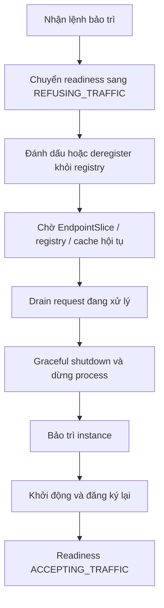

# Chuyển trạng thái ngừng nhận yêu cầu trước khi bảo trì

Khi cần nâng cấp, thay cấu hình hoặc bảo trì một microservice, dừng tiến trình ngay lập tức có thể làm mất các request đang xử lý. Consumer còn có thể tiếp tục chọn instance đó từ Kubernetes Service, Consul hoặc Eureka trong một khoảng thời gian sau khi quá trình dừng bắt đầu.

Quy trình an toàn cần đưa instance vào trạng thái **không nhận request mới** trước, chờ thông tin discovery và load balancer cập nhật, xử lý hết request đang chạy, rồi mới dừng tiến trình. Trong Spring Cloud, thao tác này liên quan tới readiness, health check, `ServiceRegistry`, graceful shutdown và thời gian hội tụ của từng registry. Bài học này trình bày thứ tự thực hiện và cách phối hợp các thành phần khi bảo trì một instance.

## 1. Vì sao phải ngừng nhận traffic trước khi dừng?

Một service thường có nhiều instance cùng phục vụ request. Discovery và LoadBalancer chọn instance dựa trên danh sách mà registry hoặc nền tảng cung cấp. Khi bảo trì một instance, có hai nhóm request cần xử lý:

- **Request mới:** cần được chuyển sang instance khác.
- **Request đang xử lý:** cần có thời gian hoàn tất trước khi process hoặc container bị dừng.

Nếu process bị kill ngay, request đang chạy có thể nhận lỗi kết nối, timeout hoặc response không hoàn chỉnh. Nếu chỉ dừng process mà không cập nhật discovery, consumer có thể tiếp tục chọn địa chỉ cũ cho tới khi health check, heartbeat, cache hoặc TTL phát hiện instance đã mất.

Quy trình drain có mục tiêu:

1. Đánh dấu instance không còn sẵn sàng nhận request mới.
2. Đưa instance ra khỏi danh sách endpoint/registry mà consumer sử dụng.
3. Chờ các thay đổi đó lan tới proxy, discovery client và LoadBalancer.
4. Chờ request đang chạy hoàn tất trong giới hạn thời gian cho phép.
5. Dừng process một cách graceful.



Readiness, registry status và graceful shutdown là các cơ chế khác nhau. Chỉ dùng một trong số đó thường chưa đủ để bảo đảm mọi consumer ngừng gửi request tới instance.

## 2. Phân biệt readiness, liveness và trạng thái đăng ký

### 2.1. Readiness quyết định có nhận traffic hay không

Readiness trả lời câu hỏi: instance đã sẵn sàng phục vụ request mới chưa? Khi bảo trì, ứng dụng nên chuyển readiness sang trạng thái từ chối traffic. Trong Kubernetes, readiness probe thất bại khiến endpoint không còn được xem là sẵn sàng cho traffic thông thường qua Service.

Với Spring Boot Actuator, có thể bật health probes:

```yaml
management:
  endpoints:
    web:
      exposure:
        include: health
  endpoint:
    health:
      probes:
        enabled: true
      show-details: never
```

Khi được bật, các endpoint thường dùng là:

```text
/actuator/health/readiness
/actuator/health/liveness
```

Readiness nên phản ánh khả năng nhận request. Liveness nên phản ánh process có cần được khởi động lại hay không. Khi bảo trì có chủ đích, hãy chuyển readiness sang `REFUSING_TRAFFIC` nhưng giữ liveness khỏe; nếu làm liveness thất bại, Kubernetes có thể restart container trong lúc bạn đang cố drain nó.

### 2.2. Liveness không phải công tắc drain

Liveness probe giúp phát hiện process bị treo hoặc không thể phục hồi. Nó không nên bị chuyển sang lỗi chỉ để loại instance khỏi traffic. Dùng readiness để ngừng nhận request và để liveness tiếp tục giám sát sức khỏe của process.

### 2.3. Trạng thái registry là một lớp riêng

Readiness của ứng dụng không tự động cập nhật mọi registry trong mọi cấu hình:

- Kubernetes Service/EndpointSlice theo dõi Pod readiness và cập nhật endpoint tương ứng.
- Consul có thể dùng HTTP/TCP/script/TTL check; khi check không còn `passing`, consumer truy vấn với `?passing` sẽ loại instance khỏi kết quả. Registration vẫn có thể còn trong Catalog.
- Eureka dùng heartbeat/lease và trạng thái instance. Việc readiness chuyển sang từ chối traffic không tự động bảo đảm Eureka lập tức loại instance khỏi mọi consumer. Cần dùng status/deregistration phù hợp với Eureka client/server và xác minh cách consumer lọc `OUT_OF_SERVICE`.

Vì vậy, trước khi bảo trì cần xác định chính xác consumer lấy danh sách instance từ đâu và điều kiện nào khiến instance bị loại khỏi danh sách ứng viên.

## 3. Chuyển trạng thái readiness trong Spring Boot

Spring Boot cung cấp `AvailabilityChangeEvent` để thay đổi trạng thái readiness của ứng dụng. Có thể phát sự kiện `ReadinessState.REFUSING_TRAFFIC` khi bắt đầu drain và chuyển về `ACCEPTING_TRAFFIC` sau khi ứng dụng khởi động, kiểm tra xong và sẵn sàng nhận request.

Ví dụ một endpoint nội bộ để bắt đầu drain:

```java
import org.springframework.boot.availability.AvailabilityChangeEvent;
import org.springframework.boot.availability.ReadinessState;
import org.springframework.context.ApplicationContext;
import org.springframework.http.ResponseEntity;
import org.springframework.web.bind.annotation.PostMapping;
import org.springframework.web.bind.annotation.RestController;

@RestController
public class MaintenanceController {

    private final ApplicationContext applicationContext;

    public MaintenanceController(ApplicationContext applicationContext) {
        this.applicationContext = applicationContext;
    }

    @PostMapping("/internal/drain")
    public ResponseEntity<Void> drain() {
        AvailabilityChangeEvent.publish(
                applicationContext,
                ReadinessState.REFUSING_TRAFFIC
        );
        return ResponseEntity.accepted().build();
    }
}
```

Endpoint trên chỉ minh họa thao tác readiness. Trong production, hãy bảo vệ endpoint bằng authentication/authorization, giới hạn network access và ghi nhận ai đã yêu cầu drain. Không để người dùng bên ngoài tùy ý chuyển instance sang trạng thái bảo trì.

Nếu ứng dụng cần tự phục hồi sau bảo trì, có thể phát sự kiện `ReadinessState.ACCEPTING_TRAFFIC` sau khi hoàn tất kiểm tra và đăng ký lại. Không chuyển sang accepting chỉ vì process đã mở port; cần xác minh dependency, registry và đường phục vụ request.

## 4. Đưa instance ra khỏi discovery

### 4.1. Kubernetes Service

Với workload chạy trong Kubernetes, readiness probe là cơ chế tự nhiên để loại Pod khỏi endpoint sẵn sàng. Khi `/actuator/health/readiness` trả trạng thái không sẵn sàng, kubelet cập nhật điều kiện Pod; EndpointSlice controller phản ánh thay đổi đó. Service networking sau đó ngừng chọn endpoint không còn Ready cho traffic thông thường.

Ví dụ cấu hình Deployment:

```yaml
apiVersion: apps/v1
kind: Deployment
metadata:
  name: order-service
  namespace: shop
spec:
  replicas: 3
  selector:
    matchLabels:
      app: order-service
  template:
    metadata:
      labels:
        app: order-service
    spec:
      terminationGracePeriodSeconds: 90
      containers:
        - name: order-service
          image: example/order-service:1.0
          ports:
            - name: http
              containerPort: 8080
          readinessProbe:
            httpGet:
              path: /actuator/health/readiness
              port: http
            periodSeconds: 5
            failureThreshold: 1
          livenessProbe:
            httpGet:
              path: /actuator/health/liveness
              port: http
            periodSeconds: 10
```

Kubernetes chỉ cập nhật EndpointSlice sau khi trạng thái Pod thay đổi và controller reconcile. Proxy, ingress, client-side discovery hoặc cache bên ngoài có thể cần thêm thời gian để nhận thông tin mới. Không giả định rằng readiness thất bại đồng nghĩa mọi request trên toàn hệ thống dừng ngay lập tức.

### 4.2. Consul

Nếu consumer truy vấn Consul Health API với `?passing` hoặc Spring Cloud Consul bật `query-passing`, instance sẽ không còn được trả về khi một check liên quan chuyển khỏi `passing`.

Có thể đưa instance ra khỏi tập passing bằng một trong các cách được thiết kế cho service:

- Health endpoint chuyển sang mã HTTP không thành công khi ứng dụng vào maintenance.
- Cập nhật TTL check hoặc trạng thái check qua Consul Agent/API theo quy trình đã cấu hình.
- Deregister service instance qua Consul client/API khi muốn xóa registration.

Ví dụ, nếu Consul HTTP check gọi `/actuator/health/readiness`, readiness chuyển sang từ chối traffic sẽ khiến check kế tiếp thất bại. Thời gian loại khỏi truy vấn passing phụ thuộc health-check interval, timeout và thời điểm consumer truy vấn lại.

Nếu cần loại ngay, có thể dùng thao tác deregistration có kiểm soát. Cần nhớ Catalog registration và Health status là hai dữ liệu khác nhau: check critical không nhất thiết xóa bản ghi khỏi Catalog.

### 4.3. Eureka

Eureka Client duy trì registration bằng heartbeat. Nếu chỉ làm readiness thất bại nhưng Eureka Client vẫn gửi heartbeat, instance có thể tiếp tục xuất hiện trong registry.

Trước khi bảo trì, có thể chuyển trạng thái instance sang `OUT_OF_SERVICE` bằng cơ chế `ServiceRegistry`/Eureka phù hợp với phiên bản đang dùng, hoặc deregister registration khỏi Eureka. Sau đó xác minh:

- Eureka Server đã nhận trạng thái mới hoặc deregistration.
- Consumer thực sự loại instance đó khỏi danh sách được chọn.
- Các cache registry phía client và LoadBalancer đã cập nhật.

Không dựa vào việc dừng process để Eureka tự phát hiện ngay lập tức. Khi process mất kết nối đột ngột, server cần thời gian phát hiện lease hết hạn; self-preservation còn có thể trì hoãn eviction. `OUT_OF_SERVICE`, cancellation/deregistration và heartbeat là các hành vi khác nhau, nên hãy kiểm tra đường đi cụ thể trong phiên bản Eureka/Spring Cloud của dự án.

### 4.4. Dùng ServiceRegistry abstraction

Spring Cloud Commons định nghĩa `ServiceRegistry` để thao tác với registration, gồm các hành động như register, deregister, đọc trạng thái và cập nhật trạng thái. Tuy nhiên, kiểu registration và giá trị status hợp lệ phụ thuộc implementation.

Ví dụ về trình tự ở mức khái niệm:

```text
1. Đưa readiness sang REFUSING_TRAFFIC.
2. Dùng registry adapter để set trạng thái không phục vụ hoặc deregister.
3. Xác minh registry không còn trả instance như một ứng viên traffic.
4. Chờ cache/discovery client cập nhật.
5. Drain request đang chạy.
```

Không truyền cùng một chuỗi status cho mọi registry. Eureka có trạng thái như `OUT_OF_SERVICE`; Consul thường dựa trên health check và passing/warning/critical hoặc deregistration. Hãy dùng API/property đúng của implementation đang chạy.

## 5. Chờ thay đổi discovery lan truyền

Sau khi readiness hoặc registry được cập nhật, consumer có thể vẫn giữ danh sách cũ trong một khoảng thời gian. Các lớp có thể gây trễ:

- Chu kỳ readiness probe và thời gian kubelet cập nhật Pod condition.
- Thời gian EndpointSlice controller và network proxy cập nhật endpoint.
- Chu kỳ Consul health check hoặc Eureka registry fetch/heartbeat.
- Cache của DiscoveryClient và Spring Cloud LoadBalancer.
- Cache DNS hoặc connection pool của client.
- Ingress, API Gateway, service mesh sidecar hoặc external load balancer.

Thời gian chờ nên dựa trên các interval/cache timeout đã cấu hình và phép đo thực tế. Không dùng một con số cố định cho mọi môi trường. Trong rollout, nên theo dõi số endpoint Ready, số instance passing/available và request mới thực sự tới instance trước khi tiếp tục dừng.

Với một service có nhiều replica, hãy drain từng instance theo rolling update hoặc theo batch nhỏ. Giữ đủ capacity còn lại để phục vụ tải đỉnh trong lúc một instance đang bảo trì.

## 6. Drain request đang xử lý

Loại instance khỏi discovery chỉ ngăn phần lớn request mới đi tới nó; các request đã được gửi hoặc các kết nối keep-alive vẫn có thể tồn tại. Ứng dụng cần thời gian hoàn tất request đang chạy và dừng nhận request mới.

Spring Boot hỗ trợ graceful shutdown cho embedded web server:

```yaml
server:
  shutdown: graceful

spring:
  lifecycle:
    timeout-per-shutdown-phase: 30s
```

Khi nhận tín hiệu shutdown, web server ngừng nhận kết nối/request mới theo khả năng của server và chờ request đang xử lý hoàn tất trong giới hạn timeout. Hành vi chi tiết phụ thuộc server (Tomcat, Jetty, Undertow, Reactor Netty) và phiên bản Spring Boot.

Các điểm cần tính:

- Timeout graceful shutdown phải đủ cho request dài nhất được phép hoàn tất.
- Timeout của client và upstream cần hợp lý; request không có deadline có thể làm drain kéo dài.
- Background job, message listener và scheduled task cần có quy trình pause/stop riêng.
- WebSocket, streaming response và long polling có thể tồn tại lâu hơn request HTTP thông thường.
- Nếu timeout drain hết, cần có hành vi kết thúc cuối cùng rõ ràng; không thể chờ vô hạn trong lúc orchestrator chuẩn bị kill container.

Không nhầm `server.shutdown: graceful` với việc tự deregister khỏi Eureka/Consul. Graceful shutdown xử lý server đang phục vụ request; registry và readiness cần được cập nhật trước đó.

## 7. Phối hợp với Kubernetes preStop và SIGTERM

Khi Pod bị xóa hoặc Deployment rollout, kubelet chạy `preStop` hook trước khi gửi tín hiệu `SIGTERM` tới container. Thời gian hook chạy được tính vào `terminationGracePeriodSeconds`.

Có thể dùng `preStop` HTTP hook để gọi endpoint drain nội bộ:

```yaml
spec:
  terminationGracePeriodSeconds: 90
  containers:
    - name: order-service
      image: example/order-service:1.0
      ports:
        - name: http
          containerPort: 8080
      lifecycle:
        preStop:
          httpGet:
            path: /internal/drain
            port: http
            scheme: HTTP
```

Endpoint `/internal/drain` có thể chuyển readiness sang `REFUSING_TRAFFIC`, cập nhật registry ngoài và chờ khoảng thời gian hội tụ được thiết kế. Sau khi hook hoàn tất, kubelet gửi `SIGTERM`; Spring Boot bắt đầu graceful shutdown.

Thời gian `terminationGracePeriodSeconds` phải bao gồm thời gian preStop, thời gian propagation/drain và thời gian shutdown. Ví dụ:

```text
terminationGracePeriodSeconds
  >= preStop + propagation/drain + graceful shutdown + safety margin
```

Đây là quan hệ để tính ngân sách thời gian, không phải giá trị cấu hình cố định. Nếu preStop chờ 20 giây và graceful shutdown có thể dùng 30 giây, cần đặt termination grace period lớn hơn tổng đó và có phần dự phòng.

Kubernetes có thể gửi tín hiệu kết thúc khi grace period hết. Nếu ứng dụng không dừng trong thời hạn, container có thể bị kill cưỡng bức và các request còn lại bị mất. Hãy kiểm thử với request dài nhất và thời gian propagation thật của hệ thống.

## 8. Quy trình bảo trì hoàn chỉnh

Một quy trình có kiểm soát có thể thực hiện như sau:

### Trước khi drain

1. Xác nhận còn đủ replica khỏe để nhận tải sau khi rút một instance.
2. Kiểm tra tình trạng registry, health check, LoadBalancer và error rate hiện tại.
3. Xác định consumer nào dùng Kubernetes Service, Consul, Eureka hoặc cache riêng.
4. Xác nhận endpoint drain chỉ người vận hành hoặc orchestrator được gọi.
5. Đặt timeout request, graceful shutdown và termination grace period phù hợp.

### Bắt đầu drain

1. Gửi lệnh bảo trì tới đúng instance.
2. Ứng dụng chuyển readiness sang `REFUSING_TRAFFIC`.
3. Cập nhật health check, registry status hoặc deregistration theo implementation.
4. Chờ EndpointSlice/registry/LoadBalancer cập nhật; quan sát để xác nhận instance không còn được chọn cho request mới.
5. Theo dõi số request in-flight giảm về 0 hoặc về ngưỡng đã định.

### Dừng và bảo trì

1. Gửi `SIGTERM` hoặc để orchestrator tiếp tục termination sau preStop.
2. Spring Boot graceful shutdown chờ request đang xử lý trong timeout.
3. Dừng message listener, scheduler và background worker theo chính sách của ứng dụng.
4. Hoàn tất bảo trì hoặc triển khai phiên bản mới.

### Đưa instance trở lại

1. Khởi động process và hoàn tất startup.
2. Kiểm tra dependency bắt buộc và endpoint readiness.
3. Đăng ký lại với registry nếu đã deregister; bảo đảm instance ID không xung đột.
4. Xác minh health check/registry status đã passing hoặc trạng thái sẵn sàng tương ứng.
5. Chuyển readiness sang `ACCEPTING_TRAFFIC` khi ứng dụng thực sự sẵn sàng.
6. Theo dõi error rate, latency và phân phối request sau khi instance nhận traffic.

Không đưa instance vào lại traffic chỉ vì container đã Running. Trạng thái Running không đồng nghĩa Ready hoặc registration đã được cập nhật.

## 9. Ví dụ thứ tự khi dùng Consul

Giả sử Consul check gọi `/actuator/health/readiness` và consumer bật `query-passing: true`.

```text
Consumer                 Order instance              Consul
   |                           |                         |
   |                           |<-- POST /internal/drain |
   |                           |                         |
   |                           | Readiness = REFUSING    |
   |                           |                         |
   |                           |<----- HTTP health check -|
   |                           |------ non-2xx ---------->|
   |                           |                         | status critical
   |<------ query passing: instance excluded -----------|
   |                           |                         |
   |---- new request to other instance ----------------->|
   |                           |                         |
   |                           | finish in-flight work   |
   |                           |                         |
   |                           |<-------- SIGTERM --------|
   |                           | graceful shutdown       |
```

Trong sơ đồ, check cần chạy ít nhất một lần sau khi readiness đổi trạng thái. Nếu muốn loại nhanh hơn, có thể chủ động cập nhật check/deregister qua Consul API/client thay vì chờ chu kỳ HTTP check. Sau đó vẫn phải tính thời gian consumer làm mới danh sách instance.

## 10. Những lỗi thường gặp

| Hiện tượng | Nguyên nhân có thể | Cách xử lý |
| --- | --- | --- |
| Pod đã drain nhưng request mới vẫn tới | Readiness chưa cập nhật, EndpointSlice/proxy chưa hội tụ hoặc consumer dùng registry ngoài | Kiểm tra từng lớp discovery và thời điểm cập nhật. |
| Kubernetes đã loại Pod nhưng Eureka vẫn trả instance | Eureka heartbeat vẫn tiếp tục và không tự liên kết readiness Kubernetes | Đặt trạng thái/deregister Eureka riêng, rồi xác minh consumer. |
| Consul Catalog còn bản ghi sau khi check critical | Health check đổi trạng thái nhưng không xóa registration | Dùng `?passing` cho consumer hoặc deregister khi quy trình yêu cầu xóa hẳn. |
| Request đang chạy bị ngắt khi bảo trì | Process bị kill trước khi drain hoàn tất hoặc graceful timeout quá ngắn | Tăng ngân sách shutdown, kiểm soát request deadline và kiểm thử request dài. |
| Pod bị restart ngay khi bắt đầu drain | Liveness probe cũng bị làm thất bại | Chỉ thay đổi readiness; giữ liveness phản ánh khả năng sống của process. |
| Pod bị kill trước khi graceful shutdown xong | `terminationGracePeriodSeconds` ngắn hơn tổng preStop và shutdown | Tính lại ngân sách thời gian và kiểm tra log termination. |
| Instance không quay lại traffic sau bảo trì | Readiness vẫn refusing, registry chưa register hoặc health check chưa passing | Kiểm tra startup, registration, endpoint health rồi mới chuyển accepting. |
| Drain endpoint bị gọi ngoài ý muốn | Endpoint không được bảo vệ hoặc mở public | Yêu cầu quyền vận hành, giới hạn network và audit thao tác. |

## 11. Checklist trước khi áp dụng production

- Readiness probe đo đúng khả năng nhận request; liveness không bị dùng làm công tắc drain.
- Có một endpoint hoặc thao tác nội bộ được bảo vệ để bắt đầu drain.
- Đã xác định tất cả registry và cache mà consumer sử dụng.
- Consul check/query-passing hoặc Eureka status/deregistration được kiểm thử theo implementation thực tế.
- Đã đo thời gian hội tụ từ lúc readiness đổi tới lúc request mới ngừng tới instance.
- Graceful shutdown và timeout request đủ cho thời gian xử lý đang chạy.
- Kubernetes `preStop` và `terminationGracePeriodSeconds` có ngân sách phù hợp.
- Background jobs, message consumers, scheduler và streaming connection có kế hoạch dừng riêng.
- Có đủ capacity còn lại khi drain từng instance.
- Quy trình khôi phục instance xác minh registration và readiness trước khi nhận traffic.

## 12. Ghi nhớ

- Trước khi bảo trì, chuyển readiness sang `REFUSING_TRAFFIC` để ngừng nhận request mới.
- Readiness, registry status/deregistration và graceful shutdown là các lớp riêng; cần phối hợp theo discovery implementation đang dùng.
- Kubernetes readiness cập nhật EndpointSlice; Consul có thể lọc bằng `?passing`; Eureka cần xử lý trạng thái hoặc deregistration riêng nếu muốn loại instance trước khi process dừng.
- Chờ discovery client, proxy và LoadBalancer cập nhật trước khi kết thúc process.
- Dùng Spring Boot `server.shutdown: graceful` và `spring.lifecycle.timeout-per-shutdown-phase` để chờ request đang xử lý.
- Kubernetes `preStop` chạy trước SIGTERM; thời gian hook nằm trong `terminationGracePeriodSeconds`.
- Chỉ chuyển sang `ACCEPTING_TRAFFIC` sau khi startup, health check và đăng ký đã sẵn sàng.

Một quy trình drain đúng thứ tự giúp bảo trì từng instance mà không làm gián đoạn toàn bộ service, đồng thời giảm request lỗi do consumer tiếp tục gọi một endpoint đang dừng.

## Tài liệu tham khảo

- [Spring Boot: Graceful Shutdown](https://docs.spring.io/spring-boot/reference/web/graceful-shutdown.html)
- [Spring Boot: Application Availability](https://docs.spring.io/spring-boot/reference/features/spring-application.html#features.spring-application.availability)
- [Kubernetes: Pod Lifecycle và termination](https://kubernetes.io/docs/concepts/workloads/pods/pod-lifecycle/)
- [Spring Cloud Commons: ServiceRegistry](https://docs.spring.io/spring-cloud-commons/reference/spring-cloud-commons/common-abstractions.html)
