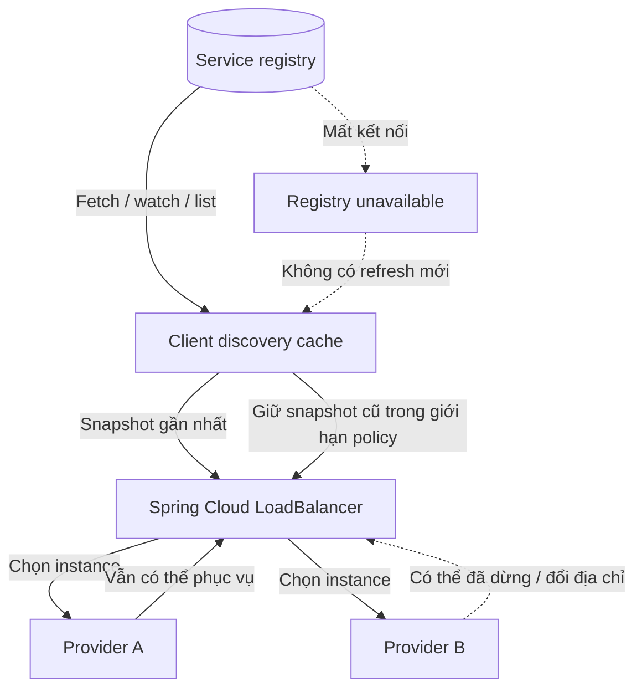
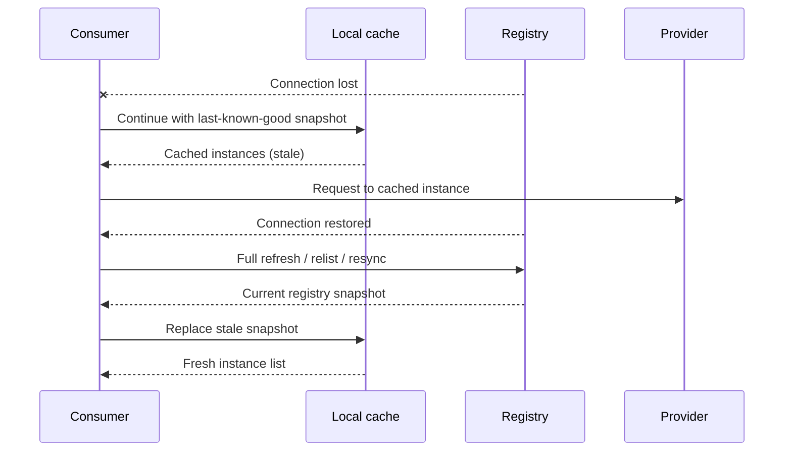

# Sổ đăng ký mất kết nối nhưng bộ đệm client vẫn còn

Khi Eureka, Consul, ZooKeeper hoặc Kubernetes API tạm thời không truy cập được, ứng dụng consumer có thể vẫn giữ danh sách service instance đã đọc trước đó trong bộ nhớ. Điều này giúp một số lời gọi liên service tiếp tục hoạt động trong thời gian registry gián đoạn. Tuy nhiên, danh sách đó chỉ là **snapshot gần nhất mà client biết**, không chứng minh các instance vẫn còn sống hoặc vẫn được phép nhận traffic.

Vấn đề cần giải quyết là cân bằng giữa tính sẵn sàng và độ mới của dữ liệu. Nếu luôn bỏ cache ngay khi registry mất kết nối, một sự cố control plane có thể làm gián đoạn cả data plane dù các provider vẫn đang chạy. Nếu dùng cache cũ vô thời hạn, consumer có thể gọi đến instance đã bị xóa, Pod đã terminate hoặc địa chỉ đã thay đổi. Vì vậy, cần có chính sách rõ ràng về stale data, giới hạn tuổi dữ liệu, hành vi khi khởi động chưa có cache và quy trình đối soát sau reconnect.

## 1. Cache client còn lại điều gì khi registry mất kết nối?

Service registry lưu thông tin về service và instance. Consumer thường không truy vấn registry cho từng request nghiệp vụ; thay vào đó, discovery client, informer, Curator recipe hoặc Spring Cloud LoadBalancer có thể giữ dữ liệu trong bộ nhớ và cập nhật theo chu kỳ hoặc sự kiện.

Khi kết nối registry bị gián đoạn, cache đã có trước đó có thể vẫn tồn tại:

- Service ID và danh sách instance đã quan sát.
- Hostname/IP và port được quảng bá.
- Metadata như zone, version hoặc environment.
- Trạng thái health gần nhất mà provider trả về.
- Thời điểm refresh thành công gần nhất, nếu ứng dụng có lưu.

Cache không tự biết những gì đã xảy ra sau lần đồng bộ cuối. Một instance có thể đã shutdown, bị deregister, chuyển zone hoặc bị thay thế nhưng consumer chưa nhận được cập nhật. Vì vậy, dữ liệu trong cache phải đi cùng thông tin về độ mới và trạng thái kết nối tới nguồn.



Registry outage và provider outage là hai sự cố khác nhau. Registry có thể không truy cập được trong khi các provider vẫn khỏe; ngược lại, registry có thể hoạt động bình thường nhưng một provider cụ thể đã chết. Consumer cần xử lý cả hai tình huống.

## 2. Phân biệt các lớp cache

Trong một ứng dụng Spring Cloud, dữ liệu instance có thể đi qua nhiều lớp. Không nên gọi chung tất cả là “registry cache” vì mỗi lớp có nguồn dữ liệu và vòng đời riêng.

| Lớp | Nội dung | Khi registry mất kết nối |
| --- | --- | --- |
| Provider registry/server | Bản ghi service và instance được lưu ở Eureka/Consul/ZooKeeper/Kubernetes | Có thể không nhận registration, health update hoặc truy vấn mới |
| Discovery client cache | Snapshot do Eureka client, Curator cache hoặc informer giữ | Có thể tiếp tục cung cấp snapshot cuối cùng tùy implementation |
| Spring Cloud LoadBalancer cache | Kết quả `ServiceInstanceListSupplier` được cache nếu có cấu hình cache | Có thể tiếp tục trả danh sách đã cache đến khi hết TTL/evict |
| DNS cache | Kết quả phân giải tên DNS | Có thể giữ địa chỉ theo TTL DNS/JVM/resolver |
| HTTP connection pool | TCP/TLS connection đến instance đã chọn | Có thể giữ connection idle đến địa chỉ cũ |

Các lớp này không thay thế nhau. Xóa một entry khỏi LoadBalancer cache không nhất thiết xóa dữ liệu trong Eureka client cache; registry refresh thành công cũng không nhất thiết đóng ngay connection cũ trong HTTP pool.

Khi điều tra, cần xác định request đang dùng danh sách instance từ lớp nào và connection đến địa chỉ nào. Nếu không, việc tăng TTL hoặc giảm fetch interval có thể không tác động đến lớp đang gây lỗi.

## 3. Stale data và độ tuổi của snapshot

Một snapshot có thể vẫn đúng ngay sau khi registry mất kết nối, nhưng xác suất lỗi tăng dần theo thời gian. Ví dụ, lần refresh thành công gần nhất cách đây 2 giây có thể đủ mới cho hệ thống có instance ổn định; snapshot 20 phút tuổi có thể chứa nhiều địa chỉ đã bị thay thế.

Nên theo dõi tối thiểu:

- `lastSuccessfulRefreshAt`: thời điểm đọc registry thành công gần nhất.
- `cacheAge`: thời gian từ lần refresh thành công đến hiện tại.
- `connectionState`: trạng thái kết nối với registry nếu provider cung cấp.
- `lastRefreshError`: lỗi gần nhất, được chuẩn hóa và làm sạch thông tin nhạy cảm.
- `instanceCount`: số instance trong snapshot.
- `snapshotVersion` hoặc revision/resource version nếu nguồn hỗ trợ.

Ví dụ snapshot ở tầng ứng dụng:

```java
import java.time.Instant;
import java.util.List;
import org.springframework.cloud.client.ServiceInstance;

public record DiscoverySnapshot(
        List<ServiceInstance> instances,
        Instant lastSuccessfulRefreshAt,
        boolean registryConnected,
        String revision
) {
    public DiscoverySnapshot {
        instances = List.copyOf(instances);
    }
}
```

`lastSuccessfulRefreshAt` phải chỉ cập nhật khi có lần đọc thành công. Không cập nhật timestamp này khi chỉ reconnect TCP hoặc khi một lần refresh thất bại; nếu cập nhật sai, dữ liệu cũ sẽ bị xem nhầm là mới.

Không phải provider nào cũng trả revision có ý nghĩa so sánh. Nếu không có revision, dùng timestamp refresh cục bộ và thông tin trạng thái kết nối; đừng tự tạo revision rồi coi đó là version của registry.

## 4. Chọn chính sách khi registry không truy cập được

Có ba hướng xử lý phổ biến. Chính sách phù hợp phụ thuộc mức độ quan trọng của request và mức rủi ro khi gọi nhầm instance.

| Chính sách | Hành vi | Ưu điểm | Rủi ro |
| --- | --- | --- | --- |
| Fail closed | Không chọn instance nếu không xác nhận được dữ liệu đủ mới | Tránh dùng địa chỉ cũ | Có thể ngừng gọi service dù provider vẫn khỏe |
| Bounded stale / fail open có giới hạn | Dùng snapshot gần nhất trong một khoảng stale tối đa | Giữ khả năng phục vụ khi control plane gián đoạn ngắn | Có thể gọi đến instance vừa bị xóa |
| Degraded mode | Tiếp tục một phần traffic hoặc chỉ cho phép operation an toàn theo policy | Kiểm soát được mức rủi ro theo nghiệp vụ | Cần thiết kế và kiểm thử phức tạp hơn |

Một policy thực tế thường là bounded stale: dùng last-known-good snapshot trong một thời gian ngắn, ghi nhận trạng thái degraded, sau đó fail closed khi vượt stale budget. Không nên dùng cache vô thời hạn chỉ vì muốn tăng availability.

### Ví dụ chọn policy theo nghiệp vụ

- Đọc catalog hoặc nội dung ít thay đổi có thể chấp nhận stale snapshot ngắn.
- Tra cứu tồn kho cần giới hạn stale age chặt hơn vì dữ liệu instance và trạng thái phục vụ có thể thay đổi nhanh.
- Thanh toán, cấp quyền hoặc thao tác có tác động tài chính cần timeout, idempotency và policy fail closed phù hợp; không được xem cache cũ là bằng chứng provider còn đủ điều kiện xử lý.
- Request đã có địa chỉ endpoint được xác thực và đang trong một workflow có thể tiếp tục theo policy riêng, nhưng không nên bỏ qua kiểm tra lỗi kết nối.

Chính sách stale discovery chỉ quyết định có cho phép chọn địa chỉ từ snapshot cũ hay không. Nó không biến response cũ thành dữ liệu nghiệp vụ mới nhất và không thay thế consistency của database.

## 5. Xử lý khi ứng dụng khởi động mà registry đang lỗi

Phải phân biệt hai trường hợp:

1. **Ứng dụng đã từng đồng bộ thành công:** có last-known-good snapshot để cân nhắc dùng trong stale budget.
2. **Ứng dụng khởi động mới, chưa có snapshot:** không có dữ liệu đáng tin cậy để chọn instance.

Không áp dụng stale-if-error cho trường hợp thứ hai bằng cách tạo danh sách instance giả hoặc dùng địa chỉ mặc định không được kiểm soát. Consumer nên chờ registry sẵn sàng, không Ready cho luồng phụ thuộc discovery, hoặc trả lỗi rõ ràng khi không có instance.

Nếu ứng dụng có thể phục vụ một số endpoint không phụ thuộc discovery, có thể cho process tiếp tục chạy nhưng readiness của capability gọi service phụ thuộc cần được quản lý riêng. Không nhất thiết phải restart toàn bộ process chỉ vì registry chưa sẵn sàng.

## 6. Chính sách TTL và stale budget

TTL của cache và stale budget là hai khái niệm khác nhau:

- **Cache TTL** quyết định khi nào entry cần được refresh hoặc evict trong cơ chế cache.
- **Stale budget** quyết định ứng dụng có còn được phép sử dụng snapshot cũ khi không refresh được hay không.

Ví dụ:

| Tham số | Giá trị minh họa | Ý nghĩa |
| --- | ---: | --- |
| Discovery refresh interval | 5 giây | Chu kỳ client thử lấy dữ liệu mới |
| LoadBalancer cache TTL | 10 giây | Thời gian giữ kết quả supplier trong cache |
| Maximum stale age | 30 giây | Quá tuổi này thì không dùng snapshot để chọn instance |
| Retry backoff | 1–10 giây có jitter | Khoảng chờ giữa các lần thử lại |

Các giá trị chỉ để minh họa. Stale budget cần được chọn dựa trên tốc độ thay đổi instance, lease/health propagation, SLA và khả năng xử lý lỗi của consumer. Nếu cache TTL là 10 giây nhưng provider cache bên dưới không refresh được trong 5 phút, stale age thực tế vẫn là 5 phút; không được lấy TTL lớp ngoài làm bằng chứng toàn bộ dữ liệu mới.

Không nên đặt TTL quá thấp khiến mỗi request lại gọi registry, cũng không nên đặt TTL quá cao để che giấu sự cố. Đo tỷ lệ cache hit, refresh success/failure và age của snapshot trước khi tuning.

## 7. Ví dụ giữ last-known-good snapshot

Đoạn code sau minh họa một cache ở tầng ứng dụng. Khi refresh thành công, thay snapshot bằng danh sách mới. Khi refresh lỗi tạm thời, giữ nguyên danh sách và timestamp cũ nhưng đánh dấu registry disconnected. Khi stale age vượt giới hạn, từ chối dùng snapshot.

```java
import java.time.Duration;
import java.time.Instant;
import java.util.List;
import java.util.concurrent.atomic.AtomicReference;
import org.springframework.cloud.client.ServiceInstance;

public class LastKnownGoodDiscoveryCache {

    public record Snapshot(
            List<ServiceInstance> instances,
            Instant lastSuccessfulRefreshAt,
            boolean registryConnected) {

        public Snapshot {
            instances = List.copyOf(instances);
        }
    }

    private final AtomicReference<Snapshot> current = new AtomicReference<>();

    public void refreshSucceeded(List<ServiceInstance> instances) {
        current.set(new Snapshot(instances, Instant.now(), true));
    }

    public void refreshFailed() {
        current.updateAndGet(previous -> {
            if (previous == null) {
                return null;
            }
            return new Snapshot(
                    previous.instances(),
                    previous.lastSuccessfulRefreshAt(),
                    false);
        });
    }

    public List<ServiceInstance> getUsableInstances(Duration maxStaleAge) {
        Snapshot snapshot = current.get();
        if (snapshot == null) {
            throw new IllegalStateException("No discovery snapshot is available");
        }

        Duration age = Duration.between(
                snapshot.lastSuccessfulRefreshAt(), Instant.now());
        if (age.compareTo(maxStaleAge) > 0) {
            throw new IllegalStateException("Discovery snapshot is too stale");
        }

        return snapshot.instances();
    }
}
```

`ServiceInstance` trong ví dụ là kiểu của Spring Cloud (`org.springframework.cloud.client.ServiceInstance`). Đây là ví dụ minh họa policy, không phải thay thế mặc định cho Eureka client, Consul client, Curator cache hoặc Spring Cloud LoadBalancer.

Có một điểm quan trọng: nếu lần refresh trả về danh sách rỗng một cách thành công, phải cập nhật cache thành danh sách rỗng. Không giữ danh sách cũ chỉ vì danh sách mới không có instance. Empty result có thể là trạng thái hợp lệ sau khi toàn bộ provider đã deregister. Chỉ dùng last-known-good khi thao tác refresh thực sự thất bại theo policy đã xác định.

Trong hệ thống thực tế, cần phân biệt lỗi transient như timeout/connection reset với lỗi cấu hình hoặc quyền truy cập như `401`, `403`, sai TLS trust. Không nên âm thầm dùng stale snapshot vô thời hạn khi token đã bị thu hồi hoặc cấu hình registry sai.

## 8. Cache và Spring Cloud LoadBalancer

Spring Cloud LoadBalancer lấy instance qua `ServiceInstanceListSupplier`. Supplier có thể lấy dữ liệu từ `DiscoveryClient`, delegate sang supplier khác, lọc theo zone/health hoặc cache danh sách.

Một số điểm cần chú ý:

- Nếu dùng supplier có cache, cache đó có thể giữ danh sách trong TTL của nó.
- Nếu discovery provider đã có local cache, LoadBalancer cache có thể tạo thêm một lớp stale.
- Nếu supplier trả danh sách rỗng rồi cache kết quả, service mới xuất hiện có thể chưa được nhìn thấy cho đến lần cache refresh tiếp theo.
- Nếu supplier không hỗ trợ stale-if-error, không được giả định LoadBalancer tự giữ last-known-good khi nguồn ném exception.
- `DiscoveryClient` là abstraction tra cứu; contract chung không quy định mọi implementation phải giữ cache khi registry mất kết nối.

Vì thế, cần kiểm tra đúng discovery implementation và supplier chain đang dùng. Đừng thêm một cache custom chỉ vì thấy registry outage; trước tiên xác định lớp nào đã cache dữ liệu và hành vi khi refresh lỗi.

### Tránh cache chồng lớp không kiểm soát

Ví dụ có thể tồn tại:

```text
Eureka local registry cache
       ↓
DiscoveryClient.getInstances()
       ↓
CachingServiceInstanceListSupplier
       ↓
Consumer request
```

Nếu mỗi lớp có TTL riêng, tuổi dữ liệu thực tế có thể lớn hơn TTL của từng lớp đơn lẻ. Cần đo `lastSuccessfulRefreshAt` ở nguồn dữ liệu thật, không chỉ đo thời gian entry nằm trong cache ngoài cùng.

## 9. Khác biệt theo từng registry

Hành vi cache khi registry mất kết nối phụ thuộc provider. Không nên áp dụng một giả định chung cho tất cả implementation.

| Provider | Nơi thường giữ dữ liệu client | Khi mất kết nối |
| --- | --- | --- |
| Eureka | Eureka client có local registry cache; có thể thêm LoadBalancer cache | Client có thể tiếp tục tra cứu snapshot đã fetch trước đó; độ mới phụ thuộc lần fetch thành công gần nhất và cache phía LoadBalancer |
| Consul | Discovery API/client query và có thể thêm LoadBalancer cache | Không mặc định mọi Consul DiscoveryClient giữ last-known-good; nếu có cache supplier thì hành vi phụ thuộc cache đó và lỗi truy vấn |
| ZooKeeper/Curator | `ServiceCache` hoặc `CuratorCache` giữ cây znode/snapshot | Có thể giữ snapshot trong thời gian `SUSPENDED`; sau `LOST` cần session mới và cache re-initialization/reconciliation |
| Kubernetes | Informer/cache hoặc discovery query tùy Spring Cloud Kubernetes mode | Informer có thể giữ trạng thái cuối trong lúc watch gián đoạn; cần quan sát cache sync và resource version khi reconnect |
| Kubernetes DNS | DNS resolver cache ở JVM/OS/CoreDNS path | Kết quả có thể tồn tại theo DNS TTL; đây là cache DNS, không phải cache `DiscoveryClient` |

### Eureka

Eureka client thường fetch registry về local cache và làm mới theo chu kỳ. Khi Eureka Server tạm thời không truy cập được, client có thể tiếp tục trả danh sách đã tải trước đó cho các lời gọi discovery. Consumer vì thế vẫn có thể gọi provider đang hoạt động dù control plane bị gián đoạn.

Tuy nhiên:

- Snapshot không chứa thay đổi mới kể từ lần fetch thành công cuối.
- Instance vừa deregister có thể vẫn xuất hiện trong cache.
- Instance mới đăng ký có thể chưa xuất hiện.
- Cache ở Spring Cloud LoadBalancer có thể làm tăng thêm độ trễ cập nhật.
- Khi client mới khởi động mà chưa fetch thành công, không có last-known-good snapshot để dùng.

Theo dõi fetch success/failure và registry refresh interval. Không nhầm heartbeat/lease của provider với lần fetch registry của consumer: provider có thể vẫn renew thành công ở một peer khác trong khi consumer không lấy được registry từ endpoint nó đang dùng.

### Consul

Consul có service catalog và health API. Spring Cloud Consul Discovery có thể truy vấn Consul agent/server để lấy danh sách instance và health; Spring Cloud LoadBalancer có thể cache danh sách supplier nếu được cấu hình.

Khi Consul API mất kết nối, hành vi phụ thuộc vào lớp đang giữ dữ liệu:

- Nếu chỉ dùng query trực tiếp và không có cache phù hợp, truy vấn mới có thể thất bại.
- Nếu LoadBalancer supplier có cache, danh sách đã cache có thể còn dùng đến khi hết TTL hoặc bị evict.
- Consul agent local có thể vẫn hoạt động khi một server phía sau gặp sự cố, tùy topology và trạng thái agent.

Không mặc định Consul DiscoveryClient giữ snapshot cuối giống Eureka. Hãy kiểm tra query path, `query-passing`, agent/server endpoint và supplier chain của phiên bản Spring Cloud đang dùng.

### ZooKeeper và Curator

Curator `ServiceCache` hoặc `CuratorCache` có thể giữ dữ liệu đã quan sát trong bộ nhớ khi connection state chuyển sang `SUSPENDED`. Consumer có thể đọc snapshot đó nhưng phải đánh dấu stale vì watch không cập nhật được.

Khi `RECONNECTED`, cache recipe cần tiếp tục theo dõi và đối soát trạng thái hiện tại. Khi `LOST`, ZooKeeper session đã hết hạn; ephemeral znode của provider gắn với session cũ bị xóa. Provider cần đăng ký lại bằng session mới, còn consumer cần chờ cache khởi tạo/đồng bộ lại trước khi coi snapshot là fresh.

Không replay một event giả định rằng mọi watch event trong thời gian mất kết nối đều được giao đầy đủ. Hãy đọc lại trạng thái hiện tại hoặc dựa vào cache recipe đã quản lý việc đồng bộ.

### Kubernetes

Spring Cloud Kubernetes có thể dùng Kubernetes API, informer hoặc cơ chế discovery khác tùy cấu hình và phiên bản. Với informer, local cache được cập nhật qua list/watch. Khi watch bị gián đoạn, cache có thể vẫn giữ trạng thái cuối trong khi không nhận thay đổi mới; sau reconnect cần đảm bảo watch được thiết lập lại và cache sync/reconciliation hoàn tất.

Lỗi API server, RBAC `403`, throttling hoặc watch expiration không giống nhau. `403` không phải lỗi transient để retry mãi; cần sửa quyền ServiceAccount. Resource version cũ có thể khiến client phải relist và đồng bộ lại.

Nếu chỉ gọi Kubernetes Service bằng DNS, hành vi có thể đi qua CoreDNS và cache DNS thay vì Spring Cloud DiscoveryClient. Cần xác định rõ ứng dụng đang dùng DNS, Service/EndpointSlice API hay informer cache.

## 10. Đọc cache cũ có nghĩa là chấp nhận rủi ro gì?

Khi dùng stale snapshot, consumer có thể gặp một số tình huống:

1. **Instance vẫn sống:** request tiếp tục thành công dù registry không truy cập được.
2. **Instance đã dừng:** request gặp connection refused, reset hoặc timeout.
3. **Instance đã bị thay thế:** địa chỉ cũ không còn route đến Pod mới.
4. **Instance mới chưa được biết:** tải bị dồn vào các instance cũ còn trong cache.
5. **Metadata đã thay đổi:** consumer chọn sai zone/version hoặc bỏ qua capability mới.
6. **Tất cả instance đã bị deregister:** cache cũ vẫn có địa chỉ nhưng không còn provider hợp lệ.

Do đó, stale discovery chỉ giúp duy trì khả năng tìm địa chỉ trong thời gian ngắn. Nó không bảo đảm request thành công và không thay thế timeout, circuit breaker, health check hoặc retry có điều kiện.

## 11. Chọn instance khi snapshot đang stale

Khi cache được đánh dấu stale nhưng vẫn nằm trong stale budget, LoadBalancer có thể tiếp tục chọn instance theo policy. Nên bổ sung các nguyên tắc:

- Không chọn instance có địa chỉ/port không hợp lệ hoặc metadata bắt buộc bị thiếu.
- Ưu tiên instance có lần health/validation gần nhất còn trong giới hạn nếu có nguồn tín hiệu độc lập.
- Giới hạn retry và chỉ retry sang instance khác cho request idempotent hoặc có idempotency key.
- Nếu một instance liên tục lỗi kết nối, dùng circuit breaker hoặc cơ chế loại tạm thời tại consumer; không tự sửa registry khi không có quyền sở hữu registration.
- Khi stale budget hết hạn, trả lỗi có kiểm soát như `503 Service Unavailable` thay vì tiếp tục chọn endpoint cũ vô thời hạn.

Tránh health-check từng instance quá dày từ mọi consumer khi registry đang lỗi; điều đó có thể tạo một đợt probe storm. Nếu cần active health probing, dùng sampling, giới hạn concurrency và cache kết quả.

## 12. Reconnect và reconciliation sau khi registry phục hồi

Kết nối TCP trở lại không đồng nghĩa cache đã đồng bộ. Sau reconnect cần thực hiện hoặc chờ các bước sau:

1. Xác nhận client đã kết nối lại đúng registry endpoint/cluster.
2. Thực hiện full refresh, relist hoặc re-establish watch theo provider.
3. Đọc trạng thái registry hiện tại và thay snapshot cũ bằng snapshot mới sau khi đồng bộ thành công.
4. Xác định instance nào đã thêm, xóa, đổi địa chỉ hoặc đổi metadata.
5. Xử lý registration của chính ứng dụng nếu session/lease cũ đã mất.
6. Cập nhật cache LoadBalancer hoặc phát tín hiệu để supplier làm mới.
7. Chỉ đánh dấu cache fresh sau khi có bằng chứng đồng bộ thành công.

Với provider dùng event/watch, hãy dùng event làm tín hiệu để đọc lại trạng thái nếu semantics không bảo đảm event log đầy đủ. Full snapshot sau reconnect giúp tránh bỏ sót thay đổi trong khoảng mất kết nối.



Không xóa snapshot cũ trước khi có snapshot mới hợp lệ nếu policy cho phép last-known-good. Ngược lại, nếu refresh thành công và trả về danh sách rỗng, phải thay cache bằng danh sách rỗng; đây là trạng thái mới đã được xác nhận.

## 13. Retry và backoff khi registry unavailable

Nhiều replica cùng retry registry theo một chu kỳ cố định có thể tạo thundering herd khi registry phục hồi. Nên dùng exponential backoff có jitter và giới hạn số request đồng thời.

Ví dụ lịch retry minh họa:

| Lần thử | Delay cơ sở | Delay sau jitter (ví dụ) |
| ---: | ---: | ---: |
| 1 | 500 ms | 430 ms |
| 2 | 1 giây | 1.180 ms |
| 3 | 2 giây | 1.760 ms |
| 4 | 4 giây | 3.520 ms |
| 5 | 8 giây | 7.300 ms |

Các delay chỉ là ví dụ. Cần có cap tối đa, deadline và phân loại lỗi:

- Timeout, connection reset, server unavailable: thường có thể retry.
- `401`/`403`: kiểm tra credential/ACL; không retry vô hạn.
- TLS certificate invalid hoặc hostname mismatch: sửa cấu hình trust/certificate.
- Sai service ID, namespace hoặc endpoint: lỗi cấu hình cần xử lý.
- Rate limit/throttling: tuân thủ `Retry-After` hoặc policy của provider nếu có.

Không retry mỗi request nghiệp vụ bằng cách gọi registry lại khi registry đang lỗi. Tách retry của control-plane refresh khỏi retry của data-plane HTTP call. Hai vòng retry cần giới hạn độc lập để không khuếch đại tải.

## 14. Readiness và health trong thời gian registry outage

Không nên tự động đánh dấu toàn bộ consumer NotReady chỉ vì registry tạm thời mất kết nối nếu consumer còn snapshot trong stale budget và vẫn có thể phục vụ request an toàn.

Một policy có thể là:

| Trạng thái | Readiness gợi ý | Hành vi gọi downstream |
| --- | --- | --- |
| Registry connected, cache fresh | Ready | Chọn instance bình thường |
| Registry disconnected, cache còn mới | Ready hoặc degraded theo SLA | Dùng snapshot với cảnh báo |
| Registry disconnected, cache stale nhưng trong budget | Degraded; có thể vẫn Ready nếu nghiệp vụ cho phép | Dùng stale snapshot, timeout ngắn và retry có giới hạn |
| Stale age vượt budget | NotReady cho capability phụ thuộc discovery hoặc fail request có kiểm soát | Không chọn instance cũ |
| Chưa từng có snapshot | NotReady cho capability phụ thuộc discovery | Chờ registry hoặc trả lỗi rõ ràng |
| Reconnect nhưng chưa reconcile | Degraded | Tiếp tục policy stale cũ đến khi full refresh thành công |

Readiness của một consumer không nhất thiết phản ánh khả năng gọi mọi dependency. Nếu chỉ một luồng nghiệp vụ phụ thuộc service discovery, có thể quản lý capability đó riêng thay vì làm mất toàn bộ traffic đến ứng dụng.

## 15. Observability cho stale cache

Log, metric và alert cần cho biết cache có đang được dùng trong trạng thái stale hay không.

Các metric gợi ý:

| Metric | Ý nghĩa |
| --- | --- |
| `discovery_refresh_success_total` | Số lần refresh thành công |
| `discovery_refresh_failure_total` | Số lần refresh thất bại theo provider/error category |
| `discovery_cache_age_seconds` | Tuổi snapshot kể từ lần refresh thành công gần nhất |
| `discovery_stale_reads_total` | Số lần request dùng snapshot stale |
| `discovery_snapshot_instance_count` | Số instance trong snapshot hiện tại |
| `discovery_reconciliation_duration_seconds` | Thời gian đồng bộ lại sau reconnect |
| `discovery_reconnect_total` | Số lần kết nối lại |
| `loadbalancer_no_instance_total` | Số lần không tìm được instance phù hợp |
| `discovery_last_success_timestamp_seconds` | Timestamp lần refresh thành công gần nhất |

Log chuyển trạng thái nên có `service.name`, `service.instance.id`, `discovery.provider`, `registry.endpoint` đã làm sạch, `connection.state`, `cache.age.ms`, `instance.count`, `operation.id` và `error.type`.

Ví dụ log stale cache:

```json
{
  "event.name": "discovery.cache.stale_in_use",
  "service.name": "checkout-service",
  "discovery.provider": "eureka",
  "cache.age.ms": 8500,
  "cache.max.stale.ms": 30000,
  "instance.count": 4,
  "connection.state": "DISCONNECTED",
  "policy": "BOUNDED_STALE"
}
```

Alert nên dựa trên stale age, tỷ lệ refresh thất bại và số lần stale read, không chỉ dựa trên một lần registry timeout. Tránh gắn instance ID hoặc endpoint động làm metric label có cardinality cao; chi tiết này phù hợp với log.

## 16. Xử lý HTTP connection pool khi instance đã cũ

Discovery cache và HTTP connection pool là hai lớp riêng. Khi instance bị remove khỏi registry, connection pool có thể vẫn giữ connection idle đến địa chỉ đó. Điều này không có nghĩa LoadBalancer vẫn chọn instance; có thể request đang dùng một connection được giữ từ trước hoặc cache khác chưa cập nhật.

Nên:

- Giới hạn `maxIdleTime` và `maxLifeTime` của connection theo idle timeout của upstream/proxy.
- Đóng/evict connection lỗi theo cơ chế HTTP client.
- Đặt connect/response timeout để request không chờ vô hạn khi endpoint cũ không còn hoạt động.
- Chỉ retry sang instance khác khi operation an toàn.
- Quan sát lỗi connection reset/refused cùng instance ID và cache age.

Không xóa toàn bộ connection pool chỉ vì registry mất kết nối; các connection đang hoạt động đến provider khỏe có thể vẫn dùng được. Việc đóng pool đồng loạt có thể tạo TCP/TLS handshake storm khi hệ thống phục hồi.

## 17. Những lỗi thiết kế thường gặp

| Cách làm | Hậu quả | Cách cải thiện |
| --- | --- | --- |
| Giả định `DiscoveryClient` luôn giữ cache khi registry lỗi | Mỗi provider có semantics khác nhau; có thể nhận exception hoặc danh sách rỗng | Kiểm tra implementation và supplier chain thực tế |
| Dùng cache stale vô thời hạn | Gọi instance đã bị xóa hoặc thay địa chỉ | Đặt maximum stale age và fail closed khi hết budget |
| Xóa cache ngay khi mất kết nối | Mất khả năng gọi provider còn khỏe trong outage ngắn | Dùng bounded stale nếu nghiệp vụ cho phép |
| Coi cache rỗng là lỗi refresh | Có thể giữ instance đã deregister dù registry trả empty thành công | Phân biệt empty success với refresh failure |
| Cập nhật `lastSuccess` khi reconnect socket | Snapshot cũ bị đánh dấu nhầm là fresh | Chỉ cập nhật sau full refresh/reconciliation thành công |
| Cache nhiều lớp với TTL không rõ | Stale age thực tế vượt dự kiến | Đo timestamp từ lần fetch nguồn thành công và tài liệu hóa TTL từng lớp |
| Retry mọi lỗi registry vô hạn | Log storm và tải tăng khi registry phục hồi | Phân loại lỗi, backoff/jitter, cap và alert |
| Đánh dấu consumer NotReady ngay khi registry lỗi | Control-plane outage lan sang data plane | Dựa trên stale budget và khả năng phục vụ thực tế |
| Retry mọi request ghi sang instance khác | Giao dịch có thể bị thực hiện trùng | Dùng idempotency key và retry có điều kiện |
| Reconnect xong lập tức báo healthy | Cache/watch/registration có thể chưa đồng bộ | Chỉ báo recovered sau reconciliation |

## 18. Kịch bản kiểm thử phục hồi

Nên kiểm thử cả tình huống có cache và chưa có cache:

1. Khởi động registry và provider; consumer fetch được snapshot ban đầu.
2. Xác nhận `lastSuccessfulRefreshAt` và instance count được ghi nhận.
3. Ngắt kết nối consumer đến registry nhưng giữ provider hoạt động.
4. Gửi request trong stale budget; xác nhận consumer dùng snapshot cũ và ghi nhận stale read.
5. Dừng một provider trong thời gian registry outage; xác nhận request đến instance đó thất bại có timeout và retry an toàn nếu được cấu hình.
6. Để outage kéo dài vượt maximum stale age; xác nhận consumer ngừng chọn snapshot cũ.
7. Khôi phục registry; xác nhận full refresh/relist/watch resync thành công và snapshot được thay thế.
8. Xác nhận instance đã dừng bị loại và instance mới được thêm.
9. Kiểm thử refresh trả danh sách rỗng thành công; cache phải trở thành rỗng.
10. Khởi động consumer mới trong lúc registry unavailable; xác nhận không có snapshot giả và readiness/error phản ánh đúng trạng thái.
11. Kiểm thử `401`/`403` hoặc TLS lỗi; xác nhận không bị xử lý như lỗi mạng transient thông thường.
12. Với ZooKeeper, mô phỏng `SUSPENDED` và `LOST`; với Kubernetes informer, mô phỏng watch reconnect/resource version relist.

Kiểm thử nên xác minh cả kết quả HTTP, nội dung cache, metric age, event log và thời điểm readiness thay đổi. Chỉ thấy client reconnect thành công là chưa đủ.

## 19. Runbook khi registry mất kết nối

Khi alert báo registry unavailable, có thể xử lý theo trình tự:

1. Xác định provider, endpoint/cluster và phạm vi ảnh hưởng: một consumer, một node hay toàn bộ registry.
2. Kiểm tra connection state, lỗi DNS/TCP/TLS/ACL và thời điểm refresh thành công gần nhất.
3. Xem `cache.age`, instance count và stale budget còn lại.
4. Xác định consumer đang dùng Eureka local cache, Consul query/cache supplier, Curator cache, Kubernetes informer hay DNS.
5. Kiểm tra các provider endpoint còn truy cập được từ consumer; không kết luận mọi provider chết chỉ từ registry outage.
6. Nếu stale age còn trong budget, duy trì policy bounded stale và theo dõi lỗi request theo instance.
7. Nếu vượt budget, chuyển sang fail-closed/degraded behavior đã định nghĩa; không tăng TTL tùy tiện trong sự cố.
8. Khôi phục registry, kiểm tra quyền truy cập và full reconciliation.
9. Xác nhận cache fresh, instance count hợp lý và các endpoint cũ đã bị loại.
10. Sau sự cố, điều chỉnh refresh/backoff/TTL dựa trên dữ liệu thực tế.

Không sửa registry bằng tay hoặc xóa cache trên diện rộng khi chưa xác định nguồn dữ liệu và ownership. Một thao tác dọn registry sai có thể xóa registration hợp lệ của provider đang hoạt động.

## 20. Checklist triển khai

- [ ] Biết chính xác lớp nào đang cache danh sách instance.
- [ ] Có timestamp lần refresh thành công gần nhất.
- [ ] Phân biệt refresh failure với refresh thành công trả danh sách rỗng.
- [ ] Có maximum stale age phù hợp với SLA và tốc độ thay đổi instance.
- [ ] Có hành vi riêng cho ứng dụng đã có cache và ứng dụng khởi động chưa có cache.
- [ ] Chọn fail-open bounded, fail-closed hoặc degraded mode theo nghiệp vụ.
- [ ] Không giả định mọi `DiscoveryClient` giữ last-known-good khi registry lỗi.
- [ ] Kiểm tra cache chồng lớp giữa provider client và LoadBalancer supplier.
- [ ] Reconnect đi kèm full refresh/relist/reconciliation trước khi báo fresh.
- [ ] Xử lý registration/session riêng nếu provider dùng lease hoặc ephemeral node.
- [ ] Retry có phân loại lỗi, backoff, jitter, cap và concurrency limit.
- [ ] HTTP timeout/circuit breaker bảo vệ request khi endpoint trong cache đã stale.
- [ ] Theo dõi cache age, refresh failures, stale reads và no-instance events.
- [ ] Kiểm thử outage ngắn, outage kéo dài, empty result, reconnect và consumer cold start.

Khi registry mất kết nối, cache client có thể giúp data plane tiếp tục hoạt động trong thời gian ngắn, nhưng snapshot chỉ phản ánh trạng thái cuối cùng đã quan sát. Thiết kế an toàn cần biết cache nằm ở đâu, đo tuổi dữ liệu, giới hạn stale budget, phân biệt empty result với lỗi refresh và đồng bộ lại toàn bộ trạng thái sau reconnect. Với policy bounded stale, consumer có thể giữ khả năng phục vụ khi control plane gián đoạn ngắn mà vẫn dừng sử dụng địa chỉ cũ khi dữ liệu vượt giới hạn tin cậy.
