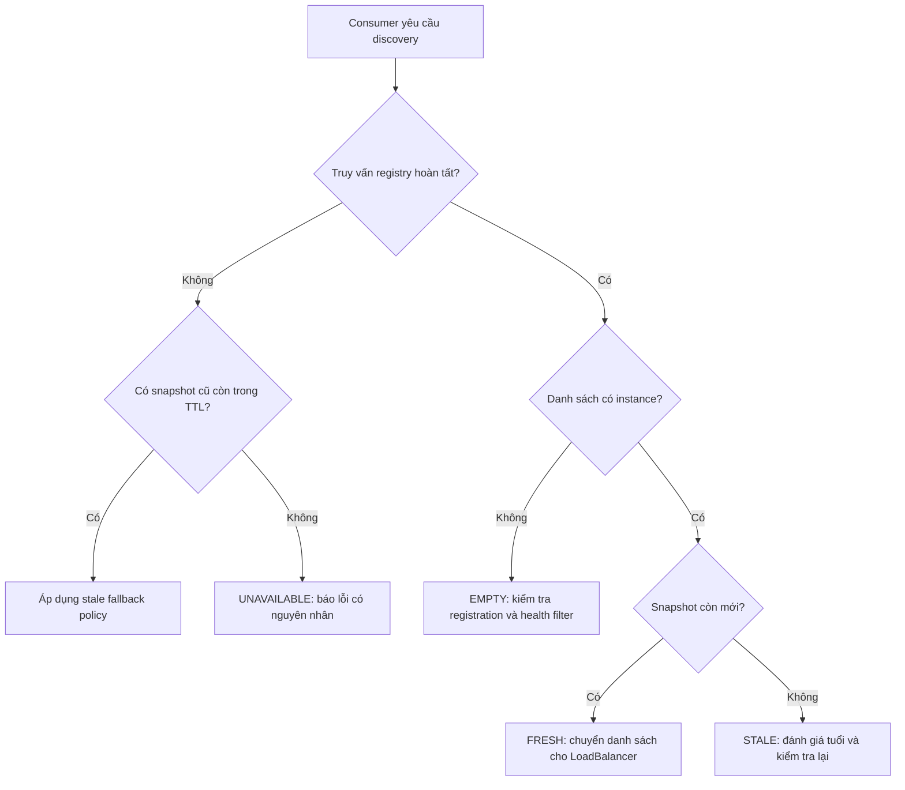

# Phân biệt danh sách rỗng, dữ liệu cũ và lỗi kết nối

Khi một consumer gọi `DiscoveryClient.getInstances("order-service")`, kết quả có thể là một danh sách instance, danh sách rỗng hoặc một exception. Ba tình huống này không mang cùng ý nghĩa. Danh sách rỗng có thể là kết quả hợp lệ khi chưa có instance nào đăng ký hoặc tất cả instance bị lọc theo health; dữ liệu cũ có thể vẫn chứa địa chỉ của instance đã dừng hoặc chưa thấy instance mới; lỗi kết nối có nghĩa consumer không lấy được một kết quả đáng tin cậy từ registry.

Nếu ứng dụng gộp cả ba tình huống thành “không tìm thấy service”, nó dễ retry sai cách, gọi vào endpoint đã chết hoặc báo outage nhầm khi registry chỉ tạm thời không truy cập được. Bài học này xây dựng cách phân loại kết quả discovery, nhận biết dữ liệu stale, chẩn đoán Eureka/Consul/Kubernetes và thiết kế retry/fallback có giới hạn để phục hồi an toàn.

## 1. Ba kết quả discovery cần phân biệt

### 1.1. Danh sách rỗng: truy vấn thành công nhưng không có instance phù hợp

Danh sách rỗng (`[]`) có nghĩa lớp discovery đã trả về một kết quả không có instance phù hợp. Đây không tự động là lỗi kết nối. Các nguyên nhân thường gặp:

- Provider chưa đăng ký hoặc đã deregister.
- Service ID sai chữ hoa/thường, sai tên hoặc sai namespace.
- Tất cả instance đang không Ready, `warning`/`critical`, hoặc `OUT_OF_SERVICE`.
- Consumer bật lọc health như Consul `?passing`, nên các instance chưa đạt điều kiện bị loại.
- Kubernetes Service không có EndpointSlice endpoint Ready do selector/label sai hoặc Pod chưa Ready.
- Ứng dụng dùng `SimpleDiscoveryClient` nhưng service ID chưa được khai báo trong `simple.instances`.
- Consumer vừa khởi động và truy vấn trước khi provider hoàn tất registration.

Danh sách rỗng là một **kết quả**, không phải bằng chứng registry đang hỏng. Hãy kiểm tra truy vấn có thành công, dữ liệu có mới hay không, và có lý do hợp lệ khiến không instance nào được chọn.

### 1.2. Dữ liệu cũ (stale): có kết quả nhưng không phản ánh trạng thái hiện tại

Dữ liệu stale là snapshot registry hoặc cache đã cũ hơn giới hạn chấp nhận của hệ thống. Nó có thể chứa:

- **Stale-positive:** instance đã dừng hoặc bị deregister nhưng vẫn xuất hiện trong danh sách.
- **Stale-negative:** instance mới đã đăng ký và khỏe nhưng snapshot chưa cập nhật nên consumer chưa nhìn thấy.

Stale-positive có thể làm request đi tới host/port không còn hoạt động. Stale-negative có thể làm giảm capacity hoặc khiến truy vấn trả danh sách rỗng dù provider đã sẵn sàng.

Nguồn stale thường nằm ở registry peer/follower, client-side registry cache, Spring Cloud LoadBalancer cache, DNS cache, proxy hoặc cache riêng của ứng dụng. Một truy vấn trả về danh sách không rỗng chưa chứng minh rằng các instance trong danh sách còn sống; cần biết thời điểm snapshot được cập nhật thành công và cơ chế health check.

### 1.3. Lỗi kết nối: không lấy được kết quả đáng tin cậy

Lỗi kết nối xảy ra khi consumer không thể hoàn tất truy vấn discovery. Ví dụ:

- DNS không phân giải được hostname registry.
- TCP connection refused, timeout hoặc route/firewall chặn.
- TLS handshake/certificate lỗi.
- Registry trả `401`/`403` do thiếu hoặc sai credential/ACL.
- Registry trả `429`, `5xx` hoặc đóng kết nối.
- Eureka/Consul server hoặc Kubernetes API không khả dụng.

Trong trường hợp này, consumer không biết registry hiện có bao nhiêu instance khỏe. Không được tự đổi lỗi kết nối thành danh sách rỗng vì điều đó làm mất thông tin nguyên nhân và có thể khiến ứng dụng đưa ra quyết định sai.

## 2. Bảng so sánh và cách xử lý ban đầu

| Tình huống | Có truy vấn thành công? | Dữ liệu trả về | Cách hiểu | Hành động ban đầu |
| --- | --- | --- | --- | --- |
| Empty result | Có | Danh sách `[]` | Không có instance phù hợp tại snapshot vừa đọc | Kiểm tra service ID, namespace, health filter, registration và desired replicas. |
| Fresh non-empty | Có | Danh sách instance mới | Có ứng viên discovery theo snapshot hiện tại | LoadBalancer chọn instance; request vẫn cần timeout/health handling. |
| Stale non-empty | Có thể có hoặc không ở lần refresh mới nhất | Snapshot cũ còn instance | Registry/cache chưa hội tụ hoặc refresh đang lỗi | Kiểm tra tuổi snapshot; chỉ fallback trong giới hạn TTL và policy. |
| Stale empty | Có thể có hoặc không ở lần refresh mới nhất | Snapshot cũ vẫn rỗng | Có thể provider mới đăng ký nhưng cache chưa cập nhật | Refresh có kiểm soát; không kết luận provider không tồn tại. |
| Connection failure | Không | Exception/status lỗi; không có kết quả mới | Không thể xác minh registry ở thời điểm hiện tại | Phân loại lỗi, retry có giới hạn hoặc dùng snapshot cũ theo policy. |
| Authentication/authorization failure | Request tới được endpoint nhưng bị từ chối | `401`/`403` | Cấu hình danh tính/quyền không hợp lệ | Sửa credential/ACL; không retry liên tục như lỗi mạng. |



Điểm quan trọng là phải lưu trạng thái và thời điểm của lần truy vấn thành công gần nhất. Chỉ nhìn vào `List<ServiceInstance>` sẽ không đủ để phân biệt snapshot rỗng mới, snapshot rỗng cũ và lỗi truy vấn hiện tại.

## 3. Phân loại từ DiscoveryClient trong Spring Cloud

API đồng bộ cơ bản:

```java
List<ServiceInstance> instances = discoveryClient.getInstances("order-service");
```

Kết quả thông thường là:

- Danh sách có phần tử: discovery implementation đã cung cấp các instance.
- Danh sách rỗng: không có instance được trả về cho service ID đó.
- Runtime exception: implementation không thể hoàn thành thao tác theo cách của nó; cần xem exception và nguyên nhân gốc.

Không nên viết code biến exception thành list rỗng:

```java
// Không nên: che mất lỗi kết nối, TLS hoặc ACL.
try {
    return discoveryClient.getInstances(serviceId);
} catch (RuntimeException ex) {
    log.warn("Discovery failed", ex);
    return List.of();
}
```

Khi làm vậy, caller không thể biết registry thực sự trả empty hay request đã thất bại. Metric empty-result cũng bị tăng sai, làm cảnh báo availability khó tin cậy.

### 3.1. Trả kết quả có trạng thái và thời điểm quan sát

Ở lớp adapter của ứng dụng, có thể bọc kết quả discovery thành một kiểu dữ liệu rõ nghĩa:

```java
import java.time.Instant;
import java.util.List;

import org.springframework.cloud.client.ServiceInstance;

public record DiscoverySnapshot(
        String serviceId,
        List<ServiceInstance> instances,
        Instant observedAt,
        Instant attemptedAt,
        boolean refreshSucceeded,
        String failureReason) {

    public boolean isEmpty() {
        return refreshSucceeded && instances.isEmpty();
    }

    public boolean isUnavailable() {
        return !refreshSucceeded;
    }
}
```

Adapter thực hiện truy vấn và chỉ đánh dấu `refreshSucceeded=true` khi thao tác hoàn tất:

```java
import java.time.Instant;
import java.util.List;

import org.springframework.cloud.client.ServiceInstance;
import org.springframework.cloud.client.discovery.DiscoveryClient;
import org.springframework.stereotype.Component;

@Component
public class DiscoveryLookup {

    private final DiscoveryClient discoveryClient;

    public DiscoveryLookup(DiscoveryClient discoveryClient) {
        this.discoveryClient = discoveryClient;
    }

    public DiscoverySnapshot lookup(String serviceId) {
        try {
            List<ServiceInstance> instances =
                    List.copyOf(discoveryClient.getInstances(serviceId));

            return new DiscoverySnapshot(
                    serviceId,
                    instances,
                    Instant.now(),
                    Instant.now(),
                    true,
                    null
            );
        } catch (RuntimeException ex) {
            return new DiscoverySnapshot(
                    serviceId,
                    List.of(),
                    null,
                    Instant.now(),
                    false,
                    ex.getClass().getSimpleName()
            );
        }
    }
}
```

Đây là ví dụ phân loại ở tầng ứng dụng. `observedAt` là thời điểm có snapshot mới đọc được; khi truy vấn thất bại, trường này là `null`, còn `attemptedAt` ghi thời điểm lần thử. Snapshot thành công trước đó phải được lưu riêng để stale fallback có thể kiểm tra tuổi của nó. Tùy implementation, một số client có thể đọc local cache và không ném exception ngay cả khi lần refresh nền gần nhất thất bại. Vì vậy `refreshSucceeded` trong adapter chỉ mô tả lần gọi API local vừa thực hiện; muốn biết dữ liệu registry có mới hay không, cần theo dõi trạng thái refresh, timestamp hoặc health của client/observer riêng.

Không trả `failureReason` chứa nguyên văn URL có credential, token, header hoặc response body nhạy cảm. Ghi mã lỗi đã chuẩn hóa và exception type đã làm sạch.

### 3.2. Empty không đồng nghĩa lỗi HTTP 404

Discovery API có thể trả empty list khi service chưa tồn tại hoặc không có instance phù hợp. HTTP endpoint của registry có thể biểu diễn trường hợp này bằng response `200` với mảng rỗng hoặc cấu trúc không có instance, tùy API. `404` có thể mang nghĩa resource/path/service không tồn tại theo contract riêng của endpoint. Hãy dựa vào API cụ thể thay vì coi mọi response không có instance là cùng một trạng thái.

## 4. Nhận biết dữ liệu stale

### 4.1. Theo dõi thời điểm refresh thành công

Một snapshot cần ít nhất:

- `observedAt`: thời điểm lấy dữ liệu thành công gần nhất.
- `source`: registry/cluster/namespace tạo ra dữ liệu.
- `age`: thời gian từ `observedAt` đến hiện tại.
- `refreshStatus`: lần refresh gần nhất thành công hay thất bại.
- `instances`: danh sách được trả về từ snapshot đó.

Ví dụ chính sách tuổi dữ liệu:

| Tuổi snapshot | Trạng thái | Hành động gợi ý |
| --- | --- | --- |
| Trong freshness TTL | Fresh | Dùng snapshot theo health và LoadBalancer policy. |
| Vượt freshness TTL nhưng còn trong stale TTL | Stale-eligible | Có thể dùng tạm nếu policy cho phép, đồng thời refresh và phát metric stale. |
| Vượt stale TTL | Expired | Không dùng snapshot làm bằng chứng endpoint còn khả dụng; trả unavailable hoặc fallback theo thiết kế nghiệp vụ riêng. |

Ví dụ: service đặt freshness TTL 15 giây và stale TTL 60 giây. Snapshot 8 giây tuổi được xem là fresh; snapshot 35 giây tuổi chỉ được dùng theo stale fallback policy; snapshot 90 giây tuổi đã hết hạn. Các giá trị này chỉ minh họa, cần điều chỉnh theo registry refresh interval, LoadBalancer cache, health check và yêu cầu latency.

### 4.2. Những lớp cache có thể tạo stale data

| Lớp | Ví dụ | Dấu hiệu |
| --- | --- | --- |
| Registry server/peer | Eureka peer replication, Consul server/follower hoặc cache | Các node registry trả tập instance khác nhau trong một khoảng thời gian. |
| Discovery client | Eureka client registry cache, Consul client/cache | Lần gọi local trả snapshot cũ dù server đã có thay đổi. |
| Spring Cloud LoadBalancer | Cache của `ServiceInstanceListSupplier` | DiscoveryClient đã cập nhật nhưng danh sách LoadBalancer vẫn cũ. |
| DNS | TTL record, local resolver cache | Tên service phân giải ra IP cũ sau khi endpoint thay đổi. |
| Ứng dụng/proxy | Cache riêng, connection pool, keep-alive | Request tiếp tục đi qua kết nối hoặc snapshot cũ sau deregistration. |

Đừng cộng các TTL một cách máy móc. Các lớp cache có thể chạy song song, refresh lệch thời điểm hoặc giữ connection cũ. Hãy đo tổng thời gian từ lúc registration/health thay đổi tới lúc consumer không còn chọn instance đó.

### 4.3. Stale-positive và stale-negative

Ví dụ stale-positive:

```text
T0: order-a và order-b đang khỏe
T1: order-b bị dừng
T2: registry đã đánh dấu order-b critical/deregister
T3: consumer vẫn có cache cũ chứa order-b
T4: request được chọn tới order-b và thất bại
```

Ví dụ stale-negative:

```text
T0: registry chưa có payment-c
T1: payment-c khởi động và đăng ký thành công
T2: registry đã thấy payment-c
T3: consumer vẫn dùng snapshot cũ rỗng
T4: lookup tiếp tục trả empty cho đến khi refresh/cache hết hạn
```

Stale-positive gây request tới instance chết; stale-negative gây giảm capacity hoặc báo service unavailable nhầm. Cả hai đều cần theo dõi freshness chứ không chỉ theo dõi số lượng instance.

## 5. Nhận biết lỗi kết nối và phân loại lỗi có thể retry

Không phải mọi lỗi đều nên retry. Phân loại ban đầu:

| Lỗi | Ví dụ | Retry? | Hướng xử lý |
| --- | --- | --- | --- |
| DNS/network transient | Temporary failure, timeout, connection reset | Có giới hạn | Exponential backoff + jitter, kiểm tra DNS/route. |
| Registry unavailable | HTTP `502`/`503`/`504`, server restart | Có giới hạn | Retry có deadline; dùng stale snapshot nếu policy cho phép. |
| Rate limit | HTTP `429` | Có điều kiện | Tôn trọng `Retry-After`, giảm tốc độ truy vấn. |
| Authentication | HTTP `401` | Không retry liên tục | Kiểm tra token/credential và rotation. |
| Authorization | HTTP `403` | Không retry liên tục | Sửa ACL/RBAC/policy. |
| TLS/certificate | Expired certificate, hostname mismatch, trust failure | Không retry mù | Sửa certificate, truststore hoặc hostname. |
| Sai endpoint/config | HTTP `404`, sai port/path/region | Không retry mù | Kiểm tra URL và cấu hình. |
| Empty result hợp lệ | Truy vấn thành công, không có instance | Không retry liên tục | Kiểm tra registration, health filter và service ID; có thể recheck sau khoảng hội tụ. |

Retry lỗi cấu hình hoặc quyền thường chỉ tạo tải và làm log nhiễu. Với lỗi transient, dùng số lần thử tối đa, tổng deadline, backoff tăng dần và jitter để nhiều consumer không đồng loạt gọi registry sau khi registry phục hồi.

## 6. Chiến lược retry cho discovery

Ví dụ lịch retry minh họa:

```text
Attempt 1: ngay lập tức
Attempt 2: sau 200 ms + jitter
Attempt 3: sau 500 ms + jitter
Attempt 4: sau 1 s + jitter
Stop: khi hết deadline hoặc đạt số lần thử tối đa
```

Các khoảng thời gian cần điều chỉnh theo timeout của registry và request nghiệp vụ. Không retry vô hạn trong request thread. Nếu discovery là thao tác nền, có thể dùng scheduler với backoff và cập nhật snapshot khi refresh thành công.

### 6.1. Empty result không nên kích hoạt retry storm

Nếu registry trả empty thành công, một vòng retry ngay lập tức thường không thay đổi kết quả và có thể tạo tải. Xử lý theo nguyên nhân:

- Nếu provider vừa khởi động, có thể chờ một khoảng registration convergence rồi truy vấn lại một lần.
- Nếu health check chưa passing, theo dõi trạng thái check và chờ lần cập nhật tiếp theo.
- Nếu service ID/namespace sai, sửa cấu hình thay vì retry.
- Nếu service chủ động scale-to-zero, empty có thể là trạng thái mong đợi và không cần retry.

### 6.2. Retry có jitter và deadline

Pseudocode:

```java
Duration deadline = Duration.ofSeconds(3);
int maxAttempts = 4;

for (int attempt = 1; attempt <= maxAttempts; attempt++) {
    try {
        return queryRegistry(serviceId);
    } catch (TransientRegistryException ex) {
        if (attempt == maxAttempts || deadlineExpired()) {
            throw ex;
        }
        sleep(backoffWithJitter(attempt));
    } catch (AuthenticationException | ConfigurationException ex) {
        throw ex;
    }
}
```

Đây là pseudocode mô tả policy, không phải implementation hoàn chỉnh. Cần bảo đảm tổng thời gian sleep + request timeout không vượt deadline. Nếu dùng Resilience4j hoặc Spring Retry, cấu hình retry predicate để chỉ retry các lỗi transient và kết hợp circuit breaker/bulkhead phù hợp.

## 7. Stale fallback: khi nào được dùng dữ liệu cũ?

Khi registry tạm thời không truy cập được, có thể cân nhắc tiếp tục dùng snapshot gần nhất. Điều này giúp service duy trì một phần khả năng phục vụ khi control plane gặp sự cố, nhưng có rủi ro chọn instance đã chết.

Chỉ dùng stale fallback nếu:

- Snapshot trước đó được lấy thành công và còn trong stale TTL.
- Instance trong snapshot đã được kiểm tra health gần đây hoặc có cơ chế loại endpoint lỗi ở tầng request.
- Request có timeout ngắn, retry có giới hạn và circuit breaker.
- Hệ thống chấp nhận rủi ro endpoint stale trong thời gian ngắn.
- Có metric và log thể hiện rõ request đang dùng stale snapshot.

Không dùng stale fallback nếu:

- Snapshot đã quá hạn hoặc chưa từng có lần refresh thành công.
- Endpoint cũ có thể trỏ tới workload đã bị thu hồi quyền hoặc chuyển sang tenant khác.
- Địa chỉ/credential/route thay đổi làm endpoint cũ không còn an toàn.
- Yêu cầu nghiệp vụ đòi hỏi consistency mạnh hoặc không được phép gọi nhầm instance.

### 7.1. Bảng quyết định fallback

| Kết quả mới | Snapshot cũ | Hành động |
| --- | --- | --- |
| Fresh non-empty | Bất kỳ | Dùng danh sách mới và cập nhật snapshot. |
| Fresh empty | Bất kỳ | Xem đây là empty có chủ đích; không tự thay bằng stale non-empty trừ khi policy cho phép rõ ràng. |
| Connection failure | Fresh snapshot | Dùng snapshot fresh nếu thiết kế cần cache; ghi nhận refresh error. |
| Connection failure | Stale nhưng trong stale TTL | Có thể dùng stale snapshot có cảnh báo và health guard. |
| Connection failure | Snapshot hết hạn hoặc không có | Trả unavailable; không bịa danh sách instance. |
| Auth/config/TLS failure | Bất kỳ | Báo lỗi cấu hình/quyền; không che bằng retry liên tục. |

Điểm cần chú ý: nếu truy vấn mới trả empty thành công, đó là bằng chứng mới hơn snapshot cũ. Không nên tự động bỏ qua empty để tiếp tục dùng danh sách cũ, trừ khi hệ thống có chính sách cụ thể cho eventual consistency và đã chấp nhận rủi ro stale-positive.

### 7.2. Không cache exception thành empty

Khi refresh thất bại, giữ lại snapshot cũ cùng timestamp và trạng thái refresh lỗi. Không ghi đè snapshot bằng `List.of()` chỉ vì lần gọi registry thất bại. Ngược lại, khi refresh thành công và trả empty, hãy cập nhật snapshot thành empty mới; nếu giữ lại danh sách cũ sẽ tạo stale-positive có chủ đích mà không ai nhận biết.

## 8. Chẩn đoán theo từng nền tảng

### 8.1. Eureka

Eureka Client thường giữ registry trong local cache và fetch registry theo chu kỳ. Vì vậy, ứng dụng có thể vẫn đọc được danh sách từ cache trong lúc kết nối tới Eureka Server gặp lỗi. Điều này giúp giảm phụ thuộc vào mỗi request, nhưng kết quả có thể cũ.

Khi nghi ngờ stale data:

1. Kiểm tra log Eureka Client về lần fetch registry gần nhất và lỗi kết nối.
2. Kiểm tra `eureka.client.registry-fetch-interval-seconds` trong cấu hình active.
3. Kiểm tra Eureka Dashboard/REST API trên server và so sánh với danh sách client đang nhìn thấy.
4. Kiểm tra peer replication nếu chạy nhiều Eureka Server.
5. Xem instance status, lease renewal, eviction và self-preservation.
6. Kiểm tra cache của Spring Cloud LoadBalancer sau cache registry của Eureka Client.

Một instance vẫn xuất hiện trong registry không nhất thiết là khỏe. `OUT_OF_SERVICE`, heartbeat/lease và self-preservation ảnh hưởng đến việc instance được giữ lại hoặc được consumer chọn. Khi server không kết nối được, đừng coi local cache là dữ liệu vừa được xác minh.

### 8.2. Consul

Consul có Catalog API và Health API. Hai API phục vụ mục đích khác nhau:

```bash
# Xem các registration trong Catalog
curl -i "http://localhost:8500/v1/catalog/service/order-service"

# Xem instance cùng các health check
curl -i "http://localhost:8500/v1/health/service/order-service"

# Chỉ lấy entry có tất cả check liên quan passing
curl -i "http://localhost:8500/v1/health/service/order-service?passing"
```

Nếu Catalog có registration nhưng Health API với `?passing` trả empty, có thể tất cả instance đang warning/critical hoặc node/service check không passing. Đây là empty theo health filter, không nhất thiết là lỗi kết nối.

Consul hỗ trợ blocking query bằng tham số `index`/`wait` để client đợi thay đổi thay vì polling quá dày. Response có header `X-Consul-Index`; client có thể dùng index cho truy vấn tiếp theo. Các consistency mode như `consistent` và `stale` ảnh hưởng tới node/leader được dùng và độ mới của dữ liệu. Chỉ dùng chế độ stale khi hiểu trade-off consistency và không diễn giải response thành dữ liệu tuyến tính mới nhất.

Khi chẩn đoán Consul:

1. Kiểm tra endpoint, DNS, port và TLS từ network của consumer.
2. Kiểm tra ACL token; phân biệt `403` với empty response.
3. So sánh Catalog API với Health API và truy vấn `?passing`.
4. Kiểm tra node/service checks, TTL, interval, deregistration và Consul Agent.
5. Nếu dùng cache hoặc blocking query, kiểm tra index, thời gian chờ và timestamp lần đọc thành công.
6. Nếu Consul cluster có nhiều server, kiểm tra leader, quorum và trạng thái peer/agent.

### 8.3. Kubernetes

Kubernetes Service discovery dựa trên Service, DNS và EndpointSlice. Service có thể tồn tại nhưng không có endpoint Ready; khi đó DNS vẫn phân giải tên Service, nhưng không có backend sẵn sàng để xử lý request.

Kiểm tra:

```bash
kubectl get service order-service -n shop
kubectl get pods -n shop -l app=order-service
kubectl get endpointslice -n shop \
  -l kubernetes.io/service-name=order-service
kubectl describe service order-service -n shop
```

Phân loại:

- Service không tồn tại hoặc sai namespace: cấu hình/name/namespace issue.
- Service tồn tại, EndpointSlice rỗng: selector không khớp hoặc không có Pod Ready.
- EndpointSlice có endpoint nhưng client vẫn gọi địa chỉ cũ: kiểm tra DNS cache, proxy, connection pool hoặc client cache.
- Kubernetes API không truy cập được: lỗi control plane/network/RBAC; không coi là danh sách rỗng.

Nếu Spring Cloud Kubernetes DiscoveryClient đọc Kubernetes API, kiểm tra ServiceAccount/RBAC, namespace scope, API watch/list và trạng thái informer/cache của client theo phiên bản. Nếu ứng dụng chỉ gọi DNS Service, kiểm tra CoreDNS và cache resolver riêng.

## 9. Quan sát trạng thái và freshness

Để phân biệt ba tình huống trong dashboard, nên xuất metric riêng thay vì chỉ có một gauge instance count.

| Metric gợi ý | Ý nghĩa |
| --- | --- |
| `discovery_lookup_total{service,registry,outcome}` | Số lần lookup theo kết quả `success_nonempty`, `success_empty`, `error`. |
| `discovery_snapshot_age_seconds{service,registry}` | Tuổi của snapshot thành công gần nhất. |
| `discovery_refresh_errors_total{service,registry,reason}` | Số lần refresh thất bại theo nhóm nguyên nhân đã chuẩn hóa. |
| `discovery_stale_fallback_total{service,registry}` | Số lần dùng stale snapshot để phục vụ lookup. |
| `discovery_instances{service,registry,state}` | Số instance theo trạng thái như `registered`, `healthy`, `unhealthy`. |
| `discovery_lookup_duration_seconds{service,registry}` | Thời gian thực hiện lookup/refresh. |

Đây là metric contract gợi ý do ứng dụng hoặc observer cung cấp; không phải tên metric built-in được bảo đảm của mọi Spring Cloud release. Dùng label có cardinality giới hạn. Không đưa URL, instance ID thay đổi liên tục, token hoặc exception message vào label.

Ví dụ PromQL:

```promql
# Tỷ lệ lookup thành công nhưng trả empty trong 5 phút
sum by (service, registry) (
  rate(discovery_lookup_total{outcome="success_empty"}[5m])
)
/
clamp_min(
  sum by (service, registry) (rate(discovery_lookup_total[5m])),
  0.001
)
```

```promql
# Snapshot đã quá freshness TTL 60 giây
discovery_snapshot_age_seconds > 60
```

```promql
# Có stale fallback trong khi refresh lỗi
increase(discovery_stale_fallback_total[10m]) > 0
and on (service, registry)
increase(discovery_refresh_errors_total[10m]) > 0
```

Đặt cảnh báo riêng cho `success_empty`, refresh error và snapshot age. Empty rate cao có thể là sự cố registration/health; refresh error cao gợi ý kết nối/ACL; snapshot age cao cho biết dữ liệu không được làm mới. Không gộp cả ba thành một alert “service not found”.

## 10. Ví dụ quyết định ở consumer

Một consumer nên xử lý kết quả theo trạng thái, không chỉ theo số phần tử:

```java
DiscoverySnapshot snapshot = discoveryLookup.lookup("order-service");

if (snapshot.isUnavailable()) {
    // Lần lookup thất bại: kiểm tra snapshot cũ theo stale TTL/policy.
    return useStaleSnapshotIfAllowed(snapshot.serviceId());
}

if (snapshot.isEmpty()) {
    // Registry trả empty thành công: không biến thành connection error.
    throw new NoHealthyInstancesException(snapshot.serviceId());
}

return loadBalancerChoose(snapshot.instances());
```

`useStaleSnapshotIfAllowed` phải đọc một snapshot thành công trước đó, kiểm tra tuổi, health guard và policy của service. Không lấy danh sách cũ từ một cache không có timestamp hoặc không biết nguồn registry.

Trong nhiều ứng dụng, Spring Cloud LoadBalancer và DiscoveryClient đã quản lý cache/refresh nội bộ. Không nên thêm cache thứ ba theo ví dụ trên nếu chưa đo được lợi ích và tác động. Hãy xác định rõ cache nào là nguồn snapshot, ai refresh và TTL nào có hiệu lực.

## 11. Lỗi thường gặp và cách xử lý

| Hiện tượng | Chẩn đoán có thể | Hướng xử lý |
| --- | --- | --- |
| `getInstances()` trả `[]` | Chưa đăng ký, sai service ID/namespace, health filter loại hết instance | Kiểm tra registry query trực tiếp, service name, health state và desired replicas. |
| `getInstances()` ném exception | Registry/network/TLS/ACL hoặc lỗi implementation | Giữ nguyên trạng thái error, phân loại exception và kiểm tra endpoint/quyền. |
| Client trả instance đã dừng | Snapshot/cache stale-positive hoặc health check chậm | Kiểm tra timestamp, cache TTL, heartbeat/health check và connection pool. |
| Provider mới chạy nhưng consumer vẫn thấy empty | Stale-negative, registration chưa hội tụ hoặc cache rỗng | Kiểm tra thời điểm register, peer sync và refresh interval. |
| Consul Catalog có instance nhưng `?passing` rỗng | Check warning/critical hoặc node-level check không passing | Xem Health API và từng check, sửa health endpoint/Agent. |
| Eureka Server mất kết nối nhưng request vẫn có instance | Consumer có thể đang đọc local registry cache | Kiểm tra lần fetch thành công gần nhất và tuổi cache; không coi cache là live proof. |
| Kubernetes Service tồn tại nhưng không có backend | EndpointSlice rỗng, selector sai hoặc Pod chưa Ready | Kiểm tra labels, selector, readiness và EndpointSlice. |
| `401`/`403` bị retry liên tục | Authentication/authorization bị phân loại nhầm là transient | Sửa token/ACL/RBAC; retry chỉ với lỗi transient. |
| Registry phục hồi nhưng consumer vẫn lỗi | Cache cũ, circuit breaker chưa half-open hoặc DNS/connection pool giữ endpoint cũ | Kiểm tra refresh, TTL, breaker state và tạo kết nối mới có kiểm soát. |

## 12. Checklist phục hồi

Khi phát hiện lookup bất thường, đi theo thứ tự:

1. Xác nhận consumer nhận `[]`, stale snapshot hay exception; ghi lại outcome riêng.
2. Xác minh registry endpoint có truy cập được từ đúng network của consumer.
3. Kiểm tra auth/TLS/RBAC trước khi retry.
4. Truy vấn trực tiếp registry và phân biệt Catalog với Health API/EndpointSlice.
5. Xác định thời điểm refresh thành công gần nhất và tuổi cache ở từng lớp.
6. So sánh service ID, namespace, region/zone, metadata và health filter.
7. Chỉ retry lỗi transient với deadline, backoff và jitter.
8. Chỉ dùng stale fallback khi snapshot còn trong TTL và service chấp nhận rủi ro.
9. Theo dõi healthy instance count, lookup error, empty rate và stale fallback.
10. Sau phục hồi, xác minh consumer đã nhận snapshot mới và request thực tế tới instance khỏe.

## 13. Ghi nhớ

- **Danh sách rỗng** là kết quả lookup thành công nhưng không có instance phù hợp; kiểm tra service ID, registration, namespace và health filter.
- **Dữ liệu stale** là snapshot cũ; có thể stale-positive (instance chết vẫn còn) hoặc stale-negative (instance mới chưa xuất hiện).
- **Lỗi kết nối** là không lấy được kết quả mới; giữ nguyên trạng thái lỗi, không đổi thành empty list.
- DiscoveryClient có thể đọc local cache; lần gọi API local thành công không tự chứng minh cache vừa được refresh từ registry.
- Retry chỉ lỗi transient; không retry vô hạn empty result, `401`/`403`, TLS hoặc sai cấu hình.
- Stale fallback cần TTL, health guard, timeout và metric riêng; không dùng snapshot đã hết hạn.
- Theo dõi outcome, snapshot age, refresh error và stale fallback để người vận hành xác định đúng loại sự cố.

Phân loại đúng empty, stale và connection failure giúp consumer phản ứng phù hợp: chờ provider đăng ký, làm mới snapshot, dùng fallback có giới hạn hoặc báo lỗi kết nối có nguyên nhân thay vì đưa ra một quyết định discovery sai.

## Tài liệu tham khảo

- [Spring Cloud Commons: DiscoveryClient và ServiceRegistry](https://docs.spring.io/spring-cloud-commons/reference/spring-cloud-commons/common-abstractions.html)
- [Spring Cloud LoadBalancer: Caching và instance supplier](https://docs.spring.io/spring-cloud-commons/reference/spring-cloud-commons/loadbalancer.html)
- [Consul HTTP API: Health](https://developer.hashicorp.com/consul/api-docs/health)
- [Consul HTTP API: Catalog](https://developer.hashicorp.com/consul/api-docs/catalog)
- [Kubernetes: Service và EndpointSlices](https://kubernetes.io/docs/concepts/services-networking/service/)
