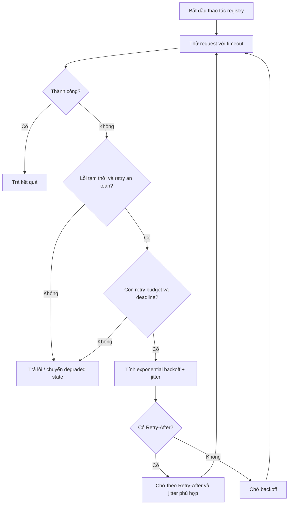

# Giới hạn thời gian chờ, thử lại và giãn cách khi kết nối sổ đăng ký

## 1. Vì sao kết nối registry cần timeout và retry có kiểm soát?

Trong Spring Cloud Service Discovery, ứng dụng phải trao đổi với registry để đăng ký instance, gia hạn lease/heartbeat, tải danh sách service hoặc theo dõi thay đổi. Registry có thể chậm do tải cao, mất leader, network partition, DNS lỗi, TLS handshake thất bại hoặc đang phục hồi sau sự cố.

Nếu client chờ vô hạn, thread và connection có thể bị giữ lại, làm cạn pool và kéo theo request nghiệp vụ bị treo. Nếu client retry quá nhanh hoặc tất cả client retry cùng lúc, chính registry đang yếu lại nhận thêm tải và càng khó phục hồi. Vì vậy, cần phối hợp ba cơ chế:

- **Timeout:** giới hạn thời gian một thao tác được phép chờ.
- **Retry:** thử lại lỗi tạm thời trong số lần hoặc tổng thời gian cho phép.
- **Backoff và jitter:** giãn khoảng cách giữa các lần thử, phân tán thời điểm retry giữa các client.

Các cơ chế này áp dụng cho kết nối registry như Eureka, Consul hoặc Kubernetes API. Chúng cũng liên quan đến request gọi service, nhưng timeout/retry của registry và timeout/retry của request nghiệp vụ là hai chính sách khác nhau.

## 2. Phân biệt các loại timeout

Không có một giá trị timeout duy nhất phù hợp cho mọi thao tác. Trước khi cấu hình, hãy xác định client đang chờ điều gì.

| Loại timeout | Ý nghĩa | Ví dụ lỗi khi hết hạn |
|---|---|---|
| Connection timeout | Thời gian tối đa để mở TCP connection tới registry | DNS/TCP route lỗi hoặc server không nhận kết nối |
| TLS handshake timeout | Thời gian hoàn tất thương lượng TLS | Certificate, proxy hoặc TLS endpoint phản hồi chậm |
| Connection-pool acquire timeout | Thời gian chờ lấy connection khả dụng từ pool | Pool cạn do request treo hoặc giới hạn connection quá thấp |
| Response/read timeout | Thời gian tối đa chờ byte/response từ server sau khi đã kết nối | Registry quá tải, xử lý request chậm hoặc network ngừng truyền |
| Request/operation timeout | Tổng thời gian cho một thao tác HTTP hoặc RPC | Toàn bộ request vượt ngân sách dù từng giai đoạn chưa timeout riêng |
| Discovery deadline | Tổng thời gian ứng dụng cho phép để hoàn tất một lần tra cứu/đăng ký, gồm cả retry | Hết thời gian nghiệp vụ cho phép chờ registry |
| Blocking-query wait | Thời gian server giữ một truy vấn chờ dữ liệu thay đổi | Consul blocking query hoặc Kubernetes watch kết thúc theo giới hạn đã đặt |

`registry-fetch-interval` không phải response timeout. Đây là khoảng thời gian giữa các lần tải registry cache. Tương tự, health-check interval là chu kỳ chạy check, không phải thời gian tối đa cho một HTTP request health check.

### 2.1. Đặt timeout theo ngân sách thời gian

Một thao tác kết nối registry có thể gồm nhiều bước: lấy connection, DNS/TCP, TLS, gửi request, server xử lý, nhận response và parse dữ liệu. Tổng thời gian cần nằm trong deadline:

\[
T_{operation} \leq T_{deadline}
\]

Nếu có nhiều lần retry:

\[
T_{total} = \sum_{i=1}^{A} T_{attempt_i} + \sum_{i=1}^{A-1} T_{backoff_i}
\]

Trong đó `A` là số attempt tối đa. Tổng thời gian này phải nhỏ hơn deadline của tác vụ gọi. Không đặt mỗi attempt timeout 10 giây rồi retry 5 lần trong một tác vụ chỉ được phép chờ 5 giây.

Ví dụ ngân sách minh họa cho một lần đọc registry đồng bộ:

| Thành phần | Ngân sách ví dụ |
|---|---:|
| Acquire connection | 100 ms |
| Connect + TLS | 300 ms |
| Response/read | 700 ms |
| Parse và xử lý local | 100 ms |
| Tổng một attempt | Khoảng 1,2 giây |
| Số attempt | Tối đa 2 |
| Backoff giữa hai attempt | 100–250 ms |
| Deadline tổng | Khoảng 2,7 giây |

Đây chỉ là ví dụ để minh họa cách phân bổ ngân sách. Hãy đo p95/p99 thực tế, loại network, kích thước registry và SLO của ứng dụng trước khi chọn con số. Một registry fetch toàn bộ có payload lớn có thể cần read timeout khác với truy vấn một service ID.

### 2.2. Timeout của registry không phải timeout của request nghiệp vụ

`DiscoveryClient.getInstances("payment-service")` có thể đọc từ cache và trả nhanh, hoặc có thể truy vấn registry tùy implementation. Sau khi có instance, request HTTP tới `payment-service` lại có connect/read/deadline riêng.

Ví dụ:

1. Consumer đọc cache registry trong 20 ms.
2. Load balancer chọn `payment-service` instance.
3. Kết nối tới instance bị treo 2 giây.
4. Request nghiệp vụ timeout sau 2 giây.

Tăng timeout của Eureka/Consul không giải quyết timeout của request tới service đích. Ngược lại, giảm timeout registry quá thấp có thể làm discovery thất bại dù service đích vẫn khỏe.

## 3. Chọn thao tác nào được phép retry?

Retry chỉ hữu ích khi lỗi có khả năng tự hết và thao tác có thể thực hiện lại an toàn. Không retry mọi exception.

### 3.1. Lỗi thường có thể retry

- Connection reset hoặc connection refused trong lúc server đang restart.
- DNS tạm thời không phân giải được do thay đổi endpoint.
- Timeout hoặc lỗi network có tính tạm thời.
- HTTP `429 Too Many Requests` nếu tuân thủ `Retry-After`.
- HTTP `502`, `503`, `504` trong giai đoạn proxy/registry failover.
- Kubernetes API Server trả `410 Gone` cho watch resource version cũ: đây là tín hiệu cần relist rồi mở watch mới, không lặp lại cùng watch request mãi.
- Leader election hoặc node failover đang diễn ra, nếu client library hỗ trợ reconnect.

### 3.2. Lỗi thường không nên retry mù quáng

| Lỗi | Vì sao không nên retry liên tục |
|---|---|
| HTTP `400` | Request sai cú pháp hoặc tham số; retry không sửa được dữ liệu |
| HTTP `401` | Credential/token không hợp lệ hoặc hết hạn; cần sửa xác thực |
| HTTP `403` | Thiếu quyền RBAC/ACL; retry chỉ tăng tải và che nguyên nhân |
| HTTP `404` | Sai endpoint/path hoặc tài nguyên không tồn tại; cần xác minh ý nghĩa theo thao tác |
| TLS certificate/hostname invalid | Đây là lỗi cấu hình hoặc trust; không tự hết khi retry nhanh |
| Invalid service ID/configuration | Phải sửa cấu hình hoặc tên service |
| Serialization/schema error | Payload không tương thích; retry cùng dữ liệu thường tiếp tục thất bại |

Một số mã như `404` phụ thuộc ngữ nghĩa. Ví dụ truy vấn một service chưa đăng ký có thể là trạng thái hợp lệ với kết quả rỗng, trong khi `404` ở sai context path của registry là lỗi cấu hình. Hãy phân loại theo API và thao tác, không chỉ theo mã HTTP.

### 3.3. Đọc registry và ghi đăng ký có yêu cầu khác nhau

Đọc danh sách instance thường idempotent: lặp lại cùng truy vấn không tạo thêm bản ghi. Đăng ký service cũng có thể được thiết kế để lặp lại an toàn nếu giữ nguyên service ID/instance ID và dùng API registration đúng của provider. Tuy nhiên, không nên giả định mọi lệnh ghi đều idempotent.

- **Eureka:** đăng ký cùng app/instance ID là cập nhật bản ghi instance theo giao thức Eureka; giữ instance ID ổn định giữa các lần retry.
- **Consul:** đăng ký qua Agent API với cùng service ID có thể cập nhật service đã tồn tại; không tạo ID mới cho mỗi lần retry.
- **Kubernetes:** thao tác `create` có thể trả `409 AlreadyExists` khi lần trước đã thành công nhưng response bị mất. Đọc lại object hoặc dùng `apply`/update với `resourceVersion` đúng; không lặp `create` vô hạn.

Với thao tác có side effect, phải xác định tính idempotent, khóa định danh và trạng thái sau timeout trước khi bật retry.

## 4. Exponential backoff và jitter

Nếu mọi client retry sau cùng một khoảng cố định, chúng có thể tạo thành từng đợt request đồng pha. Exponential backoff làm khoảng nghỉ tăng dần sau mỗi lần thất bại; jitter thêm ngẫu nhiên để phân tán thời điểm thử lại.

### 4.1. Exponential backoff

Một công thức phổ biến:

\[
d_k = \min(d_{max}, d_{base} \times m^k)
\]

Trong đó:

- `d_base`: khoảng nghỉ ban đầu.
- `m`: hệ số tăng, thường lớn hơn 1.
- `k`: số lần retry đã thực hiện.
- `d_max`: giới hạn khoảng nghỉ tối đa.

Ví dụ với `d_base = 200 ms`, `m = 2`, `d_max = 2 s`:

| Lần retry | Backoff trước jitter |
|---:|---:|
| 1 | 200 ms |
| 2 | 400 ms |
| 3 | 800 ms |
| 4 | 1.600 ms |
| 5 | 2.000 ms (đã chạm trần) |

### 4.2. Full jitter

Full jitter chọn một giá trị ngẫu nhiên từ 0 đến backoff đã tính:

\[
d_k^{jitter} = U(0, d_k)
\]

Nhờ vậy, nhiều client không cùng retry tại đúng 200 ms, 400 ms hoặc 800 ms. Một cách khác là equal jitter hoặc decorrelated jitter; chọn một chiến lược và kiểm thử với quy mô client thực tế.

### 4.3. Tôn trọng `Retry-After`

Nếu server trả `Retry-After`, client nên chờ ít nhất khoảng thời gian server yêu cầu, sau đó mới áp dụng chính sách jitter phù hợp. Giá trị có thể biểu diễn số giây hoặc HTTP date tùy giao thức. Không bỏ qua header rồi retry ngay khi gặp `429`.

### 4.4. Không retry mãi mãi

Giới hạn retry bằng cả số lần và tổng deadline. Ví dụ:

- Tối đa 3–4 attempt cho một lần tra cứu đồng bộ.
- Tổng deadline 2–3 giây cho một request nghiệp vụ cần tra cứu nhanh.
- Tác vụ background registration có thể dùng thời gian retry dài hơn, nhưng phải backoff, jitter và phát metric/log rõ ràng.

Các con số là ví dụ. Đối với auto-registration chạy nền, client có thể tiếp tục reconnect trong suốt vòng đời process; tuy vậy mỗi vòng thử vẫn phải có timeout, khoảng nghỉ và cơ chế ngăn tạo tải không giới hạn.

## 5. Retry budget và tránh nhân số lần retry

Một hệ thống có thể có retry ở nhiều lớp:

- HTTP client kết nối registry retry 3 lần.
- Spring Cloud wrapper retry thêm 3 lần.
- Tầng nghiệp vụ retry thêm 3 lần.

Nếu các lớp lồng nhau, số attempt có thể nhân lên tới (3 \times 3 \times 3 = 27) cho một thao tác ban đầu. Đây là retry amplification.

Nguyên tắc:

1. Chọn một lớp chịu trách nhiệm retry chính cho mỗi thao tác.
2. Nếu client library đã tự retry, không bọc thêm retry rộng mà không tính tổng attempt.
3. Truyền deadline còn lại xuống lớp dưới thay vì cấp timeout mới đầy đủ ở mỗi lớp.
4. Dùng retry budget theo tỷ lệ request hoặc theo thời gian để tránh retry chiếm hết capacity.
5. Giới hạn số request đang retry đồng thời bằng bulkhead/semaphore.
6. Log attempt number, elapsed time, exception class và operation; tránh log toàn bộ payload/secret.

Retry budget có thể biểu diễn theo tỷ lệ đơn giản:

\[
RetryBudget = \frac{N_{retry}}{N_{original}}
\]

Ví dụ đặt ngân sách retry không vượt quá 10% số request gốc trong một cửa sổ quan sát. Đây là chính sách minh họa; với tác vụ registration/heartbeat nền, cần định nghĩa budget riêng theo service và registry.

## 6. Circuit breaker và bulkhead

### 6.1. Circuit breaker

Khi registry liên tục lỗi, circuit breaker có thể tạm ngừng gọi tới endpoint đang lỗi:

- **Closed:** cho phép request đi qua và theo dõi lỗi.
- **Open:** từ chối request mới trong thời gian chờ, tránh tiếp tục làm quá tải registry.
- **Half-open:** cho phép một số probe giới hạn để kiểm tra registry đã phục hồi chưa.

Circuit breaker không thay thế timeout. Một request bị treo mà không có timeout vẫn có thể chiếm tài nguyên trước khi breaker kịp mở. Cũng không nên dùng một breaker chung cho mọi registry node nếu client có cơ chế failover theo endpoint; breaker quá rộng có thể chặn cả các node khỏe.

### 6.2. Bulkhead

Bulkhead giới hạn số thao tác registry chạy đồng thời. Ví dụ, nếu registry đang chậm, tối đa 20 lần fetch/registration có thể chạy đồng thời; các tác vụ vượt giới hạn bị từ chối hoặc xếp hàng có giới hạn thay vì chiếm toàn bộ thread pool.

Tách executor/connection pool cho tác vụ registry và request nghiệp vụ để một đợt retry không làm cạn tài nguyên phục vụ HTTP traffic. Với async watch hoặc background refresh, dùng queue bounded và có chính sách drop/coalesce phù hợp.

## 7. Cấu hình timeout và retry theo tầng Spring Cloud

Không có một thuộc tính Spring Cloud chung điều khiển mọi timeout của Eureka, Consul và Kubernetes. Cần cấu hình đúng transport/client được starter sử dụng.

### 7.1. Timeout của HTTP client

Nếu ứng dụng tự gọi registry API bằng Spring `RestClient`/`WebClient`, cấu hình connect timeout và response timeout trên HTTP connector tương ứng. Ví dụ với Reactor Netty:

```java
import java.time.Duration;

import reactor.netty.http.client.HttpClient;
import org.springframework.context.annotation.Bean;
import org.springframework.context.annotation.Configuration;
import org.springframework.http.client.reactive.ReactorClientHttpConnector;
import org.springframework.web.reactive.function.client.WebClient;

@Configuration
public class RegistryHttpConfiguration {

    @Bean
    WebClient registryWebClient() {
        HttpClient httpClient = HttpClient.create()
                .option(io.netty.channel.ChannelOption.CONNECT_TIMEOUT_MILLIS, 500)
                .responseTimeout(Duration.ofSeconds(2));

        return WebClient.builder()
                .clientConnector(new ReactorClientHttpConnector(httpClient))
                .build();
    }
}
```

Ví dụ đặt connect timeout 500 ms và response timeout 2 giây. Các giá trị phải phù hợp với network và deadline thực tế. Với HTTP client khác, cấu hình tương đương nằm ở request factory/transport của client đó.

Đoạn code này chỉ cấu hình `WebClient` do ứng dụng tự tạo. Nó **không tự cấu hình** HTTP transport nội bộ mà Eureka Client, Consul starter hoặc Kubernetes client đang dùng. Muốn đổi timeout của discovery client, hãy tra đúng thuộc tính của starter/client library theo phiên bản dự án.

### 7.2. Retry với Spring Retry

Spring Retry có thể áp dụng cho một wrapper đọc registry khi thao tác có thể retry an toàn:

```java
import org.springframework.context.annotation.Configuration;
import org.springframework.retry.annotation.EnableRetry;

@Configuration
@EnableRetry
public class RegistryRetryConfiguration {
}
```

Service thực hiện truy vấn:

```java
import org.springframework.retry.annotation.Backoff;
import org.springframework.retry.annotation.Retryable;
import org.springframework.stereotype.Service;
import org.springframework.cloud.client.ServiceInstance;
import org.springframework.cloud.client.discovery.DiscoveryClient;

import java.util.List;

@Service
public class RegistryLookupService {

    private final DiscoveryClient discoveryClient;

    public RegistryLookupService(DiscoveryClient discoveryClient) {
        this.discoveryClient = discoveryClient;
    }

    @Retryable(
            retryFor = {TransientRegistryException.class},
            maxAttempts = 4,
            backoff = @Backoff(
                    delay = 200,
                    maxDelay = 2000,
                    multiplier = 2.0,
                    random = true
            )
    )
    public List<ServiceInstance> findPaymentInstances() {
        return discoveryClient.getInstances("payment-service");
    }
}
```

`TransientRegistryException` ở đây là exception do adapter của ứng dụng định nghĩa sau khi phân loại lỗi network/timeout tạm thời, ví dụ:

```java
public class TransientRegistryException extends RuntimeException {

    public TransientRegistryException(String message, Throwable cause) {
        super(message, cause);
    }
}
```

Không bắt mọi `RuntimeException` rồi retry. Nếu `getInstances()` trả danh sách rỗng, đó là kết quả hợp lệ của truy vấn và không tự động được xem là exception để retry.

Spring Retry dùng proxy AOP; lời gọi method qua `this.findPaymentInstances()` trong cùng bean không đi qua proxy nên không kích hoạt retry. Tên thuộc tính annotation có thể khác giữa các phiên bản Spring Retry; hãy kiểm tra dependency đang dùng. Với Spring Framework 7/Spring Boot thế hệ mới, Spring Retry và cơ chế resilience có thể có lựa chọn thay thế; tránh trộn API của các thế hệ.

### 7.3. Ví dụ cấu hình Resilience4j

Nếu dự án dùng Resilience4j, có thể cấu hình một retry instance riêng cho thao tác registry:

```yaml
resilience4j:
  retry:
    instances:
      registryLookup:
        maxAttempts: 4
        waitDuration: 200ms
        enableExponentialBackoff: true
        exponentialBackoffMultiplier: 2
        enableRandomizedWait: true
        randomizedWaitFactor: 0.5
```

Đây là ví dụ cấu hình theo Resilience4j Spring Boot integration; xác minh tên thuộc tính và cách kết hợp exponential/randomized wait theo phiên bản thư viện. Cấu hình retry không tự áp dụng nếu method chưa được bọc bằng annotation/decorator tương ứng.

Không bật đồng thời retry của Spring Retry, Resilience4j và HTTP client cho cùng một thao tác mà không tính tổng attempt và tổng thời gian.

## 8. Lưu ý riêng cho Eureka

Eureka Client thực hiện một số hoạt động mạng độc lập:

- Register instance khi khởi động.
- Heartbeat/renewal để gia hạn lease.
- Fetch registry để cập nhật cache local.
- Cancel/deregister khi shutdown bình thường.

### 8.1. Timeout kết nối Eureka Server

Eureka client library có các cấu hình timeout kết nối và đọc response từ Eureka Server, ví dụ các thuộc tính thường gặp:

```yaml
eureka:
  client:
    eureka-server-connect-timeout-seconds: 2
    eureka-server-read-timeout-seconds: 5
```

Tên và khả năng cấu hình phụ thuộc phiên bản Spring Cloud Netflix/Eureka client. Kiểm tra configuration metadata của release đang dùng trước khi áp dụng; không giả định các thuộc tính này tồn tại hoặc có cùng mặc định ở mọi phiên bản.

Connect timeout quá thấp có thể làm failover giả khi mạng có jitter; read timeout quá thấp có thể làm full registry fetch thất bại khi registry lớn. Quá cao lại giữ connection/thread lâu khi server thực sự mất kết nối.

### 8.2. Fetch interval không phải read timeout

`eureka.client.registry-fetch-interval-seconds` quyết định chu kỳ fetch registry cache. Giảm interval làm client nhìn thấy thay đổi sớm hơn nhưng tăng request tới server. Read timeout mới là thời gian chờ response của một lần fetch. Điều chỉnh hai thuộc tính này cho hai mục tiêu khác nhau.

### 8.3. Heartbeat và self-preservation

Heartbeat failure có thể do server lỗi hoặc do mạng tạm thời. Eureka self-preservation có thể giữ instance trong registry khi tỷ lệ heartbeat giảm bất thường. Không nên tắt cơ chế này để ép registry xóa instance nhanh trong lúc network partition; thay vào đó, kiểm tra timeout request nghiệp vụ, health status và stale instance handling ở consumer.

## 9. Lưu ý riêng cho Consul

Ứng dụng thường đăng ký service qua Consul Agent. Client có thể gọi Agent API hoặc dùng Spring Cloud Consul để quản lý registration, health check và discovery.

### 9.1. Timeout HTTP tới Agent/Server

Đặt connect/read/operation timeout phù hợp cho transport thực tế mà Spring Cloud Consul sử dụng. Phân biệt địa chỉ Agent cục bộ với Consul server: trong kiến trúc phổ biến, ứng dụng đăng ký vào Agent; Agent chịu trách nhiệm đồng bộ catalog lên server. Nếu chỉ kiểm tra kết nối tới server mà bỏ qua Agent, có thể bỏ sót điểm lỗi ngay trên node ứng dụng.

### 9.2. Blocking query và thời gian chờ

Consul HTTP API hỗ trợ blocking query qua `index` và `wait`. `wait` là thời gian server giữ request để chờ dữ liệu thay đổi hoặc hết thời hạn. Response timeout của HTTP client phải lớn hơn `wait` cộng phần dự phòng cho network và xử lý response.

Ví dụ:

```text
GET /v1/health/service/payment-service?index=1250&wait=2m
```

Nếu HTTP client đặt read timeout 30 giây trong khi `wait=2m`, client sẽ đóng request trước khi Consul có cơ hội trả về bình thường. Ngược lại, `wait` quá ngắn sẽ khiến client tạo nhiều request nối tiếp, làm tăng tải. Khi blocking query timeout bình thường, tiếp tục dùng `X-Consul-Index` mới nhận được; không coi mỗi lần hết `wait` là lỗi cần retry nhanh.

### 9.3. Health check timeout

Consul health check có interval và timeout riêng. Timeout của check quyết định thời gian chờ một lần check; interval quyết định khoảng cách giữa các lần check. Nếu endpoint readiness phản hồi chậm hơn timeout, service có thể chuyển critical dù ứng dụng vẫn phục vụ một phần request. Chọn timeout dựa trên p99 của endpoint check và giữ endpoint nhẹ, không chạy truy vấn nghiệp vụ nặng mỗi lần check.

## 10. Lưu ý riêng cho Kubernetes API

Spring Cloud Kubernetes có thể truy cập Kubernetes API trực tiếp bằng Fabric8/Kubernetes Java Client hoặc thông qua DiscoveryServer. Timeout/retry phụ thuộc HTTP client và informer/watch implementation của lựa chọn đó.

### 10.1. LIST/WATCH và `resourceVersion`

Client thường lấy snapshot bằng LIST rồi theo dõi thay đổi bằng WATCH. Watch có thể kết thúc do `timeoutSeconds`, network, API Server restart hoặc resource version không còn được giữ.

- Khi watch kết thúc bình thường, mở watch tiếp theo từ resource version cuối cùng.
- Khi API trả `410 Gone`, resource version đã quá cũ; thực hiện LIST mới để lấy snapshot rồi mở watch mới.
- Khi API trả `429 Too Many Requests`, tôn trọng `Retry-After` và áp dụng backoff.
- Khi nhận `401/403`, sửa credential/RBAC; không retry liên tục.
- Khi lỗi network tạm thời, reconnect có backoff và jitter, tránh đồng loạt relist toàn cluster.

### 10.2. Watch timeout không phải lỗi

Kubernetes watch có thể kết thúc sau thời gian được yêu cầu để client tạo watch mới và duy trì kết nối. Đây là vòng đời bình thường của watch, không phải lúc nào cũng là lỗi cần tăng timeout. `timeoutSeconds` của watch, HTTP read timeout và deadline tổng của thao tác là ba giá trị khác nhau; HTTP read timeout phải đủ dài để không cắt watch sớm hơn dự kiến.

### 10.3. Tôn trọng giới hạn API Server

Kubernetes API Server có thể trả `429` khi quá tải hoặc áp dụng API Priority and Fairness. Client nên tôn trọng `Retry-After`, dùng client-go/Fabric8 informer theo cơ chế reconnect/backoff đã hỗ trợ và tránh tự viết vòng polling LIST dày. Một lần relist toàn cluster có thể tải nặng hơn một watch duy trì.

## 11. Kết hợp timeout, retry và readiness

Timeout/retry chỉ điều khiển khả năng kết nối; chúng không quyết định instance đã sẵn sàng nhận traffic. Cần kết hợp với readiness:

1. Ứng dụng khởi động và cố gắng đăng ký service.
2. Nếu registry tạm thời không truy cập được, registration client retry nền với timeout/backoff.
3. Ứng dụng hoàn tất warm-up và dependency bắt buộc.
4. Readiness chuyển sang accepting traffic khi ứng dụng đủ điều kiện.
5. Consumer chỉ chọn instance đủ health/ready theo cơ chế registry/load balancer.
6. Nếu registry mất kết nối, consumer dùng cache trong giới hạn chính sách và request tới service đích vẫn có timeout riêng.

Không nên giữ ứng dụng ở trạng thái not-ready vô hạn chỉ vì registry tạm thời mất kết nối nếu ứng dụng vẫn có thể phục vụ traffic qua đường định tuyến khác và chính sách hệ thống cho phép. Ngược lại, nếu registry là thành phần bắt buộc để nhận request, readiness phải phản ánh dependency đó. Quyết định cần dựa trên kiến trúc traffic thực tế.

## 12. Sơ đồ retry có backoff



## 13. Ví dụ chính sách theo loại thao tác

| Thao tác | Timeout gợi ý để bắt đầu thử nghiệm | Retry | Ghi chú |
|---|---:|---|---|
| Đọc một service từ registry cache | Deadline vài trăm ms đến 1–2 s | Thường không cần nếu chỉ đọc cache; retry ngắn nếu gọi remote | Trả danh sách rỗng là kết quả hợp lệ |
| Fetch registry toàn bộ | Theo kích thước registry, có thể vài giây | Có giới hạn, backoff+jitter | Payload lớn và parse có thể tốn CPU |
| Register instance | Connect/read timeout vài giây tùy network | Retry nền có backoff+jitter | Giữ instance ID ổn định và registration idempotent |
| Heartbeat/renewal | Ngắn hơn lease budget nhưng đủ network jitter | Client library quản lý; tránh retry trùng lớp | Mất heartbeat có thể làm instance bị đánh dấu không khỏe |
| Consul blocking query | Read timeout lớn hơn `wait` + margin | Kết thúc wait bình thường thì mở query mới | Giữ `X-Consul-Index` |
| Kubernetes watch | HTTP read timeout lớn hơn watch timeout + margin | Reconnect; 410 thì relist; 429 tôn trọng Retry-After | Tránh polling LIST dày |
| Request nghiệp vụ tới instance | Theo deadline end-to-end của API | Chỉ retry khi thao tác idempotent và còn deadline | Tách khỏi timeout registry |

Các khoảng thời gian trong bảng là điểm khởi đầu để thiết kế test, không phải mặc định của Spring Cloud. Chốt giá trị sau khi đo latency, network, kích thước registry, lease/check interval và SLO.

## 14. Metrics và log cần theo dõi

Để biết retry đang giúp phục hồi hay đang khuếch đại tải, cần quan sát:

- `registry_request_duration`: latency theo operation (register, heartbeat, fetch, query, watch).
- `registry_request_timeout_total`: số timeout theo endpoint/operation.
- `registry_retry_total`: số retry theo nguyên nhân và attempt number.
- `registry_retry_delay`: histogram khoảng backoff thực tế.
- `registry_circuit_breaker_state`: trạng thái closed/open/half-open.
- `registry_connection_pool_pending`: số request chờ connection.
- `registry_instances_visible`: số instance consumer nhìn thấy.
- `registry_last_success_timestamp`: thời điểm thao tác registry thành công gần nhất.
- `discovery_stale_instance_count`: số instance được phát hiện không còn phục vụ.

Log nên có `serviceId`, `instanceId`, `registry`, `operation`, `endpoint`, `attempt`, `elapsedMs`, `timeoutType`, `statusCode` và `exceptionClass`. Không ghi credential, token hoặc toàn bộ response payload.

Không dùng `instanceId`, URL có ID động hoặc exception message làm metric label nếu tạo cardinality cao. Dùng log/trace cho định danh chi tiết và metric label có tập giá trị giới hạn.

## 15. Những lỗi cấu hình thường gặp

| Dấu hiệu | Nguyên nhân | Cách xử lý |
|---|---|---|
| Client treo lâu khi registry mất kết nối | Thiếu connect/read/operation timeout | Cấu hình timeout cho đúng HTTP transport |
| Registry phục hồi nhưng client tiếp tục retry dồn dập | Backoff cố định hoặc thiếu jitter | Dùng exponential backoff + jitter và retry budget |
| Một thao tác tạo hàng chục request | Retry lồng nhau ở nhiều lớp | Chọn một lớp retry chính và tính tổng attempt |
| Service đăng ký trùng | Instance ID thay đổi ở mỗi lần retry | Dùng instance ID ổn định và registration idempotent |
| Consul blocking query liên tục bị timeout phía client | HTTP read timeout ngắn hơn `wait` | Đặt read timeout lớn hơn wait cộng margin |
| Kubernetes API Server trả 429 liên tục | Client relist/poll quá nhanh hoặc quá nhiều watcher | Tôn trọng Retry-After, dùng informer và backoff |
| Kubernetes watch nhận 410 rồi lặp lại lỗi | Tiếp tục dùng resourceVersion cũ | LIST lại snapshot và mở watch mới |
| Retry làm cạn thread pool | Không có bulkhead hoặc queue không giới hạn | Tách pool và giới hạn concurrency |
| 401/403 lặp đi lặp lại | Credential hoặc RBAC sai | Sửa auth/ACL thay vì retry |
| Discovery trả rỗng nhưng log ghi timeout | Trộn kết quả không có instance với lỗi kết nối | Phân biệt empty result và exception |

## 16. Checklist triển khai

- [ ] Xác định timeout connect, TLS, pool acquire, response/read và operation deadline.
- [ ] Đặt deadline tổng cho thao tác và tính cả thời gian retry/backoff.
- [ ] Phân biệt timeout registry với timeout request nghiệp vụ.
- [ ] Chỉ retry lỗi tạm thời và thao tác có thể thực hiện lại an toàn.
- [ ] Dùng exponential backoff, jitter, max delay và retry budget.
- [ ] Tôn trọng `Retry-After` khi server yêu cầu.
- [ ] Tránh retry lồng nhau không kiểm soát giữa HTTP client, Spring wrapper và tầng nghiệp vụ.
- [ ] Giữ service/instance ID ổn định khi retry đăng ký.
- [ ] Dùng circuit breaker/bulkhead khi registry lỗi kéo dài hoặc concurrency tăng cao.
- [ ] Với Eureka, phân biệt connect/read timeout với registry fetch interval và heartbeat.
- [ ] Với Consul, đặt HTTP read timeout lớn hơn blocking query `wait` cộng margin.
- [ ] Với Kubernetes, xử lý 410 bằng relist, 429 bằng Retry-After/backoff và 401/403 bằng sửa quyền.
- [ ] Theo dõi timeout, retry, latency, pool pending, stale instance và thời điểm thành công gần nhất.
- [ ] Kiểm thử registry chậm, mất mạng, restart, failover và phục hồi trong môi trường kiểm soát.

## 17. Kết luận

Kết nối registry cần timeout rõ ràng, retry có giới hạn và backoff có jitter. Timeout bảo vệ thread/connection khỏi bị giữ vô hạn; retry giúp vượt qua lỗi tạm thời; backoff và jitter ngăn nhiều client cùng tạo tải dồn lên registry. Retry chỉ an toàn khi thao tác có thể thực hiện lại, lỗi được phân loại đúng và tổng attempt nằm trong deadline.

Hãy cấu hình đúng transport của từng discovery provider, tách timeout registry khỏi timeout request nghiệp vụ, tôn trọng `Retry-After`, xử lý riêng Consul blocking query và Kubernetes watch, đồng thời theo dõi retry budget/circuit breaker. Mục tiêu không phải retry đến khi thành công bằng mọi giá, mà là phục hồi có kiểm soát mà không làm registry và toàn bộ microservice quá tải thêm.

## Tài liệu tham khảo

- [Spring Cloud Netflix – Configuration Properties](https://docs.spring.io/spring-cloud-netflix/reference/configprops.html)
- [Netflix Eureka – Client/Server Communication](https://github.com/Netflix/eureka/wiki/Understanding-eureka-client-server-communication)
- [Spring Cloud Consul – Service Discovery](https://docs.spring.io/spring-cloud-consul/reference/discovery.html)
- [Consul – Blocking Queries](https://developer.hashicorp.com/consul/api-docs/features/blocking)
- [Kubernetes – API Concepts, List and Watch](https://kubernetes.io/docs/reference/using-api/api-concepts/)
- [Kubernetes – API Priority and Fairness](https://kubernetes.io/docs/concepts/cluster-administration/flow-control/)
- [Resilience4j – Retry](https://resilience4j.readme.io/docs/retry)
- [Spring Retry – Reference](https://github.com/spring-projects/spring-retry)
