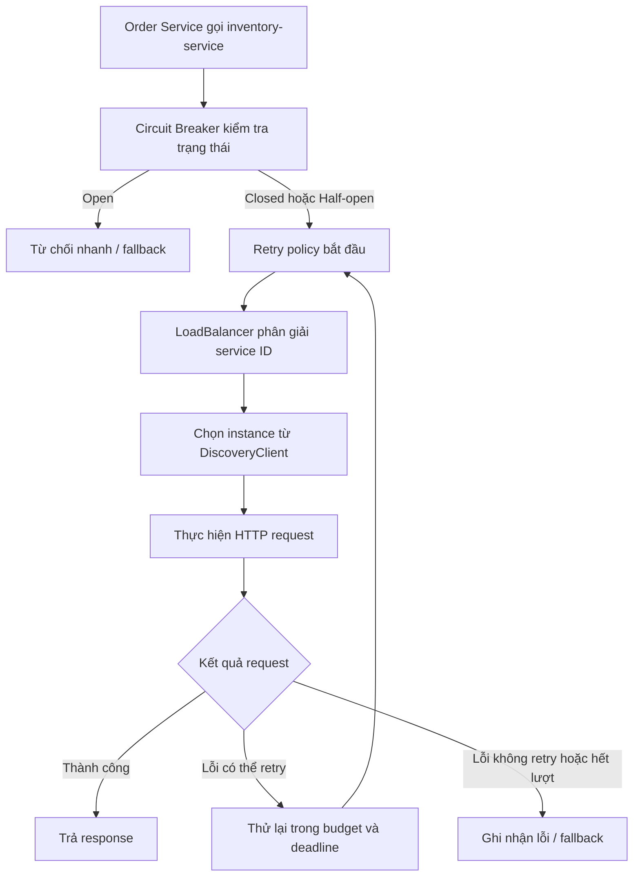
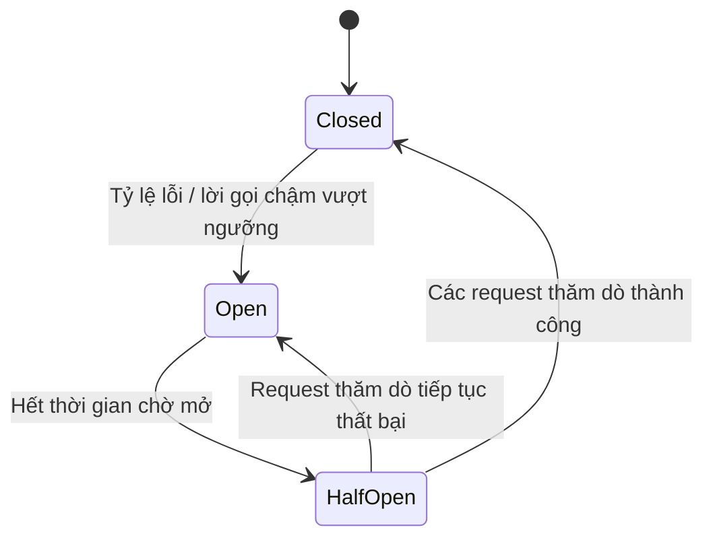

# Ranh giới phối hợp với Circuit Breaker và chính sách gọi lại

Service discovery, load balancing, retry và Circuit Breaker cùng tham gia bảo vệ lời gọi giữa các microservice, nhưng mỗi thành phần giải quyết một vấn đề riêng. Discovery tìm các instance đã đăng ký theo service ID. LoadBalancer chọn instance cho request. Retry quyết định có gửi lại request khi gặp lỗi tạm thời hay không. Circuit Breaker ngăn consumer tiếp tục gọi một dependency đang lỗi kéo dài.

Nếu đặt nhiều cơ chế này ở sai ranh giới, một request có thể bị gửi lại nhiều lần, làm tăng tải lên service đang suy yếu hoặc khiến Circuit Breaker đo sai tỷ lệ lỗi. Bài này tập trung vào cách phối hợp chúng quanh một lời gọi tới `inventory-service`, cách chọn một nơi chịu trách nhiệm retry, giới hạn tổng thời gian và bảo đảm thao tác ghi không bị thực hiện lặp.

## Phân chia trách nhiệm

| Thành phần | Câu hỏi nó trả lời | Nó không làm thay phần nào? |
|---|---|---|
| Service Discovery | Service ID hiện có những instance nào? | Không tự quyết định request nào nên retry hoặc mở Circuit Breaker |
| Spring Cloud LoadBalancer | Instance nào sẽ nhận request này? | Không thay thế timeout, retry nghiệp vụ hoặc Circuit Breaker |
| Retry | Có nên thử lại request sau lỗi vừa gặp không? | Không bảo đảm lần sau sẽ thành công và không tự sửa registry |
| Circuit Breaker | Có nên tạm ngừng gọi dependency đang lỗi không? | Không tự tìm instance khác hoặc kiểm tra sức khỏe toàn hệ thống |
| Timeout/deadline | Consumer chờ tối đa bao lâu? | Không tự chọn instance hoặc bảo đảm thao tác an toàn khi retry |

Ví dụ consumer gọi `http://inventory-service/api/items/42` bằng HTTP client có `@LoadBalanced`. Discovery trả về các instance, LoadBalancer chọn một instance, sau đó chính sách retry và Circuit Breaker quyết định request được thực hiện, thử lại hay bị từ chối sớm.



Sơ đồ thể hiện ranh giới logic. Thứ tự thực thi cụ thể phụ thuộc nơi đặt retry: retry có thể nằm trong LoadBalancer để chọn instance kế tiếp, hoặc nằm ngoài lời gọi HTTP ở tầng ứng dụng.

## Discovery và LoadBalancer xử lý lỗi instance như thế nào?

Giả sử registry trả về ba instance:

```text
inventory-service
  instance A: 10.0.1.12:8080  (đang timeout)
  instance B: 10.0.1.13:8080  (đang khỏe)
  instance C: 10.0.1.14:8080  (đang khỏe)
```

LoadBalancer chọn một instance theo chiến lược đang cấu hình. Nếu instance A vừa chết nhưng registry chưa kịp loại bỏ, request đầu tiên có thể thất bại. Retry ở tầng LoadBalancer có thể chọn instance kế tiếp trong danh sách và thử lại.

Đây là retry theo instance: mục tiêu là vượt qua một endpoint lỗi trong cùng service ID. Nó phù hợp với lỗi kết nối tạm thời, reset connection hoặc một số lỗi server có thể phục hồi. Cấu hình retry cùng instance và retry sang instance khác cần được giới hạn rõ ràng.

Discovery và health check vẫn là nguồn dữ liệu cho danh sách instance. Retry không xóa instance A khỏi registry. Circuit Breaker cũng không tự cập nhật trạng thái health của A. Nếu A liên tục lỗi, cần điều tra health check, heartbeat, lease, địa chỉ quảng bá và độ trễ đồng bộ registry.

## Circuit Breaker bảo vệ dependency ở cấp lời gọi

Circuit Breaker theo dõi kết quả lời gọi trong một cửa sổ thống kê. Khi tỷ lệ lỗi hoặc tỷ lệ lời gọi chậm vượt ngưỡng sau số lượng mẫu tối thiểu, breaker chuyển sang trạng thái Open và từ chối các lời gọi mới trong một khoảng thời gian. Sau đó breaker cho phép một số request thăm dò ở trạng thái Half-open.



Các trạng thái có ý nghĩa:

- **Closed:** request được phép đi tới dependency; breaker ghi nhận kết quả.
- **Open:** request bị từ chối nhanh, thường phát sinh `CallNotPermittedException`; không tiêu tốn thêm kết nối tới service đang lỗi.
- **Half-open:** chỉ một số request thăm dò được phép đi qua để đánh giá dependency đã phục hồi chưa.

Với service discovery, thường đặt breaker theo service ID logic, ví dụ `inventory`, để thống kê tổng thể lời gọi tới `inventory-service` qua các instance động. Nếu tạo một breaker riêng cho mỗi IP, cần cơ chế quản lý vòng đời key khi instance thay đổi. Nếu mục tiêu là loại bỏ một instance riêng lẻ, hãy xem xét health check hoặc chính sách LoadBalancer phù hợp thay vì mong breaker cấp service tự sửa registry.

Circuit Breaker thường có trạng thái cục bộ trong từng consumer process. Hai replica của `order-service` có thể có breaker state khác nhau. Không giả định một instance mở breaker thì mọi consumer trong hệ thống đều mở theo.

## Chọn ranh giới retry: LoadBalancer hay tầng ứng dụng?

Có hai vị trí thường dùng để retry:

| Vị trí | Phạm vi quyết định | Khi phù hợp |
|---|---|---|
| Spring Cloud LoadBalancer retry | Thử lại trên cùng instance hoặc instance kế tiếp của cùng service ID | Lỗi kết nối tới một instance, stale endpoint hoặc lỗi tạm thời ở một node |
| Resilience4j Retry ở tầng ứng dụng | Thử lại toàn bộ thao tác gọi dependency theo chính sách nghiệp vụ | Cần backoff, phân loại exception, giới hạn attempt và phối hợp với fallback/deadline |

Không nên để cả Gateway, LoadBalancer, HTTP client và service layer đều retry độc lập mà không có ngân sách chung. Mỗi tầng có thể hợp lý khi đứng riêng, nhưng khi lồng nhau số request thực tế tăng theo tích số.

Ví dụ, nếu Gateway cho phép 3 lần thử, ứng dụng cho phép 2 lần và LoadBalancer thử 2 instance, một request đầu vào có thể tạo tối đa khoảng `3 × 2 × 2 = 12` lần gọi tới upstream trong trường hợp mọi tầng đều dùng hết lượt. Đây là khuếch đại tải ngay lúc dependency đang gặp sự cố.

**Khuyến nghị:** chọn một tầng làm chủ retry chính cho từng lời gọi. Nếu mục tiêu là đổi sang instance khác khi một node lỗi, dùng LoadBalancer retry và giữ retry nghiệp vụ ở mức tối thiểu. Nếu cần retry có phân loại lỗi/backoff tại tầng ứng dụng, cân nhắc tắt retry LoadBalancer cho lời gọi đó hoặc cấu hình nó chỉ thử một lần sang instance kế tiếp. Ghi rõ lựa chọn trong cấu hình và kiểm thử tổng số request thực tế.

## Cấu hình retry của Spring Cloud LoadBalancer

Spring Cloud LoadBalancer có thể retry trên cùng instance hoặc chọn instance tiếp theo. Ví dụ cấu hình minh họa:

```yaml
spring:
  cloud:
    loadbalancer:
      retry:
        enabled: true
        max-retries-on-same-service-instance: 0
        max-retries-on-next-service-instance: 1
        retryable-status-codes:
          - 503
          - 504
```

Ý nghĩa của cấu hình:

- Không thử lại instance đã chọn ban đầu.
- Cho phép tối đa một lần thử sang instance kế tiếp.
- Chỉ xem một số status code đã chọn là có thể retry.

Các property và khả năng retry có thể khác theo phiên bản Spring Cloud, loại HTTP client và integration đang dùng. Hãy kiểm tra reference của release train; không sao chép cấu hình mà chưa xác minh client có hỗ trợ retry. Cũng cần quyết định lỗi kết nối nào được retry và cách tránh chọn lại instance vừa thất bại.

Không phải mọi `503` đều có thể khắc phục bằng cách thử instance khác. Nếu toàn bộ service không có instance khỏe, retry chỉ tạo thêm request vô ích. Với `429 Too Many Requests`, tôn trọng `Retry-After` nếu hệ thống hỗ trợ và tránh retry sớm hơn quota cho phép.

## Cấu hình Resilience4j Retry và Circuit Breaker

Khi muốn quản lý retry ở tầng ứng dụng, Resilience4j cho phép phân loại exception, đặt số lần thử, khoảng chờ và cửa sổ thống kê của breaker. Ví dụ cấu hình cho dependency `inventory`:

Với Spring Boot 3, ứng dụng có thể dùng Resilience4j Spring Boot integration cùng Spring Cloud LoadBalancer. Ví dụ dependency Maven:

```xml
<dependency>
    <groupId>org.springframework.cloud</groupId>
    <artifactId>spring-cloud-starter-loadbalancer</artifactId>
</dependency>
<dependency>
    <groupId>io.github.resilience4j</groupId>
    <artifactId>resilience4j-spring-boot3</artifactId>
</dependency>
```

Quản lý phiên bản theo BOM tương thích của dự án. Nếu chọn Spring Cloud CircuitBreaker abstraction thay cho Resilience4j API trực tiếp, dùng starter adapter Resilience4j tương ứng và API `CircuitBreakerFactory`; không trộn hai cách tích hợp mà không có chủ đích.

`spring-cloud-starter-loadbalancer` nên được quản lý bằng Spring Cloud BOM. Với `resilience4j-spring-boot3`, quản lý phiên bản Resilience4j theo BOM riêng của Resilience4j hoặc dependency management đã được dự án xác nhận; không giả định Spring Cloud BOM quản lý mọi artifact Resilience4j.

```yaml
resilience4j:
  retry:
    instances:
      inventory:
        max-attempts: 2
        wait-duration: 200ms
        enable-exponential-backoff: true
        exponential-backoff-multiplier: 2
        retry-exceptions:
          - org.springframework.web.client.ResourceAccessException
          - org.springframework.web.client.HttpServerErrorException
        ignore-exceptions:
          - org.springframework.web.client.HttpClientErrorException
  circuitbreaker:
    instances:
      inventory:
        sliding-window-type: COUNT_BASED
        sliding-window-size: 20
        minimum-number-of-calls: 10
        failure-rate-threshold: 50
        slow-call-duration-threshold: 800ms
        slow-call-rate-threshold: 50
        wait-duration-in-open-state: 10s
        permitted-number-of-calls-in-half-open-state: 3
        ignore-exceptions:
          - org.springframework.web.client.HttpClientErrorException
```

`max-attempts: 2` nghĩa là tổng cộng tối đa hai lần thực hiện, bao gồm lần đầu. Cấu hình chỉ là điểm khởi đầu để minh họa; số lần thử, thời gian chờ, cửa sổ và ngưỡng phải dựa trên latency mục tiêu, lưu lượng và khả năng chịu tải của provider.

Chỉ retry lỗi có khả năng tạm thời. Ví dụ trên dùng `ResourceAccessException` cho lỗi kết nối/timeout và `HttpServerErrorException` cho nhóm lỗi server; nhóm thứ hai rộng hơn riêng 503/504. Nếu chỉ muốn retry một vài status, dùng predicate tùy chỉnh kiểm tra status code thay vì cho phép mọi HTTP 5xx. `HttpClientErrorException` được ignore trong ví dụ; nếu API có chính sách retry riêng cho 429, hãy xử lý `Retry-After` có chủ đích. Không retry mặc định các lỗi xác thực, phân quyền, validation, dữ liệu không tồn tại hoặc lỗi nghiệp vụ không thể tự phục hồi.

### Ví dụ kết hợp bằng decorator

Khi dùng Resilience4j API trực tiếp, có thể tạo retry và breaker từ registry đã được Spring Boot cấu hình. Ví dụ dưới đây đặt Retry bên trong Circuit Breaker để breaker đo kết quả cuối cùng của một thao tác logic:

Bean HTTP client được đánh dấu `@LoadBalanced`:

```java
import org.springframework.cloud.client.loadbalancer.LoadBalanced;
import org.springframework.context.annotation.Bean;
import org.springframework.context.annotation.Configuration;
import org.springframework.web.client.RestClient;

@Configuration
class HttpClientConfiguration {
    @Bean
    @LoadBalanced
    RestClient.Builder loadBalancedRestClientBuilder() {
        return RestClient.builder();
    }
}
```

```java
import io.github.resilience4j.circuitbreaker.CallNotPermittedException;
import io.github.resilience4j.circuitbreaker.CircuitBreaker;
import io.github.resilience4j.circuitbreaker.CircuitBreakerRegistry;
import io.github.resilience4j.retry.Retry;
import io.github.resilience4j.retry.RetryRegistry;
import org.springframework.beans.factory.annotation.Qualifier;
import org.springframework.stereotype.Service;
import org.springframework.web.client.RestClient;

import java.util.function.Supplier;

@Service
public class InventoryClient {
    private final RestClient restClient;
    private final CircuitBreaker circuitBreaker;
    private final Retry retry;

    public InventoryClient(
            @Qualifier("loadBalancedRestClientBuilder") RestClient.Builder builder,
            CircuitBreakerRegistry circuitBreakerRegistry,
            RetryRegistry retryRegistry) {
        this.restClient = builder.build();
        this.circuitBreaker = circuitBreakerRegistry.circuitBreaker("inventory");
        this.retry = retryRegistry.retry("inventory");
    }

    public InventoryItem getItem(String sku) {
        Supplier<InventoryItem> remoteCall = () -> restClient.get()
            .uri("http://inventory-service/api/items/{sku}", sku)
            .retrieve()
            .body(InventoryItem.class);

        Supplier<InventoryItem> retryingCall =
            Retry.decorateSupplier(retry, remoteCall);
        Supplier<InventoryItem> protectedCall =
            CircuitBreaker.decorateSupplier(circuitBreaker, retryingCall);

        try {
            return protectedCall.get();
        } catch (CallNotPermittedException ex) {
            throw new InventoryUnavailableException(
                "Inventory circuit is open", ex);
        }
    }
}
```

Đoạn code giả định ứng dụng đã cấu hình bean `RestClient.Builder` có `@LoadBalanced`, các registry Resilience4j được Spring Boot tạo từ cấu hình và `InventoryItem`/`InventoryUnavailableException` là kiểu của ứng dụng. Cần khai báo dependency Resilience4j/Spring Cloud CircuitBreaker tương thích với phiên bản Spring Boot đang dùng.

Vì ví dụ này dùng Resilience4j Retry ở tầng ứng dụng, hãy tắt hoặc giới hạn retry của LoadBalancer cho cùng lời gọi để không vô tình nhân số attempt. Với cấu hình toàn cục, có thể đặt `spring.cloud.loadbalancer.retry.enabled: false`; nếu các service khác cần LoadBalancer retry, dùng cấu hình theo service/client phù hợp với release train thay vì tắt toàn cục.

Trong cách ghép trên, Circuit Breaker bọc toàn bộ Retry. Một request logic được tính là một kết quả đối với breaker: nếu retry thành công, breaker ghi nhận thành công; nếu mọi lần thử đều thất bại, breaker ghi nhận một lần thất bại. Điều này giúp breaker phản ánh kết quả cuối cùng người gọi nhìn thấy.

### Khi nào Circuit Breaker nên bọc từng attempt?

Có thể đảo thứ tự decorator:

```java
Supplier<InventoryItem> breakerPerAttempt =
    CircuitBreaker.decorateSupplier(circuitBreaker, remoteCall);
Supplier<InventoryItem> retryingPerAttempt =
    Retry.decorateSupplier(retry, breakerPerAttempt);
```

Khi đó mỗi attempt đi qua breaker và mỗi lỗi có thể đóng góp vào failure rate. Breaker có thể mở nhanh hơn trong một đợt lỗi, nhưng retry tiếp theo có thể gặp breaker đã mở và bị từ chối. Hãy cấu hình Retry không thử lại `CallNotPermittedException`, nếu không tầng retry sẽ lặp lại một request vốn đã bị breaker chặn.

Thứ tự decorator làm thay đổi ý nghĩa thống kê. Không ghép annotation `@Retry` và `@CircuitBreaker` rồi giả định thứ tự mặc định nếu chưa kiểm tra thứ tự aspect của phiên bản đang dùng. Dùng decorator tường minh hoặc kiểm thử hành vi để xác nhận ranh giới.

## Retry phải tôn trọng idempotency

Retry một request GET thường an toàn hơn retry một thao tác ghi, nhưng vẫn cần cân nhắc tác động phụ của API. Nếu một request POST đã tới provider và provider hoàn tất ghi dữ liệu nhưng response bị mất trên đường truyền, consumer không biết thao tác đã thành công hay chưa. Gửi lại POST có thể tạo hai đơn hàng hoặc trừ kho hai lần.

Với thao tác ghi:

- Chỉ retry khi API có semantics idempotent hoặc có cơ chế chống xử lý trùng.
- Dùng idempotency key ổn định qua mọi attempt của cùng một thao tác logic.
- Provider lưu kết quả theo key và trả lại kết quả cũ khi nhận request trùng.
- Không tạo idempotency key mới cho mỗi lần retry.
- Nếu không có cơ chế idempotency, trả lỗi cho caller hoặc dùng workflow/compensation phù hợp thay vì tự động gửi lại.

Không retry lỗi validation, `400`, `401`, `403` hoặc lỗi nghiệp vụ vĩnh viễn. Với `404`, cần biết rõ API có thể trả 404 tạm thời do dữ liệu chưa đồng bộ hay đó là kết quả cuối cùng. Không dùng một danh sách status code chung cho mọi endpoint.

## Timeout, deadline và backoff

Retry chỉ có ý nghĩa nếu còn thời gian trong deadline của request gốc. Nếu caller chờ tối đa hai giây, không thể đặt ba attempt mỗi lần timeout hai giây cộng thêm backoff dài rồi mong đáp ứng deadline.

Ngân sách thời gian tổng cần bao gồm thời gian mỗi attempt và khoảng chờ:

\[T_{total} \geq \sum_{i=1}^{n} T_{attempt,i} + \sum_{i=1}^{n-1} T_{backoff,i}\]

Ví dụ một lời gọi có deadline 1.5 giây có thể dành 400 ms cho attempt đầu, 100 ms backoff và 400 ms cho attempt thứ hai, còn lại cho overhead và response processing. Đây chỉ là ví dụ phân bổ; phải đo latency thực tế và tính cả DNS, kết nối, TLS, queueing và serialization.

Backoff tăng dần cùng jitter giúp tránh nhiều consumer retry đồng loạt:

```text
Attempt 1: gửi ngay
Attempt 2: chờ khoảng 200 ms + jitter
Attempt 3: chờ khoảng 400 ms + jitter
```

Giới hạn số lần thử. Không dùng vòng lặp vô hạn hoặc `Thread.sleep` trong luồng xử lý request để chờ dependency. Khi deadline gần hết, dừng retry và trả lỗi có ý nghĩa cho caller.

## Fallback phải biểu diễn đúng mức suy giảm

Fallback là cách ứng dụng phản hồi khi breaker mở hoặc mọi attempt thất bại. Fallback không nên che giấu lỗi bằng dữ liệu giả:

| Loại thao tác | Fallback có thể phù hợp | Điều cần tránh |
|---|---|---|
| Đọc dữ liệu ít thay đổi | Cache gần nhất kèm timestamp/staleness rõ ràng | Trả dữ liệu cũ như thể vừa đọc từ nguồn chính |
| Đọc dữ liệu quan trọng | Trả lỗi dependency unavailable để caller quyết định | Trả giá trị mặc định có thể gây quyết định sai |
| Ghi đơn hàng/thanh toán | Trả trạng thái chưa xác định hoặc lỗi có correlation/idempotency key để truy vấn lại | Báo thành công giả hoặc gửi lặp thao tác ghi |
| Lấy dữ liệu tùy chọn | Bỏ qua phần phụ và đánh dấu response degraded | Làm mất thông tin suy giảm khiến caller hiểu nhầm |

Fallback không nên gọi lại chính dependency đang được bảo vệ bằng cùng breaker, vì có thể tạo vòng lặp hoặc tiếp tục gây tải lên service lỗi. Với breaker mở, có thể trả `503 Service Unavailable` và `Retry-After` nếu client có thể thử lại sau; chỉ trả thời gian retry khi hệ thống có cơ sở để ước lượng.

## Circuit Breaker không thay thế health check hoặc registry cleanup

Circuit Breaker quan sát lỗi từ góc nhìn consumer. Health check/heartbeat quan sát trạng thái instance theo cơ chế của registry hoặc platform. Hai góc nhìn này có thể khác nhau:

- Provider health check vẫn passing nhưng consumer timeout do network partition.
- Registry còn bản ghi instance cũ trong lúc consumer không kết nối được.
- Một instance trả lỗi cho một loại request nhưng vẫn phục vụ request khác.
- Breaker của một consumer mở trong khi consumer khác vẫn gọi thành công.

Vì vậy, không dùng trạng thái breaker làm bằng chứng duy nhất rằng provider đã chết. Kết hợp metrics của breaker, LoadBalancer, registry, health check, network và log provider để xác định lỗi thuộc instance, service hay đường truyền.

## Quan sát và vận hành

Theo dõi ít nhất các chỉ số sau theo service ID và route/caller:

- Số request thành công, thất bại và timeout.
- Số attempt trên một request logic và số lần retry theo cùng instance/instance kế tiếp.
- Circuit Breaker state: closed, open, half-open và số lần bị từ chối.
- Thời gian phản hồi p50/p95/p99 trước và sau retry.
- Số instance discovery trả về và instance được LoadBalancer chọn.
- Tỷ lệ fallback và số response degraded.
- Số lỗi theo loại: connection, timeout, 4xx, 5xx, auth và no-instance.

Gắn correlation ID hoặc trace ID để nối các attempt của một request logic. Phân biệt metric request logic ở tầng ứng dụng với metric HTTP attempt ở tầng client; nếu chỉ nhìn tổng số request, có thể không nhận ra retry đang khuếch đại tải.

Không ghi token, thông tin xác thực hoặc payload nhạy cảm trong log retry. Log nên có service ID, attempt number, exception/status, thời gian chờ và trace ID.

## Kiểm thử phối hợp

Viết integration test với hai instance giả lập của `inventory-service`, một instance trả lỗi tạm thời và một instance trả thành công. Xác minh:

1. Discovery trả về đúng hai instance và LoadBalancer chọn được instance.
2. Khi instance đầu timeout, retry theo cấu hình chỉ thử số lần đã định và có thể chọn instance kế tiếp.
3. Khi tất cả attempt thất bại, Circuit Breaker ghi nhận đúng kết quả theo thứ tự decorator.
4. Khi breaker Open, request tiếp theo bị từ chối nhanh và không tạo HTTP call mới.
5. Sau thời gian chờ, Half-open chỉ cho phép số request thăm dò đã cấu hình.
6. Retry không chạy với lỗi validation/authentication hoặc exception đã được ignore.
7. POST có idempotency key không tạo bản ghi trùng khi response của attempt đầu bị mất.
8. Tổng số HTTP attempt không vượt retry budget khi có nhiều tầng Gateway/client/LoadBalancer.
9. Tổng thời gian xử lý vẫn nằm trong deadline đã đặt.
10. Fallback trả trạng thái degraded hoặc lỗi rõ ràng, không báo thành công giả.

Không chỉ test trường hợp tất cả request thành công. Cần tạo lỗi có kiểm soát như connection reset, timeout, 503 và no-instance để xác nhận chính sách retry, breaker và fallback.

## Lỗi thiết kế thường gặp

| Thiết kế | Hậu quả | Cách điều chỉnh |
|---|---|---|
| Mọi tầng đều retry | Khuếch đại request và retry storm | Chọn một tầng làm chủ retry, tính tổng attempt budget |
| Retry mọi exception | Lặp lỗi 4xx, auth hoặc validation không thể phục hồi | Allowlist lỗi tạm thời và ignore lỗi vĩnh viễn |
| Retry POST không idempotency | Tạo dữ liệu hoặc side effect trùng | Idempotency key và deduplication phía provider |
| Circuit Breaker đặt quá sâu trong từng HTTP attempt mà không chủ ý | Breaker mở do từng attempt dù request logic cuối cùng thành công; retry có thể gặp breaker Open | Chọn rõ breaker đo attempt hay thao tác logic |
| Circuit Breaker đặt theo IP động | Tạo nhiều breaker key và khó quản lý khi instance đổi | Dùng service ID cho breaker tổng thể; xử lý node lỗi ở health/LB layer |
| Fallback gọi lại chính service đang lỗi | Tạo vòng lặp và tăng tải | Dùng cache hoặc trả lỗi degraded; tránh cùng dependency path |
| Không có timeout tổng | Retry giữ request và thread quá lâu | Đặt deadline end-to-end và giới hạn attempt/backoff |
| Coi breaker Open là instance đã chết | Nhầm lỗi cục bộ consumer với trạng thái registry | Đối chiếu breaker, discovery, health và network metrics |

## Checklist triển khai

1. Xác định service ID và discovery integration đang dùng.
2. Quyết định retry nằm ở LoadBalancer hay tầng ứng dụng cho từng lời gọi.
3. Nếu có nhiều tầng retry, tính tích số attempt tối đa và đặt ngân sách chung.
4. Chỉ retry lỗi tạm thời; bỏ qua validation, authentication và lỗi nghiệp vụ vĩnh viễn.
5. Đặt Circuit Breaker theo dependency logic và chọn rõ nó đo từng attempt hay kết quả thao tác.
6. Cấu hình sliding window, minimum calls, failure threshold, open wait và half-open probes theo dữ liệu thực tế.
7. Đặt connect/read timeout và deadline tổng trước khi bật retry.
8. Dùng backoff có jitter và giới hạn số lần thử.
9. Bảo đảm thao tác ghi có idempotency hoặc không được retry tự động.
10. Thiết kế fallback rõ ràng và không gọi vòng lại dependency đang lỗi.
11. Theo dõi breaker state, retry count, selected instance, latency và fallback.
12. Kiểm thử no-instance, stale instance, timeout, 5xx, breaker open/half-open và retry storm.

## Kết luận

Service Discovery cung cấp danh sách instance, LoadBalancer chọn đích, Retry quyết định có thử lại và Circuit Breaker giới hạn việc tiếp tục gọi dependency đang lỗi. Hãy đặt retry tại một ranh giới có chủ đích, giới hạn số attempt và deadline, dùng idempotency cho thao tác ghi, đồng thời xác định Circuit Breaker đo từng HTTP attempt hay kết quả của một thao tác logic. Circuit Breaker không sửa registry hoặc thay thế health check; phối hợp metrics của consumer, LoadBalancer và registry mới giúp phân biệt instance lỗi với service hoặc network đang suy giảm.
