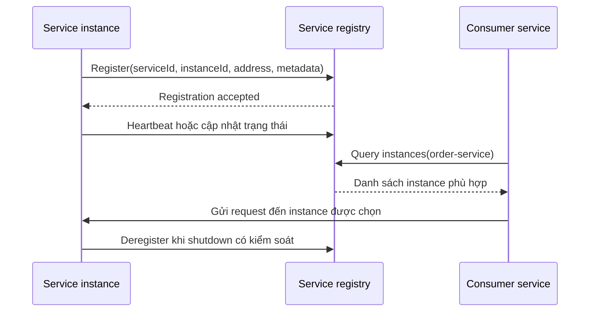
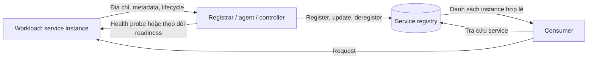

# Tự đăng ký và đăng ký thông qua thành phần trung gian

Trong kiến trúc `SPRING_CLOUD_SERVICE_DISCOVERY`, registry cần biết mỗi instance đang chạy ở đâu, có thể nhận request bằng giao thức nào và còn đủ điều kiện phục vụ hay không. Có hai cách tổ chức việc cập nhật thông tin này: chính service tự đăng ký (self-registration), hoặc một thành phần bên ngoài theo dõi service rồi đăng ký thay (third-party registration). Cả hai đều tạo dữ liệu để consumer tra cứu qua `DiscoveryClient`, nhưng khác nhau ở nơi sở hữu vòng đời đăng ký.

Spring Cloud cung cấp các abstraction chung như `DiscoveryClient`, `ServiceRegistry` và `Registration`, đồng thời tích hợp cơ chế tự đăng ký cho các implementation như Eureka và Consul. Hiểu rõ hai mô hình giúp chọn đúng nơi quản lý health check, credential, deregistration và dữ liệu instance khi triển khai microservice.

## 1. Registry cần lưu thông tin gì?

Một service có thể chạy nhiều instance. Registry lưu thông tin để consumer tìm đúng instance thay vì phải cấu hình cố định hostname và port. Một bản ghi instance thường có các nhóm dữ liệu sau:

| Dữ liệu | Ví dụ | Mục đích |
|---|---|---|
| Service ID / tên dịch vụ | `order-service` | Nhóm các instance cùng cung cấp một dịch vụ |
| Instance ID | `order-service:pod-a83f` | Phân biệt từng bản chạy, kể cả khi nhiều instance cùng tên |
| Địa chỉ truy cập | `10.20.1.15:8080` hoặc hostname nội bộ | Cho consumer biết nơi gửi request |
| Giao thức | HTTP hoặc HTTPS | Tạo URI đúng khi gọi instance |
| Metadata | zone, version, region, tags | Lọc hoặc ưu tiên instance theo thuộc tính triển khai |
| Health / trạng thái | healthy, critical, `UP`, `OUT_OF_SERVICE` | Xác định instance có được đưa vào danh sách phục vụ hay không |
| Thông tin kiểm tra | health-check URL, interval, TTL | Cho registry hoặc agent kiểm tra vòng đời instance |

Không phải registry nào cũng lưu mọi trường với cùng tên hoặc cùng semantics. `Registration` trong Spring Cloud Commons là marker interface; từng provider có implementation riêng, ví dụ `EurekaRegistration` hoặc `ConsulRegistration`. Vì vậy, không nên giả định metadata hay trạng thái có thể chuyển đổi nguyên xi giữa Eureka, Consul và registry khác.

## 2. Mô hình service tự đăng ký (self-registration)

Trong self-registration, chính tiến trình service biết địa chỉ và trạng thái của nó, sau đó gửi thông tin đăng ký đến registry. Với Spring Cloud, khi một implementation `DiscoveryClient` như Eureka hoặc Consul có mặt trên classpath, ứng dụng Spring Boot mặc định có thể tự đăng ký instance local. Với các phiên bản Spring Cloud hiện hành, không bắt buộc phải thêm `@EnableDiscoveryClient` chỉ để kích hoạt hành vi này.

Luồng tổng quát:



Quy trình thường có các bước:

1. **Khởi động và nhận diện instance:** ứng dụng xác định `spring.application.name`, instance ID, host, port, giao thức và metadata. Instance ID phải duy nhất trong phạm vi registry.
2. **Đăng ký:** discovery client gửi bản ghi lên registry khi ứng dụng đi vào giai đoạn đăng ký của lifecycle.
3. **Duy trì trạng thái:** instance gửi heartbeat hoặc registry/agent thực hiện health check. Metadata có thể được cập nhật khi trạng thái hoặc địa chỉ thay đổi.
4. **Ngừng phục vụ:** khi shutdown có kiểm soát, instance deregister hoặc chuyển trạng thái để consumer ngừng chọn nó trước khi tiến trình dừng.
5. **Dọn bản ghi lỗi thời:** nếu tiến trình chết đột ngột và không deregister được, heartbeat hết hạn hoặc health check thất bại giúp registry đánh dấu hay loại instance theo chính sách của provider.

### Spring Cloud hỗ trợ self-registration như thế nào?

`DiscoveryClient` chủ yếu phục vụ việc truy vấn dịch vụ và instance. `ServiceRegistry` là abstraction dành cho thao tác đăng ký, hủy đăng ký và một số thao tác trạng thái. Hai interface này có mục đích khác nhau:

| Abstraction | Trách nhiệm | Ví dụ thao tác |
|---|---|---|
| `DiscoveryClient` | Tra cứu service và các instance có thể sử dụng | `getServices()`, `getInstances("order-service")` |
| `ServiceRegistry` | Ghi hoặc xóa thông tin đăng ký của một instance | `register(registration)`, `deregister(registration)` |
| `Registration` | Đại diện cho dữ liệu đăng ký của provider | `EurekaRegistration`, `ConsulRegistration` |

Spring Cloud Commons mặc định bật auto-registration cho implementation tương ứng. Có thể tắt bằng cấu hình:

```yaml
spring:
  cloud:
    service-registry:
      auto-registration:
        enabled: false
```

Với Eureka, cũng có thể dùng `@EnableDiscoveryClient(autoRegister = false)` ở cấu hình phù hợp. Annotation `@EnableDiscoveryClient` không còn bắt buộc trong cấu hình thông thường của Spring Cloud hiện hành; property phía trên là cách điều khiển auto-registration qua cấu hình.

Khi cần tự điều khiển thời điểm đăng ký, ứng dụng có thể gọi `ServiceRegistry` với `Registration` phù hợp do provider cung cấp. Ví dụ sau minh họa ý tưởng; việc tạo `Registration` cụ thể phụ thuộc Eureka, Consul hoặc registry đang dùng:

```java
// Pseudocode: Registration được tạo theo provider đang sử dụng.
final class RegistrationLifecycle {
    private final ServiceRegistry registry;
    private final Registration registration;

    void registerWhenReady() {
        registry.register(registration);
    }

    void deregisterBeforeShutdown() {
        registry.deregister(registration);
    }
}
```

Spring Cloud Commons còn phát hai event khi auto-registration diễn ra: `InstancePreRegisteredEvent` trước khi đăng ký và `InstanceRegisteredEvent` sau khi đăng ký. Ứng dụng có thể lắng nghe các event này để ghi log, bổ sung kiểm tra hoặc phối hợp với một bước khởi tạo khác. Các event này không được phát khi auto-registration bị tắt bằng `spring.cloud.service-registry.auto-registration.enabled=false`.

### Ví dụ cấu hình Eureka client

```yaml
spring:
  application:
    name: order-service
  cloud:
    service-registry:
      auto-registration:
        enabled: true

server:
  port: 8080

eureka:
  client:
    serviceUrl:
      defaultZone: http://eureka-server:8761/eureka/
```

Với `spring-cloud-starter-netflix-eureka-client` trên classpath, ứng dụng vừa là Eureka client để truy vấn registry, vừa là một instance được đăng ký. Service ID mặc định lấy từ `spring.application.name`; port mặc định lấy từ `server.port`. Thuộc tính `defaultZone` là key của map và có phân biệt chữ hoa/chữ thường.

### Heartbeat không đồng nghĩa với health của ứng dụng

Registry cần biết instance còn tồn tại và có thể phục vụ. Hai câu hỏi này liên quan nhưng không giống nhau:

- **Heartbeat / lease:** tiến trình hoặc agent còn liên lạc với registry hay không?
- **Health / readiness check:** instance có thực sự sẵn sàng nhận loại request mà consumer gửi hay không?

Với Eureka, heartbeat của client mặc định được dùng để xác định instance còn hoạt động. Theo tài liệu Spring Cloud Netflix, trạng thái Actuator không tự động được truyền lên Eureka trong cấu hình mặc định; instance đã đăng ký có thể vẫn được công bố là `UP`. Nếu cần truyền health status của ứng dụng, có thể bật `eureka.client.healthcheck.enabled=true` trong `application.yml` và kiểm tra hành vi của phiên bản đang dùng.

Với Spring Cloud Consul, đăng ký mặc định tạo HTTP check đến `/actuator/health` mỗi 10 giây; nếu check thất bại, instance được đánh dấu `critical`. Consul cũng hỗ trợ TTL check, trong đó ứng dụng gửi heartbeat đến Consul agent thay vì agent gọi vào ứng dụng. Cần cấu hình đúng địa chỉ, context path, management port và quyền truy cập của endpoint kiểm tra.

## 3. Mô hình đăng ký qua thành phần trung gian (third-party registration)

Trong third-party registration, service không trực tiếp chịu trách nhiệm tạo và xóa bản ghi registry. Một thành phần khác theo dõi vòng đời workload, thu thập địa chỉ và trạng thái, sau đó đăng ký hoặc deregister thay service.

Spring Cloud Commons không cung cấp một controller độc lập dùng chung để tự động đăng ký mọi workload bên ngoài ứng dụng. `ServiceRegistry` là abstraction phía ứng dụng Spring; một registrar chạy ngoài tiến trình cần dùng API/SDK của registry hoặc API của nền tảng triển khai, đồng thời tự quản lý ánh xạ giữa vòng đời workload và bản ghi registry.

Thành phần trung gian có thể là:

- **Registration agent hoặc sidecar:** tiến trình chạy cạnh service, theo dõi health và gửi đăng ký đến registry.
- **Node agent:** agent chạy trên từng máy chủ, phát hiện các tiến trình hoặc container mới và quản lý bản ghi của chúng.
- **Orchestrator hoặc controller:** nền tảng triển khai theo dõi Pod, task hoặc VM, rồi cập nhật endpoint khi workload được tạo, ready, thay thế hoặc xóa.
- **Hệ thống provisioning:** pipeline hoặc control plane tạo workload và đồng thời ghi thông tin instance vào registry.

Luồng tổng quát:



Thành phần trung gian cần làm tốt ba việc: nhận diện đúng workload, xác định chính xác thời điểm workload sẵn sàng/ngừng phục vụ, và bảo đảm bản ghi được cập nhật hoặc xóa khi workload biến mất. Nếu registrar không quan sát được trạng thái thật của ứng dụng, registry có thể chứa instance chưa sẵn sàng hoặc đã chết.

### Ví dụ: nền tảng quản lý workload

Giả sử một nền tảng triển khai tạo ba replica `inventory-service`. Khi một Pod mới được tạo, controller quan sát Pod và Service selector, chờ Pod đạt readiness, rồi cập nhật tập endpoint phục vụ. Khi Pod bị xóa hoặc readiness thất bại, controller loại endpoint tương ứng khỏi tập endpoint được công bố.

Trong Kubernetes, Service và EndpointSlice được control plane duy trì từ Pod và readiness. Đây là ví dụ về nền tảng quản lý endpoint thay cho từng ứng dụng tự ghi vào một registry Eureka/Consul riêng. Spring Cloud Kubernetes có thể dùng Kubernetes API làm nguồn discovery; không cần giả định ứng dụng phải gọi `ServiceRegistry` để đăng ký chính nó trong mô hình này.

### Phân biệt Consul Agent với third-party registration

Spring Cloud Consul client thường gửi yêu cầu qua HTTP API đến Consul agent, thường là agent local trên node. Agent tiếp nhận đăng ký, thực hiện health check và phối hợp với cụm Consul. Việc có agent ở giữa đường truyền không tự động biến kiến trúc thành third-party registration: nếu ứng dụng Spring Cloud vẫn khởi tạo bản đăng ký và điều khiển vòng đời của nó, đây vẫn là self-registration từ góc độ ownership.

Chỉ nên gọi là third-party registration khi một thành phần độc lập thực sự sở hữu việc phát hiện workload, quyết định trạng thái và tạo/xóa bản ghi thay ứng dụng. Ranh giới nằm ở quyền sở hữu lifecycle, không chỉ ở việc request đi qua proxy hoặc agent.

## 4. So sánh hai mô hình

| Tiêu chí | Self-registration | Third-party registration |
|---|---|---|
| Ai tạo bản ghi? | Chính service hoặc discovery client trong service | Agent, sidecar, controller hoặc nền tảng triển khai |
| Ai hiểu trạng thái nội bộ? | Ứng dụng có thể kết hợp trạng thái readiness và logic nghiệp vụ | Registrar thường dựa vào probe, metadata hoặc tín hiệu từ orchestrator |
| Tích hợp registry | Mỗi service cần client/configuration và quyền đăng ký | Registrar cần tích hợp registry; service có thể không cần registry SDK |
| Phụ thuộc khi triển khai | Service phải truy cập được registry hoặc agent | Registrar phải truy cập được workload và registry |
| Đa ngôn ngữ | Mỗi ngôn ngữ cần client hoặc giao thức tương thích | Có thể dùng chung một registrar cho nhiều runtime |
| Quyền và bảo mật | Credential đăng ký có thể nằm trong từng service | Credential tập trung ở agent/controller, cần bảo vệ thành phần này chặt chẽ |
| Điểm lỗi cần quản lý | Từng client, cấu hình và tiến trình đăng ký | Registrar/agent và kênh quan sát workload |
| Ngừng hoạt động | Service cần deregister; TTL/health check xử lý crash | Registrar cần theo dõi terminate, mất kết nối và xóa bản ghi |

Không có mô hình nào tự động bảo đảm dữ liệu đúng. Self-registration có lợi thế khi ứng dụng hiểu rõ thời điểm sẵn sàng và có thể quản lý credential riêng. Third-party registration hữu ích khi nền tảng đã có control plane đáng tin cậy, cần hỗ trợ nhiều ngôn ngữ hoặc muốn tập trung quyền truy cập registry.

## 5. Vòng đời đăng ký và các tình huống dễ sai lệch

Đăng ký không kết thúc ở một lần gọi API. Registry cần phản ánh được các chuyển đổi trạng thái trong suốt vòng đời instance:

| Giai đoạn | Hành động | Rủi ro nếu xử lý sai |
|---|---|---|
| Starting | Tạo instance ID và chuẩn bị metadata | ID trùng làm một instance ghi đè hoặc xóa nhầm bản ghi của instance khác |
| Ready | Đăng ký hoặc đưa instance vào danh sách phục vụ | Đăng ký quá sớm khiến consumer gọi vào service chưa mở cổng hoặc chưa sẵn sàng |
| Running | Gửi heartbeat, chạy health check và cập nhật metadata | Mạng gián đoạn hoặc probe sai endpoint tạo trạng thái khỏe giả hoặc lỗi giả |
| Draining | Đánh dấu không nhận request mới, chờ request đang chạy kết thúc | Consumer tiếp tục chọn instance trong lúc ứng dụng đang shutdown |
| Stopping | Deregister và dừng tiến trình | Xóa bản ghi quá muộn gây request lỗi; xóa quá sớm có thể làm gián đoạn request đang chạy |
| Crashed | Registry/agent phát hiện heartbeat hoặc health check thất bại | Bản ghi stale còn tồn tại cho đến khi hết TTL hoặc lần kiểm tra tiếp theo |

Đối với rolling deployment, cần có thứ tự phù hợp: instance mới chỉ được nhận traffic khi ready; instance cũ ngừng nhận traffic mới trước khi dừng; thời gian drain phải đủ cho request đang xử lý. Thời gian heartbeat, health check và TTL nên được chọn dựa trên SLA phát hiện lỗi, tải registry và khả năng chịu false positive.

### Các sai lệch thường gặp

**Đăng ký địa chỉ không thể truy cập.** Ứng dụng có thể tự suy ra IP của container hoặc hostname nội bộ, nhưng địa chỉ đó chưa chắc consumer ở network khác truy cập được. Hãy xác định địa chỉ mà consumer thực sự dùng, kiểm tra routing, port mapping, proxy và TLS trước khi công bố.

**Instance ID không duy nhất.** Nếu mọi replica cùng dùng một ID cố định, registry có thể cập nhật hoặc xóa nhầm bản ghi. Hãy kết hợp service ID với pod UID, hostname, process ID hoặc một định danh duy nhất khác tùy nền tảng.

**Readiness và liveness bị dùng lẫn.** Liveness trả lời tiến trình có cần khởi động lại không; readiness trả lời instance có nhận traffic được không. Registry và load balancer cần tín hiệu phù hợp với khả năng phục vụ. Một ứng dụng sống nhưng chưa kết nối được database hoặc chưa nạp xong dữ liệu có thể chưa ready.

**Health check không thể truy cập.** Consul agent có thể không gọi được `/actuator/health` do management port, context path, firewall hoặc authentication. Hãy kiểm tra request từ chính nơi thực hiện probe, không chỉ kiểm tra bằng trình duyệt trên máy developer.

**Deregister không chạy khi process bị kill.** Hook shutdown chỉ xử lý được trường hợp dừng có kiểm soát. Với crash, mất node hoặc mất điện, cần heartbeat/TTL hoặc controller đối chiếu workload thực tế để dọn bản ghi.

**Registry và cache chưa đồng bộ.** Một consumer có thể còn giữ danh sách instance cũ sau khi registry đã thay đổi. Client-side load balancer nên xử lý lỗi kết nối và lấy danh sách mới theo cơ chế refresh của provider; không giả định mọi consumer thấy trạng thái mới ngay lập tức.

## 6. Chọn mô hình nào cho hệ thống?

Self-registration thường phù hợp khi service Spring Boot trực tiếp tích hợp Eureka hoặc Consul, số lượng workload vừa phải, ứng dụng cần kiểm soát metadata và có thể quản lý credential theo từng workload. Đây cũng là mô hình mặc định dễ bắt đầu khi học `ServiceRegistry` và `DiscoveryClient` trong Spring Cloud.

Third-party registration thường phù hợp khi tổ chức đã có orchestrator hoặc agent quản lý workload, có nhiều ngôn ngữ/runtime, hoặc muốn tập trung quyền ghi registry vào một thành phần hạ tầng. Với mô hình này, cần xác định rõ ai là nguồn sự thật cho readiness, ai xử lý deregistration và registrar khôi phục ra sao khi bị restart.

Trước khi quyết định, hãy trả lời các câu hỏi:

1. Thành phần nào biết chắc instance đã sẵn sàng nhận request?
2. Thành phần nào có thể phát hiện instance chết đột ngột và xóa bản ghi cũ?
3. Địa chỉ được đăng ký có thể truy cập từ tất cả consumer liên quan không?
4. Credential nào được phép tạo, cập nhật và xóa bản ghi? Có giới hạn theo service hoặc namespace không?
5. Nếu registry tạm thời không truy cập được, service có tiếp tục chạy không và khi kết nối trở lại ai đồng bộ trạng thái?
6. Cách triển khai có bảo đảm instance mới không nhận traffic trước readiness và instance cũ được drain trước khi dừng không?

## 7. Bảo mật và vận hành

Đăng ký dịch vụ là một thao tác có ảnh hưởng trực tiếp đến định tuyến traffic. Một client hoặc registrar không đáng tin cậy có thể công bố địa chỉ giả, metadata sai hoặc xóa instance hợp lệ. Vì vậy:

- Xác thực service/registrar với registry; dùng TLS khi giao tiếp qua network không tin cậy.
- Cấp quyền ghi theo service hoặc namespace, giới hạn thao tác đăng ký và xóa trong phạm vi cần thiết.
- Không đưa password, token, khóa riêng hoặc dữ liệu cá nhân vào metadata/tag hiển thị trong registry.
- Bảo vệ health endpoint; chỉ mở cho agent hoặc probe cần truy cập và cấu hình đúng network path.
- Ghi log sự kiện register, update, status change và deregister cùng service ID, instance ID, thời điểm và nguyên nhân.
- Theo dõi số lượng instance, bản ghi stale, health check critical, lỗi heartbeat, lỗi đăng ký và thời gian hội tụ sau deployment.
- Có quy trình đối soát registry với workload thực tế để phát hiện bản ghi mồ côi hoặc instance bị thiếu.

Không dùng registry làm kho lưu cấu hình bí mật. Metadata nên chứa thông tin định tuyến và phân loại cần thiết, với dữ liệu được kiểm soát và xác thực.

## 8. Kết nối với DiscoveryClient và load balancing

Dù đăng ký theo mô hình nào, consumer thường dùng `DiscoveryClient` để tìm các instance theo service ID. Sau đó, Spring Cloud LoadBalancer hoặc một cơ chế định tuyến khác chọn instance phù hợp. Registry trả lời câu hỏi “những instance nào đã được công bố và đang hợp lệ theo registry”; load balancer quyết định “request này đi đến instance nào”.

Ví dụ, consumer gọi logical service name `http://order-service`. Discovery client lấy danh sách instance của `order-service`; load balancer chọn một instance theo chiến lược đang cấu hình và tạo địa chỉ vật lý. Vì thế, đăng ký thành công chưa đủ để bảo đảm request thành công: network, TLS, health, timeout và chính sách retry vẫn cần được cấu hình đúng.

## Tài liệu tham khảo

- [Spring Cloud Commons — Common Abstractions: DiscoveryClient, ServiceRegistry và auto-registration](https://docs.spring.io/spring-cloud-commons/reference/spring-cloud-commons/common-abstractions.html)
- [Spring Cloud Netflix — Eureka Clients, registration, heartbeat và health check](https://docs.spring.io/spring-cloud-netflix/reference/spring-cloud-netflix.html)
- [Spring Cloud Consul — Service Discovery, registration, HTTP check và TTL check](https://docs.spring.io/spring-cloud-consul/reference/discovery.html)
- [Kubernetes — Service và EndpointSlice](https://kubernetes.io/docs/concepts/services-networking/service/)
- [Kubernetes — Pod readiness và liveness probes](https://kubernetes.io/docs/concepts/configuration/liveness-readiness-startup-probes/)
