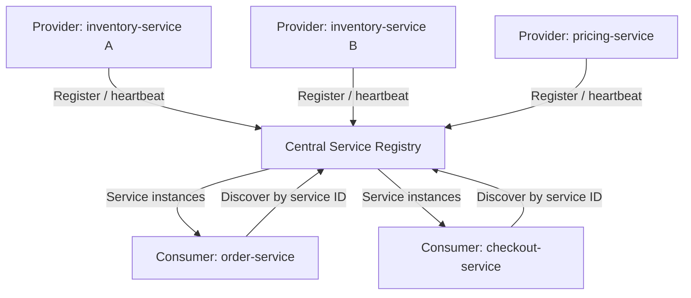
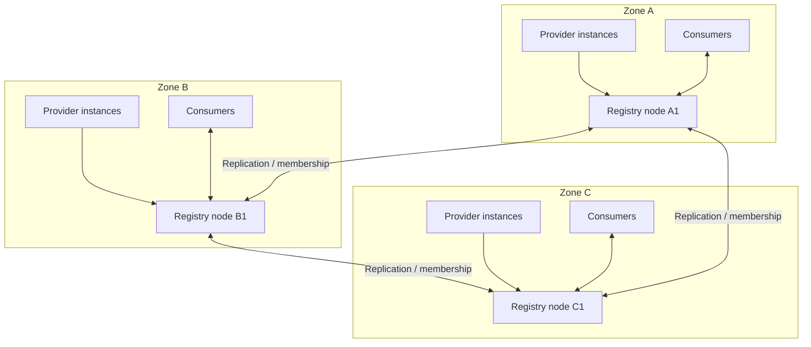
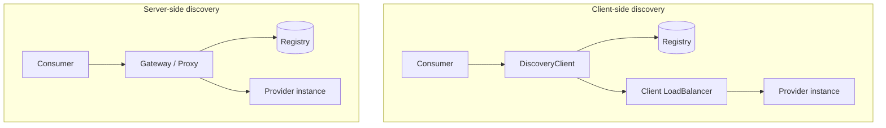

# Sổ đăng ký tập trung và sổ đăng ký phân tán

Trong hệ thống microservice, provider cần công bố các instance đang chạy và consumer cần tìm các instance đó bằng tên dịch vụ. Service Registry giữ vai trò lưu trữ và cung cấp thông tin này. Cách tổ chức registry ảnh hưởng trực tiếp đến độ sẵn sàng, độ trễ tra cứu, tính nhất quán dữ liệu và khả năng vận hành khi mạng hoặc một node gặp sự cố.

Có thể tổ chức sổ đăng ký theo mô hình tập trung hoặc phân tán. Mô hình tập trung dùng một đầu mối logic để quản lý dữ liệu dịch vụ; mô hình phân tán phân bố dữ liệu và/hoặc khả năng xử lý giữa nhiều node, vùng hoặc trung tâm dữ liệu. Trong thực tế, một registry tập trung về mặt logic vẫn có thể chạy thành cụm nhiều node có dự phòng. Ngược lại, một hệ thống có nhiều server cũng chưa chắc là phân tán theo nghĩa mọi node cùng tham gia duy trì dữ liệu và phục vụ truy vấn.

Bài học này thuộc module `SPRING_CLOUD_SERVICE_DISCOVERY`, nơi người học tìm hiểu cách Spring Cloud khám phá instance qua `DiscoveryClient`, `ServiceRegistry`, Eureka hoặc Consul, cùng vòng đời đăng ký, health check, load balancing, bảo mật và xử lý sai lệch registry. Trọng tâm ở đây là phân biệt hai kiến trúc registry, hiểu cách dữ liệu được chia sẻ và chọn mô hình phù hợp với phạm vi triển khai microservice.

## 1. Registry làm gì trong Service Discovery?

Một Service Registry lưu bản ghi của các instance. Bản ghi thường có service ID, instance ID, host, port, giao thức, metadata và thông tin trạng thái hoặc health tùy nhà cung cấp.

Ví dụ, ba instance của `inventory-service` có thể được công bố như sau:

| Service ID | Instance ID | Địa chỉ | Metadata |
|---|---|---|---|
| `inventory-service` | `inventory-a1` | `10.10.1.21:8080` | `zone=zone-a` |
| `inventory-service` | `inventory-a2` | `10.10.1.22:8080` | `zone=zone-a` |
| `inventory-service` | `inventory-b1` | `10.10.2.31:8080` | `zone=zone-b` |

Registry hỗ trợ hai nhóm thao tác:

- **Ghi và duy trì bản ghi:** provider đăng ký instance, cập nhật trạng thái, gửi heartbeat hoặc thực hiện health check theo cơ chế của registry, rồi hủy đăng ký khi dừng.
- **Đọc và khám phá:** consumer tra cứu theo service ID để lấy danh sách instance, sau đó chọn một instance hoặc chuyển danh sách cho bộ cân bằng tải.

Registry không xử lý logic nghiệp vụ của request. Nó cũng không bảo đảm rằng một địa chỉ được trả về chắc chắn còn phục vụ tại thời điểm request tới nơi. Consumer vẫn cần timeout, xử lý lỗi kết nối và chính sách retry phù hợp.

## 2. Sổ đăng ký tập trung

Trong mô hình tập trung, các provider và consumer sử dụng một đầu mối registry logic. Provider gửi bản ghi tới registry đó; consumer truy vấn cùng nguồn dữ liệu để lấy danh sách instance.

Điểm quan trọng là **tập trung về mặt quản lý và nguồn dữ liệu logic**. Registry có thể là một tiến trình đơn trong môi trường phát triển, nhưng triển khai production thường cần nhiều node, replica hoặc cơ chế failover. Một cụm server vẫn có thể được xem là registry tập trung nếu toàn hệ thống cung cấp một authority logic chung và các client truy cập qua một endpoint hoặc một tập endpoint thuộc cùng registry.

### 2.1. Cách hoạt động

Một luồng điển hình diễn ra như sau:

1. Provider khởi động và tạo registration gồm service ID, địa chỉ instance cùng metadata.
2. Registry nhận và lưu bản ghi theo mô hình dữ liệu của nó.
3. Provider duy trì sự hiện diện bằng heartbeat, lease hoặc health check nếu implementation yêu cầu.
4. Consumer truy vấn registry bằng service ID, nhận danh sách instance đủ điều kiện theo chính sách lọc.
5. Consumer hoặc LoadBalancer chọn một instance để gửi request.
6. Khi provider dừng, nó hủy đăng ký; nếu tiến trình chết đột ngột, TTL hoặc health check có thể loại bản ghi sau một khoảng thời gian.

### 2.2. Ưu điểm

- **Dễ hiểu và dễ quản trị:** có một nơi logic để kiểm tra service ID, instance, trạng thái và metadata.
- **Quản lý chính sách tập trung:** quyền đăng ký, quy ước đặt tên, metadata và quy tắc health có thể được quản lý nhất quán.
- **Phù hợp hệ thống một vùng:** với hệ thống có quy mô vừa phải trong một datacenter hoặc một cụm mạng, một registry logic thường đủ đơn giản để triển khai.
- **Dễ tích hợp:** ứng dụng có thể dùng abstraction chung của Spring Cloud để đăng ký và tra cứu qua một integration cụ thể.

### 2.3. Hạn chế và rủi ro

Registry tập trung tạo ra một dependency chung. Nếu registry ngừng hoạt động, provider mới có thể không đăng ký được và consumer có thể không lấy được danh sách mới. Các consumer đang giữ cache có thể tiếp tục dùng dữ liệu cũ, nhưng mức độ ảnh hưởng phụ thuộc vào client và chính sách cache.

Khi số lượng service và request tra cứu tăng, registry có thể trở thành điểm nóng về tải hoặc độ trễ. Nếu registry chỉ có một node, node đó còn là điểm lỗi đơn. Triển khai một cụm HA giúp giảm rủi ro này, nhưng không loại bỏ các vấn đề như lỗi mạng tới toàn cụm, lỗi cấu hình chung, quá tải hoặc mất khả năng ghi khi quorum không đạt.

Vì vậy, “tập trung” không đồng nghĩa với “chỉ có một máy”. Cần phân biệt authority logic với số lượng node vật lý.

## 3. Sổ đăng ký phân tán

Trong mô hình phân tán, registry được triển khai trên nhiều node và dữ liệu hoặc khả năng xử lý được phân bố giữa các node, vùng hoặc datacenter. Các node có thể sao chép trạng thái, trao đổi thông tin membership, tiếp nhận truy vấn ở nhiều vị trí hoặc phối hợp qua cơ chế quorum.

Sơ đồ minh họa nhiều node cùng tham gia kiến trúc. Cơ chế thực tế có thể là leader/quorum, replication giữa các peer, gossip, phân vùng theo vùng hoặc kết hợp nhiều cơ chế. Không phải mọi registry phân tán đều cho phép mọi node ghi dữ liệu độc lập.

### 3.1. Các cách phân tán dữ liệu

**Replication có điều phối bằng leader hoặc quorum:** một nhóm node duy trì bản sao dữ liệu và phối hợp để xác nhận thay đổi. Một số thao tác ghi cần leader hoặc quorum. Cách này giúp các node thống nhất trạng thái theo một giao thức xác định, nhưng khi không đủ quorum thì một số thao tác có thể phải từ chối hoặc chờ phục hồi.

**Replication giữa các peer với hội tụ sau:** các node trao đổi thay đổi và dần hội tụ về cùng trạng thái. Trong khoảng thời gian mạng bị phân đoạn hoặc thông tin chưa truyền hết, hai node có thể trả về danh sách khác nhau. Mô hình này có thể tăng khả năng tiếp tục phục vụ truy vấn hoặc cập nhật cục bộ, nhưng consumer cần chấp nhận khả năng dữ liệu tạm thời cũ hoặc không đồng nhất.

**Gossip và membership:** node trao đổi thông tin về sự tồn tại và tình trạng của node khác theo chu kỳ hoặc khi có sự kiện. Gossip thường hữu ích cho phát hiện thành viên và lan truyền trạng thái. Nó không nhất thiết là cơ chế lưu trữ mọi bản ghi service hay là cơ chế đồng thuận cho tất cả thao tác ghi.

**Phân vùng hoặc liên kết theo vùng:** mỗi datacenter hoặc zone có registry cục bộ để provider và consumer truy cập gần nhau. Các vùng có thể đồng bộ, liên kết hoặc liên bang hóa thông tin cần thiết. Cách này giảm độ trễ cục bộ và giới hạn ảnh hưởng khi một vùng gặp sự cố, nhưng cần chính sách rõ ràng về tra cứu liên vùng và xử lý dữ liệu trùng.

### 3.2. Ưu điểm

- **Khả năng chịu lỗi tốt hơn:** một node hỏng không nhất thiết làm toàn bộ registry ngừng hoạt động, nếu topology và quorum được thiết kế phù hợp.
- **Mở rộng theo vùng:** có thể đặt node gần provider và consumer để giảm độ trễ mạng.
- **Phân tán tải:** nhiều node có thể cùng phục vụ truy vấn hoặc duy trì bản sao dữ liệu.
- **Cô lập sự cố:** lỗi ở một zone hoặc datacenter có thể được giới hạn nếu kiến trúc phân vùng và failover được thiết kế đúng.
- **Hỗ trợ hệ thống đa vùng:** phù hợp hơn với hệ thống cần hoạt động ở nhiều datacenter hoặc khu vực địa lý.

### 3.3. Hạn chế và rủi ro

Kiến trúc phân tán phức tạp hơn về vận hành. Đội ngũ cần hiểu replication, membership, quorum, partition, failover, đồng bộ thời gian và chính sách xử lý dữ liệu xung đột. Khi có sự cố mạng, các vùng có thể nhìn thấy trạng thái khác nhau.

Việc thêm node không tự động làm hệ thống an toàn hơn. Nếu các node cùng đặt trong một failure domain, cùng phụ thuộc vào một switch, một zone hoặc một cấu hình sai, một sự cố vẫn có thể làm mất toàn bộ khả năng phục vụ. Cần đặt replica trên các miền lỗi độc lập và kiểm thử tình huống mất node hoặc mất liên kết giữa các vùng.

Ngoài ra, replication và gossip tạo thêm traffic mạng. Nếu cấu hình không phù hợp, hoạt động đồng bộ có thể cạnh tranh băng thông với request nghiệp vụ hoặc làm tăng thời gian hội tụ.

## 4. So sánh hai mô hình

| Tiêu chí | Registry tập trung | Registry phân tán |
|---|---|---|
| Nguồn dữ liệu logic | Một authority hoặc một cụm logic chung. | Nhiều node/vùng duy trì hoặc phục vụ dữ liệu theo topology. |
| Triển khai vật lý | Có thể một node hoặc một cụm HA. | Thường nhiều node ở nhiều failure domain. |
| Độ phức tạp | Thường thấp hơn, dễ quan sát và quản trị hơn. | Cao hơn do replication, membership, quorum hoặc hội tụ. |
| Độ trễ | Phụ thuộc vị trí client so với registry chung. | Có thể thấp hơn khi truy cập node cục bộ, nhưng đồng bộ liên vùng có độ trễ. |
| Khả năng chịu lỗi | Phụ thuộc HA, replica và failover của cụm trung tâm. | Có thể chịu lỗi node/vùng tốt hơn nếu replica phân bố đúng. |
| Tính nhất quán | Có thể tập trung kiểm soát thứ tự ghi; vẫn phụ thuộc implementation. | Có thể dùng quorum hoặc eventual consistency; khác nhau theo thiết kế. |
| Khả năng mở rộng | Có thể tăng tài nguyên và thêm replica; điểm tập trung vẫn cần quản lý tải. | Có thể phân tán tải và dữ liệu, đổi lại cần quản trị topology. |
| Phạm vi phù hợp | Một cụm hoặc một datacenter, hệ thống cần mô hình vận hành đơn giản. | Nhiều zone/datacenter, yêu cầu chịu lỗi và truy cập phân vùng. |
| Vấn đề nổi bật | Điểm phụ thuộc chung, quá tải hoặc mất registry logic. | Sai lệch tạm thời, partition, quorum, hội tụ và vận hành phức tạp. |

Không có mô hình nào luôn tốt hơn. Một registry tập trung được triển khai thành cụm HA có thể đáp ứng yêu cầu của nhiều hệ thống lớn. Một registry phân tán có thể phù hợp với hệ thống đa vùng nhưng gây chi phí vận hành không cần thiết cho một ứng dụng nhỏ.

## 5. Tính nhất quán và network partition

Tính nhất quán mô tả mức độ các node nhìn thấy cùng một trạng thái registry và thời điểm thay đổi được phản ánh trên các bản sao. Trong môi trường phân tán, network partition có thể khiến một nhóm node không liên lạc được với nhóm còn lại.

Khi xảy ra partition, hệ thống thường phải cân nhắc giữa việc tiếp tục chấp nhận thao tác và việc bảo đảm các node không đưa ra trạng thái mâu thuẫn. Đây là một phần của bài toán CAP: khi phân vùng mạng thực sự xảy ra, một hệ thống phân tán phải lựa chọn cách đánh đổi giữa tính nhất quán và tính sẵn sàng cho những thao tác liên quan.

Hai hướng phổ biến:

- **Ưu tiên xác nhận nhất quán qua quorum:** thao tác ghi cần đủ số node tham gia. Nếu không đủ quorum, hệ thống có thể từ chối ghi để tránh hai nhóm cùng xác nhận các thay đổi xung đột. Đổi lại, một phần hệ thống có thể mất khả năng ghi trong thời gian partition.
- **Ưu tiên tiếp tục phục vụ với hội tụ sau:** node hoặc vùng có thể tiếp tục cung cấp dữ liệu cục bộ và đồng bộ thay đổi khi kết nối phục hồi. Đổi lại, consumer có thể nhận danh sách instance cũ, thiếu hoặc khác nhau giữa các vùng trong một khoảng thời gian.

Không nên gắn nhãn một registry là “strongly consistent” hoặc “eventually consistent” cho mọi thao tác mà không kiểm tra tài liệu. Một sản phẩm có thể dùng các cơ chế khác nhau cho membership, ghi service catalog, đọc dữ liệu và cache phía client.

### 5.1. Vì sao dữ liệu registry có thể sai lệch?

Giả sử instance `inventory-a2` vừa bị dừng ở zone A. Provider không gửi được deregistration do mạng bị ngắt. Một consumer ở zone B vẫn có bản sao cũ và tiếp tục nhận instance này trong kết quả discovery. Trong khi đó, consumer ở zone A có thể đã thấy instance bị loại nhờ health check cục bộ.

Đây là sai lệch tạm thời giữa trạng thái thực tế và trạng thái registry. Các cơ chế như heartbeat, TTL, health check, replication và cache refresh giúp giới hạn thời gian sai lệch, nhưng không bảo đảm mọi consumer cập nhật đồng thời.

### 5.2. Cách ứng dụng giảm tác động

1. Đặt timeout kết nối và timeout request phù hợp; không coi dữ liệu discovery là bảo đảm endpoint còn sống.
2. Chỉ retry thao tác an toàn khi retry, giới hạn số lần và dùng backoff để tránh tạo tải dồn.
3. Dùng circuit breaker hoặc cơ chế cô lập lỗi khi dependency liên tục không khả dụng.
4. Phối hợp readiness, graceful shutdown, deregistration và TTL để rút instance khỏi traffic đúng lúc.
5. Hiểu cache ở registry client, `DiscoveryClient` adapter và LoadBalancer; tránh thêm nhiều tầng cache không cần thiết.
6. Theo dõi thời gian từ khi instance thay đổi đến khi consumer nhìn thấy thay đổi.

## 6. Centralized và distributed là một trục kiến trúc; client-side và server-side là trục khác

Một nhầm lẫn phổ biến là xem registry tập trung đồng nghĩa với client-side discovery hoặc registry phân tán đồng nghĩa với server-side discovery. Đây là hai quyết định kiến trúc độc lập.

- **Tập trung/phân tán** mô tả cách registry được tổ chức, lưu dữ liệu, sao chép và phục vụ truy vấn.
- **Client-side/server-side discovery** mô tả thành phần nào thực hiện việc tra cứu và lựa chọn đích cho request.

Trong client-side discovery, consumer gọi `DiscoveryClient` để lấy danh sách `ServiceInstance`; LoadBalancer chọn một instance. Consumer có thể tra cứu từ một registry tập trung hoặc từ node registry phân tán.

Trong server-side discovery, consumer gửi request tới một proxy, gateway hoặc load balancer ổn định; thành phần trung gian sử dụng dữ liệu registry để tìm và chuyển request tới provider. Registry bên dưới vẫn có thể tập trung hoặc phân tán.

Ví dụ, Spring Cloud `DiscoveryClient` kết hợp Spring Cloud LoadBalancer thường thể hiện mô hình client-side discovery. Spring Cloud Gateway có thể sử dụng service ID và discovery integration để định tuyến ở phía gateway. Cả hai cách đều có thể kết nối tới registry tập trung hoặc phân tán.

## 7. Liên hệ với Spring Cloud, Eureka và Consul

Spring Cloud Commons định nghĩa abstraction để ứng dụng không phải phụ thuộc trực tiếp vào giao thức riêng của một registry. Các interface quan trọng gồm:

| Abstraction | Vai trò |
|---|---|
| `ServiceInstance` | Mô tả một instance có thể được truy cập, gồm service ID, host, port, URI và metadata. |
| `DiscoveryClient` | Tra cứu danh sách instance theo service ID ở phía consumer. |
| `Registration` | Mô tả instance dùng trong quy trình đăng ký ở phía provider. |
| `ServiceRegistry` | Cung cấp thao tác đăng ký, hủy đăng ký và quản lý trạng thái registration. |

Các abstraction không áp đặt một topology duy nhất. Registry integration chịu trách nhiệm kết nối với hệ thống cụ thể và chuyển dữ liệu sang các kiểu Spring Cloud.

### 7.1. Eureka

Eureka thường được triển khai theo cụm Eureka Server. Các server peer có thể trao đổi và sao chép thông tin registry; Eureka client đăng ký instance và duy trì trạng thái bằng heartbeat. Cách triển khai này có các đặc tính hội tụ và cache riêng, vì vậy consumer có thể tạm thời nhìn thấy dữ liệu chưa đồng nhất.

Eureka có cơ chế self-preservation để hạn chế việc xóa hàng loạt instance khi server nghi ngờ có sự cố mạng khiến heartbeat giảm bất thường. Cơ chế này giúp tránh xóa nhầm trong một số tình huống, nhưng cũng có thể khiến bản ghi của instance đã chết còn tồn tại lâu hơn dự kiến. Người vận hành cần hiểu ngưỡng, log và tác động của cấu hình này.

### 7.2. Consul

Consul thường có Consul agent trên các node và một cụm Consul server duy trì trạng thái catalog. Cụm server dùng giao thức consensus dựa trên Raft để phối hợp một số thay đổi trạng thái; gossip được dùng cho membership và phát hiện lỗi node trong kiến trúc Consul. Đây là các cơ chế có vai trò khác nhau.

Client có thể đăng ký service qua agent và tra cứu catalog thông qua agent hoặc API phù hợp. Health check có thể được cấu hình để phản ánh trạng thái dịch vụ. Việc đọc dữ liệu với các mức consistency khác nhau và hành vi khi mất quorum cần được hiểu theo cấu hình và tài liệu Consul đang triển khai.

### 7.3. So sánh ở góc độ kiến trúc

| Khía cạnh | Eureka | Consul |
|---|---|---|
| Thành phần điển hình | Eureka client và cụm Eureka Server. | Consul agent trên node và cụm Consul server. |
| Đồng bộ trạng thái | Peer replication, heartbeat và cơ chế hội tụ/cache. | Raft cho trạng thái server cần consensus; gossip cho membership/failure detection. |
| Health | Heartbeat và cơ chế trạng thái của Eureka. | Health check có thể cấu hình theo service. |
| Khi có partition | Có thể xuất hiện dữ liệu trễ hoặc khác nhau; self-preservation ảnh hưởng việc loại bản ghi. | Khả năng ghi phụ thuộc quorum server; agent và client có thể còn dữ liệu cục bộ hoặc trạng thái cũ. |
| Lưu ý | Cần quan sát replication, renewal và self-preservation. | Cần vận hành agent/server, quorum, ACL, datacenter và health check. |

Đây là mô tả ở mức kiến trúc. Chi tiết cụ thể thay đổi theo phiên bản, cấu hình, topology và cách ứng dụng tích hợp. Không nên suy ra toàn bộ semantics của registry chỉ từ abstraction `DiscoveryClient` hoặc `ServiceRegistry`.

## 8. Ví dụ chọn topology theo môi trường

### 8.1. Một cụm ứng dụng trong một datacenter

Một nhóm microservice chạy trong cùng một datacenter, có số lượng instance vừa phải và đội vận hành nhỏ. Một registry logic chung, được triển khai thành cụm HA phù hợp, có thể là lựa chọn cân bằng giữa tính đơn giản và khả năng sẵn sàng.

Các điểm cần thiết kế:

- Có nhiều registry node hoặc replica trong các failure domain phù hợp.
- Provider và consumer có endpoint dự phòng hoặc cơ chế discovery endpoint của cụm.
- Consumer có cache hợp lý để giảm phụ thuộc vào từng lần truy vấn registry.
- Có health check, heartbeat/TTL và deregistration khi shutdown.
- Có cảnh báo khi registry mất quorum, quá tải hoặc số lượng instance bất thường.

### 8.2. Nhiều zone trong cùng một vùng địa lý

Một hệ thống chạy ở ba availability zone có thể đặt registry node trên các zone khác nhau. Provider và consumer ưu tiên node gần nhất hoặc endpoint nội bộ phù hợp, trong khi trạng thái registry được sao chép theo cơ chế của sản phẩm.

Thiết kế cần cân bằng giữa truy vấn cục bộ và tính nhất quán toàn cụm. Nếu mỗi zone chỉ nhìn dữ liệu cục bộ, cần biết khi nào và bằng cách nào instance ở zone khác được khám phá. Nếu mọi truy vấn đều đi tới một endpoint ở zone xa, độ trễ và rủi ro phụ thuộc mạng liên zone tăng lên.

### 8.3. Nhiều datacenter hoặc nhiều khu vực địa lý

Với hệ thống đa vùng, có thể dùng registry theo từng datacenter kết hợp federation hoặc cơ chế đồng bộ có chọn lọc. Consumer thường ưu tiên instance tại vùng gần để giảm latency và chỉ chuyển vùng khi cần failover hoặc khi chính sách nghiệp vụ cho phép.

Không nên mặc định mọi service ID phải được công bố toàn cầu. Một số dịch vụ chỉ tồn tại trong một vùng; một số khác cần được khám phá liên vùng. Phạm vi công bố, quyền truy cập và quy tắc fallback phải được xác định rõ.

## 9. Quy trình thiết kế một registry topology

Có thể dùng trình tự sau để chọn và triển khai mô hình:

1. **Xác định failure domain:** ứng dụng chạy trong một node, một zone, nhiều zone hay nhiều datacenter?
2. **Đo yêu cầu độ trễ:** consumer cần tra cứu ở phạm vi cục bộ hay liên vùng? Có thể chấp nhận độ trễ đồng bộ bao lâu?
3. **Chọn semantics dữ liệu:** thao tác nào cần quorum/consistency cao, thao tác nào chấp nhận dữ liệu trễ trong thời gian ngắn?
4. **Chọn topology:** một registry logic HA, cluster peer, registry theo vùng hay federation.
5. **Xác định luồng ghi và đọc:** provider đăng ký vào đâu, consumer truy vấn node nào, dữ liệu được sao chép ra sao?
6. **Thiết kế health và lifecycle:** readiness, heartbeat, TTL, health check và deregistration phối hợp thế nào?
7. **Thiết kế bảo mật:** xác thực client, ACL theo service ID, TLS, phân vùng quyền và bảo vệ metadata.
8. **Kiểm thử lỗi:** dừng một node, mất quorum, chia cắt mạng, mất một zone, dữ liệu cũ và registry quá tải.
9. **Đo khả năng phục hồi:** thời gian phát hiện instance lỗi, thời gian hội tụ và thời gian consumer nhận được danh sách đúng.

## 10. Bảo mật và phân quyền registry

Registry chứa dữ liệu hạ tầng nội bộ và có thể ảnh hưởng tới nơi request được gửi. Một ứng dụng có quyền đăng ký tùy ý có thể giả mạo service ID hoặc công bố địa chỉ độc hại. Một consumer có quyền tra cứu quá rộng có thể nhìn thấy thông tin của những vùng hoặc dịch vụ không liên quan.

Các biện pháp nên áp dụng:

- Xác thực provider, consumer và agent khi kết nối registry.
- Phân quyền đăng ký, cập nhật, hủy đăng ký và tra cứu theo service ID, namespace hoặc datacenter.
- Dùng TLS cho các kết nối qua mạng không tin cậy.
- Quản lý token và credential bằng secret manager; luân chuyển credential khi cần.
- Không đưa mật khẩu, token, private key hoặc dữ liệu nhạy cảm vào metadata.
- Giới hạn quyền quản trị và bảo vệ API/GUI của registry.
- Kiểm tra dữ liệu metadata trước khi dùng để định tuyến hoặc áp dụng chính sách bảo mật.

Trong topology phân tán, chính sách bảo mật còn cần nhất quán giữa node, agent, datacenter và cơ chế replication. Một node được cấu hình quyền rộng hơn có thể trở thành đường vòng để ghi hoặc đọc dữ liệu ngoài phạm vi dự kiến.

## 11. Giám sát và xử lý sự cố

Registry nên được giám sát như một dependency hạ tầng quan trọng. Ngoài trạng thái sống của tiến trình, cần theo dõi khả năng ghi, đọc, đồng bộ và mức độ chính xác của dữ liệu.

| Chỉ số hoặc tín hiệu | Ý nghĩa |
|---|---|
| Số lượng instance theo service ID | Phát hiện service đột ngột mất instance hoặc đăng ký trùng. |
| Tỷ lệ register/deregister thành công | Phát hiện provider không công bố hoặc không rút bản ghi đúng cách. |
| Heartbeat hoặc health check timeout | Phát hiện instance hoặc đường mạng có vấn đề. |
| Độ trễ truy vấn discovery | Đánh giá ảnh hưởng của registry lên consumer. |
| Replication lag hoặc thời gian hội tụ | Đánh giá độ mới dữ liệu giữa các node nếu implementation cung cấp. |
| Trạng thái quorum/leader | Đánh giá khả năng ghi và phối hợp của cụm consensus. |
| Gossip/member status | Phát hiện node bị nghi ngờ hoặc mất liên lạc trong topology có gossip. |
| Tỷ lệ kết quả discovery rỗng | Phát hiện sai service ID, thiếu registration hoặc phạm vi truy vấn sai. |

Khi consumer nhận được instance không còn hoạt động, hãy kiểm tra theo thứ tự: địa chỉ trong bản ghi, trạng thái provider, health check/heartbeat, trạng thái registry node, replication hoặc cache, rồi đến cache của LoadBalancer. Cần ghi nhận mốc thời gian để xác định độ trễ phát hiện và hội tụ.

Khi registry mất khả năng ghi, không nên lập tức xóa hoặc đăng ký lại hàng loạt instance bằng script tùy tiện. Trước hết xác định trạng thái quorum, leader, replication và nguồn dữ liệu có thẩm quyền. Các thao tác sửa dữ liệu thủ công có thể làm tình trạng lệch bản ghi phức tạp hơn.

## 12. Các hiểu nhầm thường gặp

**“Registry tập trung luôn chỉ có một server.”** Không đúng. Tập trung có thể mô tả một authority logic được cung cấp bởi cụm HA nhiều node.

**“Có nhiều server nghĩa là registry phân tán hoàn toàn.”** Chưa đủ căn cứ. Nhiều server có thể chỉ là replica của một authority trung tâm; cần xem cách dữ liệu được phân phối, sao chép và phục vụ.

**“Registry phân tán luôn nhất quán hơn.”** Không đúng. Một topology phân tán có thể ưu tiên availability và hội tụ sau, khiến các consumer tạm thời nhìn thấy dữ liệu khác nhau.

**“Gossip thay thế consensus.”** Không đúng. Gossip thường lan truyền membership hoặc thông tin trạng thái; consensus giải quyết việc các node thống nhất một số thay đổi. Một sản phẩm có thể dùng cả hai cho mục đích khác nhau.

**“Có replica là không thể mất dữ liệu.”** Không đúng. Replica có thể cùng chịu ảnh hưởng từ lỗi cấu hình, lỗi phần mềm, xóa nhầm, mất quorum hoặc failure domain chung. Cần backup và quy trình phục hồi phù hợp.

**“Client-side discovery chỉ dùng được với registry tập trung.”** Không đúng. Consumer có thể tra cứu từ một node cục bộ trong registry phân tán.

**“Registry trả về instance nghĩa là request chắc chắn thành công.”** Không đúng. Dữ liệu có thể trễ; endpoint, DNS, firewall, TLS và ứng dụng đích vẫn có thể lỗi.

## 13. Checklist lựa chọn kiến trúc

| Câu hỏi | Gợi ý đánh giá |
|---|---|
| Hệ thống có bao nhiêu zone/datacenter? | Một vùng thường có thể bắt đầu với registry logic chung; đa vùng cần xem xét locality và federation. |
| Registry mất kết nối thì consumer làm gì? | Có cache, endpoint dự phòng, fallback hoặc giới hạn thời gian hoạt động với dữ liệu cũ không? |
| Ghi registry có cần quorum không? | Xác định thao tác nào cần xác nhận đồng thuận và hành vi khi mất quorum. |
| Có chấp nhận dữ liệu trễ không? | Đặt giới hạn độ trễ hội tụ và cách consumer xử lý instance cũ. |
| Instance được phát hiện chết bằng cách nào? | Heartbeat, TTL, health check hay kết hợp. |
| Consumer truy vấn ở đâu? | Node cục bộ, endpoint chung hay datacenter gần nhất. |
| Metadata và quyền được quản lý thế nào? | Quy ước schema, ACL, TLS và secret management. |
| Có kiểm thử partition và failover không? | Mô phỏng mất node, mất quorum, mất zone và phục hồi liên kết. |
| Đo được độ mới dữ liệu không? | Theo dõi replication lag, cache age hoặc thời gian hội tụ. |
| Chi phí vận hành có phù hợp không? | Đánh giá nhân lực trực ca, backup, nâng cấp và phục hồi. |

## Kết luận

Sổ đăng ký tập trung cung cấp một authority logic chung, dễ hiểu và dễ quản trị; khi triển khai production, nó vẫn có thể chạy trên cụm HA nhiều node. Sổ đăng ký phân tán phân bố dữ liệu hoặc khả năng phục vụ giữa nhiều node và vùng, giúp mở rộng phạm vi và tăng khả năng chịu lỗi khi topology được thiết kế đúng, nhưng làm tăng độ phức tạp về replication, quorum, membership, consistency và vận hành.

Trong Spring Cloud, `DiscoveryClient`, `ServiceInstance`, `Registration` và `ServiceRegistry` là các abstraction giúp ứng dụng làm việc với registry. Eureka và Consul có cách tổ chức cụm, health check và đồng bộ khác nhau; cần hiểu semantics của implementation cụ thể thay vì giả định abstraction che giấu mọi khác biệt. Khi chọn kiến trúc, hãy bắt đầu từ failure domain, yêu cầu độ trễ, tính nhất quán, phạm vi discovery và năng lực vận hành. Dù registry tập trung hay phân tán, consumer vẫn cần xử lý dữ liệu cũ, endpoint không khả dụng, bảo mật và lỗi mạng trong suốt vòng đời microservice.
