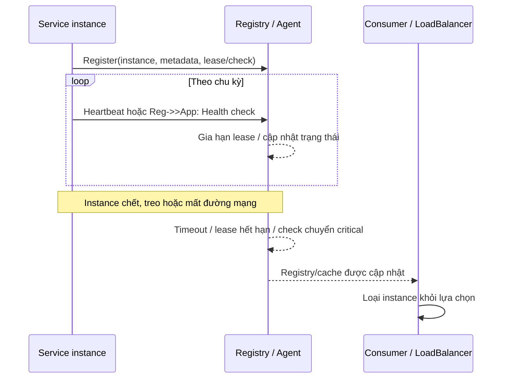

# Cơ chế phát hiện lỗi: nhịp báo sống, kiểm tra sức khỏe và phiên kết nối

Trong hệ thống microservice, registry chỉ có thể giới thiệu những instance mà nó tin là còn hoạt động. Khi một instance bị treo, mất mạng hoặc không còn xử lý được yêu cầu, thông tin đăng ký có thể trở nên lỗi thời. Heartbeat, health check và session/lease giúp phát hiện tình trạng đó, nhưng mỗi cơ chế quan sát một khía cạnh khác nhau và đều có độ trễ.

Trong Spring Cloud, `DiscoveryClient` đọc danh sách instance từ registry và `ServiceRegistry` cung cấp thao tác đăng ký/hủy đăng ký. Việc instance còn xuất hiện trong danh sách không tự chứng minh rằng nó đang sẵn sàng phục vụ. Muốn định tuyến an toàn, cần hiểu cách registry xác nhận sự sống, cách ứng dụng báo trạng thái và cách client phản ứng khi thông tin bị trễ.

## 1. Phân biệt heartbeat, health check, lease và session

| Cơ chế | Ai gửi/kiểm tra? | Điều nó chứng minh | Điều nó không chứng minh |
|---|---|---|---|
| Heartbeat (nhịp báo sống) | Ứng dụng hoặc agent gửi tín hiệu định kỳ tới registry/agent | Thành phần gửi vẫn có thể thực hiện trao đổi với nơi nhận tại thời điểm gửi | Không đảm bảo luồng xử lý nghiệp vụ, database hay dependency khác đang khỏe |
| Health check chủ động | Registry/agent gọi HTTP, TCP, gRPC hoặc script tới instance | Instance trả lời phép kiểm tra theo tiêu chí đã cấu hình | Không đảm bảo mọi request thực tế đều thành công hoặc mọi dependency đều ổn |
| Lease | Registry cấp thời hạn đăng ký; client phải gia hạn trước khi hết hạn | Quyền xuất hiện trong registry còn hiệu lực theo thời gian gia hạn | Không phải kết nối TCP liên tục và cũng không phải cam kết instance xử lý request tốt |
| Session | Một cơ chế có định danh và vòng đời; trong Consul, session có thể gắn với node, health check, TTL và distributed lock | Session còn hợp lệ theo các điều kiện được khai báo | Không đồng nghĩa với session HTTP, socket hay lease đăng ký service của mọi registry |
| Liveness | Ứng dụng báo tiến trình có còn sống và có khả năng tiếp tục chạy không | Tiến trình chưa rơi vào trạng thái cần khởi động lại | Không có nghĩa ứng dụng đã sẵn sàng nhận traffic |
| Readiness | Ứng dụng báo có thể nhận request mới hay không | Instance hiện đủ điều kiện phục vụ theo chính sách readiness | Không có nghĩa tiến trình đã chết nếu readiness thất bại |

Heartbeat thường là cơ chế push: instance chủ động báo cho registry. Health check chủ động là cơ chế pull: registry hoặc agent gọi vào instance. Một hệ thống có thể dùng một trong hai hoặc kết hợp cả hai.

Lease là cách registry giới hạn thời gian hiệu lực của đăng ký. Nếu không nhận được gia hạn trong thời hạn quy định, registry có thể đánh dấu hoặc loại instance. Consul Session là một khái niệm riêng, thường dùng để gắn health check với khóa phân tán. Không nên gọi chung mọi cơ chế này là 'phiên kết nối'.

## 2. Vì sao phát hiện lỗi luôn có độ trễ?

Trong môi trường phân tán, registry không thể quan sát trực tiếp trạng thái nội bộ của một process ở máy khác. Một heartbeat bị trễ có thể do process đã chết, nhưng cũng có thể do mạng nghẽn, garbage collection pause, CPU quá tải, agent khởi động lại hoặc registry đang bận. Vì vậy, mất tín hiệu không phải bằng chứng tuyệt đối rằng process đã chết.

Mỗi cơ chế cần một khoảng thời gian chờ hoặc ngưỡng thất bại. Nếu đặt ngưỡng quá ngắn, một đợt nghẽn mạng ngắn có thể khiến instance khỏe bị đánh dấu lỗi (false positive). Nếu đặt quá dài, instance đã chết vẫn có thể nằm trong registry và nhận traffic (false negative theo góc nhìn định tuyến).

Thời gian từ khi sự cố xảy ra đến khi client ngừng chọn instance thường gồm nhiều phần:

1. Thời gian chờ đến lần heartbeat hoặc health check tiếp theo.
2. Timeout của lần kiểm tra và số lần thất bại liên tiếp cần đạt.
3. Thời gian lease hết hạn hoặc registry chuyển trạng thái.
4. Thời gian cập nhật cache/replication của registry và cache phía client.
5. Thời gian load balancer nhận danh sách mới và ngừng chọn instance đó.

Không có một con số chung cho mọi registry. Hãy đo end-to-end trên đúng cấu hình, vì rút ngắn riêng heartbeat không làm cache và quá trình phân phối trạng thái tự động nhanh tương ứng.



## 3. Eureka: heartbeat gia hạn lease

Với Spring Cloud Netflix Eureka, khi Eureka Client đăng ký, nó gửi metadata như tên ứng dụng, host, port và thông tin instance. Sau đó client định kỳ gửi heartbeat để gia hạn lease. Nếu server không nhận heartbeat trong thời hạn lease, instance có thể bị loại khỏi registry.

Các giá trị mặc định phổ biến được Spring Cloud Netflix công bố:

| Thuộc tính | Giá trị mặc định | Ý nghĩa |
|---|---:|---|
| `eureka.instance.lease-renewal-interval-in-seconds` | `30` giây | Chu kỳ client gửi heartbeat |
| `eureka.instance.lease-expiration-duration-in-seconds` | `90` giây | Thời gian server chờ kể từ heartbeat cuối trước khi lease có thể hết hạn |

Lease expiration phải lớn hơn renewal interval. Nếu thay đổi hai giá trị, hãy xem xét độ trễ mạng, thời gian dừng GC, tải của Eureka Server và chu kỳ fetch registry phía client. Giảm renewal interval quá thấp có thể tăng tải registry và làm sai các giả định nội bộ về nhịp renew.

Ví dụ cấu hình minh họa trong `application.yml`:

```yaml
eureka:
  instance:
    lease-renewal-interval-in-seconds: 30
    lease-expiration-duration-in-seconds: 90
```

Đây là giá trị mặc định được viết tường minh để người vận hành thấy chính sách đang áp dụng. Trong phần lớn triển khai, nên giữ mặc định cho đến khi đã đo và kiểm thử được nhu cầu thay đổi.

### 3.1. Self-preservation và registry có thể giữ instance cũ

Eureka có cơ chế self-preservation. Khi số heartbeat nhận được giảm mạnh so với ngưỡng dự kiến, server có thể tạm dừng eviction hàng loạt để bảo vệ registry trong trường hợp mạng bị phân vùng hoặc nhiều client cùng mất liên lạc. Cơ chế này tránh xóa nhầm phần lớn registry chỉ vì một sự cố mạng diện rộng.

Đổi lại, trong giai đoạn self-preservation, registry có thể tiếp tục trả về instance đã thực sự dừng. Consumer phải chịu được tình huống đó bằng timeout kết nối/response hợp lý, retry có giới hạn và chọn instance khác khi phù hợp. Retry cần tránh tạo bão request khi toàn bộ cụm đang lỗi.

Không nên tắt self-preservation chỉ để làm instance biến mất nhanh hơn. Nếu cân nhắc thay đổi, cần đánh giá topology mạng, khả năng chịu lỗi của consumer, ngưỡng renew và cách giám sát trạng thái self-preservation.

### 3.2. Heartbeat không đồng nghĩa readiness

Heartbeat của Eureka chủ yếu xác nhận client vẫn liên lạc và gia hạn được lease. Một instance vẫn có thể gửi heartbeat trong khi thread pool cạn, queue đầy hoặc dependency nghiệp vụ không dùng được. Nếu muốn trạng thái sức khỏe ảnh hưởng tới discovery, cần tích hợp health/status callback theo cơ chế mà Eureka Client hỗ trợ và kiểm tra cách trạng thái đó được công bố, cache và tiêu thụ.

Đừng giả định rằng chỉ cần thêm Spring Boot Actuator thì Eureka tự động loại mọi instance không sẵn sàng. Hãy kiểm thử cụ thể trạng thái được gửi lên registry và hành vi của consumer.

## 4. Consul: health check chủ động và TTL heartbeat

Spring Cloud Consul đăng ký service với Consul Agent. Theo cấu hình mặc định của Spring Cloud Consul, agent tạo HTTP health check gọi endpoint `/actuator/health` mỗi 10 giây. Nếu check thất bại, instance được đánh dấu `critical`. Đường dẫn và chu kỳ có thể cấu hình lại.

Ví dụ cấu hình HTTP health check:

```yaml
spring:
  cloud:
    consul:
      host: localhost
      port: 8500
      discovery:
        health-check-path: /actuator/health
        health-check-interval: 10s
```

Đảm bảo endpoint thực tế khớp context path và management port của ứng dụng. Nếu Actuator chạy trên cổng riêng hoặc dưới `/admin`, URL mặc định có thể không truy cập được từ Consul Agent. Health check cũng phải được bảo vệ đúng cách: agent cần quyền gọi endpoint, còn endpoint không nên tiết lộ thông tin nhạy cảm.

### 4.1. TTL check: ứng dụng chủ động gửi heartbeat

Consul hỗ trợ TTL check. Thay vì agent gọi ứng dụng, ứng dụng gửi heartbeat đến Consul Agent để làm mới trạng thái TTL. Spring Cloud Consul có thể bật cơ chế này; theo tài liệu thuộc tính hiện hành, heartbeat integration mặc định tắt và TTL mặc định là 30 giây.

Ví dụ bật TTL heartbeat:

```yaml
spring:
  cloud:
    consul:
      discovery:
        heartbeat:
          enabled: true
          ttl: 30s
          use-actuator-health: true
```

Khi dùng TTL check, ứng dụng phải tiếp tục gửi heartbeat đúng hạn. Nếu không gia hạn, check chuyển sang trạng thái critical theo quy tắc TTL của Consul. `use-actuator-health: true` cho phép Spring Cloud Consul tính trạng thái gửi đi dựa trên Actuator Health khi endpoint phù hợp có sẵn.

TTL check là lựa chọn thay thế cho HTTP check mặc định trong cấu hình discovery; không nên mặc định cộng cả hai cơ chế rồi suy ra thời gian phát hiện lỗi. Hãy xác định check nào đang được đăng ký trong Consul và kiểm tra trạng thái thực tế bằng giao diện/API của Consul.

Spring Cloud Consul có thuộc tính `heartbeat.reregister-service-on-failure` để cho phép thử đăng ký lại service khi heartbeat thất bại theo điều kiện cấu hình. Tính năng này mặc định tắt. Đăng ký lại chỉ khôi phục metadata khi nguyên nhân phù hợp; nó không sửa được ứng dụng đang treo hoặc agent/cluster đang mất kết nối.

### 4.2. Critical, passing và deregistration

Trạng thái health check của Consul ảnh hưởng đến cách truy vấn service. Consumer nên truy vấn các instance ở trạng thái `passing` nếu yêu cầu chỉ nhận endpoint khỏe. Một check chuyển `critical` không có nghĩa record lập tức bị xóa khỏi catalog; record có thể còn để quan sát và phục hồi.

Spring Cloud Consul hỗ trợ `health-check-critical-timeout` để yêu cầu Consul tự deregister service nếu trạng thái critical kéo dài quá thời hạn, với điều kiện phiên bản Consul hỗ trợ tính năng đó. Đây là chính sách dọn record lâu ngày, không phải timeout phát hiện lỗi ban đầu. Hãy cân nhắc khả năng service tự phục hồi và quy trình đăng ký lại trước khi cấu hình.

## 5. Consul Session: phiên gắn với health check và distributed lock

Consul Session là đối tượng có ID, được tạo với node, danh sách health check, TTL tùy chọn, hành vi khi invalidated và lock delay. Ứng dụng thường dùng session kết hợp Consul KV để tạo distributed lock hoặc leader election.

Một session có thể bị invalidated khi node bị deregister, health check liên kết bị xóa hoặc chuyển sang `critical`, session bị destroy, hoặc TTL hết hạn nếu session có TTL. Khi session invalidated, khóa liên quan được xử lý theo `Behavior`:

- `release`: giải phóng khóa để tiến trình khác có thể acquire.
- `delete`: xóa key đang được khóa.

`LockDelay` trì hoãn việc acquire lại khóa sau khi session invalidated, tạo khoảng thời gian để chủ sở hữu cũ nhận ra quyền sở hữu đã mất và dừng công việc. Cơ chế này giúp giảm nguy cơ hai tiến trình cùng hành động, nhưng không thay thế fencing token hoặc kiểm tra quyền sở hữu ở hệ thống đích đối với workload yêu cầu tính nhất quán cao.

TTL của session là giới hạn thời gian cho việc renew session; nó không phải TTL của service registration. Một service có thể đăng ký với Consul mà không dùng Consul Session. Ngược lại, session có thể được dùng cho khóa phân tán mà không liên quan tới việc consumer tìm endpoint của service.

Ví dụ tạo session qua Consul HTTP API (minh họa, không phải cấu hình Spring Cloud Discovery):

```json
{
  "Name": "inventory-leader-lock",
  "TTL": "30s",
  "LockDelay": "15s",
  "Behavior": "release"
}
```

Consul trả về session ID. Client cần renew session trước khi TTL hết hạn; nếu không, session có thể bị invalidated và khóa được xử lý theo behavior đã chọn. TTL chỉ là thời điểm sớm nhất có thể invalidation; Consul có thể xử lý trễ hơn. Vì vậy, hãy renew trước hạn và tính đến network delay, clock skew và leader failover.

Không dùng session TTL làm cơ chế duy nhất để quyết định service có nhận traffic hay không. Hãy dùng health check/registration cho discovery và session cho mục đích khóa hoặc điều phối có liên quan.

## 6. Spring Boot Actuator: tách liveness khỏi readiness

Spring Boot Actuator cung cấp health endpoint và các health group cho liveness/readiness trong môi trường hỗ trợ probe. Hai trạng thái này trả lời hai câu hỏi khác nhau:

| Trạng thái | Câu hỏi | Hành động thường gặp khi thất bại |
|---|---|---|
| Liveness | Tiến trình có còn hoạt động đủ để tiếp tục chạy không? | Nền tảng như Kubernetes có thể khởi động lại container |
| Readiness | Instance có thể nhận request mới ngay lúc này không? | Load balancer/orchestrator ngừng gửi traffic mới tới instance |

Không đưa dependency bên ngoài như database, broker hoặc registry vào liveness một cách tùy tiện. Nếu database tạm thời mất kết nối, restart liên tục tất cả ứng dụng có thể làm sự cố nặng hơn. Readiness có thể xét dependency thiết yếu nếu service thực sự không thể phục vụ khi dependency đó lỗi.

Ví dụ cấu hình tối thiểu để bật probe endpoint trong `application.yml`:

```yaml
management:
  endpoints:
    web:
      exposure:
        include: health,info
  endpoint:
    health:
      probes:
        enabled: true
```

Spring Boot cung cấp các endpoint health group như `/actuator/health/liveness` và `/actuator/health/readiness`. Nếu management port tách biệt với server port, cần xem xét probe có kiểm tra được đường phục vụ thực tế hay không. Một management server khỏe trong khi server nhận traffic bị treo có thể tạo kết quả readiness sai.

Health endpoint nên chỉ trả dữ liệu tối thiểu cần cho probe. Không mở rộng chi tiết health, environment, config hoặc thông tin kết nối nội bộ ra mạng công khai. Dùng authentication/network policy phù hợp nếu endpoint không dành cho mọi caller.

### 6.1. Readiness khi khởi động và khi shutdown

Khi ứng dụng khởi động, readiness chỉ nên chuyển sang `ACCEPTING_TRAFFIC` sau khi các thành phần bắt buộc đã sẵn sàng. Trong lúc warm-up, migration hoặc nạp cache, instance có thể vẫn sống nhưng chưa nên nhận request.

Khi shutdown có kiểm soát, trình tự hợp lý là:

1. Chuyển readiness sang không sẵn sàng để ngừng nhận request mới.
2. Ngừng hoặc hủy đăng ký instance khỏi registry/load balancer theo integration đang dùng.
3. Chờ request đang xử lý hoàn tất trong khoảng graceful shutdown cho phép.
4. Đóng tài nguyên và kết thúc process.

Spring Boot hỗ trợ graceful shutdown cho embedded web server. Có thể cấu hình thời gian chờ xử lý request đang chạy:

```yaml
server:
  shutdown: graceful
spring:
  lifecycle:
    timeout-per-shutdown-phase: 30s
```

Graceful shutdown ở web server không tự đảm bảo mọi registry/cache cập nhật tức thì. Cần xác minh client registry có deregister khi đóng context, orchestrator gửi đúng signal, readiness được hạ trước khi process dừng và thời gian termination grace của nền tảng đủ dài.

## 7. Kết nối mạng không phải health check

Một TCP connection đang mở không chứng minh service còn xử lý được request. Kết nối có thể tồn tại trong khi application thread bị deadlock; ngược lại, kết nối có thể bị reset dù service vẫn khỏe và có thể nhận kết nối mới.

TCP keepalive, HTTP connection pool validation và timeout của client giúp phát hiện hoặc giới hạn kết nối lỗi ở tầng vận chuyển. Chúng bổ sung cho health check, không thay thế health check ứng dụng hoặc lease của registry.

Consumer nên cấu hình riêng các timeout phù hợp:

- Connect timeout: giới hạn thời gian thiết lập kết nối tới instance.
- Response/read timeout: giới hạn thời gian chờ phản hồi.
- Pool idle/lifetime: tránh giữ connection quá lâu so với timeout của proxy/server.
- Retry: giới hạn số lần, chỉ retry thao tác an toàn hoặc có idempotency; thêm backoff và jitter.

Timeout của request cần ngắn hơn giới hạn chịu đựng của caller. Retry không được vượt ngân sách thời gian tổng thể và không nên tự động lặp lại lệnh ghi có thể đã thực hiện thành công ở server.

## 8. Chọn chu kỳ và ngưỡng phát hiện lỗi

Không có một cấu hình heartbeat phù hợp cho mọi hệ thống. Hãy bắt đầu từ mục tiêu phục hồi (RTO), tải registry và khả năng chịu false positive. Các nguyên tắc thực tế:

1. Đặt timeout lớn hơn độ trễ bình thường có biên an toàn cho GC pause, CPU contention và mạng.
2. Dùng nhiều tín hiệu độc lập khi rủi ro false positive cao, nhưng tránh health check quá nặng hoặc truy vấn sâu toàn bộ dependency ở tần suất cao.
3. Giữ chu kỳ lease/heartbeat nhất quán giữa client và registry; không đặt expiration nhỏ hơn renewal interval.
4. Đồng bộ đồng hồ ở các node; với TTL/session, tính đến clock skew và renew trước hạn.
5. Đặt timeout của consumer và chính sách retry sao cho instance lỗi không làm request treo quá lâu.
6. Đo thời gian từ lúc kill/partition đến khi instance biến mất khỏi kết quả discovery, thay vì chỉ đo thời gian check chuyển critical.
7. Thử cả shutdown có kiểm soát, process crash, network partition và overload; mỗi tình huống có thể tạo trạng thái registry khác nhau.

## 9. Theo dõi và xử lý sai lệch registry

Khi registry trả về instance không còn dùng được, hãy kiểm tra theo chuỗi sau:

| Quan sát | Câu hỏi cần trả lời | Hướng điều tra |
|---|---|---|
| Heartbeat bị trễ hoặc mất | Client còn gửi được heartbeat không? | Log client, kết nối tới registry/agent, DNS, firewall, CPU và GC pause |
| Health check chuyển critical | Endpoint có truy cập được từ chính agent không? | URL/path/port, timeout, TLS, auth header, management context path và log Actuator |
| Eureka vẫn trả instance cũ | Server có vào self-preservation không? | Renewal rate, ngưỡng renew, peer replication và cache của consumer |
| Consul còn record critical lâu ngày | Có cấu hình deregister critical timeout không? | Trạng thái check, critical timeout, phiên bản Consul và chính sách re-register |
| Một consumer vẫn gọi instance đã bị loại | Consumer đang dùng cache nào và cập nhật lúc nào? | Registry fetch interval, client-side cache, load balancer cache và DNS cache |
| Instance khỏe nhưng bị loại | Ngưỡng/timeout có quá nhạy không? | Mạng, thời gian pause, check timeout, tải registry và chu kỳ renew |

Những metric nên theo dõi gồm số instance theo service và trạng thái, số heartbeat/renew nhận được, tỷ lệ check passing/critical, thời gian từ lỗi đến eviction/deregister, số lần đăng ký lại, số request lỗi theo instance, timeout/retry của consumer và trạng thái self-preservation của Eureka.

Đối với Consul, so sánh catalog với health state: record còn tồn tại nhưng critical khác với record đã bị deregister. Đối với Eureka, xem registry trên server và registry cache ở consumer; hai nơi có thể lệch nhau trong thời gian replication/fetch. Đừng kết luận dữ liệu sai chỉ từ một màn hình hoặc một lần truy vấn.

## 10. Thực hành kiểm chứng failure detection

Với một service đã đăng ký vào Eureka hoặc Consul, chạy các thử nghiệm riêng biệt trên môi trường development:

1. Khởi động hai instance cùng service name và xác nhận consumer nhìn thấy cả hai.
2. Dừng một instance bằng shutdown có kiểm soát; quan sát readiness, deregistration và thời gian instance biến mất khỏi discovery.
3. Kill process đột ngột; đo thời gian heartbeat/lease hoặc health check phát hiện lỗi.
4. Chặn tạm đường mạng từ instance tới registry nhưng vẫn giữ cổng nghiệp vụ hoạt động; quan sát registry và consumer phản ứng thế nào.
5. Làm readiness thất bại trong khi liveness vẫn healthy; xác nhận instance ngừng nhận traffic mới nhưng process không bị restart.
6. Khôi phục mạng hoặc health endpoint; kiểm tra instance có được đăng ký lại và consumer có nhận lại instance hay không.
7. Với Consul Session, tạo khóa thử nghiệm, ngừng renew session và xác minh khóa được release/delete đúng behavior sau invalidation.

Không chạy thử network partition hoặc kill process trên môi trường production khi chưa có kế hoạch kiểm soát tác động. Ghi lại thời gian từng mốc: sự cố bắt đầu, check/lease đổi trạng thái, registry cập nhật và request cuối cùng tới instance.

## 11. Checklist triển khai

- [ ] Đã xác định rõ cơ chế đang dùng: Eureka lease, Consul HTTP check hay Consul TTL check.
- [ ] Đã phân biệt liveness với readiness và xác định dependency nào ảnh hưởng đến readiness.
- [ ] Health endpoint đúng path, port, timeout, TLS và quyền truy cập từ registry/agent.
- [ ] Lease expiration lớn hơn renewal interval; TTL được renew trước hạn.
- [ ] Đã hiểu hành vi self-preservation của Eureka và trạng thái critical/deregister của Consul.
- [ ] Consul Session chỉ được dùng cho khóa/điều phối cần session; có behavior, TTL và lock delay phù hợp.
- [ ] Consumer có connect/read timeout, retry giới hạn và khả năng xử lý instance stale.
- [ ] Graceful shutdown hạ readiness và cho phép deregistration trước khi process kết thúc.
- [ ] Có metric/log để đo thời gian phát hiện lỗi và kiểm tra sai lệch registry/cache.
- [ ] Đã thử crash, shutdown, overload và network partition trong môi trường kiểm thử.

## Tài liệu tham khảo

- [Spring Cloud Netflix — Registering with Eureka và heartbeat](https://docs.spring.io/spring-cloud-netflix/reference/spring-cloud-netflix.html)
- [Spring Cloud Netflix — Configuration Properties](https://docs.spring.io/spring-cloud-netflix/reference/configprops.html)
- [Netflix Eureka — Server Self Preservation Mode](https://github.com/Netflix/eureka/wiki/Server-Self-Preservation-Mode)
- [Spring Cloud Consul — Service Discovery và health check](https://docs.spring.io/spring-cloud-consul/reference/discovery.html)
- [Spring Cloud Consul — Common Application Properties](https://docs.spring.io/spring-cloud-consul/reference/appendix.html)
- [Spring Boot Actuator — Kubernetes Probes](https://docs.spring.io/spring-boot/reference/actuator/endpoints.html)
- [Consul — Sessions and Distributed Locks](https://developer.hashicorp.com/consul/docs/automate/session)
- [Consul — Session HTTP API](https://developer.hashicorp.com/consul/api-docs/session)
