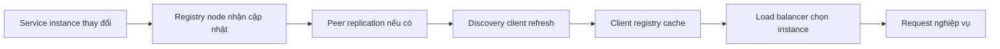
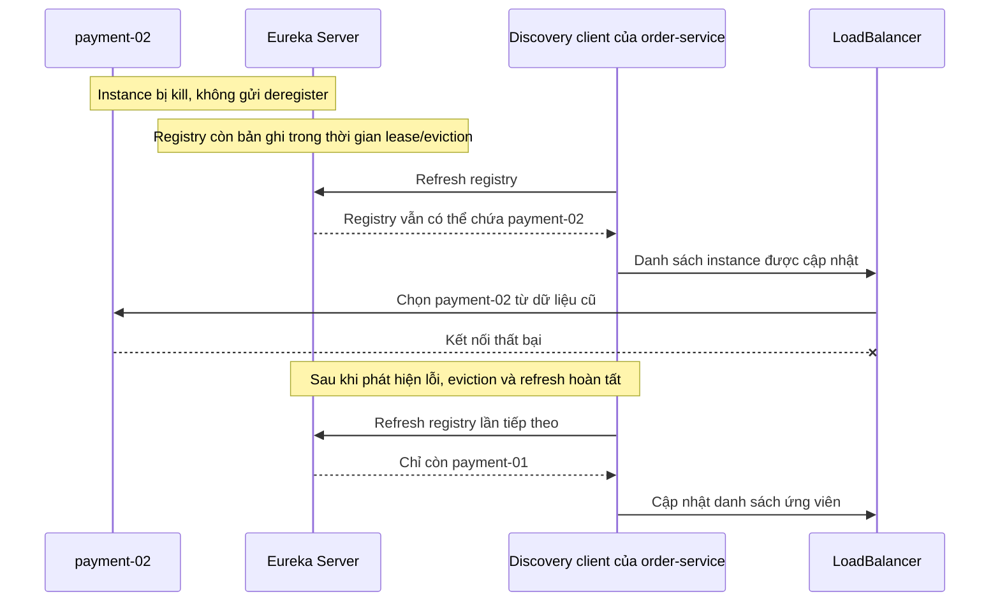

# Độ trễ lan truyền thay đổi và tính nhất quán cuối cùng

Trong hệ thống microservice, thông tin service discovery thay đổi liên tục: instance mới được đăng ký, instance cũ dừng hoạt động, trạng thái health thay đổi hoặc một nhóm dịch vụ được triển khai phiên bản mới. Consumer cần biết những thay đổi này để chọn đúng địa chỉ khi gửi request. Tuy nhiên, thông tin trong registry không phải lúc nào cũng xuất hiện đồng thời ở mọi Eureka Server, Consul agent, discovery client và load balancer.

Độ trễ giữa thời điểm một thay đổi được ghi nhận và thời điểm các thành phần liên quan nhìn thấy thay đổi đó được gọi là **độ trễ lan truyền**. Trong môi trường phân tán, các bản sao và cache có thể tạm thời chứa dữ liệu khác nhau. Nếu hệ thống tiếp tục hoạt động, kết nối được khôi phục và không có thay đổi mới cạnh tranh, các bản sao có thể dần hội tụ về cùng một trạng thái. Đó là ý nghĩa của **tính nhất quán cuối cùng** (eventual consistency).

Trong Spring Cloud, `DiscoveryClient` cung cấp cách tra cứu instance thống nhất ở phía ứng dụng, còn cách cập nhật registry, sao chép dữ liệu và làm mới cache phụ thuộc implementation như Eureka hoặc Consul. Vì vậy, consumer cần được thiết kế để chịu được một khoảng thời gian nhìn thấy dữ liệu cũ, thay vì giả định một thay đổi registry sẽ có hiệu lực tức thì trên toàn hệ thống.

## 1. Vì sao thay đổi trong registry không xuất hiện ngay ở mọi nơi?

Service discovery thường gồm nhiều lớp. Một thay đổi phải đi qua các lớp này trước khi mọi consumer có thể sử dụng dữ liệu mới:

1. **Service instance:** ứng dụng khởi động, gửi đăng ký, heartbeat, thay đổi status hoặc deregister.
2. **Registry server/agent:** thành phần nhận yêu cầu, xác thực và cập nhật dữ liệu đăng ký.
3. **Các node registry khác:** nếu triển khai nhiều node, thay đổi có thể cần được sao chép hoặc đồng bộ sang peer.
4. **Discovery client:** client tải danh sách dịch vụ hoặc nhận thay đổi từ registry và cập nhật cache cục bộ.
5. **Load balancer hoặc lớp gọi dịch vụ:** thành phần chọn instance có thể có cache hay danh sách ứng viên riêng.

Mỗi lớp có chu kỳ cập nhật, hàng đợi, timeout và chính sách lỗi riêng. Một instance có thể đã đăng ký thành công ở một node nhưng consumer đang đọc cache cũ. Tương tự, instance đã deregister ở registry nhưng một consumer vẫn còn giữ địa chỉ đó trong bộ nhớ.

Sơ đồ mô tả đường đi khái niệm. Một số implementation có thể gộp agent và registry, dùng cơ chế watch/event hoặc cache ở nhiều lớp. Không phải mọi hệ thống đều có đầy đủ từng bước theo đúng thứ tự này.

## 2. Các loại thay đổi và cách chúng lan truyền

Không phải mọi thay đổi discovery đều có cùng thời gian hội tụ. Cần phân biệt ít nhất bốn tình huống.

| Thay đổi | Điều xảy ra ở provider/registry | Điều consumer có thể gặp |
|---|---|---|
| Đăng ký instance mới | Instance gửi thông tin đăng ký và registry thêm bản ghi. | Consumer chưa thấy instance mới cho đến khi dữ liệu được sao chép và cache được làm mới. |
| Cập nhật metadata hoặc status | Provider công bố thông tin mới hoặc chuyển trạng thái. | Một số consumer có thể còn nhìn thấy status/metadata cũ trong một khoảng thời gian. |
| Deregister có kiểm soát | Instance gửi yêu cầu hủy đăng ký hoặc được đánh dấu ngừng phục vụ. | Consumer có thể tiếp tục chọn instance từ cache cũ cho đến lần cập nhật tiếp theo. |
| Instance mất đột ngột | Không gửi được deregistration; registry phải dựa vào heartbeat, lease hoặc health check để phát hiện. | Địa chỉ chết có thể tồn tại lâu hơn so với trường hợp shutdown có kiểm soát. |

Đăng ký mới và deregistration có kiểm soát thường bắt đầu bằng một thao tác ghi rõ ràng. Khi instance chết đột ngột, hệ thống cần thời gian để suy ra rằng bản ghi không còn hợp lệ. Với cơ chế lease, khoảng chờ phát hiện có liên quan đến chu kỳ heartbeat, thời hạn lease và chu kỳ eviction. Với health check, còn phụ thuộc tần suất kiểm tra, ngưỡng lỗi và cách trạng thái được truyền đến consumer.

## 3. Tính nhất quán cuối cùng là gì?

Tính nhất quán cuối cùng là thuộc tính của hệ thống phân tán: nếu một bản cập nhật được chấp nhận, quá trình truyền thông tin tiếp tục hoạt động và không có cập nhật mới xung đột, các bản sao sẽ hội tụ về trạng thái tương ứng sau một khoảng thời gian.

Ví dụ, `payment-service` có hai instance `payment-01` và `payment-02`. Khi `payment-02` được deregister, registry node A có thể xóa bản ghi trước, node B nhận bản sao sau, còn consumer C chỉ bỏ instance khỏi cache ở lần refresh tiếp theo. Trong khoảng hội tụ, ba nơi có thể quan sát ba trạng thái khác nhau. Sau khi replication và refresh hoàn tất, các thành phần sẽ cùng phản ánh rằng `payment-02` không còn là instance được discovery cung cấp.

Eventual consistency không có nghĩa là dữ liệu cũ luôn tự sửa ngay lập tức, cũng không phải cam kết rằng mọi request sẽ thành công trong thời gian hội tụ. Nó cũng không tự bảo đảm mọi reader nhìn thấy các cập nhật theo cùng thứ tự. Nếu mạng bị chia cắt kéo dài, node không thể đồng bộ hoặc một client ngừng refresh, dữ liệu có thể tiếp tục lệch nhau.

Trong service discovery, điều này dẫn đến một nguyên tắc thực tế: **registry cung cấp danh sách ứng viên theo dữ liệu discovery mà client đang có; khả năng kết nối thực tế vẫn phải được kiểm tra ở tầng gọi dịch vụ.**

## 4. Những nguồn tạo ra độ trễ

### 4.1. Chu kỳ heartbeat và thời hạn lease

Heartbeat cho biết client vẫn liên lạc với registry và muốn duy trì đăng ký. Nếu một instance bị tắt đột ngột, registry không thể nhận được lệnh deregister từ instance đó. Nó cần phát hiện heartbeat bị thiếu hoặc lease hết hạn rồi mới loại bỏ bản ghi theo chính sách.

Với Eureka, client định kỳ gia hạn lease. Nếu không nhận được heartbeat trong khoảng thời hạn quy định, server có thể đánh dấu đăng ký hết hạn và eviction sẽ xử lý bản ghi. Các giá trị mặc định thường gặp có thể là heartbeat khoảng 30 giây và lease khoảng 90 giây, nhưng đây không phải SLA về thời gian loại bỏ. Cấu hình, lịch chạy, tải hệ thống, mạng và self-preservation đều ảnh hưởng đến thời điểm bản ghi thực sự biến mất.

Với Consul, agent có thể đăng ký service kèm health check. Trạng thái được cập nhật theo chu kỳ kiểm tra và ngưỡng cấu hình; service discovery có thể lọc hoặc trả về các service theo trạng thái health được yêu cầu. Thời gian phát hiện phụ thuộc loại check và cấu hình cụ thể.

Heartbeat và health check cũng có ý nghĩa khác nhau. Heartbeat xác nhận client còn gia hạn đăng ký; health check đánh giá điều kiện sức khỏe do hệ thống định nghĩa. Một tiến trình vẫn gửi heartbeat nhưng dependency quan trọng đã hỏng có thể chưa được phản ánh đúng nếu ứng dụng không tích hợp health status phù hợp.

### 4.2. Peer replication giữa các registry node

Khi chạy nhiều registry node để tăng khả năng sẵn sàng, thay đổi có thể cần được truyền giữa các node. Trong thời gian replication, một consumer đọc node A có thể thấy bản ghi mới, trong khi consumer đọc node B chưa thấy.

Eureka hỗ trợ peer replication giữa các Eureka Server. Mỗi node duy trì registry và trao đổi thông tin với peer; độ trễ hoặc lỗi kết nối peer có thể khiến dữ liệu tạm thời khác nhau. Nếu một node bị cô lập, trạng thái nó cung cấp có thể cũ cho đến khi kết nối được khôi phục và dữ liệu được đồng bộ.

Consul sử dụng kiến trúc server/agent và cơ chế đồng bộ trạng thái catalog. Cách đọc và mức nhất quán phụ thuộc loại truy vấn, node được truy cập và chế độ consistency mà Consul hỗ trợ. Không nên giả định rằng mọi API discovery của mọi registry đều có cùng một hợp đồng đồng bộ.

### 4.3. Làm mới cache của discovery client

Để giảm số request đến registry và tránh phụ thuộc registry trong từng request nghiệp vụ, discovery client thường giữ dữ liệu cục bộ. Client có thể tải toàn bộ registry, lấy delta hoặc sử dụng watch/blocking query tùy implementation.

Với Eureka client, registry cache được làm mới theo chu kỳ. Consumer có thể tiếp tục sử dụng danh sách đã tải trong khi server đã có thay đổi. Với Consul, ứng dụng hoặc integration có thể dùng blocking query/index hoặc cơ chế watch để chờ thay đổi; điều đó có thể giảm polling vô ích nhưng vẫn cần xử lý reconnect và dữ liệu cache.

### 4.4. Cache ở lớp load balancing và ứng dụng

Ngay cả khi `DiscoveryClient` đã nhận registry mới, thành phần gọi dịch vụ vẫn có thể giữ danh sách instance hoặc kết quả lựa chọn riêng. Spring Cloud LoadBalancer có thể sử dụng cache để giảm việc tra cứu lặp lại. Ứng dụng cũng có thể tự lưu `ServiceInstance`, URL hoặc client object trong bộ nhớ.

Nếu nhiều lớp cùng cache dữ liệu, tổng độ trễ nhìn thấy thay đổi có thể lớn hơn chu kỳ refresh của riêng registry client. Khi điều tra, cần kiểm tra tất cả lớp lưu danh sách instance, không chỉ Dashboard của Eureka hoặc Consul.

## 5. Ước lượng thời gian hội tụ

Có thể phân tích độ trễ theo từng đoạn thay vì tìm một con số chung cho toàn hệ thống.

Với một instance mới được đăng ký, thời gian consumer nhìn thấy thay đổi có thể được phân rã khái niệm như sau:

\[
T_{visible} \approx T_{register} + T_{replication} + T_{client-refresh} + T_{lb-cache}
\]

Trong đó:

- `T_register`: thời gian registry nhận và áp dụng đăng ký.
- `T_replication`: thời gian thay đổi được truyền đến node mà consumer đang sử dụng; bằng 0 hoặc không áp dụng nếu không có replication.
- `T_client_refresh`: thời gian đến lần làm mới tiếp theo của discovery client hoặc thời gian chờ watch/query trả kết quả.
- `T_lb_cache`: thời gian đến khi cache hoặc danh sách instance của load balancer phản ánh dữ liệu mới.

Đây là mô hình phân tích, không phải công thức SLA chính xác. Các bước có thể chạy song song hoặc chồng lấp; retry, timeout và lỗi mạng có thể làm thời gian dài hơn.

Với instance chết đột ngột, thời gian loại bỏ thường còn phụ thuộc thời gian phát hiện lỗi:

\[
T_{remove} \approx T_{failure-detection} + T_{registry-update} + T_{replication} + T_{client-refresh} + T_{lb-cache}
\]

`T_failure-detection` có thể là thời gian chờ lease hết hạn, thời gian health check xác nhận lỗi hoặc một tín hiệu khác. Khi shutdown có kiểm soát và deregistration thành công, thành phần phát hiện lỗi có thể được thay bằng thời gian xử lý lệnh deregister.

Để đo thực tế, ghi lại các mốc thời gian: lúc provider bắt đầu đăng ký/deregister, lúc registry nhận cập nhật, lúc các peer phản ánh thay đổi, lúc discovery client quan sát thay đổi và lúc request đầu tiên sử dụng danh sách mới. Đo trên nhiều lần triển khai và nhiều consumer để có phân bố p50/p95/p99 thay vì chỉ dựa vào một lần thử.

## 6. Ví dụ: consumer gọi vào instance vừa dừng

Giả sử `order-service` có cache hai instance của `payment-service`: `payment-01` và `payment-02`. `payment-02` bị dừng đột ngột do container bị kill.

Đây là tình huống minh họa. Thứ tự chính xác và số lần request thất bại phụ thuộc thời điểm kill, chu kỳ lease, cache, retry và cách load balancer xử lý lỗi. Không nên giả định consumer sẽ tự động loại bỏ instance ngay sau request thất bại nếu ứng dụng chưa cấu hình cơ chế đó.

## 7. Thiết kế consumer chịu được dữ liệu discovery cũ

### 7.1. Timeout rõ ràng

Mỗi request đến instance cần có connect timeout và response timeout phù hợp. Nếu một địa chỉ đã lỗi thời, timeout giới hạn thời gian consumer chờ kết nối. Timeout phải phù hợp với SLA nghiệp vụ và thời gian xử lý hợp lệ của provider.

Không đặt timeout quá dài khiến request mắc kẹt, nhưng cũng không đặt quá ngắn làm tăng lỗi giả khi hệ thống đang tải cao. Nên theo dõi latency thực tế và điều chỉnh theo từng loại request.

### 7.2. Retry có giới hạn và backoff

Retry có thể giúp request được gửi lại đến instance còn hoạt động sau khi một lựa chọn thất bại. Tuy nhiên, retry cần giới hạn số lần, có backoff và jitter để tránh nhiều consumer đồng loạt tạo tải khi registry hoặc dịch vụ đang gặp sự cố.

Chỉ retry request có ngữ nghĩa an toàn. Với thao tác ghi hoặc thanh toán, retry có thể tạo tác dụng phụ trùng lặp nếu provider đã xử lý request nhưng response bị mất. Dùng idempotency key hoặc cơ chế deduplication ở tầng nghiệp vụ trước khi retry các thao tác như vậy.

### 7.3. Circuit breaker và bulkhead

Circuit breaker có thể tạm ngừng gọi đến một dependency đang lỗi liên tục, giúp giảm request vô ích và thời gian chờ. Bulkhead giới hạn tài nguyên dành cho từng dependency để lỗi của một dịch vụ không làm cạn toàn bộ thread hoặc connection pool của consumer.

Circuit breaker không sửa registry. Nó bảo vệ luồng gọi trong lúc discovery và trạng thái instance đang hội tụ; khi dependency phục hồi, chính sách half-open và retry có kiểm soát cho phép thử lại.

### 7.4. Refresh và cache có chủ đích

Điều chỉnh chu kỳ refresh hoặc TTL cache có thể rút ngắn thời gian nhìn thấy thay đổi, nhưng refresh quá thường xuyên làm tăng tải lên registry và mạng. Cache quá lâu có thể giữ instance cũ; cache quá ngắn có thể gây nhiều lần tra cứu và tăng độ nhạy với sự cố registry.

Hãy xác định rõ cache nằm ở đâu: registry client, Spring Cloud LoadBalancer, gateway hay lớp tự viết. Cấu hình cần căn cứ vào phiên bản Spring Cloud và discovery provider đang sử dụng, vì tên thuộc tính và hành vi có thể thay đổi giữa các phiên bản.

### 7.5. Xử lý trường hợp không có instance

Consumer phải xử lý danh sách rỗng khi dịch vụ chưa đăng ký, mọi instance bị đánh dấu không khỏe hoặc cache chưa có dữ liệu. Không nên chuyển danh sách rỗng thành một địa chỉ mặc định tùy tiện. Tùy nghiệp vụ, có thể trả lỗi phụ thuộc tạm thời, dùng fallback đã thiết kế hoặc đưa request vào hàng đợi.

## 8. Thiết kế provider để rút ngắn thời gian loại bỏ instance lỗi

### 8.1. Graceful shutdown và deregistration

Khi dừng có kiểm soát, instance nên chuyển sang trạng thái không nhận traffic mới, hoàn tất request đang xử lý và deregister khỏi registry trước khi tiến trình kết thúc. Trình tự cụ thể phụ thuộc framework và nền tảng triển khai, nhưng mục tiêu là tạo thời gian drain để consumer ngừng chọn instance trước khi địa chỉ ngừng phục vụ.

Với Eureka, có thể sử dụng trạng thái `OUT_OF_SERVICE` trong quy trình bảo trì/triển khai nếu hệ thống đã tích hợp thao tác chuyển status và có thời gian để client nhận thay đổi. Khi shutdown bình thường, Eureka client cũng có thể gửi lệnh deregister. Với Consul, có thể deregister service hoặc điều chỉnh health check theo quy trình triển khai.

### 8.2. Readiness khác với liveness

Readiness cho biết instance có nên nhận request mới hay không. Liveness cho biết tiến trình còn hoạt động hay cần được khởi động lại. Nếu dùng một health endpoint duy nhất cho cả hai mục đích, một dependency tạm thời lỗi có thể khiến nền tảng restart liên tục hoặc loại bỏ instance quá sớm.

Nên thiết kế health check phù hợp với vai trò của từng tín hiệu. Nếu một dependency là bắt buộc để phục vụ request, readiness có thể phản ánh dependency đó; nếu dependency chỉ ảnh hưởng một chức năng phụ, cần cân nhắc để không làm toàn bộ instance bị loại khỏi registry.

### 8.3. Phối hợp với orchestration

Trong Kubernetes hoặc nền tảng tương tự, readiness probe, preStop hook và thời gian termination grace period có thể phối hợp với deregistration và drain. Nếu pod bị xóa, cần đủ thời gian để endpoint không còn được chọn, request đang chạy hoàn tất và registry cập nhật trạng thái.

Không nên giả định readiness probe tự động cập nhật Eureka hoặc Consul nếu chưa có integration. Kiểm tra rõ thành phần nào chuyển health state thành service registration status.

## 9. Khác biệt cần lưu ý giữa Eureka và Consul

`DiscoveryClient` giúp ứng dụng gọi discovery theo abstraction chung, nhưng không làm cho mọi registry có cùng semantics.

| Khía cạnh | Eureka | Consul |
|---|---|---|
| Đăng ký | Eureka client đăng ký `InstanceInfo` với Eureka Server. | Service đăng ký với Consul agent/catalog theo cấu hình. |
| Duy trì trạng thái | Heartbeat gia hạn lease; server có eviction và self-preservation. | Health check và cập nhật trạng thái service/agent tham gia xác định service có khỏe hay không. |
| Đồng bộ nhiều node | Eureka Server trao đổi registry với peer. | Consul duy trì catalog qua cụm server và agent; consistency của truy vấn phụ thuộc cơ chế đọc. |
| Cập nhật phía consumer | Eureka client tải registry và làm mới cache định kỳ, có thể dùng delta. | Có thể dùng query, blocking query/index hoặc watch tùy API và integration. |
| Hệ quả vận hành | Cần chú ý lease, eviction, self-preservation và registry cache. | Cần chú ý health check, agent/server, query consistency, index/watch và cache của client. |

Bảng này mô tả khác biệt ở mức khái niệm. Chi tiết cấu hình và thời gian cập nhật phụ thuộc phiên bản thư viện, cách triển khai và API mà Spring Cloud integration đang sử dụng. Khi chuyển từ Eureka sang Consul hoặc ngược lại, cần kiểm tra lại hành vi timeout, health, cache và khả năng quan sát thay đổi.

## 10. Quan sát và kiểm tra độ trễ lan truyền

Để biết hệ thống có hội tụ trong giới hạn vận hành mong muốn hay không, cần theo dõi nhiều lớp thay vì chỉ nhìn số instance trên dashboard.

Các chỉ số và sự kiện nên quan sát:

- Thời điểm đăng ký, cập nhật status và deregistration ở provider.
- Thời điểm registry chấp nhận thay đổi và trạng thái replication giữa các node.
- Thời điểm discovery client nhận registry mới hoặc watch event.
- Tuổi dữ liệu cache nếu implementation cung cấp thông tin này.
- Số request thất bại do connection refused, timeout hoặc host không phân giải được.
- Số lần retry, circuit breaker mở và tỷ lệ request fallback.
- Số instance `UP`, `OUT_OF_SERVICE`, unhealthy hoặc hết lease theo từng service.
- Chênh lệch số instance theo registry node và theo consumer.

Một bài kiểm tra có thể thực hiện trong môi trường staging:

1. Ghi lại danh sách instance ban đầu của một service.
2. Đăng ký một instance mới và đo thời gian cho đến khi nhiều consumer nhìn thấy nó.
3. Chuyển instance sang trạng thái không phục vụ và đo thời gian consumer ngừng chọn instance.
4. Dừng đột ngột một instance trong môi trường thử nghiệm và đo thời gian registry loại bỏ bản ghi.
5. Lặp lại khi có nhiều registry node hoặc khi một consumer tạm thời mất kết nối.
6. So sánh p50/p95/p99, tỷ lệ request lỗi và tải phát sinh do refresh/retry.

Thử nghiệm cần dùng request kiểm tra an toàn và có giới hạn tải. Mục đích là xác định hành vi thực tế của cấu hình đang chạy, không suy ra SLA chỉ từ giá trị mặc định trong tài liệu.

## 11. Checklist thiết kế và vận hành

- Xác định thời gian tối đa chấp nhận được để consumer nhìn thấy instance mới và ngừng chọn instance đã rời hệ thống.
- Ghi rõ các chu kỳ heartbeat, lease, health check, registry refresh và cache của load balancer.
- Kiểm tra peer replication và khả năng hội tụ sau khi mạng giữa các registry node phục hồi.
- Dùng graceful shutdown, readiness và drain để giảm request đi vào instance đang dừng.
- Cấu hình timeout, retry có giới hạn, backoff, jitter và circuit breaker theo đặc tính nghiệp vụ.
- Chỉ retry thao tác ghi khi có idempotency hoặc cơ chế chống xử lý trùng.
- Xử lý danh sách instance rỗng và dữ liệu metadata thiếu một cách rõ ràng.
- Theo dõi lỗi kết nối đến instance đã bị loại và thời gian cache giữ bản ghi cũ.
- Đo độ trễ hội tụ trên nhiều consumer và nhiều registry node trong điều kiện tải, lỗi mạng và rollout.
- Đối chiếu tài liệu của đúng phiên bản Eureka, Consul và Spring Cloud đang sử dụng trước khi thay đổi các tham số refresh hoặc health check.

## Kết luận

Độ trễ lan truyền xuất hiện vì thay đổi service discovery phải đi qua registry, replication, discovery client, cache và lớp load balancing. Trong thời gian đó, các consumer có thể nhìn thấy những phiên bản khác nhau của registry. Tính nhất quán cuối cùng mô tả khả năng các bản sao hội tụ khi hệ thống tiếp tục trao đổi dữ liệu và không còn thay đổi xung đột; nó không bảo đảm mọi request đều thành công trong khoảng hội tụ.

Một hệ thống Spring Cloud vững chắc cần kết hợp discovery với health/readiness, graceful deregistration, timeout, retry an toàn, circuit breaker và quan sát độ trễ. Cần đo thời gian hội tụ thực tế của Eureka hoặc Consul trong topology đang triển khai, sau đó chọn chu kỳ refresh và chính sách gọi dịch vụ phù hợp với yêu cầu vận hành.
