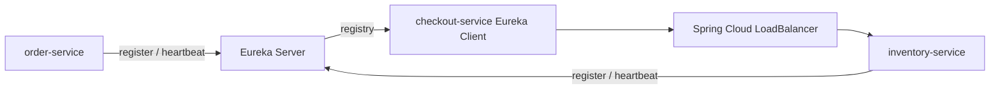
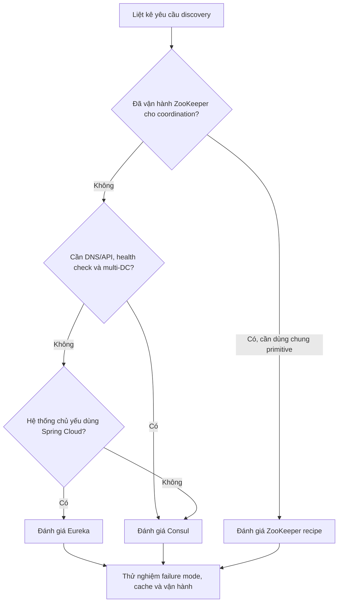

# So sánh Eureka, Consul và ZooKeeper theo yêu cầu hệ thống

## 1. Bắt đầu từ yêu cầu service discovery

Trong hệ thống microservice, service discovery giúp một service tìm các instance đang cung cấp service khác mà không phải cố định địa chỉ IP và cổng trong mã nguồn. Khi một instance được tạo, thay thế hoặc dừng, registry cần phản ánh thay đổi đó để consumer có thể chọn đích gọi phù hợp.

Spring Cloud cung cấp các abstraction như `DiscoveryClient` để truy vấn instance và `ServiceRegistry` để đăng ký instance. Eureka, Consul và ZooKeeper đều có thể tham gia giải quyết bài toán này, nhưng chúng được thiết kế với mục tiêu và mô hình vận hành khác nhau. Vì vậy, lựa chọn không nên chỉ dựa vào mức độ phổ biến hoặc số lượng tính năng; cần bắt đầu từ yêu cầu về độ sẵn sàng, tính nhất quán, health check, bảo mật, đa vùng và năng lực vận hành.

Một điểm cần phân biệt ngay từ đầu: Eureka và Consul được thiết kế để cung cấp service registry/discovery. ZooKeeper trước hết là hệ thống điều phối phân tán (distributed coordination service); service discovery thường được xây dựng trên các primitive của nó như ephemeral znode, session và watch. Cả ba có thể giúp tìm instance, nhưng trải nghiệm và chi phí vận hành không giống nhau.

## 2. Tổng quan nhanh

| Tiêu chí | Eureka | Consul | ZooKeeper |
|---|---|---|---|
| Mục tiêu thiết kế | Service registry và discovery | Service networking, registry, health và cấu hình | Điều phối phân tán, metadata có cấu trúc và đồng bộ |
| Cách đăng ký phổ biến | Eureka Client đăng ký trực tiếp với Eureka Server | Service đăng ký với Consul Agent trên node; agent cập nhật catalog | Ứng dụng hoặc thư viện tạo ephemeral znode theo một quy ước |
| Cách khám phá | Eureka API và registry cache ở client | HTTP API hoặc DNS interface | Client đọc znodes và theo dõi bằng watch |
| Health check | Heartbeat/lease; có thể tích hợp health indicator | Có health check HTTP, TCP, gRPC, script hoặc TTL tùy cấu hình | Thường suy ra từ session/ephemeral node hoặc tự xây dựng kiểm tra sức khỏe |
| Đồng bộ dữ liệu | Replication giữa peer và cache client; có thể có độ trễ | Catalog được quản lý qua agent và server; ghi dùng Raft, đọc có các chế độ consistency | Ensemble dùng Zab; ghi cần quorum, session và watch cung cấp cơ chế điều phối |
| Load balancing | Thường kết hợp Spring Cloud LoadBalancer ở phía client | DNS, API hoặc tích hợp load balancer/proxy | Không cung cấp load balancing ứng dụng hoàn chỉnh; consumer tự chọn instance |
| Tính năng đi kèm | Tập trung vào registry | ACL, KV, multi-datacenter, Consul Connect/service mesh | Znode, watch, lock, leader election, barrier và các recipe điều phối |
| Phù hợp nổi bật | Ứng dụng Spring cần discovery đơn giản | Hệ thống cần health check, DNS, ACL và kết nối đa vùng | Hệ thống cần coordination primitives hoặc đang dùng ZooKeeper |

Bảng trên là định hướng kiến trúc, không phải bảng xếp hạng tuyệt đối. Hành vi cụ thể còn phụ thuộc phiên bản, cấu hình cluster, client library, mạng và cách consumer sử dụng dữ liệu discovery.

## 3. Eureka: lựa chọn gọn cho service discovery trong hệ sinh thái Spring

### 3.1. Cách hoạt động

Eureka sử dụng mô hình client/server. Mỗi service tích hợp Eureka Client và đăng ký `InstanceInfo` lên Eureka Server. Bản ghi thường chứa tên ứng dụng, instance ID, hostname/IP, port, trạng thái và metadata. Client gửi heartbeat định kỳ để gia hạn lease; khi ứng dụng dừng bình thường, client có thể gửi yêu cầu hủy đăng ký.

Consumer tải registry từ Eureka Server và thường giữ một bản cache cục bộ. Khi cần gọi `inventory-service`, consumer tìm các instance thuộc tên ứng dụng đó rồi dùng cơ chế chọn instance ở phía client. Trong Spring Cloud, việc cân bằng tải thường do Spring Cloud LoadBalancer đảm nhiệm; Eureka cung cấp danh sách instance chứ không tự thực hiện toàn bộ quá trình load balancing cho request nghiệp vụ.



Trong triển khai nhiều server, Eureka peer replication giúp các node trao đổi thay đổi registry. Dữ liệu giữa các peer và cache consumer có thể hội tụ sau một khoảng thời gian; không nên giả định mọi client nhìn thấy thay đổi ngay lập tức.

### 3.2. Health và hành vi khi lỗi

Heartbeat xác nhận Eureka Client vẫn liên lạc được với Eureka Server. Nó không tự chứng minh toàn bộ chức năng nghiệp vụ hoặc dependency của service đều khỏe. Có thể tích hợp Spring Boot Actuator health indicator để trạng thái instance phản ánh tình trạng ứng dụng tốt hơn.

Lease expiration và eviction giúp loại instance không còn gửi heartbeat. Tuy nhiên, Eureka có cơ chế self-preservation: khi server nghi ngờ nhiều heartbeat bị mất do sự cố mạng diện rộng, nó có thể trì hoãn eviction để tránh xóa nhầm hàng loạt instance. Điều này bảo vệ registry trong một số tình huống phân vùng mạng, nhưng cũng có thể khiến instance đã chết còn xuất hiện trong registry lâu hơn.

Nếu Eureka Server tạm thời không truy cập được, consumer có thể tiếp tục dùng registry cache đã tải trước đó. Điều này giúp một số request tới instance đã biết vẫn hoạt động, nhưng đăng ký mới, thay đổi trạng thái và cập nhật registry có thể bị chậm hoặc không thực hiện được cho tới khi kết nối phục hồi. Khả năng phục vụ thực tế phụ thuộc cache, timeout và chính sách retry của ứng dụng.

### 3.3. Ưu điểm và giới hạn

**Ưu điểm**

- Tích hợp tự nhiên với Spring Cloud Netflix Eureka Client và các API discovery của Spring.
- Mô hình đăng ký, heartbeat và cache client tương đối dễ hiểu.
- Hợp với hệ thống chủ yếu cần tra cứu instance theo tên service và dùng client-side load balancing.
- Có thể tiếp tục sử dụng thông tin registry đã cache trong một số tình huống server tạm thời gián đoạn.

**Giới hạn**

- Tập trung vào registry; health check chủ động, DNS service discovery, ACL và service mesh không phải bộ tính năng cốt lõi tương đương Consul.
- Tính nhất quán giữa peer và cache có độ trễ; self-preservation có thể giữ instance cũ lâu hơn mong muốn.
- Cần quản lý Eureka Server, peer replication, mạng và chính sách bảo mật riêng.
- Không thay thế load balancer, API gateway hay hệ thống quan sát của ứng dụng.

**Nên cân nhắc Eureka khi:** đội ngũ dùng Spring Cloud, muốn một registry đơn giản, chủ yếu khám phá service trong một hệ thống hoặc một miền triển khai, và chấp nhận mô hình cache cùng độ trễ hội tụ của registry.

## 4. Consul: service networking với health check và nhiều cách truy cập

### 4.1. Cách hoạt động

Consul sử dụng agent/server. Thông thường mỗi node chạy một Consul Agent. Service có thể đăng ký với agent cục bộ qua cấu hình hoặc HTTP API; agent gửi thông tin tới Consul server và catalog. Các Consul Server duy trì trạng thái cluster, dùng Raft để đồng thuận dữ liệu cần ghi. Gossip được dùng cho membership và phát hiện thành viên trong các LAN/WAN pool.

Consumer có thể truy vấn service catalog qua HTTP API hoặc DNS interface. Điều này cho phép ứng dụng, script, proxy và một số nền tảng khác nhau sử dụng cùng nguồn thông tin mà không nhất thiết phải tích hợp một client Java chuyên biệt.

### 4.2. Health check và service mesh

Consul có health check là một phần quan trọng của service catalog. Tùy loại check và cấu hình, Consul có thể kiểm tra endpoint HTTP, TCP, gRPC, chạy script hoặc nhận trạng thái TTL do ứng dụng cập nhật. Kết quả check gắn với service/node và có thể được dùng khi truy vấn các instance khỏe.

Consul còn cung cấp KV store và Consul Connect cho service-to-service communication theo mô hình service mesh, thường kết hợp proxy sidecar, identity và mTLS. Đây là lợi thế khi yêu cầu hệ thống không dừng ở việc biết địa chỉ instance mà còn cần kiểm soát kết nối giữa service.

ACL và TLS hỗ trợ kiểm soát quyền truy cập tới agent, API và cluster. Việc thiết kế token policy, certificate, gossip encryption và phân quyền vẫn cần được triển khai, luân chuyển và giám sát đúng cách.

### 4.3. Consistency và khả năng chịu lỗi

Các Consul Server dùng Raft để đồng thuận đối với thao tác ghi catalog và dữ liệu điều phối. Điều này đòi hỏi cụm server duy trì quorum để chấp nhận ghi. Consul hỗ trợ các chế độ đọc với đặc tính consistency khác nhau; lựa chọn chế độ truy vấn ảnh hưởng độ mới và tính nhất quán của dữ liệu đọc. Vì vậy, khi hệ thống cần bảo đảm một quyết định quan trọng dựa trên trạng thái mới nhất, cần xem xét rõ chế độ đọc thay vì giả định mọi truy vấn DNS/HTTP đều có cùng bảo đảm.

Agent trên node có thể tiếp tục thực hiện một số công việc cục bộ, chẳng hạn chạy health check, khi kết nối server bị gián đoạn. Tuy nhiên, khả năng cập nhật catalog toàn cụm, thực hiện thao tác cần quorum hoặc cung cấp dữ liệu mới nhất bị giới hạn bởi trạng thái server và mạng. Cần thiết kế timeout, cache, retry và hành vi fallback ở consumer.

Với multi-datacenter, Consul cung cấp mô hình kết nối giữa các datacenter và cách truy vấn service theo phạm vi phù hợp. Điều này hữu ích khi hệ thống có nhiều site hoặc vùng triển khai, nhưng kéo theo yêu cầu thiết kế WAN, ACL, replication và kiểm soát lưu lượng liên vùng.

### 4.4. Ưu điểm và giới hạn

**Ưu điểm**

- Có service catalog cùng health check đa dạng, hỗ trợ loại bỏ instance không khỏe khi truy vấn đúng cách.
- Cung cấp cả HTTP API và DNS, dễ tích hợp với nhiều ngôn ngữ và nền tảng.
- Có ACL, TLS, KV store, multi-datacenter và Consul Connect/service mesh.
- Mô hình agent trên node hỗ trợ đăng ký và kiểm tra service tại nơi service chạy.

**Giới hạn**

- Nhiều thành phần và khái niệm hơn Eureka; cần vận hành agent, server quorum, gossip, ACL, certificate và health check.
- Khi mất quorum, các thao tác ghi cần đồng thuận không thể tiếp tục như bình thường.
- Health check chỉ có giá trị khi được cấu hình đúng và phản ánh tiêu chí sẵn sàng thực tế; check quá nặng hoặc sai ngưỡng có thể tạo nhiễu.
- DNS caching và chế độ consistency của truy vấn có thể ảnh hưởng thời gian consumer nhìn thấy thay đổi.

**Nên cân nhắc Consul khi:** hệ thống đa ngôn ngữ hoặc đa nền tảng, cần health check tích hợp, DNS/API discovery, ACL rõ ràng, multi-datacenter hoặc có kế hoạch dùng Consul Connect.

## 5. ZooKeeper: nền tảng coordination, discovery được xây dựng từ primitive

### 5.1. Cách hoạt động

ZooKeeper lưu dữ liệu dưới dạng cây znode. Client có thể tạo, đọc, cập nhật và xóa znode. Một znode có thể là persistent hoặc ephemeral; ephemeral znode tồn tại trong thời gian session của client còn hiệu lực và được xóa khi session hết hạn. Có thể kết hợp sequential znode để tạo tên tuần tự.

Một service discovery recipe có thể quy ước đường dẫn như:

```text
/services
  /order-service
    /instance-0000000012  -> 10.0.1.12:8081
    /instance-0000000013  -> 10.0.1.13:8081
  /inventory-service
    /instance-0000000007  -> 10.0.2.7:8082
```

Khi một instance khởi động, nó tạo ephemeral znode chứa địa chỉ và metadata. Consumer đọc các znode con của service cần gọi để lấy danh sách instance. Khi process mất kết nối đủ lâu để session hết hạn, ZooKeeper xóa ephemeral znode, qua đó báo hiệu instance không còn đăng ký.

Client có thể đặt watch để nhận thông báo khi dữ liệu hoặc danh sách con thay đổi. Watch truyền thống của ZooKeeper là one-shot: sau khi được kích hoạt, client thường phải đọc lại dữ liệu và đăng ký watch mới. Khi nhiều client cùng theo dõi một znode cha, thay đổi có thể đánh thức rất nhiều consumer; cần thiết kế watch và cache để tránh tải tăng đột biến.

### 5.2. Coordination và consistency

ZooKeeper dùng Zab (ZooKeeper Atomic Broadcast) để duy trì thứ tự cập nhật trong ensemble. Các thao tác ghi cần quorum; hệ thống cần đủ số thành viên để bầu/duy trì leader và xác nhận thay đổi. ZooKeeper cung cấp các bảo đảm quan trọng cho coordination như cập nhật có thứ tự và thao tác nguyên tử trong mô hình dữ liệu của nó.

ZooKeeper không phải một service catalog hoàn chỉnh theo cùng nghĩa với Consul. Nó không tự định nghĩa đầy đủ khái niệm service health, DNS discovery, load balancing hay policy kết nối. Ứng dụng hoặc thư viện phải quy định schema znode, session timeout, đăng ký instance, xử lý watch, retry và cách chọn instance.

Ephemeral znode phản ánh vòng đời session, không phải một health check nghiệp vụ toàn diện. Nếu ứng dụng vẫn giữ session sống nhưng không còn xử lý request được, znode có thể vẫn tồn tại. Muốn đánh giá sức khỏe sâu hơn, hệ thống cần thêm health signal hoặc cơ chế kiểm tra riêng.

### 5.3. Ưu điểm và giới hạn

**Ưu điểm**

- Cung cấp primitive coordination đã được sử dụng rộng rãi: ephemeral/sequential znode, watch, lock, leader election và barrier.
- Mô hình session giúp dọn đăng ký tự động khi client mất kết nối đủ lâu và session hết hạn.
- Phù hợp khi nền tảng đã dùng ZooKeeper cho các tác vụ coordination khác và muốn dùng chung hạ tầng.
- Quorum và Zab cung cấp cơ chế đồng thuận cho trạng thái coordination.

**Giới hạn**

- Service discovery cần được xây dựng bằng recipe hoặc thư viện; ứng dụng phải xử lý schema, watch, cache và session.
- Không có bộ health check, DNS interface và service mesh tích hợp như Consul.
- Cần quản lý ensemble, quorum, session timeout, connection churn, ACL và nâng cấp cẩn thận.
- Watch one-shot và lượng client lớn có thể tạo tải thông báo; cần tránh để mọi consumer phản ứng đồng thời mà không có cache hoặc điều tiết.

**Nên cân nhắc ZooKeeper khi:** hệ thống đã phụ thuộc ZooKeeper cho coordination, cần các primitive như leader election/lock, hoặc có nền tảng discovery dựa trên ZooKeeper đã được kiểm chứng. Nếu mục tiêu duy nhất là service discovery mới, cần tính cả chi phí tự xây dựng recipe và vận hành ensemble.

## 6. So sánh theo các yêu cầu kiến trúc

### 6.1. Độ mới dữ liệu và hành vi khi mất mạng

| Tình huống | Eureka | Consul | ZooKeeper |
|---|---|---|---|
| Instance mới đăng ký | Server nhận đăng ký; peer và consumer cache có thể cập nhật sau | Agent đăng ký service và catalog được cập nhật qua server | Client tạo znode; consumer đọc lại hoặc nhận watch rồi làm mới cache |
| Instance dừng bình thường | Client gửi deregistration | Agent/service deregister hoặc trạng thái check thay đổi | Session đóng hoặc ephemeral znode bị xóa khi session hết hạn |
| Instance chết đột ngột | Heartbeat ngừng; lease/eviction xử lý, self-preservation có thể trì hoãn | Health check hoặc TTL đánh dấu không khỏe; catalog/query phản ánh theo trạng thái cập nhật | Session hết hạn và ephemeral znode bị xóa; thời gian phụ thuộc session timeout và phát hiện lỗi |
| Server mất quorum/kết nối | Consumer có thể dùng cache cũ; cập nhật registry bị ảnh hưởng | Server không thể chấp nhận các thao tác ghi cần quorum; agent và cache có giới hạn riêng | Không thể commit ghi mới nếu không có quorum; client có thể mất session khi gián đoạn kéo dài |
| Dữ liệu ở consumer | Registry cache, làm mới theo chu kỳ | DNS/API query, cache và consistency mode | Client cache và watch; cần đọc lại, đăng ký watch lại |

Không thể kết luận một công nghệ luôn phát hiện instance chết nhanh nhất chỉ từ tên sản phẩm. Cần so sánh cấu hình heartbeat/lease, health check interval, TTL, session timeout, retry, cache TTL, network timeout và hành vi khi quorum mất.

### 6.2. Health check và chất lượng instance

| Yêu cầu | Eureka | Consul | ZooKeeper |
|---|---|---|---|
| Biết client còn liên lạc với registry | Heartbeat | Agent/server communication và check status | Session/connection |
| Kiểm tra HTTP/TCP/gRPC chủ động | Thường tích hợp Actuator hoặc hệ thống ngoài | Có check tích hợp | Phải tự xây dựng hoặc kết hợp hệ thống ngoài |
| Loại instance không khỏe khỏi truy vấn | Dựa trên trạng thái instance và consumer xử lý status | Có thể truy vấn service theo trạng thái check | Recipe/consumer tự quy định cách lọc |
| Phản ánh dependency nghiệp vụ | Cần cấu hình health indicator phù hợp | Cần cấu hình check phản ánh readiness phù hợp | Cần thêm health signal riêng |

Health check nên phản ánh khả năng nhận traffic, không nhất thiết là mọi dependency đều phải hoạt động. Ví dụ, một service có thể vẫn phục vụ endpoint đọc khi một dependency phụ bị lỗi. Cần phân biệt liveness (process còn sống), readiness (có thể nhận traffic) và trạng thái dependency để tránh loại instance quá sớm hoặc giữ instance lỗi quá lâu.

### 6.3. Bảo mật và kiểm soát truy cập

| Khía cạnh | Eureka | Consul | ZooKeeper |
|---|---|---|---|
| Xác thực/phân quyền | Thường tích hợp Spring Security, reverse proxy hoặc cơ chế bảo vệ endpoint | ACL token và policy là tính năng nền tảng | ACL trên znode; có thể dùng SASL/Kerberos tùy triển khai |
| Mã hóa truyền tải | Có thể cấu hình TLS và bảo vệ endpoint | Hỗ trợ TLS cho giao tiếp phù hợp; gossip encryption có cấu hình riêng | Có thể cấu hình TLS và cơ chế xác thực tương ứng |
| Phạm vi quyền | Cần thiết kế ở lớp ứng dụng/hạ tầng bảo vệ Eureka | Có thể cấp quyền theo token, service và tài nguyên | Có thể cấp quyền theo path và thao tác znode |
| Lưu ý vận hành | Bảo vệ dashboard/API, credential và network | Quản lý token, policy, certificate, gossip key và rotation | Quản lý ACL, credential, certificate và quyền truy cập path |

Không nên để registry mở công khai chỉ vì nó nằm trong mạng nội bộ. Registry tiết lộ topology, địa chỉ và metadata của hệ thống; nếu bị sửa trái phép, kẻ tấn công có thể đăng ký instance giả hoặc làm sai lệch hướng gọi service.

### 6.4. Độ phức tạp vận hành

| Hạng mục | Eureka | Consul | ZooKeeper |
|---|---|---|---|
| Thành phần cần vận hành | Eureka Server và client | Agent trên node, Consul Server, gossip và Raft | ZooKeeper ensemble và client library |
| Việc cần theo dõi | Heartbeat, eviction, self-preservation, peer replication, cache | Agent/check status, Raft quorum, gossip, ACL, DNS/API, WAN federation | Quorum/leader, latency, session, watch, connection, disk và snapshot |
| Tự xây dựng logic discovery | Ít nếu dùng Spring Cloud | Ít cho registry tiêu chuẩn | Nhiều hơn; phụ thuộc recipe và thư viện |
| Độ phù hợp với đội Spring | Cao | Tốt qua Spring Cloud Consul | Có tích hợp nhưng cần hiểu rõ client/recipe |

Độ phức tạp thực tế còn phụ thuộc việc tổ chức đã có nền tảng vận hành công nghệ đó hay chưa. Một đội đang chạy Consul ổn định có thể thấy Consul dễ vận hành hơn một cụm Eureka mới; một đội đã có ZooKeeper ensemble được quản lý tốt có thể tận dụng nó cho coordination hiện hữu.

## 7. Chọn công nghệ theo yêu cầu hệ thống

### 7.1. Các tình huống thường gặp

| Yêu cầu hệ thống | Lựa chọn nên đánh giá trước | Lý do |
|---|---|---|
| Ứng dụng Spring Cloud, cần đăng ký và tìm instance theo tên service | Eureka | Tích hợp trực tiếp, mô hình client-side discovery đơn giản |
| Nhiều ngôn ngữ, cần discovery qua DNS và HTTP API | Consul | Có nhiều giao diện truy cập registry |
| Cần health check HTTP/TCP/gRPC và lọc instance theo trạng thái | Consul | Health check là năng lực tích hợp của nền tảng |
| Nhiều datacenter, cần catalog và policy truy cập tập trung | Consul | Có mô hình multi-datacenter và ACL |
| Cần service-to-service mTLS và proxy mesh | Consul Connect hoặc giải pháp mesh chuyên dụng | Discovery có thể kết hợp identity và proxy traffic |
| Đã dùng ZooKeeper cho leader election, lock và coordination | ZooKeeper có thể phù hợp | Tận dụng hạ tầng và primitive đã có |
| Chỉ cần service discovery mới, không có nhu cầu coordination | Eureka hoặc Consul thường đơn giản hơn | Tránh tự xây dựng discovery recipe trên ZooKeeper |

### 7.2. Cây quyết định tham khảo



Cây quyết định chỉ giúp thu hẹp lựa chọn. Trước khi chốt, cần xác nhận yêu cầu nhất quán, thời gian phát hiện lỗi, khả năng hoạt động khi mất quorum, số lượng instance, số vùng triển khai và năng lực trực vận hành.

## 8. Tích hợp trong Spring Cloud

Spring Cloud cung cấp abstraction để ứng dụng giảm phụ thuộc vào API riêng của từng registry. Các starter phổ biến gồm:

```xml
<!-- Eureka -->
<dependency>
    <groupId>org.springframework.cloud</groupId>
    <artifactId>spring-cloud-starter-netflix-eureka-client</artifactId>
</dependency>

<!-- Consul -->
<dependency>
    <groupId>org.springframework.cloud</groupId>
    <artifactId>spring-cloud-starter-consul-discovery</artifactId>
</dependency>

<!-- ZooKeeper -->
<dependency>
    <groupId>org.springframework.cloud</groupId>
    <artifactId>spring-cloud-starter-zookeeper-discovery</artifactId>
</dependency>
```

Chỉ thêm starter tương ứng với registry được chọn và quản lý phiên bản thông qua Spring Cloud release train/BOM tương thích với phiên bản Spring Boot của dự án. Không nên trộn các phiên bản starter độc lập không tương thích.

Consumer có thể sử dụng abstraction `DiscoveryClient` để liệt kê instance:

```java
@Service
public class ServiceLookup {

    private final DiscoveryClient discoveryClient;

    public ServiceLookup(DiscoveryClient discoveryClient) {
        this.discoveryClient = discoveryClient;
    }

    public List<ServiceInstance> findInstances(String serviceId) {
        return discoveryClient.getInstances(serviceId);
    }
}
```

Ví dụ trên minh họa việc tra cứu instance theo service ID. Trong ứng dụng gọi HTTP thực tế, nên kết hợp Spring Cloud LoadBalancer hoặc cơ chế tương đương để chọn instance, xử lý timeout và retry phù hợp. Không nên tự chọn phần tử đầu tiên của danh sách rồi coi đó là load balancing hoàn chỉnh.

Các cấu hình kết nối khác nhau theo implementation: Eureka dùng `eureka.client.service-url.defaultZone`; Consul thường cấu hình host/port của agent và thuộc tính discovery; ZooKeeper thường cần connection string tới ensemble và cấu hình đăng ký/discovery. Hãy tham khảo tài liệu đúng release train đang dùng vì tên thuộc tính và khả năng có thể thay đổi theo phiên bản.

`DiscoveryClient` giúp giảm coupling ở tầng truy vấn, nhưng không làm các registry có cùng semantics. Ví dụ, cách cập nhật health, consistency, metadata, ACL và xử lý khi mất kết nối vẫn khác nhau. Nếu chuyển registry, cần kiểm tra cả hành vi vận hành chứ không chỉ sửa dependency và URL.

## 9. Checklist trước khi quyết định

Trước khi chọn Eureka, Consul hoặc ZooKeeper, nhóm kiến trúc nên trả lời các câu hỏi sau:

1. **Quy mô:** có bao nhiêu service, instance, node và datacenter? Tốc độ scale up/down ra sao?
2. **Độ mới:** consumer có thể chấp nhận instance vừa chết còn xuất hiện trong registry bao lâu?
3. **Health:** cần heartbeat đơn giản hay cần kiểm tra HTTP/TCP/gRPC, readiness và dependency?
4. **Failure mode:** điều gì phải tiếp tục hoạt động khi server, peer, quorum hoặc network bị lỗi?
5. **Consistency:** thao tác nào cần dữ liệu mới nhất? Có thể dùng cache cũ trong một khoảng thời gian không?
6. **Traffic:** ai chọn instance và cân bằng tải? Có cần DNS, proxy, gateway hoặc service mesh không?
7. **Security:** cần TLS, ACL/token, phân quyền theo service hay audit thao tác registry ở mức nào?
8. **Topology:** hệ thống có nhiều region/datacenter hoặc mạng WAN có độ trễ cao không?
9. **Vận hành:** đội ngũ đã có kinh nghiệm, monitoring, backup, upgrade và quy trình xử lý sự cố cho công nghệ nào?
10. **Tương thích:** starter và phiên bản registry có tương thích Spring Boot/Spring Cloud hiện tại không?

## 10. Cách đánh giá bằng thử nghiệm thực tế

Không nên chọn chỉ dựa trên benchmark đọc/ghi tổng hợp. Hãy dựng một thử nghiệm nhỏ gần với topology production và đo các tình huống sau:

- Đăng ký đồng thời nhiều instance và đo thời gian consumer nhìn thấy instance mới.
- Dừng graceful và kill process đột ngột; đo thời gian instance biến mất khỏi kết quả discovery.
- Làm gián đoạn kết nối giữa client và registry, giữa agent và server, hoặc giữa các node server; quan sát cache và retry.
- Làm mất quorum có kiểm soát trong môi trường thử nghiệm; xác nhận thao tác nào tiếp tục được, thao tác nào bị từ chối và cách hệ thống phục hồi.
- Làm một dependency của service lỗi nhưng giữ process sống; xác minh health check có loại instance khỏi traffic theo mong muốn hay không.
- Tăng số consumer cùng theo dõi thay đổi; đo tải phát sinh do polling, DNS query hoặc watch notification.
- Kiểm tra ACL/TLS, luân chuyển credential/certificate và khả năng audit.

Nên ghi nhận ít nhất các chỉ số: thời gian đăng ký, thời gian phát hiện instance không khỏe, độ trễ hội tụ registry, tỷ lệ lỗi truy vấn, CPU/memory của agent/server, lưu lượng mạng, thời gian phục hồi sau partition và công sức vận hành. Kết quả thử nghiệm mới cho biết công nghệ nào đáp ứng SLO của hệ thống trong điều kiện thực tế.

## 11. Kết luận lựa chọn

Eureka phù hợp khi trọng tâm là service discovery đơn giản trong hệ sinh thái Spring Cloud và đội ngũ chấp nhận registry cache cùng độ trễ hội tụ. Consul phù hợp khi discovery là một phần của service networking lớn hơn, cần health check tích hợp, DNS/API, ACL, multi-datacenter hoặc service mesh. ZooKeeper phù hợp khi hệ thống cần coordination primitives hoặc đã vận hành ZooKeeper; dùng nó cho discovery mới đòi hỏi thiết kế recipe, watch, session và health signal cẩn thận.

Không có lựa chọn tốt nhất cho mọi hệ thống. Quyết định cuối cùng cần dựa trên SLO, failure mode, consistency, bảo mật, topology và năng lực vận hành đã được kiểm chứng bằng thử nghiệm.
