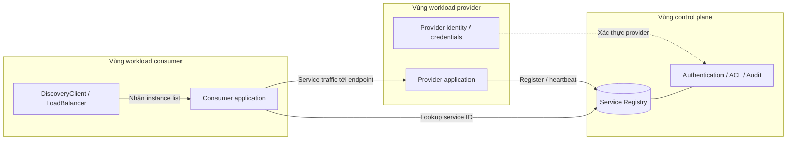

# Mô hình đe dọa và ranh giới tin cậy của sổ đăng ký

Service registry là thành phần điều khiển quan trọng trong hệ thống Spring Cloud Service Discovery. Registry nhận thông tin đăng ký từ provider, lưu service ID và instance endpoint, rồi cung cấp dữ liệu để consumer tìm nơi gửi request. Nếu registry hoặc danh tính workload bị xâm phạm, kẻ tấn công có thể làm sai lệch đích gọi, đọc cấu trúc nội bộ, làm gián đoạn khám phá hoặc lợi dụng consumer để gửi request tới endpoint ngoài dự kiến.

Registry phải được xem là một ranh giới tin cậy riêng trong kiến trúc microservice. Dữ liệu registry giúp tìm địa chỉ, nhưng không tự chứng minh rằng instance là hợp lệ hoặc request được phép truy cập nghiệp vụ. Thiết kế an toàn cần xác thực provider/consumer, phân quyền thao tác, mã hóa kết nối, giới hạn network, xác minh endpoint và duy trì khả năng phục hồi khi registry không đáng tin cậy hoặc tạm thời không khả dụng.

## 1. Registry nằm ở đâu trong kiến trúc?

Service discovery có hai luồng chính:

- **Control plane:** provider đăng ký/heartbeat; consumer truy vấn registry; registry lưu và phân phối thông tin instance.
- **Data plane:** consumer gửi HTTP/gRPC request trực tiếp tới instance được chọn hoặc tới proxy/load balancer được công bố.



Registry không nhất thiết nằm trên đường đi của từng request nghiệp vụ. Consumer có thể lấy instance từ cache rồi gọi thẳng provider. Điều này có hai hệ quả bảo mật:

1. Bảo vệ API registry thôi chưa đủ; traffic consumer-provider cũng cần xác thực và mã hóa.
2. Khi registry bị sửa đổi hoặc dữ liệu cache bị đầu độc, consumer có thể tiếp tục gọi endpoint sai ngay cả khi registry sau đó đã được khôi phục.

Hãy phân biệt trust boundary của registry, từng workload, network và service API. Không gộp chúng thành một vùng “nội bộ nên đáng tin”.

## 2. Tài sản cần bảo vệ

Threat model bắt đầu bằng việc xác định tài sản và hậu quả khi tài sản bị lộ, sửa hoặc làm mất khả dụng.

| Tài sản | Ví dụ | Hậu quả khi bị xâm phạm |
|---|---|---|
| Danh tính workload | Service account, client certificate, Consul token | Kẻ tấn công giả provider hoặc consumer |
| Registration | Service ID, instance ID, host, port, scheme | Request bị chuyển tới instance giả hoặc sai đích |
| Catalog và topology | Tên service, namespace, zone, tags | Lộ cấu trúc nội bộ và quan hệ giữa hệ thống |
| Metadata | Version, zone, capability, routing hints | Bị sửa để ảnh hưởng lựa chọn instance |
| Registry configuration | ACL, peer, root path, health check | Mất kiểm soát quyền và trạng thái registry |
| Secret và khóa | ACL token, password, TLS private key | Truy cập trái phép và giả mạo kết nối |
| Cache discovery | Instance list trong client/LoadBalancer | Endpoint độc hại hoặc cũ tiếp tục được sử dụng |
| Audit và event | Ai đăng ký, đọc hoặc xóa service | Mất khả năng điều tra và phát hiện tấn công |
| Availability | Registry quorum, API, watch, heartbeat | Microservice không tìm được đích mới hoặc mất khả năng phục hồi |

Không chỉ bảo vệ password. Một endpoint sai được đăng ký bằng credential hợp lệ vẫn có thể gây tác động lớn nếu consumer tin tưởng và tự động gửi request tới endpoint đó.

## 3. Actor và ranh giới tin cậy

Các actor thường gặp:

- **Provider hợp lệ:** ứng dụng được phép đăng ký một hoặc một nhóm service cụ thể.
- **Consumer hợp lệ:** ứng dụng được phép đọc service cần thiết và gọi API theo chính sách.
- **Operator:** người quản trị registry, ACL, cluster và cấu hình bảo mật.
- **Health checker/agent:** thành phần kiểm tra trạng thái instance hoặc cập nhật health.
- **CI/CD và secret manager:** cấp credential, triển khai cấu hình và image.
- **Workload bị xâm nhập:** ứng dụng có credential hợp lệ nhưng đã bị attacker kiểm soát.
- **Attacker ngoài hệ thống:** cố truy cập registry/API hoặc khai thác network exposure.
- **Registry bị xâm phạm:** server, peer hoặc datastore bị chiếm quyền hoặc bị sửa dữ liệu.

Các trust boundary cần xác định rõ:

| Ranh giới | Câu hỏi cần trả lời |
|---|---|
| Workload → Registry | Provider/consumer xác thực bằng danh tính nào? |
| Registry → Workload | Consumer kiểm tra endpoint và danh tính server thế nào? |
| Provider → Consumer | Consumer xác minh đúng service identity hay chỉ tin host/port? |
| Registry node → Registry node | Peer traffic có mã hóa và xác thực không? |
| Workload → Secret manager | Ai được cấp token và scope secret nào? |
| Operator → Control plane | Quản trị qua mạng nào, MFA/audit ra sao? |
| Cluster/network → Registry | Port nào được expose và subnet nào được phép truy cập? |

Một workload chạy trong cùng VPC, subnet hoặc Kubernetes cluster vẫn là một principal riêng. Network nội bộ không thay thế authentication và authorization.

## 4. Phân tích STRIDE cho service registry

STRIDE giúp phân loại các mối đe dọa theo hành vi tấn công:

| Nhóm | Ví dụ trong discovery | Tác động |
|---|---|---|
| Spoofing | Đăng ký instance giả dưới service ID hợp lệ; giả registry endpoint | Consumer gọi nhầm attacker |
| Tampering | Sửa host, port, metadata, health state hoặc ACL | Sai lệch định tuyến và quyền |
| Repudiation | Không có audit ai tạo/xóa registration | Không truy vết được thay đổi |
| Information disclosure | Đọc toàn catalog, host, port, zone, tags | Lộ topology và bề mặt tấn công |
| Denial of service | Flood registration, lookup, watch hoặc làm mất quorum | Discovery chậm hoặc ngừng hoạt động |
| Elevation of privilege | Token đọc catalog dùng được để ghi/xóa service khác | Workload vượt quyền được cấp |

Không phải mọi registry đều có cùng tính năng hoặc API. STRIDE là cách lập danh sách rủi ro; cần ánh xạ từng rủi ro tới provider, phiên bản và deployment thực tế.

## 5. Giả mạo hoặc đầu độc registration

Một provider được xác thực yếu hoặc có quyền ghi catalog quá rộng có thể đăng ký instance giả dưới service ID của hệ thống khác. Consumer tra cứu service ID sẽ nhận instance do attacker kiểm soát.

Ví dụ dữ liệu bị đầu độc:

```text
serviceId: payment-service
instanceId: fake-payment-01
host: attacker-controlled.internal
port: 8080
scheme: http
metadata:
  zone: production
```

Nếu LoadBalancer chọn endpoint này, request có thể gửi dữ liệu nhạy cảm tới attacker hoặc nhận response giả. Rủi ro tăng khi consumer tự động tin mọi instance trong registry.

Kiểm soát cần có:

- Xác thực từng provider trước khi cho phép đăng ký.
- Chỉ cấp quyền ghi cho service ID hoặc namespace mà workload sở hữu.
- Dùng instance ID duy nhất, có quy tắc đặt tên và audit.
- Giới hạn host/port/scheme được phép công bố theo môi trường.
- Không cho phép metadata tùy ý điều khiển URL hoặc HTTP destination.
- Dùng TLS/mTLS giữa consumer và provider; xác minh identity theo service, không chỉ kiểm tra certificate có hợp lệ.
- Theo dõi registration mới, thay đổi host/port và instance xuất hiện bất thường.

Consumer cũng nên kiểm tra các thuộc tính endpoint theo policy của hệ thống. Ví dụ service nội bộ chỉ được gọi qua HTTPS và port nằm trong allowlist. Không nên lấy scheme, host hoặc URL từ metadata do nguồn không đáng tin cung cấp rồi dùng trực tiếp.

## 6. Catalog disclosure và enumeration

Catalog có thể tiết lộ tên service, hostname, IP, port, zone, version và metadata. Attacker đọc được catalog có thể lập bản đồ kiến trúc, tìm service quản trị, xác định phiên bản cũ hoặc suy ra các vùng mạng nội bộ.

Giảm rủi ro bằng cách:

- Yêu cầu authentication cho API registry, kể cả API đọc.
- Phân quyền consumer chỉ đọc service/namespace cần thiết.
- Tách quyền catalog-wide dành cho operator khỏi quyền runtime.
- Giới hạn endpoint UI, dashboard và API quản trị trong network quản trị.
- Không lưu token, password, private key hoặc dữ liệu nhạy cảm trong metadata.
- Audit truy vấn catalog-wide bất thường và số lượng request tăng đột biến.
- Dùng namespace/root path/partition để phân tách domain khi provider hỗ trợ.

Ẩn service name khỏi UI không phải biện pháp kiểm soát truy cập. Cần enforce quyền ở registry API hoặc lớp bảo vệ tương ứng.

## 7. MITM, giả mạo registry và kết nối không mã hóa

Nếu provider hoặc consumer kết nối registry qua HTTP không được bảo vệ, attacker có vị trí trên network có thể đọc token, sửa response hoặc giả mạo endpoint. Nếu service traffic cũng không có TLS, attacker có thể đọc hoặc thay đổi dữ liệu nghiệp vụ sau khi discovery đã hoàn tất.

Các biện pháp:

- Dùng TLS cho kết nối client-registry và peer-registry.
- Dùng mTLS khi cần xác minh danh tính workload ở cả hai phía.
- Quản lý CA, certificate renewal, truststore và private key theo vòng đời.
- Kiểm tra hostname/SAN của certificate khớp endpoint registry hoặc provider.
- Không tắt certificate verification trong production để “sửa nhanh” lỗi handshake.
- Bảo vệ DNS và cấu hình endpoint registry khỏi bị thay đổi trái phép.
- Dùng TLS cho service-to-service traffic; registry TLS không tự bảo vệ request nghiệp vụ.

Khi certificate hết hạn hoặc CA rotation, cần rollout trust bundle và certificate theo thứ tự tương thích để tránh toàn bộ client mất kết nối cùng lúc.

## 8. SSRF và endpoint độc hại từ dữ liệu discovery

Consumer có thể gọi endpoint do registry cung cấp. Nếu attacker có thể ghi registration hoặc làm sai lệch catalog, consumer có nguy cơ trở thành phương tiện gửi request tới địa chỉ nội bộ không dự kiến.

Các mục tiêu có thể bị nhắm tới gồm metadata service của cloud, cổng quản trị, database, endpoint debug hoặc dịch vụ chỉ cho phép truy cập từ mạng nội bộ.

Đặc biệt nguy hiểm khi ứng dụng:

- Nhận service ID từ input người dùng rồi tra cứu tùy ý.
- Dùng host/URL lấy từ metadata để tạo HTTP client.
- Cho phép đăng ký endpoint bất kỳ mà không kiểm tra network zone.
- Cho phép scheme, port hoặc hostname tùy ý.
- Dùng consumer có quyền truy cập network rộng hơn service cần gọi.

Kiểm soát:

1. Service ID cần là dependency được khai báo hoặc allowlist, không lấy tùy tiện từ request người dùng.
2. Consumer chỉ được egress tới subnet/port của service hợp lệ.
3. Validate scheme, hostname, port và network zone trước khi gửi request nếu policy yêu cầu.
4. Không cho metadata trở thành URL hoàn chỉnh hoặc HTTP header tùy ý.
5. Dùng mTLS/service identity để xác minh peer đích.
6. Chặn truy cập tới link-local, loopback, metadata endpoint và mạng quản trị trừ khi được cho phép rõ ràng.
7. Ghi nhận service ID và endpoint đã chọn ở dạng an toàn để điều tra, tránh log secret hoặc payload nhạy cảm.

Service discovery không nên trở thành proxy tổng quát cho mọi URL do người gọi cung cấp.

## 9. Credential bị lộ và quyền vượt mức

Credential của provider có thể bị đánh cắp từ environment, file cấu hình, log, image hoặc CI pipeline. Nếu token có quyền quản trị toàn catalog, attacker có thể xóa service, tạo instance giả hoặc đọc topology.

Áp dụng least privilege:

| Principal | Quyền nên có | Quyền không nên có mặc định |
|---|---|---|
| Provider | Đăng ký/cập nhật/hủy instance thuộc service sở hữu | Ghi/xóa mọi service |
| Consumer | Đọc service cần gọi | Đăng ký hoặc sửa catalog |
| Health checker | Cập nhật/truy vấn health theo thiết kế | Quyền operator toàn registry |
| CI/CD | Cấp credential và triển khai trong phạm vi pipeline | Token runtime lâu dài toàn quyền |
| Operator | Quản trị theo nhiệm vụ, có audit | Chia sẻ credential admin cho ứng dụng |

Tách credential theo workload và môi trường. Dùng secret manager hoặc secret mount được bảo vệ; không commit token vào source code. Khi nghi ngờ lộ credential, revoke/rotate, kiểm tra audit và xác minh registration do credential đó tạo ra.

## 10. Denial of Service và registry availability

Registry có thể bị quá tải bởi:

- Nhiều client poll hoặc fetch catalog quá thường xuyên.
- Registration churn do container restart liên tục.
- Watch/subscription mở quá nhiều hoặc không được đóng đúng lifecycle.
- Health check quá dày hoặc timeout không hợp lý.
- Flood request vào API, UI hoặc endpoint quản trị.
- Làm mất quorum hoặc gây áp lực lên disk/network của registry cluster.

Biện pháp giảm tải và duy trì availability:

- Giới hạn rate, connection và quyền truy cập ở network/API gateway hoặc registry khi được hỗ trợ.
- Đặt timeout, retry có backoff và jitter; tránh retry đồng loạt.
- Dùng cache và watch theo hướng dẫn của provider; không enumerate toàn catalog trên mỗi request.
- Giới hạn tần suất health check phù hợp với mục tiêu phát hiện lỗi.
- Theo dõi quorum, leader, disk, memory, request rate, registration churn và latency.
- Triển khai registry theo topology HA được hỗ trợ; bảo vệ peer traffic và backup.
- Thiết kế ứng dụng có hành vi khi registry tạm thời unavailable, kể cả khi cache cũ còn dùng được.

Không nên xem việc tăng số registry node là biện pháp đủ. Cần kiểm tra quorum, failure domain, replication, backup/restore và quy trình nâng cấp.

## 11. Sai lệch dữ liệu, stale instance và cache poisoning

Một instance có thể đã dừng nhưng vẫn còn trong cache hoặc registry trong một khoảng thời gian. Ngược lại, instance khỏe có thể tạm thời biến mất do heartbeat, session hoặc network partition.

Các tình huống:

- Consumer giữ cache chứa endpoint cũ sau khi provider deregister.
- Attacker tạo instance giả rồi instance tiếp tục tồn tại trong cache.
- Network partition khiến hai phía có nhận định khác nhau về health.
- Instance ID trùng làm registration bị ghi đè hoặc cleanup nhầm.
- Client tiếp tục retry endpoint đã bị rút khỏi registry.

Kiểm soát:

- Chọn lease/heartbeat/session timeout theo failure detection và network profile.
- Hiểu TTL/refresh/cache ở từng tầng, tránh nhiều cache không có invalidation.
- Khi endpoint lỗi liên tục, circuit breaker và retry có giới hạn giúp giảm tác động.
- Dùng graceful deregistration và rollout/drain có thứ tự.
- Định kỳ đối chiếu registration với workload thực tế và audit thay đổi bất thường.
- Không dùng registry health làm bằng chứng duy nhất về trạng thái nghiệp vụ.
- Khi khôi phục registry, xác minh cache và registration trước khi mở lại traffic.

Đừng xóa toàn bộ service registration để xử lý một instance sai. Thao tác cleanup phải xác định đúng service ID và instance ID.

## 12. Kiểm soát theo từng registry

Mỗi provider có mô hình xác thực và phân quyền riêng. Các nguyên tắc chung cần được ánh xạ vào cơ chế thực tế:

| Registry | Cơ chế cần bảo vệ | Điểm cần xác minh |
|---|---|---|
| Eureka | Bảo vệ Eureka Server/API, HTTP authentication/authorization và TLS theo deployment | Client chỉ đăng ký service được phép; UI/API không public; peer/replication traffic được bảo vệ |
| Consul | ACL token/policy, TLS, gossip encryption và network segmentation | Token provider/consumer/operator tách biệt; chỉ cấp quyền service/namespace cần thiết; agent/API không mở rộng |
| ZooKeeper | Authentication, znode ACL, TLS và bảo vệ quorum/peer traffic | ACL đúng trên root và node; xác minh quyền CREATE/READ/WRITE/DELETE; client session không dùng credential chung |
| Kubernetes | RBAC, ServiceAccount, API server TLS, NetworkPolicy và admission controls | Chỉ list/watch resource trong namespace cần thiết; EndpointSlice/Service không bị sửa bởi principal ngoài phạm vi |

### Eureka

Eureka Server thường được triển khai như một ứng dụng Spring Boot. Bảo vệ endpoint registry bằng Spring Security hoặc lớp bảo vệ được tổ chức lựa chọn; cấu hình HTTPS/TLS, authorization cho API và quyền truy cập dashboard. Không mặc định rằng mọi Eureka deployment đều có ACL theo service ID ở mức granular; nếu cần phân quyền provider theo service, thiết kế policy ở server/security layer hoặc gateway và kiểm thử bằng credential thực tế.

### Consul

Consul cung cấp ACL policy/token và TLS. Tách token theo workload, dùng policy giới hạn service registration/read, bảo vệ HTTP API và gossip/peer traffic theo kiến trúc cluster. Không đưa token vào tag hoặc metadata. Agent local cũng cần được bảo vệ vì API agent có thể cho phép thao tác trên node tùy cấu hình.

### ZooKeeper

ZooKeeper dùng authentication scheme và ACL gắn với znode. ACL cần được cấu hình cho cả root path và node con; không giả định ACL của parent tự động được kế thừa đệ quy. Bảo vệ client port và quorum/peer communication, bật cơ chế xác thực phù hợp và xác minh ACL thực tế bằng công cụ quản trị. Quyền đọc service path và quyền ghi registration cần được tách theo vai trò.

### Kubernetes

Kubernetes discovery dựa trên API resources như Service, Pod và EndpointSlice. Dùng ServiceAccount riêng cho từng workload; RBAC chỉ cấp get, list, watch trên resource và namespace cần thiết. Bảo vệ API server, giới hạn quyền sửa Service/EndpointSlice, dùng NetworkPolicy và admission policy để giảm khả năng workload trái phép công bố endpoint.

## 13. Registry không thay thế service authorization

Registry trả lời câu hỏi “instance nào có thể được gọi theo service ID?”. Nó không trả lời “người dùng hoặc service này có được phép thực hiện nghiệp vụ này không?”.

Ví dụ consumer tìm được `payment-service` và kết nối TLS thành công. Điều đó không có nghĩa consumer được phép hoàn tiền hoặc xem thông tin thẻ. Provider vẫn phải xác thực caller và kiểm tra quyền nghiệp vụ.

Cần các lớp bảo vệ riêng:

- Authentication service-to-service bằng mTLS, OAuth2 client credentials hoặc cơ chế workload identity.
- Authorization theo scope, role, audience hoặc policy nghiệp vụ.
- Xác thực người dùng cuối nếu request mang danh nghĩa người dùng.
- Kiểm tra input, rate limit và audit tại service đích.
- Không tin header identity do consumer tự gửi nếu không có cơ chế ký/xác minh đáng tin cậy.

Registry là control plane hỗ trợ định tuyến. Authorization phải được thực thi ở API/service đích hoặc gateway tin cậy.

## 14. Quan sát, audit và phát hiện bất thường

Nên ghi nhận các sự kiện:

- Principal nào tạo, cập nhật hoặc xóa service registration.
- Service ID/instance ID nào thay đổi host, port, scheme hoặc metadata.
- Credential nào đọc catalog-wide hoặc gọi API quản trị.
- Lỗi xác thực/authorization và tần suất 401/403.
- Registration churn, instance flapping và heartbeat/session expiration.
- Lookup latency, registry API error rate và cache refresh lag.
- Thay đổi ACL, RBAC, TLS certificate, peer membership hoặc registry config.

Log nên có principal, operation, service ID, instance ID, timestamp và kết quả. Không ghi token, password, private key, Authorization header hoặc payload chứa dữ liệu nhạy cảm. Bảo vệ audit log khỏi sửa/xóa trái phép và đồng bộ clock để đối chiếu sự kiện giữa các node.

Alert nên tập trung vào bất thường có ý nghĩa: provider lạ đăng ký service quan trọng, endpoint đổi sang subnet không mong đợi, operator token dùng từ workload runtime, ACL bị nới rộng, catalog read spike hoặc registry quorum mất ổn định.

## 15. Ví dụ kiểm soát consumer trước khi gọi instance

Đoạn mã dưới đây minh họa policy ở tầng ứng dụng: chỉ chấp nhận HTTPS và port nằm trong allowlist. Đây không phải thay thế TLS certificate validation hoặc authorization tại provider; nó là lớp kiểm tra bổ sung trước khi sử dụng endpoint từ discovery.

```java
import java.util.Set;

import org.springframework.cloud.client.ServiceInstance;
import org.springframework.stereotype.Component;

@Component
public class DiscoveredEndpointPolicy {

    private static final Set<Integer> ALLOWED_PORTS = Set.of(8443);

    public void validate(ServiceInstance instance) {
        if (!instance.isSecure()) {
            throw new SecurityException("Only secure instances are allowed");
        }

        if (!ALLOWED_PORTS.contains(instance.getPort())) {
            throw new SecurityException("Discovered port is not allowed");
        }

        String host = instance.getHost();
        if (host == null || host.isBlank()) {
            throw new SecurityException("Discovered host is missing");
        }
    }
}
```

Trong production, policy cần được cấu hình theo service ID và network zone thay vì dùng một port allowlist chung cho mọi service. Nếu dùng hostname, cần kiểm tra DNS resolution và network egress; nếu dùng mTLS, certificate identity phải được ánh xạ tới service mong đợi.

## 16. Runbook khi nghi ngờ registry bị xâm phạm

Khi phát hiện instance lạ hoặc endpoint bị thay đổi bất thường:

1. Xác định service ID, instance ID, host, port, metadata và thời điểm thay đổi.
2. Kiểm tra principal/credential đã tạo hoặc cập nhật registration qua audit.
3. Đối chiếu endpoint với workload thực tế, deployment và network inventory.
4. Tạm thời chặn endpoint đáng ngờ ở network egress hoặc policy routing nếu cần bảo vệ consumer.
5. Thu hồi/rotate credential bị nghi lộ; không chỉ xóa registration.
6. Xóa hoặc quarantine registration độc hại bằng thao tác có phạm vi chính xác.
7. Kiểm tra cache ở consumer/LoadBalancer và chờ dữ liệu hợp lệ hội tụ.
8. Xác minh TLS certificate và service identity của endpoint thay thế.
9. Kiểm tra log truy cập API, catalog read và request nghiệp vụ có thể đã bị chuyển hướng.
10. Khôi phục ACL/RBAC và registry configuration từ nguồn kiểm soát.
11. Theo dõi registration mới, lỗi authentication và traffic bất thường sau khôi phục.
12. Ghi nhận nguyên nhân gốc và cập nhật threat model.

Không xóa toàn bộ catalog hoặc restart đồng loạt mọi service như phản ứng mặc định. Các hành động rộng có thể làm tăng downtime và xóa bằng chứng điều tra.

## 17. Checklist threat model trước khi triển khai

1. Đã liệt kê asset, actor, trust boundary và luồng control/data plane.
2. Provider và consumer có danh tính riêng, xác thực khi truy cập registry.
3. Quyền đăng ký, đọc, sửa và xóa được giới hạn theo service/namespace.
4. Registry API, UI, peer traffic và datastore được bảo vệ.
5. TLS/mTLS được dùng đúng chỗ; certificate được xác minh và rotation có kế hoạch.
6. Consumer không tin mù host, port, scheme hoặc metadata trong registration.
7. Service ID là dependency được kiểm soát; không nhận tùy ý từ input người dùng.
8. Network egress giới hạn consumer tới endpoint hợp lệ.
9. Service API vẫn thực thi authentication và authorization độc lập với discovery.
10. Secret được quản lý bên ngoài source code, image và log.
11. Có audit cho registration, catalog read và thay đổi policy.
12. Có giới hạn rate, timeout, retry/backoff và cache phù hợp.
13. Có quy trình phát hiện stale instance, poisoning và registration churn.
14. Registry cluster có HA, backup/restore và bảo vệ quorum/peer.
15. Có runbook khi credential hoặc registry bị xâm phạm.
16. Đã kiểm thử các tình huống giả mạo registration, đọc catalog trái phép, endpoint sai và registry unavailable.

Service registry là một nguồn dữ liệu điều khiển định tuyến có ảnh hưởng lớn tới toàn bộ microservice. Khi xác định rõ trust boundary, xác thực từng workload, giới hạn quyền, mã hóa kết nối, kiểm tra endpoint và bảo vệ service API độc lập, hệ thống giảm được nguy cơ giả mạo instance, lộ topology, SSRF, DoS và sai lệch registry. Hãy coi dữ liệu discovery là thông tin định tuyến cần kiểm chứng, không phải bằng chứng duy nhất về danh tính hay quyền truy cập.
