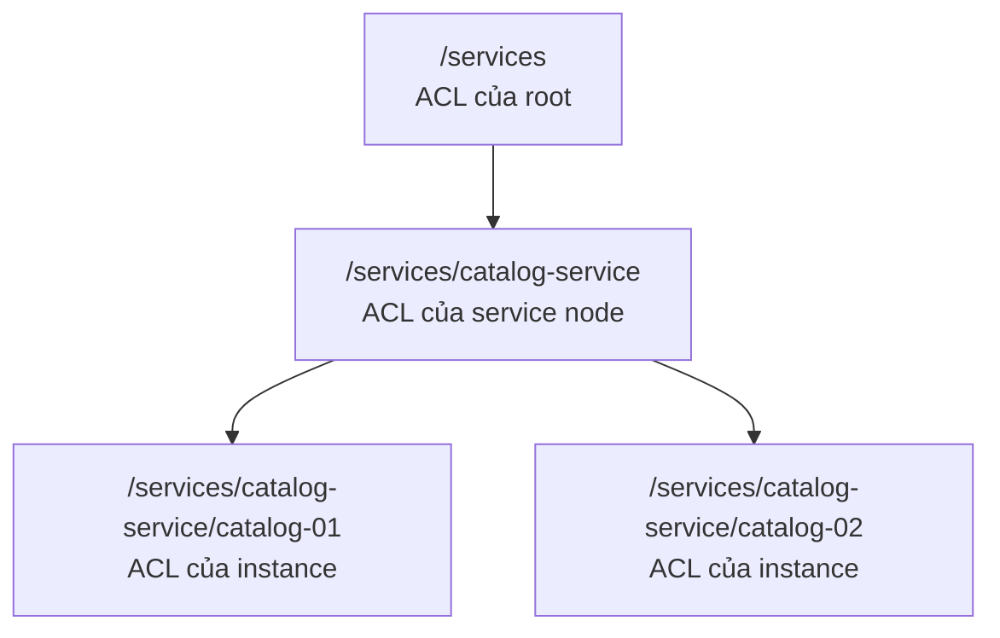

# Zookeeper ACL, xác thực và bảo vệ đường dẫn đăng ký

Spring Cloud Zookeeper dùng Apache Curator để đăng ký và khám phá service. Thông tin instance được lưu thành các znode trong cây dữ liệu ZooKeeper. Nếu mọi client đều có thể đọc, tạo, sửa hoặc xóa các znode này, một ứng dụng có thể giả mạo service, xóa registration của ứng dụng khác hoặc đọc thông tin hạ tầng nội bộ.

ZooKeeper cung cấp xác thực kết nối và Access Control List (ACL) ở từng znode. Xác thực xác định danh tính client; ACL quyết định danh tính đó được phép thực hiện thao tác nào trên một đường dẫn cụ thể. Muốn bảo vệ service registry, cần cấu hình cả hai lớp, phân quyền theo đường dẫn và kiểm tra ACL của từng znode đã tồn tại.

Bài học thuộc chương `Bảo mật` trong module `SPRING_CLOUD_SERVICE_DISCOVERY`. Module giúp người học hiểu cơ chế tìm instance theo tên dịch vụ qua `DiscoveryClient`, `ServiceRegistry`, Eureka hoặc Consul, cùng vòng đời đăng ký, health check, load balancing, bảo mật và xử lý sai lệch registry. Nội dung này tập trung vào ACL, authentication scheme, quyền trên đường dẫn đăng ký, cách Spring Cloud Zookeeper tích hợp Curator và quy trình kiểm chứng quyền truy cập.

## 1. Dữ liệu Service Discovery nằm ở đâu trong ZooKeeper?

ZooKeeper tổ chức dữ liệu theo cây znode. Mỗi znode có thể chứa dữ liệu và các znode con. Curator Service Discovery lưu service instance theo một base path, bên dưới là tên service và ID của từng instance.

Spring Cloud Zookeeper có thuộc tính `spring.cloud.zookeeper.discovery.root` để chọn thư mục gốc của service registry. Giá trị mặc định thường là `/services`.

Ví dụ cấu trúc minh họa:

```text
/services
  /catalog-service
    /catalog-01       -> payload instance A
    /catalog-02       -> payload instance B
  /order-service
    /order-01         -> payload instance C
```

Trong ví dụ:

- `/services` là root của service registry.
- `/services/catalog-service` là znode nhóm các instance của service `catalog-service`.
- `/services/catalog-service/catalog-01` chứa dữ liệu của một instance.
- Consumer đọc danh sách con dưới service path rồi đọc payload từng instance.

Đường dẫn chính xác phụ thuộc `spring.cloud.zookeeper.discovery.root`, service name, instance ID và cấu hình integration. Curator cũng hỗ trợ base path hoặc path constructor riêng. Vì vậy, hãy kiểm tra path thực tế trong ZooKeeper trước khi thiết kế ACL; không mặc định mọi ứng dụng đều dùng `/services`.

### 1.1. Cấu hình root riêng theo môi trường

Có thể tách registry theo môi trường bằng root path:

```yaml
spring:
  application:
    name: catalog-service
  cloud:
    zookeeper:
      connect-string: zk-1.internal:2181,zk-2.internal:2181,zk-3.internal:2181
      discovery:
        enabled: true
        register: true
        root: /services/production
```

Khi đó, các instance được lưu dưới `/services/production/catalog-service/...`. Môi trường staging có thể dùng `/services/staging`. Root path giúp tổ chức và phân vùng dữ liệu; bản thân nó không phải cơ chế xác thực hoặc phân quyền.

Nếu cùng một ZooKeeper ensemble được dùng cho service discovery và distributed configuration, cần phân biệt root của hai chức năng. Spring Cloud Zookeeper discovery thường dùng `/services`; Zookeeper Config thường dùng `/config`. Cần đặt ACL riêng cho từng cây dữ liệu để ứng dụng chỉ đọc hoặc ghi đúng vùng được cấp quyền.

## 2. Xác thực và ACL là hai lớp khác nhau

Hai câu hỏi bảo mật cần được trả lời riêng:

1. **Authentication:** client kết nối là ai? Client chứng minh danh tính bằng digest, SASL/Kerberos, chứng chỉ X.509 hoặc cơ chế được cấu hình.
2. **Authorization:** danh tính đó được làm gì trên znode? ACL gán quyền `READ`, `WRITE`, `CREATE`, `DELETE` hoặc `ADMIN` cho một identity.

Ví dụ, một `catalog-service` có thể xác thực bằng tài khoản `catalog-writer`. ACL cho phép tài khoản đó tạo instance dưới `/services/catalog-service`, cập nhật payload instance của nó và hủy registration khi dừng. Một consumer chỉ có quyền đọc các znode service discovery; nó không được tạo hoặc xóa registration.

Xác thực thành công không đồng nghĩa có toàn quyền trên ZooKeeper. Ngược lại, một ACL tham chiếu tới identity mà client chưa xác thực cũng không giúp client có quyền truy cập.

## 3. ACL hoạt động trên từng znode

ZooKeeper ACL gắn với một znode cụ thể. ACL của `/services` không tự động áp dụng cho `/services/catalog-service`, và ACL của service node cũng không tự động áp dụng cho các instance node bên dưới.



Điều này có nghĩa việc đặt ACL hạn chế trên root không bảo vệ các node con đã tồn tại với ACL rộng. Khi tạo znode mới, ứng dụng hoặc Curator phải gán ACL phù hợp cho chính znode đó. Khi thay đổi chính sách, cần cập nhật ACL cho từng node hiện hữu; không thể chỉ sửa ACL root rồi kỳ vọng các con tự kế thừa.

## 4. Năm quyền ACL cơ bản

ZooKeeper hỗ trợ năm quyền chính:

| Quyền | Ý nghĩa | Ví dụ trong service registry |
|---|---|---|
| `CREATE` | Tạo znode con bên dưới znode đang xét. | Tạo service node dưới `/services` hoặc instance node dưới `/services/catalog-service`. |
| `READ` | Đọc dữ liệu của znode và liệt kê các znode con. | Consumer liệt kê instance và đọc payload. |
| `WRITE` | Thay đổi dữ liệu của chính znode. | Cập nhật payload hoặc metadata instance. |
| `DELETE` | Xóa znode con của znode đang xét. | Hủy instance node bằng quyền `DELETE` trên service parent. |
| `ADMIN` | Thay đổi ACL của znode. | Quản trị viên sửa quyền trên root, service hoặc instance node. |

`CREATE` và `DELETE` được tách khỏi `WRITE`. Một client có thể được phép thêm child nhưng không được xóa child; hoặc được sửa payload một znode nhưng không được tạo thêm node bên dưới.

Lưu ý quan trọng: quyền `DELETE` được kiểm tra trên **parent** của znode bị xóa. Muốn xóa `/services/catalog-service/catalog-01`, client cần quyền `DELETE` trên `/services/catalog-service`. Tương tự, muốn tạo instance node bên dưới service node, client cần quyền `CREATE` trên service node.

ZooKeeper không có khái niệm owner giống quyền sở hữu file Unix. `ADMIN` là quyền quản lý ACL, không phải một owner mặc định được tự động cấp cho người tạo.

## 5. Các authentication scheme thường dùng

ZooKeeper hỗ trợ nhiều scheme để tạo identity gắn với connection:

| Scheme | Cách nhận diện | Lưu ý |
|---|---|---|
| `world` | Identity `anyone`, đại diện cho mọi client. | `world:anyone` không yêu cầu xác thực; chỉ dùng khi dữ liệu thực sự công khai. |
| `auth` | Các identity đã xác thực trên connection hiện tại. | Tiện để giới hạn quyền cho identity đã đăng nhập; không thay thế việc bật authentication trên server. |
| `digest` | Tài khoản và mật khẩu. | Dễ thử nghiệm và tích hợp, nhưng dữ liệu xác thực digest được gửi qua mạng; cần TLS nếu dùng qua network. |
| `sasl` | Identity được xác thực bằng SASL, thường kết hợp Kerberos. | Phù hợp môi trường doanh nghiệp có Kerberos và quản lý principal. |
| `x509` | X.500 principal trong chứng chỉ client. | Có thể dùng mutual TLS để xác thực client bằng chứng chỉ. |
| `ip` | Địa chỉ IP nguồn hoặc subnet. | Đây là điều kiện dựa trên IP, không phải xác thực mật mã; địa chỉ IP có thể bị giả mạo nếu mạng không được bảo vệ. |

ACL entry có dạng `scheme:id` đi cùng tập quyền. Ví dụ `digest:catalog-reader:...` là identity digest được lưu trong ACL; phần identity digest phải được tạo theo định dạng ZooKeeper yêu cầu, không phải chuỗi mật khẩu thô.

### 5.1. `world:anyone` và OPEN_ACL_UNSAFE

Curator có `ZooDefs.Ids.OPEN_ACL_UNSAFE`, cho phép `world:anyone` thực hiện mọi quyền trên znode. Tên `UNSAFE` là lời nhắc rõ ràng: không dùng ACL này cho service registry production.

Một node được tạo với ACL mở có thể bị client không xác thực đọc, sửa, tạo child hoặc xóa child. Nếu instance node có payload chứa host, port và metadata, thông tin nội bộ có thể bị lộ; nếu attacker có quyền ghi, nó có thể công bố địa chỉ giả để consumer gửi request tới sai đích.

Hãy kiểm tra ACL thực tế của các node được Curator tạo ra. Đừng suy luận rằng đã cấu hình digest authentication thì mọi znode tự động có ACL hạn chế.

### 5.2. `auth` scheme

`auth` là scheme tiện ích áp dụng quyền cho các identity đã xác thực trên connection tạo ACL. Nó thường được dùng để tạo node mà chỉ identity đã xác thực mới truy cập được.

Nếu connection chưa có identity đã xác thực, việc tạo ACL theo `auth` sẽ thất bại. Ngoài ra, `auth` không tự bật hoặc bắt buộc xác thực cho toàn bộ ensemble; server cần cấu hình enforce-auth phù hợp nếu muốn từ chối client chưa xác thực ngay khi kết nối.

### 5.3. Digest không thay thế TLS

Digest authentication vẫn truyền thông tin username/password trong dữ liệu xác thực theo cơ chế ZooKeeper. Vì vậy, không dùng digest qua mạng không tin cậy nếu client-server transport chưa được mã hóa. ACL digest cũng không phải nơi để lưu mật khẩu thô.

Nếu cần bảo vệ danh tính và credential qua mạng, ưu tiên SASL/Kerberos hoặc mutual TLS với X.509 khi hạ tầng hỗ trợ. Nếu vẫn dùng digest, hãy kết hợp TLS, secret manager, credential riêng cho từng ứng dụng và chính sách luân chuyển mật khẩu.

## 6. Thiết kế quyền cho đường dẫn service registration

Với cấu trúc `/services/<service-name>/<instance-id>`, có thể phân quyền theo ba tầng:

| Path | Provider đăng ký | Consumer khám phá | Registry administrator |
|---|---|---|---|
| `/services` | `READ`, `CREATE` để tạo service node khi được phép. | `READ` để liệt kê service. | Toàn quyền quản trị. |
| `/services/catalog-service` | `READ`, `CREATE`, `DELETE` để quản lý instance con. | `READ` để liệt kê instance. | Toàn quyền quản trị. |
| `/services/catalog-service/catalog-01` | `READ`, `WRITE` nếu cần cập nhật payload. | `READ` để đọc địa chỉ và metadata. | Toàn quyền quản trị. |

Đây là ma trận tham khảo. Nếu mỗi service có một tài khoản writer riêng, ACL có thể giới hạn writer của `catalog-service` chỉ trên `/services/catalog-service`; writer không có quyền tạo hoặc sửa registration của `order-service`.

### 6.1. Tách reader, writer và administrator

Một thiết kế thường dùng có ba nhóm identity:

- **Discovery reader:** chỉ có `READ` trên root, service node và instance node thuộc phạm vi cần khám phá.
- **Service writer:** có `CREATE` trên parent cần tạo child, `WRITE` trên instance node của service mình và `DELETE` trên service parent để hủy instance. Quyền cần thiết phải được giới hạn theo path.
- **Registry administrator:** có `ADMIN` hoặc quyền quản trị rộng hơn để tạo namespace, sửa ACL và xử lý sự cố. Credential này không dùng trong process ứng dụng thường ngày.

Nếu tất cả microservice dùng chung một tài khoản writer có quyền trên toàn `/services`, một service bị xâm nhập có thể giả mạo hoặc xóa registration của service khác. Tách identity theo service hoặc nhóm service giúp giới hạn phạm vi ảnh hưởng.

### 6.2. Phân vùng theo môi trường

Có thể dùng root riêng:

```yaml
spring:
  cloud:
    zookeeper:
      discovery:
        root: /services/production
```

Staging có thể dùng `/services/staging`. Admin tạo các root cần thiết và đặt ACL tương ứng trước khi ứng dụng đăng ký. Việc tách path giúp tổ chức dữ liệu và áp dụng policy; ACL vẫn phải được gán cho từng znode vì không có kế thừa đệ quy.

Một lựa chọn khác là ZooKeeper chroot trong connect string hoặc Curator namespace. Chroot/namespace giới hạn cách client nhìn thấy cây đường dẫn, nhưng không thay thế ACL. Client vẫn cần identity và quyền phù hợp bên trong vùng namespace của nó.

## 7. Bảo vệ parent path và instance path đúng cách

Để provider tạo instance mới, quyền cần được đặt ở đúng nơi:

1. Provider cần `CREATE` trên `/services` nếu nó được phép tạo service node mới.
2. Provider cần `CREATE` trên `/services/catalog-service` để tạo instance node.
3. Consumer cần `READ` trên `/services` để liệt kê service và `READ` trên service node để liệt kê instance.
4. Consumer cần `READ` trên instance node để đọc payload.
5. Provider cần `WRITE` trên instance node nếu cập nhật dữ liệu.
6. Provider cần `DELETE` trên service parent để hủy instance node một cách tường minh.
7. Admin cần `ADMIN` trên từng node mà họ cần thay đổi ACL.

Nếu chỉ cấp `CREATE` trên `/services` mà không cấp `CREATE` trên `/services/catalog-service`, provider có thể tạo được service node nhưng không tạo được instance bên dưới. Nếu consumer chỉ có `READ` trên instance nhưng không có `READ` trên service parent, nó có thể đọc một path đã biết nhưng không liệt kê được các instance con.

Đối với ephemeral node, ZooKeeper quản lý vòng đời theo session. Khi session hết hạn, ephemeral node được xóa theo cơ chế của server. Tuy vậy, quá trình đăng ký và hủy đăng ký tường minh của ứng dụng vẫn cần quyền phù hợp; không nên dựa vào session expiry như cơ chế dọn dẹp duy nhất.

## 8. Cấu hình xác thực trong Spring Cloud Zookeeper

Spring Cloud Zookeeper dùng Curator phía dưới. Dependency discovery thường dùng:

```xml
<dependency>
    <groupId>org.springframework.cloud</groupId>
    <artifactId>spring-cloud-starter-zookeeper-discovery</artifactId>
</dependency>
```

Khai báo địa chỉ ZooKeeper và root path:

```yaml
spring:
  application:
    name: catalog-service
  cloud:
    zookeeper:
      connect-string: zk-1.internal:2181,zk-2.internal:2181,zk-3.internal:2181
      discovery:
        enabled: true
        register: true
        root: /services/production
```

`connect-string` chỉ định ensemble; `discovery.root` xác định cây đăng ký. Các thuộc tính này không tự cấu hình authentication hoặc ACL. Cần tùy chỉnh Curator client để gửi thông tin xác thực và dùng ACL phù hợp khi tạo znode.

### 8.1. CuratorFrameworkCustomizer ở Spring Cloud Zookeeper mới

Trong các phiên bản Spring Cloud Zookeeper mới có `CuratorFrameworkCustomizer`. Auto-configuration áp dụng customizer lên `CuratorFrameworkFactory.Builder` trước khi tạo Curator client. Có thể thêm digest authorization như sau:

```java
import java.nio.charset.StandardCharsets;

import org.springframework.cloud.zookeeper.CuratorFrameworkCustomizer;
import org.springframework.context.annotation.Bean;
import org.springframework.context.annotation.Configuration;

@Configuration
public class ZookeeperAuthenticationConfiguration {

    @Bean
    CuratorFrameworkCustomizer digestAuthentication(
            ZookeeperCredentials credentials) {
        byte[] authData = (credentials.username() + ":" + credentials.password())
                .getBytes(StandardCharsets.UTF_8);

        return builder -> builder.authorization("digest", authData);
    }
}
```

`ZookeeperCredentials` trong ví dụ là đối tượng cấu hình do ứng dụng cung cấp; username và password phải lấy từ secret manager hoặc secret mount, không hardcode trong source code. Curator builder nhận `authorization("digest", ...)` trước khi client được tạo.

Không tự tạo một `CuratorFramework` bean thay thế chỉ để thêm credential nếu auto-configuration đã cung cấp client. Với các phiên bản mới, việc khai báo `CuratorFrameworkCustomizer` là cách mở rộng phù hợp hơn; thay thế bean có thể khiến `ZookeeperAutoConfiguration` lùi lại và làm mất cấu hình mặc định của Spring Cloud.

### 8.2. Khác biệt giữa các phiên bản

Một số tài liệu Spring Cloud Zookeeper cũ mô tả cách gọi `addAuthInfo` trực tiếp trên `CuratorFramework` trong `@BootstrapConfiguration`. Tuy nhiên, `CuratorFramework` là interface và không có method `addAuthInfo`. Tài liệu nhánh mới đã chuyển sang `CuratorFrameworkCustomizer` và `CuratorFrameworkFactory.Builder.authorization(...)`.

Nếu dự án dùng legacy bootstrap (`spring-cloud-starter-bootstrap` hoặc `spring.cloud.bootstrap.enabled=true`), customizer phải được đăng ký đủ sớm trong bootstrap context theo hướng dẫn của release train đó. Nếu dùng Spring Boot Config Data, không nên tự thêm bootstrap file chỉ vì một ví dụ cũ yêu cầu như vậy. Hãy kiểm tra tài liệu đúng phiên bản Spring Cloud Zookeeper đang dùng.

## 9. Cấu hình ACLProvider cho Curator

Xác thực cho biết client là ai; `ACLProvider` quyết định ACL Curator gắn vào các znode khi tạo chúng. Curator có interface `ACLProvider` với hai phương thức:

- `getDefaultAcl()`: ACL mặc định nếu không có path-specific rule.
- `getAclForPath(path)`: ACL áp dụng cho znode ở đường dẫn tương ứng.

Curator `DefaultACLProvider` thường trả về `ZooDefs.Ids.OPEN_ACL_UNSAFE` làm ACL mặc định. Vì vậy, cần cấu hình ACLProvider hạn chế thay vì dựa vào default ACL mở.

Ví dụ dưới đây minh họa phân quyền theo ba tầng root, service node và instance node. Các digest identity được truyền vào constructor dưới dạng ACL ID đã được tạo từ quy trình cấp credential của tổ chức; không dùng mật khẩu thô làm ACL ID.

```java
import java.util.List;

import org.apache.curator.framework.api.ACLProvider;
import org.apache.zookeeper.ZooDefs;
import org.apache.zookeeper.data.ACL;
import org.apache.zookeeper.data.Id;

public final class ServiceRegistryAclProvider implements ACLProvider {

    private final String root;
    private final List<ACL> rootAcl;
    private final List<ACL> serviceAcl;
    private final List<ACL> instanceAcl;

    public ServiceRegistryAclProvider(
            String root,
            String readerDigestId,
            String writerDigestId,
            String adminDigestId) {
        this.root = root;

        Id reader = new Id("digest", readerDigestId);
        Id writer = new Id("digest", writerDigestId);
        Id admin = new Id("digest", adminDigestId);

        this.rootAcl = List.of(
                new ACL(ZooDefs.Perms.READ, reader),
                new ACL(ZooDefs.Perms.READ | ZooDefs.Perms.CREATE, writer),
                new ACL(ZooDefs.Perms.ALL, admin));

        this.serviceAcl = List.of(
                new ACL(ZooDefs.Perms.READ, reader),
                new ACL(ZooDefs.Perms.READ | ZooDefs.Perms.CREATE
                        | ZooDefs.Perms.DELETE, writer),
                new ACL(ZooDefs.Perms.ALL, admin));

        this.instanceAcl = List.of(
                new ACL(ZooDefs.Perms.READ, reader),
                new ACL(ZooDefs.Perms.READ | ZooDefs.Perms.WRITE, writer),
                new ACL(ZooDefs.Perms.ALL, admin));
    }

    @Override
    public List<ACL> getDefaultAcl() {
        return instanceAcl;
    }

    @Override
    public List<ACL> getAclForPath(String path) {
        if (root.equals(path)) {
            return rootAcl;
        }

        String prefix = root + "/";
        if (path != null && path.startsWith(prefix)) {
            String relativePath = path.substring(prefix.length());
            if (!relativePath.isEmpty() && !relativePath.contains("/")) {
                return serviceAcl;
            }
        }

        return instanceAcl;
    }
}
```

Đây là mẫu phân quyền để giải thích nguyên tắc. Trong ứng dụng thực tế, cần:

- Chuẩn hóa `root` và kiểm tra path mà Curator thực sự truyền vào `getAclForPath`.
- Xử lý các parent path được tạo tự động, đặc biệt khi root có nhiều cấp như `/services/production`.
- Mẫu code giả định root và các ancestor của nó đã được administrator tạo trước với ACL phù hợp. Nếu Curator tự tạo `/services` hoặc `/services/production`, ACLProvider phải trả ACL riêng cho từng ancestor để client có `CREATE` trên parent tương ứng.
- Không để path lạ rơi vào ACL mở; `getDefaultAcl()` phải là ACL hạn chế.
- Giới hạn writer theo service name nếu mỗi service có identity riêng.
- Dùng ACL ID đúng định dạng của authentication scheme; digest ACL ID không phải password thô.
- Kiểm thử ACL trên root, service parent và instance node bằng các identity khác nhau.

### 9.1. Gắn ACLProvider vào CuratorFrameworkCustomizer

Có thể kết hợp authorization và ACLProvider trong cùng customizer:

```java
import java.nio.charset.StandardCharsets;

import org.apache.curator.framework.api.ACLProvider;
import org.springframework.cloud.zookeeper.CuratorFrameworkCustomizer;
import org.springframework.context.annotation.Bean;
import org.springframework.context.annotation.Configuration;

@Configuration
public class ZookeeperSecurityConfiguration {

    @Bean
    CuratorFrameworkCustomizer registrySecurity(
            ZookeeperCredentials credentials,
            ACLProvider serviceRegistryAclProvider) {
        byte[] authData = (credentials.username() + ":" + credentials.password())
                .getBytes(StandardCharsets.UTF_8);

        return builder -> builder
                .authorization("digest", authData)
                .aclProvider(serviceRegistryAclProvider);
    }
}
```

Trong cấu hình này, `authorization` xác thực Curator client; `aclProvider` quyết định ACL được gắn khi tạo znode. Hai chức năng có liên quan nhưng không thay thế nhau.

Nếu cùng Curator client còn được dùng cho Zookeeper Config hoặc một cây znode khác, ACLProvider cần xử lý path của các chức năng đó một cách rõ ràng. Không áp dụng một ACL quá hẹp cho toàn bộ ensemble mà chưa kiểm tra các path mà ứng dụng cần đọc hoặc ghi.

## 10. Phân biệt ACLProvider với sửa ACL node đã tồn tại

`ACLProvider` được dùng khi Curator thực hiện thao tác tạo znode và cần xác định ACL. Việc thêm ACLProvider hôm nay không tự sửa ACL của node đã được tạo hôm qua.

Nếu registry đã có znode được tạo với `OPEN_ACL_UNSAFE`, cần một quy trình migration:

1. Dùng identity quản trị có quyền `ADMIN` trên các node cần sửa.
2. Liệt kê toàn bộ path dưới registry root.
3. Đọc ACL hiện tại của từng znode.
4. Đặt ACL mới trên root, service node và instance node theo policy.
5. Kiểm tra lại bằng reader, writer và admin identity.
6. Sau khi xác nhận, thu hồi hoặc xoay credential cũ.

Không chỉ sửa ACL root vì ACL không có tính kế thừa. Cần kiểm tra toàn bộ cây, kể cả các service node và instance node đã tồn tại.

Việc gọi `setACL` yêu cầu quyền `ADMIN` trên znode đó. Hãy giữ credential admin riêng cho tác vụ migration; không cấp quyền này cho mọi service writer.

## 11. Cấu hình xác thực bắt buộc ở ZooKeeper Server

Client gửi credential không đồng nghĩa server bắt buộc mọi client phải xác thực. Nếu muốn từ chối client chưa xác thực, cần bật chính sách enforce-auth ở server.

Với ZooKeeper 3.7 trở lên, có thể cấu hình:

```properties
# Java system properties passed to the ZooKeeper server JVM
-Dzookeeper.enforce.auth.enabled=true
-Dzookeeper.enforce.auth.schemes=sasl
```

Đây là các Java system properties truyền vào JVM khi khởi động ZooKeeper, không phải key YAML của Spring Boot. Ví dụ trên yêu cầu client xác thực bằng SASL. Nếu dùng scheme khác, cấu hình server phải liệt kê scheme tương ứng và client phải được cấu hình đúng. Tính năng `zookeeper.enforce.auth.enabled` có từ ZooKeeper 3.7; các phiên bản cũ có tùy chọn riêng `zookeeper.sessionRequireClientSASLAuth` cho yêu cầu SASL.

Trước khi bật enforce-auth trong production, cần kiểm tra mọi client đang kết nối: service discovery, config client, công cụ quản trị, exporter, backup và job vận hành. Client không có credential hợp lệ sẽ không tạo được session.

## 12. TLS cho kết nối client-server và peer

ACL kiểm soát quyền ở tầng dữ liệu; TLS bảo vệ dữ liệu trên đường truyền. Hai lớp này giải quyết các vấn đề khác nhau.

ZooKeeper có thể cấu hình TLS cho kết nối client-server và cho quorum traffic giữa các server. Quorum TLS không tự động bật TLS cho client connection; cần cấu hình riêng từng kênh.

Các nguyên tắc:

- Dùng secure client port và keystore/truststore phù hợp để mã hóa kết nối ứng dụng tới ZooKeeper.
- Cân nhắc mutual TLS để server xác thực client bằng chứng chỉ X.509.
- Bật quorum TLS nếu yêu cầu bảo vệ dữ liệu giữa các peer trong ensemble.
- Bật hostname verification và quản lý CA/certificate rotation phù hợp.
- Không coi việc dùng port TLS là thay thế ACL; client đã kết nối vẫn cần quyền trên znode.
- Nếu dùng digest authentication, không truyền credential trên kết nối plaintext.

Các thuộc tính TLS và cách bật secure port phụ thuộc phiên bản ZooKeeper và `serverCnxnFactory`. Hãy theo tài liệu Admin Guide của đúng phiên bản server, kiểm tra log khởi động để xác nhận TLS thực sự được kích hoạt.

## 13. Bảo vệ registration path và namespace

Một registry có thể chứa nhiều service, môi trường và nhóm ứng dụng. Cần thiết kế path sao cho quyền của một ứng dụng không lan sang service khác.

Ví dụ:

```text
/services
  /production
    /catalog-service
      /catalog-01
      /catalog-02
    /order-service
      /order-01
  /staging
    /catalog-service
      /catalog-stg-01
```

Chính sách có thể được phân chia như sau:

- `catalog-writer` chỉ có quyền tạo, cập nhật và hủy instance dưới `/services/production/catalog-service`.
- `order-writer` chỉ có quyền quản lý `/services/production/order-service`.
- `production-discovery-reader` có quyền đọc các service production mà consumer được phép gọi.
- `staging-reader` chỉ đọc nhánh staging.
- `registry-admin` quản lý ACL và namespace.

Không cấp `CREATE` hoặc `DELETE` trên toàn bộ `/services` cho mọi ứng dụng nếu chúng chỉ cần đăng ký một service cụ thể. Cũng không cấp `ADMIN` cho consumer chỉ để họ có thể đọc danh sách instance.

### 13.1. Chroot và namespace không thay thế ACL

ZooKeeper connect string có thể dùng chroot path để client nhìn thấy một subtree như root của nó; Curator cũng có namespace để prefix path. Những cơ chế này giúp cô lập đường dẫn logic và giảm nguy cơ ứng dụng vô tình truy cập nhánh khác.

Tuy nhiên, chroot/namespace không phải authentication và không phải ACL. Client vẫn cần credential hợp lệ và ACL đúng trên các znode thực tế. Nếu nhiều ứng dụng dùng chung một identity có quyền rộng, chroot không thể thay thế phân quyền theo service.

## 14. Kiểm tra ACL bằng ZooKeeper CLI

Có thể dùng ZooKeeper CLI để xác minh path và ACL. Ví dụ kết nối tới ensemble:

```bash
zkCli.sh -server zk-1.internal:2181
```

Sau khi xác thực theo scheme được cấu hình, kiểm tra cây đăng ký:

```text
ls /services/production
ls /services/production/catalog-service
get /services/production/catalog-service/catalog-01
getAcl /services/production
getAcl /services/production/catalog-service
getAcl /services/production/catalog-service/catalog-01
```

Lệnh `getAcl` cần quyền `READ` hoặc `ADMIN` trên znode. Nếu không có `ADMIN`, digest hash trong ACL có thể được che bớt. Không đưa credential thật vào lệnh được lưu trong shell history hoặc terminal log chia sẻ.

Khi kiểm tra bằng identity riêng:

| Identity | Thử nghiệm mong đợi |
|---|---|
| Reader | Liệt kê service và đọc payload được cấp quyền; không tạo, sửa hoặc xóa node. |
| Service writer | Tạo instance trong service path được cấp; cập nhật payload được phép; không sửa ACL hoặc đăng ký service khác. |
| Administrator | Đọc và quản lý ACL theo quy trình vận hành. |
| Anonymous client | Bị từ chối nếu server enforce authentication và không có credential. |

Nên kiểm tra cả trường hợp được phép và bị từ chối. Một bài test chỉ xác nhận reader đọc được chưa chứng minh reader không thể ghi hoặc xóa node.

## 15. Chẩn đoán lỗi authentication và ACL

| Triệu chứng | Nguyên nhân có thể | Hướng kiểm tra |
|---|---|---|
| Session không được tạo, authentication failed | Credential sai, SASL principal không khớp hoặc server yêu cầu scheme khác. | Kiểm tra client auth config, JAAS, certificate và `enforce.auth.schemes`. |
| `NOAUTH` khi tạo service node | Identity đã kết nối nhưng thiếu `CREATE` trên parent path. | Kiểm tra ACL của `/services` hoặc root đã cấu hình. |
| `NOAUTH` khi tạo instance | Thiếu `CREATE` trên service parent. | Kiểm tra ACL của `/services/<service-name>`. |
| Consumer không liệt kê được instance | Thiếu `READ` trên root hoặc service parent. | Kiểm tra quyền đọc và path discovery thực tế. |
| Consumer liệt kê được nhưng không đọc payload | Thiếu `READ` trên instance node. | Kiểm tra ACL từng instance znode. |
| Deregistration thất bại | Thiếu `DELETE` trên parent của instance node. | Kiểm tra ACL service parent và log Curator. |
| Cập nhật payload thất bại | Thiếu `WRITE` trên instance node. | Kiểm tra ACL instance node. |
| `setACL` bị từ chối | Identity không có `ADMIN` trên znode. | Dùng credential admin theo runbook. |
| Một số instance cũ vẫn đọc được | Node cũ có ACL khác node mới; ACL không kế thừa. | Duyệt toàn bộ subtree và kiểm tra ACL từng node. |
| Kết nối hoạt động nhưng credential có thể bị lộ | Digest dùng trên kết nối plaintext. | Bật TLS hoặc chuyển sang SASL/mTLS. |
| Service mới tạo được nhưng consumer không thấy | Root path, namespace hoặc quyền READ không thống nhất. | So sánh `discovery.root`, path thực tế và ACL từng tầng. |

Không xử lý mọi lỗi `NOAUTH` bằng cách cấp `ALL` cho `world:anyone`. Trước hết xác định thao tác bị từ chối, znode đang được kiểm tra và parent path liên quan; sau đó cấp đúng quyền tối thiểu.

## 16. Quy trình triển khai an toàn

Một quy trình triển khai có kiểm soát có thể thực hiện theo thứ tự:

1. **Chốt namespace:** chọn root path theo môi trường và service; xác định có dùng chroot/Curator namespace hay không.
2. **Tạo identity:** cấp credential riêng cho reader, writer và administrator; ưu tiên SASL/Kerberos hoặc mTLS nếu hạ tầng hỗ trợ.
3. **Bật transport security:** cấu hình TLS cho client-server và quorum theo yêu cầu.
4. **Bật enforce authentication:** cấu hình server yêu cầu scheme được chấp nhận; kiểm tra tất cả client trước khi áp dụng.
5. **Tạo root znode:** admin tạo root và đặt ACL cho root/service parent theo chính sách.
6. **Cấu hình Curator:** dùng `CuratorFrameworkCustomizer` để cung cấp authorization và `ACLProvider` phù hợp với release train.
7. **Đăng ký service:** chạy một provider thử nghiệm, kiểm tra service path và instance path được tạo với ACL đúng.
8. **Kiểm tra consumer:** dùng reader identity để đọc service và instance; xác nhận không thể ghi/xóa.
9. **Kiểm tra writer:** xác nhận writer chỉ tạo/cập nhật/hủy instance trong service path được cấp.
10. **Migration node cũ:** duyệt và sửa ACL từng node đã tồn tại; không giả định ACLProvider tự cập nhật dữ liệu cũ.
11. **Kiểm thử session lifecycle:** kiểm tra deregistration, session expiration và registration lại sau reconnect.
12. **Giám sát:** theo dõi lỗi auth, `NOAUTH`, session, ACL migration và các thao tác quản trị.

## 17. Các hiểu nhầm thường gặp

**“Đã cấu hình digest là mọi znode đều riêng tư.”** Không đúng. Authentication chỉ gắn identity vào connection; ACL của từng znode vẫn quyết định quyền. Curator default ACL có thể là `OPEN_ACL_UNSAFE` nếu không cấu hình hạn chế.

**“ACL ở `/services` tự bảo vệ mọi service con.”** Không đúng. ACL không đệ quy; phải gán ACL riêng cho service node và instance node.

**“WRITE cho phép xóa child.”** Không đúng. `DELETE` là quyền riêng và được kiểm tra trên parent của node bị xóa.

**“Chỉ cần cấp CREATE ở root là provider đăng ký được instance.”** Không đủ. Provider còn cần `CREATE` trên service parent để tạo instance node.

**“CuratorFrameworkCustomizer thay thế ACLProvider.”** Không đúng. Customizer chỉ là điểm mở rộng builder; `authorization` cấu hình xác thực, còn `aclProvider` quyết định ACL khi tạo znode.

**“Đổi ACLProvider sẽ sửa luôn các znode cũ.”** Không đúng. Cần migration và gọi `setACL` bằng identity có `ADMIN` trên từng node.

**“Chroot hoặc root path là cơ chế phân quyền.”** Không đúng. Chúng tổ chức hoặc giới hạn đường dẫn logic; ACL và authentication vẫn cần được cấu hình.

**“Mở cổng ZooKeeper trong mạng nội bộ là đủ an toàn.”** Không đúng. Cần firewall, authentication, ACL và TLS phù hợp; ZooKeeper không nên được phơi trực tiếp ra Internet.

## 18. Checklist bảo vệ Zookeeper registration path

| Nhóm | Câu hỏi cần xác nhận |
|---|---|
| Authentication | Client có identity riêng và server có yêu cầu scheme đó không? |
| Transport | Client-server và quorum traffic có TLS theo yêu cầu không? |
| ACL defaults | Có tránh `OPEN_ACL_UNSAFE` cho node registry không? |
| Root path | `spring.cloud.zookeeper.discovery.root` có thống nhất với ACL policy không? |
| Parent permissions | Writer có `CREATE` trên parent và `DELETE` trên service parent khi cần không? |
| Instance permissions | Reader có `READ`; writer có `WRITE` cần thiết; admin có `ADMIN` không? |
| Non-recursive ACL | Root, service và instance node đều có ACL riêng chưa? |
| Identity scope | Mỗi service có writer identity giới hạn đúng path không? |
| Curator | Authorization và ACLProvider được áp dụng trên Curator client mà Spring Cloud thực sự sử dụng chưa? |
| Existing nodes | ACL của các znode cũ đã được migration chưa? |
| Secret handling | Credential có nằm trong secret manager và được luân chuyển không? |
| Runtime | Reader/writer/admin và anonymous access đã được kiểm thử cả allow lẫn deny chưa? |
| Operations | Có runbook phục hồi khi mất credential hoặc cần thay ACL không? |

## Kết luận

ZooKeeper bảo vệ service registry bằng hai lớp: authentication xác định identity của client, còn ACL cấp quyền trên từng znode. Với cấu trúc đăng ký phổ biến `/services/<service-name>/<instance-id>`, provider cần `CREATE` trên parent để tạo node, `WRITE` trên instance nếu cập nhật payload và `DELETE` trên service parent để hủy instance; consumer cần `READ` trên root, service node và instance node. ACL không kế thừa từ cha xuống con, vì vậy từng tầng của đường dẫn phải được bảo vệ riêng.

Spring Cloud Zookeeper dùng Curator và có thể tùy chỉnh Curator client bằng `CuratorFrameworkCustomizer` ở các phiên bản mới. Hãy phân biệt `authorization` với `ACLProvider`, dùng identity tối thiểu, tránh ACL mở, bật TLS và enforce authentication phù hợp, rồi kiểm tra cả các node đã tồn tại. Khi bảo vệ đúng đường dẫn đăng ký, ứng dụng có thể khám phá instance mà không được cấp quyền sửa hoặc xóa registry của service khác.

## Tài liệu tham khảo

- [Apache ZooKeeper Security](https://zookeeper.apache.org/security/): mô hình bảo mật, TLS, authentication, ACL và các giới hạn quan trọng.
- [ZooKeeper Programmer's Guide – ACL](https://zookeeper.apache.org/doc/current/zookeeperProgrammers.html): quyền `CREATE`, `READ`, `WRITE`, `DELETE`, `ADMIN`, authentication schemes và ACL không đệ quy.
- [ZooKeeper Administrator's Guide](https://zookeeper.apache.org/doc/current/zookeeperAdmin.html): enforce authentication, TLS client-server và TLS quorum.
- [Spring Cloud Zookeeper – Service Discovery](https://docs.spring.io/spring-cloud-zookeeper/reference/discovery.html): Curator integration, registration và discovery.
- [Spring Cloud Zookeeper – ACL configuration](https://docs.spring.io/spring-cloud-zookeeper/reference/5.1-SNAPSHOT/config.html): `CuratorFrameworkCustomizer` và cách cấu hình authorization ở nhánh mới; kiểm tra release train đang dùng trước khi áp dụng.
- [Apache Curator – Service Discovery](https://curator.apache.org/docs/service-discovery/): cấu trúc base path/service/instance và API đăng ký, hủy đăng ký.
- [Apache Curator – ACLProvider API](https://curator.apache.org/apidocs/org/apache/curator/framework/api/ACLProvider.html): ACL mặc định và ACL theo path.
