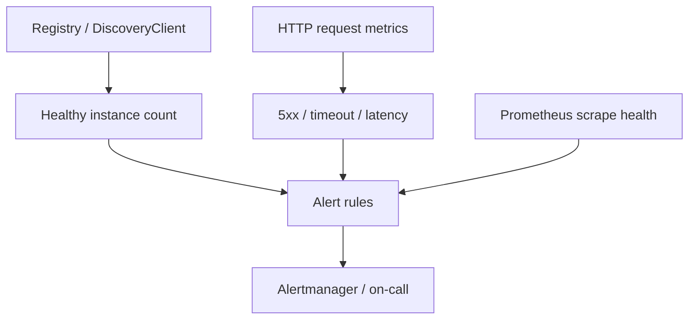

# Thiết kế cảnh báo mất toàn bộ instance và cảnh báo lỗi lan rộng

Một service có thể đã đăng ký trong Eureka hoặc Consul nhưng không còn instance nào đủ khỏe để nhận request. Cũng có trường hợp một vài instance vẫn hoạt động nhưng lỗi HTTP 5xx tăng đồng thời trên phần lớn replica, khiến service gần như không còn khả năng phục vụ. Nếu chỉ giám sát process hoặc số lượng Pod đang chạy, những tình huống này có thể bị phát hiện muộn.

Thiết kế cảnh báo cho Spring Cloud Service Discovery cần nhìn đồng thời vào ba lớp: **khả năng tìm thấy instance**, **sức khỏe của instance**, và **kết quả request thực tế**. Bài học này xây dựng metric contract, PromQL và alert rule cho hai tình huống chính: không còn instance khỏe và lỗi lan rộng trên nhiều instance hoặc toàn service. Nội dung cũng phân biệt lỗi ứng dụng với lỗi registry/telemetry, giảm cảnh báo giả và đưa ra runbook xử lý.

## 1. Hai tình huống cần cảnh báo

### 1.1. Không còn instance khỏe

Consumer truy vấn `order-service` nhưng registry không còn instance nào đạt điều kiện để nhận traffic. Nguyên nhân có thể là:

- Tất cả instance thực sự dừng hoặc bị crash.
- Readiness/health check thất bại trên toàn bộ replica.
- Registry không thể truy cập hoặc trả danh sách rỗng.
- Service đăng ký sai tên, sai địa chỉ hoặc bị lọc bởi `query-passing`/trạng thái `OUT_OF_SERVICE`.
- Network partition làm consumer không lấy được registry hoặc health state mới.

Đây thường là cảnh báo mức critical vì consumer có thể không có endpoint để gọi. Tuy nhiên, cần phân biệt **không có instance khỏe** với **không thu thập được dữ liệu discovery**. Nếu Prometheus hoặc discovery observer ngừng hoạt động, không được kết luận ngay rằng service đã mất toàn bộ instance.

### 1.2. Lỗi lan rộng

Một service vẫn có instance khỏe theo registry nhưng nhiều replica trả 5xx, timeout hoặc lỗi dependency. Ví dụ, 6/8 instance cùng lỗi database; hoặc tất cả instance trả 5xx sau một lần rollout. Registry có thể vẫn báo instance `passing` nếu health check chỉ xác nhận process hoặc endpoint health còn phản hồi.

Lỗi lan rộng cần được phát hiện bằng request metric và tỷ lệ instance bị ảnh hưởng, không chỉ bằng health check. Một instance lỗi đơn lẻ thường cần cảnh báo mức warning; lỗi xuất hiện trên phần lớn replica hoặc tỷ lệ lỗi toàn service vượt SLO cần page/on-call.



## 2. Xác định metric trước khi viết alert

Prometheus chỉ đánh giá được những tín hiệu đã được xuất ra. Không nên giả định Eureka, Consul hoặc Spring Cloud LoadBalancer tự động cung cấp mọi metric đếm instance khỏe với cùng tên ở mọi phiên bản. Hãy chuẩn hóa metric từ registry exporter, discovery observer hoặc instrumentation của ứng dụng.

Một metric contract hữu ích:

| Metric | Kiểu | Label gợi ý | Ý nghĩa |
| --- | --- | --- | --- |
| `service_discovery_registered_instances` | Gauge | `service`, `registry`, `cluster` | Số instance đã đăng ký, không nhất thiết khỏe. |
| `service_discovery_healthy_instances` | Gauge | `service`, `registry`, `cluster` | Số instance đang đạt điều kiện health/readiness mà consumer được phép chọn. |
| `service_discovery_min_healthy_instances` | Gauge | `service`, `registry`, `cluster` | Số instance khỏe tối thiểu mà service cần duy trì trong registry mà consumer sử dụng. |
| `service_discovery_lookup_failures_total` | Counter | `service`, `registry`, `reason` | Số lần truy vấn discovery thất bại hoặc không lấy được danh sách hợp lệ. |
| `app_http_requests_total` | Counter | `service`, `instance`, `status` | Số request HTTP đã xử lý, phân biệt status code. |
| `up` | Gauge do Prometheus tạo | `job`, `instance`, `service` | Target scrape có đang truy cập được hay không. |

Các metric `service_discovery_*` ở trên là **metric contract minh họa do hệ thống quan sát/exporter cung cấp**, không phải tên metric built-in được bảo đảm của mọi bản Spring Cloud. Có thể tạo chúng bằng Micrometer, exporter của registry hoặc một discovery observer định kỳ truy vấn Consul/Eureka.

Với `service_discovery_healthy_instances`, định nghĩa rõ “healthy” theo góc nhìn consumer:

- Consul: số entry có tất cả check liên quan `passing`, tương ứng với truy vấn Health API có `?passing` nếu consumer cũng lọc passing.
- Eureka: số instance có trạng thái được consumer chấp nhận, sau khi loại trạng thái không phục vụ như `OUT_OF_SERVICE` theo cấu hình.
- Kubernetes: số endpoint Ready trong EndpointSlice/Service, nếu Kubernetes là nguồn discovery.

Không trộn số instance trong Catalog với số instance có thể được chọn. Ví dụ Consul có thể vẫn giữ registration `critical` trong Catalog; metric healthy cần lấy từ health state, không chỉ đếm Catalog entries.

### 2.1. Metric phải phát ra giá trị 0

Khi không còn instance khỏe, exporter nên phát gauge `service_discovery_healthy_instances = 0` cho service đã biết. Nếu metric biến mất hoàn toàn khi giá trị bằng 0, PromQL có thể không phân biệt được zero với thiếu dữ liệu. Một cách thiết kế khác là giữ metric `service_discovery_min_healthy_instances` hoặc danh sách service mong đợi để phát hiện trường hợp không có series healthy.

Exporter cần tiếp tục phát danh sách service mong đợi ngay cả khi registry không trả instance. Nếu exporter dừng, Prometheus phải phát cảnh báo scrape/observer riêng để phân biệt lỗi thu thập với service mất instance.

### 2.2. Đếm instance khỏe không nên phụ thuộc vào một cache không rõ tuổi

Discovery observer cần ghi nhận thời điểm lấy dữ liệu thành công và độ trễ quan sát. Có thể bổ sung:

| Metric | Mục đích |
| --- | --- |
| `service_discovery_last_success_timestamp_seconds` | Thời điểm observer truy vấn registry thành công gần nhất. |
| `service_discovery_observer_errors_total` | Lỗi khi observer kết nối/đọc registry. |
| `service_discovery_registry_sync_lag_seconds` | Độ trễ giữa thay đổi nguồn và dữ liệu observer nhìn thấy, nếu đo được. |

Không tiếp tục công bố một giá trị healthy cũ như thể nó vừa được xác minh. Nếu observer không đọc được registry trong thời gian dài, cần đánh dấu dữ liệu stale hoặc ngừng cập nhật cùng cảnh báo observer down.

### 2.3. Xuất gauge bằng Micrometer

Nếu ứng dụng hoặc discovery observer tự tổng hợp số lượng instance, có thể xuất gauge qua Micrometer. Ví dụ sau minh họa một service/registry/cluster cố định; trong hệ thống nhiều service, hãy quản lý tập label có giới hạn và cập nhật từ observer đã truy vấn registry thành công.

```java
import java.util.concurrent.atomic.AtomicInteger;

import io.micrometer.core.instrument.Gauge;
import io.micrometer.core.instrument.MeterRegistry;
import org.springframework.stereotype.Component;

@Component
public class DiscoveryCountMetrics {

    private final AtomicInteger registered = new AtomicInteger();
    private final AtomicInteger healthy = new AtomicInteger();
    private final AtomicInteger minimumHealthy = new AtomicInteger(2);

    public DiscoveryCountMetrics(MeterRegistry registry) {
        Gauge.builder(
                "service.discovery.registered.instances",
                registered,
                AtomicInteger::get)
            .tag("service", "order-service")
            .tag("registry", "consul")
            .tag("cluster", "prod-a")
            .register(registry);

        Gauge.builder(
                "service.discovery.healthy.instances",
                healthy,
                AtomicInteger::get)
            .tag("service", "order-service")
            .tag("registry", "consul")
            .tag("cluster", "prod-a")
            .register(registry);

        Gauge.builder(
                "service.discovery.min.healthy.instances",
                minimumHealthy,
                AtomicInteger::get)
            .tag("service", "order-service")
            .tag("registry", "consul")
            .tag("cluster", "prod-a")
            .register(registry);
    }

    public void update(int registeredCount, int healthyCount) {
        registered.set(registeredCount);
        healthy.set(healthyCount); // Ghi 0 khi không có instance passing.
    }
}
```

Micrometer Prometheus registry thường chuẩn hóa dấu chấm trong tên meter thành dấu gạch dưới, tạo các metric như `service_discovery_healthy_instances`. Trong triển khai thực tế, `update` chỉ nên được gọi sau khi observer đọc được registry; nếu lần đọc thất bại, ghi nhận lỗi và thời điểm thành công cuối cùng thay vì giả định số healthy bằng 0. Giá trị minimum có thể đến từ cấu hình/SLO theo service. Không tạo label từ URL, Pod UID không cần thiết hoặc dữ liệu người dùng vì cardinality sẽ tăng nhanh.

## 3. Chuẩn hóa request metric từ Spring Boot

Spring Boot Actuator kết hợp Micrometer có thể xuất HTTP server request metric. Với Prometheus registry, timer `http.server.requests` thường được biểu diễn thành metric dạng `http_server_requests_seconds_count`, cùng các tag như `method`, `uri`, `status`, `outcome` và `exception`. Tên và tag thực tế phụ thuộc phiên bản, registry và cấu hình instrumentation.

Nếu cần PromQL dùng chung cho nhiều loại ứng dụng, có thể chuẩn hóa thành counter `app_http_requests_total` với label:

- `service`: tên service logic, ví dụ `order-service`.
- `instance`: định danh replica có giới hạn và ổn định trong vòng đời triển khai.
- `status`: mã HTTP, ví dụ `200`, `404`, `500`.

Không đưa URL đầy đủ, query string, user ID, request ID, trace ID hoặc exception message thành label metric. Các giá trị có cardinality cao làm tăng bộ nhớ và chi phí Prometheus. Dùng route template như `/orders/{id}` nếu cần phân tích theo endpoint.

Ví dụ cấu hình Actuator/Prometheus ở ứng dụng Spring Boot:

```xml
<dependency>
    <groupId>org.springframework.boot</groupId>
    <artifactId>spring-boot-starter-actuator</artifactId>
</dependency>
<dependency>
    <groupId>io.micrometer</groupId>
    <artifactId>micrometer-registry-prometheus</artifactId>
</dependency>
```

```yaml
management:
  endpoints:
    web:
      exposure:
        include: health,prometheus
  endpoint:
    health:
      show-details: never
```

Prometheus có thể scrape `/actuator/prometheus` theo cấu hình bảo mật của môi trường. Không expose endpoint metrics ra Internet công khai; giới hạn bằng network policy, authentication hoặc đường scrape nội bộ.

## 4. PromQL: phát hiện không còn instance khỏe

Giả sử metric contract đã có:

- `service_discovery_min_healthy_instances`: mức tối thiểu lớn hơn 0 cho service cần luôn sẵn sàng.
- `service_discovery_healthy_instances`: số instance khỏe hiện tại, phát ra cả khi bằng 0.

Hai gauge này cần có cùng bộ label định danh (`service`, `registry`, `cluster`). Nếu một service đồng thời được đăng ký ở nhiều registry, hãy đánh giá từng registry mà consumer thực sự dùng; không gộp healthy count từ registry này với minimum của registry khác.

### 4.1. Cảnh báo không còn instance khỏe

```promql
service_discovery_min_healthy_instances > 0
unless on (service, cluster, registry)
(service_discovery_healthy_instances > 0)
```

Biểu thức giữ lại những service có yêu cầu tối thiểu lớn hơn 0 nhưng không có series healthy nào lớn hơn 0. Nó bắt được cả gauge bằng 0 lẫn trường hợp series healthy bị thiếu, miễn là metric mức tối thiểu vẫn được scrape.

Ví dụ alert rule:

```yaml
groups:
  - name: service-discovery-availability
    rules:
      - alert: ServiceHasNoHealthyInstances
        expr: |
          service_discovery_min_healthy_instances > 0
          unless on (service, cluster, registry)
          (service_discovery_healthy_instances > 0)
        for: 2m
        labels:
          severity: critical
        annotations:
          summary: "Không còn instance khỏe cho {{ $labels.service }}"
          description: >-
            Service {{ $labels.service }} trong cluster {{ $labels.cluster }}
            không có instance nào đạt điều kiện nhận traffic trong ít nhất 2 phút.
          runbook_url: "https://runbooks.example/service-discovery/no-healthy-instances"
```

`for: 2m` giúp bỏ qua dao động rất ngắn trong lúc rollout hoặc cập nhật registry. Thời gian thực tế cần dựa trên health-check interval, scrape interval và mức độ nghiêm trọng của service. Với service thiết yếu, có thể dùng cửa sổ ngắn hơn nhưng cần tránh page do một lần scrape lỗi.

### 4.2. Cảnh báo thiếu capacity nhưng chưa mất toàn bộ instance

Một service có thể vẫn còn instance khỏe nhưng thấp hơn mức tối thiểu:

```promql
service_discovery_healthy_instances
  < on (service, cluster, registry)
service_discovery_min_healthy_instances
```

Đây là cảnh báo degraded capacity. Ví dụ service cần tối thiểu 3 instance nhưng hiện chỉ còn 1. Có thể đặt severity `warning` hoặc `critical` tùy mức dự phòng và tải.

Nếu muốn cảnh báo theo tỷ lệ instance healthy trên registered:

```promql
service_discovery_registered_instances > 0
and on (service, cluster, registry)
(
  service_discovery_healthy_instances
  / clamp_min(service_discovery_registered_instances, 1) < 0.5
)
```

Biểu thức này phát hiện tỷ lệ healthy thấp hơn 50% khi còn registration. Không dùng tỷ lệ thay cho cảnh báo zero healthy: service có 0/0 registration có thể không tạo series, còn service 0/5 healthy là tình trạng nghiêm trọng hơn.

### 4.3. Phân biệt observer/registry telemetry bị mất

Nếu Prometheus không scrape được discovery observer, dữ liệu healthy có thể biến mất. Tạo alert riêng:

```yaml
- alert: ServiceDiscoveryObserverDown
  expr: up{job="service-discovery-observer"} == 0
  for: 2m
  labels:
    severity: warning
  annotations:
    summary: "Không scrape được discovery observer"
    description: "Không thể xác minh số instance khỏe từ observer này."
```

Nếu target biến mất khỏi service discovery của Prometheus hoàn toàn, `up == 0` có thể không còn series. Khi đó có thể dùng `absent(up{job="service-discovery-observer"})` hoặc kiểm tra target inventory/monitoring pipeline. Cảnh báo mất telemetry cần độc lập với cảnh báo service mất instance.

## 5. PromQL: phát hiện lỗi 5xx lan rộng

Giả sử ứng dụng xuất counter:

```text
app_http_requests_total{service="order-service",instance="order-a",status="500"}
```

`status=~"5.."` chọn các mã 5xx. Tỷ lệ lỗi toàn service trong 5 phút:

```promql
sum by (service, cluster) (
  rate(app_http_requests_total{status=~"5.."}[5m])
)
/
clamp_min(
  sum by (service, cluster) (
    rate(app_http_requests_total[5m])
  ),
  0.001
)
```

Đây là tỷ lệ request 5xx trên tổng request, không phải tỷ lệ instance lỗi. Có thể cảnh báo khi tỷ lệ vượt 5% và lưu lượng đủ lớn:

```yaml
- alert: ServiceHighHttp5xxRate
  expr: |
    (
      sum by (service, cluster) (
        rate(app_http_requests_total{status=~"5.."}[5m])
      )
      /
      clamp_min(
        sum by (service, cluster) (rate(app_http_requests_total[5m])),
        0.001
      )
    ) > 0.05
    and on (service, cluster)
    sum by (service, cluster) (rate(app_http_requests_total[5m])) > 1
  for: 10m
  labels:
    severity: critical
  annotations:
    summary: "Tỷ lệ HTTP 5xx cao ở {{ $labels.service }}"
    description: "Tỷ lệ 5xx vượt 5% trong 10 phút với lưu lượng đủ lớn."
```

Điều kiện `> 1` yêu cầu có hơn khoảng một request/giây trong cửa sổ đo, giúp tránh tỷ lệ 100% từ một request đơn lẻ tạo page không cần thiết. Hãy điều chỉnh ngưỡng theo traffic thực tế và SLO.

### 5.1. Cảnh báo khi nhiều instance cùng lỗi

Tỷ lệ 5xx toàn service có thể bị chi phối bởi một instance có traffic cao. Để nhận diện lỗi lan rộng, tính tỷ lệ 5xx theo từng instance rồi đếm số instance vượt ngưỡng.

Recording rule:

```yaml
- record: service_instance:http_5xx_ratio:rate5m
  expr: |
    sum by (service, cluster, instance) (
      rate(app_http_requests_total{status=~"5.."}[5m])
    )
    /
    clamp_min(
      sum by (service, cluster, instance) (
        rate(app_http_requests_total[5m])
      ),
      0.001
    )
```

Alert rule đếm phần trăm instance đang scrape được có tỷ lệ 5xx lớn hơn 5%:

```yaml
- alert: ServiceErrorsAcrossManyInstances
  expr: |
    (
      count by (service, cluster) (
        service_instance:http_5xx_ratio:rate5m > 0.05
      )
      /
      on (service, cluster)
      count by (service, cluster) (
        up{job="spring-services"} == 1
      )
    ) > 0.5
    and on (service, cluster)
    sum by (service, cluster) (
      rate(app_http_requests_total[5m])
    ) > 1
  for: 10m
  labels:
    severity: critical
  annotations:
    summary: "Lỗi 5xx lan rộng trên {{ $labels.service }}"
    description: "Hơn một nửa instance đang scrape được có tỷ lệ 5xx trên 5%."
```

Biểu thức giả định target Prometheus của ứng dụng có label `service` và `cluster`, và mỗi instance có một target `up` tương ứng. Nếu một instance có nhiều scrape target, hãy chuẩn hóa/deduplicate danh sách trước khi dùng mẫu số. Instance không có request trong cửa sổ đo có thể không tạo series tỷ lệ; nếu service có traffic rất thấp, nên dùng tín hiệu khác hoặc tăng cửa sổ đo.

### 5.2. Phát hiện lỗi gọi dependency qua client metric

Service có thể vẫn trả 5xx vì dependency downstream lỗi. Ngoài server request metric, nên thu thập client request metric theo service đích, status và instance gọi. Ví dụ metric chuẩn hóa:

```text
app_http_client_requests_total{
  caller="order-service",
  dependency="payment-service",
  status="503"
}
```

Tỷ lệ lỗi gọi `payment-service` từ `order-service`:

```promql
sum by (caller, dependency) (
  rate(app_http_client_requests_total{status=~"5.."}[5m])
)
/
clamp_min(
  sum by (caller, dependency) (rate(app_http_client_requests_total[5m])),
  0.001
)
```

Metric này giúp phân biệt service tự lỗi với lỗi phụ thuộc. Cần chuẩn hóa instrumentation theo HTTP client thực tế (RestClient, RestTemplate, WebClient hoặc client khác); không giả định mọi client tự xuất cùng tên metric hoặc cùng tag.

## 6. Phân biệt lỗi instance, lỗi service và lỗi monitoring

Một cảnh báo tốt phải giúp người trực xác định phạm vi:

| Tín hiệu | Khả năng | Kiểm tra tiếp |
| --- | --- | --- |
| Một instance unhealthy, các instance khác khỏe | Lỗi cục bộ: process, node, config hoặc dependency cục bộ | Log/pod/host của instance đó, readiness và health check. |
| Healthy count bằng 0, registry query thất bại | Registry/network/ACL hoặc toàn bộ provider có thể đang lỗi | Truy vấn trực tiếp Eureka/Consul, kiểm tra observer và registry health. |
| Healthy count bằng 0, registry query thành công nhưng không có passing instance | Toàn bộ provider unhealthy, scale về 0 hoặc service ID sai | So sánh desired replicas, Catalog, health checks và rollout. |
| Nhiều instance cùng tăng 5xx | Lỗi lan rộng do release, config, dependency hoặc hạ tầng chung | So sánh thời điểm deploy, downstream metrics, database và network. |
| `up` của Prometheus giảm nhưng request metric chưa tăng lỗi | Scrape/network/metrics endpoint lỗi; chưa đủ bằng chứng service chết | Kiểm tra target, Actuator endpoint, auth và Prometheus. |
| Registry báo healthy nhưng request thất bại | Health check không phản ánh readiness thật, hoặc cache/stale endpoint | Kiểm tra nội dung health check, client timeout và request thực tế. |

Không dùng `up == 1` như bằng chứng duy nhất rằng service sẵn sàng. `up` chỉ cho biết Prometheus scrape target thành công. Tương tự, health check passing không bảo đảm mọi nghiệp vụ hoặc dependency đều hoạt động.

## 7. Cấu hình alert group hoàn chỉnh

Ví dụ rút gọn kết hợp các cảnh báo quan trọng. Các metric trong ví dụ phải được cung cấp và gắn label thống nhất như phần metric contract.

```yaml
groups:
  - name: service-discovery-and-availability
    rules:
      - alert: ServiceHasNoHealthyInstances
        expr: |
          service_discovery_min_healthy_instances > 0
          unless on (service, cluster, registry)
          (service_discovery_healthy_instances > 0)
        for: 2m
        labels:
          severity: critical
        annotations:
          summary: "Không còn instance khỏe: {{ $labels.service }}"
          runbook_url: "https://runbooks.example/service-discovery/no-healthy-instances"

      - alert: ServiceBelowMinimumHealthyInstances
        expr: |
          service_discovery_healthy_instances
          < on (service, cluster, registry)
          service_discovery_min_healthy_instances
        for: 5m
        labels:
          severity: warning
        annotations:
          summary: "Thiếu instance khỏe: {{ $labels.service }}"

      - alert: ServiceDiscoveryObserverDown
        expr: up{job="service-discovery-observer"} == 0
        for: 2m
        labels:
          severity: warning
        annotations:
          summary: "Discovery observer không scrape được"

      - alert: ServiceHighHttp5xxRate
        expr: |
          (
            sum by (service, cluster) (
              rate(app_http_requests_total{status=~"5.."}[5m])
            )
            /
            clamp_min(
              sum by (service, cluster) (rate(app_http_requests_total[5m])),
              0.001
            )
          ) > 0.05
          and on (service, cluster)
          sum by (service, cluster) (rate(app_http_requests_total[5m])) > 1
        for: 10m
        labels:
          severity: critical
        annotations:
          summary: "HTTP 5xx tăng cao: {{ $labels.service }}"

      - alert: ServiceErrorsAcrossManyInstances
        expr: |
          (
            count by (service, cluster) (
              service_instance:http_5xx_ratio:rate5m > 0.05
            )
            /
            on (service, cluster)
            count by (service, cluster) (
              up{job="spring-services"} == 1
            )
          ) > 0.5
          and on (service, cluster)
          sum by (service, cluster) (
            rate(app_http_requests_total[5m])
          ) > 1
        for: 10m
        labels:
          severity: critical
        annotations:
          summary: "5xx lan rộng: {{ $labels.service }}"
```

Trong file rule thực tế, recording rule `service_instance:http_5xx_ratio:rate5m` phải được khai báo trước rule dùng nó. Có thể đặt recording rule trong cùng group ở phía trên hoặc trong group được đánh giá trước. Kiểm tra cú pháp bằng `promtool check rules` trước khi nạp vào Prometheus.

## 8. Ngưỡng, thời gian và severity

Không có một ngưỡng đúng cho mọi service. Chọn threshold dựa trên SLO, lưu lượng, số replica tối thiểu, thời gian health check và khả năng phục hồi.

| Cảnh báo | Ví dụ điều kiện ban đầu | Severity gợi ý | Mục đích |
| --- | --- | --- | --- |
| Không còn instance khỏe | Healthy = 0 trong 1–2 phút khi min healthy > 0 | Critical/page | Service không có backend đủ điều kiện. |
| Dưới mức instance tối thiểu | Healthy < minimum trong 5 phút | Warning/page tùy service | Capacity dự phòng suy giảm. |
| 5xx toàn service | 5xx > 5% trong 10 phút, đủ traffic | Critical | Người dùng bị ảnh hưởng trên service. |
| 5xx trên nhiều instance | Hơn 50% instance có 5xx > 5% trong 10 phút | Critical | Lỗi lan rộng, có thể do nguyên nhân chung. |
| Một instance lỗi | 5xx/health check lỗi trên một replica | Warning | Điều tra cục bộ, trừ khi service chỉ có một replica. |
| Discovery observer down | Không scrape được observer trong 2 phút | Warning | Mất khả năng quan sát registry. |

Các con số trên chỉ là điểm khởi đầu. Với service ít traffic, tỷ lệ phần trăm có thể dao động mạnh; kết hợp số request tối thiểu, cửa sổ dài hơn hoặc lỗi tuyệt đối. Với service có SLO nghiêm ngặt, có thể dùng multi-window/multi-burn-rate alert thay vì một threshold 5xx cố định.

### 8.1. Dùng `for` để giảm nhiễu

`for` yêu cầu biểu thức tiếp tục đúng trong một khoảng thời gian trước khi alert chuyển sang firing. Chọn khoảng này đủ dài để bỏ qua thay đổi ngắn do rollout hoặc scrape jitter, nhưng ngắn hơn thời gian người dùng có thể chịu lỗi.

Không đặt `for` quá dài cho cảnh báo zero healthy nếu service không có đường fallback. Cũng không đặt `for: 0s` cho mọi cảnh báo tỷ lệ lỗi vì một burst rất ngắn có thể tạo page không cần thiết.

### 8.2. Xử lý bảo trì và scale-to-zero

Nếu service có thể chủ động scale về 0 hoặc được bảo trì theo lịch, metric `service_discovery_min_healthy_instances` phải phản ánh trạng thái mong đợi tại thời điểm đó. Có thể dùng maintenance window/silence có thời hạn trong Alertmanager, nhưng cần audit và tự hết hạn. Không tắt vĩnh viễn cảnh báo zero healthy để tránh nhiễu.

## 9. Alertmanager: nhóm, khử trùng và inhibition

Khi toàn bộ instance mất healthy, nhiều alert con có thể cùng firing: per-instance down, health check critical, request 5xx và service zero healthy. Alertmanager nên nhóm theo `service`, `registry`, `cluster` và môi trường để người trực nhận một thông báo có ngữ cảnh thay vì một alert cho mỗi Pod.

Ví dụ cấu hình ý tưởng:

```yaml
route:
  group_by: ["alertname", "service", "registry", "cluster"]
  group_wait: 30s
  group_interval: 5m
  repeat_interval: 2h
  receiver: on-call

inhibit_rules:
  - source_matchers:
      - alertname = "ServiceHasNoHealthyInstances"
    target_matchers:
      - alertname = "ServiceBelowMinimumHealthyInstances"
    equal: ["service", "registry", "cluster"]
```

Khi service không còn instance khỏe, alert zero healthy là nguyên nhân tổng quát và có thể inhibit cảnh báo thiếu capacity để tránh trùng thông báo. Không inhibit cảnh báo observer down hoặc registry cluster down nếu chúng cung cấp thông tin nguyên nhân độc lập.

Alertmanager silence nên có người sở hữu, lý do, ticket/change reference và thời điểm kết thúc. Silence chỉ ngăn thông báo; metric và alert vẫn nên được đánh giá để giữ lịch sử quan sát.

## 10. Runbook: không còn instance khỏe

Khi nhận `ServiceHasNoHealthyInstances`:

1. **Xác nhận telemetry:** kiểm tra Prometheus `up` của discovery observer và scrape target ứng dụng. Nếu observer down, xử lý monitoring trước; không kết luận registry rỗng từ metric stale.
2. **Kiểm tra registry trực tiếp:** với Consul, xem `/v1/health/service/{service}` và `/v1/health/checks/{service}`; với Eureka, kiểm tra application/instance status và peer; với Kubernetes, xem Service và EndpointSlice.
3. **So sánh registration và health:** phân biệt không có registration với có registration nhưng tất cả warning/critical/OUT_OF_SERVICE.
4. **Kiểm tra provider:** Pod/process còn chạy không, readiness/liveness, startup log, dependency và health endpoint.
5. **Kiểm tra network và quyền:** DNS, route, firewall, TLS, ACL token, Eureka authentication và network partition.
6. **Kiểm tra thay đổi gần nhất:** rollout, config change, scale event, certificate/token rotation hoặc thay đổi service name/instance ID.
7. **Khôi phục:** rollback release lỗi, khôi phục dependency, scale up instance hoặc sửa registry connectivity theo runbook của nền tảng.
8. **Xác minh phục hồi:** healthy count tăng, discovery query trả instance, consumer gọi thành công và error rate giảm.

Không xóa registration hàng loạt hoặc tắt self-preservation của Eureka chỉ để làm dashboard xanh. Trước tiên xác định instance chết thật hay heartbeat/registry bị gián đoạn.

## 11. Runbook: lỗi lan rộng trên nhiều instance

Khi nhận `ServiceHighHttp5xxRate` hoặc `ServiceErrorsAcrossManyInstances`:

1. Xác định service, cluster, tỷ lệ 5xx, lưu lượng và số instance bị ảnh hưởng.
2. So sánh thời điểm bắt đầu lỗi với deployment, config change, secret rotation hoặc thay đổi hạ tầng.
3. Kiểm tra lỗi theo status/route template; tránh dùng URL hoặc label có dữ liệu nhạy cảm.
4. Kiểm tra client request metric để tìm dependency trả 5xx hoặc timeout.
5. Kiểm tra database, message broker, DNS, network, connection pool, thread pool, GC và saturation.
6. Nếu lỗi bắt đầu ngay sau rollout, cân nhắc pause/rollback theo quy trình release.
7. Nếu dependency quá tải, giảm retry, dùng circuit breaker/bulkhead và khôi phục capacity; tránh retry storm.
8. Sau khi xử lý, xác nhận tỷ lệ lỗi giảm trên nhiều cửa sổ thời gian và không còn instance unhealthy.

Lỗi xuất hiện đồng thời trên nhiều instance thường gợi ý nguyên nhân chung như release, config, secret, dependency hoặc hạ tầng. Lỗi chỉ trên một instance thường gợi ý node/process/config cục bộ. Đây là hướng điều tra, không phải kết luận tuyệt đối.

## 12. Kiểm thử cảnh báo trước production

Không chờ sự cố thật để biết alert có hoạt động. Có thể kiểm thử trong staging:

- Dừng hoặc scale về 0 provider để xác nhận zero healthy alert firing.
- Làm readiness/Consul health check thất bại trên toàn bộ instance để xác nhận metric healthy giảm.
- Chỉ làm một instance lỗi để xác nhận cảnh báo partial degradation không bị nhầm thành zero healthy.
- Tạo response 5xx có kiểm soát trên một replica rồi nhiều replica để xác nhận alert lan rộng.
- Dừng discovery observer hoặc chặn scrape để xác nhận alert telemetry-down riêng biệt.
- Thực hiện rollout bình thường để kiểm tra `for`, Alertmanager grouping và silence không tạo page giả.
- Khôi phục provider và xác nhận alert resolved sau khi dữ liệu registry/metrics hội tụ.

Mỗi alert cần có owner, severity, dashboard link và runbook. Một cảnh báo không có hành động rõ ràng thường chỉ tạo nhiễu cho người trực.

## 13. Những lỗi thiết kế cảnh báo thường gặp

| Lỗi | Hậu quả | Cách sửa |
| --- | --- | --- |
| Chỉ cảnh báo `up == 0` | Process scrape được nhưng service không có instance đủ khỏe vẫn không bị phát hiện | Theo dõi healthy instance count và request outcome. |
| Đếm Catalog thay vì health state | Instance critical vẫn được tính là sẵn sàng | Dùng Consul Health API `?passing`, Eureka status hoặc Kubernetes Ready endpoint. |
| Không phát metric khi healthy = 0 | PromQL không có series để so sánh với zero | Xuất gauge zero hoặc dùng metric minimum/expected làm baseline và `unless`. |
| Không có alert observer down | Mất dữ liệu monitoring bị hiểu nhầm là service mất instance | Tạo alert scrape/observer độc lập. |
| Chỉ dùng tỷ lệ lỗi không kiểm tra traffic | Một request lỗi có thể tạo tỷ lệ 100% | Thêm ngưỡng request tối thiểu hoặc cửa sổ phù hợp. |
| Chỉ dùng tỷ lệ service tổng | Một replica lỗi nặng có thể bị traffic lớn làm lệch tỷ lệ hoặc bị che khuất | Theo dõi cả tỷ lệ toàn service và số instance bị ảnh hưởng. |
| Dùng label URL đầy đủ hoặc exception | Cardinality tăng mạnh, Prometheus tốn tài nguyên | Dùng service, instance, status và route template có giới hạn. |
| Không có `for` hoặc grouping | Alert chập chờn và bắn nhiều thông báo cho cùng sự cố | Dùng cửa sổ phù hợp, group theo service/cluster và inhibition. |
| Silence vô thời hạn | Sự cố thật bị che khuất | Silence có owner, lý do và thời điểm kết thúc. |

## 14. Ghi nhớ

- Zero healthy instance là tín hiệu availability critical; đo số instance consumer thực sự có thể chọn, không chỉ số registration.
- Cảnh báo lỗi lan rộng cần kết hợp tỷ lệ HTTP 5xx toàn service và tỷ lệ instance bị ảnh hưởng.
- Metric contract phải định nghĩa rõ nguồn dữ liệu, label và cách biểu diễn zero; các metric ví dụ trong bài là metric chuẩn hóa do hệ thống quan sát cung cấp.
- Tách cảnh báo service mất instance khỏi cảnh báo discovery observer/Prometheus mất telemetry.
- Dùng `for`, traffic threshold, severity, Alertmanager grouping và inhibition để giảm nhiễu nhưng không che mất sự cố gốc.
- Runbook cần kiểm tra registry, health check, request metric, dependency, network và thay đổi triển khai gần nhất.
- Kiểm thử alert trong staging với zero instance, partial failure, widespread 5xx và monitoring outage trước production.

## Tài liệu tham khảo

- [Prometheus: Alerting Rules](https://prometheus.io/docs/prometheus/latest/configuration/alerting_rules/)
- [Prometheus: Querying Basics](https://prometheus.io/docs/prometheus/latest/querying/basics/)
- [Prometheus: Instrumentation Practices](https://prometheus.io/docs/practices/instrumentation/)
- [Spring Boot: Actuator Metrics](https://docs.spring.io/spring-boot/reference/actuator/metrics.html)
- [Micrometer: Prometheus Registry](https://docs.micrometer.io/micrometer/reference/implementations/prometheus.html)
